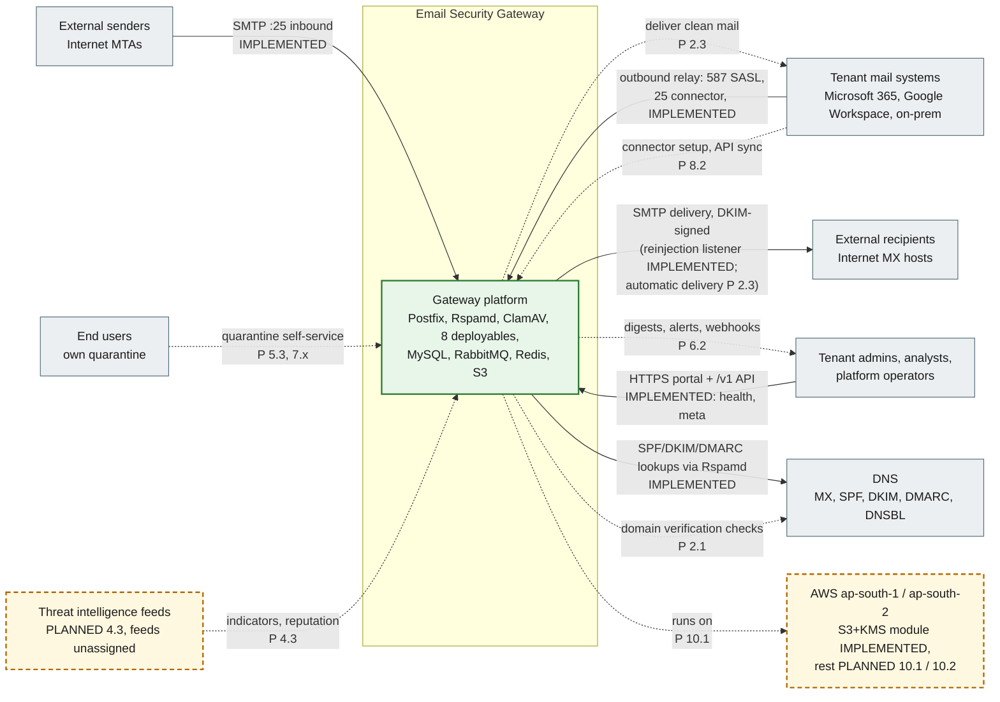

# 1. System context (C4 level 1)

The Email Security Gateway sits between the Internet and each tenant's mail system. It is the tenant's MX for inbound mail and the smart host for outbound mail. Admins and end users reach it only through the admin portal and the REST API.

**Legend.** Green solid box and solid arrow: IMPLEMENTED. Amber dashed box and dotted arrow: PLANNED, with the delivering step (`P x.y`). Grey box: external system we do not build.

## Status

| Element                         | Status                 | Evidence or delivering step                                                                                                                                   |
| ------------------------------- | ---------------------- | ------------------------------------------------------------------------------------------------------------------------------------------------------------- |
| Gateway platform (local stack)  | IMPLEMENTED            | `docker-compose.yml`; `tests/integration/*.test.ts`                                                                                                           |
| Inbound SMTP from senders       | IMPLEMENTED            | `infrastructure/postfix/*`; `mail-plane.test.ts`, `smtp-inbound.test.ts` (tenant relay domains, recipient validation, durable LMTP ingestion into S3 + MySQL) |
| Admin access over HTTPS         | IMPLEMENTED            | Portal dashboard and `/v1/meta`, `/health/*` (`services.test.ts`). Authentication is PLANNED 1.3                                                              |
| DNS lookups by Rspamd           | IMPLEMENTED            | Rspamd's SPF/DKIM/DMARC modules with `local.d/options.inc` DNS settings; `mail-plane.test.ts` scans a message                                                 |
| Delivery to tenant mail systems | PLANNED 2.3            | `delivery-worker` reinjection into outbound Postfix                                                                                                           |
| Outbound relay from tenants     | IMPLEMENTED            | `postfix-outbound` 587/25 with SMTP connectors (SASL, source IP, client certificate); `smtp-outbound.test.ts`                                                 |
| Delivery to external recipients | IMPLEMENTED (listener) | `postfix-outbound` 10027 with `rspamd-outbound` DKIM signing (`smtp-outbound.test.ts`); the delivery-worker that reinjects approved mail is PLANNED 2.3       |
| M365 / Google connectors        | PLANNED 8.2            | Connector configuration, validation and setup wizard                                                                                                          |
| End-user quarantine             | PLANNED 5.3            | Portal pages in 7.x                                                                                                                                           |
| Notifications and webhooks      | PLANNED 6.2            | `notification-worker`, `webhook_subscriptions`, `webhook_deliveries` (tables exist)                                                                           |
| Domain verification DNS checks  | PLANNED 2.1            | `domain_verifications`, `domain_dns_records` (tables exist)                                                                                                   |
| Threat intelligence feeds       | PLANNED                | `threat_indicators` and the reputation catalogs exist (step 1.1). Step 4.3 excludes external feeds; no execution-plan step ingests them yet                   |
| AWS hosting                     | PLANNED 10.1           | Only `infrastructure/terraform/modules/mail-storage` (S3 + KMS) exists and passes `terraform validate`; it has never been applied                             |
