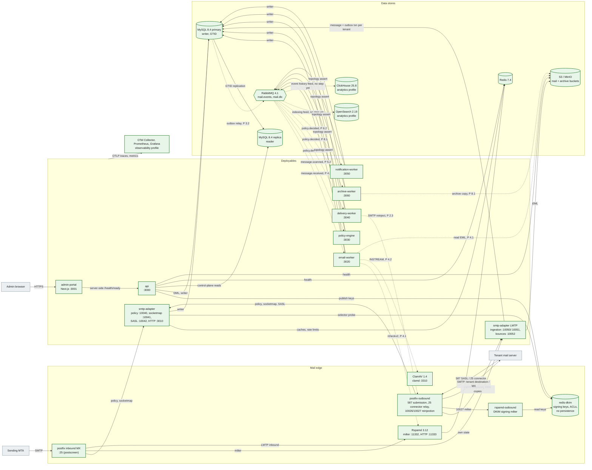

# 2. Container architecture (C4 level 2)

The deployables, the mail daemons and the data stores, with the arrows that carry mail, events and reads. The eight deployables are the seven NestJS apps in `apps/*` plus the Next.js `admin-portal`.

**Legend.** Green solid: IMPLEMENTED. Amber dashed and dotted arrows: PLANNED with the step. "Topology assert" means the worker declares its exchange, quorum queue and DLQ at startup; it does not consume yet.

## Status

| Element                                                | Status          | Evidence or delivering step                                                                                              |
| ------------------------------------------------------ | --------------- | ------------------------------------------------------------------------------------------------------------------------ |
| Postfix inbound, policy delegation, socketmap, milter  | IMPLEMENTED     | `infrastructure/postfix/*`; `mail-plane.test.ts`, `smtp-inbound.test.ts`, `smtp-relay-control.test.ts`                   |
| postfix-outbound (587, 25, 10026, 10027), SASL         | IMPLEMENTED     | `infrastructure/postfix-outbound/*`; `smtp-relay-control.test.ts`, `smtp-outbound.test.ts`                               |
| rspamd-outbound + redis-dkim (DKIM signing)            | IMPLEMENTED     | `infrastructure/rspamd-outbound/*`, `infrastructure/redis-dkim/*`; `smtp-outbound.test.ts` (signature verifies)          |
| Rspamd, ClamAV daemons                                 | IMPLEMENTED     | `mail-plane.test.ts` (`/checkv2` verdict, EICAR)                                                                         |
| 7 Nest deployables + admin-portal                      | IMPLEMENTED     | `apps/*/src/app.module.ts`, `app.module.test.ts` per app; `services.test.ts`. Shells only: health and topology           |
| MySQL primary + replica, GTID replication              | IMPLEMENTED     | `docker-compose.yml`; `replication.test.ts`                                                                              |
| `api` reads from the replica                           | IMPLEMENTED     | `PrismaReadService` (`prisma-read.service.test.ts`); no feature module reads from it yet                                 |
| RabbitMQ topology (exchanges, quorum queues, DLQs)     | IMPLEMENTED     | `packages/event-contracts/src/topology.ts`, `RabbitMqService.assertTopology`; `events.test.ts`, `rabbitmq-redis.test.ts` |
| Redis, MinIO                                           | IMPLEMENTED     | `rabbitmq-redis.test.ts` (auth, TTL), `storage.test.ts` (buckets, tenant-prefixed key, anonymous denied)                 |
| OpenSearch, ClickHouse containers                      | IMPLEMENTED     | Compose `analytics` profile, validated by `docker compose config` in CI. Not exercised by tests                          |
| Observability containers, OTLP export                  | IMPLEMENTED     | Compose `observability` profile, `packages/logger/src/tracing.ts`. Validated by `docker compose config`; no runtime test |
| LMTP ingestion, S3 write, ingestion transaction        | IMPLEMENTED     | `apps/smtp-adapter/src/{lmtp,ingestion}`; `smtp-inbound.test.ts`, `smtp-durability.test.ts`, `smtp-concurrency.test.ts`  |
| Bounce notices → bounce_events, suppressions           | IMPLEMENTED     | `apps/smtp-adapter/src/bounces`; `bounces.test.ts`, `smtp-outbound.test.ts`                                              |
| MIME parsing (headers, attachments rows)               | PLANNED 3.1     |                                                                                                                          |
| Outbox relay                                           | PLANNED 3.2     | `message_outbox` table exists                                                                                            |
| Consumers (email-worker, policy-engine, delivery, ...) | PLANNED 4.1–8.1 | Queues exist; no consumer code                                                                                           |
| OpenSearch and ClickHouse feeds                        | PLANNED         | ADR-0009. **No execution-plan step owns them yet** (reported as an open item)                                            |
