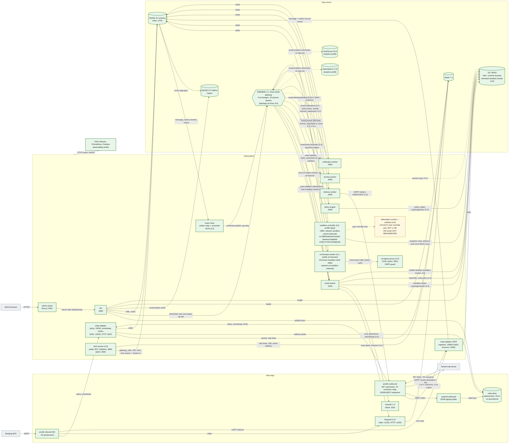

# 2. Container architecture (C4 level 2)

The deployables, the mail daemons and the data stores, with the arrows that carry mail, events and reads. The nine deployables are the eight NestJS apps in `apps/*` (step 3.2 added `event-relay`) plus the Next.js `admin-portal`.

**Legend.** Green solid: IMPLEMENTED. Amber dashed and dotted arrows: PLANNED with the step. Since step 3.2 no service declares broker objects: `rabbitmq-init` provisions the vhost from `infrastructure/rabbitmq/definitions.json`, services verify passively with their least-privilege role users, and policy-engine, archive-worker and notification-worker do not connect to RabbitMQ until their consumers exist. Step 4.6: the `sandbox-controller` runs in the `apps` profile on the internal `sandbox-control` network only (its port is not reachable from the host) with backend `disabled` — **execution of unknown files is disabled**; the detonation runners and the recording sinkhole exist only with the LOCAL/CI exec override (`infrastructure/sandbox/compose.exec.yml`; a shared-kernel container, **not a VM boundary**); a VM-class runner is not implemented. "Dormant" queues are declared and bound with no consumer (bounded `drop-head` buffers, [messaging topology](../messaging-topology.md)).

## Status

| Element                                               | Status                                                                                                                                                      | Evidence or delivering step                                                                                                                                      |
| ----------------------------------------------------- | ----------------------------------------------------------------------------------------------------------------------------------------------------------- | ---------------------------------------------------------------------------------------------------------------------------------------------------------------- |
| Postfix inbound, policy delegation, socketmap, milter | IMPLEMENTED                                                                                                                                                 | `infrastructure/postfix/*`; `mail-plane.test.ts`, `smtp-inbound.test.ts`, `smtp-relay-control.test.ts`                                                           |
| postfix-outbound (587, 25, 10026, 10027), SASL        | IMPLEMENTED                                                                                                                                                 | `infrastructure/postfix-outbound/*`; `smtp-relay-control.test.ts`, `smtp-outbound.test.ts`                                                                       |
| rspamd-outbound + redis-dkim (DKIM signing)           | IMPLEMENTED                                                                                                                                                 | `infrastructure/rspamd-outbound/*`, `infrastructure/redis-dkim/*`; `smtp-outbound.test.ts` (signature verifies)                                                  |
| Rspamd, ClamAV daemons                                | IMPLEMENTED                                                                                                                                                 | `mail-plane.test.ts` (`/checkv2` verdict, EICAR)                                                                                                                 |
| 8 Nest deployables + admin-portal                     | IMPLEMENTED                                                                                                                                                 | `apps/*/src/app.module.ts`, `app.module.test.ts` per app; `services.test.ts` (readiness checks per service)                                                      |
| MySQL primary + replica, GTID replication             | IMPLEMENTED                                                                                                                                                 | `docker-compose.yml`; `replication.test.ts`                                                                                                                      |
| `api` reads from the replica                          | IMPLEMENTED                                                                                                                                                 | `PrismaReadService` (`prisma-read.service.test.ts`); no feature module reads from it yet                                                                         |
| RabbitMQ topology v1 (vhost, 6 exchanges, 14 queues)  | IMPLEMENTED 3.2                                                                                                                                             | `packages/event-contracts/src/topology.ts`, `infrastructure/rabbitmq/{definitions.json,init.mjs}`; `messaging-topology.test.ts`, `messaging-permissions.test.ts` |
| Redis, MinIO                                          | IMPLEMENTED                                                                                                                                                 | `rabbitmq-redis.test.ts` (auth, TTL), `storage.test.ts` (buckets, tenant-prefixed key, anonymous denied)                                                         |
| OpenSearch, ClickHouse containers                     | IMPLEMENTED                                                                                                                                                 | Compose `analytics` profile, validated by `docker compose config` in CI. Not exercised by tests                                                                  |
| Observability containers, OTLP export                 | IMPLEMENTED                                                                                                                                                 | Compose `observability` profile, `packages/logger/src/tracing.ts`. Validated by `docker compose config`; no runtime test                                         |
| LMTP ingestion, S3 write, ingestion transaction       | IMPLEMENTED                                                                                                                                                 | `apps/smtp-adapter/src/{lmtp,ingestion}`; `smtp-inbound.test.ts`, `smtp-durability.test.ts`, `smtp-concurrency.test.ts`                                          |
| Bounce notices → bounce_events, suppressions          | IMPLEMENTED                                                                                                                                                 | `apps/smtp-adapter/src/bounces`; `bounces.test.ts`, `smtp-outbound.test.ts`                                                                                      |
| MIME parsing (headers, attachments rows)              | IMPLEMENTED                                                                                                                                                 | step 3.1: email-worker `MimeIngestionModule`, consuming `email.received` since 3.2; `mime-ingestion.test.ts`                                                     |
| event-relay (outbox relay, reconciler)                | IMPLEMENTED 3.2                                                                                                                                             | `apps/event-relay`; relay/reconciler integration suites, `services.test.ts`, `messaging-*.test.ts` stack suites                                                  |
| Consumers email-worker, delivery-worker               | IMPLEMENTED 3.2                                                                                                                                             | `QueueConsumer` on `email.received` / `email.delivery.pending`; worker integration suites, `messaging-*.test.ts`                                                 |
| Dead-letter view and replay (api)                     | IMPLEMENTED 3.2                                                                                                                                             | `apps/api/src/modules/dead-letters`; `dead-letters.test.ts`, `messaging-replay.test.ts`                                                                          |
| Scan consumers (rspamd, attachment, url)              | IMPLEMENTED 4.1–4.3                                                                                                                                         | email-worker scan role; `scan-*`, `attachment-*`, `url-*` stack suites                                                                                           |
| click-service, url-browser-worker, url-egress-proxy   | IMPLEMENTED 4.3                                                                                                                                             | `apps/click-service`, `apps/url-browser-worker`; click-service unit/e2e/integration, the browser container suite (profile `url-browser`), `url-smtp.test.ts`     |
| Consumers policy-engine, notification (5.2); archive  | IMPLEMENTED 5.2 (policy-engine on `email.policy.evaluate`, notification-worker on `email.notifications`: `policy-smtp.test.ts`); archive-worker PLANNED 8.1 | `email.archive` stays dormant until 8.1                                                                                                                          |
| OpenSearch and ClickHouse feeds                       | PLANNED                                                                                                                                                     | ADR-0009. **No execution-plan step owns them yet** (reported as an open item)                                                                                    |
