# 3. Component architecture

The Nest modules inside the mail-path deployables and the shared packages they are built from. Every app composes the same infrastructure modules from `@email-gateway/common`; business modules are added by later steps. Apps never import each other (ESLint), and data-plane apps cannot import `PrismaReadService` (ESLint rule plus a DI assertion in each `app.module.test.ts`).

```mermaid
flowchart TB
  classDef impl fill:#e8f5e9,stroke:#2e7d32,stroke-width:2px,color:#1b1b1b
  classDef planned fill:#fff8e1,stroke:#b26a00,stroke-width:2px,stroke-dasharray:6 4,color:#1b1b1b
  classDef ext fill:#eceff1,stroke:#546e7a,stroke-width:1px,color:#1b1b1b

  subgraph api["api"]
    apiInfra["CorrelationModule, HealthModule<br/>checks: mysql, mysql-reader, redis, s3"]:::impl
    apiDb["DatabaseModule with read<br/>PrismaService + PrismaReadService"]:::impl
    apiMeta["MetaModule<br/>GET /v1/meta"]:::impl
    apiTen["Tenants, settings, limits<br/>PLANNED 1.2"]:::planned
    apiIam["Auth, RBAC, sessions, API keys<br/>PLANNED 1.3"]:::planned
    apiDom["Domains, DNS, DKIM keys<br/>PLANNED 2.1"]:::planned
    apiPol["Policies, versions, dry-run<br/>PLANNED 5.2"]:::planned
    apiQ["Quarantine review and release<br/>PLANNED 5.3"]:::planned
    apiRep["Reports, search, audit<br/>PLANNED 6.1"]:::planned
    apiArc["Archive, legal hold, export<br/>PLANNED 8.1"]:::planned
    apiInt["M365 / Google connectors<br/>PLANNED 8.2"]:::planned
  end

  subgraph smtp["smtp-adapter"]
    polSrv["PolicyServerService<br/>TCP :10040, in-order replies,<br/>tempfail on error"]:::impl
    polProto["policy-protocol<br/>parser 16 KiB cap, formatResponse"]:::impl
    polDec["PolicyDecisionService<br/>contexts inbound, submission, relay,<br/>reinject-inbound, reinject-outbound"]:::impl
    tenRes["Tenancy: DomainPolicyService (Redis cache),<br/>RecipientValidator, TenantLimits,<br/>DomainCacheInvalidator (outbox tail)"]:::impl
    rate["FixedWindowLimiter (Lua),<br/>ReputationRecorder"]:::impl
    sockSrv["SocketmapServerService :10041<br/>relay_domain, transport, tls_policy,<br/>relay_client, relay_ccert"]:::impl
    sasl["SaslServerService :10042<br/>Dovecot auth protocol,<br/>ConnectorAuthService (Argon2id)"]:::impl
    conn["ConnectorResolver, Suppressions,<br/>DkimReadiness (redis-dkim probe)"]:::impl
    lmtpL["LMTP listeners :10050 / :10051<br/>(smtp-server, XFORWARD)"]:::impl
    ingest["IngestionService: S3 stream + copy,<br/>header scan, ingest key, loop guard,<br/>txn per organization, outbox"]:::impl
    bounce["BounceNoticeService :10052<br/>DSN parser, bounce_events,<br/>suppressions"]:::impl
    smtpInfra["DatabaseModule writer, RedisModule, S3Module,<br/>MetricsModule /metrics, HealthModule:<br/>mysql, redis, s3, 6 listeners"]:::impl
  end

  subgraph ew["email-worker"]
    ewInfra["DatabaseModule writer, AmqpModule (eg-email-worker),<br/>RedisModule, S3Module, HealthModule, MetricsModule"]:::impl
    ewMime["MimeIngestionModule (3.1; 3.2): QueueConsumer of email.received<br/>(prefetch = MIME_CONCURRENCY, hold retries),<br/>MimeIngestionService, S3 EML source + part sink,<br/>MimeRepository (writer), MimeMetrics"]:::impl
    pMime["mime-parser (3.1)<br/>streaming parse, limits, defects, headers,<br/>filenames, sniffer, zip inspector"]:::impl
    ewCons["Consumers of scan.auth, scan.spam,<br/>scan.url, scan.attachment, scan.dlp<br/>(queues dormant) PLANNED 4.x"]:::planned
    ewEng["Engine adapters: Rspamd 4.1,<br/>ClamAV + YARA 4.2, URL 4.3,<br/>BEC 4.4, DLP 4.5"]:::impl
    ewSbx["Sandbox engine (4.6, asynchronous):<br/>dispatcher, sample stager, results consumer,<br/>finalizer, sweeper (never changes the round)"]:::impl
    ewAgg["Verdict aggregation, risk score<br/>PLANNED 5.1"]:::planned
  end

  subgraph pe["policy-engine"]
    peInfra["DatabaseModule writer,<br/>RedisModule, HealthModule<br/>(no RabbitMQ until 5.x)"]:::impl
    peEval["Policy evaluator, execution logs<br/>PLANNED 5.2"]:::planned
    peQ["Quarantine writer<br/>PLANNED 5.3"]:::planned
  end

  subgraph dw["delivery-worker"]
    dwInfra["DatabaseModule writer, AmqpModule (eg-delivery-worker),<br/>RedisModule, S3Module,<br/>HealthModule: mysql, rabbitmq, redis, s3"]:::impl
    dwCons["DeliveryApprovalConsumer (3.2): QueueConsumer of<br/>email.delivery.pending, delay-queue retries,<br/>processOnce delivery-worker.planner"]:::impl
    dwRe["Planner, reinjection, rate limits,<br/>delivery-log status, reconciler (2.3)"]:::impl
    dwDev["DevPassThroughApprover<br/>outbox poller, local/CI only"]:::impl
  end

  subgraph er["event-relay (3.2)"]
    erRelay["OutboxRelay: advisory-lock shards,<br/>batch walk, confirmed publish, mark,<br/>row and broker backoff, lag"]:::impl
    erRec["OutboxReconciler: outbox health,<br/>unconsumed sweep vs ledgers,<br/>bounded re-drives"]:::impl
    erInfra["DatabaseModule writer, AmqpModule (eg-relay),<br/>MetricsModule, HealthModule: mysql, rabbitmq"]:::impl
  end

  subgraph sbc["sandbox-controller (4.6, own deployable)"]
    sbcCfg["Config: forbidden-key refusal (no DB, Redis,<br/>main S3, tokens, other broker users)"]:::impl
    sbcTask["TaskConsumer (scan.sandbox, eg-sandbox), TaskHandler<br/>state machine, ArtifactSealer (X25519), SandboxS3"]:::impl
    sbcBack["Backends: disabled (default), static (analyzer child),<br/>hardened-container (local/CI, NOT a VM), vm (refuses)"]:::impl
    sbcReap["ReaperService (startup + periodic), BackendHealth,<br/>ControllerMetrics"]:::impl
    sbcVm["VM-class runner<br/>NOT IMPLEMENTED"]:::planned
  end

  subgraph pkgs["Shared packages"]
    pConfig["config<br/>zod schemas, _FILE secrets"]:::impl
    pLogger["logger<br/>pino, context, OTel"]:::impl
    pCommon["common<br/>bootstrap, health, database, redis, s3, errors,<br/>outbox poller, advisory locks,<br/>messaging: AmqpConnection, ConfirmPublisher,<br/>QueueConsumer, content guard (3.2)"]:::impl
    pDb["database<br/>Prisma schema, processOnce, ids"]:::impl
    pEvents["event-contracts<br/>envelope, events, registry,<br/>topology v1, routing keys, definitions"]:::impl
    pSec["security-contracts<br/>SecurityEngine, EngineVerdict"]:::impl
    pSbx["sandbox (4.6)<br/>sealed sample/artifact envelopes, result MAC,<br/>analysis key, sandbox-map/1"]:::impl
    pTypes["shared-types<br/>health, enums"]:::impl
  end

  polSrv --> polProto
  polSrv --> polDec
  polDec --> tenRes
  polDec --> rate
  polDec --> conn
  sockSrv --> tenRes
  sockSrv --> conn
  sasl --> conn
  lmtpL --> ingest
  ingest -->|"outbox mail.message.received.v1"| erRelay
  erRelay -->|"email.received"| ewMime
  ewMime --> pMime
  ewMime -->|"outbox mail.message.parsed.v1"| erRelay
  erRelay -.->|"scan.* (dormant), P 4.x"| ewCons
  erRelay -->|"email.delivery.pending"| dwCons
  dwDev -->|"outbox mail.delivery.approved.v1"| erRelay
  dwCons --> dwRe
  erRec -->|"re-drive (published_at = NULL)"| erRelay
  ewCons -.-> ewEng
  ewEng -.-> ewAgg
  peEval -.-> peQ
  apiIam -.->|"guards every module"| apiTen
  apps2["All apps"]:::impl --> pCommon
  pCommon --> pConfig
  pCommon --> pLogger
  pCommon --> pDb
  pCommon --> pEvents
  pCommon --> pTypes
  ewEng -.-> pSec
  erRelay -->|"scan.sandbox.submissions, scan.sandbox.results (4.6)"| ewSbx
  ewSbx -->|"outbox task_requested.v1"| erRelay
  erRelay -->|"scan.sandbox (4.6)"| sbcTask
  sbcTask --> sbcBack
  sbcTask -->|"task_completed.v1 (confirms)"| ewSbx
  sbcBack -.-> sbcVm
  ewSbx --> pSbx
  sbcTask --> pSbx
  ingest -.-> pEvents
```

**Legend.** Green solid: IMPLEMENTED module or package. Amber dashed: PLANNED module with its step. `archive-worker` and `notification-worker` are shells (writer and health, plus S3 for the archive worker; no RabbitMQ since step 3.2); their business modules are PLANNED 8.1 and 6.2. Step 4.6: the email-worker's asynchronous sandbox engine and the separate `sandbox-controller` are IMPLEMENTED with execution of unknown files **disabled** (default backend `disabled`; `hardened-container` is a local/CI harness and not a VM boundary); the VM-class runner is PLANNED (the `vm` backend only refuses). Broker hops are drawn between components for readability: every one goes `message_outbox` → event-relay → exchange → queue → consumer (diagram [21](21-event-relay-sequence.md)).

## Status

| Component                                               | Status                 | Evidence or delivering step                                                                                                                                         |
| ------------------------------------------------------- | ---------------------- | ------------------------------------------------------------------------------------------------------------------------------------------------------------------- |
| Shared infrastructure modules (`packages/common`)       | IMPLEMENTED            | `health.service.test.ts`, `database.module.test.ts`, `prisma-read.service.test.ts`, `all-exceptions.filter.test.ts`                                                 |
| `api` health and meta                                   | IMPLEMENTED            | `apps/api/test/app.e2e.test.ts`, `services.test.ts`                                                                                                                 |
| Policy server, protocol, decision                       | IMPLEMENTED            | `policy-protocol.test.ts`, `policy-server.service.test.ts`, `mail-plane.test.ts`                                                                                    |
| Worker shells (DB writer, health)                       | IMPLEMENTED            | `apps/*/src/app.module.test.ts` (also assert `PrismaReadService` is not resolvable)                                                                                 |
| Messaging library (`packages/common/src/messaging`)     | IMPLEMENTED 3.2        | `connection/publisher/consumer/codec/content-guard/backoff.test.ts`; `messaging-client.test.ts`, `messaging-permissions.test.ts`                                    |
| event-relay relay and reconciler                        | IMPLEMENTED 3.2        | `apps/event-relay/src/**/*.test.ts`, `apps/event-relay/integration`, stack `messaging-*.test.ts`                                                                    |
| delivery-worker approval consumer, planner, reinjection | IMPLEMENTED (2.3, 3.2) | `apps/delivery-worker/src/**/*.test.ts`, `apps/delivery-worker/integration`, `routing-*.test.ts`                                                                    |
| `packages/database` (`processOnce`, `ids`)              | IMPLEMENTED            | `idempotency.test.ts`, `ids.test.ts`, `mysql.test.ts`                                                                                                               |
| `packages/event-contracts`                              | IMPLEMENTED            | `events.test.ts`                                                                                                                                                    |
| `packages/security-contracts`                           | IMPLEMENTED            | Types and zod schema only; no engine implements it yet                                                                                                              |
| email-worker `MimeIngestionModule`, `mime-parser`       | IMPLEMENTED            | step 3.1: `apps/email-worker/src/mime-ingestion/*.test.ts`, `apps/email-worker/integration`, `packages/mime-parser`, `tests/integration/mime-ingestion.test.ts`     |
| Shared outbox feed (`packages/common/src/outbox`)       | IMPLEMENTED            | `outbox-poller.test.ts`, `advisory-locks.test.ts`; since 3.2 only the dev pass-through polls (and event-relay uses the advisory locks); `ShardedOutboxFeed` removed |
| Business modules listed in the diagram                  | PLANNED                | Step numbers in the boxes                                                                                                                                           |
