# 3. Component architecture

The Nest modules inside the mail-path deployables and the shared packages they are built from. Every app composes the same infrastructure modules from `@email-gateway/common`; business modules are added by later steps. Apps never import each other (ESLint), and data-plane apps cannot import `PrismaReadService` (ESLint rule plus a DI assertion in each `app.module.test.ts`).

```mermaid
flowchart TB
  classDef impl fill:#e8f5e9,stroke:#2e7d32,stroke-width:2px,color:#1b1b1b
  classDef planned fill:#fff8e1,stroke:#b26a00,stroke-width:2px,stroke-dasharray:6 4,color:#1b1b1b
  classDef ext fill:#eceff1,stroke:#546e7a,stroke-width:1px,color:#1b1b1b

  subgraph api["api"]
    apiInfra["CorrelationModule, HealthModule<br/>checks: mysql, mysql-reader, redis, s3"]:::impl
    apiDb["DatabaseModule with read<br/>PrismaService + PrismaReadService"]:::impl
    apiMeta["MetaModule<br/>GET /v1/meta"]:::impl
    apiTen["Tenants, settings, limits<br/>PLANNED 1.2"]:::planned
    apiIam["Auth, RBAC, sessions, API keys<br/>PLANNED 1.3"]:::planned
    apiDom["Domains, DNS, DKIM keys<br/>PLANNED 2.1"]:::planned
    apiPol["Policies, versions, dry-run<br/>PLANNED 5.2"]:::planned
    apiQ["Quarantine review and release<br/>PLANNED 5.3"]:::planned
    apiRep["Reports, search, audit<br/>PLANNED 6.1"]:::planned
    apiArc["Archive, legal hold, export<br/>PLANNED 8.1"]:::planned
    apiInt["M365 / Google connectors<br/>PLANNED 8.2"]:::planned
  end

  subgraph smtp["smtp-adapter"]
    polSrv["PolicyServerService<br/>TCP :10040, in-order replies,<br/>tempfail on error"]:::impl
    polProto["policy-protocol<br/>parser 16 KiB cap, formatResponse"]:::impl
    polDec["PolicyDecisionService<br/>contexts inbound, submission, relay,<br/>reinject-inbound, reinject-outbound"]:::impl
    tenRes["Tenancy: DomainPolicyService (Redis cache),<br/>RecipientValidator, TenantLimits,<br/>DomainCacheInvalidator (outbox tail)"]:::impl
    rate["FixedWindowLimiter (Lua),<br/>ReputationRecorder"]:::impl
    sockSrv["SocketmapServerService :10041<br/>relay_domain, transport, tls_policy,<br/>relay_client, relay_ccert"]:::impl
    sasl["SaslServerService :10042<br/>Dovecot auth protocol,<br/>ConnectorAuthService (Argon2id)"]:::impl
    conn["ConnectorResolver, Suppressions,<br/>DkimReadiness (redis-dkim probe)"]:::impl
    lmtpL["LMTP listeners :10050 / :10051<br/>(smtp-server, XFORWARD)"]:::impl
    ingest["IngestionService: S3 stream + copy,<br/>header scan, ingest key, loop guard,<br/>txn per organization, outbox"]:::impl
    mime["MIME parsing, header and<br/>attachment rows PLANNED 3.1"]:::planned
    bounce["BounceNoticeService :10052<br/>DSN parser, bounce_events,<br/>suppressions"]:::impl
    smtpInfra["DatabaseModule writer, RedisModule, S3Module,<br/>MetricsModule /metrics, HealthModule:<br/>mysql, redis, s3, 6 listeners"]:::impl
  end

  subgraph ew["email-worker"]
    ewInfra["DatabaseModule writer, RabbitMqModule,<br/>RedisModule, S3Module, HealthModule"]:::impl
    ewCons["Consumer of<br/>email-worker.message-received<br/>PLANNED 4.1"]:::planned
    ewEng["Engine adapters: Rspamd 4.1,<br/>ClamAV + YARA 4.2, URL 4.3,<br/>BEC 4.4, DLP 4.5, sandbox 4.6"]:::planned
    ewAgg["Verdict aggregation, risk score<br/>PLANNED 5.1"]:::planned
  end

  subgraph pe["policy-engine"]
    peInfra["DatabaseModule writer, RabbitMqModule,<br/>RedisModule, HealthModule"]:::impl
    peEval["Policy evaluator, execution logs<br/>PLANNED 5.2"]:::planned
    peQ["Quarantine writer<br/>PLANNED 5.3"]:::planned
  end

  subgraph dw["delivery-worker"]
    dwInfra["DatabaseModule writer, RabbitMqModule,<br/>HealthModule: mysql, rabbitmq"]:::impl
    dwRe["SMTP reinjection, routes,<br/>DSN and bounce handling<br/>PLANNED 2.3"]:::planned
  end

  subgraph pkgs["Shared packages"]
    pConfig["config<br/>zod schemas, _FILE secrets"]:::impl
    pLogger["logger<br/>pino, context, OTel"]:::impl
    pCommon["common<br/>bootstrap, health, database,<br/>rabbitmq, redis, s3, errors"]:::impl
    pDb["database<br/>Prisma schema, processOnce, ids"]:::impl
    pEvents["event-contracts<br/>envelope, events, topology"]:::impl
    pSec["security-contracts<br/>SecurityEngine, EngineVerdict"]:::impl
    pTypes["shared-types<br/>health, enums"]:::impl
  end

  polSrv --> polProto
  polSrv --> polDec
  polDec --> tenRes
  polDec --> rate
  polDec --> conn
  sockSrv --> tenRes
  sockSrv --> conn
  sasl --> conn
  lmtpL --> ingest
  ingest -.->|"P 3.1"| mime
  ewCons -.-> ewEng
  ewEng -.-> ewAgg
  peEval -.-> peQ
  apiIam -.->|"guards every module"| apiTen
  apps2["All apps"]:::impl --> pCommon
  pCommon --> pConfig
  pCommon --> pLogger
  pCommon --> pDb
  pCommon --> pEvents
  pCommon --> pTypes
  ewEng -.-> pSec
  ingest -.-> pEvents
```

**Legend.** Green solid: IMPLEMENTED module or package. Amber dashed: PLANNED module with its step. `archive-worker` and `notification-worker` have the same shell as `delivery-worker` (writer, RabbitMQ, health, plus S3 for the archive worker); their business modules are PLANNED 8.1 and 6.2.

## Status

| Component                                         | Status      | Evidence or delivering step                                                                                         |
| ------------------------------------------------- | ----------- | ------------------------------------------------------------------------------------------------------------------- |
| Shared infrastructure modules (`packages/common`) | IMPLEMENTED | `health.service.test.ts`, `database.module.test.ts`, `prisma-read.service.test.ts`, `all-exceptions.filter.test.ts` |
| `api` health and meta                             | IMPLEMENTED | `apps/api/test/app.e2e.test.ts`, `services.test.ts`                                                                 |
| Policy server, protocol, decision                 | IMPLEMENTED | `policy-protocol.test.ts`, `policy-server.service.test.ts`, `mail-plane.test.ts`                                    |
| Worker shells (DB writer, RabbitMQ, health)       | IMPLEMENTED | `apps/*/src/app.module.test.ts` (also assert `PrismaReadService` is not resolvable)                                 |
| `packages/database` (`processOnce`, `ids`)        | IMPLEMENTED | `idempotency.test.ts`, `ids.test.ts`, `mysql.test.ts`                                                               |
| `packages/event-contracts`                        | IMPLEMENTED | `events.test.ts`                                                                                                    |
| `packages/security-contracts`                     | IMPLEMENTED | Types and zod schema only; no engine implements it yet                                                              |
| Business modules listed in the diagram            | PLANNED     | Step numbers in the boxes                                                                                           |
