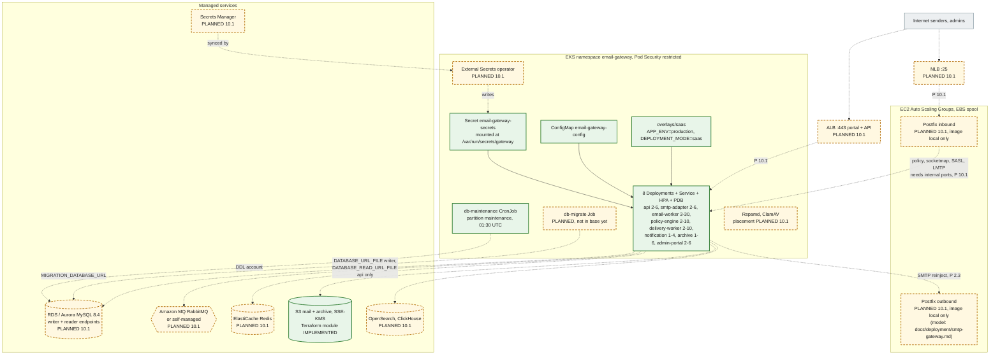

# 4. SaaS deployment

The shared multi-tenant deployment: one EKS cluster per environment rendered from `infrastructure/kubernetes/overlays/saas`, Postfix on EC2 Auto Scaling Groups, and managed AWS data stores. The Kubernetes manifests exist and render in CI. The cluster, the Postfix ASGs and every managed service except S3 are PLANNED for step 10.1.

**Legend.** Green solid: IMPLEMENTED (manifests that render with `kubectl kustomize` in CI, and the Terraform S3 module that passes `terraform validate`). Amber dashed: PLANNED.

## Status

| Element                                           | Status       | Evidence or delivering step                                                                                                                                                                                                                                                 |
| ------------------------------------------------- | ------------ | --------------------------------------------------------------------------------------------------------------------------------------------------------------------------------------------------------------------------------------------------------------------------- |
| Kustomize base: 8 Deployments, Services, HPA, PDB | IMPLEMENTED  | `infrastructure/kubernetes/base/*.yaml`; rendered by the CI `iac` job. Probes `/health/live` and `/health/ready`, zone spread, read-only root filesystem                                                                                                                    |
| `overlays/saas`                                   | IMPLEMENTED  | `infrastructure/kubernetes/overlays/saas/kustomization.yaml`                                                                                                                                                                                                                |
| Secret mount and `<KEY>_FILE` convention          | IMPLEMENTED  | `packages/config` (`load-config.test.ts`); manifests read `DATABASE_URL_FILE`, `DATABASE_READ_URL_FILE` (api only), `RABBITMQ_URL_FILE`, `REDIS_URL_FILE`                                                                                                                   |
| S3 buckets with SSE-KMS, versioning, TLS-only     | IMPLEMENTED  | `infrastructure/terraform/modules/mail-storage`; `terraform validate` in CI. Never applied                                                                                                                                                                                  |
| EKS cluster, NLB, ALB, Postfix ASGs               | PLANNED 10.1 | `infrastructure/terraform/README.md` lists the planned modules                                                                                                                                                                                                              |
| RDS/Aurora, Amazon MQ, ElastiCache, OpenSearch    | PLANNED 10.1 |                                                                                                                                                                                                                                                                             |
| External Secrets operator and Secrets Manager     | PLANNED 10.1 | ADR-0010                                                                                                                                                                                                                                                                    |
| Migration Job                                     | PLANNED      | `docs/deployment/README.md`: "not in base yet"                                                                                                                                                                                                                              |
| Partition maintenance CronJob                     | IMPLEMENTED  | `infrastructure/kubernetes/base/db-maintenance.yaml`, rendered by the CI Kustomize step; the job logic is covered by `partitions.test.ts` and the partitioning unit tests. Never applied to a cluster                                                                       |
| smtp-adapter mail ports on the Service            | PLANNED 10.1 | The `smtp-adapter` Service exposes only `http` (port 80 → 3010). Postfix on EC2 needs `:10040`–`:10042` and `:10050`–`:10052` through an internal NLB; Kubernetes manifests were out of scope in step 2.2 (design D18, [smtp-gateway.md](../../deployment/smtp-gateway.md)) |
| Rspamd and ClamAV placement in AWS                | PLANNED 10.1 | Not in the Kustomize base                                                                                                                                                                                                                                                   |
