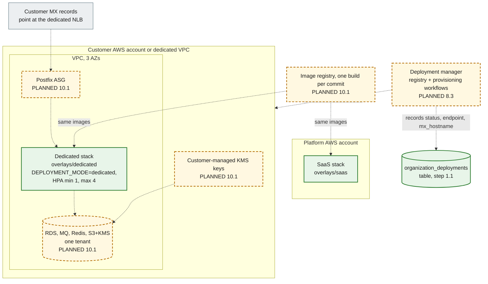

# 5. Dedicated deployment

A dedicated customer gets the **same images and the same code**, deployed into a customer-specific AWS account or VPC. The only differences are configuration (ADR-0012): the Kustomize overlay `overlays/dedicated`, Terraform variables and `DEPLOYMENT_MODE=dedicated`. No code path branches on deployment mode or on a tenant id.

**Legend.** Green solid: IMPLEMENTED (the overlay renders in CI; the `organization_deployments` table exists). Amber dashed: PLANNED.

## What differs between SaaS and dedicated

| Concern              | SaaS             | Dedicated                                                  | Where it is set                                          |
| -------------------- | ---------------- | ---------------------------------------------------------- | -------------------------------------------------------- |
| `DEPLOYMENT_MODE`    | `saas`           | `dedicated`                                                | Overlay `configMapGenerator`                             |
| Autoscaling          | Base HPA ranges  | `minReplicas: 1`, `maxReplicas: 4` for every HPA           | `overlays/dedicated/kustomization.yaml` (JSON patch)     |
| Tenants per stack    | Many             | One customer organization (plus the platform organization) | Data, not code                                           |
| AWS account / VPC    | Platform account | Customer account or dedicated VPC                          | Terraform variables (PLANNED 10.1)                       |
| Encryption keys      | Platform KMS key | Customer-managed KMS key                                   | Terraform `kms_key_arn` (the S3 module already takes it) |
| Schema, code, events | Identical        | Identical, `organization_id` still on every row            | ADR-0012, ADR-0014                                       |

## Status

| Element                                    | Status       | Evidence or delivering step                                                       |
| ------------------------------------------ | ------------ | --------------------------------------------------------------------------------- |
| `overlays/dedicated`                       | IMPLEMENTED  | `infrastructure/kubernetes/overlays/dedicated/kustomization.yaml`; rendered in CI |
| `organization_deployments` registry table  | IMPLEMENTED  | Step 1.1 schema (`schema.test.ts` asserts the 61 tables)                          |
| S3 module accepts a per-deployment KMS key | IMPLEMENTED  | `modules/mail-storage/variables.tf` (`kms_key_arn`)                               |
| Provisioning workflows, Helm/GitOps        | PLANNED 8.3  | Execution plan: "real provisioning needs AWS"                                     |
| Customer account/VPC, Postfix, data stores | PLANNED 10.1 |                                                                                   |
| Image registry and per-commit builds       | PLANNED 10.1 | `docs/deployment/README.md` release flow step 2                                   |
