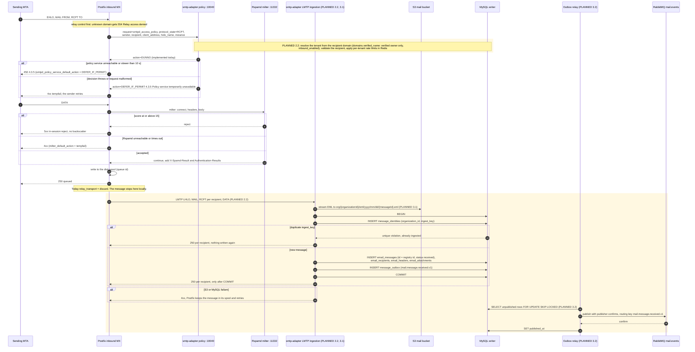

# 6. Inbound SMTP sequence

An Internet sender delivers mail for a tenant domain. In-session (pre-queue), only the `smtp-adapter` policy service and the Rspamd milter may reject or defer, and both **fail closed to 4xx** (ADR-0006). After Postfix has queued the message, ingestion stores it and commits the message and its outbox row in **one** MySQL transaction, and answers `250` only after the commit.

**Legend.** Plain messages: IMPLEMENTED. Messages inside the shaded (amber) blocks and participants marked `(PLANNED x.y)`: PLANNED. The policy request attributes come from Postfix ([SMTPD_POLICY_README](http://www.postfix.org/SMTPD_POLICY_README.html)); the adapter parses any `name=value` attribute today and uses none of them yet.

## Status

| Step in the sequence                                    | Status      | Evidence or delivering step                                                                                                                 |
| ------------------------------------------------------- | ----------- | ------------------------------------------------------------------------------------------------------------------------------------------- |
| Relay denial `554`                                      | IMPLEMENTED | `main.cf` `smtpd_relay_restrictions`; `mail-plane.test.ts` "refuses to relay"                                                               |
| Policy delegation, `DUNNO`                              | IMPLEMENTED | `policy-server.service.test.ts`; `mail-plane.test.ts` (250 when the adapter runs)                                                           |
| Fail closed when the policy service is down             | IMPLEMENTED | `mail-plane.test.ts` (4xx when the apps profile is stopped)                                                                                 |
| Tempfail when the decision throws or input is malformed | IMPLEMENTED | `policy-server.service.test.ts` ("tempfails (never accepts)"), `policy-protocol.test.ts`                                                    |
| Rspamd milter, `reject = 15`, `milter_default_action`   | IMPLEMENTED | `main.cf`, `local.d/actions.conf`. Configured, but no automated test drives a message through the milter; Rspamd itself is tested over HTTP |
| Disk spool, `250 queued`                                | IMPLEMENTED | Postfix with the `postfix-spool` volume. Locally the queued message is discarded                                                            |
| Tenant resolution, recipient validation, rate limits    | PLANNED 2.2 | `domains`, `domain_settings`, `organization_limits` tables exist                                                                            |
| LMTP handoff                                            | PLANNED 2.2 | `POSTFIX_RELAY_TRANSPORT=lmtp:inet:smtp-adapter:24` (comment in `infrastructure/postfix/entrypoint.sh`)                                     |
| S3 write, registry, single ingestion transaction        | PLANNED 3.1 | Tables `message_identities` (unique `(organization_id, ingest_key)`, tested in `schema.test.ts`), `email_*`, `message_outbox`               |
| Outbox relay with publisher confirms                    | PLANNED 3.2 | `RabbitMqService` opens a confirm channel today; no relay exists                                                                            |
