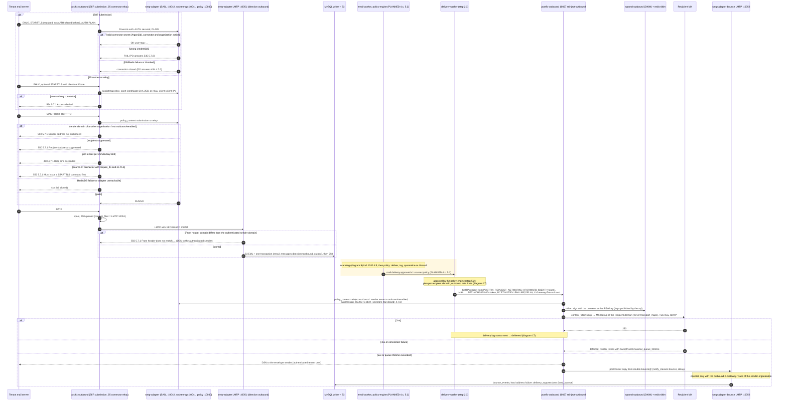

# 7. Outbound SMTP sequence

A tenant's mail system (Microsoft 365, Google Workspace or on-premises) relays outbound mail through the gateway. The gateway authenticates the **connection**, never a header: an organization-level **SMTP connector** authorizes it — SASL (`AUTH PLAIN/LOGIN` after STARTTLS on 587), a registered source network, or a pinned TLS client-certificate fingerprint (25). The envelope sender's domain must be an active domain of the **same** organization with `outbound_enabled`. The message is then ingested like inbound mail (`direction = outbound`), and later reinjected for delivery into `postfix-outbound` 10027, where `rspamd-outbound` DKIM-signs it and Postfix owns MX lookup, TLS, retries and DSNs (step 2.2, [design D9–D13](../../plan/steps/04-smtp-gateway.md), [ADR-0019](../adr/0019-smtp-gateway-topology.md), [ADR-0020](../adr/0020-dkim-signing.md)).

**There is no direct submission-to-Internet path.** Since step 2.3 the delivery-worker reinjects approved mail per recipient group ([diagram 17](17-outbound-routing-sequence.md): rate limits, 10027 via the recipient domain's MX, status from the delivery log; [diagram 19](19-retry-bounce-sequence.md): deferrals, bounces with DSN, expiry). Scanning (4.x/4.5) and policy (5.2) are planned; until they exist the only approval source is the **development-only pass-through** (local/CI).

**Legend.** Plain messages: IMPLEMENTED. Messages inside the shaded (amber) block and participants marked `(PLANNED x.y)`: PLANNED. Locally "the Internet" is `mail-sink`, reached through `dns-sink` MX records (profile `smtp-test`); `postfix-outbound` resolves nothing else.

## Status

| Step in the sequence                                          | Status                  | Evidence or delivering step                                                                                                                                                                |
| ------------------------------------------------------------- | ----------------------- | ------------------------------------------------------------------------------------------------------------------------------------------------------------------------------------------ |
| 587: STARTTLS required, AUTH only after STARTTLS, `530`/`535` | IMPLEMENTED             | `infrastructure/postfix-outbound/master.cf`; `smtp-relay-control.test.ts` suites 3, 4                                                                                                      |
| SASL against `smtp_connectors` (Argon2id), temp → `454`       | IMPLEMENTED             | `sasl-server.service.test.ts`, `apps/smtp-adapter/integration/sasl.test.ts`, `smtp-fail-closed.test.ts`                                                                                    |
| Source-IP and client-certificate connectors on 25             | IMPLEMENTED             | `socketmap-lookup.service.test.ts`, `smtp-outbound.test.ts` (cert fingerprint, smtp-tools /32, `require_tls`)                                                                              |
| Sender ownership, suppressions, per-tenant limits             | IMPLEMENTED             | `policy-decision.service.test.ts`, `smtp-outbound.test.ts` (`550 5.7.1`, `450 4.7.1`)                                                                                                      |
| Outbound ingestion (`direction = outbound`), From check       | IMPLEMENTED             | `ingestion.service.test.ts`, `smtp-outbound.test.ts` (stored; mismatch bounced)                                                                                                            |
| Connector API, recipient allow-lists                          | IMPLEMENTED             | `apps/api/integration/smtp-connectors.test.ts`, `tenant-isolation-smtp.test.ts`                                                                                                            |
| Reinject-outbound 10027 + DKIM signing                        | IMPLEMENTED             | `smtp-outbound.test.ts` (signature verified with mailauth against `domain_dkim_keys.public_key`), `dkim-signing-publisher.test.ts`                                                         |
| Reinject-inbound 10026 via transport and TLS maps             | IMPLEMENTED             | `smtp-outbound.test.ts` (tenant destination `mx.sink.test`, `required` → TLS)                                                                                                              |
| Bounce notices → `bounce_events`, `delivery_suppressions`     | IMPLEMENTED             | `bounces.test.ts`, `smtp-outbound.test.ts` (hard bounce from mail-sink; counted only with the outbound trace, §12.7)                                                                       |
| Connector types for M365 / Google                             | PLANNED 8.2             |                                                                                                                                                                                            |
| Outbound scanning and policy                                  | PLANNED 4.5, 5.2        | `organization_features` (`outbound_filtering`, `dlp`)                                                                                                                                      |
| delivery-worker reinjection, `email_deliveries` tracking      | IMPLEMENTED 2.3         | diagrams 17 and 19; `routing-mixed.test.ts`, `routing-bounces.test.ts`, `routing-rate-limit.test.ts`; [contracts.md §15](../contracts.md#15-reinjection-delivery-worker--postfix-outbound) |
| Approval by scanning and policy                               | IMPLEMENTED 4.1–5.2     | policy-engine approvals after the scan (`policy-smtp.test.ts`); the development-only pass-through was removed in 5.2                                                                       |
| Ed25519 dual signing, MTA-STS / DANE                          | PLANNED (not scheduled) | design §10                                                                                                                                                                                 |
