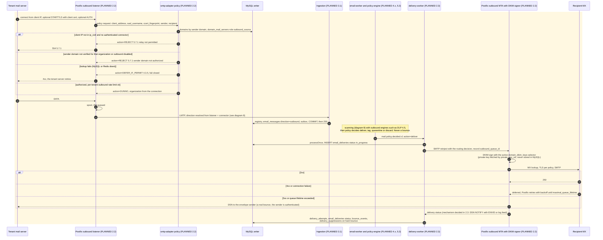

# 7. Outbound SMTP sequence

A tenant's mail system (Microsoft 365, Google Workspace or on-premises) relays outbound mail through the gateway. The gateway authenticates the **connection**, never a header: either the client IP is in the tenant's allow-list (`domain_mail_servers` rows with `role = outbound_source` and an `ip_cidr`) or the connector authenticates (SMTP AUTH or a TLS client certificate). The envelope sender's domain must be a verified domain of the **same** organization with `outbound_enabled`. The message is then ingested and scanned like inbound mail, DKIM-signed, and handed to an outbound Postfix that owns MX lookup, TLS, retries and DSNs.

**Everything in this sequence is PLANNED.** The tables it uses exist (step 1.1). Steps: listener and relay authentication 2.2, direction and routing 2.3, scanning 4.x (DLP 4.5), policy 5.2, delivery tracking 2.3, suppressions 6.x, connectors 8.2.

**Legend.** Every participant and message is PLANNED (shaded block). The DKIM signing component (Rspamd `dkim_signing` or a separate milter on the outbound Postfix) is chosen in step 2.2.

## Status

| Step in the sequence                           | Status           | Evidence or delivering step                                                                        |
| ---------------------------------------------- | ---------------- | -------------------------------------------------------------------------------------------------- |
| Outbound listener and relay authentication     | PLANNED 2.2      | `domain_mail_servers` (`role`, `ip_cidr`, `tls_mode`), `domains.outbound_enabled` exist (step 1.1) |
| Connector types for M365 / Google              | PLANNED 8.2      |                                                                                                    |
| Direction `outbound` from listener + connector | PLANNED 2.3      | `email_messages.direction` enum exists                                                             |
| Outbound scanning and policy                   | PLANNED 4.5, 5.2 | `organization_features` (`outbound_filtering`, `dlp`)                                              |
| DKIM signing                                   | PLANNED 2.2      | Key lifecycle in 2.1 (`domain_dkim_keys.private_key_ref`, `status`)                                |
| Outbound Postfix retries, backoff and DSNs     | PLANNED 2.2      | ADR-0006: no retry scheduler in Node                                                               |
| Delivery tracking, bounces, suppressions       | PLANNED 2.3, 6.x | `email_deliveries`, `delivery_attempts`, `bounce_events`, `delivery_suppressions` exist            |
| Outbound TLS policy (MTA-STS, DANE)            | PLANNED 2.2      | `docs/security/README.md` lists it for the delivery phase                                          |
