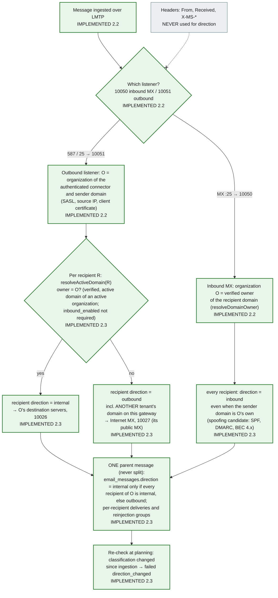

# 8. Internal email inspection and direction resolution

Internal mail is mail between two users of the **same** organization that the tenant routes through the gateway (for example a Microsoft 365 or Google Workspace outbound connector that sends internal mail out for inspection, then back in). Direction (`inbound`, `outbound` or `internal`) decides which policies, engines and routes apply, so it must not be spoofable.

**Direction is derived from the listener or connector the message arrived on and the organization's verified domains. It is never derived from headers** (`From`, `X-MS-Exchange-Organization-*`, `Received` or any other), because every header is sender-controlled. Implemented in step 2.3 by `classifyRecipient` in `@email-gateway/mail-routing` ([design R1](../../plan/steps/05-routing.md#r1-direction-resolution-one-routing-module), [ADR-0021](../adr/0021-mail-routing-and-delivery-status.md)): classified **per recipient at ingestion** (stored in `email_recipients.direction`) and **re-checked at planning**. The delivery itself is [diagram 18](18-internal-routing-sequence.md).

## Direction resolution



## Internal inspection sequence

```mermaid
sequenceDiagram
  autonumber
  participant U as Tenant mail system (connector)
  participant PO as postfix-outbound 587 / 25
  participant SA as smtp-adapter policy and LMTP ingestion 10051
  participant DB as MySQL writer
  participant EW as email-worker (PLANNED 4.x)
  participant PE as policy-engine (PLANNED 5.2)
  participant DW as delivery-worker
  participant PX as postfix-outbound 10026 reinject-inbound
  participant UD as Tenant inbound destination

  U->>PO: SMTP from the tenant connector (SASL, IP allow-list or TLS client cert)
  PO->>SA: policy request (sender ownership), then LMTP after queueing
  SA->>DB: per recipient classifyRecipient → email_recipients.direction;<br/>email_messages direction=internal if all internal; outbox; COMMIT
  SA-->>PO: 250 only after COMMIT
  rect rgb(255, 248, 225)
    Note over EW: only when organization_features internal_inspection is enabled,<br/>otherwise policy short-circuits to deliver
    EW->>DB: email_scans, scan_engine_results (malware, URL, DLP for lateral movement)
    PE->>DB: policies with direction internal or any; mail.delivery.approved.v1 (PLANNED 5.2)
  end
  Note over DW: today: development-only pass-through approval (local/CI)
  DW->>DB: plan: internal recipients per tenant domain (destination tenant:<domainId>),<br/>direction re-checked
  DW->>PX: reinject with token, XFORWARD, NOTIFY=FAILURE,DELAY, X-Gateway-Trace d=in
  PX->>UD: transport socketmap → next-hop list, tls_policy (verify for provider presets)
  UD-->>PX: 250 → delivered from the delivery log
```

**Legend.** Green / plain: IMPLEMENTED. Amber dashed boxes and the shaded block: PLANNED with the step. The grey "Headers" node is an external input that is deliberately **not** connected to the decision (the `-.-x` arrow). The earlier sketch of this diagram split mixed messages into one message per direction; step 2.3 decided against it (design §7: it duplicates S3 objects and message rows and breaks the one-record audit).

## Status

| Element                                                          | Status           | Evidence or delivering step                                                                                                     |
| ---------------------------------------------------------------- | ---------------- | ------------------------------------------------------------------------------------------------------------------------------- |
| "Never from headers" rule                                        | IMPLEMENTED      | `direction.test.ts` (classification uses listener + verified domains only), `packages/shared-types` (`MailDirection`), ADR-0012 |
| Per-recipient classification at ingestion, message `internal`    | IMPLEMENTED 2.3  | `ingestion.service.test.ts`, `apps/smtp-adapter/integration/ingestion.test.ts`, `routing-mixed.test.ts`                         |
| One parent message, per-recipient deliveries                     | IMPLEMENTED 2.3  | `route-plan.test.ts`, `planning.test.ts`, `routing-mixed.test.ts`                                                               |
| Other tenants through their public MX (no cross-tenant shortcut) | IMPLEMENTED 2.3  | `routing-mixed.test.ts`, [mail-routing.md](../../deployment/mail-routing.md) V1                                                 |
| Re-check at planning (`direction_changed`)                       | IMPLEMENTED 2.3  | `delivery-planner.test.ts`, `planning.test.ts`                                                                                  |
| Listeners and connector authentication                           | IMPLEMENTED 2.2  | `infrastructure/postfix-outbound/master.cf`, smtp-adapter connectors; `smtp-outbound.test.ts`                                   |
| Reinjection to the tenant's own servers, loop prevention         | IMPLEMENTED 2.3  | diagram 18; `routing-loops.test.ts`, `hops.test.ts`                                                                             |
| Internal inspection (engines, policies) and its feature flag     | PLANNED 4.x, 5.2 | `organization_features.feature_key = internal_inspection` (table exists)                                                        |
| Approval by policy                                               | PLANNED 5.2      | `deliveryApprovedV1` contract; dev pass-through today (local/CI only)                                                           |
| M365 / Google connector types (SMTP connector side)              | PLANNED 8.2      | destination presets exist (step 2.3)                                                                                            |
