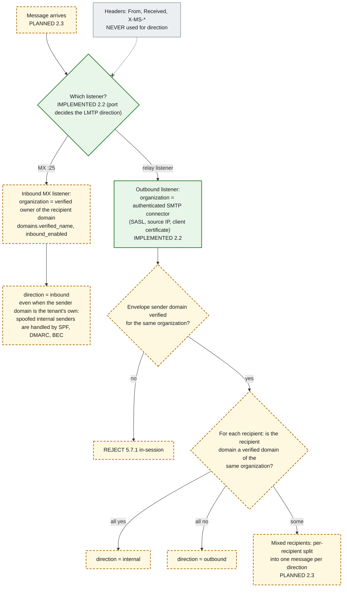
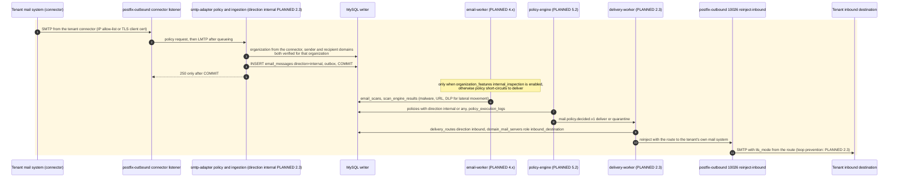

# 8. Internal email inspection and direction resolution

Internal mail is mail between two users of the **same** organization that the tenant routes through the gateway (for example a Microsoft 365 connector that sends internal mail out for inspection, then back in). Direction (`inbound`, `outbound` or `internal`) decides which policies, engines and routes apply, so it must not be spoofable.

**Direction is derived from the listener or connector the message arrived on and the organization's verified domains. It is never derived from headers** (`From`, `X-MS-Exchange-Organization-*`, `Received` or any other), because every header is sender-controlled. This rule is already stated in `packages/shared-types` (`MailDirection`) and the overview; its implementation is **PLANNED 2.3**.

## Direction resolution

## Internal inspection sequence

**Legend.** The listener decision and the connector authentication are IMPLEMENTED (step 2.2); everything else is PLANNED (amber dashed boxes, shaded sequence block). The grey "Headers" node is an external input that is deliberately **not** connected to the decision (the `-.-x` arrow).

## Status

| Element                                     | Status      | Evidence or delivering step                                                                                                                                                                          |
| ------------------------------------------- | ----------- | ---------------------------------------------------------------------------------------------------------------------------------------------------------------------------------------------------- |
| "Never from headers" rule                   | Documented  | `packages/shared-types` (`MailDirection` comment), overview, ADR-0012. No code resolves direction yet                                                                                                |
| Direction resolution, per-recipient split   | PLANNED 2.3 | `email_messages.direction`, `domains`, `domain_mail_servers` exist                                                                                                                                   |
| Listeners and connector authentication      | IMPLEMENTED | `infrastructure/postfix-outbound/master.cf`, smtp-adapter connectors; `smtp-outbound.test.ts`. Today such mail is ingested with `direction = outbound` (the listener's direction); `internal` is 2.3 |
| Reinjection to the tenant's own server      | IMPLEMENTED | 10026 + transport/TLS maps; `smtp-outbound.test.ts` ("reinject-inbound … transport and TLS maps")                                                                                                    |
| M365 / Google connector specifics           | PLANNED 8.2 |                                                                                                                                                                                                      |
| Internal-inspection feature flag            | PLANNED 1.2 | `organization_features.feature_key = internal_inspection` (table exists)                                                                                                                             |
| Routing back to the tenant, loop prevention | PLANNED 2.3 | `delivery_routes`, `domain_mail_servers` (`inbound_destination`) exist                                                                                                                               |
