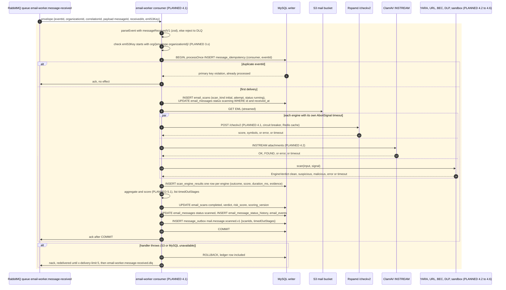

# 9. Email scanning sequence

`email-worker` consumes `mail.message.received.v1`, fans the message out to the security engines in parallel, records every engine result, and publishes `mail.message.scanned.v1`. Engines return `error` and `timeout` as **explicit outcomes**: an engine that fails is never treated as `clean`. Engines never choose the final action; the policy engine does (ADR-0007).

**Legend.** Plain participants are running daemons (IMPLEMENTED); everything the worker does is inside the shaded block and PLANNED. The `processOnce` ledger semantics used here are IMPLEMENTED and tested (`tests/integration/mysql.test.ts`).

## Status

| Element                                              | Status               | Evidence or delivering step                                                                                                                      |
| ---------------------------------------------------- | -------------------- | ------------------------------------------------------------------------------------------------------------------------------------------------ |
| Queue `email-worker.message-received` and its DLQ    | IMPLEMENTED          | `topology.ts`; asserted by `RabbitMqService` at email-worker startup; `events.test.ts`                                                           |
| Event schema `messageReceivedV1`, `messageScannedV1` | IMPLEMENTED          | `events.test.ts` (decimal ids, `org/{id}/` keys, `scanIds`)                                                                                      |
| `processOnce` on `message_idempotency`               | IMPLEMENTED          | `idempotency.test.ts`, `mysql.test.ts`                                                                                                           |
| Security engine contract                             | IMPLEMENTED          | `packages/security-contracts` (types and `engineVerdictSchema`)                                                                                  |
| Rspamd `/checkv2`, ClamAV `INSTREAM` daemons         | IMPLEMENTED          | `mail-plane.test.ts` (verdict, EICAR)                                                                                                            |
| `email_scans`, `scan_engine_results` tables          | IMPLEMENTED          | Step 1.1 schema, partitioned by `received_at` (`schema.test.ts`)                                                                                 |
| Consumer, engine adapters, aggregation               | PLANNED 4.1–4.6, 5.1 |                                                                                                                                                  |
| Key-prefix equality check against the envelope       | PLANNED 3.x          | The zod schema checks the **format** `org/{decimal}/` only, not that it equals the envelope's `organizationId`; consumers must add that check    |
| Pausing consumption during infrastructure outages    | PLANNED 3.2          | Without it, a MySQL or S3 outage burns the 5 redeliveries and moves healthy messages to the DLQ (see [failure handling](../failure-handling.md)) |

## Contract gaps to resolve in step 4.x

| Gap                                                                                                                                                    | Where                                              |
| ------------------------------------------------------------------------------------------------------------------------------------------------------ | -------------------------------------------------- |
| `scan_engine_results.outcome` allows `skipped`; `VerdictOutcome` in `security-contracts` does not                                                      | `packages/security-contracts/src/index.ts`, schema |
| `scan_engine_results.engine` names `sandbox` and `reputation`; `SecurityStage` has neither (it has `antispam, antivirus, yara, url, bec, dlp`)         | same                                               |
| `EngineVerdict.score` is 0–100; `email_messages.risk_score` and `email_scans.risk_score` are 0–1000 (the aggregated score). The mapping belongs to 5.1 | `security-contracts`, step 1.1 schema              |
