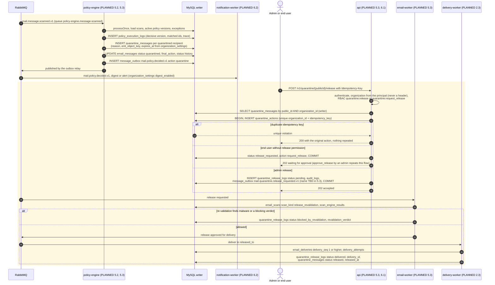

# 10. Quarantine and release sequence

`policy-engine` decides per recipient. A quarantine decision writes a `quarantine_messages` row (one per message and recipient) that points at the EML in S3. A release, by an admin or by an approved end-user request, goes through `api`, is recorded in `quarantine_actions` and `quarantine_release_logs`, and **re-validates** the message with a fresh scan before it is delivered. Nothing is bounced.

**Everything in this sequence is PLANNED** (policy 5.2, quarantine 5.3, REST conventions 6.1, authentication and RBAC 1.3, digests 6.2). The tables are IMPLEMENTED in step 1.1. The event types for release (`mail.quarantine.*`) do not exist in `packages/event-contracts` yet; their names are placeholders to be fixed in step 5.3.

**Legend.** Every message is PLANNED (shaded blocks). `actor` marks a human.

## Status

| Element                                                                | Status                | Evidence or delivering step                                                                                                                   |
| ---------------------------------------------------------------------- | --------------------- | --------------------------------------------------------------------------------------------------------------------------------------------- |
| `quarantine_messages`, `quarantine_actions`, `quarantine_release_logs` | IMPLEMENTED           | Step 1.1 schema. Not partitioned; unique `(message_id, recipient_id)` and `(organization_id, idempotency_key)`                                |
| `policy_execution_logs`                                                | IMPLEMENTED           | Partitioned table, step 1.1                                                                                                                   |
| Queue `policy-engine.message-scanned`, event `policyDecidedV1`         | IMPLEMENTED           | `topology.ts`, `events.test.ts`                                                                                                               |
| Policy evaluation and quarantine writes                                | PLANNED 5.2, 5.3      |                                                                                                                                               |
| Release endpoint, idempotency key, RBAC                                | PLANNED 5.3, 6.1, 1.3 | Permissions `quarantine:release`, `quarantine:request_release`, `quarantine:delete` are defined in the step 1.1 seed catalog (WP4, same wave) |
| Re-validation scan                                                     | PLANNED 5.3           | `email_scans.scan_kind = release_revalidation`                                                                                                |
| Release event types                                                    | PLANNED 5.3           | Not in `events.ts`                                                                                                                            |
| Digests and notifications                                              | PLANNED 6.2           |                                                                                                                                               |
| Quarantine expiry purge                                                | PLANNED 5.3           | By `quarantine_messages.expires_at` (indexed `(status, expires_at)`)                                                                          |
