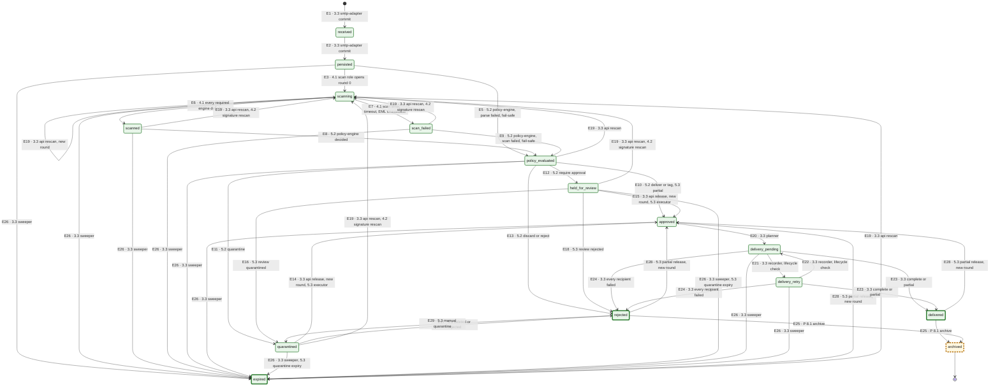

# 11. Message state machine

The fifteen lifecycle states of `email_messages.status` (step 3.3, [design L2–L4](../../plan/steps/08-message-lifecycle.md#l2-states-and-the-mapping-of-the-old-values), [ADR-0025](../adr/0025-message-lifecycle-state-machine.md)), in enum and rank order: `received`, `persisted`, `scanning`, `scanned`, `scan_failed`, `policy_evaluated`, `approved`, `quarantined`, `held_for_review`, `rejected`, `delivery_pending`, `delivery_retry`, `delivered`, `archived`, `expired`. The enum, the lifecycle columns and the history columns are IMPLEMENTED (migration `20261104130000_message_lifecycle`); the transition table is data in `@email-gateway/message-lifecycle` (`TRANSITIONS`, step 3.3 WP2), and every transition goes through its transition service (one door). Edges E1–E27 are the rows of that table. Step 4.1 ([design S15](../../plan/steps/09-rspamd.md#s15-development-pass-through-after-scanning), [ADR-0026](../adr/0026-security-scan-pipeline.md)) produces the scan edges E3, E6, E7 (email-worker scan role), adds **E27** `scanned → approved` for the development pass-through and **retires E4** (`persisted → approved`, the pass-through before scanning); the id E4 is never reused.

**Step 5.2 ([design](../../plan/steps/16-policy-engine.md), [ADR-0044](../adr/0044-policy-evaluation-placement-and-delivery-gating.md)):** the policy-engine produces E5 and E8–E13, so `policy_evaluated`, `quarantined` and `held_for_review` are reached by an implemented producer (green); **E27** (`scanned → approved`, the development pass-through of 4.1–5.1) is **retired** (the id is never reused; `dev_passthrough` remains only in history rows). The rest of the legend below describes the state before 5.2 where it says otherwise.

**Step 5.3 ([design Q5](../../plan/steps/17-quarantine.md#q5-lifecycle-mapping-recipient-state-vs-message-state-adr-0046-decision-3), [ADR-0046](../adr/0046-quarantine-store-and-per-recipient-decisions.md) decision 4, amends ADR-0025):** E10 accepts `policy_partial` (per-recipient split with at least one allowed recipient; the held recipients keep `email_recipients.status = quarantined` and an entry); E16–E18 are produced by the quarantine paths (role `quarantine`) when the last held entry of a message is quarantined from review, rejected or deleted; E26 also accepts the role `quarantine` with `quarantine_expired` (reason/role pairing: `deadline_exceeded` → `sweeper`, `quarantine_expired` → `quarantine`): the quarantine sweeper expires a held message whose last entries expired, never releasing it; **E28** `delivered | rejected | expired → approved` (role `quarantine`, `quarantine_partial_release`, new round) releases a held recipient after the rest of the message finished; **E29** `rejected → quarantined` (role `quarantine`, `manual_quarantine`, same round) is the manual quarantine of a policy-rejected message (the writer allows it only for `status_reason ∈ {policy_reject, policy_discard}`). E14/E15 are used by the 5.3 release executor (role `quarantine`); the api's operator release answers `409 quarantine_workflow_required` (Q30). E28 and E29 are explicit operator-caused re-entries: the final states stay final for automatic processing (a late automatic request from a final state still ends `stale` or `invalid`). The message state is the delivery-phase view; a recipient's fate is its `email_recipients.status` plus its quarantine entry.

**Legend.** Every state is an IMPLEMENTED enum value. Green states (solid border) are reached by a producer of step 3.3 or 4.1; amber states (dashed border) are reached only by producers of later steps (policy 5.2, quarantine 5.3, archive 8.1); `scanned` and `scan_failed` are green since the step 4.1 scan role. A thick border marks a final state (`delivered`, `rejected`, `archived`, `expired`). Every edge label starts with its id; `3.3` or `4.1` marks an edge whose producer is built in that step, `P x.y` an edge whose producer is PLANNED for step x.y. Approval in local/CI stacks: `persisted → scanning → scanned → approved` (E3, E6, E27); a `scan_failed` or parse-failed message is never approved by the pass-through. An edge produced in 3.3 and later also by another step says so (E14, E15: also the 5.3 quarantine workflow). `received` is never visible after the SMTP commit: E1 and E2 are written together in the commit transaction (the message is born `persisted`, version 1, with both history rows).

## Transition table (data, `TRANSITIONS`)

| Edge    | From                                                                                                  | To                 | Roles                | Reasons                                                               | New round                      | Producer                                                                                                          |
| ------- | ----------------------------------------------------------------------------------------------------- | ------------------ | -------------------- | --------------------------------------------------------------------- | ------------------------------ | ----------------------------------------------------------------------------------------------------------------- |
| E1      | (creation)                                                                                            | `received`         | ingestion            | `smtp_accepted`                                                       |                                | **3.3** smtp-adapter                                                                                              |
| E2      | `received`                                                                                            | `persisted`        | ingestion            | `committed`                                                           |                                | **3.3** smtp-adapter                                                                                              |
| E3      | `persisted`                                                                                           | `scanning`         | scanner              | `scan_started`                                                        |                                | **4.1** email-worker scan                                                                                         |
| ~~E4~~  | ~~`persisted`~~                                                                                       | ~~`approved`~~     | —                    | —                                                                     |                                | retired in 4.1 (3.3 dev pass-through before scanning)                                                             |
| E5      | `persisted`                                                                                           | `policy_evaluated` | policy               | `parse_failed_fail_safe`                                              |                                | 5.2                                                                                                               |
| E6      | `scanning`                                                                                            | `scanned`          | scanner              | `scan_complete`                                                       |                                | **4.1** email-worker scan                                                                                         |
| E7      | `scanning`                                                                                            | `scan_failed`      | scanner              | `scan_error`, `scan_timeout`, `eml_unavailable`                       |                                | **4.1** email-worker scan                                                                                         |
| E8      | `scanned`                                                                                             | `policy_evaluated` | policy               | `policy_decided`                                                      |                                | 5.2                                                                                                               |
| E9      | `scan_failed`                                                                                         | `policy_evaluated` | policy               | `scan_failed_fail_safe`                                               |                                | 5.2                                                                                                               |
| E10     | `policy_evaluated`                                                                                    | `approved`         | policy               | `policy_deliver`, `policy_tag`, `policy_partial` (5.3)                |                                | 5.2                                                                                                               |
| E11     | `policy_evaluated`                                                                                    | `quarantined`      | policy               | `policy_quarantine`                                                   |                                | 5.2                                                                                                               |
| E12     | `policy_evaluated`                                                                                    | `held_for_review`  | policy               | `policy_hold`                                                         |                                | 5.2                                                                                                               |
| E13     | `policy_evaluated`                                                                                    | `rejected`         | policy               | `policy_discard`, `policy_reject`                                     |                                | 5.2                                                                                                               |
| E14     | `quarantined`                                                                                         | `approved`         | operator, quarantine | `quarantine_release`                                                  | yes                            | **3.3** api; 5.3                                                                                                  |
| E15     | `held_for_review`                                                                                     | `approved`         | operator, quarantine | `review_release`                                                      | yes                            | **3.3** api; 5.3                                                                                                  |
| E16     | `held_for_review`                                                                                     | `quarantined`      | quarantine           | `review_quarantined`                                                  |                                | 5.3                                                                                                               |
| E17     | `quarantined`                                                                                         | `rejected`         | quarantine           | `quarantine_deleted`                                                  |                                | 5.3                                                                                                               |
| E18     | `held_for_review`                                                                                     | `rejected`         | quarantine           | `review_rejected`                                                     |                                | 5.3                                                                                                               |
| E19     | `scanning`, `scanned`, `scan_failed`, `policy_evaluated`, `quarantined`, `held_for_review`, `expired` | `scanning`         | operator, scanner    | `admin_rescan` (operator), `signature_rescan` (scanner only)          | yes                            | **3.3** api; **4.2** email-worker rescan runner (`attachment_rescan_jobs`: signature updates, admin bulk rescans) |
| E20     | `approved`                                                                                            | `delivery_pending` | delivery             | `delivery_planned`                                                    |                                | **3.3** delivery-worker                                                                                           |
| E21     | `delivery_pending`                                                                                    | `delivery_retry`   | delivery, recovery   | `delivery_deferred`                                                   |                                | **3.3** recorder; event-relay                                                                                     |
| E22     | `delivery_retry`                                                                                      | `delivery_pending` | delivery, recovery   | `delivery_requeued`                                                   |                                | **3.3** recorder; event-relay                                                                                     |
| E23     | `delivery_pending`, `delivery_retry`                                                                  | `delivered`        | delivery, recovery   | `delivery_complete`, `delivery_partial`                               |                                | **3.3** recorder; event-relay                                                                                     |
| E24     | `delivery_pending`, `delivery_retry`                                                                  | `rejected`         | delivery, recovery   | `delivery_failed`                                                     |                                | **3.3** recorder; event-relay                                                                                     |
| E25     | `delivered`, `rejected`                                                                               | `archived`         | archive              | `archived`                                                            |                                | 8.1                                                                                                               |
| E26     | every `EXPIRABLE_STATES` member                                                                       | `expired`          | sweeper, quarantine  | `deadline_exceeded` (sweeper), `quarantine_expired` (quarantine, 5.3) |                                | **3.3** event-relay                                                                                               |
| ~~E27~~ | ~~`scanned`~~                                                                                         | ~~`approved`~~     | —                    | —                                                                     | retired in step 5.2 (ADR-0044) |
| E28     | `delivered`, `rejected`, `expired`                                                                    | `approved`         | quarantine           | `quarantine_partial_release`                                          | yes                            | 5.3 policy-engine release executor                                                                                |
| E29     | `rejected`                                                                                            | `quarantined`      | quarantine           | `manual_quarantine`                                                   |                                | 5.3 api manual quarantine                                                                                         |

`EXPIRABLE_STATES` = `persisted`, `scanning`, `scanned`, `scan_failed`, `policy_evaluated`, `approved`, `quarantined`, `held_for_review`, `delivery_pending`, `delivery_retry`. No edge leaves `archived`; `expired` is left only by E19 and E28; `delivered` only by E25 and E28; `rejected` only by E25, E28 and E29 (E28 and E29 belong to the quarantine role, step 5.3). The reason `lifecycle_backfill` exists only in migrated history rows and is never accepted by the service.

## Ordering rule (design L4)

`decideTransition(current, request)` decides every request under the message row lock, in this order (the transition-key duplicate check runs first, in the database):

1. **Round.** `expectedRound` older than the message's `lifecycle_round` → `stale/older_round`; newer → `invalid/future_round`.
2. **Version.** `expectedVersion` given and different → `stale/version_mismatch` (the api's `expectedVersion`, the sweeper's read version).
3. **Expected source.** Current state not in `expectedFrom` → `invalid/unexpected_from`, unless the message is already in the target state by a non-round edge → `duplicate/same_state`.
4. **Same state** without a new-round edge → `duplicate/same_state`.
5. **No edge** from the current state to the target: current state final → `stale/final_state`; target rank ≤ current rank → `stale/overtaken` (a late or duplicate event); otherwise → `invalid/edge_not_allowed` (a skipped stage: a bug).
6. **Edge found:** wrong role → `invalid/actor_not_allowed`; wrong reason → `invalid/reason_not_allowed`; a reason the edge pairs with other roles only (`reasonRoles`: E19 since 4.2, E26 since 5.3) → `invalid/reason_not_allowed`.
7. **Apply:** `version + 1`, `lifecycle_round + 1` on a new-round edge (E14, E15, E19, E28).

Occurrence times (`occurred_at`) are recorded but never compared (different clocks). Delivery states (E21–E24) are not ordered by events at all: they are re-derived from the recipient statuses under the message lock ([diagram 22](22-delivery-lifecycle.md)), so an older signal cannot overwrite a newer state.

## Mapping of the step 1.1 values (migration `message_lifecycle`)

| Old value                                                | New state          | `status_reason`      | Version / history                                                                              |
| -------------------------------------------------------- | ------------------ | -------------------- | ---------------------------------------------------------------------------------------------- |
| `received`                                               | `persisted`        | `lifecycle_backfill` | `version + 1`; history `NULL → received` (version 0) and `received → persisted`, both backfill |
| `scanning`, `scanned`, `policy_evaluated`, `quarantined` | same name          | unchanged            | none                                                                                           |
| `delivery_queued`                                        | `delivery_pending` | `delivery_planned`   | in-place rename                                                                                |
| `delivered`                                              | `delivered`        | `delivery_complete`  | none                                                                                           |
| `partially_delivered`                                    | `delivered`        | `delivery_partial`   | in-place rename                                                                                |
| `failed`                                                 | `rejected`         | `delivery_failed`    | in-place rename                                                                                |
| `discarded`                                              | `rejected`         | `discarded`          | in-place rename                                                                                |

History rows are renamed with the same mapping, keep their versions and get `actor_role = actor_service = 'legacy'`; every message without a version-0 row got one `NULL → received` row. Legacy rows may contain pairs the table does not allow (`received → delivery_pending`): they are history, not decisions.

## Rules every transition keeps

| Rule                                                                                                                                                                                      | Source                  |
| ----------------------------------------------------------------------------------------------------------------------------------------------------------------------------------------- | ----------------------- |
| One door: only `@email-gateway/message-lifecycle` writes `status`, `status_changed_at`, `version`, `lifecycle_round`, `status_reason` and history rows                                    | Design §2.0, L5.9       |
| Atomic with the cause: the transition, its history row, `email_events` row and `mail.message.state_changed.v1` outbox row commit in the producer's transaction                            | Design §2.0, L5.1       |
| Lock, then compare-and-set: `SELECT … FOR UPDATE` on the message row, `UPDATE … WHERE version = ?` as the backstop                                                                        | Design L5.1, L5.4       |
| Idempotent by key: the same `transitionKey` leaves one history row (unique `(message_id, transition_key, received_at)`)                                                                   | Design L5.3             |
| No transition after `received` produces an NDR to the sender; post-queue outcomes are deliver, tag, quarantine or discard (`rejected`)                                                    | ADR-0006                |
| Partial and failed deliveries are reasons, not states: `delivered/delivery_partial`, `rejected/delivery_failed`; per-recipient outcomes stay in `email_recipients` and `email_deliveries` | ADR-0025, design L2, L9 |
| A message stuck past its state's deadline is expired by the event-relay sweeper (E26); a lost delivery derivation is repaired by the lifecycle check (E21–E24, role `recovery`)           | Design L13, L14         |

## Status

| Element                                                                                               | Status                | Evidence or delivering step                                                                                                           |
| ----------------------------------------------------------------------------------------------------- | --------------------- | ------------------------------------------------------------------------------------------------------------------------------------- |
| The fifteen-value enum, `lifecycle_round`, `status_reason`, history actor and key columns, unique key | IMPLEMENTED (3.3 WP1) | Migration `20261104130000_message_lifecycle`; `tests/integration/schema.test.ts`                                                      |
| `MESSAGE_STATES`, `ACTOR_ROLES`, `mail.message.state_changed.v1`, `mail.message.rescan_requested.v1`  | IMPLEMENTED (3.3 WP1) | `packages/event-contracts`, `events.test.ts`, `registry.test.ts`                                                                      |
| Transition table, `decideTransition`, transition service, expiry sweeper, lifecycle check             | IMPLEMENTED (3.3)     | `packages/message-lifecycle`, `apps/event-relay/src/lifecycle`, `lifecycle-event-relay`                                               |
| Producers of E1, E2, E20–E24                                                                          | IMPLEMENTED (3.3)     | smtp-adapter, delivery-worker, `@email-gateway/mail-routing`; stack `routing-*`                                                       |
| Producers of E3, E6, E7 (scan role) and E27 (dev pass-through, retired in 5.2); E4 retired            | IMPLEMENTED (4.1)     | `apps/email-worker/src/scanning`, `apps/delivery-worker/src/approvals`; stack `scan-*`, `routing-inbound` path                        |
| Producers of E14, E15, E19 (api)                                                                      | IMPLEMENTED (3.3)     | `apps/api/src/modules/messages`; stack `lifecycle-release`, `lifecycle-rescan`                                                        |
| Producer of E19 as `scanner` / `signature_rescan` (rescan runner, ADR-0028 amends ADR-0025)           | IMPLEMENTED (4.2)     | `apps/email-worker/src/scanning/engines/attachment/rescan-runner.ts`; email-worker `attachment-rescan`, stack `attachment-resilience` |
| Producers of E5, E8–E13 (policy-engine)                                                               | IMPLEMENTED (5.2)     | `apps/policy-engine`; stack `policy-smtp`                                                                                             |
| Edges E28, E29, E10 `policy_partial`, E26 role `quarantine` (table and decision)                      | IMPLEMENTED (5.3 WP1) | `packages/message-lifecycle` (`transitions.test.ts`, `decide.test.ts`, `ordering.test.ts`)                                            |
| Producers of E14–E18, E26 (`quarantine_expired`), E28, E29 (quarantine paths)                         | PLANNED 5.3 (WP3/WP4) | policy-engine `quarantine` role and api `quarantine` module                                                                           |
| Producer of E25                                                                                       | PLANNED 8.1           |                                                                                                                                       |
