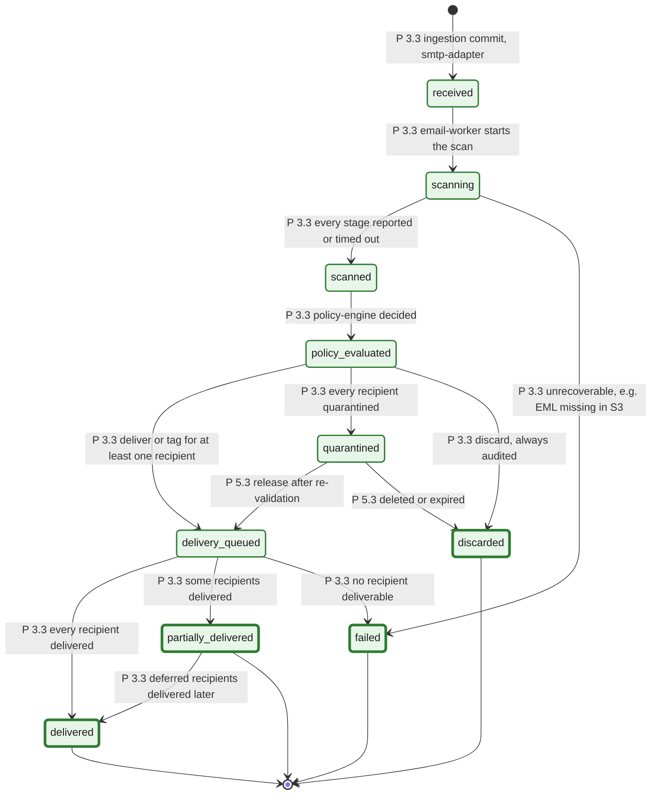

# 11. Message state machine

The states are exactly the values of `email_messages.status` from the step 1.1 design (§3.4), in enum order: `received`, `scanning`, `scanned`, `policy_evaluated`, `quarantined`, `delivery_queued`, `delivered`, `partially_delivered`, `discarded`, `failed`. The enum is IMPLEMENTED in the schema (append-only: values are only ever added).

**Every transition is PLANNED for step 3.3** (message lifecycle: state machine, atomic transitions, history, concurrency tests). The transitions below are the intended lifecycle derived from the data-ownership table and ADR-0006; step 3.3 owns the final transition table and may refine it. Each transition will be one atomic update guarded by optimistic concurrency (`email_messages.version`), written together with an `email_message_status_history` row and, where another stage must react, a `message_outbox` row.

**Legend.** States (green) are IMPLEMENTED enum values; a thick border marks a terminal state. Every transition label starts with `P x.y`: the transition is PLANNED for that step. No code performs any transition today.

## Rules the transitions must keep (from the existing design)

| Rule                                                                                                                                                                                                                                  | Source                         |
| ------------------------------------------------------------------------------------------------------------------------------------------------------------------------------------------------------------------------------------- | ------------------------------ |
| No transition after `received` ever produces an NDR to the sender. Post-queue outcomes are deliver, tag, quarantine or discard                                                                                                        | ADR-0006                       |
| Per-recipient outcomes live in `email_recipients.status` and `final_action`. A message with some recipients quarantined and some delivered moves to `delivery_queued`, and its quarantined recipients have `quarantine_messages` rows | Design §3.4, §3.8              |
| Each transition is a compare-and-set on `(id, received_at, version)`, so a redelivered event cannot move a message backwards                                                                                                          | Design §3.4 (`version` column) |
| Every transition appends `email_message_status_history (version, from_status, to_status, reason_code, event_id)`                                                                                                                      | Design §3.4                    |
| Messages stuck in a non-terminal state are found by `status IN (...) AND status_changed_at < now - 15 min` (query Q7, index `(status, status_changed_at)`) and re-driven by reconciliation (PLANNED 3.2)                              | Design §D8 Q7                  |
| `delivery_queued`, `delivered` and `partially_delivered` have no writer assigned in the data-ownership table (§3.11). Step 3.3 must assign it (most likely `delivery-worker`)                                                         | Design §3.11 (gap)             |

## Status

| Element                                                      | Status      | Evidence or delivering step                                |
| ------------------------------------------------------------ | ----------- | ---------------------------------------------------------- |
| `email_messages.status` enum, `status_changed_at`, `version` | IMPLEMENTED | Step 1.1 schema (`packages/database/prisma/schema.prisma`) |
| `email_message_status_history` (partitioned, append-only)    | IMPLEMENTED | Step 1.1 schema; `schema.test.ts` checks partitioning      |
| Index `(status, status_changed_at)` for reconciliation       | IMPLEMENTED | Step 1.1 schema                                            |
| Every transition                                             | PLANNED 3.3 | Release transitions with 5.3                               |
| Reconciliation of stuck messages                             | PLANNED 3.2 |                                                            |
