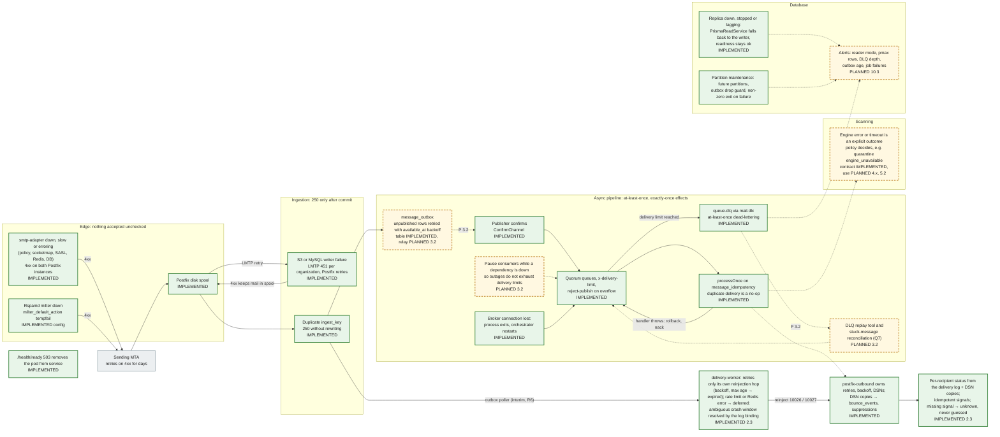

# 12. Failure handling architecture

How the platform keeps mail safe when a component fails. The principle: **every hop either has durably accepted the message or has told the previous hop to retry.** Postfix's disk spool is the buffer in front of everything; MySQL holds state and the outbox; RabbitMQ holds work; a failure anywhere turns into a retry, a dead letter or a fallback, never into silent loss or a silent `clean`. The per-dependency detail is in [failure-handling.md](../failure-handling.md).

**Legend.** Green solid: IMPLEMENTED (each box names the mechanism). Amber dashed and dotted arrows: PLANNED with the step.

## Status

| Mechanism                                                  | Status                 | Evidence or delivering step                                                                                                                                                                      |
| ---------------------------------------------------------- | ---------------------- | ------------------------------------------------------------------------------------------------------------------------------------------------------------------------------------------------ |
| Policy service fail-closed (down, slow, throws, malformed) | IMPLEMENTED            | `main.cf` (`smtpd_policy_service_default_action`, 10 s timeout); `mail-plane.test.ts`, `policy-server.service.test.ts`, `smtp-fail-closed.test.ts` (Redis down; adapter container stopped in CI) |
| Socketmap / SASL fail-closed                               | IMPLEMENTED            | `TEMP Lookup failed` → `451 4.3.0`; SASL temporary failure → `454 4.7.0` (`smtp-fail-closed.test.ts`)                                                                                            |
| Milter fail-closed                                         | IMPLEMENTED            | `main.cf` (`milter_default_action = tempfail`). Configuration only; no automated test stops Rspamd mid-session                                                                                   |
| Postfix spool (both instances), survives restarts          | IMPLEMENTED            | `postfix-spool`, `postfix-outbound-spool` volumes; `smtp-durability.test.ts` suite 6. EBS-backed ASG in production is PLANNED 10.1                                                               |
| Ingestion `250 after commit`, `451` on failure             | IMPLEMENTED            | `ingestion.service.test.ts`, `apps/smtp-adapter/integration/ingestion.test.ts`, `smtp-durability.test.ts` suite 5 (MinIO stopped)                                                                |
| Registry de-duplication `(organization_id, ingest_key)`    | IMPLEMENTED            | `schema.test.ts`; ingestion dedupe in `smtp-durability.test.ts` suite 7                                                                                                                          |
| Outbox table, relay                                        | PLANNED 3.2            | `message_outbox` (daily partitions, `(published_at, id)` index) exists                                                                                                                           |
| Publisher confirms, manual acks, quorum queues, DLQs       | IMPLEMENTED            | `rabbitmq.module.ts`, `topology.ts`; `events.test.ts`, `rabbitmq-redis.test.ts`                                                                                                                  |
| `processOnce`                                              | IMPLEMENTED            | `idempotency.test.ts`, `mysql.test.ts` (once, duplicate, rollback)                                                                                                                               |
| Crash-only RabbitMQ reconnect                              | IMPLEMENTED            | `RabbitMqService` exits on an unexpected `close`; restart policy in Compose and Kubernetes                                                                                                       |
| Reader to writer fallback                                  | IMPLEMENTED            | `prisma-read.service.test.ts`, `replication.test.ts`                                                                                                                                             |
| Readiness gating                                           | IMPLEMENTED            | `health.service.test.ts` (2 s per check, 503 on any failure)                                                                                                                                     |
| Engine `error` / `timeout` outcomes                        | IMPLEMENTED (contract) | `packages/security-contracts`; `quarantine_messages.reason` includes `engine_unavailable`. Use PLANNED 4.x, 5.2                                                                                  |
| DLQ replay, reconciliation, consumer pause                 | PLANNED 3.2            |                                                                                                                                                                                                  |
| Partition maintenance                                      | IMPLEMENTED            | `packages/database/src/partitioning/*.test.ts`, `tests/integration/partitions.test.ts`, CI migrations job (runs `apply` twice)                                                                   |
| Alerting                                                   | PLANNED 10.3           |                                                                                                                                                                                                  |
| Outbound retries and DSNs in Postfix, bounce processing    | IMPLEMENTED            | ADR-0006; `postfix-outbound` queue settings; `bounces.test.ts`, `smtp-outbound.test.ts` (hard bounce)                                                                                            |
| delivery-worker hop retry, fail-closed rate limits         | IMPLEMENTED 2.3        | `reinjection.test.ts`, `rate-limit.test.ts` (worker integration); `routing-rate-limit.test.ts` (Redis stopped: nothing sent, delivered after recovery)                                           |
| Destination outage → Postfix retry → delivered             | IMPLEMENTED 2.3        | `routing-retry.test.ts` (sink stopped and started, no `postqueue -f`; failover along the next-hop list); [diagram 19](19-retry-bounce-sequence.md)                                               |
| Status signals idempotent, stale → `unknown`               | IMPLEMENTED 2.3        | `recorder.test.ts`, `status-tailer.test.ts`, `routing-signals.test.ts` (whole log re-read, bounce notice redelivered: no change)                                                                 |
