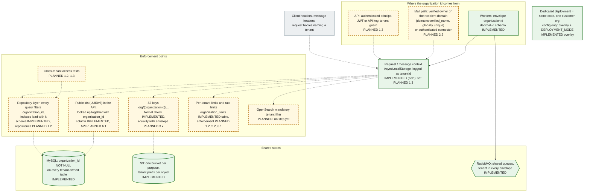

# 13. Multi-tenant isolation architecture

The platform uses a shared schema with an `organization_id BIGINT UNSIGNED` column on every tenant-owned table (ADR-0012, amended by ADR-0014). Isolation therefore depends on **where the organization id comes from** and on **every layer filtering by it**. The organization id is taken from trusted context only: the authenticated principal (API), the receiving connector or verified domain (mail path), or the event envelope set by a trusted producer (workers). **It never comes from a client-supplied header or from message content.**

**Legend.** Green solid: IMPLEMENTED. Amber dashed: PLANNED with the step. The grey node is untrusted input; the `-.-x` arrow means it is **never** used to set the organization.

## Enforcement points

| #   | Point                | Rule                                                                                                                                                                                                                                                        | Status                                                                            |
| --- | -------------------- | ----------------------------------------------------------------------------------------------------------------------------------------------------------------------------------------------------------------------------------------------------------- | --------------------------------------------------------------------------------- |
| 1   | Schema               | `organization_id BIGINT UNSIGNED NOT NULL` on every tenant-owned table; nullable only on `roles`, `threat_indicators`, `yara_rules`, `audit_logs`, `login_audit_logs` (platform rows)                                                                       | IMPLEMENTED: `schema.test.ts` ("has organization_id on every tenant-owned table") |
| 2   | Domain ownership     | Only a **verified** domain is globally unique (`domains.verified_name`, a generated column with a unique key), so one verified domain maps to one organization. Pending claims are unique per organization only, so an unverified claim cannot squat a name | IMPLEMENTED (keys, `schema.test.ts`). Verification flow PLANNED 2.1               |
| 3   | Mail path            | Organization from the recipient domain (inbound) or the authenticated connector (outbound, internal). Never from headers                                                                                                                                    | PLANNED 2.2, 2.3                                                                  |
| 4   | API                  | Organization from the authenticated principal by a tenant guard; no endpoint accepts a tenant id from a header                                                                                                                                              | PLANNED 1.3 (`docs/api/README.md`)                                                |
| 5   | Events               | `organizationId` is a decimal id set by the producer from trusted context; consumers parse it with zod                                                                                                                                                      | IMPLEMENTED: `envelope.ts`, `events.test.ts` (rejects UUIDs and leading zeros)    |
| 6   | S3 keys              | Every key starts `org/{organizationId}/`. The event schema checks the format today; consumers must also check it **equals** the envelope's `organizationId`                                                                                                 | Format IMPLEMENTED (`events.test.ts`, `storage.test.ts`). Equality PLANNED 3.x    |
| 7   | Repositories         | Every query filters by `organization_id`. Composite tenant foreign keys are deferred (design §4)                                                                                                                                                            | PLANNED 1.2, 1.3                                                                  |
| 8   | External ids         | APIs expose `public_id` (UUIDv7), not sequential ids, so ids are not guessable or enumerable                                                                                                                                                                | Column IMPLEMENTED on the 8 aggregate roots. API PLANNED 6.1                      |
| 9   | Limits               | `organization_limits` (messages per day, API requests per minute, sizes) and Redis rate limits per organization                                                                                                                                             | Table IMPLEMENTED. Enforcement PLANNED 1.2, 2.2, 6.1                              |
| 10  | Logs                 | `tenantId` log field carries the organization id, set only after authentication                                                                                                                                                                             | Field IMPLEMENTED (`packages/logger/src/context.ts`). Population PLANNED 1.3      |
| 11  | Search and analytics | Mandatory organization filter in the query layer                                                                                                                                                                                                            | PLANNED (ADR-0009). No execution-plan step yet                                    |
| 12  | Deployment mode      | Dedicated is configuration only. No code branches on `DEPLOYMENT_MODE` or on a specific organization id                                                                                                                                                     | IMPLEMENTED overlay (`overlays/dedicated`). The rule is a review rule (ADR-0012)  |
