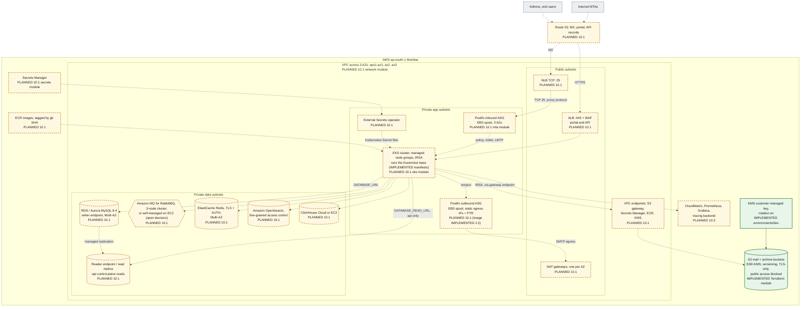

# 14. AWS Mumbai (ap-south-1) production architecture

The target production layout in `ap-south-1`. **Almost all of it is PLANNED for step 10.1** (Terraform module set, cost model; the execution plan limits local verification to `terraform validate`). What `infrastructure/terraform` contains today was checked: one module, `modules/mail-storage` (S3 mail and archive buckets with SSE-KMS, versioning, public-access block, TLS-only bucket policy and a mail-bucket lifecycle), composed by `environments/dev` together with one customer-managed KMS key. It has never been applied.

**Legend.** Green solid: IMPLEMENTED in `infrastructure/terraform` (validated by `terraform validate` in CI, never applied). Amber dashed: PLANNED with the step. Module names in the boxes are the planned modules from `infrastructure/terraform/README.md`.

## Design points carried into step 10.1

| Topic                       | Decision so far                                                                                                                                                                  | Source                                             |
| --------------------------- | -------------------------------------------------------------------------------------------------------------------------------------------------------------------------------- | -------------------------------------------------- |
| Exposure                    | Only the MX NLB and the portal/API ALB are publicly reachable. Every data store is in private subnets and encrypted with customer-managed KMS keys                               | `infrastructure/terraform/README.md`               |
| Postfix on EC2, not EKS     | The spool must outlive pod rescheduling, so Postfix runs on ASGs with EBS spools                                                                                                 | ADR-0006                                           |
| MySQL endpoints             | `DATABASE_URL` is the writer (cluster) endpoint, `DATABASE_READ_URL` the reader endpoint. On Aurora, the lag probe needs `information_schema.replica_host_status` (PLANNED 10.1) | ADR-0014, `docs/database/replication.md`           |
| RabbitMQ                    | Amazon MQ or self-managed is an **open decision**. Quorum queues need a 3-node cluster                                                                                           | ADR-0005, Terraform README                         |
| Secrets                     | Secrets Manager → External Secrets → files read with `<KEY>_FILE`                                                                                                                | ADR-0010                                           |
| Rspamd DNS                  | A dedicated recursive resolver, because public DNSBLs refuse shared resolvers                                                                                                    | ADR-0007                                           |
| Rspamd and ClamAV placement | Not decided (EKS Deployments next to the workers, or co-located with Postfix for milter latency)                                                                                 | Open, 10.1                                         |
| `smtp-adapter` reachability | Postfix on EC2 must reach the policy port `:10040` and LMTP; the Kubernetes Service exposes only HTTP today                                                                      | `infrastructure/kubernetes/base/smtp-adapter.yaml` |
| S3 lifecycle                | The mail bucket expires objects after `mail_retention_days` (default 30), while message rows are kept 6 months. Aligning them is PLANNED 8.1                                     | `modules/mail-storage`, design D9                  |

## Status

| Element                                                              | Status       | Evidence                                                       |
| -------------------------------------------------------------------- | ------------ | -------------------------------------------------------------- |
| S3 buckets (mail, archive), SSE-KMS, versioning, TLS-only, lifecycle | IMPLEMENTED  | `modules/mail-storage/*.tf`; CI `iac` job `terraform validate` |
| KMS key with rotation (dev composition)                              | IMPLEMENTED  | `environments/dev/main.tf`                                     |
| Kubernetes manifests the cluster would run                           | IMPLEMENTED  | `infrastructure/kubernetes`; CI renders both overlays          |
| Everything else in the diagram                                       | PLANNED 10.1 | Monitoring stack 10.3                                          |
