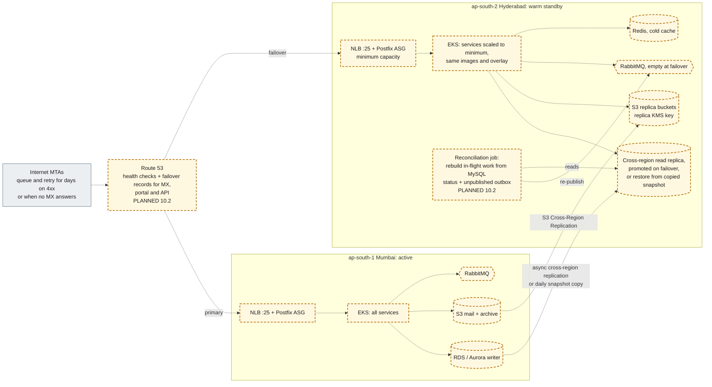

# 15. Hyderabad (ap-south-2) disaster recovery architecture

A warm standby in `ap-south-2` for a regional loss of `ap-south-1`. **Everything here is PLANNED for step 10.2** (warm standby IaC, runbooks, reconciliation). The execution plan states that this step is **design only from this workstation**, and that RPO and RTO cannot be claimed without a real regional test. The numbers below are targets, **not verified**.

**Legend.** Every element is PLANNED (step 10.2; the primary-region boxes are PLANNED 10.1). Nothing in this diagram exists in the repository today.

## What is replicated and how

| Data                   | Mechanism                                                                                                                       | Notes                                                                                                                                                                                      |
| ---------------------- | ------------------------------------------------------------------------------------------------------------------------------- | ------------------------------------------------------------------------------------------------------------------------------------------------------------------------------------------ |
| MySQL                  | Cross-region read replica (RDS) or Aurora Global Database, promoted on failover. Fallback: daily snapshots copied to ap-south-2 | Design D9 (`docs/database/backup-restore.md`, WP4) records snapshot copies and PITR. The choice between a live replica and snapshot copy sets the RPO                                      |
| S3 (EML, archive)      | Cross-Region Replication with versioning (already on in the module) and a replica KMS key                                       | Object keys outlive rows, so a replica that is ahead of MySQL is safe                                                                                                                      |
| RabbitMQ               | Not replicated across regions                                                                                                   | In-flight work is rebuilt by reconciliation: messages in non-terminal states (query Q7) and outbox rows with `published_at IS NULL` are re-published. `processOnce` makes the replays safe |
| Redis                  | Not replicated                                                                                                                  | Caches and rate-limit counters only; never the source of truth                                                                                                                             |
| OpenSearch, ClickHouse | Snapshot restore or rebuild from MySQL and S3                                                                                   | Not on the mail path; reporting may lag after a failover                                                                                                                                   |
| Postfix spools         | Not replicated                                                                                                                  | Mail in a lost primary spool that was not yet ingested is the main mail-loss risk; senders' own queues cover mail that never got a `250`                                                   |

## MX failover options (decision for step 10.2)

| Option                                  | Behaviour                                                                                                                                                              |
| --------------------------------------- | ---------------------------------------------------------------------------------------------------------------------------------------------------------------------- |
| Route 53 failover record on the MX host | Health check on the primary NLB; on failure the MX name resolves to the DR NLB. DNS TTL bounds the switch time                                                         |
| Secondary MX at a lower priority        | Senders fall back by themselves. The DR Postfix must then apply the **same** in-session checks (policy delegation and milter) to avoid becoming a weaker path for spam |

## Targets (unverified)

| Objective                        | Target                                                                          | Depends on                               |
| -------------------------------- | ------------------------------------------------------------------------------- | ---------------------------------------- |
| RPO, MySQL                       | Minutes with a cross-region replica. Up to 24 h with daily snapshot copies only | The replication mechanism chosen in 10.2 |
| RPO, mail not yet answered `250` | Zero: the sender keeps it and retries                                           | Fail-closed edge (ADR-0006)              |
| RTO, mail acceptance             | Target to be set in 10.2 (warm standby, scale-up time plus DNS TTL)             | Pre-provisioned DR capacity              |

These targets are design intent. They become claims only after the regional failover test in step 10.2.
