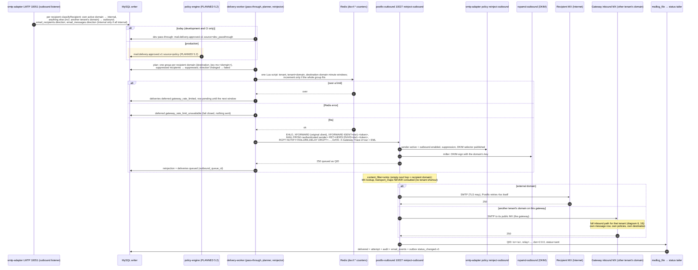

# 17. Outbound routing and delivery sequence

What happens to an outbound message after ingestion (diagram 7 covers submission and ingestion): per-recipient direction from ingestion (`outbound` unless the recipient domain is an active domain of the **same** organization), approval, the delivery-worker's outbound rate limits, reinjection into `postfix-outbound` 10027, where `content_filter=smtp:` makes Postfix resolve the **recipient domain's MX** and never consult `transport_maps` — so a recipient in **another tenant's** domain on this gateway is reached through that tenant's public MX and ingested as that tenant's own inbound message — DKIM signing, delivery, and the status from the delivery log (step 2.3, [design R1, R4, R8, R9, R11](../../plan/steps/05-routing.md), [ADR-0021](../adr/0021-mail-routing-and-delivery-status.md)).

**Legend.** Plain messages: IMPLEMENTED (step 2.2 for submission, policy and DKIM; step 2.3 for everything from classification on). Shaded block: PLANNED 5.2. The dev pass-through is development and CI only. Failure paths (deferral, bounce with DSN, expiry) are diagram 19.

## Status

| Step in the sequence                                               | Status                 | Evidence or delivering step                                                                                                                                                   |
| ------------------------------------------------------------------ | ---------------------- | ----------------------------------------------------------------------------------------------------------------------------------------------------------------------------- |
| Classification at ingestion (`email_recipients.direction`)         | IMPLEMENTED            | `direction.test.ts`, `ingestion.service.test.ts`, `apps/smtp-adapter/integration/ingestion.test.ts`; `routing-mixed.test.ts`                                                  |
| Message direction `internal` only when every recipient is internal | IMPLEMENTED            | `routing-mixed.test.ts` (all-internal submission)                                                                                                                             |
| Per-domain groups, suppressed recipients                           | IMPLEMENTED            | `route-plan.test.ts`, `planning.test.ts`                                                                                                                                      |
| Outbound rate limits, fail closed                                  | IMPLEMENTED            | `outbound-rate-limiter.test.ts`, `apps/delivery-worker/integration/rate-limit.test.ts`; `routing-rate-limit.test.ts` (1/min, three windows; Redis stopped)                    |
| 10027 bypasses `transport_maps`; other tenant via its public MX    | IMPLEMENTED            | `infrastructure/postfix-outbound/master.cf`; [mail-routing.md](../../deployment/mail-routing.md) V1; `routing-mixed.test.ts` (`relay=gw-mx.sink.test`, own message row for B) |
| DKIM signing on 10027                                              | IMPLEMENTED            | `smtp-outbound.test.ts` (step 2.2)                                                                                                                                            |
| Delivered only from the delivery log                               | IMPLEMENTED            | `postfix-log-parser.test.ts`, `transitions.test.ts`; `routing-mixed.test.ts`                                                                                                  |
| Policy approvals, outbound scanning                                | PLANNED 5.2, 4.5       |                                                                                                                                                                               |
| Delivery to real Internet MX hosts                                 | not verifiable locally | `dns-sink` + `mail-sink` stand in for the Internet                                                                                                                            |
