# 18. Internal routing sequence

Internal mail = mail an organization's **authenticated** connector submits (outbound listener, 587 SASL or 25 connector) to recipients in that **same** organization's active domains. It is inspected like any other mail and then delivered to the organization's **own** destination servers through 10026 (never to Internet MX), with DSNs to the authenticated sender. Direction comes from the listener and the verified domains, **never from headers**; mail arriving at the public inbound MX from a sender in the organization's own domain is still `inbound` (a spoofing candidate for SPF/DMARC/BEC, steps 4.x). Mixed messages stay **one** parent message; each recipient has its own direction and delivery (step 2.3, [design R1, R4, R7](../../plan/steps/05-routing.md), [diagram 8](08-internal-inspection-sequence.md)).

```mermaid
sequenceDiagram
  autonumber
  participant T as Tenant mail system (connector, SASL)
  participant PO as postfix-outbound 587 / 25
  participant ING as smtp-adapter LMTP 10051
  participant DB as MySQL writer
  participant EW as email-worker, policy-engine (PLANNED 4.x, 5.2)
  participant DW as delivery-worker
  participant PX as postfix-outbound 10026 reinject-inbound
  participant SM as smtp-adapter socketmap transport
  participant D as Organization's own servers (M365 / Google / customer)
  participant LOG as maillog_file → status tailer

  T->>PO: AUTH (connector of organization O), MAIL FROM <user@O-domain>, RCPT …
  PO->>ING: LMTP after queueing (listener direction outbound)
  ING->>DB: per recipient: resolveActiveDomain(R) owner = O → internal (inbound_enabled not required)#59;<br/>otherwise outbound. All internal → email_messages.direction = internal
  rect rgb(255, 248, 225)
    EW->>DB: internal inspection (feature internal_inspection), policy for direction internal (PLANNED 4.x, 5.2)
  end
  DW->>DB: approval (policy-engine, step 5.2), plan:<br/>internal recipients grouped per tenant domain (tenant:<domainId>), re-check direction:<br/>changed since ingestion → failed direction_changed (never leaves by the other path)
  DW->>PX: XFORWARD IDENT=dw1-<token>, MAIL FROM:<O sender> RET=HDRS ENVID=…,<br/>RCPT NOTIFY=FAILURE,DELAY, DATA: X-Gateway-Trace d=in + EML
  PX->>SM: transport → O's next-hop list
  PX-->>DW: 250 queued as QID
  PX->>D: SMTP with the destination's TLS policy (verify for provider presets)
  D-->>PX: 250
  PX->>LOG: status=sent → delivered
  Note over T,D: The trace d=in for O stops a loop if O's server sends the copy back<br/>through the inbound MX (554 5.4.6)#59; evaluateHops stops loops alternating directions
```

**Legend.** Plain messages: IMPLEMENTED (step 2.3). Shaded block: PLANNED. Approval comes from the policy-engine since step 5.2 (diagram 16).

## Status

| Element                                                     | Status                 | Evidence or delivering step                                                                                                  |
| ----------------------------------------------------------- | ---------------------- | ---------------------------------------------------------------------------------------------------------------------------- |
| Internal classification (same organization, active domain)  | IMPLEMENTED            | `direction.test.ts` (matrix incl. same-org sender on the inbound MX stays inbound), `routing-mixed.test.ts`                  |
| One parent message, per-recipient directions and deliveries | IMPLEMENTED            | `routing-mixed.test.ts` (internal, internal, outbound, other tenant; all-internal → `internal`)                              |
| Delivery to the organization's own servers on 10026         | IMPLEMENTED            | `routing-mixed.test.ts` (sink-m365 with verified TLS, sink-google)                                                           |
| `direction_changed` at planning                             | IMPLEMENTED            | `delivery-planner.test.ts`, `planning.test.ts`                                                                               |
| DSN to the authenticated sender for internal failures       | IMPLEMENTED            | `NOTIFY=FAILURE,DELAY` in `deliveryPathFor` (`route-plan.test.ts`); outbound DSN path exercised by `routing-bounces.test.ts` |
| Loop stop (trace per organization, all-direction hop count) | IMPLEMENTED            | `hops.test.ts`, `routing-loops.test.ts`                                                                                      |
| Internal inspection and internal policies                   | PLANNED 4.x, 5.2       | `organization_features.internal_inspection`                                                                                  |
| Real Microsoft 365 / Google Workspace connectors            | not verifiable locally | [destination-servers.md](../../domains/destination-servers.md) documents the customer setup                                  |
