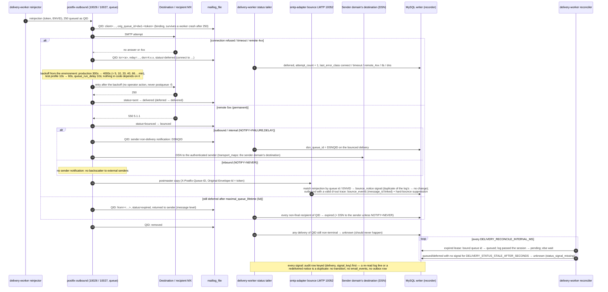

# 19. Deferral, retry, bounce and expiry sequence

How delivery failures are handled and recorded (step 2.3, [design R4, R8, R9, R12](../../plan/steps/05-routing.md), [ADR-0006](../adr/0006-postfix-mail-path.md), [ADR-0021](../adr/0021-mail-routing-and-delivery-status.md)): **Postfix owns every retry to a remote server**, its backoff, `maximal_queue_lifetime` and DSN generation; the delivery-worker retries only its own reinjection hop. Status comes from Postfix's delivery log (primary) and the postmaster DSN copies (corroboration), both matched on the queue id bound to the reinjection token; every signal is idempotent. Missing signals end in `unknown`, never in a guessed outcome.

**Legend.** Every participant and message is IMPLEMENTED in step 2.3, with these limits: real remote DSN handling and asynchronous remote bounces after a `250` (VERP/SRS) are out of scope (design §10); gateway-generated notifications for worker-side failures are step 6.2.

## Status

| Step in the sequence                                                   | Status                                | Evidence or delivering step                                                                                                                                           |
| ---------------------------------------------------------------------- | ------------------------------------- | --------------------------------------------------------------------------------------------------------------------------------------------------------------------- |
| Deferred with attempts and error class, recovery by Postfix retry      | IMPLEMENTED                           | `error-class.test.ts`, `postfix-log-parser.test.ts`; `routing-retry.test.ts` (sink-m365 stopped → deferred `connect`, started → delivered, no flush)                  |
| Backoff from the environment (test profile 10s/60s/10s)                | IMPLEMENTED                           | `infrastructure/postfix*/entrypoint.sh`, [mail-routing.md](../../deployment/mail-routing.md#retry-schedule-r4); CI `stack` job env                                    |
| Bounce with DSN (`dsn_queue_id`), DSN at the sender's server           | IMPLEMENTED                           | `status-signal-applier.test.ts`; `routing-bounces.test.ts`                                                                                                            |
| Postmaster copy matched (queue id / ENVID), `bounce_events.message_id` | IMPLEMENTED                           | `bounce-notice.service.test.ts`, `apps/smtp-adapter/integration/bounces.test.ts`; `routing-bounces.test.ts`                                                           |
| Inbound bounce without DSN                                             | IMPLEMENTED                           | `routing-bounces.test.ts`                                                                                                                                             |
| Expiry (message-level qmgr line)                                       | IMPLEMENTED (parser, recorder)        | `postfix-log-parser.test.ts` (captured line), `status-tailer.test.ts`; not run end to end by a stack suite (5-day lifetime; WP2 captured it with a 1-minute lifetime) |
| Duplicate / re-read signals are no-ops                                 | IMPLEMENTED                           | `transitions.test.ts`, `recorder.test.ts`; `routing-signals.test.ts` (cursor reset, whole log re-read, notice redelivered)                                            |
| Reconciler (leases, stale → unknown)                                   | IMPLEMENTED                           | `apps/delivery-worker/integration/status-tailer.test.ts` (ambiguous crash window resolved by the bound line or by the log passing the session; stale → `unknown`)     |
| Real remote DSN handling, asynchronous remote bounces                  | not verifiable locally / out of scope | design §10                                                                                                                                                            |
