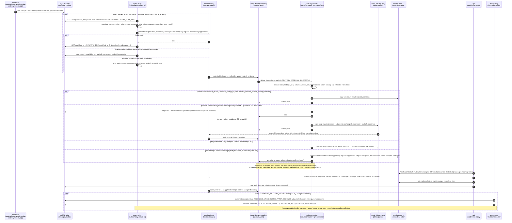

# 21. Event relay, consumers, retry, dead letter and replay

Step 3.2 ([design and verification record](../../plan/steps/07-rabbitmq.md), [ADR-0023](../adr/0023-outbox-relay-and-reconciliation.md), [ADR-0024](../adr/0024-rabbitmq-topology-retry-dead-letter.md), [topology](../messaging-topology.md), [runbook](../../runbooks/rabbitmq-messaging.md)). Every pipeline event goes from the producer's writer transaction (`message_outbox`) through the `event-relay` to a topic exchange of vhost `email-gateway`, into a quorum queue and to a consumer that applies it exactly once with `processOnce`. The example is the delivery path (`mail.delivery.approved.v1` → `email.delivery.pending` → delivery-worker planner), whose retries use the delay queue; `email.received` (email-worker) is the same except that retries are held and republished (hold strategy).

**Legend.** Every message is IMPLEMENTED (step 3.2). The same flow serves `email.received` (email-worker MIME ingestion) with the **hold** strategy: a transient or retryable failure keeps the delivery and its prefetch slot for the backoff (≤ 60 s), then republishes a copy to `email.ingestion` with `retry.email.received.org.<id>.<type>` and acks the original. Dormant queues (`scan.*`, `email.policy.evaluate`, `email.quarantine`, `email.archive`, `email.analytics`) are bound and receive copies, but have no consumer until their step.

## Status

| Step in the sequence                                               | Status          | Evidence                                                                                                                                          |
| ------------------------------------------------------------------ | --------------- | ------------------------------------------------------------------------------------------------------------------------------------------------- |
| Relay shards, confirmed publish, marking, poison rows, row backoff | IMPLEMENTED 3.2 | `apps/event-relay/src/relay/*.test.ts`; `apps/event-relay/integration/relay.test.ts` (TCP-proxy cuts, reject-publish, two relays)                 |
| Topology, routing keys, bindings, policies, role users             | IMPLEMENTED 3.2 | `packages/event-contracts` tests; `tests/integration/messaging-topology.test.ts`, `messaging-permissions.test.ts`                                 |
| Consumer decode, ack, retry (hold / delay queue), dead letter      | IMPLEMENTED 3.2 | `packages/common/src/messaging/consumer.test.ts`; `tests/integration/messaging-client.test.ts`; worker integration suites                         |
| Redelivery after a crash or broker restart, exactly-once effects   | IMPLEMENTED 3.2 | stack `messaging-restart.test.ts`, `messaging-consumer-crash.test.ts`, `messaging-db-outage.test.ts`; `cluster/node-failure.test.ts`              |
| Duplicates (relay retry, redelivery, re-drive, replay)             | IMPLEMENTED 3.2 | stack `messaging-duplicates.test.ts`; email-worker and delivery-worker idempotency suites                                                         |
| Backpressure (prefetch bounds unacked deliveries)                  | IMPLEMENTED 3.2 | stack `messaging-backlog.test.ts` (500 messages, unacked ≤ `MIME_CONCURRENCY`); email-worker `rabbitmq.test.ts` (2 000 queued events, prefetch 4) |
| Audited dead-letter replay                                         | IMPLEMENTED 3.2 | `apps/api` `dead-letters.e2e.test.ts`, `integration/dead-letters.test.ts`; stack `messaging-replay.test.ts` (through the live api)                |
| Reconciler re-drive and exhaustion                                 | IMPLEMENTED 3.2 | `apps/event-relay/src/reconciler/*.test.ts`, `apps/event-relay/integration/reconciler.test.ts`                                                    |
