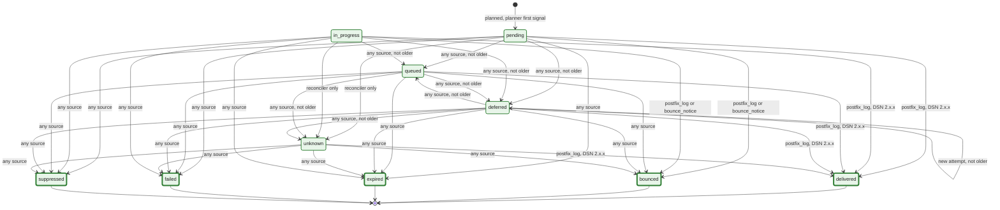
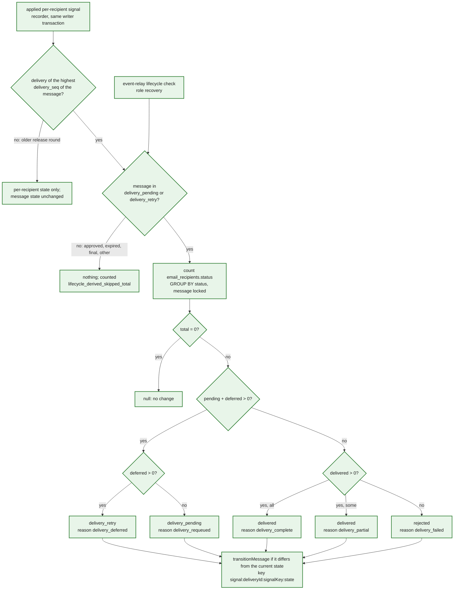

# 22. Per-recipient delivery lifecycle and the derived message state

Two layers (step 3.3 [L9](../../plan/steps/08-message-lifecycle.md#l9-per-recipient-delivery-state-and-the-derived-message-state), [ADR-0025](../adr/0025-message-lifecycle-state-machine.md); step 2.3 [R9.1](../../plan/steps/05-routing.md), [ADR-0021](../adr/0021-mail-routing-and-delivery-status.md)):

1. **Per recipient:** `email_deliveries.status` (one row per recipient and `delivery_seq`) follows the step 2.3 lattice, decided by `nextDeliveryState` in `@email-gateway/mail-routing` from every delivery signal (planner, reinjector, Postfix delivery log, bounce notices, reconciler); every signal, applied or not, is audited in `delivery_status_events`, and `email_recipients.status` mirrors the outcome.
2. **Per message:** the delivery states of the message lifecycle (`delivery_pending`, `delivery_retry`, `delivered`, `rejected`; edges E21–E24 of [diagram 11](11-message-state-machine.md)) are **derived** from the recipient statuses under the message lock, never ordered by events, so an older signal can never overwrite a newer message state.

## Per-recipient delivery lattice

**Legend.** Every state and edge is IMPLEMENTED (step 2.3, `packages/mail-routing/src/delivery-state/transitions.ts`, tested exhaustively in `transitions.test.ts`); a thick border marks a terminal status, which is never left (the same terminal status again is a `duplicate`, another a `conflict`). "Not older" = a non-terminal signal older than the delivery's `last_signal_at` is `stale`; terminal signals win over any non-terminal state. `delivered` is accepted only from the Postfix delivery log with a `2.x.x` DSN (the remote server's `2xx` after DATA). `pending → delivered | bounced` needs the log or a DSN because the log can overtake the worker's own commit. `unknown` (the reconciler's verdict when an outcome can no longer be known) only becomes terminal. Step 3.3 WP3 expresses these rows as data (`DELIVERY_TRANSITIONS`) with identical behaviour.

| Delivery status (`email_deliveries`)               | `email_recipients.status`  |
| -------------------------------------------------- | -------------------------- |
| `pending`, `in_progress`, `queued`, `unknown`      | `pending`                  |
| `deferred`                                         | `deferred`                 |
| `delivered`                                        | `delivered`                |
| `bounced`                                          | `bounced`                  |
| `expired`, `failed`, `suppressed`                  | `failed`                   |
| (5.3 per-recipient quarantine; policy discard 5.2) | `quarantined`, `discarded` |

## Derived message state (`deriveDeliveryState`, `applyDerivedDeliveryState`)

**Legend.** Every element is IMPLEMENTED: the per-recipient recorder (step 2.3), the derivation in `@email-gateway/message-lifecycle` and its wiring into the recorder, and the event-relay lifecycle check (step 3.3; verified by the stack suites `routing-*`, `lifecycle-event-relay` and `lifecycle-consumer-crash`, [step 3.3 §13](../../plan/steps/08-message-lifecycle.md#13-verification-results)). `quarantined` and `discarded` recipients count as settled: a message with some recipients quarantined and the others delivered is `delivered/delivery_partial` (step 1.1 §3.4). The step 2.3 aggregate writer (`setMessageStatus`) is removed; the recorder writes the message state only through the transition service.

## Status

| Element                                             | Status            | Evidence or delivering step                                          |
| --------------------------------------------------- | ----------------- | -------------------------------------------------------------------- |
| Per-recipient lattice, audit, recipient mirror      | IMPLEMENTED (2.3) | `transitions.ts`, `recorder.ts`, `packages/mail-routing/integration` |
| Per-recipient rows as data (`DELIVERY_TRANSITIONS`) | IMPLEMENTED (3.3) | `transitions.ts` (behaviour unchanged, oracle test)                  |
| `deriveDeliveryState`, `applyDerivedDeliveryState`  | IMPLEMENTED (3.3) | `packages/message-lifecycle`                                         |
| Recorder derivation (highest `delivery_seq` only)   | IMPLEMENTED (3.3) | `packages/mail-routing/src/delivery-state/recorder.ts`               |
| Lifecycle check (re-derivation, role `recovery`)    | IMPLEMENTED (3.3) | `apps/event-relay/src/lifecycle/lifecycle-check.ts`                  |
