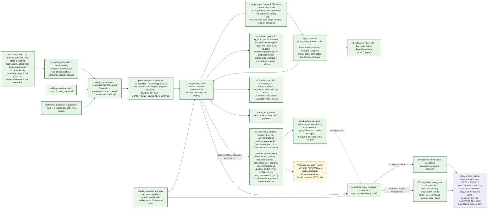

# 23. Scan pipeline: rounds, engine registry, completion and deadline

How the step 4.1 scan stage ([design S3–S6, S10](../../plan/steps/09-rspamd.md), [ADR-0026](../adr/0026-security-scan-pipeline.md)) keeps one result per message, round and engine when several engines and redeliveries run concurrently. The per-delivery sequence is [diagram 9](09-scanning-sequence.md); the lifecycle edges are in [diagram 11](11-message-state-machine.md).

## Round flow and engine registry

**Legend.** Green: IMPLEMENTED (4.1 orchestrator and Rspamd; 4.2 attachment engine; 4.3 URL engine with its child rows and the rewritten copy, [11-url-protection.md](../../plan/steps/11-url-protection.md) U1, U3, U16, U20; 4.4 stage-2 dependencies and the BEC engine, [12-phishing-bec.md](../../plan/steps/12-phishing-bec.md) B1, B2, B14, B17; 4.5 the stage-1 DLP engine with its child rows, evidence and incident, [13-dlp.md](../../plan/steps/13-dlp.md) D1, D3, D13, D16, D19). 4.6 the asynchronous sandbox engine and the sandbox-controller, [14-sandbox.md](../../plan/steps/14-sandbox.md) X10–X16: implemented with execution **disabled** — the controller's default backend answers `not_executed`, so analysed submissions end `unknown`). Amber dashed: PLANNED (a VM-class detonation runner — not implemented, the `vm` backend refuses; policy 5.2). The sandbox is **not** in `required_engines`, not in `ENGINE_REGISTRY` and not triggered by `parsed.v1`/`rescan_requested.v1`/`scan_stage_ready.v1`: its final row may be written before or after the round completes, `aggregateRound` ignores it, and it never touches `email_scans` or the lifecycle (ADR-0040). Since step 4.5 `required_engines = ["rspamd", "attachment", "url", "bec", "dlp"]`: the round completes when all five have a final row. `dlp` is a stage-1 engine (no dependency; inbound rounds finish fast with `skipped`), so outbound approval always waits for the DLP final, which carries the tenant policy's action; the engine records the action, the delivery stage applies it (D13). `bec` is a **stage-2** engine: it is never triggered by `parsed.v1`/`rescan_requested.v1`, only by the round's `scan_stage_ready.v1`, which exactly one transaction writes (the one that inserts the last of the rspamd/url finals, under the message → scan locks); a failed dependency still triggers it (the input is recorded `failed`, never clean). The deadline sweeper writes no trigger: it finalizes every missing required engine, stage 2 included, as `timeout`. The URL engine's dynamic inspection never delays the round (its result acts at click time). In 4.1 the registry held only `rspamd`.

## Aggregation (pure `aggregateRound`)

| Finals of the required engines        | Lifecycle                                            | `email_scans.status` | `scan_verdict`                                                           |
| ------------------------------------- | ---------------------------------------------------- | -------------------- | ------------------------------------------------------------------------ |
| all definite                          | E6 `scanned` (`scan_complete`)                       | `completed`          | most severe definite (`malicious > spam > suspicious > unknown > clean`) |
| any `error` (incl. `eml_unavailable`) | E7 `scan_failed` (`scan_error` or `eml_unavailable`) | `failed`             | `malicious` if any final is malicious, else `error`                      |
| only `timeout` failures               | E7 `scan_failed` (`scan_timeout`)                    | `timed_out`          | `malicious` if any final is malicious, else `timeout`                    |

A non-required engine's failure is recorded but never fails the round. Reason codes: the union of the finals' codes (≤ 32), failures first, then by verdict severity and name.

## Concurrency and idempotency

| Race                                                | What makes it converge                                                                                                                                                                                                                                             |
| --------------------------------------------------- | ------------------------------------------------------------------------------------------------------------------------------------------------------------------------------------------------------------------------------------------------------------------ |
| Two engines open the same round                     | Shared transition key `scan-open:<id>:0` (the second gets `duplicate`) and the unique `email_scans (message_id, lifecycle_round, received_at)`                                                                                                                     |
| Redelivery or a duplicate event id                  | `processOnce` ledger (`email-worker.scan.rspamd`, eventId) commits with the final row and the completion                                                                                                                                                           |
| Two event ids for the same (message, round, engine) | Inside the finalize transaction the final row is checked under the message → scan lock and inserted only once; the unique `(scan_id, final_engine, received_at)` is the backstop                                                                                   |
| Two dependency finals at once (step 4.4)            | Both lock message → scan and read the finals after the locks: only the transaction that inserts the last dependency final sees all of them and writes the stage trigger (once); a duplicate trigger is a `processOnce` ledger duplicate of `email-worker.scan.bec` |
| A stage trigger for a missing round or another scan | Ledger no-op `stage_round_missing`: a trigger never creates an `email_scans` row                                                                                                                                                                                   |
| Last engine and the deadline sweeper at once        | Both lock message → scan; the second sees `status ≠ running` and does nothing                                                                                                                                                                                      |
| A rescan while round N−1 is still running           | Round N−1 completes its own `email_scans` row; its transition (`expectedRound` N−1) is `stale`, so no `scanned.v1` (`scan_rounds_superseded_total`); round N's rows are separate                                                                                   |
| Crash between attempts                              | Attempts are rows; a round whose attempts reached the budget finalizes without another call (`engine.max_attempts_exceeded`)                                                                                                                                       |

## Deadline

`deadline_at = started_at + SCAN_ROUND_DEADLINE_SECONDS` (default 1 800 s; validated ≥ `SCAN_RSPAMD_MAX_ATTEMPTS × (SCAN_RSPAMD_TIMEOUT_MS + SCAN_RETRY_MAX_MS)` — since step 4.4 ≥ the slowest stage-1 budget plus the slowest stage-2 budget (default minimum 1 755 s) — and ≤ 6 h, below `LIFECYCLE_DEADLINE_SCANNING_HOURS`). One sweeper per cluster (advisory lock `scan:deadline`) runs every `SCAN_SWEEP_INTERVAL_MS`, takes up to `SCAN_SWEEP_BATCH_SIZE` running rounds past their deadline within `SCAN_SWEEP_LOOKBACK_HOURS` (index `(status, deadline_at)`), writes a final `timeout` (`deadline_exceeded`) for every required engine without a final row and completes the round (`scan_failed/scan_timeout`, alert `ScanDeadlineFinalizations`).

## Status

| Element                                                            | Status              | Evidence                                                                                                                               |
| ------------------------------------------------------------------ | ------------------- | -------------------------------------------------------------------------------------------------------------------------------------- |
| Catalog, registry, round open/complete, aggregation                | IMPLEMENTED 4.1     | `security-contracts` and `apps/email-worker/src/scanning` unit tests; email-worker `scan-rounds`                                       |
| Deadline sweeper                                                   | IMPLEMENTED 4.1     | `deadline-sweeper.test.ts`; email-worker `scan-resilience`                                                                             |
| Stack round flow through Postfix                                   | IMPLEMENTED 4.1     | `tests/integration/scan-pipeline.test.ts`, `scan-resilience.test.ts`                                                                   |
| Further engines (second required engine in a round)                | IMPLEMENTED 4.2–4.4 | The completion rule is engine-agnostic; five required engines since 4.5 (4.6 PLANNED)                                                  |
| URL engine child rows, rewritten copy, inspections                 | IMPLEMENTED 4.3     | email-worker `url-*` integration suites; stack `url-smtp.test.ts`, `url-ssrf.test.ts`                                                  |
| Stage-2 trigger, BEC engine, bec child rows                        | IMPLEMENTED 4.4     | `stage-trigger.test.ts`, email-worker `bec-stage`/`bec-scan`; stack `bec-smtp`, `scan-pipeline`, `scan-resilience`, `lifecycle-rescan` |
| DLP engine, extractor children, dlp child rows, evidence, incident | IMPLEMENTED 4.5     | `dlp.engine.test.ts`, email-worker `dlp-scan`; stack `dlp-smtp`, `scan-pipeline`, `lifecycle-rescan` (five engines)                    |
