# 23. Scan pipeline: rounds, engine registry, completion and deadline

How the step 4.1 scan stage ([design S3–S6, S10](../../plan/steps/09-rspamd.md), [ADR-0026](../adr/0026-security-scan-pipeline.md)) keeps one result per message, round and engine when several engines and redeliveries run concurrently. The per-delivery sequence is [diagram 9](09-scanning-sequence.md); the lifecycle edges are in [diagram 11](11-message-state-machine.md).

## Round flow and engine registry

```mermaid
flowchart LR
  classDef impl fill:#e8f5e9,stroke:#2e7d32,stroke-width:2px,color:#1b1b1b
  classDef planned fill:#fff8e1,stroke:#b26a00,stroke-width:2px,stroke-dasharray:6 4,color:#1b1b1b
  classDef ext fill:#eceff1,stroke:#546e7a,stroke-width:1px,color:#1b1b1b

  P["mail.message.parsed.v1<br/>round 0, scan_kind initial"]:::impl
  R["mail.message.rescan_requested.v1<br/>round N ≥ 1 (api E19), scan_kind rescan"]:::impl
  CAT["ENGINE_CATALOG (security-contracts, data)<br/>rspamd: antispam, scan.spam, required"]:::impl
  REG["ENGINE_REGISTRY (email-worker)<br/>rspamdRegistration: consumer, adapter, settings"]:::impl
  Q1["scan.spam → Rspamd engine consumer<br/>email-worker.scan.rspamd"]:::impl
  Q2["scan.attachment / scan.url / scan.dlp<br/>engines PLANNED 4.2–4.5"]:::planned
  OPEN["open round (first engine wins)<br/>E3 persisted → scanning (round 0)<br/>email_scans row: required_engines snapshot,<br/>deadline_at = now + SCAN_ROUND_DEADLINE_SECONDS"]:::impl
  RES["scan_engine_results<br/>non-final attempts (timeout/error)<br/>one final row per (scan, engine)"]:::impl
  AUTH["email_auth_results<br/>SPF, DKIM, DMARC, ARC (rspamd)"]:::impl
  DONE["completion under message → scan lock<br/>every required engine final?"]:::impl
  OK["E6 scanned, email_scans completed<br/>scanned.v1 outcome scanned"]:::impl
  FAIL["E7 scan_failed (scan_error / scan_timeout / eml_unavailable)<br/>email_scans failed | timed_out, scanned.v1 outcome scan_failed"]:::impl
  SW["deadline sweeper (advisory lock scan:deadline)<br/>running rounds past deadline_at → final timeout rows"]:::impl
  DP["dev pass-through (local/ci): E27 scanned → approved"]:::impl
  PE["policy-engine via email.policy.evaluate<br/>PLANNED 5.2"]:::planned

  CAT --> REG
  REG --> Q1
  REG -.-> Q2
  P --> Q1
  R --> Q1
  P -.-> Q2
  R -.-> Q2
  Q1 --> OPEN --> RES
  RES --> AUTH
  RES --> DONE
  SW --> RES
  SW --> DONE
  DONE -->|"no required failure"| OK
  DONE -->|"a required engine timeout/error"| FAIL
  OK --> DP
  OK -.-> PE
  FAIL -.-> PE
```

**Legend.** Green: IMPLEMENTED in step 4.1. Amber dashed: PLANNED (4.2–4.6 engines; policy 5.2). In 4.1 the registry holds only `rspamd`, so `required_engines = ["rspamd"]` and the Rspamd final result completes the round.

## Aggregation (pure `aggregateRound`)

| Finals of the required engines        | Lifecycle                                            | `email_scans.status` | `scan_verdict`                                                           |
| ------------------------------------- | ---------------------------------------------------- | -------------------- | ------------------------------------------------------------------------ |
| all definite                          | E6 `scanned` (`scan_complete`)                       | `completed`          | most severe definite (`malicious > spam > suspicious > unknown > clean`) |
| any `error` (incl. `eml_unavailable`) | E7 `scan_failed` (`scan_error` or `eml_unavailable`) | `failed`             | `malicious` if any final is malicious, else `error`                      |
| only `timeout` failures               | E7 `scan_failed` (`scan_timeout`)                    | `timed_out`          | `malicious` if any final is malicious, else `timeout`                    |

A non-required engine's failure is recorded but never fails the round. Reason codes: the union of the finals' codes (≤ 32), failures first, then by verdict severity and name.

## Concurrency and idempotency

| Race                                                | What makes it converge                                                                                                                                                           |
| --------------------------------------------------- | -------------------------------------------------------------------------------------------------------------------------------------------------------------------------------- |
| Two engines open the same round                     | Shared transition key `scan-open:<id>:0` (the second gets `duplicate`) and the unique `email_scans (message_id, lifecycle_round, received_at)`                                   |
| Redelivery or a duplicate event id                  | `processOnce` ledger (`email-worker.scan.rspamd`, eventId) commits with the final row and the completion                                                                         |
| Two event ids for the same (message, round, engine) | Inside the finalize transaction the final row is checked under the message → scan lock and inserted only once; the unique `(scan_id, final_engine, received_at)` is the backstop |
| Last engine and the deadline sweeper at once        | Both lock message → scan; the second sees `status ≠ running` and does nothing                                                                                                    |
| A rescan while round N−1 is still running           | Round N−1 completes its own `email_scans` row; its transition (`expectedRound` N−1) is `stale`, so no `scanned.v1` (`scan_rounds_superseded_total`); round N's rows are separate |
| Crash between attempts                              | Attempts are rows; a round whose attempts reached the budget finalizes without another call (`engine.max_attempts_exceeded`)                                                     |

## Deadline

`deadline_at = started_at + SCAN_ROUND_DEADLINE_SECONDS` (default 1 800 s; validated ≥ `SCAN_RSPAMD_MAX_ATTEMPTS × (SCAN_RSPAMD_TIMEOUT_MS + SCAN_RETRY_MAX_MS)` and ≤ 6 h, below `LIFECYCLE_DEADLINE_SCANNING_HOURS`). One sweeper per cluster (advisory lock `scan:deadline`) runs every `SCAN_SWEEP_INTERVAL_MS`, takes up to `SCAN_SWEEP_BATCH_SIZE` running rounds past their deadline within `SCAN_SWEEP_LOOKBACK_HOURS` (index `(status, deadline_at)`), writes a final `timeout` (`deadline_exceeded`) for every required engine without a final row and completes the round (`scan_failed/scan_timeout`, alert `ScanDeadlineFinalizations`).

## Status

| Element                                             | Status          | Evidence                                                                                         |
| --------------------------------------------------- | --------------- | ------------------------------------------------------------------------------------------------ |
| Catalog, registry, round open/complete, aggregation | IMPLEMENTED 4.1 | `security-contracts` and `apps/email-worker/src/scanning` unit tests; email-worker `scan-rounds` |
| Deadline sweeper                                    | IMPLEMENTED 4.1 | `deadline-sweeper.test.ts`; email-worker `scan-resilience`                                       |
| Stack round flow through Postfix                    | IMPLEMENTED 4.1 | `tests/integration/scan-pipeline.test.ts`, `scan-resilience.test.ts`                             |
| Further engines (second required engine in a round) | PLANNED 4.2–4.6 | The completion rule is engine-agnostic; it is exercised with one engine only in 4.1              |
