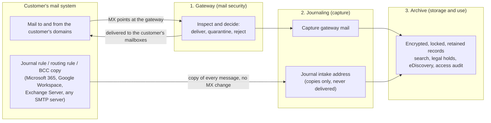
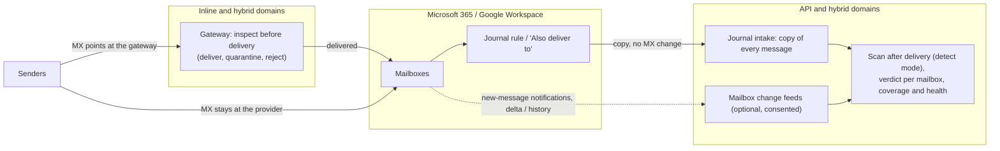

# Mail flow: the gateway, Journaling and the Archive

A one-page picture of how mail moves through the platform and who manages what, for product, sales and operations readers. Technical detail is linked at the end. Status: steps 8.1, 8.6 and API-1 (API-mode protection) are implemented and verified on the local stack; live Microsoft 365 and Google Workspace tenants, CI and the Kubernetes apply are still pending ([execution plan](../plan/execution-plan.md)).

## Three layers

The platform has three layers. A customer can use all three, or only the last two.

1. **The gateway (mail security).** The customer points the MX records of a domain at the gateway (or relays outbound mail through it). Every message is checked (spam, phishing, malware, URLs, attachments, data loss, policies) and then delivered, quarantined, rejected or tagged. This is the product most customers buy first.
2. **Journaling (capture).** Decides **what is copied into the archive**. There are two ways in:
   - **From the gateway:** mail that already flows through the gateway is captured as it is processed, including mail the gateway rejected or quarantined if the customer wants that.
   - **From journal intake:** the customer's own mail system sends a copy of every message to a secret address of the gateway. This works without any MX change: Microsoft 365 journal rules, Google Workspace routing rules, on-premises Exchange journaling, or any SMTP server that can send a blind copy. The gateway only archives these copies; it never delivers, forwards, quarantines or bounces them.
   - When both apply to the same message, the archive keeps **one record** with both sources (and a second body if the gateway changed the message on delivery).
3. **The Archive (storage and use).** Keeps what was captured: encrypted per customer, locked against deletion (Object Lock), retained by policy, held for legal matters, searchable, exportable for eDiscovery, with every access audited.

## Protection modes: inline, API, hybrid

Every domain is protected in one of three **protection modes** (step API-1). The organization has a default mode that every domain without its own mode inherits; a domain can override it. The mode is chosen in the first step of the add-domain wizard and can be changed later on the domain and organization pages (every change needs a reason and is recorded in the audit log).

| Mode                   | MX change needed | What the gateway does                                                                                                                                                                                                                                                                                                                                                                                                                                         | Can it block or delay mail?                                                          |
| ---------------------- | ---------------- | ------------------------------------------------------------------------------------------------------------------------------------------------------------------------------------------------------------------------------------------------------------------------------------------------------------------------------------------------------------------------------------------------------------------------------------------------------------- | ------------------------------------------------------------------------------------ |
| **Inline** (default)   | Yes              | Today's gateway: every message is inspected **before** delivery and then delivered, quarantined, rejected or tagged.                                                                                                                                                                                                                                                                                                                                          | Yes, by design (that is the protection).                                             |
| **API** (no MX change) | No               | The customer's Microsoft 365 or Google Workspace sends the gateway a **copy** of each message (the journal rule of journal intake) and, optionally, the gateway reads the mailboxes' change feeds. Each copy is fully scanned after delivery, evaluated against the tenant's policies (step API-4, detect mode) and the verdict is stored **per mailbox**; threats are then removed from the mailbox (step API-2) and retroactively clawed back (step API-3). | **Never.** The gateway never delivers, forwards, delays or bounces mail in API mode. |
| **Hybrid**             | Yes              | Inline filtering as today, plus the API side for post-delivery work (retroactive removal, internal mail, user reports). Copies of messages the gateway already filtered inline keep the inline verdict and are never evaluated or acted on again.                                                                                                                                                                                                             | Inline part: yes; API part: never.                                                   |

What the customer sets up for API mode, in their own tenant (the console's **Mailbox protection** page and the generated setup guide walk through it): the Microsoft 365 or Google Workspace **connection** (8.2, read-only), a **journal intake source** with the provider's journal or routing rule (the primary way copies arrive; no archiving plan is needed for it), and optionally the **mailbox access** consent (Microsoft: admin consent to a separate app with `Mail.ReadWrite` and `User.Read.All`; Google: domain-wide delegation with `gmail.modify` and Directory read). Mailbox access is what lets the gateway count mailboxes (coverage), read change feeds and, from step API-2, remove threats; it is separate from the mail-flow and account-takeover consents and can be revoked at any time (journal copies keep being scanned without it).

Safeguards: switching a domain to API mode is refused while its MX records still point at the gateway (choose Hybrid, or move the MX first), so a mode change can never make the gateway reject mail it still receives; a domain created in API mode does not accept mail at the gateway at all. Who may change modes: domain and organization administrators; who sees the Mailbox protection page: holders of `remediation:read`; who may change feeds and grant mailbox access: `remediation:write` (with `integration:manage` for the consent).

### Protection by mode: what each mode covers (step API-4)

The portal page _Security → Protection by mode_ (`GET /api-mode/protection-coverage`, [design](../plan/steps/38-api-mode-parity-onboarding.md) A10) shows this matrix and every domain's actual coverage with its gaps. The matrix is fixed in code (`PROTECTION_MODE_CAPABILITIES`):

| Capability (code)                                  | Inline                                                   | API                                                                  | Hybrid |
| -------------------------------------------------- | -------------------------------------------------------- | -------------------------------------------------------------------- | ------ |
| Blocking before delivery (`pre_delivery_blocking`) | yes                                                      | no — API mode acts after delivery                                    | yes    |
| Hold for review (`hold_for_review`)                | yes                                                      | partial — a review entry in the mailbox quarantine folder            | yes    |
| Removal after delivery (`post_delivery_removal`)   | partial — release from the gateway quarantine only       | yes                                                                  | yes    |
| Retroactive clawback (`retroactive_clawback`)      | no — needs mailbox access                                | yes                                                                  | yes    |
| Internal mail (`internal_mail`)                    | partial — only internal mail relayed through the gateway | yes                                                                  | yes    |
| Outbound DLP enforcement (`outbound_dlp_enforce`)  | yes                                                      | no — the message has already been sent                               | yes    |
| Outbound DLP detection (`outbound_dlp_detect`)     | yes                                                      | yes — recorded on the sender's mailbox, alert and webhook            | yes    |
| Tenant policies (`tenant_policies`)                | yes                                                      | partial — evaluated in detect mode; only post-delivery actions apply | yes    |
| URL rewriting (`url_rewriting`)                    | yes                                                      | no — messages are never edited after delivery                        | yes    |
| Message tagging (`message_tagging`)                | yes — headers and subject                                | yes — category / label                                               | yes    |
| User reports (`user_reports`)                      | no                                                       | yes — needs a report mailbox                                         | yes    |
| Alerts and webhooks (`alerts_webhooks`)            | yes                                                      | yes — `mailbox.threat.detected`, `mailbox.dlp.detected`              | yes    |

How a tenant policy decision applies to delivered mail (API mode): quarantine, require approval and reject move the message to the hidden quarantine folder or label (require approval as a review entry), tag/warn add the category or label, header and subject edits, banners, URL rewriting, bounces and sender notices are not possible after delivery and are recorded as not applicable; the remediation policy's `policyMapping` can change each mapping, never to a hard delete. Outbound mail is evaluated and recorded on the sender's mailbox, never touched. Onboarding an API-mode domain needs no DNS change other than the ownership TXT — or no DNS change at all when the organization's provider connection is already bound to the tenant that lists the domain as verified ([domain onboarding](../domains/onboarding.md#api-mode-and-hybrid-the-add-domain-wizard-step-api-4)).

## Who manages what

| Area                                                                       | Who                                                                         | Where in the admin console                              |
| -------------------------------------------------------------------------- | --------------------------------------------------------------------------- | ------------------------------------------------------- |
| Domains, mail servers, policies, quarantine (the gateway)                  | IT and mail administrators (Organization Admin, Domain Admin, …)            | Mail, Security, Directory                               |
| What is journaled, journal intake sources and their health (Journaling)    | IT and mail administrators (`journal:manage`)                               | Settings → Journaling                                   |
| Protection modes, mailbox access, coverage and detections (API mode)       | Domain and organization admins (modes), security analysts (`remediation:*`) | Domains, Organization, Security → Mailbox protection    |
| Retention, immutability, encryption keys, who may preview or download      | Compliance officers (`archive:manage`)                                      | Archive → Retention and lock                            |
| Searching and reading archived mail, legal holds, eDiscovery, access audit | Compliance officers and auditors (archive roles, assigned explicitly)       | Archive → Search, Legal holds, eDiscovery, Access audit |

Organization administrators **do not read archived mail by default**. Reading the archive needs an archive role (Compliance Officer, or Compliance Auditor for read-only investigations); assigning one asks for a confirmation and is recorded in the audit log. Administrators that existed before this change kept their access through an automatic Compliance Officer assignment (also recorded).

## The archive-only plan

Customers who want journaling and archiving **without** mail filtering use the **archive-only** plan. They connect their Microsoft 365 or Google Workspace tenant (read-only) or register their on-premises servers, add a journal intake source, and follow the generated setup guide in their own mail system. Their MX records stay where they are. The admin console shows them only the Archive, Journaling and directory pages (no dashboard, quarantine, mail servers or security pages), and their domains need only the ownership record (no MX, SPF or DKIM change).

## What the gateway never does with journal copies

- It never delivers, forwards or bounces a journal copy. Mail policies run on a copy only for API-mode protection (step API-4), in detect mode: the outcome is recorded and turned into a mailbox action after delivery, never into a delivery, hold or bounce.
- It accepts copies only from the customer's own tenant (Microsoft 365, proven by the tenant id in the report), with the customer's secret token (Google Workspace), or from the networks the customer registered (on-premises), over TLS. Anything else is refused in the SMTP session, or, when the proof inside the message fails, accepted and silently discarded (so forged mail never causes a bounce to an innocent sender).
- For archive-only journaling, scanning journal copies for threats is optional per customer and only adds the results to the archive record; with API mode every copy is scanned (detect mode).

## Further reading

- Design and verification: [step 8.1 journaling and archiving](../plan/steps/23-journaling-archiving.md), [step 8.6 journal intake and the Journaling / Archive split](../plan/steps/27-journal-intake-and-archive-split.md), [step API-1 API-mode protection](../plan/steps/35-api-mode-protection.md).
- Decisions: [ADR-0087 journal intake path](adr/0087-journal-intake-path.md), [ADR-0088 cross-source dedupe](adr/0088-archive-cross-source-dedupe.md), [ADR-0089 permission split](adr/0089-journaling-archive-permission-split.md), [ADR-0090 archive-only plan](adr/0090-archive-only-service-profile.md), [ADR-0098 protection modes](adr/0098-protection-modes-and-detect-mode-copies.md), [ADR-0099 mailbox access consent](adr/0099-mailbox-access-consent-and-custody.md), [ADR-0100 API-mode intake](adr/0100-api-mode-intake-mailbox-worker.md).
- Customer guides: [Microsoft 365](../integrations/journal-intake-microsoft-365.md), [Google Workspace](../integrations/journal-intake-google-workspace.md), [on-premises Exchange and SMTP](../integrations/journal-intake-on-premises.md); API mode: [Microsoft 365](../integrations/api-mode-microsoft-365.md), [Google Workspace](../integrations/api-mode-google-workspace.md).
- Technical: [architecture overview](overview.md), [contracts §31 and §34](contracts.md), runbooks [journal intake](../runbooks/journal-intake.md), [API mode](../runbooks/api-mode.md) and [archive](../runbooks/archive.md), [RBAC](../security/rbac.md).
