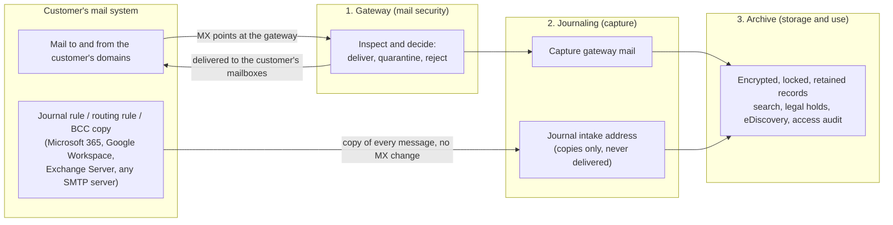

# Mail flow: the gateway, Journaling and the Archive

A one-page picture of how mail moves through the platform and who manages what, for product, sales and operations readers. Technical detail is linked at the end. Status: steps 8.1 and 8.6 are implemented and verified on the local stack; live Microsoft 365 and Google Workspace tenants, CI and the Kubernetes apply are still pending ([execution plan](../plan/execution-plan.md)).

## Three layers

The platform has three layers. A customer can use all three, or only the last two.

1. **The gateway (mail security).** The customer points the MX records of a domain at the gateway (or relays outbound mail through it). Every message is checked (spam, phishing, malware, URLs, attachments, data loss, policies) and then delivered, quarantined, rejected or tagged. This is the product most customers buy first.
2. **Journaling (capture).** Decides **what is copied into the archive**. There are two ways in:
   - **From the gateway:** mail that already flows through the gateway is captured as it is processed, including mail the gateway rejected or quarantined if the customer wants that.
   - **From journal intake:** the customer's own mail system sends a copy of every message to a secret address of the gateway. This works without any MX change: Microsoft 365 journal rules, Google Workspace routing rules, on-premises Exchange journaling, or any SMTP server that can send a blind copy. The gateway only archives these copies; it never delivers, forwards, quarantines or bounces them.
   - When both apply to the same message, the archive keeps **one record** with both sources (and a second body if the gateway changed the message on delivery).
3. **The Archive (storage and use).** Keeps what was captured: encrypted per customer, locked against deletion (Object Lock), retained by policy, held for legal matters, searchable, exportable for eDiscovery, with every access audited.

## Who manages what

| Area                                                                       | Who                                                                   | Where in the admin console                              |
| -------------------------------------------------------------------------- | --------------------------------------------------------------------- | ------------------------------------------------------- |
| Domains, mail servers, policies, quarantine (the gateway)                  | IT and mail administrators (Organization Admin, Domain Admin, …)      | Mail, Security, Directory                               |
| What is journaled, journal intake sources and their health (Journaling)    | IT and mail administrators (`journal:manage`)                         | Settings → Journaling                                   |
| Retention, immutability, encryption keys, who may preview or download      | Compliance officers (`archive:manage`)                                | Archive → Retention and lock                            |
| Searching and reading archived mail, legal holds, eDiscovery, access audit | Compliance officers and auditors (archive roles, assigned explicitly) | Archive → Search, Legal holds, eDiscovery, Access audit |

Organization administrators **do not read archived mail by default**. Reading the archive needs an archive role (Compliance Officer, or Compliance Auditor for read-only investigations); assigning one asks for a confirmation and is recorded in the audit log. Administrators that existed before this change kept their access through an automatic Compliance Officer assignment (also recorded).

## The archive-only plan

Customers who want journaling and archiving **without** mail filtering use the **archive-only** plan. They connect their Microsoft 365 or Google Workspace tenant (read-only) or register their on-premises servers, add a journal intake source, and follow the generated setup guide in their own mail system. Their MX records stay where they are. The admin console shows them only the Archive, Journaling and directory pages (no dashboard, quarantine, mail servers or security pages), and their domains need only the ownership record (no MX, SPF or DKIM change).

## What the gateway never does with journal copies

- It never delivers, forwards or bounces a journal copy, and never runs mail policies on it.
- It accepts copies only from the customer's own tenant (Microsoft 365, proven by the tenant id in the report), with the customer's secret token (Google Workspace), or from the networks the customer registered (on-premises), over TLS. Anything else is refused in the SMTP session, or, when the proof inside the message fails, accepted and silently discarded (so forged mail never causes a bounce to an innocent sender).
- Scanning journal copies for threats is optional per customer and only adds the results to the archive record.

## Further reading

- Design and verification: [step 8.1 journaling and archiving](../plan/steps/23-journaling-archiving.md), [step 8.6 journal intake and the Journaling / Archive split](../plan/steps/27-journal-intake-and-archive-split.md).
- Decisions: [ADR-0087 journal intake path](adr/0087-journal-intake-path.md), [ADR-0088 cross-source dedupe](adr/0088-archive-cross-source-dedupe.md), [ADR-0089 permission split](adr/0089-journaling-archive-permission-split.md), [ADR-0090 archive-only plan](adr/0090-archive-only-service-profile.md).
- Customer guides: [Microsoft 365](../integrations/journal-intake-microsoft-365.md), [Google Workspace](../integrations/journal-intake-google-workspace.md), [on-premises Exchange and SMTP](../integrations/journal-intake-on-premises.md).
- Technical: [architecture overview](overview.md), [contracts §31 and §34](contracts.md), runbooks [journal intake](../runbooks/journal-intake.md) and [archive](../runbooks/archive.md), [RBAC](../security/rbac.md).
