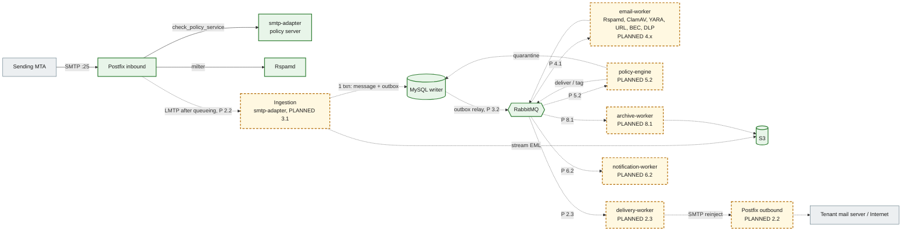

# Architecture overview

The Email Security Gateway is a multi-tenant mail filtering platform. It sits in front of a tenant's mail system (Microsoft 365, Google Workspace or on-premises) as the MX for inbound mail and as the smart host for outbound mail. It scans every message, applies tenant policy, and then delivers, tags, quarantines or discards it. Tenants can optionally turn on archiving.

One codebase ships as **shared SaaS** (many tenants) and as **dedicated** single-tenant deployments. The two differ only in configuration (Kustomize overlay, Terraform variables, `DEPLOYMENT_MODE`), never in code paths.

## Documentation map

| Document                                                                     | What it covers                                                                                                    |
| ---------------------------------------------------------------------------- | ----------------------------------------------------------------------------------------------------------------- |
| [Diagrams index](diagrams/README.md)                                         | The 15 diagrams, the IMPLEMENTED / PLANNED convention, and which diagrams contain planned elements                |
| [1. System context](diagrams/01-system-context.md)                           | Senders, tenants' mail systems, admins, end users, DNS, AWS, threat feeds                                         |
| [2. Containers](diagrams/02-containers.md)                                   | The 8 deployables, Postfix, Rspamd, ClamAV, MySQL primary + replica, RabbitMQ, Redis, S3, OpenSearch, ClickHouse  |
| [3. Components](diagrams/03-components.md)                                   | Nest modules inside `api`, `smtp-adapter`, `email-worker`, `policy-engine`, `delivery-worker`; shared packages    |
| [4. SaaS deployment](diagrams/04-deployment-saas.md)                         | EKS, `overlays/saas`, managed services                                                                            |
| [5. Dedicated deployment](diagrams/05-deployment-dedicated.md)               | `overlays/dedicated`, per-customer account or VPC                                                                 |
| [6. Inbound SMTP](diagrams/06-inbound-smtp-sequence.md)                      | Policy delegation, milter, fail-closed `4xx`, LMTP ingestion, `250` after commit, outbox                          |
| [7. Outbound SMTP](diagrams/07-outbound-smtp-sequence.md)                    | Relay authentication, scanning, DKIM signing, outbound Postfix retries and DSNs                                   |
| [8. Internal inspection](diagrams/08-internal-inspection-sequence.md)        | Direction resolution from connector and verified domains, never from headers                                      |
| [9. Scanning](diagrams/09-scanning-sequence.md)                              | Engine fan-out, timeouts as outcomes, `email_scans` / `scan_engine_results`, scanned event                        |
| [10. Quarantine and release](diagrams/10-quarantine-release-sequence.md)     | `quarantine_messages`, release with re-validation, `quarantine_actions` / `quarantine_release_logs`               |
| [11. Message state machine](diagrams/11-message-state-machine.md)            | `email_messages.status` lifecycle (transitions planned for step 3.3)                                              |
| [12. Failure handling](diagrams/12-failure-handling.md)                      | Spool, tempfail, outbox, `processOnce`, quorum queues and DLQs, replay, reader fallback                           |
| [13. Multi-tenant isolation](diagrams/13-multi-tenant-isolation.md)          | Where the organization id comes from and where it is enforced                                                     |
| [14. AWS Mumbai](diagrams/14-aws-mumbai.md)                                  | ap-south-1 production layout (planned, step 10.1)                                                                 |
| [15. Hyderabad DR](diagrams/15-dr-hyderabad.md)                              | ap-south-2 warm standby (planned, step 10.2)                                                                      |
| [Contracts](contracts.md)                                                    | Policy delegation, milter, LMTP, RabbitMQ topology, event envelope and payloads, engine contract, health, S3 keys |
| [Data ownership](data-ownership.md)                                          | Writers per table, bucket, queue and cache; who may read the replica                                              |
| [Security boundaries](security-boundaries.md)                                | Trust zones, network boundaries, DB accounts, secrets, tenant isolation points                                    |
| [Failure handling](failure-handling.md)                                      | Per-dependency failure, detection and recovery; the service dependency matrix                                     |
| [ADRs](adr/README.md)                                                        | Architecture decision records 0001–0014                                                                           |
| [Database](../database/README.md), [replication](../database/replication.md) | Schema reference, partitioning, read/write split                                                                  |
| [Execution plan](../plan/execution-plan.md)                                  | The delivery steps referenced as `PLANNED x.y` throughout these documents                                         |

## Capacity targets

| Metric       | Target                                      | Design consequence                                                                                                                                     |
| ------------ | ------------------------------------------- | ------------------------------------------------------------------------------------------------------------------------------------------------------ |
| Daily volume | 1M messages/day, growing                    | ~12 msg/s on average                                                                                                                                   |
| Peak         | 300 msg/s sustained burst                   | Every stage scales horizontally; queues absorb spikes                                                                                                  |
| Average size | ~75 KB (long tail to 50 MB)                 | ~75 GB/day of EML into S3; bodies never go on queues                                                                                                   |
| MySQL growth | ~1M message rows + ~1.5M recipient rows/day | 16 high-volume tables are range-partitioned: monthly on `received_at` (or their own time column), the outbox daily. Implemented in step 1.1 (ADR-0014) |
| Availability | 99.9% for mail acceptance                   | Postfix's disk spool buffers mail through any downstream outage                                                                                        |

## Logical services and deployable workloads

The 15 logical services are kept as **modules with clear boundaries**. Modules are grouped into a small number of deployables, split only where scaling or isolation needs differ. Any module can be extracted later without changing its contract, because modules talk through `packages/*` contracts and RabbitMQ events, never through each other's internals. The modules inside each deployable are shown in [diagram 3](diagrams/03-components.md).

| #   | Logical service             | Deployable (`apps/*`)                                   | Why it lives there                                                      |
| --- | --------------------------- | ------------------------------------------------------- | ----------------------------------------------------------------------- |
| 1   | Identity                    | `api`                                                   | Request/response, low volume                                            |
| 2   | Tenant Management           | `api`                                                   | Control plane CRUD                                                      |
| 3   | Domain Management           | `api`                                                   | Control plane; DNS verification job added in step 2.1                   |
| 4   | SMTP Gateway                | Postfix + `smtp-adapter`                                | Postfix speaks SMTP; the adapter answers in-session policy checks       |
| 5   | Email Ingestion             | `smtp-adapter` (LMTP listener, steps 2.2 and 3.1)       | Must persist before Postfix gets a 250                                  |
| 6   | Email Processing            | `email-worker`                                          | CPU/IO-heavy and scales with mail volume                                |
| 7   | Security Engine             | `email-worker` (engine adapters) → Rspamd, ClamAV, YARA | Engines are external daemons or in-process; adapters share one contract |
| 8   | Policy Engine               | `policy-engine`                                         | Scales independently; deterministic decision logic                      |
| 9   | Quarantine                  | `api` (release/review) + `policy-engine` (writes)       | Admin and end-user actions are request/response                         |
| 10  | Email Delivery              | `delivery-worker` → Postfix outbound                    | Postfix owns retries (ADR-0006)                                         |
| 11  | Archive                     | `archive-worker`                                        | Optional per tenant; isolates S3 write load                             |
| 12  | Notification                | `notification-worker`                                   | Digests and alerts; must not slow the mail path                         |
| 13  | Reporting                   | `api` (reads ClickHouse/OpenSearch)                     | Read-only queries                                                       |
| 14  | Audit                       | `api` + `audit_logs` table                              | Append-only; ClickHouse copy later                                      |
| 15  | Integration (M365 / Google) | `api` now, `integration-worker` when API sync lands     | Connector setup in the API; mailbox sync is async work                  |

The admin console is `admin-portal` (Next.js). It talks only to `api`, and holds no data-store credentials.

## Mail path

Green solid boxes and arrows exist and are tested; amber dashed boxes and dotted arrows are planned, with the delivering step (see the [diagram convention](diagrams/README.md#status-convention)). The step-by-step sequences are diagrams [6](diagrams/06-inbound-smtp-sequence.md), [7](diagrams/07-outbound-smtp-sequence.md), [9](diagrams/09-scanning-sequence.md) and [10](diagrams/10-quarantine-release-sequence.md).



1. **In-session (pre-queue).** Postfix calls `smtp-adapter` through the policy delegation protocol (recipient validation, tenant resolution, rate limits) and Rspamd as a milter. **Only these two may reject (5xx) or defer (4xx).** Rejecting during the session creates no backscatter. Both fail **closed to 4xx**: if the policy service or Rspamd is unreachable, Postfix tempfails, so the sender retries later. Mail is never accepted unchecked. The integration tests check this behaviour for the policy service. Today the policy service answers `DUNNO`; tenant resolution, recipient validation and rate limits arrive in step 2.2.
2. **Handoff.** Postfix queues the message on disk, then delivers it over LMTP to ingestion. Ingestion streams the EML to S3 and commits the message row and an outbox row in **one MySQL transaction**. It answers `250` only after the commit. Any failure answers `4xx`, so Postfix keeps the message and retries. _Until LMTP ingestion exists (steps 2.2 and 3.1), the local Postfix discards accepted mail._
3. **Post-queue.** The outbox relay publishes `mail.message.received.v1`. `email-worker` runs the security engines and publishes `mail.message.scanned.v1`. `policy-engine` decides `deliver | tag | quarantine | discard` and publishes `mail.policy.decided.v1`. **Post-queue processing never bounces.** Once Postfix has said 250, policy never generates an NDR. `discard` is silent to the sender, so it is always audited.
4. **Delivery.** `delivery-worker` reinjects approved mail into a dedicated outbound Postfix. From then on, Postfix owns MX lookup, TLS, retries, backoff and DSNs.

**Direction** (inbound, outbound or internal) is derived from the listener or connector the mail arrived on and the tenant's verified domains. **Headers never decide direction** ([diagram 8](diagrams/08-internal-inspection-sequence.md)).

## Data stores

| Store                                   | Holds                                                                                                                                                                   | Never holds                                                    |
| --------------------------------------- | ----------------------------------------------------------------------------------------------------------------------------------------------------------------------- | -------------------------------------------------------------- |
| MySQL 8.4 (GTID primary + read replica) | Organizations, domains, users, policies, message metadata and state, quarantine index, outbox (`message_outbox`), idempotency ledger (`message_idempotency`), audit log | Message bodies or attachment content; long-term event history  |
| S3 (MinIO locally)                      | EML, attachments, archive copies. Keys are tenant-prefixed: `org/{organizationId}/...`                                                                                  | —                                                              |
| RabbitMQ                                | Events with ids and S3 keys                                                                                                                                             | Message bodies                                                 |
| Redis                                   | Caches, rate-limit counters, short-lived locks                                                                                                                          | Anything that must survive a flush (never the source of truth) |
| OpenSearch                              | Searchable message-trace metadata for the portal                                                                                                                        | Bodies or attachments                                          |
| ClickHouse                              | Event history and analytics for dashboards and reports                                                                                                                  | Transactional state                                            |

The schema has 61 tables in 10 modules ([ADR-0014](adr/0014-mysql-data-model-partitioning-read-write-split.md), [database docs](../database/README.md)). Ids are `BIGINT UNSIGNED`; aggregates exposed by the API also carry a UUIDv7 `public_id`. Internally (events, S3 keys, logs) ids travel as decimal strings.

Docker Compose runs a MySQL **primary** (`mysql`, writer) and a **replica** (`mysql-replica`) with GTID replication, seeded by the one-shot `mysql-replica-setup` container. The data plane (ingestion, scanning, policy, delivery, archive) reads and writes **only the writer**, so replica lag can never affect a mail decision; ESLint and DI assertions enforce this. Only `api` registers `PrismaReadService` for control-plane reads, and it falls back to the writer whenever the replica is unreachable, stopped or lagging ([replication.md](../database/replication.md)). In production the two URLs map to the RDS or Aurora writer and reader endpoints. Who writes which table is in [data ownership](data-ownership.md).

## Reliability patterns

- **Transactional outbox.** A state change and the event that announces it are committed together in `message_outbox` (partitioned daily), and a relay publishes them with publisher confirms (relay planned for step 3.2). No event is lost and none is invented.
- **Idempotent consumers.** Every consumer wraps its side effects in `processOnce(prisma, consumer, eventId, handler)` (`packages/database`). The `message_idempotency` row and the effects commit atomically, so a redelivery becomes a no-op.
- **Quorum queues + DLQ.** Every work queue is a replicated quorum queue with a delivery limit. After that limit, poison messages go to `<queue>.dlq` (`packages/event-contracts/src/topology.ts`).
- **Fail-safe verdicts.** Engines return `error` and `timeout` as explicit outcomes. Policy decides what an unavailable engine means (for example, quarantine when antivirus is down), so failures are never silently treated as `clean`.
- **Health model.** `/health/live` checks only the process. `/health/ready` checks every dependency with a 2 s timeout and returns 503 when any one fails. The `api`'s `mysql-reader` check reports the replica mode in `details` and never fails readiness, because the writer fallback keeps the api correct. Kubernetes routes traffic only to ready pods.
- **Partition maintenance.** A maintenance job (`db:partitions`) creates future partitions and drops expired ones by a reviewed retention registry, and never drops an outbox partition that still has unpublished rows (step 1.1, work package WP4).

Per-dependency behaviour is in [failure handling](failure-handling.md).

## Multi-tenancy

- Every tenant-owned table has a non-null `organization_id BIGINT UNSIGNED`, and its tenant-scoped indexes lead with it. Platform catalogs have none, and five tables allow `NULL` for platform-level rows (ADR-0014).
- The organization comes from the authenticated principal (API), from the receiving connector or verified domain (mail path), or from the event envelope's `organizationId` (workers). **It never comes from a client-supplied header.**
- S3 keys in event payloads must start with `org/{organizationId}/`. The event schema validates the format; consumers must also check that the prefix equals the envelope's `organizationId` (step 3.x).
- Dedicated deployments run the same code with one customer organization. Deployment-mode branches in business logic are not allowed.

The enforcement points are listed in [diagram 13](diagrams/13-multi-tenant-isolation.md) and [security boundaries](security-boundaries.md).

## Cross-cutting concerns

| Concern       | Implementation                                                                                                                                                                                                   |
| ------------- | ---------------------------------------------------------------------------------------------------------------------------------------------------------------------------------------------------------------- |
| Configuration | `packages/config`: zod schemas validated once at startup. Fails fast and never echoes values. `<KEY>_FILE` support for mounted secrets                                                                           |
| Logging       | `packages/logger`: pino JSON with `service`, `correlationId`, `tenantId`, `traceId` and `spanId` on every line. `tenantId` carries the organization id (field name kept for log stability). Secrets are redacted |
| Correlation   | `x-correlation-id` is accepted only when well formed (otherwise a new one is minted), echoed on the response and carried in event envelopes                                                                      |
| Tracing       | OpenTelemetry Node SDK with auto-instrumentation (HTTP, Express, MySQL, AMQP, Redis), exported over OTLP when `OTEL_EXPORTER_OTLP_ENDPOINT` is set                                                               |
| Errors        | One global exception filter. Expected errors keep their status; anything else is logged and returned as a generic 500 with the correlation id                                                                    |
| API           | URI versioning (`/v1/...`). Probes are unversioned. OpenAPI at `/docs` outside production                                                                                                                        |

## Repository layout

```
apps/            deployable workloads (never import each other)
packages/        shared libraries (contracts, config, logger, database, Nest common)
infrastructure/  docker, kubernetes, terraform, postfix, rspamd, clamav, rabbitmq, mysql, minio, monitoring
docs/            architecture, ADRs, database, api, security, deployment, runbooks
tests/           integration tests against the running Docker Compose stack
scripts/         developer tooling
```

The ESLint configuration enforces module boundaries: apps cannot import other apps, packages must be imported by name, and data-plane apps cannot import `PrismaReadService`.

## What exists now and what comes next

**Phase 0 (step 0.1, done):** the monorepo, shared packages, a running API, a policy server, worker shells that assert their queue topology and report readiness, the admin dashboard, the Compose stack, CI, Kubernetes base manifests and a Terraform skeleton (the S3 + KMS module).

**Step 1.1 (database) and step 0.2 (architecture documentation), this step:**

- The complete MySQL data model: 61 tables, `BIGINT UNSIGNED` ids with `public_id` on exposed aggregates, `organization_id` on every tenant-owned table, 16 partitioned tables created with a `pmax` partition, and the `message_identities` registry (ADR-0014). Verified by `tests/integration/schema.test.ts`.
- The read/write split: GTID primary + replica in Compose, a reader account with `SELECT` + `REPLICATION CLIENT`, `PrismaReadService` with lag-based writer fallback in `api` only. Verified by `tests/integration/replication.test.ts` and unit tests. The probe reads Prisma's positional `SHOW REPLICA STATUS` columns ([replication.md](../database/replication.md#lag-handling-and-modes)).
- Contracts aligned to decimal ids: the event envelope carries `organizationId`, payloads carry the registry `messageId` and `receivedAt`, S3 keys are `org/{organizationId}/...`.
- Partition maintenance, seeds, the performance harness and the retention and backup docs are delivered by the same step (work package WP4).
- This architecture documentation set (15 diagrams, contracts, data ownership, security boundaries, failure handling).

No business feature exists yet: no ingestion, consumers, engine adapters, policies, quarantine, delivery or authentication.

**Next (see the [execution plan](../plan/execution-plan.md)):** tenant management (1.2) and authentication/RBAC (1.3) → domain onboarding (2.1) → the Postfix gateway with LMTP ingestion and outbound Postfix (2.2) and routing (2.3) → ingestion, RabbitMQ architecture and the message lifecycle (3.1–3.3) → engine adapters (4.x) → scoring, policy and quarantine (5.x) → the REST API and webhooks (6.x) → the admin portal (7.x) → archiving, connectors and the deployment manager (8.x) → performance (9.x) → AWS, DR and monitoring (10.x).
