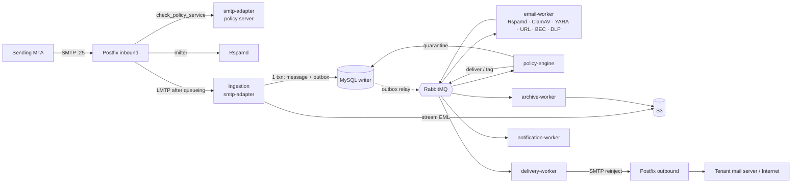

# Architecture overview

The Email Security Gateway is a multi-tenant mail filtering platform. It sits in front of a tenant's mail system (Microsoft 365, Google Workspace or on-premises) as the MX for inbound mail and as the smart host for outbound mail. It scans every message, applies tenant policy, and then delivers, tags, quarantines or discards it. Tenants can optionally turn on archiving.

One codebase ships as **shared SaaS** (many tenants) and as **dedicated** single-tenant deployments. The two differ only in configuration (Kustomize overlay, Terraform variables, `DEPLOYMENT_MODE`), never in code paths.

## Capacity targets

| Metric       | Target                                      | Design consequence                                              |
| ------------ | ------------------------------------------- | --------------------------------------------------------------- |
| Daily volume | 1M messages/day, growing                    | ~12 msg/s on average                                            |
| Peak         | 300 msg/s sustained burst                   | Every stage scales horizontally; queues absorb spikes           |
| Average size | ~75 KB (long tail to 50 MB)                 | ~75 GB/day of EML into S3; bodies never go on queues            |
| MySQL growth | ~1M message rows + ~1.5M recipient rows/day | Per-message tables partitioned by month (planned, ADR-0004)     |
| Availability | 99.9% for mail acceptance                   | Postfix's disk spool buffers mail through any downstream outage |

## Logical services and deployable workloads

The 15 logical services are kept as **modules with clear boundaries**. Modules are grouped into a small number of deployables, split only where scaling or isolation needs differ. Any module can be extracted later without changing its contract, because modules talk through `packages/*` contracts and RabbitMQ events, never through each other's internals.

| #   | Logical service             | Deployable (`apps/*`)                                   | Why it lives there                                                      |
| --- | --------------------------- | ------------------------------------------------------- | ----------------------------------------------------------------------- |
| 1   | Identity                    | `api`                                                   | Request/response, low volume                                            |
| 2   | Tenant Management           | `api`                                                   | Control plane CRUD                                                      |
| 3   | Domain Management           | `api`                                                   | Control plane; DNS verification job added later                         |
| 4   | SMTP Gateway                | Postfix + `smtp-adapter`                                | Postfix speaks SMTP; the adapter answers in-session policy checks       |
| 5   | Email Ingestion             | `smtp-adapter` (LMTP listener, next phase)              | Must persist before Postfix gets a 250                                  |
| 6   | Email Processing            | `email-worker`                                          | CPU/IO-heavy and scales with mail volume                                |
| 7   | Security Engine             | `email-worker` (engine adapters) → Rspamd, ClamAV, YARA | Engines are external daemons or in-process; adapters share one contract |
| 8   | Policy Engine               | `policy-engine`                                         | Scales independently; deterministic decision logic                      |
| 9   | Quarantine                  | `api` (release/review) + `policy-engine` (writes)       | Admin and end-user actions are request/response                         |
| 10  | Email Delivery              | `delivery-worker` → Postfix outbound                    | Postfix owns retries (ADR-0006)                                         |
| 11  | Archive                     | `archive-worker`                                        | Optional per tenant; isolates S3 write load                             |
| 12  | Notification                | `notification-worker`                                   | Digests and alerts; must not slow the mail path                         |
| 13  | Reporting                   | `api` (reads ClickHouse/OpenSearch)                     | Read-only queries                                                       |
| 14  | Audit                       | `api` + `audit_logs` table                              | Append-only; ClickHouse copy later                                      |
| 15  | Integration (M365 / Google) | `api` now, `integration-worker` when API sync lands     | Connector setup in the API; mailbox sync is async work                  |

The admin console is `admin-portal` (Next.js). It talks only to `api`, and holds no data-store credentials.

## Mail path



1. **In-session (pre-queue).** Postfix calls `smtp-adapter` through the policy delegation protocol (recipient validation, tenant resolution, rate limits) and Rspamd as a milter. **Only these two may reject (5xx) or defer (4xx).** Rejecting during the session creates no backscatter. Both fail **closed to 4xx**: if the policy service or Rspamd is unreachable, Postfix tempfails, so the sender retries later. Mail is never accepted unchecked. The integration tests check this behaviour.
2. **Handoff.** Postfix queues the message on disk, then delivers it over LMTP to ingestion. Ingestion streams the EML to S3 and commits the message row and an outbox row in **one MySQL transaction**. It answers `250` only after the commit. Any failure answers `4xx`, so Postfix keeps the message and retries.
3. **Post-queue.** The outbox relay publishes `mail.message.received.v1`. `email-worker` runs the security engines and publishes `mail.message.scanned.v1`. `policy-engine` decides `deliver | tag | quarantine | discard` and publishes `mail.policy.decided.v1`. **Post-queue processing never bounces.** Once Postfix has said 250, policy never generates an NDR. `discard` is silent to the sender, so it is always audited.
4. **Delivery.** `delivery-worker` reinjects approved mail into a dedicated outbound Postfix. From then on, Postfix owns MX lookup, TLS, retries, backoff and DSNs.

**Direction** (inbound, outbound or internal) is derived from the listener or connector the mail arrived on and the tenant's verified domains. **Headers never decide direction.**

## Data stores

| Store                         | Holds                                                                                                     | Never holds                                                    |
| ----------------------------- | --------------------------------------------------------------------------------------------------------- | -------------------------------------------------------------- |
| MySQL 8.4 (writer + replicas) | Tenants, domains, users, policies, message state, quarantine index, outbox, idempotency ledger, audit log | Message bodies; high-volume event history                      |
| S3 (MinIO locally)            | EML, attachments, archive copies. Keys are tenant-prefixed: `org/{tenantId}/...`                          | —                                                              |
| RabbitMQ                      | Events with ids and S3 keys                                                                               | Message bodies                                                 |
| Redis                         | Caches, rate-limit counters, short-lived locks                                                            | Anything that must survive a flush (never the source of truth) |
| OpenSearch                    | Searchable message-trace metadata for the portal                                                          | Bodies or attachments                                          |
| ClickHouse                    | Event history and analytics for dashboards and reports                                                    | Transactional state                                            |

The data plane (ingestion, scanning, policy, delivery) reads and writes **only the MySQL writer**, so replica lag can never affect a mail decision. Read replicas serve control-plane reads such as portal lists and reports.

## Reliability patterns

- **Transactional outbox.** A state change and the event that announces it are committed together, and a relay publishes them with publisher confirms. No event is lost and none is invented.
- **Idempotent consumers.** Every consumer wraps its side effects in `processOnce(consumer, eventId)` (`packages/database`). The ledger row and the effects commit atomically, so a redelivery becomes a no-op.
- **Quorum queues + DLQ.** Every work queue is a replicated quorum queue with a delivery limit. After that limit, poison messages go to `<queue>.dlq` (`packages/event-contracts/src/topology.ts`).
- **Fail-safe verdicts.** Engines return `error` and `timeout` as explicit outcomes. Policy decides what an unavailable engine means (for example, quarantine when antivirus is down), so failures are never silently treated as `clean`.
- **Health model.** `/health/live` checks only the process. `/health/ready` checks every dependency with a 2 s timeout and returns 503 when any one fails. Kubernetes routes traffic only to ready pods.

## Multi-tenancy

- Every tenant-owned table has a non-null `tenant_id`, and its indexes lead with it.
- The tenant comes from the authenticated principal (API), from the receiving connector or verified domain (mail path), or from the event envelope (workers). **It never comes from a client-supplied header.**
- S3 keys and event payloads are validated against the tenant in the envelope (`emlS3Key` must start with `org/`).
- Dedicated deployments run the same code with one tenant. Deployment-mode branches in business logic are not allowed.

## Cross-cutting concerns

| Concern       | Implementation                                                                                                                                     |
| ------------- | -------------------------------------------------------------------------------------------------------------------------------------------------- |
| Configuration | `packages/config`: zod schemas validated once at startup. Fails fast and never echoes values. `<KEY>_FILE` support for mounted secrets             |
| Logging       | `packages/logger`: pino JSON with `service`, `correlationId`, `tenantId`, `traceId` and `spanId` on every line. Secrets are redacted               |
| Correlation   | `x-correlation-id` is accepted only when well formed (otherwise a new one is minted), echoed on the response and carried in event envelopes        |
| Tracing       | OpenTelemetry Node SDK with auto-instrumentation (HTTP, Express, MySQL, AMQP, Redis), exported over OTLP when `OTEL_EXPORTER_OTLP_ENDPOINT` is set |
| Errors        | One global exception filter. Expected errors keep their status; anything else is logged and returned as a generic 500 with the correlation id      |
| API           | URI versioning (`/v1/...`). Probes are unversioned. OpenAPI at `/docs` outside production                                                          |

## Repository layout

```
apps/            deployable workloads (never import each other)
packages/        shared libraries (contracts, config, logger, database, Nest common)
infrastructure/  docker, kubernetes, terraform, postfix, rspamd, clamav, rabbitmq, mysql, minio, monitoring
docs/            architecture, ADRs, database, api, security, deployment, runbooks
tests/           integration tests against the running Docker Compose stack
scripts/         developer tooling
```

The ESLint configuration enforces module boundaries: apps cannot import other apps, and packages must be imported by name.

## What exists now and what comes next

**Phase 0 (this scaffold):** the monorepo, shared packages, a running API, a policy server, worker shells that assert their queue topology and report readiness, the admin dashboard, the initial schema and migrations, the Compose stack, CI, Kubernetes base manifests and a Terraform skeleton.

**Next phases (indicative):** LMTP ingestion and the outbox relay → engine adapters (Rspamd, ClamAV, YARA) and aggregation → the policy model and quarantine → outbound delivery → identity and RBAC → the M365/Google connectors → reporting (ClickHouse) and search (OpenSearch) → archive.
