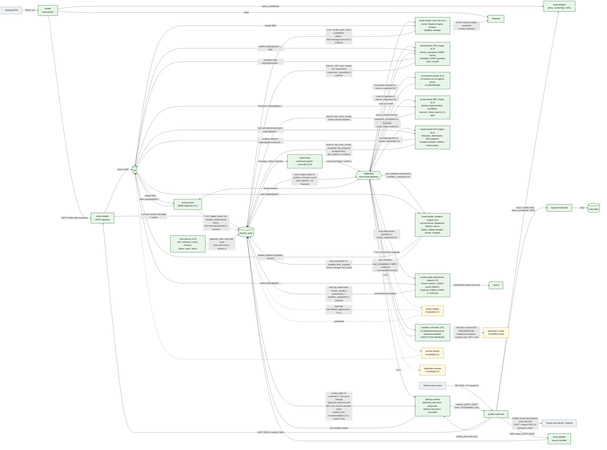

# Architecture overview

The Email Security Gateway is a multi-tenant mail filtering platform. It sits in front of a tenant's mail system (Microsoft 365, Google Workspace or on-premises) as the MX for inbound mail and as the smart host for outbound mail. It scans every message, applies tenant policy, and then delivers, tags, quarantines or discards it. Tenants can optionally turn on archiving.

One codebase ships as **shared SaaS** (many tenants) and as **dedicated** single-tenant deployments. The two differ only in configuration (Kustomize overlay, Terraform variables, `DEPLOYMENT_MODE`), never in code paths.

## Documentation map

| Document                                                                     | What it covers                                                                                                                              |
| ---------------------------------------------------------------------------- | ------------------------------------------------------------------------------------------------------------------------------------------- |
| [Diagrams index](diagrams/README.md)                                         | The 21 diagrams, the IMPLEMENTED / PLANNED convention, and which diagrams contain planned elements                                          |
| [1. System context](diagrams/01-system-context.md)                           | Senders, tenants' mail systems, admins, end users, DNS, AWS, threat feeds                                                                   |
| [2. Containers](diagrams/02-containers.md)                                   | The 9 deployables (incl. `event-relay`), Postfix, Rspamd, ClamAV, MySQL primary + replica, RabbitMQ, Redis, S3, OpenSearch, ClickHouse      |
| [3. Components](diagrams/03-components.md)                                   | Nest modules inside `api`, `smtp-adapter`, `email-worker`, `policy-engine`, `delivery-worker`; shared packages                              |
| [4. SaaS deployment](diagrams/04-deployment-saas.md)                         | EKS, `overlays/saas`, managed services                                                                                                      |
| [5. Dedicated deployment](diagrams/05-deployment-dedicated.md)               | `overlays/dedicated`, per-customer account or VPC                                                                                           |
| [6. Inbound SMTP](diagrams/06-inbound-smtp-sequence.md)                      | Policy delegation, milter, fail-closed `4xx`, LMTP ingestion, `250` after commit, outbox                                                    |
| [7. Outbound SMTP](diagrams/07-outbound-smtp-sequence.md)                    | Relay authentication, scanning, DKIM signing, outbound Postfix retries and DSNs                                                             |
| [8. Internal inspection](diagrams/08-internal-inspection-sequence.md)        | Direction resolution from connector and verified domains, never from headers                                                                |
| [9. Scanning](diagrams/09-scanning-sequence.md)                              | Step 4.1 scan role: `scan.spam` → Rspamd `/checkv2` → round, results, auth results, `scanned.v1`; failures and retries                      |
| [10. Quarantine and release](diagrams/10-quarantine-release-sequence.md)     | `quarantine_messages`, release with re-validation, `quarantine_actions` / `quarantine_release_logs`                                         |
| [11. Message state machine](diagrams/11-message-state-machine.md)            | Fifteen lifecycle states, edges E1–E27, producers (step 3.3; scan edges and E27 in 4.1, E4 retired; policy 5.x)                             |
| [12. Failure handling](diagrams/12-failure-handling.md)                      | Spool, tempfail, outbox, `processOnce`, quorum queues and DLQs, replay, reader fallback                                                     |
| [13. Multi-tenant isolation](diagrams/13-multi-tenant-isolation.md)          | Where the organization id comes from and where it is enforced                                                                               |
| [14. AWS Mumbai](diagrams/14-aws-mumbai.md)                                  | ap-south-1 production layout (planned, step 10.1)                                                                                           |
| [15. Hyderabad DR](diagrams/15-dr-hyderabad.md)                              | ap-south-2 warm standby (planned, step 10.2)                                                                                                |
| [16. Inbound routing](diagrams/16-inbound-routing-sequence.md)               | Approval, planning, reinjection on 10026 (token, XFORWARD, trace), tenant destinations, status from the log                                 |
| [17. Outbound routing](diagrams/17-outbound-routing-sequence.md)             | Classification, rate limits, 10027 via the recipient MX (no cross-tenant shortcut), DKIM, status                                            |
| [18. Internal routing](diagrams/18-internal-routing-sequence.md)             | Same-organization recipients to the organization's own servers on 10026, one parent message                                                 |
| [19. Retry and bounces](diagrams/19-retry-bounce-sequence.md)                | Postfix backoff and recovery, bounce with DSN, expiry, inbound without DSN, idempotent signals, reconciler                                  |
| [20. MIME ingestion](diagrams/20-mime-ingestion-sequence.md)                 | `email.received` → email-worker parse (streamed, limits) → S3 parts + MySQL rows + `mail.message.parsed.v1` in one transaction              |
| [23. Scan pipeline](diagrams/23-scan-pipeline.md)                            | Scan round flow, engine registry, completion under the message lock, deadline sweeper (step 4.1)                                            |
| [21. Event relay](diagrams/21-event-relay-sequence.md)                       | Outbox → event-relay (confirms) → exchanges → consumer (`processOnce`) → retry / delay queue / dead letter → audited replay; reconciler     |
| [22. Delivery lifecycle](diagrams/22-delivery-lifecycle.md)                  | Approval → planner → per-recipient states → derived message state (`delivery_retry` / `delivered` / `rejected`), recovery (step 3.3)        |
| [Messaging topology](messaging-topology.md)                                  | Vhost, six exchanges, fourteen quorum queues, bindings, policies, routing keys, headers, role users (step 3.2, ADR-0024)                    |
| [Contracts](contracts.md)                                                    | Policy delegation, milter, LMTP, RabbitMQ topology, events, engine contract, health, S3 keys, reinjection, delivery approval and status log |
| [Data ownership](data-ownership.md)                                          | Writers per table, bucket, queue and cache; who may read the replica                                                                        |
| [Security boundaries](security-boundaries.md)                                | Trust zones, network boundaries, DB accounts, secrets, tenant isolation points                                                              |
| [Failure handling](failure-handling.md)                                      | Per-dependency failure, detection and recovery; the service dependency matrix                                                               |
| [ADRs](adr/README.md)                                                        | Architecture decision records 0001–0025                                                                                                     |
| [Database](../database/README.md), [replication](../database/replication.md) | Schema reference, partitioning, read/write split                                                                                            |
| [Execution plan](../plan/execution-plan.md)                                  | The delivery steps referenced as `PLANNED x.y` throughout these documents                                                                   |

## Capacity targets

| Metric       | Target                                      | Design consequence                                                                                                                                     |
| ------------ | ------------------------------------------- | ------------------------------------------------------------------------------------------------------------------------------------------------------ |
| Daily volume | 1M messages/day, growing                    | ~12 msg/s on average                                                                                                                                   |
| Peak         | 300 msg/s sustained burst                   | Every stage scales horizontally; queues absorb spikes                                                                                                  |
| Average size | ~75 KB (long tail to 50 MB)                 | ~75 GB/day of EML into S3; bodies never go on queues                                                                                                   |
| MySQL growth | ~1M message rows + ~1.5M recipient rows/day | 16 high-volume tables are range-partitioned: monthly on `received_at` (or their own time column), the outbox daily. Implemented in step 1.1 (ADR-0014) |
| Availability | 99.9% for mail acceptance                   | Postfix's disk spool buffers mail through any downstream outage                                                                                        |

## Logical services and deployable workloads

The 15 logical services are kept as **modules with clear boundaries**. Modules are grouped into a small number of deployables, split only where scaling or isolation needs differ. Any module can be extracted later without changing its contract, because modules talk through `packages/*` contracts and RabbitMQ events, never through each other's internals. The modules inside each deployable are shown in [diagram 3](diagrams/03-components.md).

| #   | Logical service             | Deployable (`apps/*`)                                                                                                                                                                                                                                                                                                                                                                                                                                                                                                                                                                                                                                                                                                                                                                                                                                                                                                                                                                                                                                                                                                                   | Why it lives there                                                                                                                      |
| --- | --------------------------- | --------------------------------------------------------------------------------------------------------------------------------------------------------------------------------------------------------------------------------------------------------------------------------------------------------------------------------------------------------------------------------------------------------------------------------------------------------------------------------------------------------------------------------------------------------------------------------------------------------------------------------------------------------------------------------------------------------------------------------------------------------------------------------------------------------------------------------------------------------------------------------------------------------------------------------------------------------------------------------------------------------------------------------------------------------------------------------------------------------------------------------------- | --------------------------------------------------------------------------------------------------------------------------------------- |
| 1   | Identity                    | `api`                                                                                                                                                                                                                                                                                                                                                                                                                                                                                                                                                                                                                                                                                                                                                                                                                                                                                                                                                                                                                                                                                                                                   | Request/response, low volume                                                                                                            |
| 2   | Tenant Management           | `api`                                                                                                                                                                                                                                                                                                                                                                                                                                                                                                                                                                                                                                                                                                                                                                                                                                                                                                                                                                                                                                                                                                                                   | Control plane CRUD                                                                                                                      |
| 3   | Domain Management           | `api`                                                                                                                                                                                                                                                                                                                                                                                                                                                                                                                                                                                                                                                                                                                                                                                                                                                                                                                                                                                                                                                                                                                                   | Control plane; DNS verification job added in step 2.1                                                                                   |
| 4   | SMTP Gateway                | `postfix` (inbound MX), `postfix-outbound` + `smtp-adapter`                                                                                                                                                                                                                                                                                                                                                                                                                                                                                                                                                                                                                                                                                                                                                                                                                                                                                                                                                                                                                                                                             | Postfix speaks SMTP; the adapter serves policy, socketmap and SASL (2.2)                                                                |
| 5   | Email Ingestion             | `smtp-adapter` (LMTP listeners, step 2.2)                                                                                                                                                                                                                                                                                                                                                                                                                                                                                                                                                                                                                                                                                                                                                                                                                                                                                                                                                                                                                                                                                               | Must persist before Postfix gets a 250                                                                                                  |
| 6   | Email Processing            | `email-worker` (post-queue MIME parsing, step 3.1, ADR-0022)                                                                                                                                                                                                                                                                                                                                                                                                                                                                                                                                                                                                                                                                                                                                                                                                                                                                                                                                                                                                                                                                            | CPU/IO-heavy and scales with mail volume; parsing stays off the SMTP path                                                               |
| 7   | Security Engine             | `email-worker` **scan role** (step 4.1, ADR-0026: own Deployment `email-worker-scan`, own broker user `eg-scanner`, per-engine queues) → Rspamd (4.1), `attachment` engine: ClamAV, YARA-X, known hashes, archives (4.2, own Deployment `email-worker-attachment`), `url` engine: extraction, reputation, lookalikes, SSRF-guarded redirect resolution, link rewriting (4.3, own Deployment `email-worker-url`), `bec` engine: phishing/BEC — sender identity, impersonation, lookalikes, payment/urgency cues, credential links, opt-in communication history, optional bounded AI layer (4.4, stage 2 after rspamd and url, own Deployment `email-worker-bec`), `dlp` engine: data loss prevention — 23 detectors with validators and context, tenant dictionaries and RE2 patterns, attachment text extraction in isolated children, tenant policy actions, masked results, envelope-encrypted evidence (4.5, stage 1, own Deployment `email-worker-dlp`); time of click: **`click-service`** (4.3, public, own DB account); dynamic inspection: **`url-browser-worker`** + **`url-egress-proxy`** (4.3, isolated, optional profile) | Engines are external daemons or in-process; adapters share one contract and an engine registry; MIME and scan roles scale independently |
| 8   | Policy Engine               | `policy-engine` (5.2); the risk score it reads is computed by the email-worker scan role at round completion (step 5.1, ADR-0042: `message_risk_scores`)                                                                                                                                                                                                                                                                                                                                                                                                                                                                                                                                                                                                                                                                                                                                                                                                                                                                                                                                                                                | Scales independently; deterministic decision logic                                                                                      |
| 9   | Quarantine                  | `api` (release/review) + `policy-engine` (writes)                                                                                                                                                                                                                                                                                                                                                                                                                                                                                                                                                                                                                                                                                                                                                                                                                                                                                                                                                                                                                                                                                       | Admin and end-user actions are request/response                                                                                         |
| 10  | Email Delivery              | `delivery-worker` → Postfix outbound                                                                                                                                                                                                                                                                                                                                                                                                                                                                                                                                                                                                                                                                                                                                                                                                                                                                                                                                                                                                                                                                                                    | Postfix owns retries (ADR-0006)                                                                                                         |
| 11  | Archive                     | `archive-worker`                                                                                                                                                                                                                                                                                                                                                                                                                                                                                                                                                                                                                                                                                                                                                                                                                                                                                                                                                                                                                                                                                                                        | Optional per tenant; isolates S3 write load                                                                                             |
| 12  | Notification                | `notification-worker`                                                                                                                                                                                                                                                                                                                                                                                                                                                                                                                                                                                                                                                                                                                                                                                                                                                                                                                                                                                                                                                                                                                   | Digests and alerts; must not slow the mail path                                                                                         |
| 13  | Reporting                   | `api` (reads ClickHouse/OpenSearch)                                                                                                                                                                                                                                                                                                                                                                                                                                                                                                                                                                                                                                                                                                                                                                                                                                                                                                                                                                                                                                                                                                     | Read-only queries                                                                                                                       |
| 14  | Audit                       | `api` + `audit_logs` table                                                                                                                                                                                                                                                                                                                                                                                                                                                                                                                                                                                                                                                                                                                                                                                                                                                                                                                                                                                                                                                                                                              | Append-only; ClickHouse copy later                                                                                                      |
| 15  | Integration (M365 / Google) | `api` now, `integration-worker` when API sync lands                                                                                                                                                                                                                                                                                                                                                                                                                                                                                                                                                                                                                                                                                                                                                                                                                                                                                                                                                                                                                                                                                     | Connector setup in the API; mailbox sync is async work                                                                                  |

The admin console is `admin-portal` (Next.js). It talks only to `api`, and holds no data-store credentials.

**Event transport (step 3.2, [ADR-0023](adr/0023-outbox-relay-and-reconciliation.md), [ADR-0024](adr/0024-rabbitmq-topology-retry-dead-letter.md)).** A ninth deployable, `event-relay`, is the only publisher of pipeline events: it reads `message_outbox` on the MySQL writer in advisory-lock shards, publishes each row with publisher confirms to the exchange of its event type (vhost `email-gateway`, topology v1: six topic exchanges, fourteen quorum queues, routing key `org.<organizationId>.<eventType>`) and marks the row published only after the confirm. Its reconciler re-drives published events that a tracked consumer never recorded in its ledger. Consumers (`email-worker` on `email.received`, `delivery-worker` on `email.delivery.pending`) use the shared client library (`packages/common/src/messaging`): manual acks after the `processOnce` transaction, retries without losing an attempt during outages, dead letters into `email.dead-letter`, replayed only through the audited platform API. The development-only dev pass-through and smtp-adapter's cache invalidation stay outbox tails by design ([design Q13](../plan/steps/07-rabbitmq.md)). The step 3.1/2.3 outbox **poller is no longer a production transport and there is no fallback to it**: two transports per consumer would double the failure modes, and a broker outage is already covered by the outbox (rows wait unpublished) and the reconciler.

## Mail path

Green solid boxes and arrows exist and are tested; amber dashed boxes and dotted arrows are planned, with the delivering step (see the [diagram convention](diagrams/README.md#status-convention)). The step-by-step sequences are diagrams [6](diagrams/06-inbound-smtp-sequence.md), [7](diagrams/07-outbound-smtp-sequence.md), [9](diagrams/09-scanning-sequence.md), [10](diagrams/10-quarantine-release-sequence.md) and, for routing and delivery, [16](diagrams/16-inbound-routing-sequence.md), [17](diagrams/17-outbound-routing-sequence.md), [18](diagrams/18-internal-routing-sequence.md) and [19](diagrams/19-retry-bounce-sequence.md).



1. **In-session (pre-queue).** Postfix calls `smtp-adapter` through the policy delegation protocol (tenant resolution, recipient validation, rate limits, size, sender ownership and suppressions on the outbound listeners), socketmap tables (relay domains, connector IPs and certificates, transport and TLS maps) and the Dovecot SASL protocol (submission AUTH), and Rspamd as a milter on the inbound MX. **Only these may reject (5xx) or defer (4xx).** Rejecting during the session creates no backscatter. The smtp-adapter paths fail **closed to 4xx**: if the adapter, its database or Redis is unreachable, Postfix tempfails, so the sender retries later. The Rspamd milter fails **open to accept** since step 4.1 ([ADR-0027](adr/0027-rspamd-milter-policy.md)): it may reject only GTUBE and score ≥ 15 in-session, and an accepted message is always scanned post-queue, where an unavailable engine is `scan_failed`, never clean. Implemented in step 2.2 and verified by the stack SMTP suites (`tests/integration/smtp-*.test.ts`).
2. **Handoff.** Postfix queues the message on disk, then delivers it over LMTP to ingestion (`direction` = the listener: 10050 inbound, 10051 outbound). Ingestion streams the EML to S3 once and commits, **per organization**, the registry, message, recipient, event and outbox rows in one MySQL writer transaction. It answers `250` per recipient only after its organization's commit; any failure answers `451 4.3.0`, so Postfix keeps the message and retries, and a retry is deduplicated by the ingest key (step 2.2, [contracts](contracts.md#3-postfix--smtp-adapter-lmtp-ingestion)). Nothing is parsed on this path.
3. **Post-queue.** **MIME ingestion** (step 3.1, [design](../plan/steps/06-mime-ingestion.md), [ADR-0022](adr/0022-mime-parsing-and-post-queue-ingestion.md), [diagram 20](diagrams/20-mime-ingestion-sequence.md)): the email-worker consumes `mail.message.received.v1` from the `email.received` quorum queue (published by the event-relay; step 3.2), checks the envelope organization against the writer row, streams the EML from S3 into `@email-gateway/mime-parser` under limits (size, depth, parts, headers, ratios, timeout), streams every body and attachment to a deterministic `org/{organizationId}/part/…` key, re-verifies the EML hash, and commits in one writer transaction the `email_message_parses` row (`parsed`, `parsed_with_defects`, `parse_limit_exceeded` or `parse_failed`), the allow-listed `email_headers`, the `email_attachments` (sanitized filenames, sniffed types, SHA-256, archive flags), the decoded subject, an `email_events` row and `mail.message.parsed.v1` / `mail.message.parse_failed.v1`. Malformed mail is a recorded status, never a crash; infrastructure errors are retried (the queue consumer holds the delivery and republishes it, no attempt consumed), never recorded as content outcomes. The event-relay publishes the parse events to `email.ingestion`. **Scanning** (step 4.1, [design](../plan/steps/09-rspamd.md), [ADR-0026](adr/0026-security-scan-pipeline.md), diagrams [9](diagrams/09-scanning-sequence.md) and [23](diagrams/23-scan-pipeline.md)): the email-worker **scan role** consumes `parsed.v1` (and an operator's `rescan_requested.v1`) from each registered engine's queue (`scan.spam` for Rspamd), opens the scan round (`email_scans`, one per lifecycle round; E3 `persisted → scanning`), streams the EML from S3 to Rspamd `/checkv2` with the trusted envelope, maps the reply to one of seven verdicts with reason codes under platform and per-tenant thresholds, records failed attempts and the final result (`scan_engine_results`) and SPF/DKIM/DMARC/ARC (`email_auth_results`), and, once every required engine has reported, completes the round under the message lock: E6 `scanned` or E7 `scan_failed` and `mail.message.scanned.v1` in one transaction. An engine failure is never clean. Since step 4.2 ([design](../plan/steps/10-attachment-scanning.md), [ADR-0028](adr/0028-attachment-scanning-engine.md), [deployment](../deployment/attachment-scanning.md), [runbook](../runbooks/attachment-scanning.md)) every round also requires the **`attachment` engine** (`scan.attachment`, Deployment `email-worker-attachment`): it reads the parse row and the attachment rows on the writer (an incomplete attachment list is never clean), looks every SHA-256 up in the platform-wide known-threat catalog, and per attachment reads the stored part from S3 and runs clamd `INSTREAM` and a resource-limited inspector child (true type, archive walk under limits, YARA-X) in parallel, with a tenant-independent content cache in Redis whose values are authenticated with a worker-only key; suspicious and unknown attachments become sandbox submissions (contract for 4.6). Since step 4.3 ([design](../plan/steps/11-url-protection.md), ADR-0029..0032, [deployment](../deployment/url-protection.md)) every round also requires the **`url` engine** (`scan.url`, Deployment `email-worker-url`): it extracts and normalizes the URLs of the stored bodies (and text/html attachments), checks them against the platform threat feed (uncached), DNS blocklists and RDAP through an HMAC-authenticated Redis cache, detects lookalike domains, resolves shorteners and suspicious links through one SSRF-guarded fetcher, maps them with `url-map/1` (external outages → `unknown`, never clean) and writes a **rewritten copy** of the EML whose links point at the `click-service` (`/c/<signed token>`); approvals deliver that copy. At click time the click-service verifies the token, rechecks the URL (feed, cache, chain, the isolated browser's dynamic result) and allows (302 to the stored URL), warns or blocks under the tenant's click policy. `policy-engine` (5.2) will consume `scanned.v1` from `email.policy.evaluate`, decide `deliver | tag | quarantine | discard` and publish `mail.policy.decided.v1` (until then the development pass-through approves scanned mail locally, never a `scan_failed` one). **Post-queue processing never bounces.** Once Postfix has said 250, policy never generates an NDR. `discard` is silent to the sender, so it is always audited. (Two documented exceptions at ingestion, ADR-0019: a genuine gateway loop `554 5.4.6` and an outbound `From` header that does not match the authenticated sender domain.)
4. **Delivery** (step 2.3, [design](../plan/steps/05-routing.md), [ADR-0021](adr/0021-mail-routing-and-delivery-status.md)). Delivery starts from an **approval** (`mail.delivery.approved.v1`, published by the event-relay and consumed by the delivery-worker from `email.delivery.pending`, with retries through the delay queue `email.delivery.retry`). The producers are the policy engine (5.2) and the quarantine release (5.3/6.1); until they exist, local and CI stacks use the **development-only pass-through**, which since step 4.1 approves every **scanned** message (`scanned.v1` with `outcome = scanned`, edge E27; any verdict) without policy, never a `scan_failed` or parse-failed one, and is refused outside `APP_ENV=local|ci`; it also holds what the 4.x engines and (since step 5.1) the round's risk score recommend holding (`malicious`, a deterministic BEC verdict, a DLP action, a risk recommendation of `require_approval`/`quarantine`/`block`, a hard block, an error row or a missing score row). The worker re-checks each recipient's direction, groups recipients per destination (one parent message, per-recipient deliveries), applies the outbound rate limits (Redis, fail closed) and reinjects each group into `postfix-outbound` with a reinjection token in `XFORWARD IDENT`/`ENVID` and one organization-neutral `X-Gateway-Trace`: `10026` for inbound and internal recipients (the organization's destination servers as a next-hop list with failover; customer servers or the Microsoft 365 / Google Workspace presets with verified TLS), `10027` for outbound recipients (the recipient domain's MX; `transport_maps` is never consulted, so another tenant on this gateway is reached through its public MX), DKIM-signed by `rspamd-outbound`. From then on **Postfix owns** MX lookup, TLS, retries, backoff, expiry and DSNs (inbound: none to the external sender). The worker's status tailer turns Postfix's delivery log into per-recipient status — `delivered` only from `status=sent` after the remote `2xx` — with the postmaster DSN copies as corroboration; every signal is idempotent and a missing signal ends in `unknown`. The api serves the status (`GET /messages/{id}/deliveries`, `/deliveries`).

**Direction** (inbound, outbound or internal) is derived per recipient from the listener or connector the mail arrived on and the tenant's verified domains: everything arriving at the inbound MX is `inbound`; from an authenticated connector, a recipient in an active domain of the **same** organization is `internal`, anything else `outbound`. **Headers never decide direction** ([diagram 8](diagrams/08-internal-inspection-sequence.md)).

## Data stores

| Store                                   | Holds                                                                                                                                                                   | Never holds                                                    |
| --------------------------------------- | ----------------------------------------------------------------------------------------------------------------------------------------------------------------------- | -------------------------------------------------------------- |
| MySQL 8.4 (GTID primary + read replica) | Organizations, domains, users, policies, message metadata and state, quarantine index, outbox (`message_outbox`), idempotency ledger (`message_idempotency`), audit log | Message bodies or attachment content; long-term event history  |
| S3 (MinIO locally)                      | EML, attachments, archive copies. Keys are tenant-prefixed: `org/{organizationId}/...`                                                                                  | —                                                              |
| RabbitMQ                                | Events with ids and S3 keys                                                                                                                                             | Message bodies                                                 |
| Redis                                   | Caches, rate-limit counters, short-lived locks                                                                                                                          | Anything that must survive a flush (never the source of truth) |
| OpenSearch                              | Searchable message-trace metadata for the portal                                                                                                                        | Bodies or attachments                                          |
| ClickHouse                              | Event history and analytics for dashboards and reports                                                                                                                  | Transactional state                                            |

The schema has 99 tables (30 partitioned, after step 4.5) in 10 modules ([ADR-0014](adr/0014-mysql-data-model-partitioning-read-write-split.md), [database docs](../database/README.md)). Ids are `BIGINT UNSIGNED`; aggregates exposed by the API also carry a UUIDv7 `public_id`. Internally (events, S3 keys, logs) ids travel as decimal strings.

Docker Compose runs a MySQL **primary** (`mysql`, writer) and a **replica** (`mysql-replica`) with GTID replication, seeded by the one-shot `mysql-replica-setup` container. The data plane (ingestion, scanning, policy, delivery, archive) reads and writes **only the writer**, so replica lag can never affect a mail decision; ESLint and DI assertions enforce this. Only `api` registers `PrismaReadService` for control-plane reads, and it falls back to the writer whenever the replica is unreachable, stopped or lagging ([replication.md](../database/replication.md)). In production the two URLs map to the RDS or Aurora writer and reader endpoints. Who writes which table is in [data ownership](data-ownership.md).

## Reliability patterns

- **Transactional outbox.** A state change and the event that announces it are committed together in `message_outbox` (partitioned daily); the `event-relay` publishes them with publisher confirms and sets `published_at` only after the broker confirmed (step 3.2, ADR-0023). No event is lost and none is invented; a broker outage leaves rows unpublished, never dropped. The reconciler re-drives published events without a consumer ledger row (bounded).
- **Idempotent consumers.** Every consumer wraps its side effects in `processOnce(prisma, consumer, eventId, handler)` (`packages/database`). The `message_idempotency` row and the effects commit atomically, so a redelivery becomes a no-op.
- **Quorum queues, retries and one dead-letter queue** (topology v1, ADR-0024, [messaging topology](messaging-topology.md)). Every queue is a replicated quorum queue; mutable settings are policies. Consumers ack manually after their effects commit; failures are classified (transient → held and republished without consuming an attempt, retryable → exponential backoff with equal jitter, fatal → dead letter at once); delivery retries go through the delay queue `email.delivery.retry`; everything exhausted lands in `email.dead-letter`, replayed only by `POST /api/v1/platform/dead-letters/replay` (MFA platform admin, audited). `delivery-limit` 20 is a crash-loop backstop. Nothing on the broker carries content (content guard).
- **Fail-safe verdicts.** Engines return `error` and `timeout` as explicit outcomes. Since step 5.1 the risk score of every round turns them into risk (a failed required engine forces at least `medium` and `quarantine`; `unknown` is never `clean`; a scoring failure writes a fail-safe `high` / `quarantine` row); policy (5.2) decides what to do with it and must stay at least as strict as the failure floor, so failures are never silently treated as `clean`.
- **Health model.** `/health/live` checks only the process. `/health/ready` checks every dependency with a 2 s timeout and returns 503 when any one fails. The `api`'s `mysql-reader` check reports the replica mode in `details` and never fails readiness, because the writer fallback keeps the api correct. Kubernetes routes traffic only to ready pods.
- **Partition maintenance.** A maintenance job (`db:partitions`) creates future partitions and drops expired ones by a reviewed retention registry, and never drops an outbox partition that still has unpublished rows (step 1.1, work package WP4).

Per-dependency behaviour is in [failure handling](failure-handling.md).

## Multi-tenancy

- Every tenant-owned table has a non-null `organization_id BIGINT UNSIGNED`, and its tenant-scoped indexes lead with it. Platform catalogs have none, and five tables allow `NULL` for platform-level rows (ADR-0014).
- The organization comes from the authenticated principal (API), from the receiving connector or verified domain (mail path), or from the event envelope's `organizationId` (workers). **It never comes from a client-supplied header.**
- S3 keys in event payloads must start with `org/{organizationId}/`. The event schema validates the format; consumers must also check that the prefix equals the envelope's `organizationId` (step 3.x).
- Dedicated deployments run the same code with one customer organization. Deployment-mode branches in business logic are not allowed.

The enforcement points are listed in [diagram 13](diagrams/13-multi-tenant-isolation.md) and [security boundaries](security-boundaries.md).

## Cross-cutting concerns

| Concern       | Implementation                                                                                                                                                                                                   |
| ------------- | ---------------------------------------------------------------------------------------------------------------------------------------------------------------------------------------------------------------- |
| Configuration | `packages/config`: zod schemas validated once at startup. Fails fast and never echoes values. `<KEY>_FILE` support for mounted secrets                                                                           |
| Logging       | `packages/logger`: pino JSON with `service`, `correlationId`, `tenantId`, `traceId` and `spanId` on every line. `tenantId` carries the organization id (field name kept for log stability). Secrets are redacted |
| Correlation   | `x-correlation-id` is accepted only when well formed (otherwise a new one is minted), echoed on the response and carried in event envelopes                                                                      |
| Tracing       | OpenTelemetry Node SDK with auto-instrumentation (HTTP, Express, MySQL, AMQP, Redis), exported over OTLP when `OTEL_EXPORTER_OTLP_ENDPOINT` is set                                                               |
| Errors        | One global exception filter. Expected errors keep their status; anything else is logged and returned as a generic 500 with the correlation id                                                                    |
| API           | URI versioning (`/v1/...`). Probes are unversioned. OpenAPI at `/docs` outside production                                                                                                                        |

## Repository layout

```
apps/            deployable workloads (never import each other)
packages/        shared libraries (contracts, config, logger, database, Nest common)
infrastructure/  docker, kubernetes, terraform, postfix, rspamd, clamav, rabbitmq, mysql, minio, monitoring
docs/            architecture, ADRs, database, api, security, deployment, runbooks
tests/           integration tests against the running Docker Compose stack
scripts/         developer tooling
```

The ESLint configuration enforces module boundaries: apps cannot import other apps, packages must be imported by name, and data-plane apps cannot import `PrismaReadService`.

## What exists now and what comes next

**Phase 0 (step 0.1, done):** the monorepo, shared packages, a running API, a policy server, worker shells that assert their queue topology and report readiness, the admin dashboard, the Compose stack, CI, Kubernetes base manifests and a Terraform skeleton (the S3 + KMS module).

**Step 1.1 (database) and step 0.2 (architecture documentation):**

- The complete MySQL data model: 61 tables, `BIGINT UNSIGNED` ids with `public_id` on exposed aggregates, `organization_id` on every tenant-owned table, 16 partitioned tables created with a `pmax` partition, and the `message_identities` registry (ADR-0014). Verified by `tests/integration/schema.test.ts`.
- The read/write split: GTID primary + replica in Compose, a reader account with `SELECT` + `REPLICATION CLIENT`, `PrismaReadService` with lag-based writer fallback in `api` only. Verified by `tests/integration/replication.test.ts` and unit tests. The probe reads Prisma's positional `SHOW REPLICA STATUS` columns ([replication.md](../database/replication.md#lag-handling-and-modes)).
- Contracts aligned to decimal ids: the event envelope carries `organizationId`, payloads carry the registry `messageId` and `receivedAt`, S3 keys are `org/{organizationId}/...`.
- Partition maintenance, seeds, the performance harness and the retention and backup docs are delivered by the same step (work package WP4).
- This architecture documentation set (15 diagrams, contracts, data ownership, security boundaries, failure handling).

**Steps 1.2 + 1.3 (tenant management, authentication, RBAC)** ([design](../plan/steps/02-tenants-auth-rbac.md), [ADR-0015](adr/0015-api-base-path.md), [ADR-0016](adr/0016-authentication-sessions-rbac.md)):

- Business routes moved under `/api/v1`; every non-public route passes the global fail-closed `AuthGuard` → `PermissionsGuard` (bearer JWT or `X-API-Key`), and an e2e test proves no route ships without an authorization requirement. OpenAPI snapshot: [docs/api/openapi.json](../api/openapi.json).
- Authentication ([authentication.md](../security/authentication.md)): Argon2id passwords, rotating refresh-token sessions with reuse detection and immediate revocation (Redis deny-list), brute-force lockout, TOTP MFA with recovery codes and organization-enforced enrollment, password reset and email verification through the `NOTIFY_SMTP_*` relay, invitations, API keys, the audited platform override and a bootstrap CLI for the first super admin.
- RBAC ([rbac.md](../security/rbac.md)): the permission catalog, 8 system roles, custom roles without escalation, last-administrator protection; users, roles, API keys and login events APIs.
- Tenant management ([API](../api/README.md#organizations-organizations-tag)): the organization catalog (create with plan-materialized limits/features, settings, deployment row and an invited administrator; plan changes that keep overrides; suspension that cuts off sessions and API keys), settings with validation, feature and limit overrides, usage counters from the read replica, and the four-eyes deletion workflow with legal-hold and archive-retention safeguards ([runbook](../runbooks/organization-deletion.md); the purge job itself is deferred).
- Tenant isolation: the tenant comes only from the authenticated principal (`TenantScope`); repositories are the only Prisma users and take the scope first; another tenant's resource is `404`. Proven by the API integration suites against real MySQL and Redis, including the tenant isolation suites.

**Step 2.1 (domain onboarding)** ([design](../plan/steps/03-domain-onboarding.md), [ADR-0017](adr/0017-dns-resolution-strategy.md), [ADR-0018](adr/0018-dkim-key-custody.md)):

- The domains API ([API](../api/README.md#domains-domains-tag-step-21), [customer guide](../domains/onboarding.md)): add a domain (name normalization incl. IDN, reserved names, `max_domains`), DNS TXT ownership proof with "first to verify wins" across organizations, generated MX/SPF/DKIM/DMARC records with per-record checks, warnings and recommendations (SPF merge and the 10-lookup limit, DMARC none → quarantine → reject), the lifecycle `pending_verification → verified → active ⇄ suspended → deleted` (soft delete that frees the name; `failed` on expiry or a lost claim), and DKIM rotation with an overlap window. New permission `domain:dkim_rotate` ([rbac.md](../security/rbac.md#domain-permissions-step-21)).
- DNS resolution behind a port in `apps/api/src/dns`: system (`node:dns`) or DNS-over-HTTPS upstreams, MX propagation upstreams, a TTL-capped Redis cache, and the rule that an indeterminate lookup (timeout, SERVFAIL, …) never changes any state.
- DKIM private keys generated in the api and stored encrypted with `SecretBox` (`DATA_ENCRYPTION_KEY`), crypto-shredded on retirement or revocation.
- Background verification, re-verification and DKIM retirement inside the api (`DomainCheckScheduler`; Redis tick lock, conditional claims and per-domain locks, safe with several replicas; [runbook](../runbooks/domain-verification.md)).
- Audit rows for every transition and the `domain.status.changed.v1` event written to `message_outbox` in the same transaction (published once the relay exists, step 3.2); `resolveActiveDomain` in `@email-gateway/database` for the mail path of step 2.2 ([contracts](contracts.md)).
- Proven by unit tests, e2e tests and the API integration suites `domains.test.ts`, `domain-jobs.test.ts` and `tenant-isolation-domains.test.ts` against MySQL, Redis and an in-process test DNS/DoH server (no public DNS).

**Step 2.2 (Postfix SMTP gateway)** ([design and verification record](../plan/steps/04-smtp-gateway.md), [ADR-0019](adr/0019-smtp-gateway-topology.md), [ADR-0020](adr/0020-dkim-signing.md)):

- Two Postfix instances: `postfix` (inbound MX: postscreen, anvil limits, TLS ≥ 1.2, relay domains from the adapter, policy at RCPT and end of data, Rspamd milter, LMTP to ingestion) and `postfix-outbound` (587 SASL submission after STARTTLS, 25 connector relay by source IP or client-certificate fingerprint, internal reinjection 10026/10027, bounce notices). Every listener's relay permission is explicit; the defaults refuse everything.
- smtp-adapter: policy contexts `inbound`, `submission`, `relay`, `reinject-inbound`, `reinject-outbound`; socketmap maps `relay_domain`, `transport`, `tls_policy`, `relay_client`, `relay_ccert`; a Dovecot-auth-protocol SASL server (Argon2id connector secrets); Redis caches, rate limits and outbox-tail cache invalidation; durable LMTP ingestion (S3 + one writer transaction per organization, ingest-key dedupe, multi-tenant split with server-side copies, loop guard, outbound From check); the bounce handler; reputation counters; `/metrics`.
- api: SMTP connectors and recipient allow-lists (`/api/v1/smtp-connectors`, `/api/v1/domains/{id}/recipient-validation`, `/recipients`), and the DKIM signing publisher (redis-dkim, one-shot `dkim:sync`).
- Verified by unit and in-process integration suites and by the stack SMTP suites against the real Compose stack (inbound and outbound delivery, relay refusals on every listener, TLS, MinIO outage, Postfix restart, LMTP retry dedupe, multi-tenant split, 40 × 1 000 messages with zero loss, DKIM verification, bounces, loops, fail-closed); results in the step note's §12.

**Step 2.3 (mail routing and per-recipient delivery tracking)** ([design and verification record](../plan/steps/05-routing.md), [ADR-0021](adr/0021-mail-routing-and-delivery-status.md), [operations](../deployment/mail-routing.md), [customer destination setup](../domains/destination-servers.md)):

- `@email-gateway/mail-routing`: direction resolution per recipient, destination-host safety (no private/metadata IP literals, single-label or internal names, gateway hosts), Microsoft 365 / Google Workspace presets as seeded data (`mail_destination_presets`), route planning and reinjection keys, hop evaluation, and the shared delivery status recorder (audit trail `delivery_status_events`, transition lattice, message aggregate, `mail.delivery.status_changed.v1`).
- delivery-worker: approval feed (outbox poller), the development-only pass-through, planner, internal SMTP client and reinjector (token, XFORWARD, ENVID, NOTIFY per direction, streaming from S3), outbound rate limits, Postfix delivery-log tailer (rotation, cursor), reconciler, metrics.
- postfix-outbound: 10027 `content_filter=smtp:` (no cross-tenant shortcut), `maillog_file` for the status reader, retry and connect-timeout settings from the environment; smtp-adapter: classification at ingestion (`internal` messages), next-hop lists and provider TLS names in the maps, bounce notices matched to reinjections; api: destination servers (`/domains/{id}/destinations`, `/destination-providers`) and delivery status (`/messages/{id}/deliveries`, `/deliveries`) with `domain:routing_manage` and `delivery:read`.
- Verified by unit and integration suites and by the routing stack suites through both Postfix instances to test sinks presenting test-CA certificates with the providers' names (inbound with header preservation, mixed recipients incl. another tenant via the gateway MX, loops, outage and recovery, failover, bounces with DSN, duplicate signals, rate limits); results in the step note's §12.

Not built yet: re-parsing after a parser version change, execution of unknown files in production (the sandbox of 4.6 is orchestration, isolation contract and threat model; no VM-class runner), policies and the real approval producers (5.x; the dev pass-through stands in locally, holding what the DLP action holds), quarantine actions, gateway-generated notifications for worker-side failures (6.2), rule-based routing overrides (`delivery_routes`), MTA-STS/DANE, LDAP / SMTP-callout recipient validation, Ed25519 dual signing; and the admin-portal pages (7.x), SSO, per-organization API rate limits (6.1) and the organization purge job.

**Step 3.1 (MIME parser and post-queue email ingestion)** ([design and verification record](../plan/steps/06-mime-ingestion.md), [ADR-0022](adr/0022-mime-parsing-and-post-queue-ingestion.md), [runbook](../runbooks/mime-ingestion.md)):

- `@email-gateway/mime-parser`: a streaming parser over `@zone-eu/mailsplit` (no `mailparser`), the M5 limits, defect codes for malformed MIME, the header allow-list with RFC 2047/6532 decoding, filename sanitization and flags, a magic-byte sniffer and a zip/gzip inspector that never extracts.
- email-worker `MimeIngestionModule`: the sharded, concurrent outbox feed (`email-worker.mime-parser`; replaced by the `email.received` queue consumer in step 3.2), the M3 flow (ledger, tenant check against the writer row, poison guard, pre-read checks, integrity re-verification, one finalize transaction), the S3 part sink, metrics and log redaction. The step 2.3 outbox poller moved into `@email-gateway/common` (delivery-worker migrated without behaviour change).
- Forward migration `mime_ingestion` (`email_message_parses`, partitioned; new `email_attachments` columns); events `mail.message.parsed.v1` and `mail.message.parse_failed.v1`.
- Verified by the mime-parser corpus and unit tests, the email-worker unit and integration suites (MySQL writer, MinIO) and the stack suite `tests/integration/mime-ingestion.test.ts` through Postfix; results in the step note's §12. `email_messages.status` is unchanged by this step (3.3 owns the lifecycle).

**Step 3.2 (RabbitMQ event-driven processing)** ([design and verification record](../plan/steps/07-rabbitmq.md), [ADR-0023](adr/0023-outbox-relay-and-reconciliation.md), [ADR-0024](adr/0024-rabbitmq-topology-retry-dead-letter.md), [topology](messaging-topology.md), [runbook](../runbooks/rabbitmq-messaging.md), [diagram 21](diagrams/21-event-relay-sequence.md)):

- Topology v1 as data (`@email-gateway/event-contracts`: event registry, six exchanges, fourteen quorum queues, bindings, policies, routing keys) exported to `infrastructure/rabbitmq/definitions.json` and provisioned by `infrastructure/rabbitmq/init.mjs` (Compose `rabbitmq-init`, `pnpm rabbitmq:init`) into vhost `email-gateway` with least-privilege role users; services verify passively and never declare. The ADR-0005 objects on vhost `/` are removed.
- The AMQP client library in `@email-gateway/common` (connection recovery across node URLs, confirm publisher, content guard, queue consumer with retry/delay/dead-letter, metrics, Nest module); the crash-only `RabbitMqModule` is gone, policy-engine, archive-worker and notification-worker no longer connect to RabbitMQ.
- `apps/event-relay` (relay shards, reconciler, metrics, alert rules `infrastructure/monitoring/rules/messaging.rules.yml`), forward migration `event_relay` (`redrive_count`, `last_redriven_at`); email-worker and delivery-worker consume `email.received` / `email.delivery.pending` (consumer names unchanged, so the pre-3.2 backlog replayed as ledger duplicates); the api's dead-letter view and replay (`platform:dead_letter_replay`).
- Verified by unit and integration suites (throwaway vhosts) and by the stack chaos suites against the live containers (broker restart, MySQL writer pause, consumer SIGKILL, duplicate events, a 500-message backlog, dead-letter replay through the api), plus a 3-node cluster leader-kill test; results in the step note's §13.

**Step 3.3 (message lifecycle and state management)** ([design and verification record](../plan/steps/08-message-lifecycle.md), [ADR-0025](adr/0025-message-lifecycle-state-machine.md), [runbook](../runbooks/message-lifecycle.md), diagrams [11](diagrams/11-message-state-machine.md) and [22](diagrams/22-delivery-lifecycle.md)):

- `@email-gateway/message-lifecycle`: the fifteen states, the transition table as data (E1–E26 with roles, reason codes and re-entry rounds), the pure ordering rule (`decideTransition`: older round, stale version, overtaken and final states are ignored, skipped stages are invalid), the transition service (row lock + version compare-and-set, idempotency key per transition, history + `email_events` + `mail.message.state_changed.v1` outbox row in the caller's transaction), the derived delivery state, and a one-door test that keeps every other writer out.
- Forward migrations `message_lifecycle` (one-time `MessageStatus` replacement with backfill, history actor/correlation/idempotency columns, `api_idempotency_keys`; 73 tables, 19 partitioned) and `queue_id_case_sensitive` (Postfix queue ids `utf8mb4_bin`); permission `message:rescan`; topology v2 (`rescan_requested.v1` bound to the five dormant scan queues).
- Producers: smtp-adapter commit (`received`, `persisted`), dev pass-through (`approved`), planner (`delivery_pending`, only for approvals of the current round), the shared recorder (`delivery_retry` / `delivered` / `rejected` derived under the message lock); api `GET …/lifecycle`, `GET …/lifecycle/history`, `POST …/rescan`, `POST …/release` with an Idempotency-Key store; event-relay expiry sweeper and lifecycle check with alert rules `lifecycle.rules.yml`.
- Verified by unit, property and integration suites against the MySQL writer and by the stack suites `lifecycle-*.test.ts` (release delivered through the planner, rescan in the five scan queues, expiry and recovery on a host-run event-relay, reconciler re-drive, delivery-worker SIGKILL) plus the lifecycle assertions added to the 2.2/2.3/3.1/3.2 suites; results in the step note's §13.

**Step 4.1 (Rspamd integration and the security scan pipeline)** ([design and verification record](../plan/steps/09-rspamd.md), [ADR-0026](adr/0026-security-scan-pipeline.md), [ADR-0027](adr/0027-rspamd-milter-policy.md), [deployment](../deployment/rspamd.md), [runbook](../runbooks/scan-pipeline.md), diagrams [9](diagrams/09-scanning-sequence.md) and [23](diagrams/23-scan-pipeline.md)):

- The scan pipeline in the email-worker scan role (`SCAN_ENABLED`; production Deployment `email-worker-scan`, broker user `eg-scanner`): per-engine queues (topology v3: `scan.spam` is a work queue, `scan.auth` unbound and reserved), scan rounds aligned with lifecycle rounds, the engine registry (`ENGINE_CATALOG` + adapters), the Rspamd engine through `@email-gateway/rspamd` (streamed `/checkv2`, trusted envelope, reply normalization with SPF/DKIM/DMARC/ARC), the verdict mapping R0–R10 to seven standardized verdicts with reason codes, platform thresholds and bounded per-tenant overrides, timeouts, a circuit breaker, attempt rows and retries, completion under the message lock, a deadline sweeper, metrics and alert rules (`scanning.rules.yml`).
- Forward migration `scan_pipeline` (`email_messages.client_name`, scan round and attempt columns, `email_auth_results`, `scan_engine_settings`; 75 tables, 20 partitioned); permissions `scan:settings_manage` and `platform:scan_training` (39); `mail.message.scanned.v1` redefined; lifecycle edge E27 (`scanned → approved`, dev pass-through) and E4 retired.
- Rspamd at SMTP time (ADR-0027): reject only GTUBE and score ≥ 15, forged result headers stripped (by Postfix cleanup `header_checks`, independent of the milter, and by the milter), ours added, ARC trusted only for the sealers on `RSPAMD_ARC_TRUSTED_SEALERS`, `milter_default_action = accept`; Rspamd configuration for Bayes (explicit learning), fuzzy storage, test RBL/DBL zones, reputation, phishing, header anomaly; the `scan.test` zones in dns-sink and a fixture corpus.
- api: `GET /messages/{id}/scans`, `GET`/`PUT`/`DELETE /scan-settings`, platform `…/scan-training` (Bayes and fuzzy); the dev pass-through now approves only scanned mail.
- Verified by unit and integration suites (real Rspamd 3.12, Redis, MySQL writer, RabbitMQ) and by the stack suites `scan-*.test.ts` through Postfix (GTUBE rejected, forged headers removed, clean and spoofed messages scanned and delivered, Rspamd outage within and past the attempt budget, rescan) plus every earlier stack suite; results in the step note's §13. **Open at the end of 4.1:** `messaging-db-outage` (step 3.2 suite) failed in 2 of 3 runs with one delivery stranded after a MySQL writer pause (a delivery-worker read defect; fixed in step 4.2, [§6 and §13.1.4](../plan/steps/10-attachment-scanning.md#1314-fixes-made-in-this-round)), the CR2 close-out review left no record, and the commit and CI run are pending ([§13.5](../plan/steps/09-rspamd.md#135-not-complete--not-verified)).

**Step 4.2 (ClamAV and the attachment scanning engine)** ([design and verification record](../plan/steps/10-attachment-scanning.md), [ADR-0028](adr/0028-attachment-scanning-engine.md), [deployment](../deployment/attachment-scanning.md), [runbook](../runbooks/attachment-scanning.md), [performance](../performance/attachment-scanning.md)):

- The `attachment` engine in the email-worker scan role (consumer `email-worker.scan.attachment`, Deployment `email-worker-attachment`, topology v4 with `scan.attachment` and the `scan.sandbox` contract queue): engine-level rules A0 (no attachments → `skipped`) and E1 (incomplete parse → at least `suspicious`), echo-checked writer reads, the known-threat hash catalog (`malware_signatures`, never cached), clamd `INSTREAM` through the new `@email-gateway/clamav`, an inspector pool of child processes under `prlimit` and the `/proc` sampler (true file type, zip/gzip/tar walk with depth, entry, size and ratio limits, encryption and malformed markers, YARA-X with the platform bundle `apps/email-worker/yara`), the verdict mapper `attachment-map/1` with bounded tenant settings, the HMAC-authenticated content cache `eg:scan:att:v2:*`, sandbox submissions (`sandbox_submissions` + `mail.attachment.sandbox_requested.v1`), the signature watcher and rescan runner (E19 as `scanner` / `signature_rescan`), metrics and alert rules.
- Forward migration `attachment_scanning` (`attachment_scan_results` and `sandbox_submissions` partitioned, `attachment_rescan_jobs`, `scan_signature_versions`, new `malware_signatures` columns; 79 tables, 22 partitioned); permissions `platform:threat_intel_manage` and `platform:scan_rescan` (41); `clamav/clamav-debian:1.4` in Compose with its own Kubernetes Deployment.
- api: per-attachment results on `GET /messages/{id}/scans` (without the cross-tenant cache outcome or the attachment engine's timings), attachment settings through `/scan-settings/attachment`, platform `/threat-hashes` and `/attachment-rescans`; the dev pass-through holds `malicious` messages.
- The carry-over wrong-read defect after a MySQL writer pause (Prisma 6.19 engine) mitigated in the delivery-worker (echo checks, retryable missing message) and the email-worker (120 s transaction budgets, echo checks in the attachment engine).
- Verified by unit and integration suites (real clamd, YARA-X, MySQL writer, MinIO, Redis) and by the stack suites `attachment-smtp`, `attachment-resilience` and `attachment-inspector-container` through Postfix and the live containers, plus every earlier stack suite; results and what is not complete in the step note's §13.

**Step 4.3 (URL protection)** ([design and verification record](../plan/steps/11-url-protection.md), ADRs [0029](adr/0029-url-security-engine.md), [0030](adr/0030-url-rewriting-and-click-tokens.md), [0031](adr/0031-time-of-click-service.md), [0032](adr/0032-url-browser-isolation.md), [deployment](../deployment/url-protection.md), runbooks [url-scanning](../runbooks/url-scanning.md), [click-service](../runbooks/click-service.md), [url-browser-worker](../runbooks/url-browser-worker.md)):

- `@email-gateway/url-security`: extraction, normalization (identity and redirect forms), lookalikes (UTS #39 skeletons, edit distance, combosquatting, mixed script), the SSRF guard, restricted resolver and guarded fetcher (IP-literal dialling, per-hop validation), the egress proxy, reputation providers (`local_feed`, `dnsbl`, `rdap`) with breakers and the HMAC-authenticated cache, landing features, `url-map/1`, click tokens and the streaming rewriter.
- The required `url` engine in the email-worker scan role (`scan.url`, Deployment `email-worker-url`) with its child rows, the rewritten copy in S3, dynamic-inspection requests, the results consumer and the expiry sweeper; topology v5 (`scan.url`, the lossy `scan.url.inspect`, `scan.url.results`; user `eg-url-browser`); forward migration `url_protection` (84 tables, 27 partitioned).
- New deployables: the public `click-service` (own MySQL account `gateway_click`) and the isolated `url-browser-worker` + `url-egress-proxy` (profile `url-browser`); Kubernetes manifests, alert rules and runbooks.
- api: per-URL results and the rewrite on `GET /messages/{id}/scans` (no cache flags or per-URL durations), URL settings through `/scan-settings/url` (domains normalized, public suffixes refused), platform `/threat-indicators`; the dev pass-through delivers the round's rewritten copy (the contract for policy 5.2 and quarantine release 5.3).
- Verified by unit, e2e and package integration suites and by the stack suites `url-smtp`, `url-ssrf` (and `url-browser` with the profile) through Postfix and the live containers, plus every earlier stack suite; results and what is not complete (commit/CI, real feeds, Kubernetes apply, gVisor) in the step note's §13.

**Step 4.4 (phishing and BEC detection)** ([design and verification record](../plan/steps/12-phishing-bec.md), ADRs [0033](adr/0033-bec-engine-and-stage-dependencies.md), [0034](adr/0034-bec-ai-layer-invariant.md), [0035](adr/0035-bec-communication-context-privacy.md), [deployment](../deployment/bec-detection.md), [runbook](../runbooks/bec-detection.md), [diagram 23](diagrams/23-scan-pipeline.md)):

- `@email-gateway/bec`: a bounded RFC 5322 mailbox parser, display-name normalization with UTS #39 skeletons, alignment from the stored auth row, lookalikes through `url-security`, HTML → text with offset maps, English / Hindi / Hinglish lexicons as token tries, linear pattern detectors (IBAN, SWIFT, IFSC, amounts), the deterministic verdict map `bec-map/1` (50 rules, explainable evidence), trust and bounded suppression, keyed-hash history helpers, the AI layer (local logistic-regression model `bec-lr/1` with a reproducible `model:check`, the Anthropic provider, a fake provider for tests) and the aggregation invariant (AI never cleans, never lowers, bounded corroboration).
- A generic **stage-2** capability in the orchestrator (catalog `dependsOn`, `mail.message.scan_stage_ready.v1` written once per round by the transaction that inserts the last dependency final) and the required `bec` engine on `scan.bec` (topology v6, 17 queues, Deployment `email-worker-bec`), with the opt-in history sweeper, LLM budgets, metrics and alert rules; forward migration `bec_detection` (91 tables, 28 partitioned); permissions `bec:read`, `bec:manage`, `bec:feedback`, `bec:feedback_export` (45).
- api: tenant executive/vendor profiles, trusted senders, feedback with bounded suppressions, the feature-only feedback export, history purge, `/scan-settings/bec`, and the explainable `bec` section on `GET /messages/{id}/scans`; the dev pass-through holds `bec` `suspicious`/`malicious` (the contract for policy 5.2: treat the bec result explicitly).
- Verified by unit, e2e and package integration suites and by the new stack suite `bec-smtp` (CEO fraud held, legitimate mail delivered, Hinglish cues) plus every earlier stack suite updated for the fourth required engine; results and what is not complete (no real LLM call, commit/CI, Kubernetes apply) in the step note's §13.

**Step 4.5 (data loss prevention)** ([design and verification record](../plan/steps/13-dlp.md), ADRs [0036](adr/0036-dlp-engine-and-extraction.md), [0037](adr/0037-dlp-policy-actions-and-lifecycle-binding.md), [0038](adr/0038-dlp-evidence-masking-and-aadhaar-gating.md), [deployment](../deployment/dlp.md), [runbook](../runbooks/dlp.md), [performance](../performance/dlp.md), [diagram 23](diagrams/23-scan-pipeline.md)):

- `@email-gateway/dlp`: validators (Luhn, IIN, mod-97, Verhoeff, GSTIN, MRZ), 23 detectors of the verdict map `dlp-map/1` as hand-written linear scanners, context-aware scoring on the bec normalization, built-in and tenant dictionaries (en, hi, hi-Latn), tenant patterns on RE2 semantics (`re2js`) with safety validation, classification with coverage (what was not read is never clean), deterministic policy evaluation with exceptions, masking, evidence building with context redaction and its envelope encryption (`dlp-evidence/1`), text extraction for text, HTML, PDF (pdfjs-dist, evaluation off), OOXML and ODF, and a seeded synthetic corpus with a false-positive set.
- The required stage-1 `dlp` engine on `scan.dlp` (topology v7, Deployment `email-worker-dlp`) with a second resource-limited child pool for extraction (the 4.2 pool and walker generalized, attachment results byte-identical), the evidence sweeper, metrics and alert rules; forward migration `dlp_engine` (99 tables, 30 partitioned); permissions `dlp:read`, `dlp:manage`, `dlp:evidence_read`, `dlp:compliance_manage` (49); event `mail.message.dlp_incident.v1`.
- api: policies, rules, exceptions, patterns (with a log-free test endpoint), dictionaries, incidents, the Aadhaar compliance basis, the audited MFA evidence endpoint and purges, `/scan-settings/dlp`, the masked `dlp` section of `GET /messages/{id}/scans` for `dlp:read` holders; the dev pass-through approves `allow`/`alert` and holds `require_approval`/`quarantine`/`block` (the contract for policy 5.2 / quarantine 5.3: apply the action, never weaker).
- Verified by unit, e2e and package integration suites and by the new stack suite `dlp-smtp` through `postfix-outbound` plus every earlier stack suite updated for the fifth required engine; results and what is not complete in the step note's §13.

**Step 4.6 (sandbox engine)** ([design and verification record](../plan/steps/14-sandbox.md), ADRs [0039](adr/0039-sandbox-security-boundary-and-backends.md) and [0040](adr/0040-sandbox-engine-dispatch-results-artifacts.md), [threat model](../security/sandbox-threat-model.md), [deployment](../deployment/sandbox.md), runbooks [sandbox-controller](../runbooks/sandbox-controller.md) and [sandbox-engine](../runbooks/sandbox-engine.md), [escape testing](../security/sandbox-escape-testing.md)). **Execution of unknown files is disabled**; this step is orchestration, isolation contract, threat model and local verification.

- The asynchronous, optional `sandbox` engine in the email-worker (`scan.sandbox.submissions` dispatcher with plan feature, tenant opt-in, content-hash dedup and sealed staging into the restricted sandbox bucket; `scan.sandbox.results` consumer with MAC/state/tenant checks and `sandbox-map/1`; finalizer and sweeper); the one orchestrator rule: `aggregateRound` ignores asynchronous finals, so the round never waits and its verdict never changes. Topology v8 (19 queues, 45 bindings), role user `eg-sandbox`, migration `sandbox_engine` (101 tables, 30 partitioned).
- The new deployable `sandbox-controller` (Compose `apps` profile, backend `disabled`): forbidden-key refusal, `disabled` / `static` (static analyzers in a permission-model child; no execution) / `hardened-container` (local/CI harness: disposable hardened containers on an internal detonation network with a recording sinkhole — **not a VM boundary**) / `vm` (preflight that always refuses); task state machine, reaper, sealed X25519 artifacts, health and metrics; Kubernetes manifests rendered only.
- api: `/scan-settings/sandbox` (plan feature gate `409 feature_not_enabled`, execution mode in the view) and the sandbox detail of `GET /messages/{id}/scans` (no reuse flag, analysis ids or timings; no artifact download).
- Verified by unit, e2e and package integration suites, the escape-resistance suite, and the stack suites `sandbox-smtp` (backends `disabled` and `static`) and the focused `sandbox-exec` (hardened runner, local only), plus every earlier stack suite updated for topology v8; results and what is not complete (no production execution, no VM runner, Kubernetes not applied) in the step note's §13.

**Step 5.1 (risk scoring engine), this step** ([design and verification record](../plan/steps/15-risk-scoring.md), ADRs [0041](adr/0041-risk-scoring-model.md) and [0042](adr/0042-risk-scoring-placement-and-policy-handoff.md), [deployment](../deployment/risk-scoring.md), [runbook](../runbooks/risk-scoring.md), [calibration](../performance/risk-scoring-calibration.md)):

- The pure library `@email-gateway/risk-scoring` (signal map `risk-signals/1`, scorer `risk-score/1`, platform profile `rsk-default/1`, integer arithmetic, hashed input and profile) and the Rspamd code list `RSPAMD_REASON_CODES`; a synthetic labelled dataset and a generated calibration report (no accuracy claim).
- The email-worker scores every completed round in its completion transaction (revision 0, before `scanned.v1`; the late sandbox final adds revision 1), with the tenant profile snapshotted at round open; forward migration `risk_scoring` (104 tables, 31 partitioned); metrics and four alert rules.
- api: the `risk-scoring` profile routes (drafts, immutable published versions, activation, rollback, reset; audited), the dry-run that writes nothing, and the `risk` section of `GET /messages/{id}/scans`; organization purge of the risk tables. The delivery-worker dev pass-through additionally holds non-delivery recommendations (local/CI only). **Nothing is enforced in production**: policy 5.2 and quarantine 5.3 act on the score under the contract in [contracts §27](contracts.md#27-risk-scoring-step-51).
- Verified by unit, e2e and package integration suites and the new stack suite `risk-smtp` plus the earlier stack suites; results and what is not complete in the step note's §13.

**Next (see the [execution plan](../plan/execution-plan.md)):** policy and quarantine (5.2, 5.3) → the REST API and webhooks (6.x) → the admin portal (7.x) → archiving, connectors and the deployment manager (8.x) → performance (9.x) → AWS, DR and monitoring (10.x).
