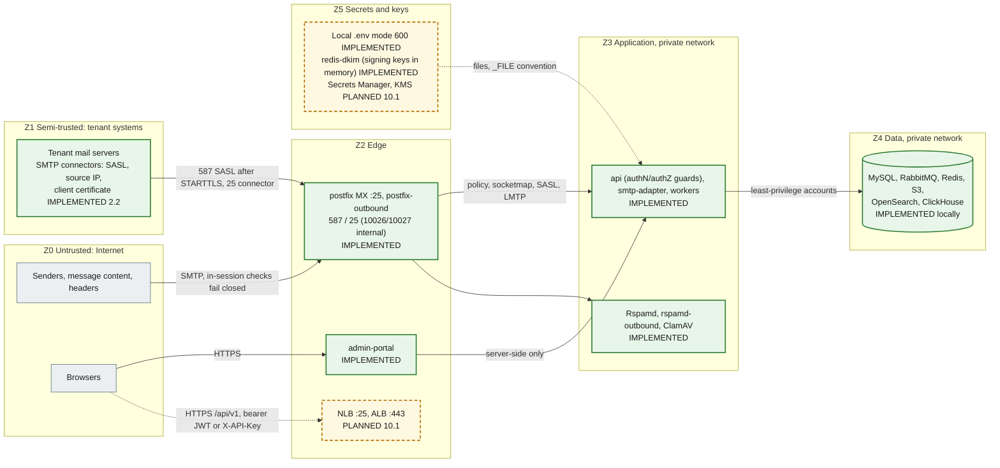

# Security boundaries

Trust zones, the network boundaries between them, the database accounts, how secrets are handled, and where tenant isolation is enforced. The baseline controls are listed in [docs/security/README.md](../security/README.md); this page shows **where** each control sits. A full STRIDE threat model is a separate follow-up (security README). Status labels follow the [diagram convention](diagrams/README.md#status-convention).

## Trust zones

| Zone                | Contains                                                     | Trust                                                                                           | Boundary controls                                                                                                                                                                                                                                                                                                                                                                                                                                                                                                                                                                |
| ------------------- | ------------------------------------------------------------ | ----------------------------------------------------------------------------------------------- | -------------------------------------------------------------------------------------------------------------------------------------------------------------------------------------------------------------------------------------------------------------------------------------------------------------------------------------------------------------------------------------------------------------------------------------------------------------------------------------------------------------------------------------------------------------------------------- |
| Z0 Internet         | Senders, every byte of message content and headers, browsers | None. Headers and bodies are attacker-controlled                                                | Postfix: no open relay (`554`), HELO required, `VRFY` off, 50 MB cap, connection, rate and recipient limits, opportunistic TLS 1.2+. Policy and milter fail closed (IMPLEMENTED, `mail-plane.test.ts`)                                                                                                                                                                                                                                                                                                                                                                           |
| Z1 Tenant systems   | Tenant mail servers and connectors                           | Only as far as the connection is authenticated, and only for that tenant's verified domains     | Organization-level SMTP connectors (step 2.2): SASL on 587 only after STARTTLS (`smtpd_tls_auth_only`), source networks on 25 (globally non-overlapping, optional `require_tls`), pinned client-certificate SHA-256 fingerprints on 25; the policy then requires the sender domain to be an active, outbound-enabled domain of the connector's organization. `domain_mail_servers.outbound_source` is deprecated. Never trusted for direction or tenant through headers. Source-IP connectors must not be used with shared-IP platforms (M365, Google): use SASL or certificates |
| Z2 Edge             | Postfix (both instances), load balancers, admin-portal       | Parses untrusted input; holds no data-store credentials (portal) or only spool access (Postfix) | Postfix holds **no credentials**: relay domains, connectors and SASL come from smtp-adapter over socketmap, policy delegation and the Dovecot auth protocol (ADR-0019). Every listener states its relay permission; the outbound defaults refuse everything. Portal: security headers, no `X-Powered-By`, API URL server-side only (IMPLEMENTED). ALB, WAF, TLS termination (PLANNED 10.1)                                                                                                                                                                                       |
| Z3 Application      | Nest services, Rspamd, ClamAV                                | Trusted code, untrusted data                                                                    | zod validation of config, events and every API request; global fail-closed authentication and permission guards on every non-public api route (IMPLEMENTED 1.3, `route-security.e2e.test.ts`); policy parser bounded at 16 KiB; correlation ids validated; non-root, read-only root FS, dropped capabilities, no service-account token (IMPLEMENTED manifests)                                                                                                                                                                                                                   |
| Z4 Data             | MySQL, RabbitMQ, Redis, S3, OpenSearch, ClickHouse           | Trusted stores, reachable only from Z3                                                          | Per-purpose accounts (below); Redis password; RabbitMQ `guest` loopback-only; S3 anonymous access denied, TLS-only and SSE-KMS (module); OpenSearch security disabled **locally only**                                                                                                                                                                                                                                                                                                                                                                                           |
| Z5 Secrets and keys | `.env`, Secrets Manager, KMS, DKIM private keys              | Highest                                                                                         | Never committed, never logged, file-mounted in clusters                                                                                                                                                                                                                                                                                                                                                                                                                                                                                                                          |

## Network boundaries

| Boundary                            | Local (Compose)                                                                                                                          | Production                                                                                                                                                                              | Status                                        |
| ----------------------------------- | ---------------------------------------------------------------------------------------------------------------------------------------- | --------------------------------------------------------------------------------------------------------------------------------------------------------------------------------------- | --------------------------------------------- |
| Host exposure                       | Every published port binds to `127.0.0.1`                                                                                                | Only the MX NLB and the portal/API ALB are public                                                                                                                                       | IMPLEMENTED locally; PLANNED 10.1             |
| Rspamd controller (:11334)          | `secure_ip` is `127.0.0.1` and `::1` only                                                                                                | Same                                                                                                                                                                                    | IMPLEMENTED                                   |
| Rspamd scan (:11333), clamd (:3310) | No authentication; reachable on the Compose network                                                                                      | Private subnets, security groups or NetworkPolicy limited to `email-worker` and Postfix                                                                                                 | IMPLEMENTED locally; restriction PLANNED 10.1 |
| smtp-adapter mail ports             | Compose network; refuses peers outside `SMTP_INTERNAL_CLIENT_NETWORKS` (loopback + RFC 1918)                                             | policy 10040, socketmap 10041, SASL 10042, LMTP 10050/10051/10052 reachable only from the Postfix ASGs (security groups; internal NLB). The Kubernetes Service does not expose them yet | IMPLEMENTED locally; production PLANNED 10.1  |
| Postfix listeners                   | `postfix` 25 → host 2525; `postfix-outbound` 587 → 2587, 25 → 2527; 10026/10027 **never published** (`POSTFIX_REINJECT_NETWORKS` only)   | inbound 25 public (NLB); outbound 587/25 open to tenant networks; 10026/10027 only from the delivery-worker subnet                                                                      | IMPLEMENTED (`smtp-relay-control.test.ts`)    |
| redis-dkim (:6379, host 6391)       | `default` user off; `dkim-writer` (api), `dkim-reader` (rspamd-outbound), `dkim-probe` (smtp-adapter: selectors only); ACL file on tmpfs | Security groups: only api, smtp-adapter and rspamd-outbound                                                                                                                             | IMPLEMENTED                                   |
| Outbound egress (local)             | `postfix-outbound` resolves only through `dns-sink` (authoritative for `sink.test`): it can never reach the Internet locally             | static egress IPs with PTR (EC2)                                                                                                                                                        | IMPLEMENTED                                   |
| Pod-to-pod                          | n/a                                                                                                                                      | Kubernetes NetworkPolicies (default deny, explicit allow per dependency)                                                                                                                | PLANNED 10.1 (not in the base manifests)      |
| Egress                              | Unrestricted                                                                                                                             | NAT; outbound SMTP only from the outbound Postfix ASG with static IPs; VPC endpoints for S3, Secrets Manager                                                                            | PLANNED 10.1                                  |

## Database accounts

All created from environment values by `infrastructure/mysql/init/01-users.sh` (idempotent `CREATE USER IF NOT EXISTS` + `GRANT`). In AWS they are created by Terraform or operations with the same grants.

| Account                      | Variable                 | Grants                                                                                                                                               | Used by                                        | Verified by                                                                                                       |
| ---------------------------- | ------------------------ | ---------------------------------------------------------------------------------------------------------------------------------------------------- | ---------------------------------------------- | ----------------------------------------------------------------------------------------------------------------- |
| `gateway_app` (writer, DML)  | `DATABASE_URL`           | `SELECT, INSERT, UPDATE, DELETE` on the schema                                                                                                       | Every service                                  | `mysql.test.ts`: DML allowed, DDL denied                                                                          |
| `gateway_reader`             | `DATABASE_READ_URL`      | `SELECT` on the schema, `REPLICATION CLIENT` on `*.*` (only to read `SHOW REPLICA STATUS`)                                                           | `api` only                                     | `replication.test.ts`: INSERT, UPDATE, DELETE, CREATE denied by privilege (1142/1044) on both replica and primary |
| `gateway_migrator` (DDL)     | `MIGRATION_DATABASE_URL` | `ALL` on the schema and on the two throwaway schemas `<db>_shadow` (Prisma shadow database, `SHADOW_DATABASE_URL`) and `<db>_perf`; nothing on `*.*` | `db-migrate`, partition maintenance            | `accounts.test.ts`: no global grant; `mysql.*`, `CREATE USER` and other schemas denied. CI `migrations` job       |
| `gateway_repl` (replication) | `MYSQL_REPLICATION_*`    | `REPLICATION SLAVE, BACKUP_ADMIN` on `*.*`                                                                                                           | Replica I/O thread, CLONE donor                | `replication.test.ts` (replication runs)                                                                          |
| `root`                       | `MYSQL_ROOT_PASSWORD`    | Everything                                                                                                                                           | Container bootstrap and the replica setup only | Never used by services                                                                                            |

The reader cannot write even on the primary, so a misrouted reader connection fails closed. The replica additionally runs with `read_only` and `super_read_only`.

## Secrets handling

| Rule                                                                                                                                                                                                                                                                                                                                                                        | Where                                                             | Status                                                                     |
| --------------------------------------------------------------------------------------------------------------------------------------------------------------------------------------------------------------------------------------------------------------------------------------------------------------------------------------------------------------------------- | ----------------------------------------------------------------- | -------------------------------------------------------------------------- |
| No credentials in the repository. `.env.example` holds placeholders (`__GENERATE__`, `__GENERATE_32__` for the replication password) and `${VAR}` references                                                                                                                                                                                                                | `.env.example`, `scripts/init-env.mjs`                            | IMPLEMENTED                                                                |
| `pnpm env:init` generates random secrets into a git-ignored `.env` with mode 600                                                                                                                                                                                                                                                                                            | `scripts/init-env.mjs`                                            | IMPLEMENTED                                                                |
| Clusters: Secrets Manager → External Secrets → Kubernetes Secret `email-gateway-secrets` → files under `/var/run/secrets/gateway`, read through `<KEY>_FILE`                                                                                                                                                                                                                | `packages/config`, `infrastructure/kubernetes/base`               | `_FILE` IMPLEMENTED (`load-config.test.ts`); External Secrets PLANNED 10.1 |
| Config errors name keys, never values                                                                                                                                                                                                                                                                                                                                       | `packages/config`                                                 | IMPLEMENTED                                                                |
| Logs redact `password`, `secret`, `token`, `authorization`, `cookie` and the authentication fields (`accessToken`, `refreshToken`, `mfaToken`, `code`, recovery codes, `x-api-key`, …); the reader's errors have connection URLs replaced by `[redacted-url]`; `audit_logs` metadata drops credential-like keys                                                             | `packages/logger`, `prisma-read.service.ts`, `apps/api/src/audit` | IMPLEMENTED (`logger.test.ts`, `audit.service.test.ts`)                    |
| MySQL scripts pass passwords through `MYSQL_PWD` or option files, never on the command line                                                                                                                                                                                                                                                                                 | `infrastructure/mysql/*`                                          | IMPLEMENTED                                                                |
| Rspamd's Redis password is rendered at start into a tmpfs `local.d` with mode 600                                                                                                                                                                                                                                                                                           | `infrastructure/rspamd/entrypoint.sh`                             | IMPLEMENTED                                                                |
| SMTP connector secrets: generated by the api, shown once, stored as Argon2id PHC hashes; verified only inside smtp-adapter (SASL server), never by Postfix; the SASL username never appears in mail headers (`smtpd_sasl_authenticated_header = no`); passwords never logged (also redacted from test transcripts)                                                          | Step 2.2                                                          | IMPLEMENTED (`smtp-connectors.test.ts`, `sasl.test.ts`)                    |
| redis-dkim passwords and `GATEWAY_TRACE_SECRET` come from `.env` / Secrets Manager; rspamd-outbound renders its reader password into a tmpfs `local.d` (mode 600)                                                                                                                                                                                                           | Step 2.2                                                          | IMPLEMENTED                                                                |
| Secrets stored in MySQL are never plaintext: passwords as Argon2id hashes, API keys and recovery codes as HMAC-SHA256 (pepper), MFA secrets AES-256-GCM encrypted, refresh and single-use tokens as SHA-256; webhook secrets app-encrypted                                                                                                                                  | `apps/api/src/crypto`, `modules/auth`                             | IMPLEMENTED 1.3 (unit and `auth.test.ts`); webhook secrets PLANNED 6.2     |
| DKIM private keys: SecretBox ciphertext in `domain_dkim_keys.private_key_ciphertext` (AES-256-GCM, `DATA_ENCRYPTION_KEY`, AAD `dkim:<domain public id>:<selector>`, ADR-0018); since step 2.2 the active RSA keys of active outbound-enabled domains are **also held in memory** by the api (transiently), redis-dkim (no persistence, ACLs) and rspamd-outbound (ADR-0020) | Step 2.1 encryption, step 2.2 publisher                           | IMPLEMENTED (`dkim-signing-publisher.test.ts`, `smtp-outbound.test.ts`)    |
| S3 objects encrypted with a customer-managed KMS key (rotation on)                                                                                                                                                                                                                                                                                                          | `infrastructure/terraform`                                        | IMPLEMENTED (module, not applied)                                          |

## Tenant isolation enforcement points

The full model is [diagram 13](diagrams/13-multi-tenant-isolation.md). In short:

| Layer            | Enforcement                                                                                                                                                                                                                                                                                                                                                                                   | Status                                                                                                                                                                                                   |
| ---------------- | --------------------------------------------------------------------------------------------------------------------------------------------------------------------------------------------------------------------------------------------------------------------------------------------------------------------------------------------------------------------------------------------- | -------------------------------------------------------------------------------------------------------------------------------------------------------------------------------------------------------- |
| Schema           | `organization_id BIGINT UNSIGNED NOT NULL` on every tenant-owned table, tenant indexes lead with it                                                                                                                                                                                                                                                                                           | IMPLEMENTED (`schema.test.ts`)                                                                                                                                                                           |
| HTTP             | Organization from the authenticated principal: `AuthGuard` builds the principal from a verified credential and sets a branded `TenantScope` (home organization, API key's organization, or override target); never from a header or query; `public_id` in URLs; another tenant's resource is `404`                                                                                            | IMPLEMENTED 1.2/1.3 for every current route. Organization endpoints verified by `apps/api/integration/tenant-isolation-organizations.test.ts`; identity endpoints by `tenant-isolation-identity.test.ts` |
| SMTP             | Organization from the **verified** owner of the recipient domain (`domains.verified_name`, globally unique; pending claims never match) or the authenticated SMTP connector (IMPLEMENTED 2.2; the LMTP listener port decides the direction; headers never decide)                                                                                                                             | Key IMPLEMENTED (`schema.test.ts`); lookup PLANNED 2.2                                                                                                                                                   |
| Events           | `organizationId` decimal id in every envelope, set by the producer from trusted context                                                                                                                                                                                                                                                                                                       | IMPLEMENTED (schema)                                                                                                                                                                                     |
| Object keys      | `org/{organizationId}/` prefix: format validated in events; equality with the envelope checked by consumers                                                                                                                                                                                                                                                                                   | Format IMPLEMENTED; equality PLANNED 3.x                                                                                                                                                                 |
| Repositories     | Only `*.repository.ts` files may use Prisma (ESLint rule); tenant-owned rows are read and written through methods that take the `TenantScope` (or, for the organization catalog, an `OrganizationAccess`-filtered organization) first; cross-tenant tests                                                                                                                                     | IMPLEMENTED 1.2/1.3 (lint rule, isolation suites)                                                                                                                                                        |
| Limits           | `organization_limits` materialized from the plan, overridable only by the platform catalog; enforced under a row lock (`OrganizationLimitsService`, `max_users` on invitation); Redis per-organization request limits                                                                                                                                                                         | Limits and `max_users` IMPLEMENTED 1.2/1.3; `max_domains` enforcement 2.1; per-organization rate limits PLANNED 6.1                                                                                      |
| Platform access  | Platform staff act on one customer organization only through a time-limited override (MFA session, reason, `platform:*` stripped, not refreshable, every request audited as `platform.override_request`, mutations carry `metadata.override`). The organization catalog (`platform:organizations`) is a separate, audited platform function, never available to API keys or override sessions | IMPLEMENTED 1.3 (`auth.test.ts`, `tenant-isolation-organizations.test.ts`)                                                                                                                               |
| Tenant lifecycle | Suspension revokes every session and stops API keys immediately; deletion is two-person (four-eyes, MFA), blocked by active legal holds, and data is kept until `purge_after` (≥ the last archive's `retain_until`)                                                                                                                                                                           | IMPLEMENTED 1.2 (`organizations.test.ts`); purge job PLANNED ([runbook](../runbooks/organization-deletion.md))                                                                                           |
| Search           | Mandatory organization filter                                                                                                                                                                                                                                                                                                                                                                 | PLANNED (no step yet)                                                                                                                                                                                    |

## Known gaps

| Gap                                                                                                                                                                              | Owner step           |
| -------------------------------------------------------------------------------------------------------------------------------------------------------------------------------- | -------------------- |
| `docs/security/README.md` says event S3 keys are "checked against the envelope tenant". Today only the format is checked                                                         | 3.x                  |
| Rspamd's scan worker and clamd have no authentication; production must restrict them at the network layer                                                                        | 10.1                 |
| No Kubernetes NetworkPolicies in the base manifests                                                                                                                              | 10.1                 |
| Composite tenant foreign keys deferred (design §4); isolation relies on the repository layer, its lint rule and the isolation suites                                             | ongoing              |
| The organization purge job (tenant rows and S3 objects after `purge_after`, freeing `domains.verified_name`) does not exist; deleted organizations keep their data, inaccessible | later step (runbook) |
| Per-organization API request limits (`api_requests_per_minute`) are stored but not enforced; only the authentication routes are rate limited                                     | 6.1                  |
| External SSO (OIDC/SAML) and SCIM are not available; the `sso` feature flag exists without an implementation                                                                     | later step           |
