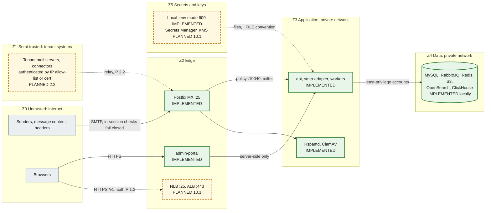

# Security boundaries

Trust zones, the network boundaries between them, the database accounts, how secrets are handled, and where tenant isolation is enforced. The baseline controls are listed in [docs/security/README.md](../security/README.md); this page shows **where** each control sits. A full STRIDE threat model is a separate follow-up (security README). Status labels follow the [diagram convention](diagrams/README.md#status-convention).

## Trust zones

| Zone                | Contains                                                     | Trust                                                                                           | Boundary controls                                                                                                                                                                                      |
| ------------------- | ------------------------------------------------------------ | ----------------------------------------------------------------------------------------------- | ------------------------------------------------------------------------------------------------------------------------------------------------------------------------------------------------------ |
| Z0 Internet         | Senders, every byte of message content and headers, browsers | None. Headers and bodies are attacker-controlled                                                | Postfix: no open relay (`554`), HELO required, `VRFY` off, 50 MB cap, connection, rate and recipient limits, opportunistic TLS 1.2+. Policy and milter fail closed (IMPLEMENTED, `mail-plane.test.ts`) |
| Z1 Tenant systems   | Tenant mail servers and connectors                           | Only as far as the connection is authenticated, and only for that tenant's verified domains     | IP allow-list (`domain_mail_servers.ip_cidr`) or SMTP AUTH / client certificate (PLANNED 2.2, 8.2). Never trusted for direction or tenant through headers                                              |
| Z2 Edge             | Postfix, load balancers, admin-portal                        | Parses untrusted input; holds no data-store credentials (portal) or only spool access (Postfix) | Portal: security headers, no `X-Powered-By`, API URL server-side only (IMPLEMENTED). ALB, WAF, TLS termination (PLANNED 10.1)                                                                          |
| Z3 Application      | Nest services, Rspamd, ClamAV                                | Trusted code, untrusted data                                                                    | zod validation of config and events; policy parser bounded at 16 KiB; correlation ids validated; non-root, read-only root FS, dropped capabilities, no service-account token (IMPLEMENTED manifests)   |
| Z4 Data             | MySQL, RabbitMQ, Redis, S3, OpenSearch, ClickHouse           | Trusted stores, reachable only from Z3                                                          | Per-purpose accounts (below); Redis password; RabbitMQ `guest` loopback-only; S3 anonymous access denied, TLS-only and SSE-KMS (module); OpenSearch security disabled **locally only**                 |
| Z5 Secrets and keys | `.env`, Secrets Manager, KMS, DKIM private keys              | Highest                                                                                         | Never committed, never logged, file-mounted in clusters                                                                                                                                                |

## Network boundaries

| Boundary                            | Local (Compose)                                     | Production                                                                                                   | Status                                        |
| ----------------------------------- | --------------------------------------------------- | ------------------------------------------------------------------------------------------------------------ | --------------------------------------------- |
| Host exposure                       | Every published port binds to `127.0.0.1`           | Only the MX NLB and the portal/API ALB are public                                                            | IMPLEMENTED locally; PLANNED 10.1             |
| Rspamd controller (:11334)          | `secure_ip` is `127.0.0.1` and `::1` only           | Same                                                                                                         | IMPLEMENTED                                   |
| Rspamd scan (:11333), clamd (:3310) | No authentication; reachable on the Compose network | Private subnets, security groups or NetworkPolicy limited to `email-worker` and Postfix                      | IMPLEMENTED locally; restriction PLANNED 10.1 |
| Policy port (:10040)                | Compose network                                     | Must be reachable from the Postfix ASG only. The Kubernetes Service does not expose it yet                   | PLANNED 2.2, 10.1                             |
| Pod-to-pod                          | n/a                                                 | Kubernetes NetworkPolicies (default deny, explicit allow per dependency)                                     | PLANNED 10.1 (not in the base manifests)      |
| Egress                              | Unrestricted                                        | NAT; outbound SMTP only from the outbound Postfix ASG with static IPs; VPC endpoints for S3, Secrets Manager | PLANNED 10.1                                  |

## Database accounts

All created from environment values by `infrastructure/mysql/init/01-users.sh` (idempotent `CREATE USER IF NOT EXISTS` + `GRANT`). In AWS they are created by Terraform or operations with the same grants.

| Account                      | Variable                 | Grants                                                                                                                                               | Used by                                        | Verified by                                                                                                       |
| ---------------------------- | ------------------------ | ---------------------------------------------------------------------------------------------------------------------------------------------------- | ---------------------------------------------- | ----------------------------------------------------------------------------------------------------------------- |
| `gateway_app` (writer, DML)  | `DATABASE_URL`           | `SELECT, INSERT, UPDATE, DELETE` on the schema                                                                                                       | Every service                                  | `mysql.test.ts`: DML allowed, DDL denied                                                                          |
| `gateway_reader`             | `DATABASE_READ_URL`      | `SELECT` on the schema, `REPLICATION CLIENT` on `*.*` (only to read `SHOW REPLICA STATUS`)                                                           | `api` only                                     | `replication.test.ts`: INSERT, UPDATE, DELETE, CREATE denied by privilege (1142/1044) on both replica and primary |
| `gateway_migrator` (DDL)     | `MIGRATION_DATABASE_URL` | `ALL` on the schema and on the two throwaway schemas `<db>_shadow` (Prisma shadow database, `SHADOW_DATABASE_URL`) and `<db>_perf`; nothing on `*.*` | `db-migrate`, partition maintenance            | `accounts.test.ts`: no global grant; `mysql.*`, `CREATE USER` and other schemas denied. CI `migrations` job       |
| `gateway_repl` (replication) | `MYSQL_REPLICATION_*`    | `REPLICATION SLAVE, BACKUP_ADMIN` on `*.*`                                                                                                           | Replica I/O thread, CLONE donor                | `replication.test.ts` (replication runs)                                                                          |
| `root`                       | `MYSQL_ROOT_PASSWORD`    | Everything                                                                                                                                           | Container bootstrap and the replica setup only | Never used by services                                                                                            |

The reader cannot write even on the primary, so a misrouted reader connection fails closed. The replica additionally runs with `read_only` and `super_read_only`.

## Secrets handling

| Rule                                                                                                                                                                                     | Where                                               | Status                                                                     |
| ---------------------------------------------------------------------------------------------------------------------------------------------------------------------------------------- | --------------------------------------------------- | -------------------------------------------------------------------------- |
| No credentials in the repository. `.env.example` holds placeholders (`__GENERATE__`, `__GENERATE_32__` for the replication password) and `${VAR}` references                             | `.env.example`, `scripts/init-env.mjs`              | IMPLEMENTED                                                                |
| `pnpm env:init` generates random secrets into a git-ignored `.env` with mode 600                                                                                                         | `scripts/init-env.mjs`                              | IMPLEMENTED                                                                |
| Clusters: Secrets Manager → External Secrets → Kubernetes Secret `email-gateway-secrets` → files under `/var/run/secrets/gateway`, read through `<KEY>_FILE`                             | `packages/config`, `infrastructure/kubernetes/base` | `_FILE` IMPLEMENTED (`load-config.test.ts`); External Secrets PLANNED 10.1 |
| Config errors name keys, never values                                                                                                                                                    | `packages/config`                                   | IMPLEMENTED                                                                |
| Logs redact `password`, `secret`, `token`, `authorization`, `cookie` fields; the reader's errors have connection URLs replaced by `[redacted-url]`                                       | `packages/logger`, `prisma-read.service.ts`         | IMPLEMENTED                                                                |
| MySQL scripts pass passwords through `MYSQL_PWD` or option files, never on the command line                                                                                              | `infrastructure/mysql/*`                            | IMPLEMENTED                                                                |
| Rspamd's Redis password is rendered at start into a tmpfs `local.d` with mode 600                                                                                                        | `infrastructure/rspamd/entrypoint.sh`               | IMPLEMENTED                                                                |
| Secrets stored in MySQL are never plaintext: passwords as Argon2id hashes, API keys as HMAC-SHA256 hashes, MFA and webhook secrets as app-encrypted ciphertext, refresh tokens as hashes | Columns exist in the step 1.1 schema                | Columns IMPLEMENTED; logic PLANNED 1.3, 6.2                                |
| DKIM private keys are never in MySQL: `domain_dkim_keys.private_key_ref` points at Secrets Manager or a KMS-encrypted object                                                             | Step 1.1 schema                                     | PLANNED 2.1                                                                |
| S3 objects encrypted with a customer-managed KMS key (rotation on)                                                                                                                       | `infrastructure/terraform`                          | IMPLEMENTED (module, not applied)                                          |

## Tenant isolation enforcement points

The full model is [diagram 13](diagrams/13-multi-tenant-isolation.md). In short:

| Layer        | Enforcement                                                                                                                                                            | Status                                                 |
| ------------ | ---------------------------------------------------------------------------------------------------------------------------------------------------------------------- | ------------------------------------------------------ |
| Schema       | `organization_id BIGINT UNSIGNED NOT NULL` on every tenant-owned table, tenant indexes lead with it                                                                    | IMPLEMENTED (`schema.test.ts`)                         |
| HTTP         | Organization from the authenticated principal (tenant guard); never from a header; `public_id` in URLs                                                                 | PLANNED 1.3, 6.1                                       |
| SMTP         | Organization from the **verified** owner of the recipient domain (`domains.verified_name`, globally unique; pending claims never match) or the authenticated connector | Key IMPLEMENTED (`schema.test.ts`); lookup PLANNED 2.2 |
| Events       | `organizationId` decimal id in every envelope, set by the producer from trusted context                                                                                | IMPLEMENTED (schema)                                   |
| Object keys  | `org/{organizationId}/` prefix: format validated in events; equality with the envelope checked by consumers                                                            | Format IMPLEMENTED; equality PLANNED 3.x               |
| Repositories | Every query filters by `organization_id`; cross-tenant tests                                                                                                           | PLANNED 1.2, 1.3                                       |
| Limits       | `organization_limits` and Redis rate limits per organization                                                                                                           | PLANNED 1.2, 2.2, 6.1                                  |
| Search       | Mandatory organization filter                                                                                                                                          | PLANNED (no step yet)                                  |

## Known gaps

| Gap                                                                                                                      | Owner step |
| ------------------------------------------------------------------------------------------------------------------------ | ---------- |
| No authentication on any endpoint yet; only `/health/*` and `/v1/meta` exist                                             | 1.3        |
| `docs/security/README.md` says event S3 keys are "checked against the envelope tenant". Today only the format is checked | 3.x        |
| Rspamd's scan worker and clamd have no authentication; production must restrict them at the network layer                | 10.1       |
| No Kubernetes NetworkPolicies in the base manifests                                                                      | 10.1       |
| Composite tenant foreign keys deferred (design §4); isolation relies on the repository layer and tests                   | 1.2, 1.3   |
