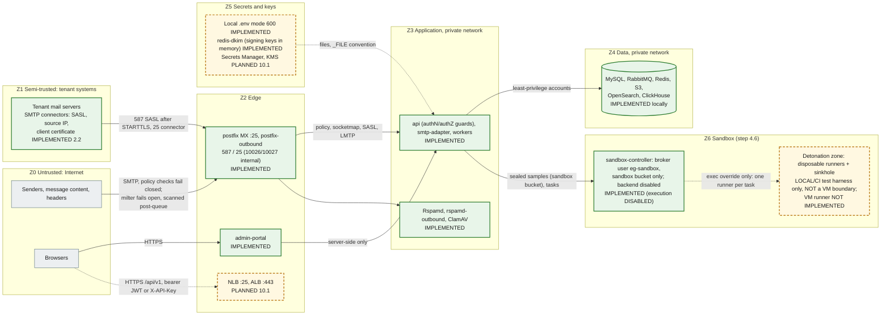

# Security boundaries

Trust zones, the network boundaries between them, the database accounts, how secrets are handled, and where tenant isolation is enforced. The baseline controls are listed in [docs/security/README.md](../security/README.md); this page shows **where** each control sits. A full STRIDE threat model is a separate follow-up (security README). Status labels follow the [diagram convention](diagrams/README.md#status-convention).

## Trust zones

| Zone                | Contains                                                                                                             | Trust                                                                                               | Boundary controls                                                                                                                                                                                                                                                                                                                                                                                                                                                                                                                                                                |
| ------------------- | -------------------------------------------------------------------------------------------------------------------- | --------------------------------------------------------------------------------------------------- | -------------------------------------------------------------------------------------------------------------------------------------------------------------------------------------------------------------------------------------------------------------------------------------------------------------------------------------------------------------------------------------------------------------------------------------------------------------------------------------------------------------------------------------------------------------------------------- |
| Z0 Internet         | Senders, every byte of message content and headers, browsers                                                         | None. Headers and bodies are attacker-controlled                                                    | Postfix: no open relay (`554`), HELO required, `VRFY` off, 50 MB cap, connection, rate and recipient limits, opportunistic TLS 1.2+. Policy and milter fail closed (IMPLEMENTED, `mail-plane.test.ts`)                                                                                                                                                                                                                                                                                                                                                                           |
| Z1 Tenant systems   | Tenant mail servers and connectors                                                                                   | Only as far as the connection is authenticated, and only for that tenant's verified domains         | Organization-level SMTP connectors (step 2.2): SASL on 587 only after STARTTLS (`smtpd_tls_auth_only`), source networks on 25 (globally non-overlapping, optional `require_tls`), pinned client-certificate SHA-256 fingerprints on 25; the policy then requires the sender domain to be an active, outbound-enabled domain of the connector's organization. `domain_mail_servers.outbound_source` is deprecated. Never trusted for direction or tenant through headers. Source-IP connectors must not be used with shared-IP platforms (M365, Google): use SASL or certificates |
| Z2 Edge             | Postfix (both instances), load balancers, admin-portal                                                               | Parses untrusted input; holds no data-store credentials (portal) or only spool access (Postfix)     | Postfix holds **no credentials**: relay domains, connectors and SASL come from smtp-adapter over socketmap, policy delegation and the Dovecot auth protocol (ADR-0019). Every listener states its relay permission; the outbound defaults refuse everything. Portal: security headers, no `X-Powered-By`, API URL server-side only (IMPLEMENTED). ALB, WAF, TLS termination (PLANNED 10.1)                                                                                                                                                                                       |
| Z3 Application      | Nest services, Rspamd, ClamAV                                                                                        | Trusted code, untrusted data                                                                        | zod validation of config, events and every API request; global fail-closed authentication and permission guards on every non-public api route (IMPLEMENTED 1.3, `route-security.e2e.test.ts`); policy parser bounded at 16 KiB; correlation ids validated; non-root, read-only root FS, dropped capabilities, no service-account token (IMPLEMENTED manifests)                                                                                                                                                                                                                   |
| Z4 Data             | MySQL, RabbitMQ, Redis, S3, OpenSearch, ClickHouse                                                                   | Trusted stores, reachable only from Z3                                                              | Per-purpose accounts (below); Redis password; RabbitMQ: dedicated vhost `email-gateway` with least-privilege role users per service (step 3.2, below), administrator only for provisioning, tests and operators, `guest` loopback-only; S3 anonymous access denied, TLS-only and SSE-KMS (module); OpenSearch security disabled **locally only**                                                                                                                                                                                                                                 |
| Z5 Secrets and keys | `.env`, Secrets Manager, KMS, DKIM private keys                                                                      | Highest                                                                                             | Never committed, never logged, file-mounted in clusters                                                                                                                                                                                                                                                                                                                                                                                                                                                                                                                          |
| Z6 Sandbox (4.6)    | `sandbox-controller` (sandbox-control zone); runners and the sinkhole (detonation zone, local/CI exec override only) | Untrusted samples; the controller holds nothing worth stealing; runner output is untrusted evidence | See [Sandbox (step 4.6)](#sandbox-step-46): configuration refuses every database/Redis/main-S3/token/DLP/other-broker key, internal networks only, sealed samples and artifacts, MAC-protected results; execution of unknown files disabled                                                                                                                                                                                                                                                                                                                                      |

## Network boundaries

| Boundary                                          | Local (Compose)                                                                                                                                                                                                                                                                                                                                                                                                                                                                                                                                                                                                                                                                                            | Production                                                                                                                                                                                                                                                                                                                                                                        | Status                                                                  |
| ------------------------------------------------- | ---------------------------------------------------------------------------------------------------------------------------------------------------------------------------------------------------------------------------------------------------------------------------------------------------------------------------------------------------------------------------------------------------------------------------------------------------------------------------------------------------------------------------------------------------------------------------------------------------------------------------------------------------------------------------------------------------------- | --------------------------------------------------------------------------------------------------------------------------------------------------------------------------------------------------------------------------------------------------------------------------------------------------------------------------------------------------------------------------------- | ----------------------------------------------------------------------- |
| Host exposure                                     | Every published port binds to `127.0.0.1`                                                                                                                                                                                                                                                                                                                                                                                                                                                                                                                                                                                                                                                                  | Only the MX NLB and the portal/API ALB are public                                                                                                                                                                                                                                                                                                                                 | IMPLEMENTED locally; PLANNED 10.1                                       |
| Rspamd controller (:11334)                        | `secure_ip` is `127.0.0.1` and `::1` only (no password from loopback: the health check); from the network every call needs a password: read (`RSPAMD_CONTROLLER_PASSWORD`, email-worker `/stat`, Prometheus) or enable (`RSPAMD_CONTROLLER_ENABLE_PASSWORD`, api training only), rendered as `rspamadm pw` hashes into tmpfs (step 4.1)                                                                                                                                                                                                                                                                                                                                                                    | Same; reachable only from the scan Deployment, the api and Prometheus (NetworkPolicy)                                                                                                                                                                                                                                                                                             | IMPLEMENTED                                                             |
| Rspamd scan (:11333), clamd (:3310)               | No authentication; reachable on the Compose network (`/checkv2`: the email-worker scan role). Milter 11332: only `postfix`. Locally Rspamd also sits on `mailtest` (`172.31.250.11`) and resolves only through `dns-sink` (`RSPAMD_DNS_SERVERS`), so it never queries the Internet                                                                                                                                                                                                                                                                                                                                                                                                                         | Private subnets, security groups or NetworkPolicy limited to `email-worker` and Postfix                                                                                                                                                                                                                                                                                           | IMPLEMENTED locally; restriction PLANNED 10.1                           |
| smtp-adapter mail ports                           | Compose network; refuses peers outside `SMTP_INTERNAL_CLIENT_NETWORKS` (loopback + RFC 1918)                                                                                                                                                                                                                                                                                                                                                                                                                                                                                                                                                                                                               | policy 10040, socketmap 10041, SASL 10042, LMTP 10050/10051/10052 reachable only from the Postfix ASGs (security groups; internal NLB). The Kubernetes Service does not expose them yet                                                                                                                                                                                           | IMPLEMENTED locally; production PLANNED 10.1                            |
| Postfix listeners                                 | `postfix` 25 → host 2525; `postfix-outbound` 587 → 2587, 25 → 2527; 10026/10027 **never published** (`POSTFIX_REINJECT_NETWORKS` only)                                                                                                                                                                                                                                                                                                                                                                                                                                                                                                                                                                     | inbound 25 public (NLB); outbound 587/25 open to tenant networks; 10026/10027 only from the delivery-worker subnet                                                                                                                                                                                                                                                                | IMPLEMENTED (`smtp-relay-control.test.ts`)                              |
| redis-dkim (:6379, host 6391)                     | `default` user off; `dkim-writer` (api), `dkim-reader` (rspamd-outbound), `dkim-probe` (smtp-adapter: selectors only); ACL file on tmpfs                                                                                                                                                                                                                                                                                                                                                                                                                                                                                                                                                                   | Security groups: only api, smtp-adapter and rspamd-outbound                                                                                                                                                                                                                                                                                                                       | IMPLEMENTED                                                             |
| Outbound egress (local)                           | `postfix-outbound` resolves only through `dns-sink` (authoritative for `sink.test`): it can never reach the Internet locally                                                                                                                                                                                                                                                                                                                                                                                                                                                                                                                                                                               | static egress IPs with PTR (EC2)                                                                                                                                                                                                                                                                                                                                                  | IMPLEMENTED                                                             |
| URL fetching and browsing (step 4.3)              | The email-worker URL engine and the click-service fetch only through the in-process `SsrfGuard` + `RestrictedResolver` + IP-literal connector of `@email-gateway/url-security` (direct mode), resolving only through `dns-sink` (`URL_DNS_SERVERS`); the TEST-ONLY allowance `URL_FETCH_TEST_ALLOW_CIDRS=203.0.113.0/24` (documentation range, refused outside APP_ENV `local`/`ci`) reaches `url-test` on `urltest` (203.0.113.0/24). `url-browser-worker` sits only on `url-sandbox` (`internal: true`, no route out) with `url-egress-proxy` and the broker; Chromium's DNS is disabled (`--host-resolver-rules`), all traffic goes through the token-authenticated proxy, which applies the same guard | Production (`docs/deployment/url-protection.md`): every fetcher in egress-proxy mode; the proxy's NetworkPolicy allows `0.0.0.0/0`/`::/0` on 80/443 **except** RFC 1918, CGNAT, link-local/metadata, loopback and other special ranges; the browser worker's NetworkPolicy allows only the proxy, RabbitMQ and DNS; optional gVisor `runtimeClassName` (documented, not verified) |
| click-service public port (step 4.3)              | `127.0.0.1:3080` (public routes only), admin `127.0.0.1:3081` (health, metrics)                                                                                                                                                                                                                                                                                                                                                                                                                                                                                                                                                                                                                            | Ingress `protect.<domain>` (TLS) routes only `/c/` and the stylesheet to 3080; 3081 is reachable only from Prometheus (NetworkPolicy)                                                                                                                                                                                                                                             |
| api public/internal boundary (step 6.1, ADR-0053) | `127.0.0.1:${API_HOST_PORT}` → api 3000: `/api/v1/*` public routes, `/health/*` and `/metrics` internal on the same port, `/docs` and `/docs-json` (never in production); `/api/metrics`, `/api/health/*`, `/api/docs` are `404`                                                                                                                                                                                                                                                                                                                                                                                                                                                                           | Ingress `api` routes **only** `Prefix /api/v1/` (TLS at the controller); probes and the Prometheus scrape reach the pod directly; `test/public-boundary.e2e.test.ts` fails any Ingress path outside the click-service's two and the api's one                                                                                                                                     | IMPLEMENTED 6.1 (Ingress rendered and tested, not applied to a cluster) |
| Pod-to-pod                                        | n/a                                                                                                                                                                                                                                                                                                                                                                                                                                                                                                                                                                                                                                                                                                        | Kubernetes NetworkPolicies (default deny, explicit allow per dependency)                                                                                                                                                                                                                                                                                                          | PLANNED 10.1 (not in the base manifests)                                |
| Egress                                            | Unrestricted                                                                                                                                                                                                                                                                                                                                                                                                                                                                                                                                                                                                                                                                                               | NAT; outbound SMTP only from the outbound Postfix ASG with static IPs; VPC endpoints for S3, Secrets Manager                                                                                                                                                                                                                                                                      | PLANNED 10.1                                                            |

## Database accounts

All created from environment values by `infrastructure/mysql/init/01-users.sh` (idempotent `CREATE USER IF NOT EXISTS` + `GRANT`). In AWS they are created by Terraform or operations with the same grants.

| Account                      | Variable                                                         | Grants                                                                                                                                                                                                                                                                                                               | Used by                                                                                                                                                | Verified by                                                                                                       |
| ---------------------------- | ---------------------------------------------------------------- | -------------------------------------------------------------------------------------------------------------------------------------------------------------------------------------------------------------------------------------------------------------------------------------------------------------------- | ------------------------------------------------------------------------------------------------------------------------------------------------------ | ----------------------------------------------------------------------------------------------------------------- |
| `gateway_app` (writer, DML)  | `DATABASE_URL`                                                   | `SELECT, INSERT, UPDATE, DELETE` on the schema                                                                                                                                                                                                                                                                       | Every service                                                                                                                                          | `mysql.test.ts`: DML allowed, DDL denied                                                                          |
| `gateway_reader`             | `DATABASE_READ_URL`                                              | `SELECT` on the schema, `REPLICATION CLIENT` on `*.*` (only to read `SHOW REPLICA STATUS`)                                                                                                                                                                                                                           | `api` only                                                                                                                                             | `replication.test.ts`: INSERT, UPDATE, DELETE, CREATE denied by privilege (1142/1044) on both replica and primary |
| `gateway_click` (step 4.3)   | `CLICK_DATABASE_URL` (`MYSQL_CLICK_USER`/`MYSQL_CLICK_PASSWORD`) | **Table grants only** (no schema privilege): SELECT on `message_urls`, `url_scan_results`, `url_dynamic_inspections`, `scan_engine_settings`, `threat_indicators`, `domains`; INSERT on `url_click_events`, `message_outbox`. Re-applied by `mysql-grants` after migrations; a missing table is reported and skipped | `click-service` only (the Internet-facing service cannot read messages, recipients or settings of other engines, and cannot update or delete anything) |
| `gateway_migrator` (DDL)     | `MIGRATION_DATABASE_URL`                                         | `ALL` on the schema and on the two throwaway schemas `<db>_shadow` (Prisma shadow database, `SHADOW_DATABASE_URL`) and `<db>_perf`; nothing on `*.*`                                                                                                                                                                 | `db-migrate`, partition maintenance                                                                                                                    | `accounts.test.ts`: no global grant; `mysql.*`, `CREATE USER` and other schemas denied. CI `migrations` job       |
| `gateway_repl` (replication) | `MYSQL_REPLICATION_*`                                            | `REPLICATION SLAVE, BACKUP_ADMIN` on `*.*`                                                                                                                                                                                                                                                                           | Replica I/O thread, CLONE donor                                                                                                                        | `replication.test.ts` (replication runs)                                                                          |
| `root`                       | `MYSQL_ROOT_PASSWORD`                                            | Everything                                                                                                                                                                                                                                                                                                           | Container bootstrap and the replica setup only                                                                                                         | Never used by services                                                                                            |

The reader cannot write even on the primary, so a misrouted reader connection fails closed. The replica additionally runs with `read_only` and `super_read_only`.

## Secrets handling

| Rule                                                                                                                                                                                                                                                                                                                                                                                                                                                                                                                                                                    | Where                                                             | Status                                                                     |
| ----------------------------------------------------------------------------------------------------------------------------------------------------------------------------------------------------------------------------------------------------------------------------------------------------------------------------------------------------------------------------------------------------------------------------------------------------------------------------------------------------------------------------------------------------------------------- | ----------------------------------------------------------------- | -------------------------------------------------------------------------- |
| No credentials in the repository. `.env.example` holds placeholders (`__GENERATE__`, `__GENERATE_32__` for the replication password) and `${VAR}` references                                                                                                                                                                                                                                                                                                                                                                                                            | `.env.example`, `scripts/init-env.mjs`                            | IMPLEMENTED                                                                |
| `pnpm env:init` generates random secrets into a git-ignored `.env` with mode 600                                                                                                                                                                                                                                                                                                                                                                                                                                                                                        | `scripts/init-env.mjs`                                            | IMPLEMENTED                                                                |
| Clusters: Secrets Manager → External Secrets → Kubernetes Secret `email-gateway-secrets` → files under `/var/run/secrets/gateway`, read through `<KEY>_FILE`                                                                                                                                                                                                                                                                                                                                                                                                            | `packages/config`, `infrastructure/kubernetes/base`               | `_FILE` IMPLEMENTED (`load-config.test.ts`); External Secrets PLANNED 10.1 |
| Config errors name keys, never values                                                                                                                                                                                                                                                                                                                                                                                                                                                                                                                                   | `packages/config`                                                 | IMPLEMENTED                                                                |
| Logs redact `password`, `secret`, `token`, `authorization`, `cookie` and the authentication fields (`accessToken`, `refreshToken`, `mfaToken`, `code`, recovery codes, `x-api-key`, …); the reader's errors have connection URLs replaced by `[redacted-url]`; `audit_logs` metadata drops credential-like keys. Since step 3.1 the mail-content fields are redacted too (top level and `*.`: `subject`, `filename`, `originalFilename`, `envelopeFrom`, `headerFrom`, `headerValue`, `textBody`, `htmlBody`, `rawHeaders`, `payload.envelopeFrom`) as defence in depth | `packages/logger`, `prisma-read.service.ts`, `apps/api/src/audit` | IMPLEMENTED (`logger.test.ts`, `audit.service.test.ts`)                    |
| MySQL scripts pass passwords through `MYSQL_PWD` or option files, never on the command line                                                                                                                                                                                                                                                                                                                                                                                                                                                                             | `infrastructure/mysql/*`                                          | IMPLEMENTED                                                                |
| Rspamd's Redis password and (step 4.1) the controller password hashes (`rspamadm pw`; the plaintext reaches only the container's own process list for the duration of the command) and the Spamhaus DQS key are rendered at start into tmpfs `local.d`/`override.d` with mode 600; the entrypoint names failing variables, never values. The api holds only the enable password, the email-worker only the read password (`*_FILE` accepted)                                                                                                                            | `infrastructure/rspamd/entrypoint.sh`                             | IMPLEMENTED                                                                |
| SMTP connector secrets: generated by the api, shown once, stored as Argon2id PHC hashes; verified only inside smtp-adapter (SASL server), never by Postfix; the SASL username never appears in mail headers (`smtpd_sasl_authenticated_header = no`); passwords never logged (also redacted from test transcripts)                                                                                                                                                                                                                                                      | Step 2.2                                                          | IMPLEMENTED (`smtp-connectors.test.ts`, `sasl.test.ts`)                    |
| redis-dkim passwords and `GATEWAY_TRACE_SECRET` come from `.env` / Secrets Manager; rspamd-outbound renders its reader password into a tmpfs `local.d` (mode 600)                                                                                                                                                                                                                                                                                                                                                                                                       | Step 2.2                                                          | IMPLEMENTED                                                                |
| RabbitMQ (step 3.2): one password per role user (`RABBITMQ_RELAY_PASSWORD`, `RABBITMQ_EMAIL_WORKER_PASSWORD`, `RABBITMQ_DELIVERY_WORKER_PASSWORD`, `RABBITMQ_OPS_PASSWORD`, `__GENERATE__` in `.env.example`); each service gets only its own URL (Compose stops passing `RABBITMQ_URL`; `*_URL_FILE` in Kubernetes). `infrastructure/rabbitmq/init.mjs` sends credentials only in the `Authorization` header and never prints them; the client library's errors and logs carry codes, never URLs                                                                       |
| Secrets stored in MySQL are never plaintext: passwords as Argon2id hashes, API keys and recovery codes as HMAC-SHA256 (pepper), MFA secrets AES-256-GCM encrypted, refresh and single-use tokens as SHA-256; webhook secrets app-encrypted                                                                                                                                                                                                                                                                                                                              | `apps/api/src/crypto`, `modules/auth`                             | IMPLEMENTED 1.3 (unit and `auth.test.ts`); webhook secrets PLANNED 6.2     |
| DKIM private keys: SecretBox ciphertext in `domain_dkim_keys.private_key_ciphertext` (AES-256-GCM, `DATA_ENCRYPTION_KEY`, AAD `dkim:<domain public id>:<selector>`, ADR-0018); since step 2.2 the active RSA keys of active outbound-enabled domains are **also held in memory** by the api (transiently), redis-dkim (no persistence, ACLs) and rspamd-outbound (ADR-0020)                                                                                                                                                                                             | Step 2.1 encryption, step 2.2 publisher                           | IMPLEMENTED (`dkim-signing-publisher.test.ts`, `smtp-outbound.test.ts`)    |
| DLP evidence (step 4.5): a dedicated key `DLP_EVIDENCE_KEY` (+ `_PREVIOUS` for rotation) wraps a fresh per-evidence data key; only the dlp-consuming email-worker and the api hold it; no re-wrap job yet (keep the previous key for the maximum retention after a rotation)                                                                                                                                                                                                                                                                                            |
| v1 list cursors (step 6.1, ADR-0051): `API_CURSOR_KEY` (64 hex, HMAC-SHA256) signs and verifies cursors bound to the organization, resource, filters and window; **api only** (its own Kubernetes Secret `email-gateway-api-cursor-key`, `API_CURSOR_KEY_FILE`), never logged; `API_CURSOR_KEY_PREVIOUS` verifies during a rotation. A leaked key lets a caller forge cursors of their own tenant only: the tenant scope is re-applied on every page, so a cursor never widens access                                                                                   |
| S3 objects encrypted with a customer-managed KMS key (rotation on)                                                                                                                                                                                                                                                                                                                                                                                                                                                                                                      | `infrastructure/terraform`                                        | IMPLEMENTED (module, not applied)                                          |

## Untrusted message content (step 3.1)

Every byte of a message is Z0 data, also after the SMTP `250`. The post-queue MIME ingestion stage in the email-worker ([design](../plan/steps/06-mime-ingestion.md) §2.0, M4–M11, M15; [ADR-0022](adr/0022-mime-parsing-and-post-queue-ingestion.md)) handles it as follows (IMPLEMENTED 3.1):

| Control                             | How                                                                                                                                                                                                                                                                                                                                                                                                                             |
| ----------------------------------- | ------------------------------------------------------------------------------------------------------------------------------------------------------------------------------------------------------------------------------------------------------------------------------------------------------------------------------------------------------------------------------------------------------------------------------- |
| No rendering, no execution          | Bodies and attachments are only transfer-decoded and (text/HTML) charset-converted, then streamed to S3. Nothing is executed, rendered, opened or converted to HTML or text. Archives are never extracted: zip metadata comes from the central directory through ranged reads (yauzl, entries never read), gzip from its header and trailer. HTML is stored unsanitized and never served                                        |
| Library surface                     | `@zone-eu/mailsplit`, `libmime`, `libqp`, `libbase64`, `iconv-lite`, `yauzl`, pinned exactly. Not `mailparser`/`nodemailer` (text↔HTML conversion and the address parser with known advisories), not `file-type`                                                                                                                                                                                                                |
| Limits outside the library          | Message size (checked before the download), nesting depth, part count, header count, header line and block size, attachment count and size, body size, decoded ratio, total decoded bytes and a wall-clock parse timeout ([M5](../plan/steps/06-mime-ingestion.md#m5-limits-validated-in-config-enforced-on-the-stream)), validated at startup. Every limit hit is recorded (`parse_limit_exceeded`), never a silent truncation |
| Bounded memory                      | The EML is streamed from S3 and every part streamed to S3 with backpressure; only the first 4 KiB of an attachment are buffered (sniffing). `MIME_CONCURRENCY × (part size × (queue + 1) + zip central directory cap)` must fit `MIME_MEMORY_BUDGET_BYTES` or the worker refuses to start (step 3.2: `MIME_CONCURRENCY` is the queue consumer's prefetch, so at most that many messages are in flight)                          |
| Headers are metadata, not trust     | Only an allow-list of 12 headers is stored, decoded, NFC-normalized, control characters replaced, bidi controls flagged, values capped at 2 048 code points. No header value is used for routing, tenancy, direction or authorization; the envelope sender and recipients stay those of step 2.2                                                                                                                                |
| Filenames                           | Sanitized (last path component, controls, bidi and zero-width characters removed, reserved device names, length cap) and flagged (`filename_path_stripped`, executable and double extensions, extension mismatch); the escaped original is metadata only. Filenames are never part of an S3 key, object metadata or a log line                                                                                                  |
| Stored objects                      | Deterministic keys `org/{organizationId}/part/…` from the writer row; `ContentDisposition: attachment` and `application/octet-stream` (HTML and attachments) or `text/plain` (text), no filename or header in object metadata, so a presigned URL opened by mistake never renders                                                                                                                                               |
| Integrity                           | The SHA-256 and size of the bytes read must equal those recorded at ingestion, otherwise nothing of the content is recorded (`integrity_mismatch`)                                                                                                                                                                                                                                                                              |
| No content in MySQL, events or logs | MySQL holds keys, hashes, sizes, types, flags and bounded header metadata; events carry ids, keys, hashes, codes and counts (no address, subject, filename or header value); logs carry ids, codes, counts and `errName`/`errCode` only, never parser or S3 error messages. A marker-string test proves it                                                                                                                      |

## Message bus (step 3.2)

RabbitMQ is Z4: reachable from Z3 only, never from the edge. Design: [07-rabbitmq.md](../plan/steps/07-rabbitmq.md) Q7, Q9, Q10; [ADR-0024](adr/0024-rabbitmq-topology-retry-dead-letter.md); topology: [messaging-topology.md](messaging-topology.md). All IMPLEMENTED and tested (`tests/integration/messaging-permissions.test.ts`, `messaging-topology.test.ts`, the library's guard tests and the api dead-letter suites).

| Control                       | What it enforces                                                                                                                                                                                                                                                                                                                                                                                                                                                                                                                                                                                                                                                                                                                                                                                                                                                                                                                                                            |
| ----------------------------- | --------------------------------------------------------------------------------------------------------------------------------------------------------------------------------------------------------------------------------------------------------------------------------------------------------------------------------------------------------------------------------------------------------------------------------------------------------------------------------------------------------------------------------------------------------------------------------------------------------------------------------------------------------------------------------------------------------------------------------------------------------------------------------------------------------------------------------------------------------------------------------------------------------------------------------------------------------------------------- |
| Dedicated vhost               | Topology v1 lives in vhost `email-gateway` (`RABBITMQ_VHOST`); nothing is published to `/` or to `amq.*` / the default exchange. The ADR-0005 objects on `/` are removed                                                                                                                                                                                                                                                                                                                                                                                                                                                                                                                                                                                                                                                                                                                                                                                                    |
| Role users, least privilege   | `eg-relay` (event-relay): write on the six exchanges, no read. `eg-email-worker`: write `email.ingestion`/`email.events`, read `email.received`. `eg-delivery-worker`: write `email.delivery`/`email.events`, read `email.delivery.pending`. `eg-ops` (api): write `email.ingestion`/`email.delivery` (the home exchanges of the replayable queues), read `email.dead-letter`. **Topic permissions** restrict the routing keys per exchange (step 3.2 review round 1): only `eg-relay` may publish event keys (`org.<id>.…`); a consumer user only its own queue's `retry.`/`delay.`/`dead-letter.` hops; `eg-ops` only `retry.<work queue>.` keys. **No service can configure** (`^$`, no declares, no policy changes) and none has a management tag. The email-worker cannot publish approvals (`email.delivery`), and the delivery-worker plans only approvals with a matching `message_outbox` row (`approval_not_issued` / `approval_mismatch` dead letters otherwise) |
| Tenant in the routing key     | The routing key `org.<organizationId>.<eventType>`, the `x-eg-organization-id` header and the envelope's `organizationId` must agree, or the consumer dead-letters the delivery (`tenant_mismatch`) without running the handler; handlers still check the event against the writer row (MIME, planner)                                                                                                                                                                                                                                                                                                                                                                                                                                                                                                                                                                                                                                                                      |
| Content guard                 | `assertMetadataOnly` on every publish path (relay, retry, dead-letter, replay) refuses binary values, strings over 2 048 characters, MIME headers, base64 runs ≥ 512 characters, body-like keys and deep/huge structures; encoded messages are capped at 128 KiB (broker `max_message_size` 1 MiB as a last line). The relay marks such outbox rows poison instead of publishing them. Bodies and attachments never travel on the bus                                                                                                                                                                                                                                                                                                                                                                                                                                                                                                                                       |
| Contract checks               | Consumers accept only the event types and schema versions they declare; anything else is dead-lettered (`unknown_event_type`, `unsupported_schema_version`, `contract_invalid`) and never retried                                                                                                                                                                                                                                                                                                                                                                                                                                                                                                                                                                                                                                                                                                                                                                           |
| Replay is a privileged action | `POST /api/v1/platform/dead-letters/replay` requires `platform:dead_letter_replay`, an MFA session and a user principal (no API keys, no override tokens); one replay at a time (Redis lock); every call, dry runs included, writes an `audit_logs` row (`platform.dead_letters_replayed`). Replayed events keep their `eventId`, so a replay never creates a second effect                                                                                                                                                                                                                                                                                                                                                                                                                                                                                                                                                                                                 |
| Logs                          | The library, relay and replay log ids, codes and counts only (`queue`, `eventId`, `eventType`, `organizationId`, `correlationId`, `errName`, `errCode`), never payload values, error messages or URLs                                                                                                                                                                                                                                                                                                                                                                                                                                                                                                                                                                                                                                                                                                                                                                       |

## Message lifecycle operations (step 3.3)

The lifecycle state is a security decision (a released message is delivered; an expired one is not). Design: [08-message-lifecycle.md](../plan/steps/08-message-lifecycle.md) §2.0, L10–L12; [ADR-0025](adr/0025-message-lifecycle-state-machine.md).

| Control                          | What it enforces                                                                                                                                                                                                                                                                                                                                                                                                                                  |
| -------------------------------- | ------------------------------------------------------------------------------------------------------------------------------------------------------------------------------------------------------------------------------------------------------------------------------------------------------------------------------------------------------------------------------------------------------------------------------------------------- |
| One door                         | Every write of the state columns and history goes through `@email-gateway/message-lifecycle`; a unit test scans `apps/*/src` and `packages/*/src` and fails on any other writer (empty allow-list). Each edge names the actor roles allowed to take it (`operator` only for rescan/release; `dev_passthrough` only in `APP_ENV` local/ci)                                                                                                         |
| Operator actions                 | `POST …/rescan` needs `message:rescan` (organization admins, security analysts), `POST …/release` needs `quarantine:release`; users and API keys; the actor (`operator`, principal type, public id) is written to the history row and an `audit_logs` row (`message.rescan_requested` / `message.quarantine_released`) in the same transaction as the transition                                                                                  |
| Release cannot bypass quarantine | Since step 5.3 (Q30) **every** `quarantined`/`held_for_review` message answers `409 quarantine_workflow_required` (re-validation and approvals: §Quarantine below); before 5.3 a message with per-recipient `quarantine_messages` rows answered it; the release writes ordinary approvals that pass the planner's provenance check (outbox row) and its round check (only the current `lifecycle_round` is planned)                               |
| Idempotency                      | `Idempotency-Key` (1–128 characters, case-sensitive) is required on both operations and stored in `api_idempotency_keys` with the response, the principal, the operation and a SHA-256 fingerprint of the request, in the transaction of the effect: a retry replays (`Idempotency-Replayed: true`), the same key with another request, principal or operation answers `422`; records expire after 24 h                                           |
| Tenant scoping                   | The organization comes from the authenticated scope only; the message is looked up by its registry public id with the tenant predicate on the registry and the partitioned row, on the writer for decisions; another organization's message is `404 message_not_found` (existence is not confirmed). The rescan refuses an EML key outside `org/<organizationId>/`. Event-driven producers check the envelope organization against the writer row |
| Optimistic concurrency           | Clients send `expectedVersion`; a stale view answers `409 message_version_conflict` (never applied); a state the operation does not allow answers `409 message_state_conflict` with the current state and version only                                                                                                                                                                                                                            |
| No content                       | History, `lifecycle.*` events, `state_changed.v1` / `rescan_requested.v1` and the `409` bodies carry ids, codes, versions, rounds and timestamps; the operator's free-text reason is stored in the audit row only                                                                                                                                                                                                                                 |
| Forged bus events                | Only `eg-relay` publishes `org.` keys on `email.security`; the scan role (4.1) checks `lifecycleRound` and the state against the writer row before acting on a `rescan_requested.v1` (an older round or another state is skipped)                                                                                                                                                                                                                 |

## Security scanning (step 4.1)

Design: [09-rspamd.md](../plan/steps/09-rspamd.md) §2.0, S11, S13, S16, S18; [ADR-0026](adr/0026-security-scan-pipeline.md), [ADR-0027](adr/0027-rspamd-milter-policy.md); deployment: [rspamd.md](../deployment/rspamd.md).

| Control                     | What it enforces                                                                                                                                                                                                                                                                                                                                                                                                                                                                                                                                                                 |
| --------------------------- | -------------------------------------------------------------------------------------------------------------------------------------------------------------------------------------------------------------------------------------------------------------------------------------------------------------------------------------------------------------------------------------------------------------------------------------------------------------------------------------------------------------------------------------------------------------------------------- |
| Never clean by accident     | Timeout, error, open breaker, missing EML, invalid reply, skipped or empty result, and a pre-filter reply that raised no verdict (close-out CR1) are never `clean`; a round whose required engine failed is `scan_failed`, which nothing approves. `clean` comes only from a complete, schema-valid, non-skipped reply with symbols                                                                                                                                                                                                                                              |
| Trusted envelope only       | SPF, HELO and IP checks use `client_ip`, `client_helo`, `client_name` and `envelope_from` recorded from Postfix XFORWARD and the writer's recipients; header values are never sent as envelope. Header values are validated (no CR/LF, length-bounded); `User` (authenticated submitter) is sent only for outbound/internal mail                                                                                                                                                                                                                                                 |
| Forged results              | Postfix cleanup (`header_checks`, independent of the milter, so also while Rspamd is down) and the milter remove inbound `X-Spam*`, `X-Spamd-*`, `X-Rspamd-*` and `Authentication-Results` with our authserv-id, and the milter adds one of ours; an ARC chain suppresses a DMARC failure only when its latest sealer is on `RSPAMD_ARC_TRUSTED_SEALERS` (anyone can seal); the post-queue scan never reads any `Authentication-Results` or spam header from the message (verified by `scan-smtp` and `scan-pipeline`: a forged pass is removed and the scan records `spf=fail`) |
| Tenant from trusted context | The worker takes the organization from the envelope and checks it against the writer row and the EML key prefix `org/<id>/` (`eml_key_mismatch` otherwise); the api from the authenticated scope (another organization's message → `404`)                                                                                                                                                                                                                                                                                                                                        |
| No content in MySQL         | The scan stage streams the EML from S3 to Rspamd and never buffers or stores it; MySQL holds only rounds, verdicts, reason codes, bounded signals and authentication outcomes (`email_scans`, `scan_engine_results`, `email_auth_results`). Training streams the EML from S3 too                                                                                                                                                                                                                                                                                                 |
| Symbol options              | Rspamd symbol options can contain addresses and URLs: bounded (≤ 5 per symbol, ≤ 200 characters, control characters stripped) and stored only in `scan_engine_results.evidence` (tenant-scoped, `message:read`). They are never logged, never in events (`scanned.v1` is a strict schema without symbols, options, scores or addresses) and never metric labels (bounded enums only)                                                                                                                                                                                             |
| Tenant thresholds           | `scan:settings_manage` (organization admins, security analysts): scores only inside platform bounds and ordered, severities only raised, required engines never disabled, unknown keys refused; audited with before/after; re-validated by the worker at use                                                                                                                                                                                                                                                                                                                     |
| Training is platform-only   | Bayes statfiles and the fuzzy storage are shared by all tenants, so training (`platform:scan_training`) is a platform operation: user principals only, MFA, rate-limited, the message looked up within the addressed organization, the EML streamed with the enable password, audited (`scan_training.<operation>`, never content). `autolearn = false` (no implicit poisoning)                                                                                                                                                                                                  |
| Redis separation            | Rspamd uses `RSPAMD_REDIS_DB` (1) of the shared local Redis, apart from the apps' DB 0; production uses a dedicated Redis. Its state (Bayes, fuzzy, reputation, history with hashed subjects) is cross-tenant by design                                                                                                                                                                                                                                                                                                                                                          |
| Broker                      | The scan role has its own user `eg-scanner`: read `scan.spam`, publish only `retry.scan.spam.*` / `dead-letter.scan.spam*`; results reach the bus only through the outbox and the relay (`messaging-permissions` stack suite)                                                                                                                                                                                                                                                                                                                                                    |
| Test-only key material      | The DKIM key of `clean.scan.test` under `tests/fixtures/scan-corpus/keys/` signs only test fixtures of a zone no real resolver serves                                                                                                                                                                                                                                                                                                                                                                                                                                            |

## URL protection (step 4.3)

Design [11-url-protection.md](../plan/steps/11-url-protection.md) §2.0, ADR-0029..0032.

| Boundary                         | Control                                                                                                                                                                                                                                                                                                                                                                                                                                                                                                                                                                                                                                                                                                                                                                                                                                                                                                                                           |
| -------------------------------- | ------------------------------------------------------------------------------------------------------------------------------------------------------------------------------------------------------------------------------------------------------------------------------------------------------------------------------------------------------------------------------------------------------------------------------------------------------------------------------------------------------------------------------------------------------------------------------------------------------------------------------------------------------------------------------------------------------------------------------------------------------------------------------------------------------------------------------------------------------------------------------------------------------------------------------------------------- |
| **click-service trust boundary** | The only anonymous, Internet-facing service besides the MX. It trusts nothing in the request: the organization, message, `received_at` and seq come only from a token whose HMAC verified (constant time), every row it reads is echo-checked against those values, the 302 target is the URL stored server side (`message_urls.url`, re-parsed, http(s) only, no userinfo) — never request data (no open redirect). Invalid tokens are answered `404` without database access. Pages are constant templates (no JavaScript, no tenant name, sender, recipient, subject or reason codes; only the destination domain on the warn page and the reference id), strict headers (CSP `default-src 'none'`, `frame-ancestors 'none'`, `Referrer-Policy: no-referrer`, `Cache-Control: no-store`, HSTS in production). Rate limits per client network, token and invalid tokens. No S3, no broker, its own least-privilege DB account (`gateway_click`) |
| **Token keys**                   | `URL_TOKEN_KEY_CURRENT` (+ id, optional previous key for verification) are held only by the URL-consuming email-worker (signs) and the click-service (verifies), and since step 5.3 the **policy-engine signs with the current key only** (URL rewriting after the scan, [ADR-0049](adr/0049-policy-copy-body-edits-banners-and-url-rewrite.md) amends ADR-0030; it never receives the previous key, has no internet ingress and the click-service needs no change): Kubernetes Secret `email-gateway-url-token-keys` (the policy-engine and `quarantine-worker` Deployments mount `URL_TOKEN_KEY_CURRENT_FILE` + `_ID` only), Compose passes them to those services only. Two-slot rotation; the previous key may be removed after `URL_TOKEN_MAX_EXPIRY_DAYS`. Tokens carry ids and an expiry, never the URL, tenant name or recipient; keys are never logged                                                                                   |
| **Cache HMAC**                   | Reputation, chain and dynamic cache entries in the shared Redis are `<mac>.<json>` under `URL_CACHE_HMAC_KEY` (≥ 32 characters; email-worker URL consumer and click-service only), verified in constant time and schema-checked before use: a process with Redis access but without the key cannot plant a `clear` answer. Entries hold no tenant data; their hit/miss and timings are never shown to tenants (cross-tenant signal)                                                                                                                                                                                                                                                                                                                                                                                                                                                                                                               |
| **SSRF guard**                   | One implementation for every outbound request of the step (scan-time fetch, click-time recheck, RDAP, the egress proxy): http/https only, ports `URL_FETCH_ALLOWED_PORTS`, names blocked before DNS (`localhost`, `*.local`, `*.internal`, metadata names, single labels, the click host), every resolved or literal address canonicalized (mapped, compatible, NAT64, 6to4) and checked against every non-globally-reachable IANA range plus `URL_FETCH_DENY_CIDRS`; any blocked answer blocks the host (rebinding/split horizon); the socket dials the validated IP literal (no second resolution, no TOCTOU) and `remoteAddress` is re-checked; every redirect hop is validated again. GET only, no cookies, credentials, referer or proxy headers                                                                                                                                                                                             |
| **Browser isolation**            | `url-browser-worker` has no MySQL, S3, Redis, token or cache keys (its config refuses to start with them), its own broker user `eg-url-browser` (read `scan.url.inspect`, publish only `inspection_completed.v1` and its retry/dead-letter keys), an internal-only network, read-only root fs, `tmpfs /tmp`, `cap_drop: ALL`, `no-new-privileges`, pids/memory/CPU limits, one fresh incognito context per job (no downloads, no service workers, no permissions), restarts after N jobs/crash/RSS. Chromium's own sandbox is used when the kernel allows it; locally it does not (Docker's seccomp), so the container controls are the boundary there; gVisor in production is documented, not verified. A browser exploit gets no database, object store or secrets                                                                                                                                                                             |
| **Egress proxy**                 | `url-egress-proxy` requires `Proxy-Authorization` (`URL_EGRESS_PROXY_TOKEN`, constant time) so it is never an open proxy; per request/CONNECT it runs the same guard and resolver, dials the validated IP, enforces connection, byte, idle and duration limits, strips `Proxy-*` headers and does not terminate TLS                                                                                                                                                                                                                                                                                                                                                                                                                                                                                                                                                                                                                               |
| **Content**                      | No page body, title, anchor text or HTML in MySQL, Redis, events, logs or metrics; URLs are never logged (hash prefixes) and never metric labels. `mail.url.inspection_requested.v1` is the only event with a URL (the analytics consumer must drop or hash it)                                                                                                                                                                                                                                                                                                                                                                                                                                                                                                                                                                                                                                                                                   |
| **Tenant data in the api**       | The scans read API and the settings routes take the organization from the authenticated scope; every URL query filters by it. Platform threat indicators are platform-wide (platform users with MFA only) and tenant lists are settings (`allowedDomains`, `blockedDomains`); `allowedDomains` never overrides feed or DNSBL malicious findings                                                                                                                                                                                                                                                                                                                                                                                                                                                                                                                                                                                                   |
| **Rewriting and DKIM**           | Rewriting changes the body, so an existing DKIM signature no longer verifies downstream: the tenant's mailbox platform must trust the gateway as its inbound gateway ([docs/domains/onboarding.md](../domains/onboarding.md)); `rewrite.dkimSignedPolicy = skip` keeps DKIM-signed mail unrewritten; signed and encrypted messages are never rewritten                                                                                                                                                                                                                                                                                                                                                                                                                                                                                                                                                                                            |

## Phishing and BEC detection (step 4.4)

Design [12-phishing-bec.md](../plan/steps/12-phishing-bec.md) §2.0 and B20, [ADR-0034](adr/0034-bec-ai-layer-invariant.md), [ADR-0035](adr/0035-bec-communication-context-privacy.md), deployment [bec-detection](../deployment/bec-detection.md).

| Boundary                              | Control                                                                                                                                                                                                                                                                                                                                                                                                                                                                                                                                                                                                                                                                                                                                                                                                                                                                                               |
| ------------------------------------- | ----------------------------------------------------------------------------------------------------------------------------------------------------------------------------------------------------------------------------------------------------------------------------------------------------------------------------------------------------------------------------------------------------------------------------------------------------------------------------------------------------------------------------------------------------------------------------------------------------------------------------------------------------------------------------------------------------------------------------------------------------------------------------------------------------------------------------------------------------------------------------------------------------- |
| **What the bec consumer reads (B20)** | Tenant mail metadata (`email_headers`, envelope, `email_auth_results`, `url_scan_results`) and the stored text/HTML body parts (S3, prefix `org/<org>/part/`, SHA-256 verified), as the URL engine does; never attachments. The organization comes from the event envelope checked against the writer rows (echo checks); profiles, trusted senders, suppressions and history of one tenant never influence another tenant's verdict                                                                                                                                                                                                                                                                                                                                                                                                                                                                  |
| **What it stores**                    | `bec_scan_results`: codes, weights, scores, versions, parsed addresses/domains/display names of the tenant's own headers (already in `email_headers`), profile public ids, lexicon ids and **span offsets — never body text, excerpts or span text**, no LLM response text (only a SHA-256 of the validated output, never exposed by the API). Logs and metrics carry ids, codes and bounded labels only                                                                                                                                                                                                                                                                                                                                                                                                                                                                                              |
| **LLM data minimization (B10)**       | Off by default (platform cap `BEC_LLM_MODE=off`, tenant opt-in `ai.llm`). When enabled, the request carries only a **redacted, bounded excerpt** (≤ 3 windows, ≤ `BEC_LLM_MAX_EXCERPT_CHARS`; e-mail addresses, URLs/domains, digit runs, phone numbers, executive/vendor names and tenant domain labels replaced by placeholders) and derived features — never addresses, display names, domains, header values, attachments, full bodies, organization or message ids, or secrets (asserted by marker-string tests on the serialized request). Structured output with enumerated indicators and offsets only (no free text); the SDK's telemetry content capture and debug logging are off. The model can never produce `clean`, lower a verdict or authorize delivery (ADR-0034). Anthropic's data-retention terms apply to the excerpts (documented, incl. the zero-data-retention consideration) |
| **Egress**                            | Only `email-worker-bec` may reach `api.anthropic.com:443` (Kubernetes NetworkPolicy 443; FQDN restriction needs the cluster's egress solution, documented). Locally the LLM is never called by tests (`BEC_LLM_PROVIDER=fake` in integration runs; `fake` refused in production)                                                                                                                                                                                                                                                                                                                                                                                                                                                                                                                                                                                                                      |
| **New secrets**                       | `BEC_CONTEXT_HMAC_KEY` (generated, `__GENERATE_64__`: 32 random bytes) and `BEC_LLM_API_KEY` (operator-supplied, optional, empty by default): given only to the email-worker (Compose) / `email-worker-bec` (Kubernetes Secrets `email-gateway-bec-context-key`, `email-gateway-bec-llm`); the api holds neither. Config errors name the keys, never values; the worker refuses to start with `bec` consumed and a key shorter than 32 characters, or with LLM mode ≠ `off` and no API key                                                                                                                                                                                                                                                                                                                                                                                                            |
| **Communication history (ADR-0035)**  | Opt-in per tenant; `bec_contact_history` holds HMAC-SHA256 keyed hashes only (key held by the bec consumer only; organization- and scope-separated, so unlinkable across tenants), counts and first/last seen; no plaintext address, domain, IP or name; retention-bounded and purgeable (`DELETE /api/v1/bec/history`, MFA, audited). Rotating the key makes old rows unreachable                                                                                                                                                                                                                                                                                                                                                                                                                                                                                                                    |
| **Tenant APIs (B18)**                 | Organization from the authenticated scope only (another tenant's id → `404`); four permissions `bec:read`, `bec:manage`, `bec:feedback`, `bec:feedback_export`; feedback is user-only, the export and the history purge require MFA; every write audited with before-images; the feedback export carries features and codes only (no bodies, addresses, notes or message ids). Suppressions are bounded (never for authentication, lookalike, impersonation, credential-link or engine codes; ≤ 90 days; weight cap per message) so a compromised analyst account cannot silence BEC detection wholesale                                                                                                                                                                                                                                                                                              |

## Data loss prevention (step 4.5)

Design [13-dlp.md](../plan/steps/13-dlp.md) §2.0 and D24, [ADR-0036](adr/0036-dlp-engine-and-extraction.md), [ADR-0037](adr/0037-dlp-policy-actions-and-lifecycle-binding.md), [ADR-0038](adr/0038-dlp-evidence-masking-and-aadhaar-gating.md), deployment [dlp](../deployment/dlp.md), runbook [dlp](../runbooks/dlp.md).

| Boundary                              | Control                                                                                                                                                                                                                                                                                                                                                                                                                                                                                                                                                                                                                                                                                                                                                                                                   |
| ------------------------------------- | --------------------------------------------------------------------------------------------------------------------------------------------------------------------------------------------------------------------------------------------------------------------------------------------------------------------------------------------------------------------------------------------------------------------------------------------------------------------------------------------------------------------------------------------------------------------------------------------------------------------------------------------------------------------------------------------------------------------------------------------------------------------------------------------------------- |
| **What the dlp consumer reads (D24)** | Tenant mail parts as 4.2–4.4 do: the stored text/HTML bodies and attachment bytes (S3, prefix `org/<org>/part/`, SHA-256 verified), the envelope, the parse and attachment rows, the tenant's active domains and DLP configuration (writer, echo-checked). The organization comes from the event envelope checked against the writer rows; one tenant's policies, patterns, dictionaries, exceptions and compliance row never influence another tenant's result                                                                                                                                                                                                                                                                                                                                           |
| **Extraction isolation (D4)**         | Untrusted formats (PDF, OOXML, ODF, archives) are parsed only in the **DLP extractor children**: the 4.2 isolation (empty environment, IPC only, Node permission model with reads of the application directory only, no child processes or writes, heap cap, `prlimit` on Linux, CPU/RSS sampling, wall clock, recycling). No content is executed: pdfjs-dist 4.10.38 (≥ 4.2.67, CVE-2024-4367) with evaluation disabled and no system fonts, an own linear XML tokenizer that refuses `<!DOCTYPE` (no entity expansion), no macros, no network. The child's module graph imports no `child_process`, network module, bec, url-security, parse5 or AI SDK (unit test). Entry names stay inside the child                                                                                                  |
| **Tenant regexes (D9)**               | Run only on RE2 semantics (`re2js` 2.9.0, linear time, no backreferences or lookaround) after validation (length, nested repetition product, empty match, breadth and cost probes on a packaged corpus), with per-message character budgets, match caps and a deadline; never on a backtracking engine. The pattern test endpoint persists, logs and audits nothing                                                                                                                                                                                                                                                                                                                                                                                                                                       |
| **Masking (D15)**                     | Matched values never appear in logs, metric labels, events, `scan_engine_results`, `dlp_scan_results`, the scans read API, the incidents API, error messages or audit metadata — only masked forms, counts, codes and ids (view schemas refuse raw-looking values; captured-log tests with marker values). Administrative interfaces receive masked values by default; the scans read API returns the masked section only to `dlp:read` holders (`message:read` alone is held by `read_only_user` and `platform_admin`)                                                                                                                                                                                                                                                                                   |
| **Evidence at rest (D16, ADR-0038)**  | Per-round envelope encryption: a fresh data key (AES-256-GCM, AAD binding organization, message and scan), wrapped with the dedicated **`DLP_EVIDENCE_KEY`** (not `DATA_ENCRYPTION_KEY`); the ciphertext in S3, the wrapped key only in the `dlp_evidence` row, so a database dump, a replica reader or a bucket leak alone reveals nothing, and an orphaned object is undecryptable. **Never stored, even encrypted:** full card numbers (first 6 + last 4 only; keeps the gateway out of PCI DSS cardholder-data scope), CVV/CVC codes, Aadhaar numbers, private keys and secrets (masked also inside every context window, whether or not Aadhaar detection is enabled). Crypto-shredding at the tenant's retention (≤ 180 days) by the evidence sweeper, on tenant request, and with the organization |
| **Evidence access (audit first)**     | One door: `GET /api/v1/messages/{messageId}/scans/{scanId}/dlp-evidence` with `dlp:evidence_read` (security_analyst, compliance_auditor, organization_admin), **MFA**, users only, 30 reads/min per user; the `dlp_evidence.read` audit row is committed **before** any byte is fetched or decrypted; key prefix, size and SHA-256 checked; `Cache-Control: no-store`; response bodies never logged. The api decrypts evidence only there                                                                                                                                                                                                                                                                                                                                                                 |
| **Key custody**                       | `DLP_EVIDENCE_KEY` (64 hex, `__GENERATE_64__`) and `DLP_EVIDENCE_KEY_PREVIOUS` (rotation; keep ≥ the maximum retention) are given only to the dlp-consuming email-worker (Compose `email-worker`; Kubernetes `email-worker-dlp`, Secret `email-gateway-dlp-evidence-key` mounted as a file) and the api; the other email-worker Deployments do not hold it. Config errors name the key, never the value. A compromised dlp worker reads mail anyway (it scans it), so an asymmetric seal-only key was not chosen (ADR-0038); KMS envelope encryption is a later drop-in                                                                                                                                                                                                                                   |
| **Aadhaar gating (D17)**              | The Aadhaar detector runs only when the tenant recorded a compliance basis (`PUT /api/v1/dlp/compliance/aadhaar`: `dlp:compliance_manage`, MFA, users only, basis + reference + attestation + review date ≤ 365 days, audited with before-images); otherwise it does not run at all (no counts, no masked values). Aadhaar values are stored only as masked last 4                                                                                                                                                                                                                                                                                                                                                                                                                                        |
| **Tenant APIs (D21)**                 | Organization from the authenticated scope only (another tenant's id → `404`); four permissions `dlp:read`, `dlp:manage`, `dlp:evidence_read`, `dlp:compliance_manage` (none held by `read_only_user`, `quarantine_reviewer`, `domain_admin` or `platform_admin`); every write audited with before-images; dictionary terms and pattern text are tenant configuration (shown to `dlp:read` holders, never in the scans read API, logs or audit metadata)                                                                                                                                                                                                                                                                                                                                                   |
| **Egress**                            | None new: no new container, no external call; extraction and detection are in-process or in the isolated child                                                                                                                                                                                                                                                                                                                                                                                                                                                                                                                                                                                                                                                                                            |

## Risk scoring (step 5.1)

Design [15-risk-scoring.md](../plan/steps/15-risk-scoring.md) §2.0, R7, R13, R15, R17, §6, [ADR-0041](adr/0041-risk-scoring-model.md), [ADR-0042](adr/0042-risk-scoring-placement-and-policy-handoff.md), deployment [risk-scoring](../deployment/risk-scoring.md), runbook [risk-scoring](../runbooks/risk-scoring.md).

| Boundary                              | Control                                                                                                                                                                                                                                                                                                                                                                                                                                           |
| ------------------------------------- | ------------------------------------------------------------------------------------------------------------------------------------------------------------------------------------------------------------------------------------------------------------------------------------------------------------------------------------------------------------------------------------------------------------------------------------------------- |
| **What the scorer reads**             | Only stored engine results of the round (finals, `email_auth_results`, `bec_scan_results`, `dlp_scan_results`), the message's direction and counts, and the round's profile snapshot: no message part, header or body. The organization comes from the locked `email_scans` row; a profile version is used only when its `organization_id` equals the round's (echo-checked; otherwise the platform default with `risk.profile.foreign_fallback`) |
| **No message content in scores**      | Rows, explanations, logs and metrics carry engine names, outcomes, reason codes, signal ids, integers, versions and ids only; explanations are rendered from fixed templates (a unit test refuses `@`, `://` and host-like tokens; the stack suite checks every row for addresses, URLs and fixture domains). Metric labels are bounded enums, never tenant ids                                                                                   |
| **Recommends, never enforces**        | No lifecycle transition, approval or quarantine row is written by scoring. The only consumer that acts on a score is the development pass-through (refused outside `APP_ENV=local\|ci`), and only to hold more                                                                                                                                                                                                                                    |
| **Trust cannot be spoofed**           | Trust reduces content-type groups only for inbound mail whose BEC trusted-sender match is authenticated as From (rule T1), with DMARC `pass` and no authentication-failure signal; never hard blocks, malware, URL threats, credentials, lookalikes, impersonation, attachments, DLP or failures. Every trust decision is recorded                                                                                                                |
| **Hard blocks cannot be outweighed**  | Hard blocks are evaluated before trust and weights and set `critical`; the malware and DLP-block indicators cannot be disabled by any tenant profile                                                                                                                                                                                                                                                                                              |
| **AI never decides alone (ADR-0034)** | BEC contributes through its deterministic, non-suppressed rule codes; an AI-only raise can at most add the action `tag`                                                                                                                                                                                                                                                                                                                           |
| **Tenant profile APIs**               | Organization from the authenticated scope only (another tenant's id → `404`); `policy:read` / `policy:manage` / `policy:publish` (no new permission); overrides strictly validated against the platform bounds (unknown keys refused); published versions immutable; every change audited with ids, version numbers, hashes and changed paths only (never values)                                                                                 |
| **Dry-run**                           | `policy:manage` and `message:read`, tenant-scoped replica reads, writes nothing (no row, audit, cache entry or event); inline overrides validated like drafts                                                                                                                                                                                                                                                                                     |
| **Read API exposure**                 | The `risk` section of the scans read API is visible to `message:read`. Its `evidence.dlp` carries the round's DLP action, coverage and maximum severity only — the same facts the `dlp` engine entry already shows to `message:read`; findings, masked samples and policy ids stay behind `dlp:read`                                                                                                                                              |
| **Egress**                            | None new: no new container, network, secret or external call                                                                                                                                                                                                                                                                                                                                                                                      |

## Policy engine (step 5.2)

Design [16-policy-engine.md](../plan/steps/16-policy-engine.md) §2.0, P2–P6, P9, P21, P22, P25; [ADR-0043](adr/0043-policy-dsl-and-deterministic-evaluator.md), [ADR-0044](adr/0044-policy-evaluation-placement-and-delivery-gating.md), [ADR-0045](adr/0045-policy-action-semantics.md).

| Boundary           | Enforcement                                                                                                                                                                                                                                                                                                                                                                                                                                                                                                                                                                                                                                                                                                             |
| ------------------ | ----------------------------------------------------------------------------------------------------------------------------------------------------------------------------------------------------------------------------------------------------------------------------------------------------------------------------------------------------------------------------------------------------------------------------------------------------------------------------------------------------------------------------------------------------------------------------------------------------------------------------------------------------------------------------------------------------------------------- |
| No customer code   | Policies are JSON data validated by a strict schema from a closed catalog (`policy-dsl/1`); no `eval`, `new Function`, `vm`, template engine or SQL fragment. Regular expressions only through RE2 (`re2js`; ≤ 5 × 256 chars, flag `i`, subjects cut to 1 024 chars), globs by a linear two-pointer matcher; bounded documents (256 KiB), rules, nodes, depth, list sizes; evaluation duration is measured (`policy_evaluation_duration_seconds`)                                                                                                                                                                                                                                                                       |
| Spoofable identity | Exceptions and the `when` of ALLOW and override rules accept sender identity only through authenticated facts (`sender.authenticated.*`: DMARC-aligned header From inbound, the organization-authenticated envelope sender outbound/internal; `sender.trusted`; department/user membership of the authenticated sender); raw envelope/header From is refused there (`identity_unauthenticated`). Missing or failed authentication is _unknown_ and never exempts. Recipient identity is the envelope recipient; exceptions over recipients need the quantifier `all`. Outbound department/user facts are as trustworthy as the tenant's own submission control (organization-level authentication, ADR-0037 decision 2) |
| Strictness floor   | Hard blocks, engine failures, missing risk/DLP rows, `scan_failed`/`parse_failed` and the DLP binding can never be weakened by any rule, exception, override or setting (code in the evaluator; unit, property and stack tests). A tenant rule weaker than the platform recommendation needs `override: true` **and** the audited setting `allowRecommendationOverrides` **and** a level-only recommendation. AI-derived fields cannot carry a hold (ADR-0034)                                                                                                                                                                                                                                                          |
| Header injection   | TAG labels (`^[a-z0-9][a-z0-9._-]{0,31}$`), subject prefixes and WARN texts are printable ASCII without CR/LF (prefix also without `:`), validated by the schema; the policy copy's headers are built only from policy data, never message data; existing `X-EG-Policy-*` headers of the message are removed from the copy, so a sender cannot forge them                                                                                                                                                                                                                                                                                                                                                               |
| Tenant isolation   | The engine takes the organization from the writer message row matched by the event's organization (never the payload alone); every read is organization-scoped and echo-checked. The api takes the organization from `CurrentScope` only; another tenant's policy, version, department, message or scan → `404`. Snapshots are cached per `(organization, generation)`                                                                                                                                                                                                                                                                                                                                                  |
| Content privacy    | Evaluation rows, explanations, events, logs and metrics hold ids, codes, enums, integers, hashes and tenant policy identifiers only (no address, domain, URL, subject, file name or header value; asserted on every row of the stack suite). Audit metadata never holds definition values, notes, names or member addresses. Notifications never contain subject, body, file names, URLs or other recipients; the sender notice goes only to a sender on an active domain of the organization                                                                                                                                                                                                                           |
| Permissions        | `policy:read`, `policy:manage` (drafts, test, dry-run with `message:read`), `policy:publish` (publish, activate, enable/disable/delete, settings), `user:read` / `user:manage` (departments). Test and dry-run write nothing. Broker users `eg-policy-engine` and `eg-notification` read only their own queue and publish only their retry/dead-letter hops and outbox-relayed events go through `eg-relay`                                                                                                                                                                                                                                                                                                             |

## Quarantine (step 5.3)

Design [17-quarantine.md](../plan/steps/17-quarantine.md) §2.0, Q9–Q18, Q21, Q25, Q28; [ADR-0046](adr/0046-quarantine-store-and-per-recipient-decisions.md), [ADR-0047](adr/0047-quarantine-release-revalidation-and-approvals.md), [ADR-0048](adr/0048-quarantine-preview-and-download-controls.md), [ADR-0049](adr/0049-policy-copy-body-edits-banners-and-url-rewrite.md). Quarantined mail is untrusted content held on behalf of a tenant; the controls below decide who may see it, get it or let it through.

| Boundary                                                            | Enforcement                                                                                                                                                                                                                                                                                                                                                                                                                                                                                                                                                                                                                                                                                                                                                                                                                                                                                                                                                                                             |
| ------------------------------------------------------------------- | ------------------------------------------------------------------------------------------------------------------------------------------------------------------------------------------------------------------------------------------------------------------------------------------------------------------------------------------------------------------------------------------------------------------------------------------------------------------------------------------------------------------------------------------------------------------------------------------------------------------------------------------------------------------------------------------------------------------------------------------------------------------------------------------------------------------------------------------------------------------------------------------------------------------------------------------------------------------------------------------------------- |
| Tenant and recipient scoping                                        | The organization comes from `CurrentScope` only; another tenant's entry, approval or release is `404`. Self-service routes (`/quarantine/me/…`, permission `quarantine:self`, role `mailbox_user`) additionally restrict to the caller's verified address (another address's entry is `404`), refuse API keys and platform overrides                                                                                                                                                                                                                                                                                                                                                                                                                                                                                                                                                                                                                                                                    |
| Release needs re-validation and, for floor reasons, a second person | A release is queued only after the replica pre-check and is decided by the policy-engine executor on writer facts (latest completed round, current policy, staleness). Hard blocks, engine failures, missing data, DLP holds, a current REJECT, REQUIRE_APPROVAL reviews, stale verdicts and adopted entries without a round need an approval: `quarantine:approve`, a user (no API key), an MFA-authenticated session, never the requester and never the entry's recipient (user id or verified address); re-checked by the executor against the stored decision (`decider_permissions_hash`). `release.allowHardBlocks = false` forbids hard-block releases entirely. End users self-release only low-risk spam/bulk/policy entries within tenant bounds                                                                                                                                                                                                                                              |
| Preview (`quarantine:preview`)                                      | JSON text only, rendered from the decoded parts of step 3.1 (the raw MIME is never parsed again in the api); HTML converted to text with scripts, styles, frames, forms, objects, SVG and event handlers dropped; images and media replaced by markers (no `src`, no data URI, nothing fetched); links listed defanged (`hxxp`, `[.]`), never clickable, rewritten or fetched; bidi/zero-width/control characters removed; DLP values (cards, IBAN, national ids, keys, …) masked with the `@email-gateway/dlp` masks (unmasked values stay behind `dlp:evidence_read`); bounded Range GET of ≤ 256 KiB per part; rate-limited; `Cache-Control: no-store`; audited before any content is read. End users see a preview only without hard blocks or malware/phishing reasons                                                                                                                                                                                                                             |
| Downloads (`quarantine:download`, off by default)                   | Tenant switch `download.enabled` (default `false`) **and** the permission (only organization and super admins hold it); `POST …/download-grants` requires a user session with MFA plus a fresh password (and TOTP when enrolled) re-authentication whose failures count toward the login lockout; the grant is single-use (atomic consume), bound to organization, user and entry, expires after 60 s (10–300); the token is HMAC-SHA256 with `QUARANTINE_DOWNLOAD_TOKEN_KEY`, **held by the api only** (its own Kubernetes Secret `email-gateway-quarantine-download-key`). The malware gate refuses hard blocks, malware/phishing verdicts, non-clean attachments and EMLs with a non-clean attachment or a malicious URL, at grant time and again at download time. Responses: `application/octet-stream`, `Content-Disposition: attachment` with a sanitized `.bin` name, `nosniff`, `no-store`, `CSP: sandbox; default-src 'none'`. No presigned S3 URL is ever issued; no defanged archive in 5.3 |
| Content privacy                                                     | Entries, actions, release logs, approvals, grants, digests, events, logs and metrics hold ids, enums, codes, counts, hashes, addresses already stored by earlier steps and operator-typed reasons only; `quarantine_messages.subject` is retired (never written); audit metadata never holds the operator's reason (it is in `quarantine_actions.reason`), filter values or content. Digests carry sender, a sanitized subject (≤ 78, only with `digest.includeSubject`), reason, expiry and a portal link that requires login; never body, attachments or URLs; no one-click release links. Asserted on every quarantine and evaluation row of the stack suite                                                                                                                                                                                                                                                                                                                                         |
| Delete and retention                                                | Delete is refused while an active legal hold matches (unparseable criteria match everything) or retention applies; the purge re-checks legal hold, retention, other recipients and pending archive at purge time and deletes every object version under the organization prefix only                                                                                                                                                                                                                                                                                                                                                                                                                                                                                                                                                                                                                                                                                                                    |
| Abuse limits                                                        | Per-principal rate limits on preview, grants, downloads and bulk; bulk ≤ 100 items per request and ≤ 1 000 items per organization and minute; every bulk item is authorized and audited like the single-item route                                                                                                                                                                                                                                                                                                                                                                                                                                                                                                                                                                                                                                                                                                                                                                                      |
| Broker and keys                                                     | `eg-policy-engine` reads `email.policy.evaluate` and `email.quarantine` only and publishes only its retry/dead-letter hops; release and notification requests go through the outbox and `eg-relay`. The policy-engine holds the URL token **current** key for signing (above); the download token key never leaves the api                                                                                                                                                                                                                                                                                                                                                                                                                                                                                                                                                                                                                                                                              |

## Sandbox (step 4.6)

Design [14-sandbox.md](../plan/steps/14-sandbox.md) §2.0, X1–X12, X17–X18, [ADR-0039](adr/0039-sandbox-security-boundary-and-backends.md), [ADR-0040](adr/0040-sandbox-engine-dispatch-results-artifacts.md), **[threat model](../security/sandbox-threat-model.md)**, [escape testing](../security/sandbox-escape-testing.md), runbooks [sandbox-controller](../runbooks/sandbox-controller.md) and [sandbox-engine](../runbooks/sandbox-engine.md). **Execution of unknown files is disabled.** Production may run the `disabled` or `static` (no execution) backend only; the only executing backend (`hardened-container`) is a local/CI test harness and **not a VM boundary**; the `vm` backend refuses to start because no verified VM-class runner exists.

| Boundary                                | Control                                                                                                                                                                                                                                                                                                                                                                                                                                                                                                                                                                                                                                                                                                                                                                                                                                         |
| --------------------------------------- | ----------------------------------------------------------------------------------------------------------------------------------------------------------------------------------------------------------------------------------------------------------------------------------------------------------------------------------------------------------------------------------------------------------------------------------------------------------------------------------------------------------------------------------------------------------------------------------------------------------------------------------------------------------------------------------------------------------------------------------------------------------------------------------------------------------------------------------------------- |
| **Sandbox zone (`sandbox-controller`)** | A separate deployable with nothing worth stealing: its configuration **refuses to start** with any `DATABASE_*`, `MYSQL_*`, `REDIS_*`, `S3_*`, `MINIO_*`, `URL_TOKEN_*`, `AUTH_*`, `DLP_*`, `BEC_LLM_*`, `CLICK_*` key, the data-encryption and cache keys, `SANDBOX_ARTIFACT_PRIVATE_KEY` and every other broker credential (also as `<KEY>_FILE`), naming keys only. It holds its broker user `eg-sandbox` (read `scan.sandbox`, publish only its result keys and its queue's retry/dead-letter hops), its own MinIO user on the sandbox bucket (`samples/*` read, `artifacts/*` write, nothing else — verified 403 for every other operation), `SANDBOX_SAMPLE_KEY`, `SANDBOX_RESULT_KEY` and the artifact **public** key. Read-only root filesystem, tmpfs scratch, `cap_drop: ALL`, `no-new-privileges`, non-root, pids/memory/CPU limits. |
| **Networks**                            | The controller's only network is `sandbox-control` (`internal: true`: rabbitmq, minio, the sinkhole's admin address). Runners (exec override only) are only on `sandbox-detonation` (`internal: true`, `gateway_mode_ipv4: isolated` so the bridge has no address on the Docker host — the escape suite found a VM listener reachable before, §12 WP4 F1), whose only peer is the recording sinkhole (DNS/HTTP/TLS-SNI, never forwards). The controller is never on the detonation network. Production: NetworkPolicy egress only to the broker, the S3 endpoint and DNS, metadata and cluster ranges denied ([deployment](../deployment/sandbox.md); rendered, not applied).                                                                                                                                                                   |
| **Detonation zone (local/CI only)**     | One disposable runner per task: non-root 65532, `CapDrop ALL`, no-new-privileges, Docker's default seccomp, read-only root, tmpfs `/scratch` and `/tmp`, memory = swap, CPU quota, pids, `nofile`/`core` ulimits, no mounts/devices/ports, empty environment, DNS = sinkhole; the spec is asserted before create and re-verified on the created container (removed without start on any mismatch); outer wall timeout; always removed in `finally`; orphans reaped at startup and on a timer. **A shared-kernel container is not a VM boundary**; AppArmor is unavailable on Docker Desktop; the exec-mode controller holds the Docker socket (control of the Docker VM, threat model R3). Only synthetic benign samples and the runtime-built EICAR string are executed.                                                                       |
| **Tenant data reach**                   | The controller never reads tenant part objects or metadata: the email-worker stages a **sealed copy** (`sandbox-sample/1`: AES-256-GCM, fresh data key wrapped under `SANDBOX_SAMPLE_KEY`, AAD bound to task id and SHA-256) into the restricted bucket; tasks carry ids, hashes, sizes, types and limits only. The dispatcher checks the envelope organization against the submission row and the part key prefix.                                                                                                                                                                                                                                                                                                                                                                                                                             |
| **Results**                             | `task_completed.v1` is direct-published by the controller with confirms and accepted by the results consumer only with a valid `resultMac` — HMAC-SHA256 under a subkey of `SANDBOX_RESULT_KEY` over the **whole** payload and the envelope organization, keyed to the task's one-time result token (sealed in the task; only its SHA-256 stored on the analysis), so a copied MAC does not fit a modified body and a leaked key alone does not answer for tasks never received — and matching analysis state, organization, SHA-256 and artifact key prefixes; every code is checked against the security-contracts enums. Forgeries are rejected, metered and alerted (`SandboxResultsRejected`). The sandbox verdict never changes the round's verdict (asynchronous engine).                                                                |
| **Artifacts**                           | Sealed with a fresh data key wrapped by **X25519** to the artifact public key (`sandbox-artifact/1`); the controller cannot open what it wrote, and **no service holds the private key** (tests and the ops script `artifact:open` only). Retention by crypto-shredding (wrapped key nulled before the object is deleted). No artifact download API.                                                                                                                                                                                                                                                                                                                                                                                                                                                                                            |
| **Credentials**                         | `SANDBOX_SAMPLE_KEY` (email-worker, controller), `SANDBOX_RESULT_KEY` (email-worker, controller), artifact key pair (public: controller; private: offline/ops), `RABBITMQ_SANDBOX_PASSWORD`, `SANDBOX_S3_SECRET_ACCESS_KEY`, `SANDBOX_SINKHOLE_ADMIN_TOKEN` (exec override only); rotation in the [controller runbook](../runbooks/sandbox-controller.md).                                                                                                                                                                                                                                                                                                                                                                                                                                                                                      |
| **Tenant APIs**                         | `/api/v1/scan-settings/sandbox`: organization from the authenticated scope; `enabled: true` needs the plan feature `attachment_sandbox` (read on the writer; `409 feature_not_enabled`). The scans read API reads `sandbox_analyses`/`sandbox_artifacts` only by the ids of the caller's own submissions (matched by public id) and never returns analysis ids, timings, the dispatching organization or a reuse flag (cross-tenant signal). No new permission.                                                                                                                                                                                                                                                                                                                                                                                 |

## Tenant isolation enforcement points

The full model is [diagram 13](diagrams/13-multi-tenant-isolation.md). In short:

| Layer            | Enforcement                                                                                                                                                                                                                                                                                                                                                                                                                                 | Status                                                                                                                                                                                                   |
| ---------------- | ------------------------------------------------------------------------------------------------------------------------------------------------------------------------------------------------------------------------------------------------------------------------------------------------------------------------------------------------------------------------------------------------------------------------------------------- | -------------------------------------------------------------------------------------------------------------------------------------------------------------------------------------------------------- |
| Schema           | `organization_id BIGINT UNSIGNED NOT NULL` on every tenant-owned table, tenant indexes lead with it                                                                                                                                                                                                                                                                                                                                         | IMPLEMENTED (`schema.test.ts`)                                                                                                                                                                           |
| HTTP             | Organization from the authenticated principal: `AuthGuard` builds the principal from a verified credential and sets a branded `TenantScope` (home organization, API key's organization, or override target); never from a header or query; `public_id` in URLs; another tenant's resource is `404`                                                                                                                                          | IMPLEMENTED 1.2/1.3 for every current route. Organization endpoints verified by `apps/api/integration/tenant-isolation-organizations.test.ts`; identity endpoints by `tenant-isolation-identity.test.ts` |
| SMTP             | Organization from the **verified** owner of the recipient domain (`domains.verified_name`, globally unique; pending claims never match) or the authenticated SMTP connector (IMPLEMENTED 2.2; the LMTP listener port decides the direction; headers never decide)                                                                                                                                                                           | Key IMPLEMENTED (`schema.test.ts`); lookup PLANNED 2.2                                                                                                                                                   |
| Events           | `organizationId` decimal id in every envelope, set by the producer from trusted context                                                                                                                                                                                                                                                                                                                                                     | IMPLEMENTED (schema)                                                                                                                                                                                     |
| Object keys      | `org/{organizationId}/` prefix: format validated in events; equality with the envelope checked by consumers. The email-worker (step 3.1) loads the message by `(id, received_at, organization_id = envelope.organizationId)` (a cross-tenant envelope finds nothing and has no effect), refuses an `eml_object_key` outside `org/{organizationId}/` (`eml_key_mismatch`) and builds every part key from the writer row                      | Format IMPLEMENTED; equality IMPLEMENTED 3.1 for the email-worker, PLANNED for later consumers                                                                                                           |
| Repositories     | Only `*.repository.ts` files may use Prisma (ESLint rule); tenant-owned rows are read and written through methods that take the `TenantScope` (or, for the organization catalog, an `OrganizationAccess`-filtered organization) first; cross-tenant tests                                                                                                                                                                                   | IMPLEMENTED 1.2/1.3 (lint rule, isolation suites)                                                                                                                                                        |
| Limits           | `organization_limits` materialized from the plan, overridable only by the platform catalog; enforced under a row lock (`OrganizationLimitsService`, `max_users` on invitation); **per-organization API request limits enforced since step 6.1** (`api_requests_per_minute`, clamped to `[API_RATE_TENANT_MIN_PER_MINUTE, API_RATE_TENANT_MAX_PER_MINUTE]`, Redis fixed windows, fail closed; plus per-principal and class limits, ADR-0052) | Limits and `max_users` IMPLEMENTED 1.2/1.3; `max_domains` enforcement 2.1; per-organization rate limits PLANNED 6.1                                                                                      |
| Platform access  | Platform staff act on one customer organization only through a time-limited override (MFA session, reason, `platform:*` stripped, not refreshable, every request audited as `platform.override_request`, mutations carry `metadata.override`). The organization catalog (`platform:organizations`) is a separate, audited platform function, never available to API keys or override sessions                                               | IMPLEMENTED 1.3 (`auth.test.ts`, `tenant-isolation-organizations.test.ts`)                                                                                                                               |
| Tenant lifecycle | Suspension revokes every session and stops API keys immediately; deletion is two-person (four-eyes, MFA), blocked by active legal holds, and data is kept until `purge_after` (≥ the last archive's `retain_until`)                                                                                                                                                                                                                         | IMPLEMENTED 1.2 (`organizations.test.ts`); purge job PLANNED ([runbook](../runbooks/organization-deletion.md))                                                                                           |
| Search           | Mandatory organization filter                                                                                                                                                                                                                                                                                                                                                                                                               | PLANNED (no step yet)                                                                                                                                                                                    |

## Known gaps

| Gap                                                                                                                                                                                                                                                                                                                                                                                                                                                                                                                                                   | Owner step             |
| ----------------------------------------------------------------------------------------------------------------------------------------------------------------------------------------------------------------------------------------------------------------------------------------------------------------------------------------------------------------------------------------------------------------------------------------------------------------------------------------------------------------------------------------------------- | ---------------------- |
| `docs/security/README.md` says event S3 keys are "checked against the envelope tenant". The email-worker checks it since step 3.1; the other consumers (delivery-worker reinjection reads the row's key, 4.x, 8.1) must do the same                                                                                                                                                                                                                                                                                                                   | 3.x / 4.x              |
| The MIME parser runs in the worker process: a synchronous CPU loop inside a library would ignore the parse `AbortSignal` (bounded by streaming and limits, the poison guard and the liveness probe). A worker-thread or sandbox isolation is not built                                                                                                                                                                                                                                                                                                | 4.x                    |
| Rspamd's scan worker and clamd have no authentication; production must restrict them at the network layer                                                                                                                                                                                                                                                                                                                                                                                                                                             | 10.1                   |
| RabbitMQ runs plain AMQP locally: `amqps://` (TLS) and the production broker (Amazon MQ or a self-managed cluster) are step 10.1 and not verified. A leaked role credential can still publish a retry key of its own work queue (topic permissions cannot tell a forged retry hop from a real one); consumers re-check every event against writer rows, and the planner refuses approvals the gateway never issued (outbox provenance), so such a credential can at most re-send a real approval (a ledger duplicate) or fill the queue               | 10.1                   |
| No Kubernetes NetworkPolicies in the base manifests                                                                                                                                                                                                                                                                                                                                                                                                                                                                                                   | 10.1                   |
| Sandbox (step 4.6): **execution of unknown files is disabled**; no VM-class runner exists (the `vm` backend only refuses) and VM isolation (gVisor/Kata/Firecracker) cannot be verified on this workstation; the local `hardened-container` runner is a shared-kernel container (NOT a VM boundary), AppArmor is unavailable on Docker Desktop and the exec-mode controller holds the Docker socket; sandbox Kubernetes manifests are rendered, not applied; the organization purge of sandbox rows and objects is deferred; no artifact download API | 4.x (VM runner) / 10.x |
| Composite tenant foreign keys deferred (design §4); isolation relies on the repository layer, its lint rule and the isolation suites                                                                                                                                                                                                                                                                                                                                                                                                                  | ongoing                |
| The organization purge job (tenant rows and S3 objects after `purge_after`, freeing `domains.verified_name`) does not exist; deleted organizations keep their data, inaccessible                                                                                                                                                                                                                                                                                                                                                                      | later step (runbook)   |
| Quarantine (step 5.3): separation of duties compares the approver's own address with the entry's recipient only when the approver's e-mail is verified (unverified approvers are compared by user id only, WP4 deviation 26); legal-hold criteria are read as the strict 5.3 subset (anything else matches everything) until 8.1 owns them; no admin-portal screens yet (7.x), so the controls are exercised through the api only                                                                                                                     |
| External SSO (OIDC/SAML) and SCIM are not available; the `sso` feature flag exists without an implementation                                                                                                                                                                                                                                                                                                                                                                                                                                          | later step             |
