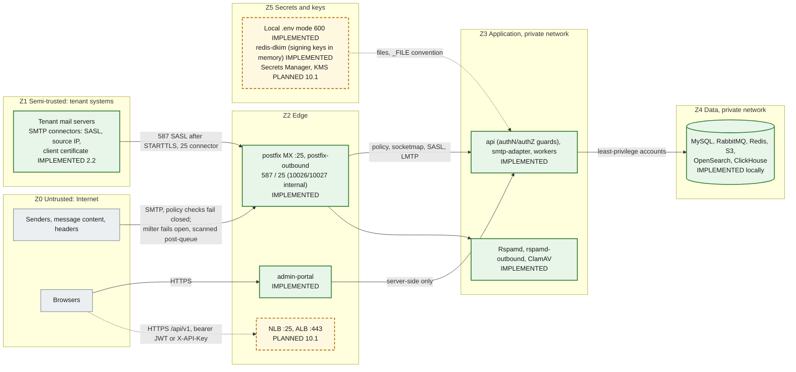

# Security boundaries

Trust zones, the network boundaries between them, the database accounts, how secrets are handled, and where tenant isolation is enforced. The baseline controls are listed in [docs/security/README.md](../security/README.md); this page shows **where** each control sits. A full STRIDE threat model is a separate follow-up (security README). Status labels follow the [diagram convention](diagrams/README.md#status-convention).

## Trust zones

| Zone                | Contains                                                     | Trust                                                                                           | Boundary controls                                                                                                                                                                                                                                                                                                                                                                                                                                                                                                                                                                |
| ------------------- | ------------------------------------------------------------ | ----------------------------------------------------------------------------------------------- | -------------------------------------------------------------------------------------------------------------------------------------------------------------------------------------------------------------------------------------------------------------------------------------------------------------------------------------------------------------------------------------------------------------------------------------------------------------------------------------------------------------------------------------------------------------------------------- |
| Z0 Internet         | Senders, every byte of message content and headers, browsers | None. Headers and bodies are attacker-controlled                                                | Postfix: no open relay (`554`), HELO required, `VRFY` off, 50 MB cap, connection, rate and recipient limits, opportunistic TLS 1.2+. Policy and milter fail closed (IMPLEMENTED, `mail-plane.test.ts`)                                                                                                                                                                                                                                                                                                                                                                           |
| Z1 Tenant systems   | Tenant mail servers and connectors                           | Only as far as the connection is authenticated, and only for that tenant's verified domains     | Organization-level SMTP connectors (step 2.2): SASL on 587 only after STARTTLS (`smtpd_tls_auth_only`), source networks on 25 (globally non-overlapping, optional `require_tls`), pinned client-certificate SHA-256 fingerprints on 25; the policy then requires the sender domain to be an active, outbound-enabled domain of the connector's organization. `domain_mail_servers.outbound_source` is deprecated. Never trusted for direction or tenant through headers. Source-IP connectors must not be used with shared-IP platforms (M365, Google): use SASL or certificates |
| Z2 Edge             | Postfix (both instances), load balancers, admin-portal       | Parses untrusted input; holds no data-store credentials (portal) or only spool access (Postfix) | Postfix holds **no credentials**: relay domains, connectors and SASL come from smtp-adapter over socketmap, policy delegation and the Dovecot auth protocol (ADR-0019). Every listener states its relay permission; the outbound defaults refuse everything. Portal: security headers, no `X-Powered-By`, API URL server-side only (IMPLEMENTED). ALB, WAF, TLS termination (PLANNED 10.1)                                                                                                                                                                                       |
| Z3 Application      | Nest services, Rspamd, ClamAV                                | Trusted code, untrusted data                                                                    | zod validation of config, events and every API request; global fail-closed authentication and permission guards on every non-public api route (IMPLEMENTED 1.3, `route-security.e2e.test.ts`); policy parser bounded at 16 KiB; correlation ids validated; non-root, read-only root FS, dropped capabilities, no service-account token (IMPLEMENTED manifests)                                                                                                                                                                                                                   |
| Z4 Data             | MySQL, RabbitMQ, Redis, S3, OpenSearch, ClickHouse           | Trusted stores, reachable only from Z3                                                          | Per-purpose accounts (below); Redis password; RabbitMQ: dedicated vhost `email-gateway` with least-privilege role users per service (step 3.2, below), administrator only for provisioning, tests and operators, `guest` loopback-only; S3 anonymous access denied, TLS-only and SSE-KMS (module); OpenSearch security disabled **locally only**                                                                                                                                                                                                                                 |
| Z5 Secrets and keys | `.env`, Secrets Manager, KMS, DKIM private keys              | Highest                                                                                         | Never committed, never logged, file-mounted in clusters                                                                                                                                                                                                                                                                                                                                                                                                                                                                                                                          |

## Network boundaries

| Boundary                            | Local (Compose)                                                                                                                                                                                                                                                                                                                         | Production                                                                                                                                                                              | Status                                        |
| ----------------------------------- | --------------------------------------------------------------------------------------------------------------------------------------------------------------------------------------------------------------------------------------------------------------------------------------------------------------------------------------- | --------------------------------------------------------------------------------------------------------------------------------------------------------------------------------------- | --------------------------------------------- |
| Host exposure                       | Every published port binds to `127.0.0.1`                                                                                                                                                                                                                                                                                               | Only the MX NLB and the portal/API ALB are public                                                                                                                                       | IMPLEMENTED locally; PLANNED 10.1             |
| Rspamd controller (:11334)          | `secure_ip` is `127.0.0.1` and `::1` only (no password from loopback: the health check); from the network every call needs a password: read (`RSPAMD_CONTROLLER_PASSWORD`, email-worker `/stat`, Prometheus) or enable (`RSPAMD_CONTROLLER_ENABLE_PASSWORD`, api training only), rendered as `rspamadm pw` hashes into tmpfs (step 4.1) | Same; reachable only from the scan Deployment, the api and Prometheus (NetworkPolicy)                                                                                                   | IMPLEMENTED                                   |
| Rspamd scan (:11333), clamd (:3310) | No authentication; reachable on the Compose network (`/checkv2`: the email-worker scan role). Milter 11332: only `postfix`. Locally Rspamd also sits on `mailtest` (`172.31.250.11`) and resolves only through `dns-sink` (`RSPAMD_DNS_SERVERS`), so it never queries the Internet                                                      | Private subnets, security groups or NetworkPolicy limited to `email-worker` and Postfix                                                                                                 | IMPLEMENTED locally; restriction PLANNED 10.1 |
| smtp-adapter mail ports             | Compose network; refuses peers outside `SMTP_INTERNAL_CLIENT_NETWORKS` (loopback + RFC 1918)                                                                                                                                                                                                                                            | policy 10040, socketmap 10041, SASL 10042, LMTP 10050/10051/10052 reachable only from the Postfix ASGs (security groups; internal NLB). The Kubernetes Service does not expose them yet | IMPLEMENTED locally; production PLANNED 10.1  |
| Postfix listeners                   | `postfix` 25 → host 2525; `postfix-outbound` 587 → 2587, 25 → 2527; 10026/10027 **never published** (`POSTFIX_REINJECT_NETWORKS` only)                                                                                                                                                                                                  | inbound 25 public (NLB); outbound 587/25 open to tenant networks; 10026/10027 only from the delivery-worker subnet                                                                      | IMPLEMENTED (`smtp-relay-control.test.ts`)    |
| redis-dkim (:6379, host 6391)       | `default` user off; `dkim-writer` (api), `dkim-reader` (rspamd-outbound), `dkim-probe` (smtp-adapter: selectors only); ACL file on tmpfs                                                                                                                                                                                                | Security groups: only api, smtp-adapter and rspamd-outbound                                                                                                                             | IMPLEMENTED                                   |
| Outbound egress (local)             | `postfix-outbound` resolves only through `dns-sink` (authoritative for `sink.test`): it can never reach the Internet locally                                                                                                                                                                                                            | static egress IPs with PTR (EC2)                                                                                                                                                        | IMPLEMENTED                                   |
| Pod-to-pod                          | n/a                                                                                                                                                                                                                                                                                                                                     | Kubernetes NetworkPolicies (default deny, explicit allow per dependency)                                                                                                                | PLANNED 10.1 (not in the base manifests)      |
| Egress                              | Unrestricted                                                                                                                                                                                                                                                                                                                            | NAT; outbound SMTP only from the outbound Postfix ASG with static IPs; VPC endpoints for S3, Secrets Manager                                                                            | PLANNED 10.1                                  |

## Database accounts

All created from environment values by `infrastructure/mysql/init/01-users.sh` (idempotent `CREATE USER IF NOT EXISTS` + `GRANT`). In AWS they are created by Terraform or operations with the same grants.

| Account                      | Variable                 | Grants                                                                                                                                               | Used by                                        | Verified by                                                                                                       |
| ---------------------------- | ------------------------ | ---------------------------------------------------------------------------------------------------------------------------------------------------- | ---------------------------------------------- | ----------------------------------------------------------------------------------------------------------------- |
| `gateway_app` (writer, DML)  | `DATABASE_URL`           | `SELECT, INSERT, UPDATE, DELETE` on the schema                                                                                                       | Every service                                  | `mysql.test.ts`: DML allowed, DDL denied                                                                          |
| `gateway_reader`             | `DATABASE_READ_URL`      | `SELECT` on the schema, `REPLICATION CLIENT` on `*.*` (only to read `SHOW REPLICA STATUS`)                                                           | `api` only                                     | `replication.test.ts`: INSERT, UPDATE, DELETE, CREATE denied by privilege (1142/1044) on both replica and primary |
| `gateway_migrator` (DDL)     | `MIGRATION_DATABASE_URL` | `ALL` on the schema and on the two throwaway schemas `<db>_shadow` (Prisma shadow database, `SHADOW_DATABASE_URL`) and `<db>_perf`; nothing on `*.*` | `db-migrate`, partition maintenance            | `accounts.test.ts`: no global grant; `mysql.*`, `CREATE USER` and other schemas denied. CI `migrations` job       |
| `gateway_repl` (replication) | `MYSQL_REPLICATION_*`    | `REPLICATION SLAVE, BACKUP_ADMIN` on `*.*`                                                                                                           | Replica I/O thread, CLONE donor                | `replication.test.ts` (replication runs)                                                                          |
| `root`                       | `MYSQL_ROOT_PASSWORD`    | Everything                                                                                                                                           | Container bootstrap and the replica setup only | Never used by services                                                                                            |

The reader cannot write even on the primary, so a misrouted reader connection fails closed. The replica additionally runs with `read_only` and `super_read_only`.

## Secrets handling

| Rule                                                                                                                                                                                                                                                                                                                                                                                                                                                                                                                                                                    | Where                                                             | Status                                                                     |
| ----------------------------------------------------------------------------------------------------------------------------------------------------------------------------------------------------------------------------------------------------------------------------------------------------------------------------------------------------------------------------------------------------------------------------------------------------------------------------------------------------------------------------------------------------------------------- | ----------------------------------------------------------------- | -------------------------------------------------------------------------- |
| No credentials in the repository. `.env.example` holds placeholders (`__GENERATE__`, `__GENERATE_32__` for the replication password) and `${VAR}` references                                                                                                                                                                                                                                                                                                                                                                                                            | `.env.example`, `scripts/init-env.mjs`                            | IMPLEMENTED                                                                |
| `pnpm env:init` generates random secrets into a git-ignored `.env` with mode 600                                                                                                                                                                                                                                                                                                                                                                                                                                                                                        | `scripts/init-env.mjs`                                            | IMPLEMENTED                                                                |
| Clusters: Secrets Manager → External Secrets → Kubernetes Secret `email-gateway-secrets` → files under `/var/run/secrets/gateway`, read through `<KEY>_FILE`                                                                                                                                                                                                                                                                                                                                                                                                            | `packages/config`, `infrastructure/kubernetes/base`               | `_FILE` IMPLEMENTED (`load-config.test.ts`); External Secrets PLANNED 10.1 |
| Config errors name keys, never values                                                                                                                                                                                                                                                                                                                                                                                                                                                                                                                                   | `packages/config`                                                 | IMPLEMENTED                                                                |
| Logs redact `password`, `secret`, `token`, `authorization`, `cookie` and the authentication fields (`accessToken`, `refreshToken`, `mfaToken`, `code`, recovery codes, `x-api-key`, …); the reader's errors have connection URLs replaced by `[redacted-url]`; `audit_logs` metadata drops credential-like keys. Since step 3.1 the mail-content fields are redacted too (top level and `*.`: `subject`, `filename`, `originalFilename`, `envelopeFrom`, `headerFrom`, `headerValue`, `textBody`, `htmlBody`, `rawHeaders`, `payload.envelopeFrom`) as defence in depth | `packages/logger`, `prisma-read.service.ts`, `apps/api/src/audit` | IMPLEMENTED (`logger.test.ts`, `audit.service.test.ts`)                    |
| MySQL scripts pass passwords through `MYSQL_PWD` or option files, never on the command line                                                                                                                                                                                                                                                                                                                                                                                                                                                                             | `infrastructure/mysql/*`                                          | IMPLEMENTED                                                                |
| Rspamd's Redis password and (step 4.1) the controller password hashes (`rspamadm pw`; the plaintext reaches only the container's own process list for the duration of the command) and the Spamhaus DQS key are rendered at start into tmpfs `local.d`/`override.d` with mode 600; the entrypoint names failing variables, never values. The api holds only the enable password, the email-worker only the read password (`*_FILE` accepted)                                                                                                                            | `infrastructure/rspamd/entrypoint.sh`                             | IMPLEMENTED                                                                |
| SMTP connector secrets: generated by the api, shown once, stored as Argon2id PHC hashes; verified only inside smtp-adapter (SASL server), never by Postfix; the SASL username never appears in mail headers (`smtpd_sasl_authenticated_header = no`); passwords never logged (also redacted from test transcripts)                                                                                                                                                                                                                                                      | Step 2.2                                                          | IMPLEMENTED (`smtp-connectors.test.ts`, `sasl.test.ts`)                    |
| redis-dkim passwords and `GATEWAY_TRACE_SECRET` come from `.env` / Secrets Manager; rspamd-outbound renders its reader password into a tmpfs `local.d` (mode 600)                                                                                                                                                                                                                                                                                                                                                                                                       | Step 2.2                                                          | IMPLEMENTED                                                                |
| RabbitMQ (step 3.2): one password per role user (`RABBITMQ_RELAY_PASSWORD`, `RABBITMQ_EMAIL_WORKER_PASSWORD`, `RABBITMQ_DELIVERY_WORKER_PASSWORD`, `RABBITMQ_OPS_PASSWORD`, `__GENERATE__` in `.env.example`); each service gets only its own URL (Compose stops passing `RABBITMQ_URL`; `*_URL_FILE` in Kubernetes). `infrastructure/rabbitmq/init.mjs` sends credentials only in the `Authorization` header and never prints them; the client library's errors and logs carry codes, never URLs                                                                       |
| Secrets stored in MySQL are never plaintext: passwords as Argon2id hashes, API keys and recovery codes as HMAC-SHA256 (pepper), MFA secrets AES-256-GCM encrypted, refresh and single-use tokens as SHA-256; webhook secrets app-encrypted                                                                                                                                                                                                                                                                                                                              | `apps/api/src/crypto`, `modules/auth`                             | IMPLEMENTED 1.3 (unit and `auth.test.ts`); webhook secrets PLANNED 6.2     |
| DKIM private keys: SecretBox ciphertext in `domain_dkim_keys.private_key_ciphertext` (AES-256-GCM, `DATA_ENCRYPTION_KEY`, AAD `dkim:<domain public id>:<selector>`, ADR-0018); since step 2.2 the active RSA keys of active outbound-enabled domains are **also held in memory** by the api (transiently), redis-dkim (no persistence, ACLs) and rspamd-outbound (ADR-0020)                                                                                                                                                                                             | Step 2.1 encryption, step 2.2 publisher                           | IMPLEMENTED (`dkim-signing-publisher.test.ts`, `smtp-outbound.test.ts`)    |
| S3 objects encrypted with a customer-managed KMS key (rotation on)                                                                                                                                                                                                                                                                                                                                                                                                                                                                                                      | `infrastructure/terraform`                                        | IMPLEMENTED (module, not applied)                                          |

## Untrusted message content (step 3.1)

Every byte of a message is Z0 data, also after the SMTP `250`. The post-queue MIME ingestion stage in the email-worker ([design](../plan/steps/06-mime-ingestion.md) §2.0, M4–M11, M15; [ADR-0022](adr/0022-mime-parsing-and-post-queue-ingestion.md)) handles it as follows (IMPLEMENTED 3.1):

| Control                             | How                                                                                                                                                                                                                                                                                                                                                                                                                             |
| ----------------------------------- | ------------------------------------------------------------------------------------------------------------------------------------------------------------------------------------------------------------------------------------------------------------------------------------------------------------------------------------------------------------------------------------------------------------------------------- |
| No rendering, no execution          | Bodies and attachments are only transfer-decoded and (text/HTML) charset-converted, then streamed to S3. Nothing is executed, rendered, opened or converted to HTML or text. Archives are never extracted: zip metadata comes from the central directory through ranged reads (yauzl, entries never read), gzip from its header and trailer. HTML is stored unsanitized and never served                                        |
| Library surface                     | `@zone-eu/mailsplit`, `libmime`, `libqp`, `libbase64`, `iconv-lite`, `yauzl`, pinned exactly. Not `mailparser`/`nodemailer` (text↔HTML conversion and the address parser with known advisories), not `file-type`                                                                                                                                                                                                                |
| Limits outside the library          | Message size (checked before the download), nesting depth, part count, header count, header line and block size, attachment count and size, body size, decoded ratio, total decoded bytes and a wall-clock parse timeout ([M5](../plan/steps/06-mime-ingestion.md#m5-limits-validated-in-config-enforced-on-the-stream)), validated at startup. Every limit hit is recorded (`parse_limit_exceeded`), never a silent truncation |
| Bounded memory                      | The EML is streamed from S3 and every part streamed to S3 with backpressure; only the first 4 KiB of an attachment are buffered (sniffing). `MIME_CONCURRENCY × (part size × (queue + 1) + zip central directory cap)` must fit `MIME_MEMORY_BUDGET_BYTES` or the worker refuses to start (step 3.2: `MIME_CONCURRENCY` is the queue consumer's prefetch, so at most that many messages are in flight)                          |
| Headers are metadata, not trust     | Only an allow-list of 12 headers is stored, decoded, NFC-normalized, control characters replaced, bidi controls flagged, values capped at 2 048 code points. No header value is used for routing, tenancy, direction or authorization; the envelope sender and recipients stay those of step 2.2                                                                                                                                |
| Filenames                           | Sanitized (last path component, controls, bidi and zero-width characters removed, reserved device names, length cap) and flagged (`filename_path_stripped`, executable and double extensions, extension mismatch); the escaped original is metadata only. Filenames are never part of an S3 key, object metadata or a log line                                                                                                  |
| Stored objects                      | Deterministic keys `org/{organizationId}/part/…` from the writer row; `ContentDisposition: attachment` and `application/octet-stream` (HTML and attachments) or `text/plain` (text), no filename or header in object metadata, so a presigned URL opened by mistake never renders                                                                                                                                               |
| Integrity                           | The SHA-256 and size of the bytes read must equal those recorded at ingestion, otherwise nothing of the content is recorded (`integrity_mismatch`)                                                                                                                                                                                                                                                                              |
| No content in MySQL, events or logs | MySQL holds keys, hashes, sizes, types, flags and bounded header metadata; events carry ids, keys, hashes, codes and counts (no address, subject, filename or header value); logs carry ids, codes, counts and `errName`/`errCode` only, never parser or S3 error messages. A marker-string test proves it                                                                                                                      |

## Message bus (step 3.2)

RabbitMQ is Z4: reachable from Z3 only, never from the edge. Design: [07-rabbitmq.md](../plan/steps/07-rabbitmq.md) Q7, Q9, Q10; [ADR-0024](adr/0024-rabbitmq-topology-retry-dead-letter.md); topology: [messaging-topology.md](messaging-topology.md). All IMPLEMENTED and tested (`tests/integration/messaging-permissions.test.ts`, `messaging-topology.test.ts`, the library's guard tests and the api dead-letter suites).

| Control                       | What it enforces                                                                                                                                                                                                                                                                                                                                                                                                                                                                                                                                                                                                                                                                                                                                                                                                                                                                                                                                                            |
| ----------------------------- | --------------------------------------------------------------------------------------------------------------------------------------------------------------------------------------------------------------------------------------------------------------------------------------------------------------------------------------------------------------------------------------------------------------------------------------------------------------------------------------------------------------------------------------------------------------------------------------------------------------------------------------------------------------------------------------------------------------------------------------------------------------------------------------------------------------------------------------------------------------------------------------------------------------------------------------------------------------------------- |
| Dedicated vhost               | Topology v1 lives in vhost `email-gateway` (`RABBITMQ_VHOST`); nothing is published to `/` or to `amq.*` / the default exchange. The ADR-0005 objects on `/` are removed                                                                                                                                                                                                                                                                                                                                                                                                                                                                                                                                                                                                                                                                                                                                                                                                    |
| Role users, least privilege   | `eg-relay` (event-relay): write on the six exchanges, no read. `eg-email-worker`: write `email.ingestion`/`email.events`, read `email.received`. `eg-delivery-worker`: write `email.delivery`/`email.events`, read `email.delivery.pending`. `eg-ops` (api): write `email.ingestion`/`email.delivery` (the home exchanges of the replayable queues), read `email.dead-letter`. **Topic permissions** restrict the routing keys per exchange (step 3.2 review round 1): only `eg-relay` may publish event keys (`org.<id>.…`); a consumer user only its own queue's `retry.`/`delay.`/`dead-letter.` hops; `eg-ops` only `retry.<work queue>.` keys. **No service can configure** (`^$`, no declares, no policy changes) and none has a management tag. The email-worker cannot publish approvals (`email.delivery`), and the delivery-worker plans only approvals with a matching `message_outbox` row (`approval_not_issued` / `approval_mismatch` dead letters otherwise) |
| Tenant in the routing key     | The routing key `org.<organizationId>.<eventType>`, the `x-eg-organization-id` header and the envelope's `organizationId` must agree, or the consumer dead-letters the delivery (`tenant_mismatch`) without running the handler; handlers still check the event against the writer row (MIME, planner)                                                                                                                                                                                                                                                                                                                                                                                                                                                                                                                                                                                                                                                                      |
| Content guard                 | `assertMetadataOnly` on every publish path (relay, retry, dead-letter, replay) refuses binary values, strings over 2 048 characters, MIME headers, base64 runs ≥ 512 characters, body-like keys and deep/huge structures; encoded messages are capped at 128 KiB (broker `max_message_size` 1 MiB as a last line). The relay marks such outbox rows poison instead of publishing them. Bodies and attachments never travel on the bus                                                                                                                                                                                                                                                                                                                                                                                                                                                                                                                                       |
| Contract checks               | Consumers accept only the event types and schema versions they declare; anything else is dead-lettered (`unknown_event_type`, `unsupported_schema_version`, `contract_invalid`) and never retried                                                                                                                                                                                                                                                                                                                                                                                                                                                                                                                                                                                                                                                                                                                                                                           |
| Replay is a privileged action | `POST /api/v1/platform/dead-letters/replay` requires `platform:dead_letter_replay`, an MFA session and a user principal (no API keys, no override tokens); one replay at a time (Redis lock); every call, dry runs included, writes an `audit_logs` row (`platform.dead_letters_replayed`). Replayed events keep their `eventId`, so a replay never creates a second effect                                                                                                                                                                                                                                                                                                                                                                                                                                                                                                                                                                                                 |
| Logs                          | The library, relay and replay log ids, codes and counts only (`queue`, `eventId`, `eventType`, `organizationId`, `correlationId`, `errName`, `errCode`), never payload values, error messages or URLs                                                                                                                                                                                                                                                                                                                                                                                                                                                                                                                                                                                                                                                                                                                                                                       |

## Message lifecycle operations (step 3.3)

The lifecycle state is a security decision (a released message is delivered; an expired one is not). Design: [08-message-lifecycle.md](../plan/steps/08-message-lifecycle.md) §2.0, L10–L12; [ADR-0025](adr/0025-message-lifecycle-state-machine.md).

| Control                          | What it enforces                                                                                                                                                                                                                                                                                                                                                                                                                                  |
| -------------------------------- | ------------------------------------------------------------------------------------------------------------------------------------------------------------------------------------------------------------------------------------------------------------------------------------------------------------------------------------------------------------------------------------------------------------------------------------------------- |
| One door                         | Every write of the state columns and history goes through `@email-gateway/message-lifecycle`; a unit test scans `apps/*/src` and `packages/*/src` and fails on any other writer (empty allow-list). Each edge names the actor roles allowed to take it (`operator` only for rescan/release; `dev_passthrough` only in `APP_ENV` local/ci)                                                                                                         |
| Operator actions                 | `POST …/rescan` needs `message:rescan` (organization admins, security analysts), `POST …/release` needs `quarantine:release`; users and API keys; the actor (`operator`, principal type, public id) is written to the history row and an `audit_logs` row (`message.rescan_requested` / `message.quarantine_released`) in the same transaction as the transition                                                                                  |
| Release cannot bypass quarantine | A message with per-recipient `quarantine_messages` rows answers `409 quarantine_workflow_required` (re-validation and approvals are 5.3); the release writes ordinary approvals that pass the planner's provenance check (outbox row) and its round check (only the current `lifecycle_round` is planned)                                                                                                                                         |
| Idempotency                      | `Idempotency-Key` (1–128 characters, case-sensitive) is required on both operations and stored in `api_idempotency_keys` with the response, the principal, the operation and a SHA-256 fingerprint of the request, in the transaction of the effect: a retry replays (`Idempotency-Replayed: true`), the same key with another request, principal or operation answers `422`; records expire after 24 h                                           |
| Tenant scoping                   | The organization comes from the authenticated scope only; the message is looked up by its registry public id with the tenant predicate on the registry and the partitioned row, on the writer for decisions; another organization's message is `404 message_not_found` (existence is not confirmed). The rescan refuses an EML key outside `org/<organizationId>/`. Event-driven producers check the envelope organization against the writer row |
| Optimistic concurrency           | Clients send `expectedVersion`; a stale view answers `409 message_version_conflict` (never applied); a state the operation does not allow answers `409 message_state_conflict` with the current state and version only                                                                                                                                                                                                                            |
| No content                       | History, `lifecycle.*` events, `state_changed.v1` / `rescan_requested.v1` and the `409` bodies carry ids, codes, versions, rounds and timestamps; the operator's free-text reason is stored in the audit row only                                                                                                                                                                                                                                 |
| Forged bus events                | Only `eg-relay` publishes `org.` keys on `email.security`; the scan role (4.1) checks `lifecycleRound` and the state against the writer row before acting on a `rescan_requested.v1` (an older round or another state is skipped)                                                                                                                                                                                                                 |

## Security scanning (step 4.1)

Design: [09-rspamd.md](../plan/steps/09-rspamd.md) §2.0, S11, S13, S16, S18; [ADR-0026](adr/0026-security-scan-pipeline.md), [ADR-0027](adr/0027-rspamd-milter-policy.md); deployment: [rspamd.md](../deployment/rspamd.md).

| Control                     | What it enforces                                                                                                                                                                                                                                                                                                                                                                                                                                                                                                                                                                 |
| --------------------------- | -------------------------------------------------------------------------------------------------------------------------------------------------------------------------------------------------------------------------------------------------------------------------------------------------------------------------------------------------------------------------------------------------------------------------------------------------------------------------------------------------------------------------------------------------------------------------------- |
| Never clean by accident     | Timeout, error, open breaker, missing EML, invalid reply, skipped or empty result, and a pre-filter reply that raised no verdict (close-out CR1) are never `clean`; a round whose required engine failed is `scan_failed`, which nothing approves. `clean` comes only from a complete, schema-valid, non-skipped reply with symbols                                                                                                                                                                                                                                              |
| Trusted envelope only       | SPF, HELO and IP checks use `client_ip`, `client_helo`, `client_name` and `envelope_from` recorded from Postfix XFORWARD and the writer's recipients; header values are never sent as envelope. Header values are validated (no CR/LF, length-bounded); `User` (authenticated submitter) is sent only for outbound/internal mail                                                                                                                                                                                                                                                 |
| Forged results              | Postfix cleanup (`header_checks`, independent of the milter, so also while Rspamd is down) and the milter remove inbound `X-Spam*`, `X-Spamd-*`, `X-Rspamd-*` and `Authentication-Results` with our authserv-id, and the milter adds one of ours; an ARC chain suppresses a DMARC failure only when its latest sealer is on `RSPAMD_ARC_TRUSTED_SEALERS` (anyone can seal); the post-queue scan never reads any `Authentication-Results` or spam header from the message (verified by `scan-smtp` and `scan-pipeline`: a forged pass is removed and the scan records `spf=fail`) |
| Tenant from trusted context | The worker takes the organization from the envelope and checks it against the writer row and the EML key prefix `org/<id>/` (`eml_key_mismatch` otherwise); the api from the authenticated scope (another organization's message → `404`)                                                                                                                                                                                                                                                                                                                                        |
| No content in MySQL         | The scan stage streams the EML from S3 to Rspamd and never buffers or stores it; MySQL holds only rounds, verdicts, reason codes, bounded signals and authentication outcomes (`email_scans`, `scan_engine_results`, `email_auth_results`). Training streams the EML from S3 too                                                                                                                                                                                                                                                                                                 |
| Symbol options              | Rspamd symbol options can contain addresses and URLs: bounded (≤ 5 per symbol, ≤ 200 characters, control characters stripped) and stored only in `scan_engine_results.evidence` (tenant-scoped, `message:read`). They are never logged, never in events (`scanned.v1` is a strict schema without symbols, options, scores or addresses) and never metric labels (bounded enums only)                                                                                                                                                                                             |
| Tenant thresholds           | `scan:settings_manage` (organization admins, security analysts): scores only inside platform bounds and ordered, severities only raised, required engines never disabled, unknown keys refused; audited with before/after; re-validated by the worker at use                                                                                                                                                                                                                                                                                                                     |
| Training is platform-only   | Bayes statfiles and the fuzzy storage are shared by all tenants, so training (`platform:scan_training`) is a platform operation: user principals only, MFA, rate-limited, the message looked up within the addressed organization, the EML streamed with the enable password, audited (`scan_training.<operation>`, never content). `autolearn = false` (no implicit poisoning)                                                                                                                                                                                                  |
| Redis separation            | Rspamd uses `RSPAMD_REDIS_DB` (1) of the shared local Redis, apart from the apps' DB 0; production uses a dedicated Redis. Its state (Bayes, fuzzy, reputation, history with hashed subjects) is cross-tenant by design                                                                                                                                                                                                                                                                                                                                                          |
| Broker                      | The scan role has its own user `eg-scanner`: read `scan.spam`, publish only `retry.scan.spam.*` / `dead-letter.scan.spam*`; results reach the bus only through the outbox and the relay (`messaging-permissions` stack suite)                                                                                                                                                                                                                                                                                                                                                    |
| Test-only key material      | The DKIM key of `clean.scan.test` under `tests/fixtures/scan-corpus/keys/` signs only test fixtures of a zone no real resolver serves                                                                                                                                                                                                                                                                                                                                                                                                                                            |

## Tenant isolation enforcement points

The full model is [diagram 13](diagrams/13-multi-tenant-isolation.md). In short:

| Layer            | Enforcement                                                                                                                                                                                                                                                                                                                                                                                                            | Status                                                                                                                                                                                                   |
| ---------------- | ---------------------------------------------------------------------------------------------------------------------------------------------------------------------------------------------------------------------------------------------------------------------------------------------------------------------------------------------------------------------------------------------------------------------- | -------------------------------------------------------------------------------------------------------------------------------------------------------------------------------------------------------- |
| Schema           | `organization_id BIGINT UNSIGNED NOT NULL` on every tenant-owned table, tenant indexes lead with it                                                                                                                                                                                                                                                                                                                    | IMPLEMENTED (`schema.test.ts`)                                                                                                                                                                           |
| HTTP             | Organization from the authenticated principal: `AuthGuard` builds the principal from a verified credential and sets a branded `TenantScope` (home organization, API key's organization, or override target); never from a header or query; `public_id` in URLs; another tenant's resource is `404`                                                                                                                     | IMPLEMENTED 1.2/1.3 for every current route. Organization endpoints verified by `apps/api/integration/tenant-isolation-organizations.test.ts`; identity endpoints by `tenant-isolation-identity.test.ts` |
| SMTP             | Organization from the **verified** owner of the recipient domain (`domains.verified_name`, globally unique; pending claims never match) or the authenticated SMTP connector (IMPLEMENTED 2.2; the LMTP listener port decides the direction; headers never decide)                                                                                                                                                      | Key IMPLEMENTED (`schema.test.ts`); lookup PLANNED 2.2                                                                                                                                                   |
| Events           | `organizationId` decimal id in every envelope, set by the producer from trusted context                                                                                                                                                                                                                                                                                                                                | IMPLEMENTED (schema)                                                                                                                                                                                     |
| Object keys      | `org/{organizationId}/` prefix: format validated in events; equality with the envelope checked by consumers. The email-worker (step 3.1) loads the message by `(id, received_at, organization_id = envelope.organizationId)` (a cross-tenant envelope finds nothing and has no effect), refuses an `eml_object_key` outside `org/{organizationId}/` (`eml_key_mismatch`) and builds every part key from the writer row | Format IMPLEMENTED; equality IMPLEMENTED 3.1 for the email-worker, PLANNED for later consumers                                                                                                           |
| Repositories     | Only `*.repository.ts` files may use Prisma (ESLint rule); tenant-owned rows are read and written through methods that take the `TenantScope` (or, for the organization catalog, an `OrganizationAccess`-filtered organization) first; cross-tenant tests                                                                                                                                                              | IMPLEMENTED 1.2/1.3 (lint rule, isolation suites)                                                                                                                                                        |
| Limits           | `organization_limits` materialized from the plan, overridable only by the platform catalog; enforced under a row lock (`OrganizationLimitsService`, `max_users` on invitation); Redis per-organization request limits                                                                                                                                                                                                  | Limits and `max_users` IMPLEMENTED 1.2/1.3; `max_domains` enforcement 2.1; per-organization rate limits PLANNED 6.1                                                                                      |
| Platform access  | Platform staff act on one customer organization only through a time-limited override (MFA session, reason, `platform:*` stripped, not refreshable, every request audited as `platform.override_request`, mutations carry `metadata.override`). The organization catalog (`platform:organizations`) is a separate, audited platform function, never available to API keys or override sessions                          | IMPLEMENTED 1.3 (`auth.test.ts`, `tenant-isolation-organizations.test.ts`)                                                                                                                               |
| Tenant lifecycle | Suspension revokes every session and stops API keys immediately; deletion is two-person (four-eyes, MFA), blocked by active legal holds, and data is kept until `purge_after` (≥ the last archive's `retain_until`)                                                                                                                                                                                                    | IMPLEMENTED 1.2 (`organizations.test.ts`); purge job PLANNED ([runbook](../runbooks/organization-deletion.md))                                                                                           |
| Search           | Mandatory organization filter                                                                                                                                                                                                                                                                                                                                                                                          | PLANNED (no step yet)                                                                                                                                                                                    |

## Known gaps

| Gap                                                                                                                                                                                                                                                                                                                                                                                                                                                                                                                                     | Owner step           |
| --------------------------------------------------------------------------------------------------------------------------------------------------------------------------------------------------------------------------------------------------------------------------------------------------------------------------------------------------------------------------------------------------------------------------------------------------------------------------------------------------------------------------------------- | -------------------- |
| `docs/security/README.md` says event S3 keys are "checked against the envelope tenant". The email-worker checks it since step 3.1; the other consumers (delivery-worker reinjection reads the row's key, 4.x, 8.1) must do the same                                                                                                                                                                                                                                                                                                     | 3.x / 4.x            |
| The MIME parser runs in the worker process: a synchronous CPU loop inside a library would ignore the parse `AbortSignal` (bounded by streaming and limits, the poison guard and the liveness probe). A worker-thread or sandbox isolation is not built                                                                                                                                                                                                                                                                                  | 4.x                  |
| Rspamd's scan worker and clamd have no authentication; production must restrict them at the network layer                                                                                                                                                                                                                                                                                                                                                                                                                               | 10.1                 |
| RabbitMQ runs plain AMQP locally: `amqps://` (TLS) and the production broker (Amazon MQ or a self-managed cluster) are step 10.1 and not verified. A leaked role credential can still publish a retry key of its own work queue (topic permissions cannot tell a forged retry hop from a real one); consumers re-check every event against writer rows, and the planner refuses approvals the gateway never issued (outbox provenance), so such a credential can at most re-send a real approval (a ledger duplicate) or fill the queue | 10.1                 |
| No Kubernetes NetworkPolicies in the base manifests                                                                                                                                                                                                                                                                                                                                                                                                                                                                                     | 10.1                 |
| Composite tenant foreign keys deferred (design §4); isolation relies on the repository layer, its lint rule and the isolation suites                                                                                                                                                                                                                                                                                                                                                                                                    | ongoing              |
| The organization purge job (tenant rows and S3 objects after `purge_after`, freeing `domains.verified_name`) does not exist; deleted organizations keep their data, inaccessible                                                                                                                                                                                                                                                                                                                                                        | later step (runbook) |
| Per-organization API request limits (`api_requests_per_minute`) are stored but not enforced; only the authentication routes are rate limited                                                                                                                                                                                                                                                                                                                                                                                            | 6.1                  |
| External SSO (OIDC/SAML) and SCIM are not available; the `sso` feature flag exists without an implementation                                                                                                                                                                                                                                                                                                                                                                                                                            | later step           |
