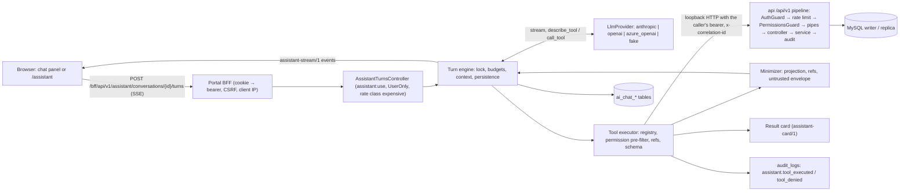
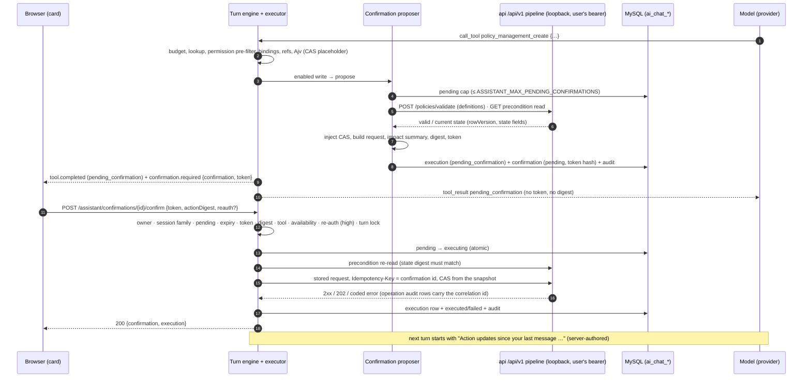

# AI chat architecture

How the AI assistant is built (steps AI-1, AI-2, AI-3, AI-R and AI-4). Normative sources: [design D1–D14](../plan/steps/28-ai-chat-management.md#2-decisions), [AI-2 design D1–D11](../plan/steps/29-ai-chat-confirmations-mail-writes.md#2-decisions), [AI-3 design D1–D13](../plan/steps/30-ai-chat-identity-tenant-admin.md#2-decisions), [ADR-0091](../architecture/adr/0091-assistant-architecture-loopback-tools.md), [ADR-0092](../architecture/adr/0092-llm-provider-abstraction-and-data-handling.md), [ADR-0094](../architecture/adr/0094-assistant-conversation-storage-retention-audit.md), [ADR-0093](../architecture/adr/0093-assistant-action-confirmation.md) (amended in AI-2), [contracts §35](../architecture/contracts.md#35-ai-assistant-step-ai-1) and [§35.1](../architecture/contracts.md#351-confirmations-step-ai-2); step AI-4: [design note 32](../plan/steps/32-ai-chat-security-operations.md), ADR-0093 "Amendment AI-4", contracts §35.4. This page summarizes them; where they differ, they win.

## Principles (design §2.0)

| #   | Invariant                                                                                                                                                                                                                                                                                                                                          |
| --- | -------------------------------------------------------------------------------------------------------------------------------------------------------------------------------------------------------------------------------------------------------------------------------------------------------------------------------------------------- |
| I1  | **No parallel business logic.** A tool is an existing `/api/v1` operation. The assistant never imports another module's services or repositories and runs no SQL beyond its own `ai_chat_*` tables.                                                                                                                                                |
| I2  | **The user's own authority, live.** Tools run only inside a live request of the user, with that request's bearer token. Nothing runs in the background on a user's behalf; no credential is stored.                                                                                                                                                |
| I3  | **The model is an untrusted client.** Tool names, arguments, ids and text from the model are validated like internet input; the model can never confirm, approve or change permissions.                                                                                                                                                            |
| I4  | **Tenant from the principal** (`scopeFromPrincipal`), never from a tool argument; the api enforces it again on every call.                                                                                                                                                                                                                         |
| I5  | **No message content to the model, none in MySQL.** No tool returns bodies or attachments; `ai_chat_*` stores user text, assistant text and masked metadata cards only, bounded and purged.                                                                                                                                                        |
| I6  | **Every tool execution is recorded and audited**, allowed or denied.                                                                                                                                                                                                                                                                               |
| I7  | **Isolation from mail processing.** The assistant lives in the api only; no worker, smtp-adapter, policy-engine or RabbitMQ change.                                                                                                                                                                                                                |
| I8  | **Tests never reach an LLM or the internet** (deterministic fake provider, injected `fetch`).                                                                                                                                                                                                                                                      |
| I9  | **No write without the user** (AI-2). A write runs only inside `POST /assistant/confirmations/{id}/confirm`, a live request of the same user and session family, carrying a token the model never saw.                                                                                                                                             |
| I10 | **What the user confirms is what runs** (AI-2). The card is rendered from the stored, server-authored summary of the stored request; the confirm carries the card's digest; changed state refuses.                                                                                                                                                 |
| I11 | **Existing controls stay the authority** (AI-2). The confirmed request passes the api's own pipeline (RBAC, MFA, tenant scope, rate limits, idempotency, CAS, approvals, audit).                                                                                                                                                                   |
| I12 | **No self-service of authority through chat** (AI-3). Nobody changes their own account, roles, status, MFA or sessions through chat, nor the assistant's own enablement or who may configure it; proposal guards refuse before anything is stored.                                                                                                 |
| I13 | **The api's no-escalation rules stay the authority** (AI-3). Guards only add refusals; every confirmed identity change passes the api's target-side, no-escalation, last-administrator and override rules.                                                                                                                                         |
| I14 | **Credentials never pass through chat** (AI-3). No tool creates, displays, rotates or accepts a password, API key, SMTP or webhook secret, invitation or reset token.                                                                                                                                                                              |
| I18 | **Four eyes stay four eyes** (AI-4). No ATO response is approved or rejected through chat by the user who requested it or who created the API key that requested it; the assistant refuses before anything is stored and again at confirm; the api's self-approval refusal stays the authority.                                                    |
| I19 | **Platform tools never reach tenant principals** (AI-4). `platform:*` tools are absent for customer users and for platform users under an override; a forced call is `denied_permission` without a loopback request.                                                                                                                               |
| I20 | **Weakening detection needs re-authentication** (AI-4). Every confirmed change that adds trust or an exception, suppresses findings, sets a benign verdict, protects an account from automation, disables a detector or policy, switches it to monitor-only, adds an `allow` rule, changes ATO settings or the IdP response permissions is `high`. |
| I21 | **No content to the model, no secret through chat** (AI-4, I5 and I14 restated). No AI-4 tool returns a body, an attachment, DLP evidence or a provider credential; the DLP pattern-test sample and pattern are never stored in execution or audit rows.                                                                                           |

## Components

| Component                   | Where                                                                                                                                                                                                                            | Role                                                                                                                                                                                                                                                                                                                          |
| --------------------------- | -------------------------------------------------------------------------------------------------------------------------------------------------------------------------------------------------------------------------------- | ----------------------------------------------------------------------------------------------------------------------------------------------------------------------------------------------------------------------------------------------------------------------------------------------------------------------------- |
| Chat panel and page         | `apps/admin-portal/src/features/assistant`                                                                                                                                                                                       | "Ask AI" header button (`Ctrl/Cmd+J`), right-side sheet (full screen below `md`), `/assistant` page with history, Settings → AI assistant tab; streams turns through the BFF; renders cards and a restricted Markdown subset (no raw HTML, internal links only); the confirmation card (`confirmation-card.tsx`, AI-2)        |
| BFF proxy                   | `apps/admin-portal/src/server/proxy.ts`                                                                                                                                                                                          | Session cookie → bearer, CSRF, client IP; passes `text/event-stream` through unbuffered (`cache-control: no-store, no-transform`, `x-accel-buffering: no`)                                                                                                                                                                    |
| Controllers (18 routes)     | `apps/api/src/modules/assistant/controllers`                                                                                                                                                                                     | Thin, `@UserOnly()`, tag `assistant` ([CHAT_API_DOCUMENTATION.md](CHAT_API_DOCUMENTATION.md))                                                                                                                                                                                                                                 |
| Turn engine                 | `services/turn-engine.service.ts`                                                                                                                                                                                                | Lock, budgets, context, model rounds, tool calls, persistence, SSE events, cancellation                                                                                                                                                                                                                                       |
| Tool executor               | `services/tool-executor.service.ts`                                                                                                                                                                                              | Registry lookup, permission pre-filter, bindings, refs, schema validation, loopback call, card + envelope, execution row + audit row; for an enabled write, hands over to the proposer instead of the loopback write                                                                                                          |
| Confirmations (AI-2)        | `services/confirmation-proposer.service.ts`, `confirmation.service.ts`, `confirmation-views.service.ts`, `repositories/confirmations.repository.ts`, `domain/confirmation-binding.ts`, `controllers/confirmations.controller.ts` | Proposal (pending cap, spec, definition validation, precondition read, CAS injection, summary, digest, token, rows), the confirm/cancel/get routes with their ordered checks, re-authentication, execution of the stored request, action updates for the next turn                                                            |
| Loopback client             | `services/loopback-client.ts`                                                                                                                                                                                                    | Sends the tool's HTTP request to the api itself with the caller's bearer                                                                                                                                                                                                                                                      |
| Availability, limits, usage | `services/assistant-availability.service.ts`, `assistant-limits.service.ts`, `assistant-usage.service.ts`                                                                                                                        | Switches (platform, feature, tenant), per-user turn window, concurrency, token budgets, usage rows                                                                                                                                                                                                                            |
| Settings, retention         | `services/assistant-settings.service.ts`, `assistant-retention.service.ts`                                                                                                                                                       | Tenant settings (CAS), content purge, metadata hard delete, stale-turn sweeper                                                                                                                                                                                                                                                |
| Provider service            | `services/assistant-provider.service.ts`                                                                                                                                                                                         | Builds the configured `LlmProvider`, retry policy, Redis-backed breaker, metrics                                                                                                                                                                                                                                              |
| `@email-gateway/assistant`  | `packages/assistant`                                                                                                                                                                                                             | Providers (Anthropic, OpenAI, Azure OpenAI, fake with multi-step plans), system prompt `assistant-system/2`, context window and recap, minimizer and sanitizer, card builder, stream contract, the generated tool registry and its generator, confirmations (canonical JSON, digest, specs, impact templates, action updates) |
| Tenant purge                | `apps/api/src/modules/tenant-data/assistant-tenant-data.repository.ts`                                                                                                                                                           | Organization deletion removes every `ai_chat_*` row                                                                                                                                                                                                                                                                           |
| Shared permission predicate | `apps/api/src/auth-contracts/authorization.ts`                                                                                                                                                                                   | `satisfiesRequirement`, used by both `PermissionsGuard` and the executor's pre-filter (one implementation)                                                                                                                                                                                                                    |

## Data flow



One **turn** = one user message → up to `ASSISTANT_MAX_TOOL_ROUNDS` model calls → one assistant message:

1. Gates: platform switch, organization feature `ai_assistant`, tenant setting, permission `assistant:use`, per-user turn window, concurrency, tenant and platform token budgets, breaker (each with its coded error, [CHAT_API_DOCUMENTATION.md](CHAT_API_DOCUMENTATION.md#error-codes)).
2. A Redis lock per conversation (`as:turn:<id>`); `clientTurnId` makes a retried POST idempotent.
3. One writer transaction stores the running turn and the user message; the SSE headers and `turn.started` are flushed before the first model call.
4. The model gets the system prompt (versioned template + context block + catalogue index of the user's available tools) and the conversation's current segment; it may call `describe_tool` or `call_tool`.
5. Each `call_tool` goes through the executor (below); the model receives a minimized envelope, the browser a card.
6. A final transaction stores the assistant message, the provider transcript, token usage (`ai_chat_usage_daily`) and the turn status.

## Loopback execution (ADR-0091)

A tool is executed by sending **the same HTTP request the portal would send** to the api itself (`ASSISTANT_LOOPBACK_URL`, empty = `http://127.0.0.1:${HTTP_PORT}`), so the guards, rate limits, idempotency, masking, signed cursors, coded errors and audit of the operation apply unchanged. The request carries exactly: the turn request's `authorization` header, `x-correlation-id: <turn correlation id>.<execution seq>`, the end user's client IP through the trusted forwarder (`x-eg-client-ip` + `x-eg-forwarder-token` when `API_TRUSTED_FORWARDER_TOKEN` is set), `accept: application/json`, `user-agent: eg-assistant/1` and the informational `x-eg-assistant-execution`. From step AI-2, the precondition reads of a confirmation (GET only) also carry `x-eg-assistant-read-primary`: HMAC-SHA256 of `AUTH_TOKEN_PEPPER` (a server value, identical on every api replica, never from model output). `AssistantReadPrimaryMiddleware` removes the header and, only when it matches (constant time), runs the route inside `runReadsOnWriter`, so its `PrismaReadService` reads use the MySQL writer instead of a lagging replica; it grants nothing else (authentication, RBAC and tenant scope are unchanged). No header is ever set from model output; path parameters are validated and encoded; responses are capped at 1 MiB; each call times out after `ASSISTANT_TOOL_TIMEOUT_MS`. A `401` ends the turn (`assistant_session_expired`). The assistant's own routes are never tools.

Executor order per `call_tool` (each refusal is a recorded, audited execution): per-turn call cap → registry lookup → not applicable → not enabled → permission pre-filter → bindings (`self_organization`) → refs (`@r<seq>.<row>`) → JSON Schema validation (Ajv) → loopback → card and envelope; for an enabled write the loopback write is replaced by the proposal (below). The confirmed write's loopback request adds `idempotency-key` (the confirmation id, a server value) for operations with `required` or `legacy` idempotency. Up to four calls of one model response run in parallel.

## Confirmation flow (step AI-2, ADR-0093 amended)

A write tool never executes inside a turn. The model can only **propose**; the user decides in a confirmation card; the confirm request executes exactly the stored request through the same loopback.



- **Proposal** (inside the turn): nothing changes platform state but `ai_chat_*` and audit rows; the validate and read calls are side-effect free. A failed definition validation (`assistant_definition_invalid`, at most 20 violations) or a failed precondition read (its coded error) is an ordinary failed execution the model can explain or fix.
- **Confirm** (outside the turn, `POST /assistant/confirmations/{id}/confirm`): the checks run in a fixed order ([CHAT_API_DOCUMENTATION.md](CHAT_API_DOCUMENTATION.md#confirmations-step-ai-2)); the confirmed write is a new execution row (`parent_execution_id` = the proposal, `turn_id` NULL) under the conversation's turn lock, as "Load more".
- **Cancel** needs no token (works after a reload); **get** shows any own confirmation (never the token).
- **Outcome to the model:** at the start of the next turn, terminal confirmations not yet reported (≤ 20, oldest first) are rendered by `buildActionUpdates()` as a prefix of the new user entry and marked `reported_at`; they are never stored in `ai_chat_messages.content`.
- **Sweeps** (the retention job): `pending` past `expires_at` → `expired`; `executing` whose write started (`execution_started_at`) more than `ASSISTANT_TOOL_TIMEOUT_MS` + 60 s ago, or with no write started and `decided_at` older than 26 × `ASSISTANT_TOOL_TIMEOUT_MS` + 60 s (the precondition re-read: up to 25 sequential reads) → `failed` with `assistant_confirmation_outcome_unknown` (never re-executed); a confirm request still running then loses its write claim (`409`, nothing sent) or, if its write was already sent, replaces that outcome with the real one (audit metadata `reconciledFrom`).
- **Specs and summaries** come from `@email-gateway/assistant` (`src/confirmations`): one confirmation spec and one impact template per enabled write ([CHAT_TOOL_REGISTRY.md](CHAT_TOOL_REGISTRY.md#confirmation-specs-ai-2), [AI-3](CHAT_TOOL_REGISTRY.md#confirmation-specs-ai-3)).
- **Step AI-3 additions** ([design note 30 D3–D5, D10](../plan/steps/30-ai-chat-identity-tenant-admin.md#d10-api-changes-assistant-module)): (1) **proposal guards** (`guards.ts`): after Ajv and before `propose`, the executor evaluates the guards that need no read (`not_self_user`, `deny_values`, `deny_permission_change` without an old set) and refuses with `denied_guard` (`tool.denied`, `assistant.tool_denied` with `guard`) without any loopback request; the proposer evaluates the after-read guards on the precondition target; the confirm re-evaluates both (`403 assistant_action_not_allowed`, row failed). (2) **Effective risk** (`escalation.ts`): the proposer stores `effectiveRisk(tool, spec, finalArgs)` (registry risk raised by the matching escalations; `requires_reauth = risk === 'high'`), passes the escalation warnings to the impact template and records `baseRisk` in the audit; the digest binds the stored risk and the confirm recomputes it (`409 assistant_confirmation_tool_changed` on a difference). (3) **Selected-item preconditions**: `readPreconditions` picks the target item of a list read (`select`), digests and displays the item, and keeps the raw target in memory only (never stored) for the after-read guards.

## Provider abstraction (ADR-0092)

One interface, `LlmProvider.complete(request, signal, onDelta)` (`packages/assistant/src/providers/types.ts`), and four implementations:

| Provider       | Transport                                                                                                                                          | Notes                                                                                                                                                                       |
| -------------- | -------------------------------------------------------------------------------------------------------------------------------------------------- | --------------------------------------------------------------------------------------------------------------------------------------------------------------------------- |
| `anthropic`    | `@anthropic-ai/sdk` 1.1.0 (as the BEC layer), streaming, `cache_control` on the system block, `output_config.effort`, server-side refusal fallback | Default model `claude-opus-5-5`, effort `low`; no `thinking`, `temperature` or forced `tool_choice`; thinking blocks replayed unchanged; `maxRetries: 0` (own retry policy) |
| `openai`       | Plain HTTPS Chat Completions with `stream: true`, strict function tools, bounded SSE parser, zod-validated chunks                                  | `ASSISTANT_OPENAI_BASE_URL`                                                                                                                                                 |
| `azure_openai` | The same client against `{endpoint}/openai/deployments/{deployment}/chat/completions?api-version=…` with the `api-key` header                      | Region chosen by the operator                                                                                                                                               |
| `fake`         | In process, deterministic, no network                                                                                                              | Directives (`/tool`, `/describe`, `/text`), demo intents, templates, adversarial mode for tests; refused with `NODE_ENV=production`                                         |

Every provider sees exactly two meta tools, `describe_tool { name }` and `call_tool { name, arguments }`, not one tool per operation (token cost, provider limits). The catalogue index in the system prompt lists only the tools the user may call, one line each, in a fixed order (prompt caching). Retries: one retry on connection errors, `429` and `5xx` before any text was streamed. Breaker: `ASSISTANT_BREAKER_THRESHOLD` failures open it for `ASSISTANT_BREAKER_RESET_MS` across all api pods (`as:brk:<provider>`), then `503 assistant_provider_unavailable`. Costs: per-model prices in `prices.ts` or `ASSISTANT_MODEL_PRICES`; tokens are always recorded, cost is advisory (`null` when unknown). The model id reported by the provider is stored per turn.

## Context and segments (D7)

- **System prompt**: `packages/assistant/prompts/assistant-system-3.md` (`assistant-system/3` since AI-3: the AI-2 rules (writes are proposals, never claim a change without an action update or result, never ask for a confirmation, password or code in chat, validate policy definitions first) plus: never change the signed-in user's own account, roles, status, MFA or sessions; never ask for, repeat or invent credentials or one-time codes, credentials are created and rotated only in the portal; role, permission, invitation, session and MFA changes need re-authentication in the card; the assistant cannot turn itself on or off or change who may configure it. Turns keep their stored `prompt_version`; `assistant-system-2.md` stays for them) + a context block (organization name and id, user display name, roles, UTC time, the browser's time zone, registry version) + the catalogue index.
- **Transcript**: the provider-native transcripts of the previous turns of the current **segment**, replayed verbatim (append-only; required for preserved thinking), plus the new user message.
- **Window**: when system + segment exceed `ASSISTANT_CONTEXT_MAX_TOKENS`, a new segment starts with a deterministic recap (last user messages, tools used and the refs still valid). No model call is made for the recap and history inside a segment is never edited.
- **Refs**: results are numbered `r<seq>` (execution) and `r<seq>.<row>` (row) per conversation; the model can refer to "the second one" as `@r4.2`, which the server resolves to the stored public id of this conversation only.

## Results (D8, D9)

- **Card** (`assistant-card/1`) for the user: built from the real API response (table, key-value, series, message or error) with display hints and portal links; the UI renders numbers from the card, not from the model's text. "Load more" re-runs the stored cursor without a model call.
- **Envelope** (`assistant-tool-result/1`) for the model: at most `ASSISTANT_TOOL_RESULT_MAX_ROWS` rows and `ASSISTANT_TOOL_RESULT_MAX_BYTES` bytes, strings ≤ 300 characters, credential-like keys dropped, control/bidi/zero-width characters stripped, mail-derived and attacker-influenced values (manifest `untrustedFields`) plus every free-form response value (objects without declared properties, maps, untyped values: evidence, detail, metadata, criteria, params; added by the registry generator, `freeFormResponsePaths`) wrapped as `{ "untrusted_text": … }`, with a fixed note that data is never instructions.
- **Assistant text** is capped at 16 000 characters and rendered by an in-repo Markdown subset renderer (no HTML, links only to internal portal routes, images and external URLs as plain text).

## Isolation from the mail path (I7, D11)

The assistant is a module of the api process only. It publishes and consumes no RabbitMQ message (topology stays v14), adds nothing to workers, smtp-adapter or policy-engine, and its failures (provider outage, budget exhaustion, bugs) degrade only the chat: kill switches at platform (`ASSISTANT_ENABLED`), organization (feature `ai_assistant`) and tenant (settings) level, a per-process concurrency cap (`ASSISTANT_MAX_CONCURRENT_TURNS`), per-user turn limits and the api's existing rate limits on every loopback call. Production may later route `/api/v1/assistant` to a separate Deployment of the same api image with its own egress policy (AI-6); not done in AI-1.

## Configuration

Api only; section "AI assistant (step AI-1)" of `.env.example` (AI-2 appended `ASSISTANT_MAX_PENDING_CONFIRMATIONS`); validated at start-up by `assistantConfigShape` (`apps/api/src/config.ts`), errors name the key, never the value.

| Key                                                                                                          | Default                     | Meaning                                                                                                                              |
| ------------------------------------------------------------------------------------------------------------ | --------------------------- | ------------------------------------------------------------------------------------------------------------------------------------ |
| `ASSISTANT_ENABLED`                                                                                          | `false`                     | Platform switch (`503 assistant_disabled` when off)                                                                                  |
| `ASSISTANT_PROVIDER`                                                                                         | `fake`                      | `fake`, `anthropic`, `openai`, `azure_openai`; `fake` is refused with `NODE_ENV=production` while enabled                            |
| `ASSISTANT_MODEL`                                                                                            | `claude-opus-5-5`           | Model id (Anthropic, OpenAI); Azure uses the deployment                                                                              |
| `ASSISTANT_EFFORT`                                                                                           | `low`                       | Anthropic effort (`low`, `medium`, `high`)                                                                                           |
| `ASSISTANT_REFUSAL_FALLBACK`                                                                                 | `default`                   | Anthropic server-side refusal fallback (`default`) or plain requests (`off`)                                                         |
| `ASSISTANT_ANTHROPIC_API_KEY`, `ASSISTANT_OPENAI_API_KEY`, `ASSISTANT_AZURE_OPENAI_API_KEY`                  | unset                       | Provider credentials (external secrets, `_FILE` accepted); required for the selected provider while enabled                          |
| `ASSISTANT_ANTHROPIC_BASE_URL`                                                                               | SDK default                 | Optional Anthropic endpoint                                                                                                          |
| `ASSISTANT_OPENAI_BASE_URL`                                                                                  | `https://api.openai.com/v1` | OpenAI endpoint (https outside local/CI)                                                                                             |
| `ASSISTANT_AZURE_OPENAI_ENDPOINT`, `ASSISTANT_AZURE_OPENAI_DEPLOYMENT`, `ASSISTANT_AZURE_OPENAI_API_VERSION` | unset, unset, `2024-10-21`  | Azure OpenAI resource, deployment and API version                                                                                    |
| `ASSISTANT_TIMEOUT_MS`                                                                                       | `30000`                     | One provider call                                                                                                                    |
| `ASSISTANT_TURN_DEADLINE_MS`                                                                                 | `90000`                     | Whole turn                                                                                                                           |
| `ASSISTANT_MAX_OUTPUT_TOKENS`                                                                                | `4096`                      | Output tokens per model call                                                                                                         |
| `ASSISTANT_MAX_TOOL_ROUNDS`, `ASSISTANT_MAX_TOOL_CALLS_PER_TURN`                                             | `6`, `12`                   | Model rounds and tool calls per turn                                                                                                 |
| `ASSISTANT_TOOL_TIMEOUT_MS`                                                                                  | `15000`                     | One loopback tool call                                                                                                               |
| `ASSISTANT_TOOL_RESULT_MAX_BYTES`, `ASSISTANT_TOOL_RESULT_MAX_ROWS`                                          | `12288`, `25`               | Envelope size sent to the model                                                                                                      |
| `ASSISTANT_CONTEXT_MAX_TOKENS`                                                                               | `60000`                     | Segment window before a recap                                                                                                        |
| `ASSISTANT_USER_MESSAGE_MAX_CHARS`                                                                           | `4000`                      | Question length                                                                                                                      |
| `ASSISTANT_TURNS_PER_USER_PER_MINUTE`                                                                        | `6`                         | Per-user turn window                                                                                                                 |
| `ASSISTANT_MAX_CONCURRENT_TURNS`                                                                             | `20`                        | Per api process (`503 assistant_busy`)                                                                                               |
| `ASSISTANT_TENANT_DAILY_TOKENS_DEFAULT`, `ASSISTANT_TENANT_DAILY_TOKENS_MAX`                                 | `1000000`, `5000000`        | Tenant budget per UTC day when unset, and the most a tenant may set                                                                  |
| `ASSISTANT_PLATFORM_DAILY_TOKENS`                                                                            | `0`                         | Platform tokens per UTC day (0 = no cap)                                                                                             |
| `ASSISTANT_RETENTION_DEFAULT_DAYS`                                                                           | `30`                        | Content retention after the last turn when the tenant set none                                                                       |
| `ASSISTANT_EXECUTION_RETENTION_DAYS`                                                                         | `400`                       | Hard delete of conversation, turn and execution metadata                                                                             |
| `ASSISTANT_MAX_CONVERSATIONS_PER_USER`                                                                       | `500`                       | `409 assistant_conversation_limit` beyond                                                                                            |
| `ASSISTANT_LOOPBACK_URL`                                                                                     | empty                       | Base URL of tool calls (empty = the api's own port)                                                                                  |
| `ASSISTANT_BACKGROUND_JOBS_ENABLED`                                                                          | `true`                      | Retention purge and stale-turn sweeper in this process                                                                               |
| `ASSISTANT_BREAKER_THRESHOLD`, `ASSISTANT_BREAKER_RESET_MS`                                                  | `5`, `60000`                | Provider breaker                                                                                                                     |
| `ASSISTANT_MODEL_PRICES`                                                                                     | empty                       | JSON prices per model (micro-USD per million tokens)                                                                                 |
| `ASSISTANT_CONFIRMATION_TTL_SECONDS`                                                                         | `300`                       | Time to confirm a proposal (60–900 s)                                                                                                |
| `ASSISTANT_REAUTH_WINDOW_SECONDS`                                                                            | `300`                       | After a successful re-authentication at an assistant confirm, `high` confirms of the same session skip it (0–1800 s; 0 = always ask) |
| `ASSISTANT_MAX_PENDING_CONFIRMATIONS`                                                                        | `5`                         | Pending confirmations per conversation (1–20); a further proposal is `denied_budget` (AI-2)                                          |

The Docker Compose api service passes no `ASSISTANT_*` key, so the containerized api runs with the assistant off; see [README.md](README.md#enabling-it-locally).

## Reports in chat and email delivery (step AI-R, ADR-0095)

Normative sources: [design note 31](../plan/steps/31-ai-chat-reports.md) (I15–I17, D1–D11), [ADR-0095](../architecture/adr/0095-assistant-reports-native-tools-static-html-email.md) and the "Amendment AI-R" sections of ADR-0091, ADR-0093 and ADR-0094, [contracts §35.3](../architecture/contracts.md), topology v15.

### Native tools

Two registry records are **native tools** (`packages/assistant/src/registry/native.ts`): they are not OpenAPI operations, their operation ids are `AssistantNative_<camel>` (never in `docs/api/openapi.json`) and their path templates start with `native:`, which the loopback client refuses. `ALL_TOOLS = [...OPERATION_TOOLS, ...NATIVE_TOOLS]` feeds the catalogue index, `describe_tool`, `GET /assistant/tools`, the executor and the capability matrix ("Native assistant tools").

| Tool                | Access / risk / confirm             | Requirement   | What the api runs (`NativeToolsService`)                                                                                              |
| ------------------- | ----------------------------------- | ------------- | ------------------------------------------------------------------------------------------------------------------------------------- |
| `report_generate`   | read / `read_audited` / none        | `report:read` | `ReportGeneratorService`: a fixed composition of up to ten loopback GETs, the pure renderer of `@email-gateway/assistant`, storage    |
| `report_send_email` | write / `medium` / `confirm+impact` | `report:read` | `ReportDeliveryService`: proposal (recipient rule, limits, bound state), confirm-time re-check, the delivery row and its outbox event |

The platform switches `ASSISTANT_REPORTS_ENABLED` and `ASSISTANT_REPORT_EMAIL_ENABLED` hide each tool (`denied_disabled`, absent from the catalogue).

### Report flow

```text
user: "generate a security report"
  │  turn engine → model calls report_generate {range|from/to, sections}
  ▼
ToolExecutorService (D5 steps 1–6: budget, lookup, permission, refs, schema)
  │  native read → ReportGeneratorService
  ├─ platform principal without override → denied_guard (report_needs_organization)
  ├─ reports of the user today ≥ ASSISTANT_REPORTS_PER_USER_PER_DAY → denied_budget
  ├─ window (≤ REPORTS_MAX_RANGE_DAYS; hour buckets ≤ 48 h, else day)
  ├─ source plan (REPORT_SOURCES): a source the principal may not read is NOT requested
  │    (omitted "permission"); the rest as loopback GETs with the user's bearer,
  │    concurrency 4, correlation <turn>.<seq>.<n>, x-eg-assistant-execution:
  │    /reports/{traffic,threats,top-domains,delivery,processing,url-clicks},
  │    /quarantine/summary, /ato/overview, then /ato/accounts?sort=-riskScore
  │    (only when ATO monitoring is on; feature off → omitted "not_enabled")
  ├─ zod parse per source (unexpected shape → omitted "unexpected_response");
  │    every requested section omitted → 503 assistant_report_sources_unavailable
  ├─ buildReportModel → renderReportHtml (pure, deterministic, inert HTML, static SVG;
  │    > ASSISTANT_REPORT_MAX_HTML_BYTES → 413 assistant_report_too_large)
  ├─ ai_chat_reports row "pending" → PutObject (mail bucket,
  │    org/<org>/assistant/report/<yyyy>/<mm>/<dd>/<reportId>.html, ChecksumSHA256)
  └─ persist transaction: row "available", execution row, card kind "report",
       audit assistant.tool_executed + assistant.report_generated
  ▼
chat: report card → portal ReportFrame fetches GET /assistant/reports/{id}
      ({ report, html } inside JSON, Cache-Control: no-store) → <iframe sandbox="" srcdoc>
```

Every figure in the report, the card and the model's envelope is a value of an API response read in that request with the user's own credential (I15); the model only chooses the period and the sections and receives the figures (≤ 8), never the HTML.

### Email path

```text
user: "send this report to my email" → model calls report_send_email {reportId?, to?}
  ▼ proposal (ReportDeliveryService.prepareProposal)
  report of this owner and conversation (404 / 410 / 413) → recipient class
  (self | member | domain; anything else → denied_guard report_recipient_not_allowed,
  no confirmation, audit with domain + SHA-256 only) → daily limits (denied_budget)
  → confirmation card (risk medium, stateDigest of report + recipient class)
  ▼ confirm (AI-2 steps 1–11, then)
  step 12 readState: recipient now refused → 403 assistant_action_not_allowed;
          digest changed (report purged, class changed) → 409 state_changed
  step 13 in one transaction: SELECT … ai_chat_settings FOR UPDATE (tenant lock),
          exact recount (limit → failed 429, nothing written), ai_chat_report_deliveries
          "queued", message_outbox assistant.report.email_requested.v1 (ids only,
          eventId = delivery id), audit assistant.report_email_requested
  ▼ event-relay → email.policy → email.notifications (topology v15)
notification-worker AssistantReportEmailHandler: delivery (org-scoped) → report
  "available" → object read from the mail bucket (key prefix, size, SHA-256 checked)
  → NoticeMailer → postfix-notify: To: one recipient, HTML body + the same HTML attached
  + plain-text part with the portal link → delivery "sent" (or "failed" with a code)
```

The api never sends mail; the worker writes only the delivery row's status columns and no audit row. A copy in a recipient's mailbox is outside the platform's control.

### Storage and retention

MySQL holds metadata only (`ai_chat_reports`, `ai_chat_report_deliveries`); the HTML is an object in the mail bucket, never returned outside JSON and never logged. The content purge of a conversation (retention job, `DELETE /assistant/conversations/{id}`) moves its reports to `purged`, clears delivery addresses and fails `queued` deliveries; the job deletes the objects after the commit (the delete route inline, best effort), sweeps `pending` reports older than 1 hour and `queued` deliveries older than 25 hours. The organization purge deletes deliveries, then reports (objects first, per batch).

## Security operations tools (step AI-4, ADR-0093 amendment AI-4)

Normative sources: [design note 32](../plan/steps/32-ai-chat-security-operations.md) (I18–I21, D1–D14), ADR-0093 "Amendment AI-4 (2026-11-24)" (q)–(u), contracts §35.4 and the module rows of §23–§25.

AI-4 enables the 66 security-operations operations of the program plan as chat tools (64 writes through the confirmation card, 2 side-effect-free reads: `dlp_patterns_test`, `risk_dry_run_dry_run`) and four new single-item reads the cards need (`bec_trusted_senders_get`, `bec_feedback_get_suppression`, `dlp_exceptions_get`, `threat_indicators_get`, routes `GET /bec/trusted-senders/{id}`, `GET /bec/suppressions/{id}`, `GET /dlp/exceptions/{id}`, `GET /platform/threat-indicators/{id}`). Registry after AI-4 (version `b399d786f91ccdd0`, program phase AI-4): 427 operations, 353 operation tools (327 enabled), 74 not applicable, 2 native tools; **329 enabled chat tools (186 reads, 143 writes)**; `MISSING` 26 (all AI-5). The flow is unchanged (proposal → card → confirm through the loopback); AI-4 adds data to it:

| Area                              | Tools                                                                                                                                                                         | What is new                                                                                                                                                  |
| --------------------------------- | ----------------------------------------------------------------------------------------------------------------------------------------------------------------------------- | ------------------------------------------------------------------------------------------------------------------------------------------------------------ |
| DLP (19)                          | policies, rules, patterns, dictionaries, exceptions, Aadhaar compliance; `dlp_patterns_test`, `dlp_exceptions_get`                                                            | CAS on `version` (body or query) injected from the read; exceptions `high`; disabling, monitor-only, `allow` rules and widened exceptions escalate to `high` |
| BEC (13)                          | executives, vendors, trusted senders, suppressions, per-message feedback; two new reads                                                                                       | trusted senders `high`; disabling, known addresses/senders/domains, expiry changes and feedback suppression escalate                                         |
| Risk scoring (7)                  | profile drafts, publish, activate, reset; `risk_dry_run_dry_run`                                                                                                              | CAS `expectedRowVersion` / `expectedProfileVersion`                                                                                                          |
| Incidents (3)                     | create, update/triage, note                                                                                                                                                   | false-positive resolution and category feedback escalate to `high`                                                                                           |
| ATO (19)                          | account protection, overrides, trusted contexts, mailbox refresh, responses (request, approve, reject, cancel, rollback), settings, IdP integrations (non-secret fields only) | the **four-eyes guard** on approve/reject; trusted contexts, ATO settings and IdP settings `high`; protection and benign overrides escalate                  |
| Platform (9, platform users only) | threat hashes and indicators, attachment rescans, scan training, dead-letter replay; `threat_indicators_get`                                                                  | every write `high` with an "every organization" impact line; never visible under an override (I19)                                                           |

### Four-eyes guard (D3, I18)

Two after-read guard kinds (`packages/assistant/src/confirmations/guards.ts`) evaluate the precondition target `ato_responses_get` (read with the proposing user's credential):

- `not_self_field { field: 'requestedBy.id', when: requestedBy.type = 'user' }`: the requester (all sessions of that user) is refused; a missing field passes (the second guard and the api decide).
- `require_read_value { field: 'canDecide', equals: true, when: status = 'pending_approval' }`: fail closed; covers the creator of a requesting API key and a session without MFA through the api's own `canDecide`.

A refusal is `denied_guard` with the fixed message `ato_four_eyes` (no values) and no confirmation row and no request to `/approve` or `/reject`; the portal shows "Not allowed in chat" with a link to the Responses page. At confirm the re-read runs with the confirming credential and the guards run again (`403 assistant_action_not_allowed`); a status change is `409 assistant_confirmation_state_changed`. The api's own self-approval refusal (`403 ato_approval_self`) stays the authority. Cancel and rollback have no separation-of-duties rule in the api and get no guard.

### Redacted read inputs (D9)

`OperationTool.redactParams` (generated from the manifest; reads only, every path must exist) lists argument paths that the api stores as `[redacted]` in `ai_chat_tool_executions.params_redacted` and in the `assistant.tool_executed` / `tool_denied` audit params, before the credential scrub (`exact` false). AI-4 sets it for `dlp_patterns_test` (`body.sample`, `body.pattern`); the loopback request still carries the real values. The user's own text and the model's tool call stay in the conversation content until retention purges it.

### Platform-only tools (D11, I19)

The platform tools are `platformOnly` and filtered by `satisfiesRequirement` (one implementation with `PermissionsGuard`). A customer user holding every tenant permission and a platform user under an override (permissions stripped to tenant permissions) see none of them in `GET /assistant/tools`; a forced call is `denied_permission` without a loopback request or operation audit row. A platform user without an override sees them; rescans and replays name an organization or say "every organization" in the card.

### Outcomes (D10)

Queued `202` work (`report_send_email`, `ato_providers_health_check`, `ato_providers_backfill`, `ato_account_mailbox_refresh`, `attachment_rescans_request`, and the earlier `message_lifecycle_rescan`, `users_resend_invitation`, `webhooks_test`, `webhook_deliveries_replay`, `webhook_deliveries_create_replay`) is reported to the model as "queued (HTTP 202)" and shown in the portal as done; the other `202`s keep the "waiting for approval by another person" wording. `ato_responses_request` (`201`) is reported as "requested; if it needs approval, another responder must approve it; the requester cannot" and shown as "Requested. If this action needs approval, another responder must approve it before it runs (you cannot approve your own request)."

### Prompt and fake provider (D12)

Prompt `assistant-system/5` = version 4 plus rule 14 (four eyes, re-authentication for weakening changes, platform-only operations, no message content in a pattern test). The fake provider gains three plans: "approve the pending response" (`ato_responses_list` → `ato_responses_approve`), "open an incident for account <address>" (`ato_accounts_list` → `incidents_create`) and `add dlp dictionary "<name>" with terms <a, b, …>` (`dlp_dictionaries_create`).

### ato-worker pool keys (D14)

Not an assistant change, built in the same step: the ATO Playwright timeout came from the ato-worker (a transient database error kept a 15-minute probe lease or counted as a provider failure, and the default Prisma pool of 17 connections with a 10 s pool timeout was too small for its concurrency). The worker now retries and defers transient database errors by 5–60 s without counting them as provider failures, and sets its pool from `ATO_DATABASE_CONNECTION_LIMIT` (default 32) and `ATO_DATABASE_POOL_TIMEOUT_SECONDS` (default 30, at least the transaction `maxWait`); see [docs/deployment/account-takeover.md](../deployment/account-takeover.md).
