# Entity-relationship diagrams

One overview and one diagram per module. Columns are limited to keys and the columns that define relationships; the full column lists are in [schema-reference.md](schema-reference.md).

Legend:

- **Solid line** (`--`): a real foreign key.
- **Dashed line** (`..`): a **logical** reference with no foreign key. Every reference to or from a partitioned table is logical, because MySQL does not allow foreign keys on partitioned tables. Integrity comes from writing parent and children in one transaction.
- Partitioned tables carry `PARTITIONED` in their attribute list, with the partition column marked `PK` as part of the composite primary key.
- `organizations` appears in most module diagrams; every tenant-owned table references it (`organization_id`).

## Overview

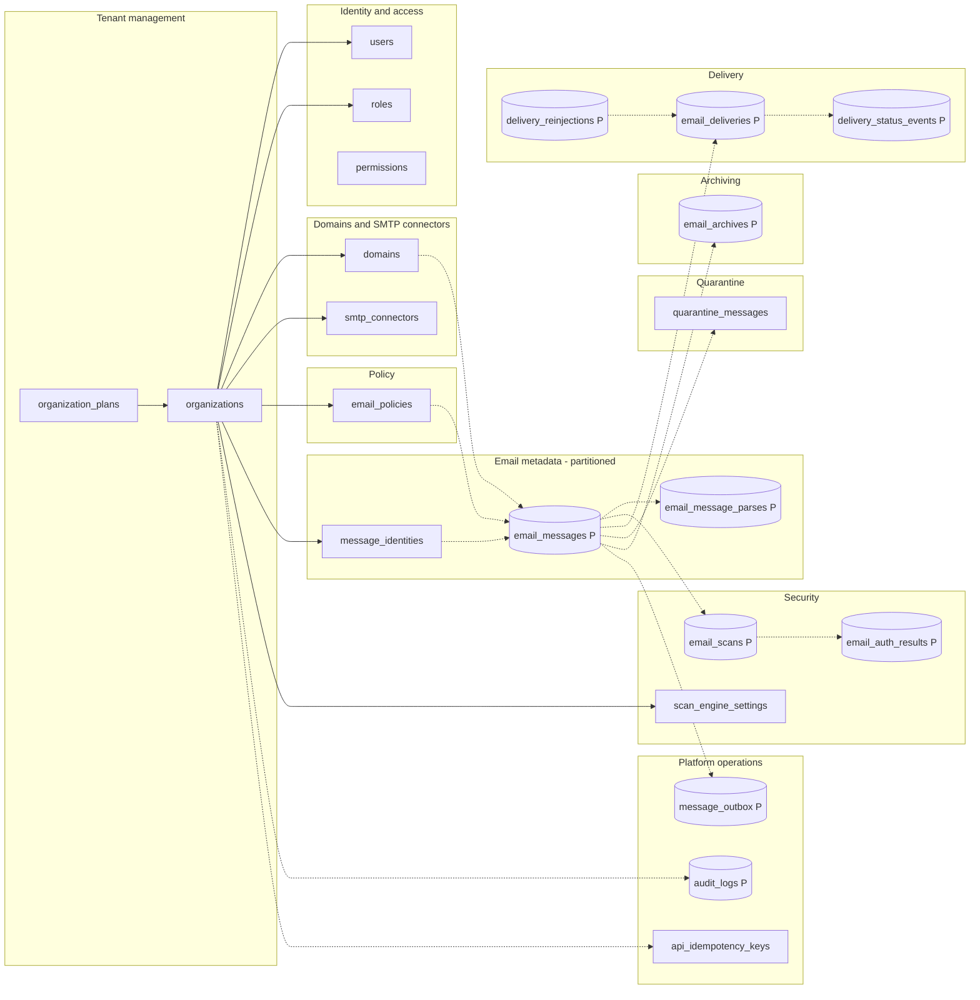

Solid arrows are foreign keys, dotted arrows are logical references. Cylinders (`P`) are partitioned tables.

## Tenant management

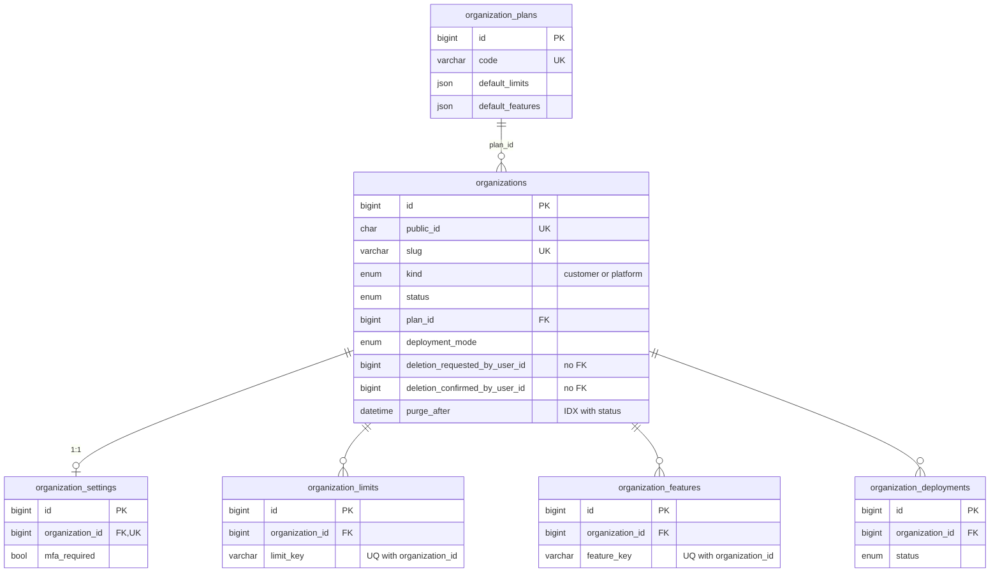

## Identity and access management

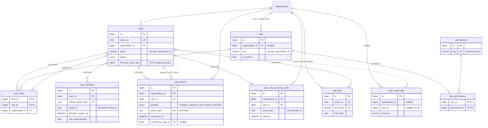

## Domain management and SMTP connectors

Step 2.2 added the recipient allow-list (`domain_recipient_addresses`, D3) and the organization-level outbound connectors (`smtp_connectors` and `smtp_connector_networks`, D10). `created_by_user_id` on both (FK to `users`, `SET NULL`) is omitted from the diagram. Step 2.3 added `public_id`, `provider` and `tls_verify_names` to `domain_mail_servers` and the platform table `mail_destination_presets` (R2). A server's `provider` names a preset by value only: presets are configuration data, so there is no foreign key.

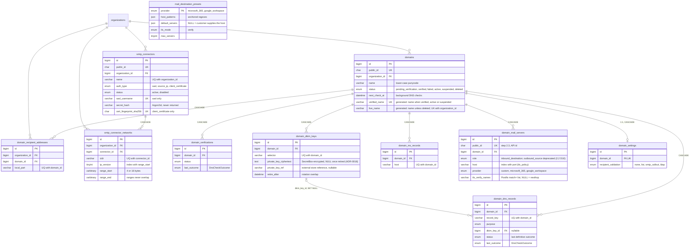

## Email metadata

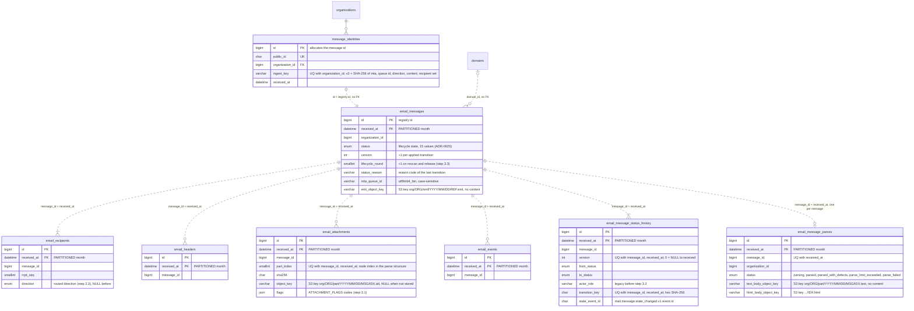

Every write of the lifecycle columns of `email_messages` (`status`, `status_changed_at`, `version`, `lifecycle_round`, `status_reason`) and every `email_message_status_history` row goes through `@email-gateway/message-lifecycle` (step 3.3 L5, one door). A message's history starts with version 0 (`NULL → received`) and its highest version equals `email_messages.version`; the migration `20261104130000_message_lifecycle` backfilled both for older rows.

`email_message_parses` (step 3.1) is the parse stage record written by email-worker: at most one row per message, in the message's partition. Headers and attachment rows of the same message are written in the transaction that finalizes it.

## Security

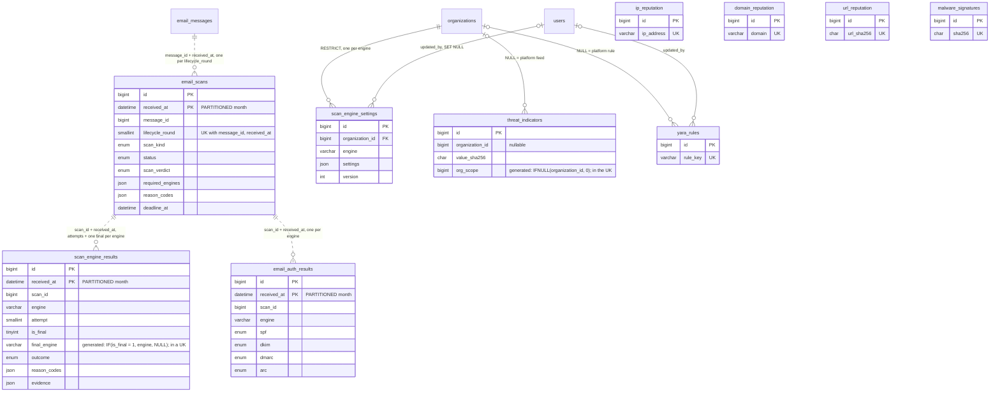

The four reputation catalogs and `malware_signatures` are platform-wide and stand alone.

Step 4.1 ([§3](../plan/steps/09-rspamd.md#3-data-model-one-forward-migration-scan_pipeline-wp1)): a scan round is `(message_id, received_at, lifecycle_round)`, one `email_scans` row; each engine writes its failed attempts as non-final `scan_engine_results` rows and exactly one final row (the unique key on the generated `final_engine`); the Rspamd engine also writes one `email_auth_results` row per round. All three are partitioned and copy the message's `received_at`, so a message's scan graph lives in one partition. `scan_engine_settings` (not partitioned) holds a tenant's override of an engine's platform thresholds, validated by `@email-gateway/security-contracts`.

## Policy

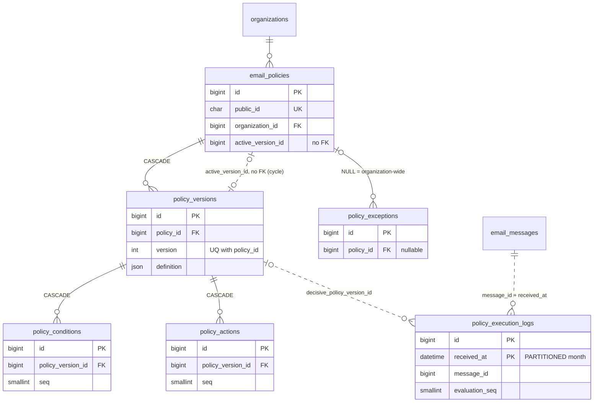

## Delivery

Step 2.3 added per-recipient delivery tracking: `delivery_reinjections` (one SMTP transaction into postfix-outbound per group of recipients) and the append-only audit `delivery_status_events`, both partitioned like the message (same `received_at`). `delivery_routes` stays unused (reserved for rule-based routing, 5.x).

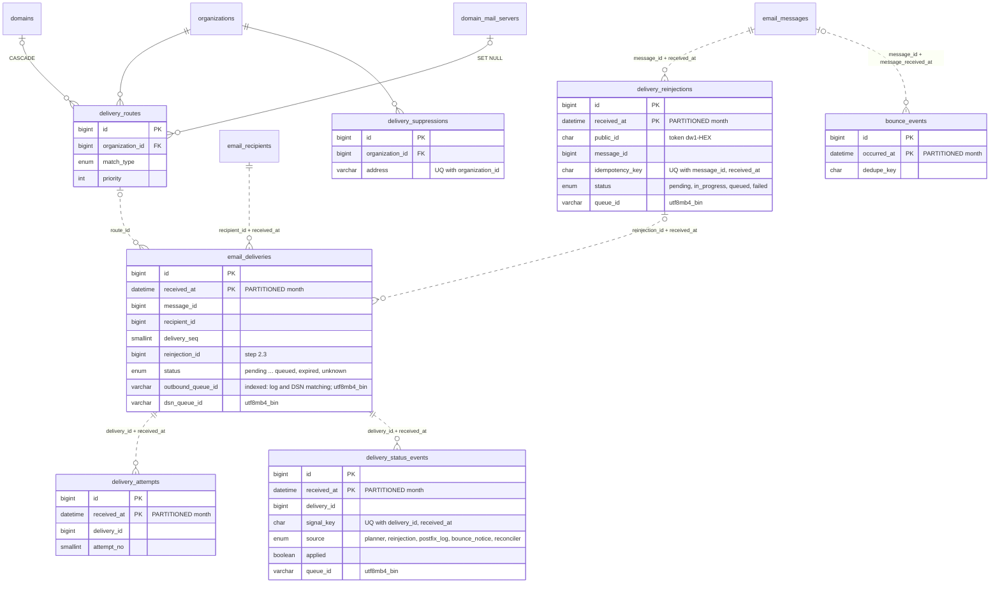

## Quarantine

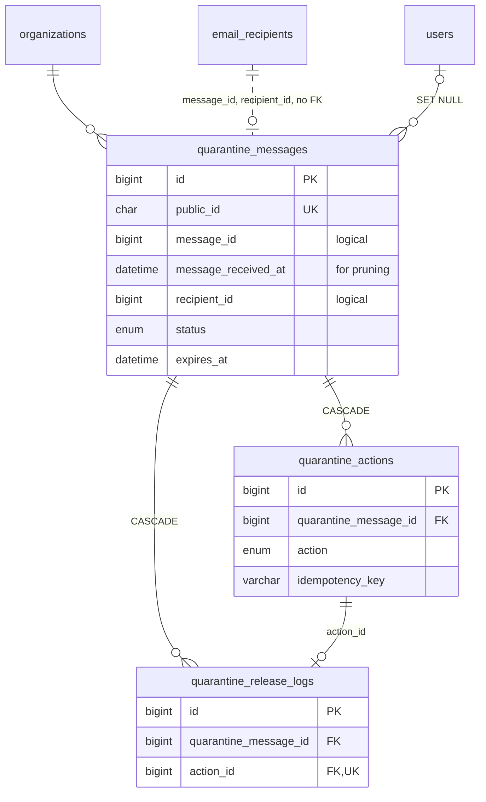

## Archiving

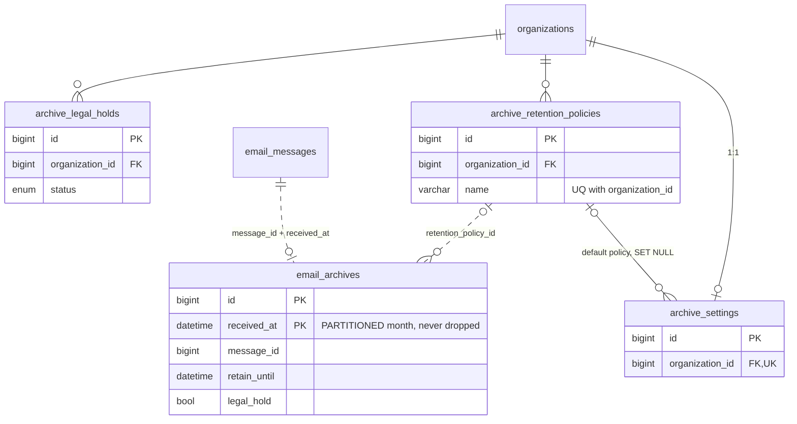

## Platform operations

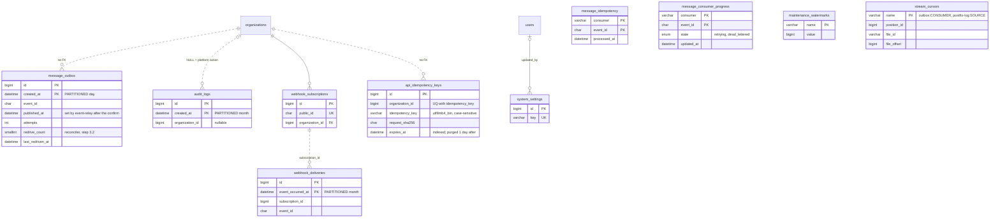

`message_idempotency` stands alone: its key is the consumer name and the event id. So does `message_consumer_progress` (step 3.2 review round 1), with the same key. `stream_cursors` (step 2.3) holds the durable positions of the delivery-worker's outbox pollers and Postfix log tailers; it references nothing. `maintenance_watermarks` belongs to the partition-maintenance job (the registry purge watermark, see [retention.md](retention.md)). `api_idempotency_keys` (step 3.3 L11) is the api's Idempotency-Key store: unpartitioned and without a foreign key (the row outlives nothing it references and is purged one day after it expires), one row per organization and key.
