# Entity-relationship diagrams

One overview and one diagram per module. Columns are limited to keys and the columns that define relationships; the full column lists are in [schema-reference.md](schema-reference.md).

Legend:

- **Solid line** (`--`): a real foreign key.
- **Dashed line** (`..`): a **logical** reference with no foreign key. Every reference to or from a partitioned table is logical, because MySQL does not allow foreign keys on partitioned tables. Integrity comes from writing parent and children in one transaction.
- Partitioned tables carry `PARTITIONED` in their attribute list, with the partition column marked `PK` as part of the composite primary key.
- `organizations` appears in most module diagrams; every tenant-owned table references it (`organization_id`).

## Overview

```mermaid
flowchart LR
  subgraph tenant[Tenant management]
    organizations
    organization_plans
  end
  subgraph iam[Identity and access]
    users
    roles
    permissions
  end
  subgraph domain[Domains and SMTP connectors]
    domains
    smtp_connectors
  end
  subgraph mail[Email metadata - partitioned]
    message_identities
    email_messages[(email_messages P)]
    email_message_parses[(email_message_parses P)]
  end
  subgraph security[Security]
    email_scans[(email_scans P)]
    email_auth_results[(email_auth_results P)]
    attachment_scan_results[(attachment_scan_results P)]
    sandbox_submissions[(sandbox_submissions P)]
    sandbox_analyses
    sandbox_artifacts
    message_urls[(message_urls P)]
    url_scan_results[(url_scan_results P)]
    url_rewrites[(url_rewrites P)]
    url_dynamic_inspections[(url_dynamic_inspections P)]
    url_click_events[(url_click_events P)]
    bec_scan_results[(bec_scan_results P)]
    scan_engine_settings
    attachment_rescan_jobs
    bec_profiles[bec_executive_profiles, bec_vendor_profiles, bec_trusted_senders]
    bec_feedback
    bec_suppression_rules
    bec_contact_history
    dlp_scan_results[(dlp_scan_results P)]
    dlp_evidence[(dlp_evidence P)]
    dlp_policies[dlp_policies, dlp_policy_rules]
    dlp_exceptions
    dlp_config[dlp_custom_patterns, dlp_keyword_dictionaries, dlp_compliance_settings]
    message_risk_scores[(message_risk_scores P)]
    risk_scoring_profiles
    risk_scoring_profile_versions
  end
  subgraph policy[Policy]
    email_policies
    policy_settings
    tenant_departments[tenant_departments, tenant_department_members]
    policy_execution_logs[(policy_execution_logs P)]
  end
  subgraph delivery[Delivery]
    email_deliveries[(email_deliveries P)]
    delivery_reinjections[(delivery_reinjections P)]
    delivery_status_events[(delivery_status_events P)]
  end
  subgraph quarantine[Quarantine]
    quarantine_messages
    quarantine_approval_requests
    quarantine_object_purges
  end
  subgraph archive[Archiving and eDiscovery]
    email_archives[(email_archives P)]
    archive_capture_intents[(archive_capture_intents P)]
    archive_disposals[(archive_disposals P)]
    archive_encryption_keys
    ediscovery_cases[ediscovery_cases, custodians, searches, hits, exports]
    archive_record_sources[(archive_record_sources P)]
    archive_dedupe_keys
  end
  subgraph intake[Journal intake]
    journal_intake_sources
    journal_intake_counters
    journal_intake_messages[(journal_intake_messages P)]
  end
  subgraph integrations[Provider integrations]
    provider_connections
    provider_connection_grants[provider_connection_grants, provider_consent_states, provider_connection_domains]
    provider_health[provider_validation_runs, provider_probe_observations, provider_health_checks, provider_health_events, provider_relay_counters]
    provider_egress[provider_egress_range_sets, provider_egress_ranges]
  end
  subgraph apimode[API-mode protection]
    api_mode_connections
    api_mailboxes[api_mailboxes, api_mailbox_addresses]
    api_message_copies[(api_message_copies P)]
    api_mode_counters[api_mode_counters, api_copy_dedupe_keys]
  end
  subgraph assistant[AI assistant]
    ai_chat_settings
    ai_chat_conversations[ai_chat_conversations, ai_chat_turns, ai_chat_messages, ai_chat_tool_executions, ai_chat_action_confirmations]
    ai_chat_usage_daily
  end
  subgraph ops[Platform operations]
    message_outbox[(message_outbox P)]
    audit_logs[(audit_logs P)]
    api_idempotency_keys
    webhook_subscriptions
    webhook_events[(webhook_events P)]
    webhook_deliveries[(webhook_deliveries P)]
    notification_settings[notification_settings, notification_user_preferences, notification_alert_windows]
  end
  organization_plans --> organizations
  organizations --> users
  organizations --> roles
  organizations --> domains
  organizations --> smtp_connectors
  organizations --> provider_connections
  provider_connections --> smtp_connectors
  organizations --> email_policies
  organizations --> message_identities
  message_identities -.-> email_messages
  domains -.-> email_messages
  email_messages -.-> email_message_parses
  email_messages -.-> email_scans
  email_scans -.-> email_auth_results
  email_scans -.-> attachment_scan_results
  email_scans -.-> sandbox_submissions
  sandbox_submissions -.-> sandbox_analyses
  sandbox_analyses --> sandbox_artifacts
  email_messages -.-> message_urls
  email_scans -.-> url_scan_results
  email_scans -.-> url_rewrites
  email_scans -.-> url_dynamic_inspections
  message_urls -.-> url_click_events
  organizations --> scan_engine_settings
  organizations --> attachment_rescan_jobs
  email_scans -.-> bec_scan_results
  organizations --> bec_profiles
  organizations --> bec_feedback
  organizations --> bec_suppression_rules
  organizations --> bec_contact_history
  bec_scan_results -.-> bec_feedback
  email_scans -.-> dlp_scan_results
  email_scans -.-> dlp_evidence
  organizations --> dlp_policies
  organizations --> dlp_exceptions
  organizations --> dlp_config
  dlp_policies --> dlp_exceptions
  email_scans -.-> message_risk_scores
  organizations --> risk_scoring_profiles
  risk_scoring_profiles --> risk_scoring_profile_versions
  risk_scoring_profile_versions -.-> email_scans
  email_messages -.-> email_deliveries
  delivery_reinjections -.-> email_deliveries
  email_deliveries -.-> delivery_status_events
  email_messages -.-> quarantine_messages
  email_messages -.-> email_archives
  email_messages -.-> archive_capture_intents
  email_archives -.-> archive_disposals
  email_archives -.-> archive_record_sources
  email_archives -.-> archive_dedupe_keys
  organizations --> journal_intake_sources
  provider_connections --> journal_intake_sources
  journal_intake_sources --> journal_intake_counters
  email_messages -.-> journal_intake_messages
  journal_intake_sources -.-> journal_intake_messages
  organizations --> api_mode_connections
  provider_connections --> api_mode_connections
  api_mode_connections --> api_mailboxes
  api_mode_connections --> api_mode_counters
  email_messages -.-> api_message_copies
  api_mailboxes -.-> api_message_copies
  organizations --> archive_encryption_keys
  organizations --> ediscovery_cases
  email_messages -.-> message_outbox
  email_policies -.-> email_messages
  organizations --> policy_settings
  organizations --> tenant_departments
  email_messages -.-> policy_execution_logs
  organizations -.-> audit_logs
  organizations -.-> api_idempotency_keys
  organizations --> webhook_subscriptions
  webhook_subscriptions -.-> webhook_deliveries
  webhook_events -.-> webhook_deliveries
  organizations --> notification_settings
  organizations --> ai_chat_settings
  organizations --> ai_chat_conversations
  users --> ai_chat_conversations
  organizations --> ai_chat_usage_daily
  ai_chat_conversations -.-> audit_logs
```

Solid arrows are foreign keys, dotted arrows are logical references. Cylinders (`P`) are partitioned tables.

## Tenant management

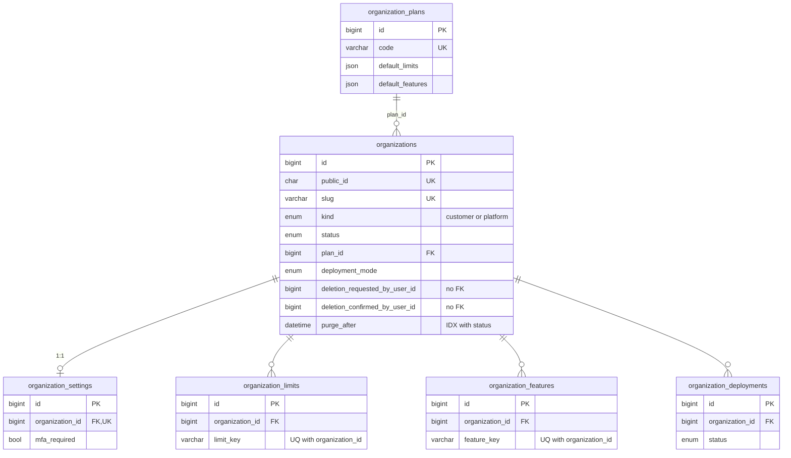

## Identity and access management

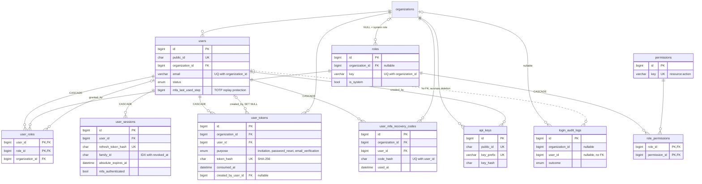

## Domain management and SMTP connectors

Step 2.2 added the recipient allow-list (`domain_recipient_addresses`, D3) and the organization-level outbound connectors (`smtp_connectors` and `smtp_connector_networks`, D10). `created_by_user_id` on both (FK to `users`, `SET NULL`) is omitted from the diagram. Step 2.3 added `public_id`, `provider` and `tls_verify_names` to `domain_mail_servers` and the platform table `mail_destination_presets` (R2). A server's `provider` names a preset by value only: presets are configuration data, so there is no foreign key.

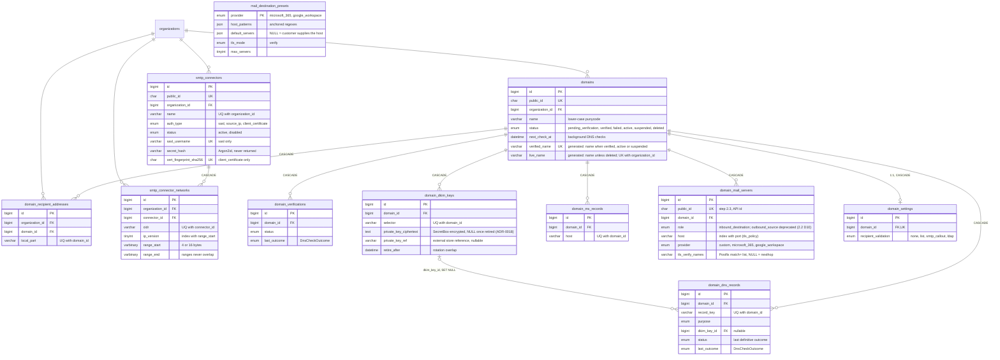

## Email metadata

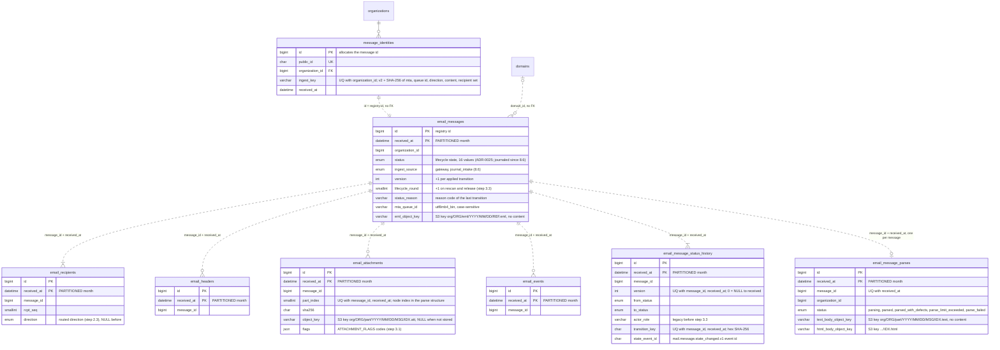

Every write of the lifecycle columns of `email_messages` (`status`, `status_changed_at`, `version`, `lifecycle_round`, `status_reason`) and every `email_message_status_history` row goes through `@email-gateway/message-lifecycle` (step 3.3 L5, one door). A message's history starts with version 0 (`NULL → received`) and its highest version equals `email_messages.version`; the migration `20261104130000_message_lifecycle` backfilled both for older rows.

`email_message_parses` (step 3.1) is the parse stage record written by email-worker: at most one row per message, in the message's partition. Headers and attachment rows of the same message are written in the transaction that finalizes it.

## Security

```mermaid
erDiagram
  email_messages ||..o{ email_scans : "message_id + received_at, one per lifecycle_round"
  email_scans ||..o{ scan_engine_results : "scan_id + received_at, attempts + one final per engine"
  email_scans ||..o{ email_auth_results : "scan_id + received_at, one per engine"
  organizations ||--o{ scan_engine_settings : "RESTRICT, one per engine"
  users |o--o{ scan_engine_settings : "updated_by, SET NULL"
  email_scans ||..o{ attachment_scan_results : "scan_id + received_at, one per attachment"
  email_attachments ||..o{ attachment_scan_results : "attachment_id, one per round"
  email_scans ||..o{ sandbox_submissions : "scan_id + received_at, one per submitted attachment"
  sandbox_analyses |o..o{ sandbox_submissions : "analysis_id (logical), many submissions per analysis"
  sandbox_analyses ||--o{ sandbox_artifacts : "RESTRICT, unique (analysis_id, seq)"
  organizations |o--o{ attachment_rescan_jobs : "RESTRICT, NULL = every organization"
  users |o--o{ attachment_rescan_jobs : "requested_by, SET NULL"
  users |o--o{ malware_signatures : "added_by, SET NULL"
  organizations |o--o{ threat_indicators : "NULL = platform feed"
  users |o--o{ threat_indicators : "added_by, SET NULL"
  email_messages ||..o{ message_urls : "message_id + received_at, one per unique URL"
  email_scans ||..o{ url_scan_results : "scan_id + received_at, one per URL"
  message_urls ||..o{ url_scan_results : "url_seq, one per round"
  email_scans ||..o| url_rewrites : "scan_id + received_at, one per round"
  email_scans ||..o{ url_dynamic_inspections : "scan_id + received_at, one per inspected URL"
  message_urls ||..o{ url_click_events : "message_id + message_received_at + url_seq"
  email_scans ||..o| bec_scan_results : "scan_id + received_at, one per round"
  organizations ||--o{ bec_executive_profiles : "RESTRICT"
  organizations ||--o{ bec_vendor_profiles : "RESTRICT"
  organizations ||--o{ bec_trusted_senders : "RESTRICT"
  organizations ||--o{ bec_feedback : "RESTRICT"
  organizations ||--o{ bec_suppression_rules : "RESTRICT"
  organizations ||--o{ bec_contact_history : "RESTRICT"
  users |o--o{ bec_executive_profiles : "created_by, updated_by, SET NULL"
  users |o--o{ bec_vendor_profiles : "created_by, updated_by, SET NULL"
  users |o--o{ bec_trusted_senders : "created_by, SET NULL"
  users |o--o{ bec_feedback : "created_by, SET NULL"
  users |o--o{ bec_suppression_rules : "created_by, SET NULL"
  bec_scan_results ||..o{ bec_feedback : "bec_result_id + message_received_at"
  bec_feedback ||..o{ bec_suppression_rules : "feedback_id (logical)"
  email_scans ||..o| dlp_scan_results : "scan_id + received_at, one per round"
  email_scans ||..o| dlp_evidence : "scan_id + received_at, at most one per round"
  dlp_policies |o..o{ dlp_scan_results : "matched_policy_id (logical)"
  dlp_policy_rules |o..o{ dlp_scan_results : "matched_rule_id (logical)"
  organizations ||--o{ dlp_policies : "RESTRICT"
  organizations ||--o{ dlp_policy_rules : "RESTRICT"
  organizations ||--o{ dlp_exceptions : "RESTRICT"
  organizations ||--o{ dlp_custom_patterns : "RESTRICT"
  organizations ||--o{ dlp_keyword_dictionaries : "RESTRICT"
  organizations ||--o| dlp_compliance_settings : "RESTRICT, one per organization"
  dlp_policies ||--o{ dlp_policy_rules : "RESTRICT"
  dlp_policies |o--o{ dlp_exceptions : "policy target, RESTRICT"
  dlp_policy_rules |o--o{ dlp_exceptions : "rule target, RESTRICT"
  users |o--o{ dlp_policies : "created_by, updated_by, SET NULL"
  users |o--o{ dlp_policy_rules : "created_by, updated_by, SET NULL"
  users |o--o{ dlp_exceptions : "created_by, updated_by, SET NULL"
  users |o--o{ dlp_custom_patterns : "created_by, updated_by, SET NULL"
  users |o--o{ dlp_keyword_dictionaries : "created_by, updated_by, SET NULL"
  users |o--o{ dlp_compliance_settings : "aadhaar_recorded_by, SET NULL"
  email_scans ||..o{ message_risk_scores : "scan_id + received_at, one per revision (0, 1)"
  organizations ||--o| risk_scoring_profiles : "RESTRICT, one per organization"
  organizations ||--o{ risk_scoring_profile_versions : "RESTRICT"
  risk_scoring_profiles ||--o{ risk_scoring_profile_versions : "RESTRICT, unique (profile_id, version_no)"
  risk_scoring_profiles |o..o| risk_scoring_profile_versions : "active_version_id, no FK (cycle)"
  risk_scoring_profile_versions |o..o{ email_scans : "risk_profile_version_id snapshot (logical)"
  risk_scoring_profile_versions |o..o{ message_risk_scores : "profile_version_id (logical)"
  users |o--o{ risk_scoring_profiles : "updated_by, SET NULL"
  users |o--o{ risk_scoring_profile_versions : "created_by, updated_by, published_by, SET NULL"
  organizations |o--o{ yara_rules : "NULL = platform rule"
  users |o--o{ yara_rules : "updated_by"
  email_scans {
    bigint id PK
    datetime received_at PK "PARTITIONED month"
    bigint message_id
    smallint lifecycle_round "UK with message_id, received_at"
    enum scan_kind
    enum status
    enum scan_verdict
    json required_engines
    json reason_codes
    datetime deadline_at
    bigint risk_profile_version_id "nullable, no FK, snapshot at open"
  }
  scan_engine_results {
    bigint id PK
    datetime received_at PK "PARTITIONED month"
    bigint scan_id
    varchar engine
    smallint attempt
    tinyint is_final
    varchar final_engine "generated: IF(is_final = 1, engine, NULL); in a UK"
    enum outcome
    json reason_codes
    json evidence
  }
  email_auth_results {
    bigint id PK
    datetime received_at PK "PARTITIONED month"
    bigint scan_id
    varchar engine
    enum spf
    enum dkim
    enum dmarc
    enum arc
  }
  scan_engine_settings {
    bigint id PK
    bigint organization_id FK
    varchar engine
    json settings
    int version
  }
  threat_indicators {
    bigint id PK
    bigint organization_id "nullable"
    char value_sha256
    bigint org_scope "generated: IFNULL(organization_id, 0); in the UK"
    enum category "nullable, step 4.3"
    bigint added_by_user_id FK "nullable, step 4.3"
  }
  message_urls {
    bigint id PK
    datetime received_at PK "PARTITIONED month"
    bigint message_id "UK with url_seq / url_sha256, received_at"
    smallint url_seq
    varchar url "normalized redirect form, the only redirect target"
    char url_sha256 "identity form"
    varchar host
    enum host_kind
  }
  url_scan_results {
    bigint id PK
    datetime received_at PK "PARTITIONED month"
    bigint scan_id "UK with url_seq, received_at"
    smallint url_seq
    enum verdict "UrlVerdict"
    json reason_codes
    json reputation
    json redirect_chain "hosts only"
  }
  url_rewrites {
    bigint id PK
    datetime received_at PK "PARTITIONED month"
    bigint scan_id "UK with received_at"
    enum status "rewritten, skipped"
    varchar object_key "S3 org/ORG/rewrite/..., nullable"
    varchar skip_reason "nullable"
  }
  url_dynamic_inspections {
    bigint id PK
    datetime received_at PK "PARTITIONED month"
    bigint scan_id "UK with url_seq, received_at"
    smallint url_seq
    enum status "pending, completed, failed, expired"
    json signals "counts, hosts, brand ids"
  }
  url_click_events {
    bigint id PK
    datetime clicked_at PK "PARTITIONED month by clicked_at"
    char public_id "reference id"
    bigint message_id
    datetime message_received_at
    enum decision
    varchar client_network "truncated, nullable"
  }
  bec_scan_results {
    bigint id PK
    datetime received_at PK "PARTITIONED month"
    bigint scan_id "UK with received_at"
    smallint lifecycle_round
    tinyint deterministic_score
    tinyint score
    enum deterministic_verdict
    enum verdict
    json inputs "auth, url, text, history states"
    json rules "codes, weights, offsets, no text"
    json ai "assessments, no text"
  }
  bec_executive_profiles {
    bigint id PK
    char public_id UK
    bigint organization_id FK "UK with normalized_name"
    varchar normalized_name
    json known_addresses
  }
  bec_vendor_profiles {
    bigint id PK
    char public_id UK
    bigint organization_id FK "UK with normalized_name"
    varchar normalized_name
    json domains
  }
  bec_trusted_senders {
    bigint id PK
    char public_id UK
    bigint organization_id FK "UK with kind, value"
    enum kind "address, domain"
    varchar value
    datetime expires_at "nullable"
  }
  bec_feedback {
    bigint id PK
    char public_id UK
    bigint organization_id FK
    bigint scan_id "UK with created_by_user_id, kind"
    bigint bec_result_id
    enum kind "false_positive, false_negative"
  }
  bec_suppression_rules {
    bigint id PK
    char public_id UK
    bigint organization_id FK "UK with reason_code, sender_scope, sender_value"
    varchar reason_code
    datetime expires_at "at most 90 days"
  }
  bec_contact_history {
    bigint id PK
    bigint organization_id FK "UK with scope, key_hash"
    enum scope "sender, pair"
    char key_hash "HMAC-SHA256, no plaintext"
    int message_count
    datetime last_seen_at
  }
  dlp_scan_results {
    bigint id PK
    datetime received_at PK "PARTITIONED month"
    bigint scan_id "UK with received_at"
    smallint lifecycle_round
    enum verdict
    enum action "allow .. block"
    enum action_source
    bigint matched_policy_id "nullable, no FK"
    bigint matched_rule_id "nullable, no FK"
    enum coverage
    json findings "masked samples only"
  }
  dlp_evidence {
    bigint id PK
    datetime received_at PK "PARTITIONED month"
    bigint scan_id "UK with received_at"
    varchar object_key "S3 ciphertext, NULL after delete"
    varchar wrapped_key "NULL = crypto-shredded"
    datetime expires_at
    datetime purged_at "nullable"
  }
  dlp_policies {
    bigint id PK
    char public_id UK
    bigint organization_id FK "UK with name"
    enum mode "enforce, monitor"
    smallint priority
  }
  dlp_policy_rules {
    bigint id PK
    char public_id UK
    bigint organization_id FK
    bigint policy_id FK "UK with name"
    json conditions
    enum action
  }
  dlp_exceptions {
    bigint id PK
    char public_id UK
    bigint organization_id FK "UK with scope, value, target_key"
    enum scope
    varchar value
    bigint policy_id FK "nullable"
    bigint rule_id FK "nullable"
    varchar target_key "all, policy:id, rule:id"
    datetime expires_at
  }
  dlp_custom_patterns {
    bigint id PK
    char public_id UK
    bigint organization_id FK "UK with name"
    varchar pattern "RE2"
    enum validator
  }
  dlp_keyword_dictionaries {
    bigint id PK
    char public_id UK
    bigint organization_id FK "UK with name"
    enum category
    json terms
  }
  dlp_compliance_settings {
    bigint id PK
    bigint organization_id FK "UK"
    boolean aadhaar_enabled
    enum aadhaar_basis "nullable"
    bigint aadhaar_recorded_by_user_id FK "nullable"
    datetime aadhaar_review_due_at "nullable"
  }
  message_risk_scores {
    bigint id PK
    datetime received_at PK "PARTITIONED month"
    bigint scan_id "UK with revision, received_at"
    tinyint revision "0 round, 1 with sandbox"
    bigint message_id
    enum level "none .. critical"
    enum recommended_action "deliver .. block"
    bigint profile_version_id "nullable, no FK"
  }
  risk_scoring_profiles {
    bigint id PK
    char public_id UK
    bigint organization_id FK "UK"
    bigint active_version_id "nullable, no FK"
    int version "CAS"
  }
  risk_scoring_profile_versions {
    bigint id PK
    char public_id UK
    bigint organization_id FK
    bigint profile_id FK "UK with version_no"
    int version_no
    enum status "draft, published"
    json overrides
  }
  ip_reputation {
    bigint id PK
    varchar ip_address UK
  }
  domain_reputation {
    bigint id PK
    varchar domain UK
  }
  url_reputation {
    bigint id PK
    char url_sha256 UK
  }
  malware_signatures {
    bigint id PK
    char sha256 UK
    enum severity
    varchar source "analyst, feed:<name>, sandbox"
    bigint added_by_user_id FK "nullable"
    datetime expires_at "nullable"
  }
  attachment_scan_results {
    bigint id PK
    datetime received_at PK "PARTITIONED month"
    bigint scan_id "UK with attachment_id, received_at"
    bigint attachment_id
    char sha256
    varchar detected_type
    enum verdict
    json reason_codes
    json archive "index paths, no entry names"
  }
  sandbox_submissions {
    bigint id PK
    datetime received_at PK "PARTITIONED month"
    bigint scan_id "UK with attachment_id, received_at"
    bigint attachment_id
    varchar object_key "S3 part key"
    enum status "4.6 appends skipped"
    bigint analysis_id "logical, indexed (4.6)"
    varchar skip_reason "4.6"
  }
  sandbox_analyses {
    bigint id PK
    char public_id UK "task id"
    char sha256
    varchar dedupe_key UK "sha256:analysis_key, nullable"
    enum status
    bigint organization_id "dispatching org, routing only"
    varchar sample_object_key "sandbox bucket"
    enum verdict "nullable"
    json report "bounded view, no content"
  }
  sandbox_artifacts {
    bigint id PK
    bigint analysis_id FK "UK with seq"
    enum kind
    varchar object_key "sandbox bucket"
    varchar wrapped_key "nullable = crypto-shredded"
  }
  attachment_rescan_jobs {
    bigint id PK
    char public_id UK
    varchar dedupe_key UK "nullable"
    bigint organization_id FK "nullable"
    enum trigger
    enum status
  }
  scan_signature_versions {
    bigint id PK
    varchar engine "UK with component, version"
    varchar component
    varchar version
  }
  yara_rules {
    bigint id PK
    varchar rule_key UK
  }
```

The four reputation catalogs and `malware_signatures` are platform-wide; `malware_signatures` references only the analyst who added a hash (step 4.2 A17), and `scan_signature_versions` stands alone.

Step 4.1 ([§3](../plan/steps/09-rspamd.md#3-data-model-one-forward-migration-scan_pipeline-wp1)): a scan round is `(message_id, received_at, lifecycle_round)`, one `email_scans` row; each engine writes its failed attempts as non-final `scan_engine_results` rows and exactly one final row (the unique key on the generated `final_engine`); the Rspamd engine also writes one `email_auth_results` row per round. All three are partitioned and copy the message's `received_at`, so a message's scan graph lives in one partition. `scan_engine_settings` (not partitioned) holds a tenant's override of an engine's platform thresholds, validated by `@email-gateway/security-contracts`.

Step 4.2 ([§3](../plan/steps/10-attachment-scanning.md#3-data-model-one-forward-migration-attachment_scanning-wp1)): the attachment engine writes, in the finalize transaction of its final `scan_engine_results` row, one `attachment_scan_results` row per attachment (logical reference to `email_attachments.id`) and one `sandbox_submissions` row per attachment submitted to the sandbox; both are partitioned and copy the message's `received_at`. Archive entries are findings inside their attachment's row (index paths), not rows. `attachment_rescan_jobs` and `scan_signature_versions` are not partitioned.

Step 4.3 ([§3](../plan/steps/11-url-protection.md#3-data-model-one-forward-migration-url_protection-wp1)): the URL engine writes, in the finalize transaction of its final `scan_engine_results` row, the message's new `message_urls` rows (one per unique URL; a rescan keeps the seqs already stored), one `url_scan_results` row per URL, one `url_rewrites` row and one `url_dynamic_inspections` row per URL sent to the browser worker; all four copy the message's `received_at`. The click-service writes one `url_click_events` row per decided click, partitioned by `clicked_at` and pointing to its URL by `(message_id, message_received_at, url_seq)`. No foreign keys (all five are partitioned); `threat_indicators` gains the analyst who added a platform indicator (`SET NULL`).

Step 4.4 ([§3](../plan/steps/12-phishing-bec.md#3-data-model-one-forward-migration-bec_detection-wp1)): the BEC engine (a stage-2 engine that runs after `rspamd` and `url` finalized) writes, in the finalize transaction of its final `scan_engine_results` row, one `bec_scan_results` row per round (partitioned, copies the message's `received_at`, no foreign keys) and, in round 0 only and when the tenant opted in, its `bec_contact_history` upserts. The six tenant tables are not partitioned and reference `organizations` (`RESTRICT`, deleted explicitly by organization deletion) and `users` (`SET NULL`); `bec_feedback` points to its result by `(bec_result_id, message_received_at)` and `bec_suppression_rules` to its feedback by `feedback_id`, both logical references without a foreign key.

Step 4.6 ([§3](../plan/steps/14-sandbox.md#3-data-model-one-forward-migration-sandbox_engine-wp1)): the sandbox engine of the email-worker links each `sandbox_submissions` row (partitioned) to one content-addressed `sandbox_analyses` row by `analysis_id` (a logical reference: no foreign key from a partitioned table); several submissions of different tenants and rounds can share one analysis (`dedupe_key`). `sandbox_analyses` and `sandbox_artifacts` are not partitioned and platform-level (no foreign key to `organizations`); `sandbox_artifacts` references its analysis (`RESTRICT`: the sweeper deletes artifacts first). Sample and artifact bytes live only in the sandbox bucket, sealed.

Step 4.5 ([§3](../plan/steps/13-dlp.md#3-data-model-one-forward-migration-dlp_engine-wp1)): the DLP engine (a stage-1 engine on `scan.dlp`) writes, in the finalize transaction of its final `scan_engine_results` row, one `dlp_scan_results` row per round and, when a reportable finding was sealed into an encrypted S3 evidence object, one `dlp_evidence` row (both partitioned, copy the message's `received_at`, no foreign keys; `matched_policy_id` / `matched_rule_id` are logical references). The six tenant tables are not partitioned and reference `organizations` (`RESTRICT`, deleted explicitly by organization deletion) and `users` (`SET NULL`); rules reference their policy and exceptions their target policy or rule (`RESTRICT`).

Step 5.1 ([§3](../plan/steps/15-risk-scoring.md#3-data-model-one-forward-migration-risk_scoring-wp1)): the email-worker writes one `message_risk_scores` row per scan round and revision (partitioned, copies the message's `received_at`, no foreign keys): revision 0 in the transaction that completes the round, revision 1 (the round's inputs plus the late sandbox final) once, both under the `email_scans` row lock. Each organization has at most one `risk_scoring_profiles` row (`RESTRICT` to `organizations`), whose versions are `risk_scoring_profile_versions` rows (`RESTRICT` to the profile and the organization, `SET NULL` to the three user columns). The active version is the profile's `active_version_id` (a logical reference, no foreign key: it would form a cycle with `profile_id`). When a round opens, the email-worker copies that pointer into `email_scans.risk_profile_version_id` (n rounds to one version, logical), and `message_risk_scores.profile_version_id` records the version actually used (NULL = the platform default).

Step 5.2 ([§3](../plan/steps/16-policy-engine.md#3-data-model-one-forward-migration-policy_engine-wp1)): a policy's versions hold `policy-dsl/1` documents (`dsl_version`; legacy rows without it are `superseded` and their relational `policy_conditions` / `policy_actions` / `policy_exceptions` rows are retired: no reader or writer). Each organization has at most one `policy_settings` row (`RESTRICT`), whose `generation` every effective policy change increments. The tenant directory is `tenant_departments` (`RESTRICT` to `organizations`) with `tenant_department_members` (`RESTRICT` to the department and the organization; `user_id` `CASCADE` to `users`; exactly one of address / user, api-enforced); versions name the departments and users they reference in `references` (public ids, logical). The policy-engine writes one `policy_execution_logs` row per message and lifecycle round (partitioned, copies the message's `received_at`, no foreign keys; `scan_id` and `decisive_policy_version_id` are logical references, `decisive_policy_public_id` the decisive policy's public id).

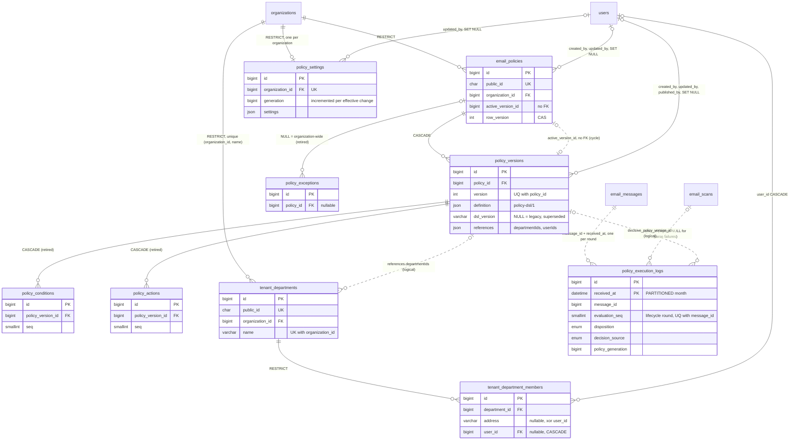

## Delivery

Step 2.3 added per-recipient delivery tracking: `delivery_reinjections` (one SMTP transaction into postfix-outbound per group of recipients) and the append-only audit `delivery_status_events`, both partitioned like the message (same `received_at`). `delivery_routes` stays unused (reserved for rule-based routing, 5.x).

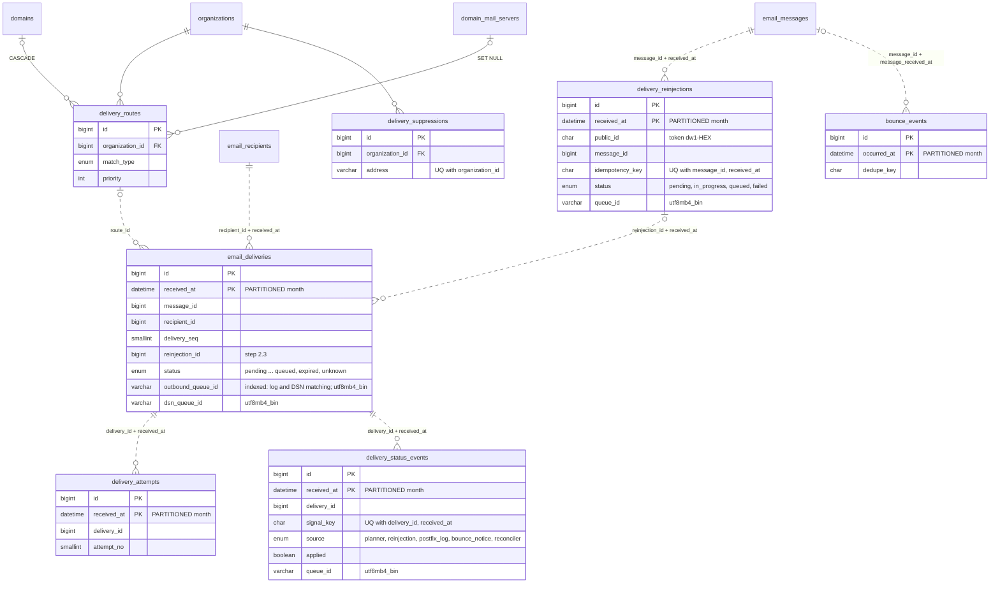

## Quarantine

Step 5.3 ([§3](../plan/steps/17-quarantine.md#3-data-model-one-forward-migration-quarantine-wp1)): an entry per (message, lifecycle round, recipient), the one approval model, single-use download grants, tenant settings, end-user preferences, object purges and digests. None is partitioned; every table references `organizations` ON DELETE RESTRICT (tenant purge order: grants, approval requests, release logs, actions, purges, digests, preferences, entries, settings). The message, recipient, scan and approval-request references of an entry are logical (no FK).

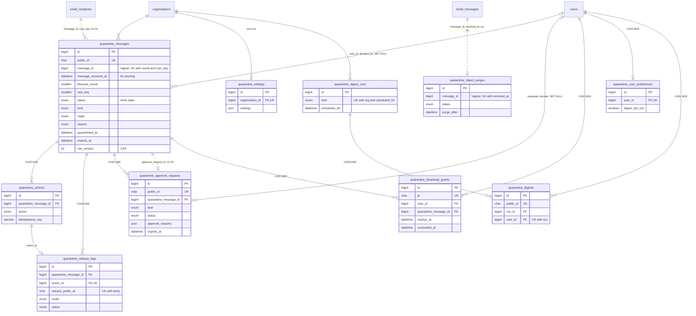

## Archiving

Step 8.1 ([design §3](../plan/steps/23-journaling-archiving.md#3-data-model-one-forward-migration-journaling_archiving-wp1)). Solid lines are foreign keys; dotted lines are logical references (partitioned tables have no foreign keys). Metadata only: message content lives in the encrypted objects of the archive bucket.

```mermaid
erDiagram
  organizations ||--o| archive_settings : "1:1, RESTRICT"
  organizations ||--o{ archive_retention_policies : "RESTRICT"
  archive_retention_policies |o--o{ archive_settings : "default policy, SET NULL"
  users |o--o{ archive_settings : "updated_by SET NULL"
  email_messages ||..o| archive_capture_intents : "message_id + received_at (UQ)"
  email_messages ||..o| email_archives : "message_id + received_at (UQ)"
  archive_capture_intents |o..o| email_archives : "archive_id"
  archive_retention_policies |o..o{ email_archives : "retention_policy_id"
  archive_encryption_keys ||..o{ email_archives : "organization_id + key_version"
  organizations ||--o{ archive_encryption_keys : "RESTRICT"
  email_archives ||..o{ archive_index_queue : "message_id + received_at"
  organizations ||--o{ archive_index_checks : "RESTRICT"
  email_archives ||..o| archive_disposals : "archive_record_id, message_id"
  organizations ||--o{ archive_legal_holds : "RESTRICT"
  ediscovery_cases |o--o{ archive_legal_holds : "case_id RESTRICT"
  organizations ||--o{ ediscovery_cases : "RESTRICT"
  ediscovery_cases ||--o{ ediscovery_custodians : "RESTRICT"
  users |o--o{ ediscovery_custodians : "user_id SET NULL"
  ediscovery_cases ||--o{ ediscovery_searches : "RESTRICT"
  ediscovery_searches ||--o{ ediscovery_search_hits : "RESTRICT"
  email_archives ||..o{ ediscovery_search_hits : "message_id + received_at"
  ediscovery_cases ||--o{ ediscovery_exports : "RESTRICT"
  ediscovery_searches ||--o{ ediscovery_exports : "RESTRICT"
  ediscovery_exports |o--o{ archive_download_grants : "export_id CASCADE"
  email_archives |o..o{ archive_download_grants : "message_id + received_at"
  users ||--o{ archive_download_grants : "user_id CASCADE"
  organizations ||--o{ archive_download_grants : "RESTRICT"
  email_archives ||..o{ archive_record_sources : "archive_id + archive_received_at (8.6)"
  email_messages ||..o{ archive_record_sources : "merged copy: message_id + message_received_at"
  email_archives ||..o{ archive_dedupe_keys : "archive_id + archive_received_at (8.6)"
  archive_capture_intents |o..o| email_archives : "merged: archive_id + archive_received_at (8.6)"
  archive_settings {
    bigint id PK
    bigint organization_id FK,UK
    json settings "archive-settings/1, NULL = defaults"
    bigint generation
    int row_version
    enum scope "RETIRED"
    varchar encryption_key_ref "RETIRED"
  }
  archive_retention_policies {
    bigint id PK
    char public_id UK
    bigint organization_id FK
    varchar name "UQ with organization_id"
    json criteria "archive-retention/1"
    datetime deleted_at "soft delete"
    bool is_default "RETIRED"
  }
  archive_capture_intents {
    bigint id PK
    datetime received_at PK "PARTITIONED month, 4 months"
    bigint message_id "UQ with received_at"
    enum status
    datetime next_check_at
    datetime archive_received_at "8.6: NULL = received_at"
    bool merged "8.6"
  }
  email_archives {
    bigint id PK
    datetime received_at PK "PARTITIONED month, never dropped"
    bigint message_id "UQ with received_at"
    char message_public_id
    enum status "active, expiry_review, disposing"
    json parties "archive-parties/1"
    json objects "keys and version ids"
    varchar wrapped_dek "NULL = crypto-shredded"
    datetime retain_until
    bool legal_hold "informational"
    bool source_gateway "8.6"
    bool source_journal_intake "8.6"
    bigint intake_source_id "8.6, no FK"
    smallint merged_count "8.6"
  }
  archive_record_sources {
    bigint id PK
    datetime archive_received_at PK "PARTITIONED month, never dropped (8.6)"
    bigint archive_id
    bigint message_id "UQ with message_received_at, archive_received_at"
    enum source "gateway, journal_intake"
    bool content_variant
  }
  archive_dedupe_keys {
    bigint id PK
    bigint organization_id "no FK"
    char message_id_hash "index with org, header_fingerprint"
    char header_fingerprint "archive-fingerprint/1"
    char body_sha256
    bigint archive_id
  }
  archive_encryption_keys {
    bigint id PK
    char public_id UK
    bigint organization_id FK "UQ with version"
    int version
    varchar wrapped_key "under the root key"
  }
  archive_index_queue {
    bigint id PK
    bigint organization_id "no FK"
    enum op "upsert, delete, purge_org"
  }
  archive_index_checks {
    bigint id PK
    bigint organization_id FK "UQ with day"
    date day
  }
  archive_disposals {
    bigint id PK
    datetime requested_at PK "PARTITIONED month, never dropped"
    bigint archive_record_id
    enum state
  }
  archive_legal_holds {
    bigint id PK
    char public_id UK
    bigint organization_id FK
    bigint case_id FK
    enum status
  }
  ediscovery_cases {
    bigint id PK
    char public_id UK
    bigint organization_id FK "UQ with name"
    enum status "open, closed"
  }
  ediscovery_custodians {
    bigint id PK
    bigint case_id FK "UQ with address"
    varchar address
  }
  ediscovery_searches {
    bigint id PK
    char public_id UK
    bigint case_id FK
    json criteria "archive-search/1"
    bool index_complete
  }
  ediscovery_search_hits {
    bigint id PK
    bigint search_id FK "UQ with message_id, received_at"
    enum review_tag
  }
  ediscovery_exports {
    bigint id PK
    char public_id UK
    bigint search_id FK
    char package_sha256
    varchar wrapped_dek
  }
  archive_download_grants {
    bigint id PK
    char jti UK
    bigint user_id FK
    enum kind "message, export"
  }
```

## Journal intake

Step 8.6 ([design §3](../plan/steps/27-journal-intake-and-archive-split.md#3-data-model-one-forward-migration-utc-timestamp_journal_intake-wp1), ADR-0087). Intake messages are ordinary registry messages (`email_messages.ingest_source = journal_intake`); `journal_intake_messages` holds their envelope and proof. Solid lines are foreign keys; dotted lines are logical references. Only hashes of the intake credentials are stored.

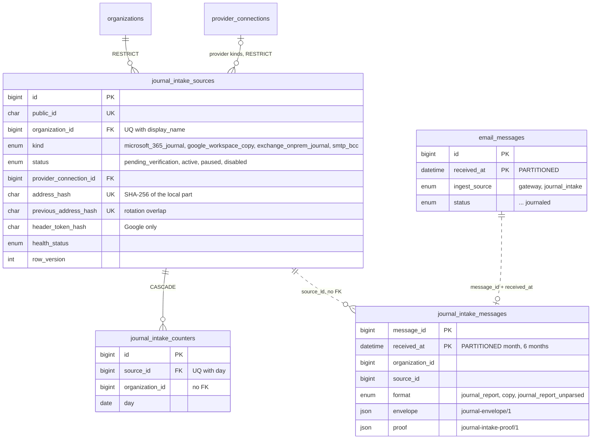

## API-mode protection

Step API-1 ([design §3](../plan/steps/35-api-mode-protection.md#3-data-model-one-forward-migration-utc-timestamp_api_mode_protection-wp1), ADR-0098, ADR-0100). Copies are ordinary registry messages (`email_messages.ingest_source` `journal_intake` or `mailbox_api`); `api_message_copies` holds one row per scanned copy and mailbox. The protection mode lives on `organizations.protection_mode` (default) and `domains.protection_mode` (NULL = inherit). Solid lines are foreign keys; dotted lines are logical references. No message content and no provider credential is stored here (credentials are step 8.2 grants).

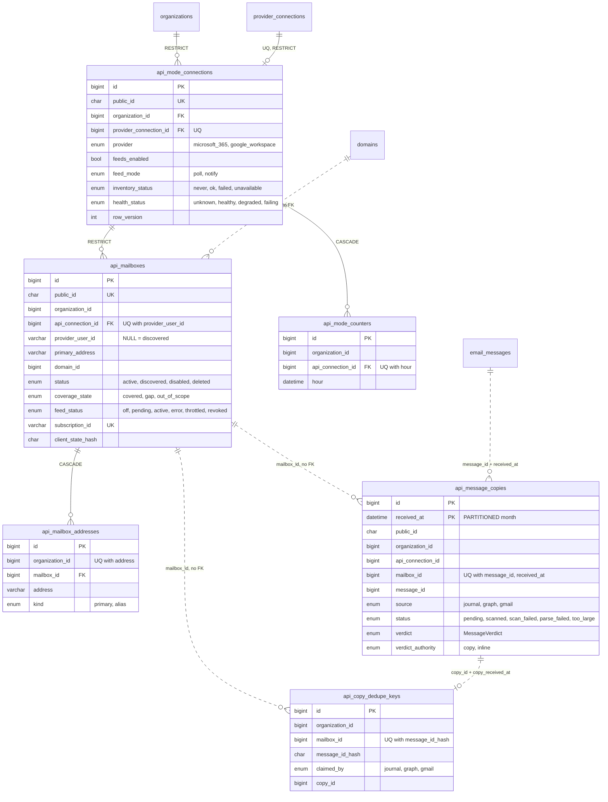

## Security incidents and account takeover

Step 8.4 ([design §3](../plan/steps/24-account-takeover-core.md#3-data-model-two-forward-migrations-wp1), ADR-0070, ADR-0075). Solid lines are foreign keys; dotted lines are logical references (partitioned tables have no foreign keys, and `ato_accounts` keeps no foreign key to the subject it monitors, so the trail survives a deleted user or connector).

```mermaid
erDiagram
  organizations ||--o{ security_incidents : "RESTRICT"
  users |o--o{ security_incidents : "assigned_user SET NULL"
  security_incidents ||--o{ security_incident_events : "CASCADE"
  security_incidents ||--o{ security_incident_links : "CASCADE"
  security_incident_links }o..o| email_messages : "message: ref_id + ref_time"
  security_incident_links }o..o| ato_risk_signals : "ato_signal: ref_id + ref_time"
  security_incident_links }o..o| ato_auth_events : "ato_auth_event: ref_id + ref_time"
  security_incidents ||--o| ato_incident_details : "1:1, CASCADE"
  security_incidents |o..o| ato_accounts : "subject_ref_id (ato_account); active_incident_id"
  organizations ||--o| ato_settings : "1:1, RESTRICT"
  users |o--o{ ato_settings : "updated_by SET NULL"
  organizations ||--o{ ato_settings_versions : "RESTRICT"
  organizations ||--o{ ato_accounts : "RESTRICT"
  users |o..o{ ato_accounts : "user_id (gateway_user)"
  smtp_connectors |o..o{ ato_accounts : "connector_id (smtp_connector)"
  ato_accounts ||--o| ato_account_baselines : "1:1, CASCADE"
  ato_accounts ||..o{ ato_account_activity_daily : "account_id + day_start (UQ)"
  ato_accounts |o..o{ ato_auth_events : "account_id"
  ato_accounts ||..o{ ato_risk_signals : "account_id"
  ato_accounts ||..o{ ato_risk_scores : "account_id"
  ato_accounts ||--o{ ato_risk_overrides : "CASCADE"
  ato_accounts ||--o{ ato_trusted_contexts : "CASCADE"
  ato_accounts ||--o{ ato_account_identities : "CASCADE"
  ato_accounts ||--o{ ato_incident_details : "RESTRICT"
  ato_accounts ||--o{ ato_response_actions : "RESTRICT"
  security_incidents |o--o{ ato_response_actions : "RESTRICT"
  ato_response_actions ||--o{ ato_response_action_logs : "CASCADE"
  ato_response_actions |o..o| ato_smtp_restrictions : "restriction_id / response_action_id"
  organizations ||--o{ ato_smtp_restrictions : "RESTRICT"
  organizations ||--o{ ato_provider_integrations : "RESTRICT"
  organizations ||--o{ ato_provider_streams : "RESTRICT (8.5)"
  ato_provider_integrations ||--o{ ato_provider_streams : "CASCADE (8.5)"
  organizations ||--o{ ato_provider_mailbox_items : "RESTRICT (8.5)"
  ato_provider_integrations ||--o{ ato_provider_mailbox_items : "CASCADE (8.5)"
  ato_accounts |o--o{ ato_provider_mailbox_items : "SET NULL (8.5)"
  ato_provider_integrations |o--o{ ato_account_identities : "SET NULL (8.5)"
  ato_provider_integrations |o..o{ ato_response_actions : "integration_id, no FK (8.5)"
  security_incidents {
    bigint id PK
    char public_id UK
    bigint organization_id FK
    enum category "account_takeover (append-only)"
    enum subject_type "ato_account (append-only)"
    bigint subject_ref_id "UQ with org, category, subject_type, active_marker"
    enum status "six states"
    tinyint active_marker "GENERATED STORED"
  }
  ato_accounts {
    bigint id PK
    char public_id UK
    bigint organization_id FK
    enum kind "mailbox, gateway_user, smtp_connector"
    char subject_hash "UQ with organization_id, kind"
    tinyint risk_score
    bigint active_incident_id "logical"
  }
  ato_auth_events {
    bigint id PK
    datetime occurred_at PK "PARTITIONED month, 3 months"
    char dedupe_key "UQ with organization_id, occurred_at"
  }
  ato_account_activity_daily {
    bigint id PK
    datetime day_start PK "PARTITIONED month, 6 months"
  }
  ato_risk_signals {
    bigint id PK
    datetime detected_at PK "PARTITIONED month, 13 months"
  }
  ato_risk_scores {
    bigint id PK
    datetime computed_at PK "PARTITIONED month, 13 months"
  }
  ato_response_actions {
    bigint id PK
    char dedupe_hash "UQ with organization_id, active_marker"
    tinyint active_marker "GENERATED STORED"
  }
  ato_smtp_restrictions {
    bigint id PK
    char subject_hash "UQ with organization_id, active_marker"
    tinyint active_marker "GENERATED STORED"
  }
```

## Provider integrations

Step 8.2 ([design §3](../plan/steps/25-m365-google-connectors.md#3-data-model-one-forward-migration-provider_integrations-wp1), ADR-0076–0081). None of these tables is partitioned, so every reference is a real foreign key. Tenant children of a connection carry `organization_id` without a foreign key (always the parent connection's); the two egress tables are platform data (no `organization_id`). Credentials are stored only as AES-256-GCM ciphertext (ADR-0077); probe evidence holds no message content.

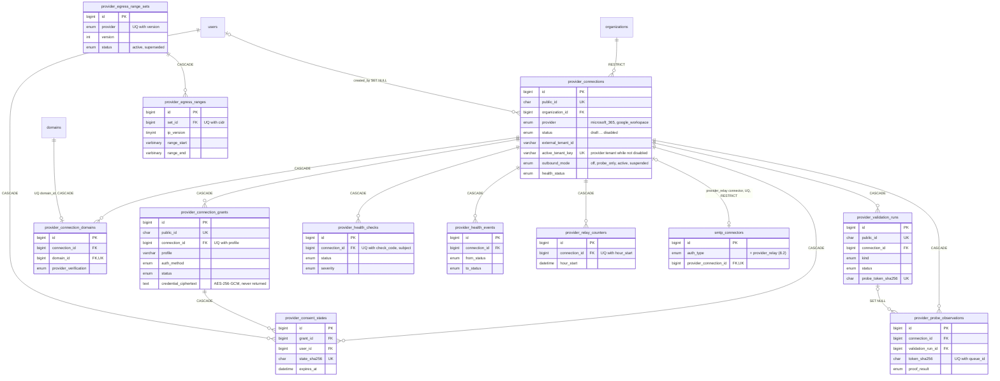

## AI assistant

Step AI-1 ([design §3](../plan/steps/28-ai-chat-management.md#3-data-model-migration-ai_assistant-ai-1-wp1), ADR-0094). Not partitioned. Every table references `organizations` (RESTRICT; the organization purge deletes them explicitly); a conversation belongs to one user (CASCADE, private data) and its turns, messages and tool executions cascade from it. Step AI-2 ([design §3](../plan/steps/29-ai-chat-confirmations-mail-writes.md#3-data-model-migration-ai_assistant_confirmations-wp1)) added `ai_chat_action_confirmations`: one per write proposal execution, cascading from its execution, turn and conversation. Dotted lines are logical references (no FK). No email body or attachment is stored.

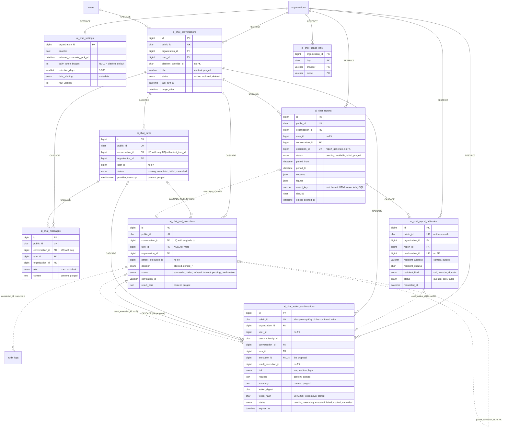

Step AI-R ([design §3](../plan/steps/31-ai-chat-reports.md#3-data-model-migration-ai_assistant_reports-wp1), ADR-0095) added `ai_chat_reports` (report metadata; the HTML is an object in the mail bucket) and `ai_chat_report_deliveries` (confirmed report emails, one per confirmation).

## Platform operations

```mermaid
erDiagram
  organizations ||..o{ message_outbox : "no FK"
  organizations |o..o{ audit_logs : "NULL = platform action"
  organizations ||--o{ webhook_subscriptions : ""
  webhook_subscriptions ||..o{ webhook_deliveries : "subscription_id"
  webhook_events ||..o{ webhook_deliveries : "event_id + occurred_at"
  webhook_deliveries ||..o{ webhook_delivery_attempts : "delivery_id + event_occurred_at"
  webhook_subscriptions ||--o{ webhook_replays : "RESTRICT"
  organizations ||--o{ webhook_replays : "RESTRICT"
  webhook_replays |o..o{ webhook_deliveries : "replay_id"
  organizations ||--o| notification_settings : "RESTRICT"
  users |o--o{ notification_settings : "updated_by SET NULL"
  users ||--o| notification_user_preferences : "CASCADE"
  organizations ||--o{ notification_alert_windows : "RESTRICT"
  users |o--o{ system_settings : "updated_by"
  message_outbox {
    bigint id PK
    datetime created_at PK "PARTITIONED day"
    char event_id
    datetime published_at "set by event-relay after the confirm"
    int attempts
    smallint redrive_count "reconciler, step 3.2"
    datetime last_redriven_at
  }
  message_idempotency {
    varchar consumer PK
    char event_id PK
    datetime processed_at
  }
  message_consumer_progress {
    varchar consumer PK
    char event_id PK
    enum state "retrying, dead_lettered"
    datetime updated_at
  }
  organizations ||..o{ api_idempotency_keys : "no FK"
  api_idempotency_keys {
    bigint id PK
    bigint organization_id "UQ with idempotency_key"
    varchar idempotency_key "utf8mb4_bin, case-sensitive"
    char request_sha256
    datetime expires_at "indexed; purged 1 day after"
  }
  audit_logs {
    bigint id PK
    datetime created_at PK "PARTITIONED month"
    bigint organization_id "nullable"
  }
  webhook_subscriptions {
    bigint id PK
    char public_id UK
    bigint organization_id FK
    enum status "active, paused, disabled, deleted"
    smallint secret_version
    int row_version
  }
  webhook_events {
    bigint id PK
    datetime occurred_at PK "PARTITIONED month"
    char event_id "UQ with occurred_at (deterministic)"
    bigint organization_id
    text payload_json "guarded envelope"
  }
  webhook_deliveries {
    bigint id PK
    datetime event_occurred_at PK "PARTITIONED month"
    char public_id
    bigint subscription_id
    char event_id
    smallint delivery_seq "UQ (subscription_id, event_id, event_occurred_at, delivery_seq)"
    enum status "pending, succeeded, failed, dead, cancelled"
  }
  webhook_delivery_attempts {
    bigint id PK
    datetime attempted_at PK "PARTITIONED month"
    bigint delivery_id
    smallint attempt_no
    enum outcome
  }
  webhook_replays {
    bigint id PK
    char public_id UK
    bigint organization_id FK
    bigint subscription_id FK
    enum status "queued, running, completed, failed, cancelled"
  }
  notification_settings {
    bigint id PK
    bigint organization_id FK "UQ"
    json settings
    int row_version
  }
  notification_user_preferences {
    bigint id PK
    bigint organization_id FK
    bigint user_id FK "UQ"
    json preferences "optOut kinds"
  }
  notification_alert_windows {
    bigint id PK
    bigint organization_id FK
    varchar kind "UQ with scope_key, window_start"
    varchar scope_key
    datetime window_start
    int event_count
  }
  system_settings {
    bigint id PK
    varchar key UK
  }
  maintenance_watermarks {
    varchar name PK
    bigint value
  }
  stream_cursors {
    varchar name PK "outbox:CONSUMER, postfix-log:SOURCE"
    bigint position_id
    varchar file_id
    bigint file_offset
  }
```

`message_idempotency` stands alone: its key is the consumer name and the event id. So does `message_consumer_progress` (step 3.2 review round 1), with the same key. `stream_cursors` (step 2.3) holds the durable positions of the delivery-worker's outbox pollers and Postfix log tailers; it references nothing. `maintenance_watermarks` belongs to the partition-maintenance job (the registry purge watermark, see [retention.md](retention.md)). `api_idempotency_keys` (step 3.3 L11) is the api's Idempotency-Key store: unpartitioned and without a foreign key (the row outlives nothing it references and is purged one day after it expires), one row per organization and key. Step 6.2: `webhook_events` and `webhook_delivery_attempts` are partitioned (logical references only); `webhook_replays` and the three notification tables are unpartitioned with real foreign keys.
