# Partitioning

Twenty high-volume tables are range-partitioned by time ([ADR-0014](../architecture/adr/0014-mysql-data-model-partitioning-read-write-split.md) §3, design [D3](../plan/steps/01-database.md#d3-partitioning-adr-0014-3); step 2.3 added `delivery_reinjections` and `delivery_status_events`, [§3](../plan/steps/05-routing.md#3-data-model-one-forward-migration-mail_routing-wp1); step 3.1 added the parse stage table `email_message_parses`, [§3](../plan/steps/06-mime-ingestion.md#3-data-model-one-forward-migration-mime_ingestion-wp1); step 4.1 added the authentication results table `email_auth_results`, [§3](../plan/steps/09-rspamd.md#3-data-model-one-forward-migration-scan_pipeline-wp1)). Dropping a partition removes a month (or a day) of rows as a metadata operation, without the undo, purge lag and binlog volume of a batched `DELETE`.

## MySQL constraints we design for

- A partitioned InnoDB table **cannot have foreign keys, and cannot be referenced by one**.
- Every `PRIMARY KEY` and `UNIQUE` key **must include every partitioning column**. Partitioned tables therefore use `PRIMARY KEY (id, <partition column>)`, and every unique key ends with the partition column.
- **Pruning** happens only when the query constrains the partition column: an exact value for point lookups, a range for lists. Without it, MySQL probes the index in every partition.
- `AUTO_INCREMENT` works on the first column of the composite key: ids stay globally unique and increasing.

## Design

- **Syntax.** `PARTITION BY RANGE COLUMNS(<col>)` on a `DATETIME(3)` column. MySQL 8.4 accepts `DATETIME(3)` in RANGE COLUMNS, so the `TO_DAYS()` fallback was not needed. Bounds are literals such as `'2026-12-01 00:00:00'`.
- **Migrations create only the catch-all** `PARTITION pmax VALUES LESS THAN (MAXVALUE)`, so they do not depend on the date they run. The maintenance job creates dated partitions by splitting `pmax`.
- **Naming.** Monthly `pYYYYMM` holds `[YYYY-MM-01, next month)`, daily `pYYYYMMDD` holds one UTC day, and `pmax` holds everything above the last bound. Because the first dated partition is created by splitting `pmax`, it also holds every older row.
- **One message, one partition.** Child rows of a message (recipients, headers, attachments, scans, engine results, events, status history, policy logs, deliveries, attempts, reinjections, delivery status events, parse rows, archives) copy the **message's** `received_at`. So `WHERE message_id = ? AND received_at = ?` prunes to one partition, and the whole graph of a message is dropped together.
- **The identity registry** (`message_identities`, not partitioned) allocates message ids and maps `public_id → (id, received_at)`, so reads by public id reach the partitioned tables with the partition key. Event payloads carry `receivedAt` for the same reason.
- **Integrity without foreign keys.** Rows of partitioned tables are written in the same transaction as their parent. Unique keys that end with `received_at` (for example `(message_id, rcpt_seq, received_at)`) make writes idempotent.
- **Prisma.** Models declare `@@id([id, receivedAt])` and no `@relation`. Joins to partitioned tables are explicit queries. Prisma does not introspect partitions, so `prisma migrate diff` stays clean after maintenance has split `pmax` (verified locally and in CI).

## Registry

The registry is `packages/database/src/partitioning/registry.ts`. "Retention N months" means: drop `pYYYYMM` when its **upper bound** ≤ the first day of (current UTC month − N months), so 6 months keeps the current month plus 6 full months. For days: drop when the upper bound ≤ today (00:00 UTC) − N days.

| Table                          | Partition column    | Granularity | Drop after | Tier        | Guard                                   |
| ------------------------------ | ------------------- | ----------- | ---------- | ----------- | --------------------------------------- |
| `email_messages`               | `received_at`       | month       | 6 months   | core        |                                         |
| `email_recipients`             | `received_at`       | month       | 6 months   | core        |                                         |
| `email_attachments`            | `received_at`       | month       | 6 months   | core        |                                         |
| `email_scans`                  | `received_at`       | month       | 6 months   | core        |                                         |
| `email_deliveries`             | `received_at`       | month       | 6 months   | core        |                                         |
| `email_headers`                | `received_at`       | month       | 3 months   | detail      |                                         |
| `email_events`                 | `received_at`       | month       | 3 months   | detail      |                                         |
| `email_message_status_history` | `received_at`       | month       | 3 months   | detail      |                                         |
| `scan_engine_results`          | `received_at`       | month       | 3 months   | detail      |                                         |
| `policy_execution_logs`        | `received_at`       | month       | 3 months   | detail      |                                         |
| `delivery_attempts`            | `received_at`       | month       | 3 months   | detail      |                                         |
| `delivery_reinjections`        | `received_at`       | month       | 6 months   | core        |                                         |
| `delivery_status_events`       | `received_at`       | month       | 3 months   | detail      |                                         |
| `email_message_parses`         | `received_at`       | month       | 6 months   | core        |                                         |
| `email_auth_results`           | `received_at`       | month       | 6 months   | core        |                                         |
| `email_archives`               | `received_at`       | month       | never      | compliance  | `drop: false` (legal hold, step 8.1)    |
| `bounce_events`                | `occurred_at`       | month       | 6 months   | core        |                                         |
| `audit_logs`                   | `created_at`        | month       | never      | compliance  | `drop: false` (export is an ops action) |
| `webhook_deliveries`           | `event_occurred_at` | month       | 2 months   | operational |                                         |
| `message_outbox`               | `created_at`        | **day**     | 7 days     | operational | no unpublished rows                     |

Not partitioned, deliberately: `scan_engine_settings` (step 4.1: one row per organization and engine, needs foreign keys), `message_identities` (the uniqueness anchor), `message_idempotency` (its key must not contain time, or a late redelivery would pass), `message_consumer_progress` (same key, step 3.2), `api_idempotency_keys` (the api's Idempotency-Key store, step 3.3; its key must not contain time either), `quarantine_messages` (about 5% of volume, needs foreign keys, purged by `expires_at`) and every control-plane table.

## Maintenance job

`packages/database/src/partitioning/`: a pure planner (`planPartitionChanges(spec, existing, now, opts)`), an executor and a CLI.

```mermaid
flowchart TD
  A[Read information_schema.PARTITIONS<br/>TABLE_SCHEMA = DATABASE&#40;&#41;] --> B{For each registered table}
  B --> C[Plan: partitions up to 3 months<br/>or 7 days ahead]
  C --> D{pmax has rows?}
  D -- yes --> E[warn with row estimate]
  D -- no --> F
  E --> F[ALTER TABLE t REORGANIZE PARTITION pmax INTO &#40;...&#41;]
  B --> G[Plan: expired partitions]
  G --> H{guard: unpublished outbox rows?}
  H -- yes --> I[skip, log error, exit 1]
  H -- no --> J[ALTER TABLE t DROP PARTITION a, b]
  B --> K[Retention purges, batched]
  K --> L[exit 0, or 1 on any failure]
```



1. **Read** the current partitions from `information_schema.PARTITIONS`. A table whose partitions break the naming convention (unknown name, bound that does not match the name, no `pmax`) is reported as an error and left untouched. The other tables are still processed.
2. **Create ahead.** For each table, partitions must exist for the current period plus **3 months** (monthly) or **7 days** (daily). If the table has only `pmax`, the first partition starts at `--bootstrap-from` (default: the current month or day). Otherwise it continues from the last upper bound, so a job that has not run for a while catches up. If `pmax` already holds rows, the job logs a `warn` with the row estimate and still splits: `REORGANIZE` copies those rows, at a cost proportional to their number.
3. **Drop expired** partitions by the registry. It never drops `pmax`, never drops `drop: false` tables, and never drops on the run that bootstraps a table. For `message_outbox`, each expired partition is checked with `SELECT 1 FROM message_outbox PARTITION (p…) WHERE published_at IS NULL LIMIT 1`. If it finds a row, that drop is skipped, an error is logged, and the run exits non-zero.
4. **Retention purges** (DML, see [retention.md](retention.md)): `message_idempotency` rows processed more than 30 days ago, `message_consumer_progress` rows updated more than 30 days ago, `api_idempotency_keys` rows expired more than 1 day ago (step 3.3), and `message_identities` rows with `id < MIN(email_messages.id)` that no live archive or quarantine row references (walked in id ranges from a watermark in `maintenance_watermarks`). They run in batches of 5,000 with a 50 ms pause and a cap of 200 batches per run. Hitting the cap logs a `warn`, and the next run continues.
5. **Idempotent.** A second `apply` right after a successful one plans no partition changes and purges nothing.
6. **Serialized.** `apply` first takes a MySQL advisory lock, `GET_LOCK('partition_maintenance:<schema>', 0)`. If another run holds it (db-migrate, the CronJob, a manual run and CI can overlap), the run logs `warn` `another partition maintenance run holds the lock; skipping this run` and exits 0 without doing anything. `plan` takes no lock.
7. **Bounded DDL waits.** Before any partition DDL, `apply` sets `SET SESSION lock_wait_timeout = 5` (`--lock-wait-timeout <s>` to change it). A long transaction on a hot table therefore delays the `ALTER` by at most 5 s instead of up to MySQL's default of a year, during which every later query on that table would queue behind it. A timeout is a per-table failure (exit 1) and the next run retries.

The lock and the session setting are per connection, so the CLI uses a single-connection client (`createMaintenanceClientUrl`, `connection_limit=1`), and before each DDL statement the executor checks `IS_USED_LOCK(...) = CONNECTION_ID()` and refuses to run DDL otherwise.

Identifiers in the generated SQL come only from the registry (validated as plain identifiers) and from partition names that match `^p(max|\d{6}|\d{8})$`. Values are bound with placeholders.

```bash
pnpm db:partitions -- plan                                 # print the SQL, change nothing
pnpm db:partitions -- apply
pnpm db:partitions -- plan --now 2027-06-15T00:00:00Z     # what would happen on that date
pnpm db:partitions -- apply --bootstrap-from 2026-07-01   # first partition starts in July
```

It runs as the migrator (`MIGRATION_DATABASE_URL`, or `MIGRATION_DATABASE_URL_FILE`) and logs JSON with pino (`service: db-maintenance`). It runs:

- **Compose:** in the `db-migrate` job, after `prisma migrate deploy`, before any service starts.
- **Kubernetes:** the `db-maintenance` CronJob (`infrastructure/kubernetes/base/db-maintenance.yaml`), daily at 01:30 UTC, `concurrencyPolicy: Forbid`, image `email-gateway/db-migrate`.
- **CI:** in the migrations job, twice (the second run must be a no-op), before the drift check.

## Failure modes and alerts

| Failure                                        | Effect                                                                     | Detection and response                                                                                                                                     |
| ---------------------------------------------- | -------------------------------------------------------------------------- | ---------------------------------------------------------------------------------------------------------------------------------------------------------- |
| Job not running (CronJob suspended, image bad) | After 3 months, new rows land in `pmax`; pruning and drops stop working    | Alert on a failed or missing `db-maintenance` Job for more than 2 days. Alert on a non-empty `pmax` (the job warns on it)                                  |
| Rows in `pmax`                                 | The next split copies them (slower DDL), nothing is lost                   | `warn` log `pmax already contains rows`. Run the job; investigate far-future timestamps                                                                    |
| Outbox partition with unpublished rows expired | Drop skipped, exit 1                                                       | Error log `expired partition not dropped: guard failed`. The event-relay (step 3.2) is stuck or a poison row remains: fix it, then the next run drops it   |
| Unexpected partition layout (manual change)    | That table is skipped, exit 1                                              | Error log names the table and partition. Fix the layout by hand to match the convention                                                                    |
| DDL lock wait (long transaction on the table)  | `ALTER` gives up after `lock_wait_timeout` (5 s); that table fails, exit 1 | Error log with `Lock wait timeout exceeded`; the next run retries. Runs at low traffic (01:30 UTC). Long-running transactions are a bug in their own right |
| Overlapping runs                               | The second run skips (advisory lock), exit 0                               | `warn` log `another partition maintenance run holds the lock`. Investigate only if every run skips (a stuck session holds the lock)                        |
| Purge capped                                   | Leftover rows purged on the next run                                       | `warn` log `retention purge hit its per-run cap`. Investigate if it repeats for days                                                                       |

`REORGANIZE PARTITION pmax` on an empty `pmax` and `DROP PARTITION` are metadata operations. Both take a short exclusive metadata lock on the table. On Aurora/RDS they replicate like any DDL.

## Migration plan

### Partitioning an existing large table online

The baseline already partitions every high-volume table, so this applies only to a table that grows unexpectedly later.

1. Add the partition column to every unique key (and to the primary key) with an online tool, because MySQL cannot partition the table otherwise. Drop any foreign keys to or from it, and replace them with application checks.
2. Use [gh-ost](https://github.com/github/gh-ost) or `pt-online-schema-change` to copy the table into a partitioned shadow table (`--alter "PARTITION BY RANGE COLUMNS(created_at) (PARTITION p202601 VALUES LESS THAN ('2026-02-01'), …, PARTITION pmax VALUES LESS THAN (MAXVALUE))"`) while it keeps taking writes, then cut over. gh-ost needs a binlog in `ROW` format (already set) and works on RDS/Aurora with `--assume-rbr --allow-on-master` or on a replica.
3. Write a Prisma migration that records the final state (the composite `@@id`, removed relations). Mark it applied with `prisma migrate resolve --applied` where the tool did the work.
4. Add the table to the registry with its retention, run `db:partitions -- plan`, and add it to `tests/integration/schema.test.ts`.

### Changing granularity

Monthly to daily (or the reverse) for a table: change the registry entry, then reorganize the **future** partitions only. For example, split the not-yet-filled `p202702` into `p20270201…p20270228` with `REORGANIZE PARTITION p202702 INTO (…)`, which is cheap while it is empty. Past partitions keep their old granularity until they expire. The planner validates names per granularity, so during the transition either finish the conversion in one change or teach the planner both patterns for that table. Do not convert a filled partition at peak time: `REORGANIZE` copies its rows.

### Restoring a dropped partition

Restore the partition's data into a non-partitioned table with the same structure (see [backup-restore.md](backup-restore.md#restoring-a-single-dropped-partition)), then swap it in:

```sql
-- 1. Recreate the empty partition by splitting the partition that now covers the range
--    (or pmax), for example:
ALTER TABLE email_events REORGANIZE PARTITION p202608 INTO (
  PARTITION p202607 VALUES LESS THAN ('2026-08-01 00:00:00'),
  PARTITION p202608 VALUES LESS THAN ('2026-09-01 00:00:00'));
-- 2. Swap the restored rows in. WITH VALIDATION checks that every row belongs in the range.
ALTER TABLE email_events EXCHANGE PARTITION p202607 WITH TABLE email_events_restore WITH VALIDATION;
```

Restored partitions older than the retention cutoff are dropped again by the next maintenance run, so suspend the CronJob (or temporarily mark the table `drop: false`) for as long as the data must stay.

## Query plans

The [performance report](performance-report.md) records `EXPLAIN`, `EXPLAIN FORMAT=TREE` and `EXPLAIN ANALYZE` for Q1–Q14 on 200,000 synthetic messages (about 5M rows). Pruning, from the report:

| Query                                       | Partitions read                                |
| ------------------------------------------- | ---------------------------------------------- |
| Q1 message list, last 24 h                  | `email_messages`: 2 of 9 (yesterday and today) |
| Q2 message detail by `public_id`            | `email_messages`, `email_recipients`: 1 of 9   |
| Q3 scans and engine results                 | `email_scans`, `scan_engine_results`: 1 of 9   |
| Q4 status history and events                | 1 of 9 each                                    |
| Q11 delivery status counts, last day        | `email_messages`, `email_deliveries`: 2 of 9   |
| Q12 audit log, last 7 days                  | `audit_logs`: 2 of 9                           |
| Q7 stuck messages, Q10 hash hunt, Q8 outbox | all partitions (no partition-column predicate) |

A pruned point lookup, from the report (Q2, message by id and `received_at`):

```text
| id | select_type | table          | partitions | type  | key     | rows |
| 1  | SIMPLE      | email_messages | p202610    | const | PRIMARY | 1    |
```

Q7, Q8 and Q10 read every partition by design: each probes a selective index in each partition (a handful of rows), which stays cheap while the number of partitions is small (9 monthly, about 15 daily for the outbox in steady state). The report shows them at about 1 ms, Q8 included, although the perf run bootstraps 132 daily outbox partitions. If a UI can bound Q10 by time, add a `received_at` range to prune.
