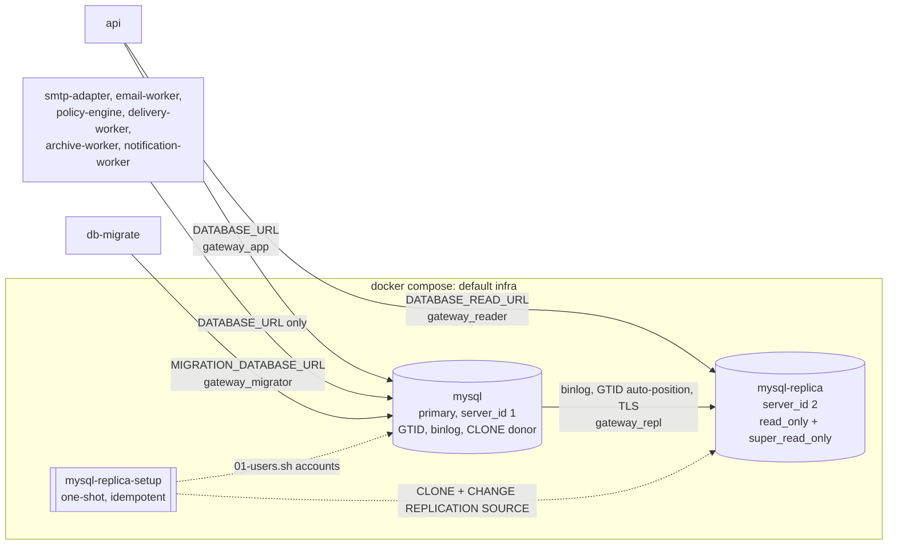

# MySQL replication and the read/write split

MySQL runs as a GTID **primary** (writer) and a **read replica**, with asynchronous replication. Only control-plane reads in `api` use the replica. Everything else, including every data-plane service, reads and writes the primary. The decision is recorded in [ADR-0014 §6](../architecture/adr/0014-mysql-data-model-partitioning-read-write-split.md). This page covers the local topology, the setup, the accounts, the routing rules, lag handling and operations.

## Topology (local Compose)



| Service               | Host port (default)                          | Notes                                                                                   |
| --------------------- | -------------------------------------------- | --------------------------------------------------------------------------------------- |
| `mysql`               | `127.0.0.1:${MYSQL_HOST_PORT:-3306}`         | Primary. Volume `mysql-data`                                                            |
| `mysql-replica`       | `127.0.0.1:${MYSQL_REPLICA_HOST_PORT:-3308}` | Replica. Volume `mysql-replica-data`. Healthy only while both replication threads run   |
| `mysql-replica-setup` | none                                         | Runs on every `docker compose up`, exits 0 when replication is (or already was) running |

Both servers mount the shared `infrastructure/mysql/conf.d/gateway.cnf` plus a role file as `/etc/mysql/conf.d/role.cnf`:

| Setting                                 | Primary (`primary/role.cnf`) | Replica (`replica/role.cnf`) |
| --------------------------------------- | ---------------------------- | ---------------------------- |
| `server_id`                             | 1                            | 2                            |
| `gtid_mode`, `enforce_gtid_consistency` | ON                           | ON                           |
| `log_bin`                               | `binlog`                     | default (on)                 |
| `binlog_expire_logs_seconds`            | 604800 (7 days)              | default                      |
| `read_only`, `super_read_only`          | off                          | ON                           |
| `log_replica_updates`                   |                              | ON                           |
| `relay_log`                             |                              | `relay-bin`                  |
| `replica_parallel_workers`              |                              | 4                            |
| `replica_preserve_commit_order`         |                              | ON                           |
| `plugin-load-add`                       | `mysql_clone.so`             | `mysql_clone.so`             |
| `innodb_buffer_pool_size`               | 512M (gateway.cnf)           | 256M                         |

Seven days of binlogs means a stopped replica can catch up by itself for a week. After that it has to be re-seeded (see [Re-seed](#re-seed-the-replica)).

## Seeding with CLONE, and the setup algorithm

**What shipped: CLONE.** The mysqldump fallback described in the step design was not needed.

`infrastructure/mysql/replica/setup-replica.sh` runs in the `mysql-replica-setup` container after `mysql` is healthy and `mysql-replica` has started. It is idempotent:

1. **Accounts.** It runs `infrastructure/mysql/init/01-users.sh` against the primary over TCP (`MYSQL_HOST=mysql`). That script uses only `CREATE USER IF NOT EXISTS` and `GRANT`, so it also adds accounts introduced later (reader, replication) to an existing `mysql-data` volume. It never changes an existing password.
2. **Wait** until the replica accepts root connections (timeout 180 s).
3. **Already replicating?** If a source is configured and both `Replica_IO_Running` and `Replica_SQL_Running` are `Yes`, it exits 0. This is the normal path on every later `docker compose up`.
4. **Configured but stopped?** It runs `START REPLICA` and waits up to 20 s. If both threads are `Yes`, it exits 0. Otherwise it prints `Last_IO_Error` and `Last_SQL_Error`, runs `RESET REPLICA ALL` and re-seeds.
5. **Seed.** `SET GLOBAL super_read_only = OFF`, `SET GLOBAL clone_valid_donor_list = 'mysql:3306'`, then `CLONE INSTANCE FROM gateway_repl@mysql:3306 ... REQUIRE SSL`. CLONE replaces the replica's data directory with a physical copy of the primary: schema, data, accounts and `gtid_executed`. The replica then restarts on the cloned data, and `role.cnf` turns `super_read_only` back on. The script waits for the new server process and for `performance_schema.clone_status` to say `Completed`. It then runs `CHANGE REPLICATION SOURCE TO SOURCE_HOST='mysql', SOURCE_PORT=3306, SOURCE_USER=…, SOURCE_PASSWORD=…, SOURCE_AUTO_POSITION=1, SOURCE_SSL=1` and `START REPLICA`, and waits up to 120 s for both threads. On timeout it prints `Last_IO_Error`/`Last_SQL_Error` and exits 1.
6. **Secrets.** Passwords reach `mysql` only through the `MYSQL_PWD` environment variable or as SQL on stdin. They never appear on a command line or in the output.

A seed of the Phase 0 database takes about 10 seconds.

### How the replica restarts after CLONE

A CLONE recipient restarts itself when the clone finishes, but only when it runs under a supervisor (mysqld_safe or systemd). Without one, CLONE returns `ERROR 3707` and mysqld exits. The container would then exit and be restarted by Docker, and `docker compose up --wait` would report the service as failed.

`infrastructure/mysql/replica/entrypoint.sh` wraps the stock `mysql:8.4` entrypoint (it sources it and calls its `_main`) with two changes:

- **A supervisor.** mysqld runs with `MYSQLD_PARENT_PID` set. When it exits with code 16 (restart requested), the wrapper starts it again inside the same container, and it forwards `SIGTERM` on `docker compose stop`. The container keeps running, with a restart count of 0.
- **First-start init.** The stock entrypoint's temporary init server runs with `--read-only=OFF --super-read-only=OFF`. Otherwise, on an empty volume, `role.cnf` makes its root-account setup fail with `ERROR 1290`. The real server always runs with `role.cnf` as written.

The setup script still accepts `ERROR 3707` (and a dropped connection, `2013`) as a successful clone, so it also works if the replica is run without the wrapper.

## Accounts and grants

All accounts are created on the primary by `01-users.sh` from `.env` values. They reach the replica through CLONE and replication.

| Account (`.env`)                          | Used by                                                       | Grants                                                                                                                                                                                          | Why                                                                                                                                                                                                     |
| ----------------------------------------- | ------------------------------------------------------------- | ----------------------------------------------------------------------------------------------------------------------------------------------------------------------------------------------- | ------------------------------------------------------------------------------------------------------------------------------------------------------------------------------------------------------- |
| `MYSQL_APP_USER` (`gateway_app`)          | `DATABASE_URL`, every service (writer)                        | `SELECT, INSERT, UPDATE, DELETE` on the schema                                                                                                                                                  | Runtime DML only                                                                                                                                                                                        |
| `MYSQL_MIGRATOR_USER`                     | `MIGRATION_DATABASE_URL`, `db-migrate`, partition maintenance | `ALL` on the schema, on `<db>_shadow` (`SHADOW_DATABASE_URL`, `prisma migrate dev`) and on `<db>_perf` (`pnpm db:perf`). **No privilege on `*.*`** (only `USAGE`), so it cannot touch `mysql.*` | Migrations. The schema names are escaped in the grants (`email\_gateway\_shadow`) so `_` is not a wildcard. `01-users.sh` revokes the global DDL + DML grant that volumes created before step 1.1 carry |
| `MYSQL_READER_USER` (`gateway_reader`)    | `DATABASE_READ_URL`, `api` only                               | `SELECT` on the schema, `REPLICATION CLIENT` on `*.*`                                                                                                                                           | Reads. `REPLICATION CLIENT` is needed only for `SHOW REPLICA STATUS` (the lag probe). It cannot change data or replication settings                                                                     |
| `MYSQL_REPLICATION_USER` (`gateway_repl`) | replica I/O thread, CLONE donor login                         | `REPLICATION SLAVE, BACKUP_ADMIN` on `*.*`                                                                                                                                                      | Binlog streaming, and `BACKUP_ADMIN` lets the donor serve CLONE                                                                                                                                         |

The reader is denied writes by its **privileges** (errors 1142/1044), not only by the replica's `read_only`: the same credentials are also denied writes on the primary. `tests/integration/replication.test.ts` checks both. `tests/integration/accounts.test.ts` checks that the migrator has no global privileges and is denied on `mysql.*`, `CREATE USER` and any other schema.

MySQL limits a replication password (`CHANGE REPLICATION SOURCE TO SOURCE_PASSWORD`) to **32 characters**. That is why `.env.example` uses `MYSQL_REPLICATION_PASSWORD=__GENERATE_32__`, which `pnpm env:init` turns into 32 hex characters. The setup script refuses a longer one with a clear error.

## Routing rules

| Path                                                                                                              | Connection                                                                                                                                |
| ----------------------------------------------------------------------------------------------------------------- | ----------------------------------------------------------------------------------------------------------------------------------------- |
| Data plane: smtp-adapter, email-worker, policy-engine, delivery-worker, archive-worker                            | **Writer only.** They do not register `PrismaReadService`, and ESLint forbids importing it. Replica lag must never affect a mail decision |
| notification-worker                                                                                               | Writer only for now (it may adopt the reader in step 6.2)                                                                                 |
| `api` control-plane lists, search, reports and dashboards                                                         | `PrismaReadService.client` (replica while healthy)                                                                                        |
| Read-after-write: return-after-create, anything inside a transaction, authorization decisions right after a write | `PrismaService` (writer)                                                                                                                  |

In Compose only `api` gets `DATABASE_READ_URL` (`mysql://…@mysql-replica:3306/…`); the shared `x-node-env` has the writer only. On the host, `.env` points `DATABASE_READ_URL` at `localhost:${MYSQL_REPLICA_HOST_PORT}`.

## Lag handling and modes

`PrismaReadService` (in `packages/common`) probes the replica with `SHOW REPLICA STATUS` at startup and then every `DATABASE_READ_LAG_CHECK_INTERVAL_MS` (default 5000), with a 2 s timeout.

| Mode              | When                                                                                                                                                                       | `client` |
| ----------------- | -------------------------------------------------------------------------------------------------------------------------------------------------------------------------- | -------- |
| `reader`          | Last probe succeeded, both threads `Yes`, `Seconds_Behind_Source` ≤ `DATABASE_READ_MAX_LAG_SECONDS` (default 10)                                                           | replica  |
| `writer-fallback` | Probe failed or timed out (`reader unreachable: …`), no rows (`not a replica`), a thread not `Yes` (`replication stopped`), lag NULL (`lag unknown`), lag over the maximum | writer   |
| `writer-only`     | `DATABASE_READ_URL` not set                                                                                                                                                | writer   |

It logs only mode **transitions**: one `warn` when entering `writer-fallback` (with the reason and lag), one `info` when returning to `reader`. It never logs per query, and never the URL.

> **Column names.** Prisma's `$queryRawUnsafe('SHOW REPLICA STATUS')` returns the columns as `f0`…`f59` rather than by name. The probe therefore reads each column by name when present and otherwise by its documented MySQL 8.4 position (`f10` = `Replica_IO_Running`, `f11` = `Replica_SQL_Running`, `f32` = `Seconds_Behind_Source`). The reader account cannot read the `performance_schema` replication tables, so the positional mapping is the supported path. Covered by unit tests with positional rows in `prisma-read.service.test.ts`; verified live against the Compose replica (mode `reader`, lag 0 s). A MySQL upgrade that reorders `SHOW REPLICA STATUS` columns must re-check these positions.

### Health details, and why readiness does not fail

`/health/ready` on `api` lists a `mysql-reader` check. It always reports `status: "ok"` and carries the mode in `details`:

```json
{
  "name": "mysql-reader",
  "status": "ok",
  "latencyMs": 3,
  "details": { "mode": "reader", "lagSeconds": 0, "maxLagSeconds": 10 }
}
```

In `writer-fallback`, `details.reason` says why. Readiness deliberately does **not** fail on replica problems: the writer fallback keeps `api` fully functional, and the writer itself is covered by the `mysql` check. Failing readiness would take every `api` pod out of service because of a component that is optional by design. Alert on `details.mode != "reader"` instead (monitoring arrives with the observability work).

## Operations

### Check status

```bash
docker compose ps mysql mysql-replica mysql-replica-setup
docker compose logs mysql-replica-setup
docker compose exec mysql-replica sh -c 'MYSQL_PWD="$MYSQL_ROOT_PASSWORD" mysql -uroot -e "SHOW REPLICA STATUS\G"' \
  | grep -E 'Running:|Seconds_Behind_Source|Last_(IO|SQL)_Error:|Auto_Position'
docker compose exec mysql-replica sh -c 'MYSQL_PWD="$MYSQL_ROOT_PASSWORD" mysql -uroot -e "SELECT @@gtid_executed\G"'
```

### Re-run the setup

It is safe to run at any time: it does nothing when replication is running.

```bash
docker compose run --rm mysql-replica-setup
```

### Re-seed the replica

This throws away only the replica's volume. The primary's `mysql-data` is untouched.

```bash
docker compose rm -sf mysql-replica mysql-replica-setup
docker volume rm "${COMPOSE_PROJECT_NAME:-email-gateway}_mysql-replica-data"
docker compose up -d --wait
```

### Troubleshooting

| Symptom                                                        | Cause                                                                                                        | Fix                                                                                                                                                          |
| -------------------------------------------------------------- | ------------------------------------------------------------------------------------------------------------ | ------------------------------------------------------------------------------------------------------------------------------------------------------------ |
| `mysql-replica` unhealthy, setup exited 1 with `Last_IO_Error` | The replica cannot connect to or authenticate with the primary (for example, a changed replication password) | Fix the cause shown, then `docker compose run --rm mysql-replica-setup` (it restarts or re-seeds)                                                            |
| `Last_IO_Error` mentions purged binary logs                    | The replica was stopped for longer than the 7-day binlog retention                                           | [Re-seed](#re-seed-the-replica)                                                                                                                              |
| `Last_SQL_Error` (duplicate key, missing row, …)               | The replica diverged, for example after a manual write with `super_read_only` off                            | [Re-seed](#re-seed-the-replica). Never write to the replica                                                                                                  |
| Setup: `MYSQL_REPLICATION_PASSWORD is N characters`            | A password longer than 32 characters                                                                         | Use 32 characters or fewer. On an existing volume, also `ALTER USER` on the primary (`01-users.sh` never changes passwords)                                  |
| `api` health shows `writer-fallback`                           | See `details.reason`                                                                                         | `replication stopped` or `lag …`: check status above. `reader unreachable`: is `mysql-replica` up, and does `DATABASE_READ_URL` use the right host and port? |
| "Access denied" for `gateway_reader` after regenerating `.env` | The accounts already exist on the `mysql-data` volume with the old passwords                                 | See the [local stack runbook](../runbooks/local-stack.md)                                                                                                    |

## Production mapping

| Setting             | Local                | AWS                                                                                                  |
| ------------------- | -------------------- | ---------------------------------------------------------------------------------------------------- |
| `DATABASE_URL`      | `mysql:3306`         | RDS for MySQL instance endpoint, or the Aurora **cluster (writer) endpoint**                         |
| `DATABASE_READ_URL` | `mysql-replica:3306` | RDS **read replica** endpoint, or the Aurora **reader endpoint**                                     |
| Replication         | GTID, CLONE-seeded   | Managed by RDS/Aurora (Terraform, step 10.x)                                                         |
| Kubernetes          |                      | `DATABASE_READ_URL_FILE=/var/run/secrets/gateway/database-read-url` (secret key `database-read-url`) |
| Lag settings        | `.env`               | ConfigMap: `DATABASE_READ_MAX_LAG_SECONDS`, `DATABASE_READ_LAG_CHECK_INTERVAL_MS`                    |

`SHOW REPLICA STATUS` works on RDS for MySQL read replicas, so the probe works unchanged there. **Aurora** replicas return no rows, so with the current probe an Aurora reader would stay in `writer-fallback` (`not a replica`): safe, but it never uses the replica. An Aurora-specific probe (`information_schema.replica_host_status`) is **planned for step 10.1** and is not implemented yet.

The reader and replication accounts are created by Terraform/ops in AWS, not by `01-users.sh`, with the same grants as above (on RDS, the replication account is managed by AWS).
