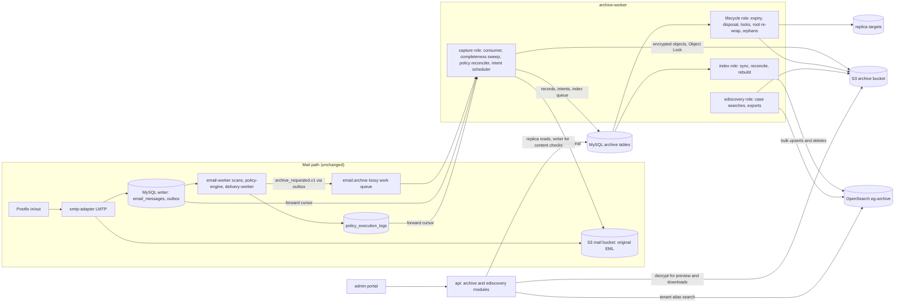

# Step 8.1: Journaling and compliance archiving

**Status:** implemented and verified locally, **not complete** (2026-11-17). Designed by the architect on 2026-11-16 on commit `01e77d7`; built by WP1–WP5 on top of `ebf1082` (step 7.3 committed) and verified end to end by WP6 on the combined working tree: the new `archive-smtp` stack suite (the 17 cases of §9.4), `pnpm test:integration` in one run (exit 0, 1 649 tests), Playwright 91/91, the 3-node RabbitMQ cluster suite on topology v12, the full gate, every image rebuilt one at a time ([§14](#14-verification-record)); eight fixes by WP6 (§13.6 §3, among them an archive-worker busy loop that only the CommonJS build showed). ADRs 0064–0069 Accepted. **Not complete:** commit, CI and a Kubernetes cluster apply; AWS S3 Object Lock, CRR, KMS and Amazon OpenSearch access control are not verified (10.1/10.2). Originally: designed on `01e77d7` (docs only on top of `f0f9da4`, step 7.2) while 7.3 was in progress; §13 holds the deviations of every package, §14 the verification.

**ADRs of the step** (all Proposed; numbers are the next free ones after 7.3's ADR-0063, the orchestrator renumbers if needed):

- [ADR-0064](../../architecture/adr/0064-journal-capture-intents-and-archive-consumer.md): journal capture through database-driven capture intents, capture points and categories, the `email.archive` consumer with reconciliation from `policy_execution_logs`, scan rounds linked through frozen snapshots without rescanning, topology v12; **retires lifecycle edge E25** (supersedes [ADR-0025](../../architecture/adr/0025-message-lifecycle-state-machine.md) decision 6 for the `archived` state).
- [ADR-0065](../../architecture/adr/0065-archive-storage-and-per-tenant-envelope-encryption.md): archive storage layout and per-tenant envelope encryption (root key, tenant key versions, per-record data keys, the `archive-object/1` streaming format, rotation, crypto-shredding).
- [ADR-0066](../../architecture/adr/0066-archive-immutability-s3-object-lock.md): immutable archive storage with S3 Object Lock per tenant (governance/compliance), extend-only retention, honest fallback, AWS vs MinIO.
- [ADR-0067](../../architecture/adr/0067-retention-legal-hold-and-disposal-consistency.md): retention policies, case-scoped legal holds evaluated authoritatively at disposal time, and one disposal pipeline consistent across S3 (versions and replica buckets), MySQL and OpenSearch.
- [ADR-0068](../../architecture/adr/0068-archive-search-opensearch-and-authorization.md): metadata-only archive search in OpenSearch with per-tenant filtered aliases, a mandatory tenant filter, field-level authorization and ADR-0062 masking; MySQL stays the source of truth.
- [ADR-0069](../../architecture/adr/0069-ediscovery-cases-searches-and-exports.md): eDiscovery cases, case-scoped holds, worker-run searches verified against MySQL, review tags, bounded encrypted exports with a signed chain-of-custody manifest and single-use download grants.

This note is the single source for the step. Implementers see only their own work-package instructions plus this note; every name, key, route, table, column, code and file below is binding unless an implementer records a deviation (with evidence) in their package's deviation file (§13). Section numbers (§) and decision ids (A*n*) are stable references.

**Brief (product owner, authoritative).** Optional email archiving, independently configurable per organization: inbound, outbound and internal archiving; retention policies; legal hold; search; eDiscovery; export; audit trail; encryption key management; lifecycle management; customer-specific archive access. S3 for email objects, MySQL for archive metadata and retention configuration, OpenSearch for authorized metadata search, immutable storage where legally and contractually required, deletion, retention and legal hold consistent across replicated storage, tenant isolation and comprehensive access auditing. **Merged on 2026-11-09:** the Email Journaling extension ([brief and gap analysis](../briefs/8.1-journaling-and-archiving.md)): journal capture in all three directions and of rejected, quarantined and failed mail by tenant policy, linked to the existing scan rounds without rescanning, and the `email.archive` consumer of the policy ARCHIVE action's `mail.message.archive_requested.v1` requests of step 5.2, reconciling from `policy_execution_logs` because the dormant queue is lossy. Plan row 8.1 is titled "Journaling and compliance archiving".

---

## 1. Starting point (inspected at `f0f9da4` / `01e77d7`)

### 1.1 What exists

| Area                                        | State                                                                                                                                                                                                                                                                                                                                                | Reuse / change in 8.1                                                                                                                            |
| ------------------------------------------- | ---------------------------------------------------------------------------------------------------------------------------------------------------------------------------------------------------------------------------------------------------------------------------------------------------------------------------------------------------- | ------------------------------------------------------------------------------------------------------------------------------------------------ |
| SMTP acceptance (2.2, ADR-0019)             | Postfix accepts; LMTP ingestion writes the EML to S3 (`org/{org}/eml/...`, SHA-256 `email_messages.eml_sha256`), then one writer transaction (registry, `email_messages`, `email_recipients`, events, outbox `mail.message.received.v1`); `250` only after the commit, `451 4.3.0` on any failure; Postfix keeps the mail queued until LMTP succeeds | Unchanged. The committed message row and outbox row are the **recoverable journaling intent** (A2): nothing new on the SMTP hot path             |
| Directions (2.3)                            | Per recipient `email_recipients.direction`; message `direction` = listener direction, `internal` only when every recipient is internal (mixed stays `outbound`)                                                                                                                                                                                      | Eligibility uses the message direction **or** any recipient direction (A4)                                                                       |
| MIME (3.1)                                  | `email_message_parses`, decoded `.text`/`.html` parts and attachments in the mail bucket, `email_headers` allow-list                                                                                                                                                                                                                                 | Read once at capture into the encrypted journal object (A5); never re-parsed in the api (ADR-0048)                                               |
| Mail bucket lifetime                        | Local MinIO: no EML expiry rule. AWS Terraform `mail-storage`: `expire-processed-mail` after `mail_retention_days` (default **30 days**) for every mail-bucket object                                                                                                                                                                                | Capture must happen within that window (A3, A6); the archive keeps its **own** encrypted copy in the archive bucket                              |
| Core MySQL tier                             | `email_messages`, recipients, scans, auth results, risk, `policy_execution_logs` … dropped after **6 months** (partition registry)                                                                                                                                                                                                                   | The archive keeps its own metadata and frozen scan snapshots (A5) because it outlives the core tier                                              |
| Messaging (3.2)                             | Topology v11, 21 queues; `email.archive` **dormant** (drop-head at 10 000), bound to `org.*.mail.message.archive_requested.v1`; `archive-worker` connects to nothing                                                                                                                                                                                 | Topology v12: `email.archive` becomes a lossy work queue consumed by `eg-archive` (A26)                                                          |
| Lifecycle (3.3, ADR-0025)                   | 15 states incl. `archived`; edge **E25** `delivered \| rejected → archived` (role `archive`, "8.1")                                                                                                                                                                                                                                                  | **E25 retired**, `archived` reserved (A25)                                                                                                       |
| Scans (4.1–4.6), risk (5.1)                 | Rounds in `email_scans` with per-engine rows, auth, attachment, URL, BEC, DLP (masked), sandbox, risk rows; read model `apps/api/src/modules/messages/repositories/message-scans-read.repository.ts` + mapper `domain/message-scans.ts`                                                                                                              | Linked, never rescanned: the round's rows are frozen into an encrypted `archive-scan/1` snapshot read back through the **same mapper** (A5, A19) |
| Policy ARCHIVE (5.2, ADR-0045)              | Status `requested`; `mail.message.archive_requested.v1` (ids, ORIGINAL `emlS3Key`, `ruleRef`) via the outbox to the dormant queue; the evaluation row (`policy_execution_logs.actions`) is the durable record                                                                                                                                        | Consumed + reconciled (A2)                                                                                                                       |
| Quarantine (5.3)                            | `decideObjectDisposal` (Q17) reads `archive_legal_holds` (strict subset `{custodians, from, to}`; unparsable = match all), `archive_settings.enabled/scope`, max `archive_retention_policies.retention_days`, `email_archives.retain_until/legal_hold`, ARCHIVE requested                                                                            | Rules updated for 8.1 (A23)                                                                                                                      |
| Organizations (1.2)                         | Deletion blocked by active `archive_legal_holds`; `purge_after = max(now + 30 d, MAX(email_archives.retain_until) of live rows)`; the purge job is deferred; tenant-data purge repositories per step                                                                                                                                                 | `ArchiveTenantDataRepository` (A24)                                                                                                              |
| Registry purge (1.1)                        | `message_identities` rows kept while a live `email_archives` row (`deleted_at IS NULL`) references them; "whoever deletes the last reference below the watermark deletes the registry row"                                                                                                                                                           | Disposal honours it (A14)                                                                                                                        |
| Archive tables (1.1)                        | `archive_settings` (`enabled`, single-value `scope`, `object_lock_mode`, `encryption_key_ref`), `archive_retention_policies`, `archive_legal_holds`, `email_archives` (monthly partitions, compliance tier, never dropped). **All empty locally** (read-only check 2026-11-16)                                                                       | Extended by migration `journaling_archiving` (§3)                                                                                                |
| Plans (1.2 seed)                            | Feature `archiving` on `enterprise`/`dedicated`; limit `archive_retention_days` 2 555 / 3 650 (0 on trial/standard)                                                                                                                                                                                                                                  | Entitlement and retention cap (A20, A11)                                                                                                         |
| RBAC (1.3 → 7.2)                            | 60 permissions; existing `archive:read` (read set), `archive:export` (OA, CA), `archive:legal_hold` (OA), `settings:manage` ("…and archive settings")                                                                                                                                                                                                | +4 permissions (A20)                                                                                                                             |
| REST API (6.1, ADR-0050–0053)               | Coded errors, strict schemas, signed v1 cursors, rate classes, Idempotency-Key, route inventory; OpenAPI says "Archive … step 8.1"                                                                                                                                                                                                                   | 41 new operations (§4.4)                                                                                                                         |
| Masking (7.2, ADR-0062)                     | Subjects, recipient addresses, To/Cc/Subject masked for every caller; audited `message:reveal`; attachment names in clear (open PO question)                                                                                                                                                                                                         | Applied unchanged to archived messages (A17, A19)                                                                                                |
| Quarantine preview/download (5.3, ADR-0048) | Sanitized JSON preview from stored decoded parts via `@email-gateway/mail-safety`; single-use re-authorized download grants; no MIME parse in the api                                                                                                                                                                                                | Same model for archived messages (A19)                                                                                                           |
| Envelope encryption (4.5, 4.6, 6.2)         | Config KEKs with `_PREVIOUS` rotation, AES-256-GCM, SecretBox wrapped-key format `v1.<kid>.<iv>.<tag>.<ct>`, crypto-shredding; whole-buffer only; no per-tenant keys                                                                                                                                                                                 | Extended into a per-tenant hierarchy with streaming chunks (A8)                                                                                  |
| Object storage                              | MinIO (Chainguard, pinned digest); `gateway-mail` and `gateway-archive` created **versioned, without Object Lock**; `S3_BUCKET_ARCHIVE` in every service config, unused                                                                                                                                                                              | Archive bucket recreated with Object Lock when empty (A29)                                                                                       |
| OpenSearch                                  | `opensearch` 2.19.3 only in profile `analytics` (heap 512 MB, security plugin off locally); **no code uses it, no client dependency, image not pulled, no volume**                                                                                                                                                                                   | First user (A16); new profile `search`                                                                                                           |
| archive-worker                              | Skeleton: config (`HTTP_PORT` 3060, DB, S3), health (`mysql`, `s3`), Kubernetes Deployment/HPA/PDB                                                                                                                                                                                                                                                   | Implemented (A1)                                                                                                                                 |
| Admin portal (7.1/7.2)                      | Settings tab `archive` shows "Arrives in step 8.1"; BFF streams downloads (quarantine)                                                                                                                                                                                                                                                               | Pages of A28                                                                                                                                     |

### 1.2 The twelve brief features against the code

| #   | Feature                          | Before 8.1                      | 8.1                                                                                                                       | Owner                                      |
| --- | -------------------------------- | ------------------------------- | ------------------------------------------------------------------------------------------------------------------------- | ------------------------------------------ |
| 1   | Inbound archiving                | New (tables only)               | Journal capture, direction `inbound` (A2–A6)                                                                              | archive-worker (`capture` role)            |
| 2   | Outbound archiving               | New                             | Same, `outbound`                                                                                                          | archive-worker                             |
| 3   | Internal archiving               | New                             | Same, `internal` (and mixed messages with internal recipients, A4)                                                        | archive-worker                             |
| 4   | Retention policies               | Extend (table, no logic)        | `archive-retention/1` criteria, priority, plan cap, lazy extend-only recomputation (A11, A13)                             | api (config), archive-worker (`lifecycle`) |
| 5   | Legal hold                       | Extend (table; read by 5.3/1.2) | Case-scoped holds, `archive-hold/1` criteria, authoritative evaluation at disposal (A12)                                  | api, archive-worker                        |
| 6   | Search                           | New                             | OpenSearch metadata index, tenant aliases, masked authorized search (A16, A17)                                            | archive-worker (`index`), api              |
| 7   | eDiscovery                       | New                             | Cases, custodians, holds, worker-run searches, review tags (A18)                                                          | api, archive-worker (`ediscovery`)         |
| 8   | Export                           | New                             | Bounded async encrypted EML ZIP + signed manifest, single-use grants (A18)                                                | archive-worker, api                        |
| 9   | Audit trail                      | Extend (`audit_logs`)           | Every archive read, search, reveal, preview, download, export, hold and disposal audited; per-record disposal log (A21)   | api, archive-worker                        |
| 10  | Encryption key management        | New                             | Per-tenant key versions, audited rotation, root re-wrap, crypto-shredding (A8, A9)                                        | api, archive-worker                        |
| 11  | Lifecycle management             | New                             | Record lifecycle (active → review → disposing), Object Lock, export expiry, AWS storage-class transitions (A10, A13, A14) | archive-worker, Terraform                  |
| 12  | Customer-specific archive access | Extend (RBAC)                   | 4 new permissions, content routes customer-only (no platform override), per-tenant keys and aliases (A20)                 | api, seed                                  |

### 1.3 The journaling brief requirements against the code

| Requirement (journaling brief)                                                                                                                              | Decision                                                                                                                                                           |
| ----------------------------------------------------------------------------------------------------------------------------------------------------------- | ------------------------------------------------------------------------------------------------------------------------------------------------------------------ |
| Capture inbound/outbound/internal                                                                                                                           | A2–A4                                                                                                                                                              |
| Capture rejected / quarantined / failed-delivery by tenant policy                                                                                           | A3 categories, flags `include.*` (off by default)                                                                                                                  |
| Journaling independent of the final delivery decision                                                                                                       | Capture is driven by the message state, whatever the disposition; categories only filter (A3)                                                                      |
| Original preserved before modification                                                                                                                      | The 3.1 original (`eml_object_key`, SHA-256 at ingest) is copied byte-for-byte, hash re-verified (A6); rewritten and policy copies are never archived              |
| No loss when scanning or delivery fails                                                                                                                     | Capture points include `scan_failed`-, `parse_failed`-, `expired`- and `delivery_failed`-terminated messages; the completeness sweep visits every message row (A2) |
| No duplicates during retries                                                                                                                                | Unique `(message_id, received_at)` on intents and records; attempt-scoped object keys (A6)                                                                         |
| No SMTP reinjection loops                                                                                                                                   | Capture never sends mail (no journal mailbox, no SMTP)                                                                                                             |
| Recoverable journaling intent before acceptance                                                                                                             | The committed message and outbox rows (2.2 contract, `451` on failure) + the completeness sweep (A2)                                                               |
| Temporary SMTP failure when durable persistence fails                                                                                                       | Existing 2.2/3.1 behaviour, re-tested (§9.4 case 16)                                                                                                               |
| Associate existing scan results (spam, malware/ClamAV/YARA, URL, phishing/BEC, DLP, SPF/DKIM/DMARC, risk, final action, versions, timestamps, errors)       | Frozen `archive-scan/1` snapshot of the round's read-model rows (A5)                                                                                               |
| Never rescan for journaling; a rescan keeps the previous round                                                                                              | Snapshots per round and revision; capture reads only (A5, A7)                                                                                                      |
| Scanner failure never CLEAN                                                                                                                                 | Snapshot copies the stored outcomes (`timeout`/`error`/`scan_failed`) verbatim                                                                                     |
| journal_* tables suggested                                                                                                                                  | Mapped onto existing archive tables plus intents, keys, disposals and eDiscovery tables (§3); no parallel `journal_*` copies                                       |
| journal.* events suggested                                                                                                                                  | Not needed: capture is database-driven (A2, ADR-0064 alternatives)                                                                                                 |
| No raw EML through RabbitMQ                                                                                                                                 | Only ids travel (existing event)                                                                                                                                   |
| Domain-, user- and group-wise configuration                                                                                                                 | `scope` of `archive-settings/1` (A4)                                                                                                                               |
| Journal Explorer (search by sender, recipient, subject, date, Message-ID, verdict; view original, scans, attachment scans; download EML with authorization) | A17, A19                                                                                                                                                           |
| Compliance Management (retention, holds, exports, journal audit logs, processing failures)                                                                  | A11–A14, A18, A21, capture issues (§4.4 #11–12)                                                                                                                    |
| Permissions (view, search, retrieve, download attachments, export, manage retention, create/remove holds, view audit)                                       | A20 (`archive:read`, `archive:search`, `archive:retrieve`, `archive:export`, `archive:manage`, `archive:legal_hold`, `audit:read`)                                 |
| QA list 1–20                                                                                                                                                | §9                                                                                                                                                                 |

### 1.4 Gaps and conflicts found

1. **E25 conflicts with the product.** Moving delivered/rejected messages to `archived` would erase their outcome from every status-driven surface (explorer status filters, reports, delivery views) and cannot represent archived quarantined mail (no edge). Archive membership is a separate fact (A25).
2. **5.3 Q17 rule 2 retains mail-bucket objects for archive retention**, which the AWS mail-bucket lifecycle (30 days) overrides anyway; the archive must hold its own copy (A23).
3. **The dormant queue is lossy and the relay must never stall on the archive**: correctness comes from sweeps over MySQL, the queue only lowers latency (A2, A26).
4. **No OpenSearch client and no running OpenSearch**: a fetch-based client in `@email-gateway/common` (no new dependency), profile `search`, image pull and memory budget (A16, A29).
5. **The local archive bucket has no Object Lock** and MinIO cannot enable it on an existing bucket (A29).
6. **The core tier (6 months) is shorter than any archive retention**: scan results, recipients and headers must be frozen at capture (A5).
7. **The api may not parse MIME** (ADR-0048): previews of archived mail come from bounded decoded parts copied at capture (A5, A19).
8. **`archive_settings.scope` is a single value** (cannot express inbound+outbound without internal): replaced by the settings document (A22); the column is retired, not dropped (rolling upgrade).
9. **Prisma read-model selects live only in the api**: moved to `packages/database` so the worker can freeze exactly what the api maps (A5).

---

## 2. Decisions

### 2.0 Architecture and invariants



Invariants (never traded away):

1. **No message content in MySQL, logs, metrics, events or the search index.** MySQL holds metadata (addresses, subject, ids, hashes, codes); bodies and attachments exist only inside encrypted S3 objects. The index holds metadata only (no bodies, no attachment content).
2. **The tenant comes from the authenticated principal or from the row being processed**, never from a request field; every query filters by `organization_id` first; every S3 key read or written is checked to start with `org/<organizationId>/` of the row; every search goes through the tenant alias **and** carries the tenant filter.
3. **MySQL (writer) is the source of truth** for records, retention, holds and keys. The index is derived and rebuildable; S3 objects are referenced only by committed rows (anything else is an orphan, reconciled).
4. **Capture is idempotent per message** (`(message_id, received_at)`), reads the original only, never rescans, never sends mail.
5. **Nothing archived is ever modified.** Objects are write-once (attempt-scoped keys); retention only grows; disposal is the only deletion path and re-checks holds in the transaction that crypto-shreds.
6. **Every human or API access to archived content or metadata is audited before the content is returned** (A21).
7. **Data plane stays writer-only**: the archive-worker never registers `PrismaReadService` (ESLint rule and DI assertion, ADR-0014).
8. **The mail path never waits for the archive**: no synchronous dependency from SMTP, scanning, policy or delivery on the archive-worker, OpenSearch or the archive bucket.

### A1. Ownership

| Component                                                      | Owns                                                                                                                                                                                                                                                                                                                                                                                    |
| -------------------------------------------------------------- | --------------------------------------------------------------------------------------------------------------------------------------------------------------------------------------------------------------------------------------------------------------------------------------------------------------------------------------------------------------------------------------- |
| `@email-gateway/archive` (new pure package `packages/archive`) | Crypto (key wrapping, HKDF, `archive-object/1` streams, Ed25519 manifest signatures), JSON document schemas (§4.2), capture decision, journal eligibility, retention selection and expiry decision, hold criteria and matcher, OpenSearch template, names, document and query builders, snapshot codec, object keys, download tokens. No I/O, no clock (time is a parameter), no logger |
| `@email-gateway/common` `search/` (new)                        | `OpenSearchModule` / `OpenSearchService`: fetch-based HTTP client (timeouts, optional basic auth, routing, bulk NDJSON, typed errors that never echo bodies)                                                                                                                                                                                                                            |
| `@email-gateway/config`                                        | `archiveKeysConfigSchema`, `archiveSearchConfigSchema`, `archiveTestSeamSchema` (§4.8)                                                                                                                                                                                                                                                                                                  |
| `packages/database`                                            | Migration, Prisma models, partition registry, seed catalog, `src/read-models/scan-read-model.ts` (selects moved from the api, A5)                                                                                                                                                                                                                                                       |
| archive-worker (`apps/archive-worker`)                         | Roles `capture`, `index`, `lifecycle`, `ediscovery` (`ARCHIVE_WORKER_ROLES`); writer only; the only writer of records, intents, objects, the index and disposals                                                                                                                                                                                                                        |
| api (`apps/api`)                                               | Modules `archive` and `ediscovery`; settings, retention policies, keys rotation, holds, cases, search/detail/reveal/preview/downloads, review, export requests; the tenant-data purge repository; never writes archive objects (reads and decrypts only), never writes the index                                                                                                        |
| policy-engine                                                  | Unchanged evaluation; its quarantine disposal facts follow A23                                                                                                                                                                                                                                                                                                                          |
| admin-portal                                                   | Pages of A28                                                                                                                                                                                                                                                                                                                                                                            |

Kubernetes (rendered, not applied): Deployment `archive-worker` (roles `capture,index`, HPA) and new Deployment `archive-jobs` (roles `lifecycle,ediscovery`, 1–2 replicas; leader locks make single-run jobs safe). Locally one Compose container runs all roles.

### A2. Capture model: intents, sources, sweeps, consumer, reconciler (ADR-0064)

- **Capture intent** (`archive_capture_intents`, one row per message in archive scope): created by any of the three sources below with `INSERT … ON DUPLICATE KEY UPDATE` on `(message_id, received_at)` (sources are OR-ed in). It carries the sources (`source_journal`, `source_policy`, `policy_rule_ref`), the settings generation, a status (`pending`, `captured_open`, `closed`, `skipped`, `lost`, `failed`) and `next_check_at`. Intents are the work queue of the capture scheduler and the anchor of reconciliation and of the "capture issues" view.
- **Source 1, journal completeness sweep** (leader `GET_LOCK('eg:archive-journal-sweep')`, every `ARCHIVE_SWEEP_INTERVAL_MS`): a **forward cursor over `email_messages.id`** (`stream_cursors` row `archive:journal-sweep`, registry ids are allocated in time order) reading `WHERE id > :cursor AND received_at >= :cursorReceivedAt - 1 day AND created_at <= now - ARCHIVE_SWEEP_SAFETY_LAG_SECONDS ORDER BY id LIMIT ARCHIVE_SWEEP_BATCH_SIZE` (PK range per partition; the safety lag exceeds `INGEST_DB_TIMEOUT_MS`, so no in-flight id is skipped). For organizations that are entitled and enabled with `received_at >= journal_enabled_at`, journal eligibility (A4) is evaluated and eligible messages get an intent. Start position `ARCHIVE_JOURNAL_SWEEP_START` (`now`: no historical backfill, §8). Every message row is visited exactly once: **completeness by construction**, no dependency on any queue.
- **Source 2, the `email.archive` consumer** (ledger consumer `archive-worker.archive`, user `eg-archive`, `processOnce`): `mail.message.archive_requested.v1` → the message is re-read on the writer (organization and `received_at` echo-checked, key prefix checked) → intent upserted with `source_policy = 1`, `policy_rule_ref = ruleRef`, `next_check_at = now`. Ack after commit. Unknown/foreign message → acked with a counter (no intent).
- **Source 3, the policy reconciler** (leader `GET_LOCK('eg:archive-policy-reconcile')`): a forward cursor over `policy_execution_logs.id` (`stream_cursors` row `archive:policy-reconcile`, safety lag `ARCHIVE_POLICY_RECONCILE_SAFETY_LAG_SECONDS` ≥ `POLICY_DB_TX_TIMEOUT_MS`), rows whose `actions` contain `{ type: 'ARCHIVE', status: 'requested' }` → the same upsert. Start `ARCHIVE_POLICY_RECONCILE_START` (`oldest`: recovers every request the dormant v9–v11 buffer dropped, within the 6-month table retention; mail older than the mail-bucket retention ends `lost`, recorded). This is the reconciliation the plan row requires; it also makes a lossy queue safe.
- **Capture scheduler**: claims due intents (`status IN ('pending','captured_open') AND next_check_at <= now`, `ORDER BY next_check_at LIMIT n FOR UPDATE SKIP LOCKED`, lease `ARCHIVE_CAPTURE_LEASE_SECONDS`), evaluates `decideCapture` (A3) on fresh writer facts and executes the result (A5) with `ARCHIVE_CAPTURE_CONCURRENCY` parallel captures per replica. Re-check schedule while waiting: 1, 2, 5, 15, 30 min, then hourly; captures of final states re-check at +1 h and +24 h (late sandbox revisions, A7) and close; non-final captures (quarantined) re-check until final or `ARCHIVE_OUTCOME_WINDOW_DAYS`.
- **Why not events for journaling** (ADR-0064 alternatives): binding `received.v1` and `state_changed.v1` adds ~8 events per message to the archive queue; as a work queue an outage would stall the outbox relay for the whole pipeline (reject-publish at 1 000 000), as a lossy queue it would flood the shared dead-letter queue with maxlen drops. Sweeps give a bounded latency (≈ sweep interval + first re-check, ~1–2 min) with exact completeness and no broker load.

### A3. Capture points and categories

`decideCapture(input) → { action: 'wait' | 'capture' | 'skip' | 'lost', category?, reason, recheckAt? }` (pure, `@email-gateway/archive`). Input: entitlement, settings (A22), sources, message facts on the writer (`status`, `status_reason`, `final_action`, `lifecycle_round`, recipient statuses and directions, presence of the original object), intent age, now.

| Message state (reason)                                                                                                                                      | Category      | Captured when                                                                           | Otherwise                                                                |
| ----------------------------------------------------------------------------------------------------------------------------------------------------------- | ------------- | --------------------------------------------------------------------------------------- | ------------------------------------------------------------------------ |
| any non-final state before a decision (`received` … `policy_evaluated`, `approved`, `delivery_pending`, `delivery_retry`) with **no** recipient `delivered` | —             | —                                                                                       | `wait`                                                                   |
| any state with at least one recipient `delivered` (first delivery), or `delivered` (`delivery_complete`, `delivery_partial`)                                | `delivered`   | always (journal or policy source)                                                       | —                                                                        |
| `quarantined`, `held_for_review`                                                                                                                            | `quarantined` | `include.quarantined` or policy source (ARCHIVE applies to every disposition, ADR-0045) | `wait` (a release may deliver it)                                        |
| `rejected` with a policy or quarantine reason (`policy_discard`, `policy_reject`, `quarantine_rejected`, …)                                                 | `rejected`    | `include.rejected` or policy source                                                     | `skip` (`category_excluded`)                                             |
| `rejected` (`delivery_failed`), `expired`                                                                                                                   | `failed`      | `include.failed` or policy source                                                       | `skip` (`category_excluded`)                                             |
| organization not entitled / archiving disabled / `policyArchive.enabled = false` for a policy-only intent                                                   | —             | —                                                                                       | `skip` (`not_entitled`, `archiving_disabled`, `policy_archive_disabled`) |
| message row gone, or original object missing (mail-bucket lifecycle)                                                                                        | —             | —                                                                                       | `lost` (alert)                                                           |
| intent older than `ARCHIVE_INTENT_MAX_AGE_DAYS` while waiting (a wait in quarantine: older than `QUARANTINE_WAIT_MAX_DAYS` = 100, closing round §14.9)      | —             | —                                                                                       | `skip` (`max_age`)                                                       |

Notes: SMTP-time refusals create no message row and are never journaled (§8). "Rejected" means post-acceptance policy rejection or discard. A message captured as `quarantined` and later released and delivered keeps one record; its outcome is refreshed (A7). Retention is chosen with the category at capture (A11).

### A4. Journal eligibility and scope

- Direction: eligible when `directions[message.direction]` **or** `directions[d]` for any recipient direction `d` (a mixed outbound message with internal recipients is eligible when `internal` is on).
- Org-side parties of a message: recipients whose direction is `inbound` or `internal`, plus the envelope sender (and header From) when the direction is `outbound` or `internal`.
- `scope.mode = all` (default): every eligible message. `include`: at least one org-side party matches the scope. `exclude`: at least one org-side party does **not** match it. A party matches when its address is in `scope.addresses`, belongs to a user of `scope.userIds` (`users.email`), to a member of `scope.departmentIds` (`tenant_department_members` address or user), or its domain is a verified domain of `scope.domainIds`. Public ids are resolved once per settings generation (cached `ARCHIVE_SETTINGS_CACHE_TTL_MS`); an id that no longer resolves is ignored and counted (`archive_scope_unresolved_total`).
- `journal_enabled_at`: only messages received at or after the last enablement are journaled (no backfill).
- Policy-sourced intents ignore directions and scope (an explicit rule) but still need entitlement, `enabled` and `policyArchive.enabled` (default true).

### A5. What a capture writes

For an intent decided `capture(category)`, in this order (one `captureId` = UUIDv7 per attempt):

1. **Facts** (writer, echo-checked): the message row, recipients, parse row, headers, attachment rows, deliveries at this instant, the latest round's read-model rows (`packages/database/src/read-models/scan-read-model.ts`), the round's policy evaluation row.
2. **Keys**: the tenant's active key version (created on first use, A9) and a fresh 32-byte record data key (DEK).
3. **EML object**: stream `GetObject(mail bucket, email_messages.eml_object_key)` (prefix `org/<org>/eml/` verified) → `archive-object/1` encrypt (kind `eml`) → multipart upload to the archive bucket (`@aws-sdk/lib-storage`, `ARCHIVE_S3_PART_SIZE_BYTES`), with Object Lock headers when the tenant's mode is not `none` (A10). The plaintext SHA-256 is computed while streaming and **must equal `email_messages.eml_sha256`**; a mismatch aborts (`failed`, `integrity_mismatch`, critical alert) and nothing is committed.
4. **Journal object** (`archive-journal/1`, kind `journal`): the journal report — envelope (MAIL FROM, every envelope recipient with direction and status, BCC included), message facts (Message-ID, From, Subject, size, original SHA-256, client IP/HELO), the stored header allow-list, the attachment list (part index, file name, content types, size, SHA-256), the parse outcome, deliveries at capture, and the decoded `.text`/`.html` parts read with bounded Range GETs (≤ `ARCHIVE_PREVIEW_PART_MAX_BYTES` each, `truncated` flag) for the sanitized preview (A19).
5. **Scan snapshot object** (`archive-scan/1`, kind `scan`, one per linked round and risk revision): the round's read-model rows encoded with the tagged codec (BigInt and Date preserved). Never a rescan; a round that is still `scanning` is linked later (A7).
6. **One writer transaction**: insert `email_archives` (status `active`, category, sources, metadata, parties JSON, `objects` and `scan_rounds` JSON, key version, wrapped DEK, lock mode and `lock_until`, retention policy, `retain_until`, `expiry_action`, `settings_generation`), set the intent `captured_open` (`archive_id`, `captured_at`), insert an `archive_index_queue` upsert. The DEK exists only wrapped in this row (crypto-shredding, A14).
7. Failure before the commit leaves attempt-scoped objects without a row (orphans, A15); the intent is retried with backoff (`ARCHIVE_CAPTURE_RETRY_BASE_MS` … `_MAX_MS`), never given up before the intent's max age except for deterministic failures (`integrity_mismatch`, `object_lock_unavailable`, `lost`).

**Read-model selects move to `packages/database`.** The `select` objects and row types of `message-scans-read.repository.ts` are moved verbatim to `packages/database/src/read-models/scan-read-model.ts` (WP1 adds them, WP4 switches the api to import them, behaviour-neutral). The worker freezes exactly those columns; the api decodes a snapshot back into the same row types and maps it with the existing `domain/message-scans.ts` mapper, so an archived round renders exactly like a live one (masking included). Live-only data is not frozen: URL click summaries, BEC feedback references, DLP evidence (its own ≤ 180-day retention; shown as "not retained in the archive").

### A6. Idempotency, crash recovery, integrity

- Records: unique `(message_id, received_at)`; a second capture of the same message loses the insert and deletes its own just-written versions (governance bypass for locked orphans is the lifecycle role's job, A15).
- Intents: unique `(message_id, received_at)`; leases make a crashed worker's claim re-claimable after `ARCHIVE_CAPTURE_LEASE_SECONDS`.
- Consumer: `processOnce` ledger (`archive-worker.archive`), retries `hold` 10 × 2 s–60 s; duplicates of `archive_requested.v1` are no-ops.
- Objects: write-once attempt-scoped keys (`…/<captureId>/…`), never overwritten; the committed row names the exact version ids.
- Integrity: original SHA-256 re-verified at capture; ciphertext SHA-256 and size recorded; downloads and exports re-verify the plaintext SHA-256 while streaming and abort on mismatch (`archive_integrity_failed`, alert).

### A7. Outcome refresh window

While an intent is `captured_open`, each re-check compares the message's state, recipient statuses, `lifecycle_round` and risk revisions with the record: changes update `message_state`, `message_state_reason`, parties' statuses, `final_verdict/final_action/risk_score/malicious` and append new rounds or revisions (new scan objects, ≤ 16 entries) — never the EML or journal object — and enqueue an index upsert. The intent closes when the message is final and the +24 h check passed, or after `ARCHIVE_OUTCOME_WINDOW_DAYS`. Rescans after that window are not linked (§8).

### A8. Key hierarchy and encryption format (ADR-0065)

- **Root key** `ARCHIVE_ROOT_KEY` (32 bytes, 64 hex; id `ARCHIVE_ROOT_KEY_ID`), held by the archive-worker and the api only; `ARCHIVE_ROOT_KEY_PREVIOUS` / `_PREVIOUS_ID` during rotation. A `ArchiveRootKeyProvider` interface (`wrap`, `unwrap`) with the local implementation; AWS KMS is a drop-in later (10.1, §8).
- **Tenant key** per (organization, version): 32 random bytes, stored only wrapped (`archive_encryption_keys.wrapped_key`, AES-256-GCM under the root key, AAD `eg-archive-tenant-key/v1\0<organizationId>\0<version>`, SecretBox format `v1.<rootKid>.<iv>.<tag>.<ct>`).
- **Record DEK**: 32 random bytes per record, wrapped under the tenant key version (AAD `eg-archive-dek/v1\0<organizationId>\0<messagePublicId>\0<captureId>\0<keyVersion>`, format `v1.k<version>.<iv>.<tag>.<ct>`), stored in `email_archives.wrapped_dek` only. Export DEKs likewise (AAD `eg-archive-export-dek/v1\0<organizationId>\0<exportPublicId>\0<keyVersion>`).
- **Object key**: `HKDF-SHA256(DEK, salt = 32 random bytes in the header, info = eg-archive-object/v1\0<kind>\0<organizationId>\0<subjectId>)`; a fresh salt per object, so one DEK safely encrypts the record's EML, journal and scan objects.
- **`archive-object/1` format**: header `EGARC1` ‖ version `0x01` ‖ kind (1 `eml`, 2 `journal`, 3 `scan`, 4 `export`) ‖ chunk size u32 BE ‖ salt (32) ‖ nonce prefix (7) = 51 bytes; then chunks of `ARCHIVE_CHUNK_BYTES` plaintext (default 64 KiB), each AES-256-GCM with nonce = prefix ‖ u32 BE counter ‖ final flag (1 byte), AAD = the header; ciphertext ‖ 16-byte tag. Truncation, reordering, extension or tampering fail decryption; decryption streams with constant memory. Content type `application/octet-stream`, keys end in `.bin`.

### A9. Key management (encryption key management feature)

- **Creation**: the archive-worker creates version 1 on the first capture of an organization (`INSERT` with unique `(organization_id, version)`; the loser of a race re-reads).
- **Tenant rotation** (`POST /archive/keys/rotate`, `archive:manage`, MFA user, Idempotency-Key, audited `archive.key_rotated` `{ fromVersion, toVersion, reason }`): under the `archive_settings` row lock, a new version (max + 1) becomes `active`, the previous `retired` (decrypt-only). New captures use the new version within `ARCHIVE_KEY_CACHE_TTL_MS`. Existing records keep their version (no DEK re-wrap job in 8.1, §8).
- **Root rotation** (operations, runbook): deploy the new `ARCHIVE_ROOT_KEY`/`_ID` with the old one as `_PREVIOUS`/`_PREVIOUS_ID`; the lifecycle role re-wraps every `archive_encryption_keys` row whose `root_key_id` is the previous id (bounded batches, `UPDATE … WHERE id = ? AND root_key_id = ?`), audited by one system row `archive.root_key_rewrapped` per run with counts; gauge `archive_root_rewrap_pending`; remove `_PREVIOUS` only when it reaches 0.
- **Destruction**: only by the organization purge (A24), after every record is disposed: `wrapped_key = NULL`, status `destroyed`.
- **Visibility**: `GET /archive/keys` lists versions (status, root key id, created/activated/retired, creator) — never key material.

### A10. Immutability (ADR-0066)

- The archive bucket is created **with Object Lock enabled and no default retention** (AWS: `object_lock_enabled = true`; MinIO: `mc mb --with-lock`). Per tenant `archive_settings.object_lock_mode`: `none` (default) | `governance` | `compliance`.
- Locked tenants: every archive object (EML, journal, scan snapshots, also later rounds) is uploaded with `ObjectLockMode` and `ObjectLockRetainUntilDate = retain_until` (no unlocked window). `lock_mode`/`lock_until` are recorded on the record. Exports are never locked.
- **Extend-only**: whenever the lifecycle keeps a record past `lock_until` (policy increase, hold, review) it extends every object version with `PutObjectRetention` before updating the row. Retention is never shortened (compliance: impossible; governance: possible with bypass but not offered).
- Mode changes (`PUT /archive/settings`): `none → governance|compliance` and `governance → compliance` apply to new captures and enqueue a bounded "apply lock" pass over active records (lifecycle role, cursor `archive:lock:<organizationId>`); `compliance → governance|none` is refused (`409 archive_immutability_downgrade_forbidden`); `governance → none` affects new captures only (existing locks expire naturally).
- **Honest fallback**: availability is probed with `GetObjectLockConfiguration` at start (cached) unless `ARCHIVE_OBJECT_LOCK=disabled`. Without Object Lock: settings with a mode other than `none` are refused (`409 archive_object_lock_unavailable`), and intents of a tenant whose mode requires it fail with `object_lock_unavailable` (alert) instead of silently storing unlocked copies. `GET /archive/status` reports availability.
- Object legal-hold flags (`PutObjectLegalHold`) are **not** used: holds are enforced authoritatively in MySQL at disposal and, for locked tenants, by extending the lock (A12, A13), which avoids an O(records) flag pass per hold.

### A11. Retention policies

- `archive_retention_policies` gains `public_id`, `row_version`, `deleted_at` (soft delete), creator/updater. `criteria` follows `archive-retention/1`: optional `directions`, `categories`, `sources`, `policyRuleRefs` (≤ 50), `domainIds` (≤ 100, org-side party domain), `departmentIds` (≤ 50); a record matches when every present criterion matches. `on_expiry`: `delete` | `review`. `retention_days`: 1 … min(plan limit `archive_retention_days`, `ARCHIVE_MAX_RETENTION_DAYS`) (`422 archive_retention_exceeds_limit`). At most `ARCHIVE_RETENTION_POLICIES_MAX_PER_ORG` live policies.
- Selection at capture: live policies by `priority` ascending then id; the first match wins; else `archive_settings.default_retention_policy_id` (required while enabled, `422 archive_default_retention_required`). `retain_until = received_at + days` (UTC; `ARCHIVE_TEST_DAY_SECONDS` replaces the day length in local/ci tests only). The record stores `retention_policy_id`, `retain_until` and `expiry_action`.
- **Lazy, extend-only recomputation** at expiry: effective retain-until = max(stored, `received_at` + the policy's current days when the policy is live). Shortening a policy affects new captures only; lengthening it protects existing records when they reach their stored date. The api shows the effective value. `is_default` is retired (unused) in favour of the settings pointer; deleting the default policy is refused (`409 archive_retention_policy_is_default`).

### A12. Legal holds

- Holds are created inside an eDiscovery case (`POST /ediscovery/cases/{caseId}/holds`, `archive:legal_hold` + `ediscovery:manage`, MFA user, Idempotency-Key, reason required) and are **immutable**; changing a hold = create a new one and release the old (both audited). `archive_legal_holds` gains `public_id`, `case_id`, `criteria_version`, `release_reason`, `row_version`. Legacy rows (no case, `criteria_version` NULL) keep working with the 5.3 subset.
- Criteria `archive-hold/1`: `{ custodians?: string[] (addresses, ≤ 10 000; the case's custodians are snapshotted when "useCaseCustodians" is chosen at creation), from?, to? (date or datetime), directions? }`. Match = no custodians or the envelope sender, header From or any envelope recipient is a custodian; `received_at` within `[from, to]` (date bounds are whole UTC days); direction listed when present. **Unparsable criteria match everything** (fail-safe), as in 5.3.
- Enforcement points (all authoritative, writer facts): the expiry decision (A13) and every disposal transaction (A14); manual disposal (`409 archive_dispose_not_allowed`); organization deletion request/confirmation and purge (1.2, A24); quarantine delete and purge (5.3 rule 1, A23). No per-record hold application job is needed; `email_archives.legal_hold` is an informational flag set when a hold blocked an expiry (shown in views, indexed).
- Release (`POST /legal-holds/{holdId}/release`, `archive:legal_hold`, MFA user, reason): status `released`; records it held become eligible at their next expiry evaluation. A case cannot be closed while it has active holds.
- At most `ARCHIVE_HOLDS_MAX_ACTIVE_PER_ORG` active holds. "Which records does this hold cover" is answered by search (`holdId` filter, A17), informational only.

### A13. Expiry and review (lifecycle role)

Leader `GET_LOCK('eg:archive-lifecycle')`, every `ARCHIVE_LIFECYCLE_INTERVAL_MS`, organization by organization (those with records), batches of `ARCHIVE_LIFECYCLE_BATCH_SIZE` from `email_archives (organization_id, status, retain_until)` where `status = 'active' AND retain_until <= now`. Per record, one writer transaction with the row locked (`SELECT … FOR UPDATE`), `decideExpiry` (pure):

1. Effective retention beyond now (A11) → extend `retain_until` (and the object lock first when locked); outcome `policy_extended`.
2. A matching active hold → extend by `ARCHIVE_HOLD_EXTENSION_DAYS` (lock first), `legal_hold = 1`; outcome `held`.
3. `expiry_action = review` (the live policy's current value, else the stored one) → status `expiry_review` (locked records extended by `ARCHIVE_REVIEW_EXTENSION_DAYS` so a reviewer always works on a protected record); outcome `review`. Disposed only by `POST /archive/messages/{messageId}/dispose` (`archive:manage`, MFA user, reason), which re-runs 1–2.
4. Otherwise → disposal (A14) in the same transaction; outcome `disposed`.

One system audit row `archive.lifecycle_run` per run per organization with counts by outcome (never per record; the per-record trail is `archive_disposals`).

### A14. Disposal pipeline and cross-store consistency (ADR-0067)

Single deletion path for expiry, manual disposal and the organization purge:

1. **Decision transaction** (writer, record locked): re-check holds and effective retention; insert `archive_disposals` (state `shredded`, reason, the message public id, `received_at`, original SHA-256 and size, object references, replica target list, requester); update the record: `status = disposing`, `wrapped_dek = NULL` (**crypto-shred: every version and replica of the objects becomes undecryptable at this commit**), `deleted_at = now`; insert an index `delete` op. Content routes refuse `disposing` records (`410 archive_content_unavailable`).
2. **Objects** (lifecycle role, claim `archive_disposals (state, next_attempt_at)`): delete the recorded version ids in the archive bucket, then every remaining version under the record's prefix (orphans of failed attempts; governance bypass only for orphans, `ARCHIVE_GOVERNANCE_BYPASS_ORPHANS`), then **every version of the same keys in each replica target** (`ARCHIVE_REPLICA_TARGETS`; S3 replication never replicates version deletes). A version still under a lock (only possible for orphans of compliance captures) is recorded with its `retainUntil` and retried after it. State `objects_deleted`.
3. **Index**: wait until the index role applied the delete op (doc `GET` returns 404). State `index_deleted`.
4. **Row**: hard-delete the `email_archives` row; when the message's registry row is below the registry purge watermark, no `quarantine_messages` row references it and the message row is gone, delete the `message_identities` row in the same transaction (registry contract). State `completed`, `completed_at`.
5. Failures: `attempts`, exponential `next_attempt_at`, `failed` after `ARCHIVE_DISPOSAL_MAX_ATTEMPTS` (alert); a failed disposal is already crypto-shredded (no readable data remains).

**MySQL replica consistency**: deletion happens on the writer and replicates. Every content route (journal, security, preview, downloads, export downloads, export builds) re-reads the record status and wrapped DEK **on the writer** before decrypting, so replica lag can never serve disposed content; metadata lists may show a disposing record for at most the replica lag (≤ `DATABASE_READ_MAX_LAG_SECONDS`, else reads fall back to the writer).

### A15. Reconciliation jobs

| Job (role)                                                    | What it checks                                                                                                                                                                                                                          | Repair                                                                                                                      |
| ------------------------------------------------------------- | --------------------------------------------------------------------------------------------------------------------------------------------------------------------------------------------------------------------------------------- | --------------------------------------------------------------------------------------------------------------------------- |
| Index counts (`index`, every `ARCHIVE_RECONCILE_INTERVAL_MS`) | Per organization and UTC day: MySQL count of `active`+`expiry_review` records (index-only on `(organization_id, received_at)`) vs `_count` on the tenant alias; the last `ARCHIVE_RECONCILE_RECENT_DAYS` every run, older days rotating | Mismatch → every record of the day re-enqueued (upsert) and stale docs of the day deleted; result in `archive_index_checks` |
| Index queue health (`index`)                                  | Oldest queued op age                                                                                                                                                                                                                    | Alert `ArchiveIndexLag`                                                                                                     |
| Disposal verification (`lifecycle`)                           | Completed disposals: sampled `HEAD` of versions (primary and replicas), doc absent                                                                                                                                                      | Re-open the disposal at `objects_deleted`/`shredded`                                                                        |
| Orphan objects (`lifecycle`)                                  | Per organization and capture day prefix: object versions older than 24 h not referenced by a record or a disposal                                                                                                                       | Delete (governance bypass for governance orphans; compliance orphans recorded and retried after their lock)                 |
| Root re-wrap (`lifecycle`)                                    | Tenant keys under `ARCHIVE_ROOT_KEY_PREVIOUS_ID`                                                                                                                                                                                        | Re-wrap (A9)                                                                                                                |
| Stuck intents (`capture`)                                     | Intents past their max age                                                                                                                                                                                                              | `skipped (max_age)` / `lost`, alert                                                                                         |

### A16. Search index (OpenSearch) (ADR-0068)

- **Physical layout**: composable index template `<prefix>-v1` matching `<prefix>-v1-*` (`ARCHIVE_SEARCH_INDEX_PREFIX`, default `eg-archive`); yearly indices `<prefix>-v1-<yyyy>` by `received_at` (UTC year); `ARCHIVE_INDEX_SHARDS` / `ARCHIVE_INDEX_REPLICAS` (1/0 locally); `dynamic: strict` mapping (§4.3); `_id` = message public id; **custom routing = organization id**.
- **Tenant isolation**: a filtered alias per tenant `<prefix>-t<organizationId>` over every index of the current version, `filter: { term: { org_id } }`, `routing: <organizationId>`, created by the index role before the tenant's first document and added to every new yearly index in the same `_aliases` call that creates it. The api searches **only** through the tenant alias derived from `TenantScope` **and** its query builder always adds the `org_id` term filter. No user input ever names an index. Production: Amazon OpenSearch fine-grained access control (the api's role may only read `<prefix>-t*`, the worker's role writes `<prefix>-v*` and manages aliases); locally the security plugin is off (ADR-0009) — the difference is documented.
- **Documents**: metadata only (§4.3): ids, times, direction, category, sources, status, sender (envelope, header, domain), recipients (addresses, domains), subject (text), Message-ID key, size, attachment count, attachment names and SHA-256s, verdict, final action, risk score, malicious, DLP matched, SPF/DKIM/DMARC results, retain-until, legal-hold flag, lock mode. **Never a body, a header value other than these, an attachment's content or a URL.**
- **Sync**: `archive_index_queue` rows are written in the same transaction as every record change (capture, refresh, status, extension, disposal, organization purge); the index role claims batches in id order, builds each document **from the current MySQL row** (coalescing; idempotent), sends one `_bulk` (`ARCHIVE_INDEX_BATCH_SIZE`), deletes applied rows, backs off on failure (the queue just grows while OpenSearch is down; capture is never blocked).
- **Rebuild**: CLI `node dist/cli/reindex.js --organization <publicId> | --all [--version v2]` in the worker container: creates the target version's template and indices, re-enqueues records by `(organization_id, received_at)` keyset, then swaps each tenant alias atomically and deletes the old indices. Organization purge: `_delete_by_query` with routing and the tenant term, then alias removal.

### A17. Search API, field-level authorization, masking, audit

- `GET /archive/messages` (`archive:search`, class `expensive`, signed v1 cursor resource `archive_messages` wrapping `search_after` `[receivedAtMs, messageId]` and the filter hash): required bounded range `from`/`to` (≤ `ARCHIVE_SEARCH_MAX_RANGE_DAYS`), allow-listed filters (§4.4 #15), `sort` `-receivedAt` (default) | `receivedAt`, `limit` 1–100. `track_total_hits: false`; no totals. Freshness: header `X-EG-Index-Lag-Seconds` (oldest queued op of the organization).
- **Filters that would confirm a masked value need `message:reveal`** (ADR-0062 decision 6): `recipient`, `subject`, `custodian` → `403 archive_filter_forbidden` before any query. `holdId` needs `archive:legal_hold` or `ediscovery:manage` (who is under hold is confidential). `recipientDomain`, sender filters, Message-ID, attachment name and hash stay with `archive:search`.
- **Results are masked for every caller** exactly like the live explorer (ADR-0062 decision 2): `subject: null` + `subjectMasked`, recipients as `f***@example.com` (`maskAddress` of `apps/api/src/modules/messages/domain/sensitive-masking.ts`), sender side and attachment names in clear (the ADR-0062 open question applies equally). Clear values only through `POST /archive/messages/{messageId}/reveal` (`archive:read` + `message:reveal`), which reads MySQL (subject, parties) and the journal object (To/Cc/Subject header values), commits one `archive.revealed` audit row before responding, `no-store`, route limit `ARCHIVE_REVEAL_PER_MINUTE`.
- OpenSearch unavailable → `503 archive_search_unavailable`; detail, reveal, journal, security, preview and downloads keep working from MySQL and S3.
- Audit `archive.searched` on the first page (no cursor): filter names, filter hash, SHA-256 of identifying values, page result count; never values (6.1 D11).

### A18. eDiscovery (ADR-0069)

- **Case** (`ediscovery_cases`): name (unique per organization), description, matter reference, status `open | closed`, `row_version`; custodians (`ediscovery_custodians`, ≤ `ARCHIVE_CASE_MAX_CUSTODIANS`, addresses normalized lower-case, optional user link) managed through `PATCH` (full list replacement, CAS). Close requires no active hold of the case. At most `ARCHIVE_CASES_MAX_OPEN_PER_ORG` open cases. All case routes `ediscovery:manage`; every user holding it sees every case of the organization (per-case membership is §8).
- **Searches** (`POST …/searches`, `ediscovery:manage` + `archive:search`, `expensive`, Idempotency-Key, `202`): criteria `archive-search/1` (the search vocabulary, `custodians: 'case' | string[]`, range up to `ARCHIVE_CASE_SEARCH_MAX_RANGE_DAYS`; reveal-gated criteria as A17). Executed by the `ediscovery` role: OpenSearch via the tenant alias with `search_after` to completion (bounded `ARCHIVE_CASE_SEARCH_MAX_HITS` → `truncated`, deadline `ARCHIVE_CASE_SEARCH_DEADLINE_MS`), **every hit verified against MySQL** (same organization, `active`/`expiry_review`) in batches and written to `ediscovery_search_hits`. Completeness is reported, not assumed: `index_complete = true` only when the organization's index queue has no op older than 60 s at completion **and** every UTC day of the range has an `ok` check in `archive_index_checks`; otherwise `false` with `incompleteReason` (`index_lag`, `unverified_days`, `mismatched_days`). At most `ARCHIVE_CASE_MAX_ACTIVE_SEARCHES` queued/running per case.
- **Review**: hits carry `review_tag` (`untagged`, `relevant`, `not_relevant`, `privileged`); `POST …/review` tags ≤ `ARCHIVE_REVIEW_MAX_ITEMS` hits per request (user principals), audited with counts and the message ids.
- **Exports** (`POST …/exports`, `ediscovery:manage` + `archive:export`, `expensive`, Idempotency-Key, `202`): from one completed search, filtered by review tags (default every tag except `not_relevant`), bounded by `ARCHIVE_EXPORT_MAX_ITEMS` / `ARCHIVE_EXPORT_MAX_BYTES` (`422 ediscovery_export_too_large`); when the selection contains malicious records (`malicious = 1`), `acknowledgeMalicious: true` is required (`409 ediscovery_export_malicious_ack_required`) and those items go under `malicious/` with a warning README. The `ediscovery` role builds a ZIP (yazl, streaming): `messages/<receivedAt>_<messageId>.eml` (decrypted originals, plaintext SHA-256 re-verified), `manifest.json` (`archive-export-manifest/1`: ids, times, Message-ID, path, SHA-256, size, verdict per item; counts; filters; generator; signing key id), `manifest.sig` (Ed25519 over the manifest bytes, `ARCHIVE_EXPORT_SIGNING_KEY`), `README.txt`; the ZIP stream is encrypted (`archive-object/1` kind `export`, export DEK under the tenant key) into `org/<org>/exports/<yyyy>/<mm>/<exportId>.bin` (tag `eg-object=archive-export`, never locked). Recorded: package SHA-256 (plaintext ZIP), bytes, manifest SHA-256, item and malicious counts; system audit `ediscovery.export_completed|failed`. Expiry after `ARCHIVE_EXPORT_TTL_HOURS` (object deleted, status `expired`); bucket lifecycle backstop on the tag.
- **Download**: `POST …/exports/{exportId}/download-grants` (`ediscovery:manage` + `archive:export`, MFA user + password/TOTP re-entry, not under override) → single-use token (A19); `GET /archive/downloads/{token}` decrypts and streams the ZIP. The public verification keys are published by `GET /archive/export-signing-keys`.

### A19. Content access

| Route                            | Gate                                                                                     | Behaviour                                                                                                                                                                                                                                                                                                                       |
| -------------------------------- | ---------------------------------------------------------------------------------------- | ------------------------------------------------------------------------------------------------------------------------------------------------------------------------------------------------------------------------------------------------------------------------------------------------------------------------------- |
| `GET /archive/messages/{id}`     | `archive:read`                                                                           | MySQL row (replica, echo-checked): masked metadata, capture, retention (effective), `legalHold` flag (the ids and names of the holds matching now only for holders of `archive:legal_hold` or `ediscovery:manage`), immutability, integrity, rounds summary; audited `archive.message_viewed`                                   |
| `GET …/journal`                  | `archive:read`                                                                           | Decrypts the journal object (record status and DEK re-read on the writer): envelope (recipients masked), headers (safe subset of ADR-0062 decision 4 in clear, others `value: null, masked: true`), attachments, parse outcome, deliveries at capture; audited `archive.journal_viewed`                                         |
| `GET …/security`                 | `archive:read`                                                                           | Decrypts every scan snapshot, maps with the live mapper (masked DLP samples need `dlp:read` as live), no evidence; audited `archive.security_viewed`                                                                                                                                                                            |
| `POST …/reveal`                  | `archive:read` + `message:reveal`                                                        | A17                                                                                                                                                                                                                                                                                                                             |
| `GET …/preview`                  | `archive:retrieve`, MFA user, never under a platform override                            | Tenant `access.previewEnabled`; `renderPreview` of `@email-gateway/mail-safety` over the journal object's decoded parts, headers, attachments and the latest snapshot's URL verdicts (sanitized JSON text, DLP-masked, defanged links); audit committed before decryption; `no-store`; route limit `ARCHIVE_PREVIEW_PER_MINUTE` |
| `POST …/download-grants`         | `archive:retrieve`, MFA user + re-auth (`ReauthenticationService`), never under override | Tenant `access.downloadEnabled` (default false); refused for `malicious` records (`409 archive_download_blocked`; use an export); grant row + HMAC token (`ARCHIVE_DOWNLOAD_TOKEN_KEY`, TTL `ARCHIVE_DOWNLOAD_TOKEN_TTL_SECONDS`, per user `ARCHIVE_DOWNLOAD_GRANTS_PER_HOUR`) bound to organization, user, kind and target     |
| `GET /archive/downloads/{token}` | `archive:retrieve` or `archive:export`, the grant's user                                 | Atomic consume; writer re-check; audit before streaming; `application/octet-stream`, `Content-Disposition: attachment`, `nosniff`, `no-store`, sandbox CSP; plaintext hash verified while streaming                                                                                                                             |

Per-attachment downloads are not offered (the api never parses MIME; the original EML contains them) (§8).

### A20. RBAC and tenant isolation

New tenant permissions (catalog 60 → 64; none in `TENANT_READ_PERMISSIONS`):

| Key                 | Description                                                                                                   | System roles                                                          |
| ------------------- | ------------------------------------------------------------------------------------------------------------- | --------------------------------------------------------------------- |
| `archive:search`    | Search archived and journaled messages (metadata, masked)                                                     | super_admin, organization_admin, security_analyst, compliance_auditor |
| `archive:retrieve`  | View the sanitized preview and download original archived messages (audited)                                  | super_admin, organization_admin, compliance_auditor                   |
| `archive:manage`    | Manage archive settings, retention policies, encryption keys, capture issues and disposal of reviewed records | super_admin, organization_admin                                       |
| `ediscovery:manage` | Manage eDiscovery cases, custodians, searches, review and exports                                             | super_admin, organization_admin, compliance_auditor                   |

Existing keys keep their holders: `archive:read` (read set: also read_only_user, platform_admin, security_analyst, compliance_auditor), `archive:export` (organization_admin, compliance_auditor), `archive:legal_hold` (organization_admin). `settings:manage`'s description loses "archive" (archive settings need `archive:manage`; no archive route existed before). Rules: tenant from the principal only; another organization's message, policy, hold, case, search or export id → `404`; **content routes (preview, download grants, downloads, export grants) refuse platform override sessions** (`403 archive_override_forbidden`): archived content is customer-only; metadata routes under an override are audited with `metadata.override` (super_admin with every tenant permission; platform_admin read set only). API keys may use read, search, retention, case, search and export-request routes (scopes), never MFA routes (settings `PUT`, key rotation, holds, disposal, preview, grants, case close, review). Mutations other than settings/keys/holds/disposal require the `archiving` entitlement (`403 archiving_not_enabled`).

### A21. Audit trail

Every route writes `audit_logs` rows through `AuditService` (ids, enums, counts, hashes; never subjects, addresses, bodies or tokens); content reads commit the row **before** decrypting. Actions (resource types in parentheses): `archive.settings_updated` (`archive_settings`, changed paths); `archive.retention_policy_created|updated|deleted` (`archive_retention_policy`); `archive.key_rotated` (`archive_key`); `archive.searched`, `archive.message_viewed`, `archive.journal_viewed`, `archive.security_viewed`, `archive.revealed`, `archive.previewed`, `archive.download_granted`, `archive.downloaded`, `archive.disposal_requested`, `archive.capture_retried` (`archive_message`); `legal_hold.created|released` (`legal_hold`); `ediscovery.case_created|updated|closed` (`ediscovery_case`); `ediscovery.search_requested`, `ediscovery.hits_viewed`, `ediscovery.review_tagged` (`ediscovery_search`); `ediscovery.export_requested|download_granted|downloaded` (`ediscovery_export`). System rows (actor `system`, the archive-worker, same column semantics as the webhook-worker's): `archive.lifecycle_run`, `archive.root_key_rewrapped`, `ediscovery.search_completed|failed`, `ediscovery.export_completed|failed`, `archive.organization_purged`. Per-record disposals are logged in `archive_disposals` (append-only, compliance tier) instead of one audit row each. The portal's compliance views use `GET /audit/logs?actionPrefix=archive.` (and `ediscovery.`, `legal_hold.`) — `audit:read`, no new route.

### A22. Settings API and defaults

- `archive_settings` gains `settings JSON` (`archive-settings/1`, strict, every key optional, defaults applied by `@email-gateway/archive`; `NULL` = every default, so older fixtures that create a bare row keep working), `settings_sha256`, `generation`, `row_version`, `journal_enabled_at`, `updated_by_user_id`. Typed columns stay authoritative for `enabled`, `object_lock_mode` (API `immutability`) and `default_retention_policy_id`. Retired, kept and never read: `scope`, `encryption_key_ref` (dropped by a later contract migration).
- Defaults: no row = disabled. Document defaults: `directions` all **true** (when the tenant enables archiving, all mail is journaled), `include.rejected|quarantined|failed` **false**, `scope.mode = all`, `policyArchive.enabled = true`, `access.previewEnabled = true`, `access.downloadEnabled = false`.
- `PUT /archive/settings` (`archive:manage`, MFA user, Idempotency-Key, class `sensitive`, CAS `expectedRowVersion` → `409 archive_settings_conflict` with `currentRowVersion`): enabling requires the `archiving` entitlement (`403 archiving_not_enabled`) and a live default retention policy; scope ids must resolve inside the organization (`422 archive_scope_reference_invalid`); immutability rules of A10; `generation` + 1 on every change; `journal_enabled_at` set when `enabled` goes false → true. Audited with changed paths.

### A23. Quarantine binding (5.3 Q17) under 8.1

`decideObjectDisposal` (`@email-gateway/quarantine`) and both fact readers (api `QuarantineFactsRepository` + `quarantine-disposition.service.ts`, policy-engine `DisposalFactsReader`) change:

1. **Legal hold** (unchanged rule, new matcher): `legalHoldMatches` of `@email-gateway/archive` (`archive-hold/1` plus the legacy subset; unparsable = match all).
2. **Archive retention no longer retains mail-bucket objects**: the archive keeps its own encrypted copy, and the AWS mail-bucket lifecycle expires processed mail after 30 days regardless. `409 quarantine_retention_active` is no longer produced (API changelog; code kept in the catalogue as deprecated).
3. **Archive pending (generalized)**: the message has an intent in `pending`, or ARCHIVE requested, or is journal-eligible under the current settings with no resolved intent yet, and no `email_archives` row → the delete is allowed, the purge deferred (`archive_pending`, `purge_after = now + 1 h` so the sweeper re-checks).
4. Shared-object rule unchanged.

### A24. Organization purge

`ArchiveTenantDataRepository.purgeOrganization(scope)` (api `tenant-data`, called by the deferred purge job, resumable, returns `{ complete, counts }`): refused while an active hold exists (`ArchivePurgeRefusedError`) or a record's effective retention is in the future; phase 1 sends every remaining record through the disposal decision (reason `organization_deleted`, crypto-shred, A14) in batches and enqueues `purge_org` for the index; phase 2 (when no record and no unfinished disposal remains) deletes intents, index checks, download grants, export rows (objects deleted by the worker), search hits, searches, custodians, released holds, cases, retention policies, settings, then sets every tenant key `destroyed` (`wrapped_key = NULL`). `archive_disposals` and `audit_logs` stay (compliance). The organization deletion runbook gets the archive section.

### A25. Lifecycle state E25 retired

`packages/message-lifecycle`: E25 is removed from `TRANSITIONS` (comment like E4/E27; the id is never reused); `archived` stays in `MessageStatus` (append-only enum) as a **reserved state without a producer**; the reachability invariant test excludes it explicitly; the `archive` actor role stays reserved. The archive-worker never changes `email_messages.status`. ADR-0064 supersedes ADR-0025 decision 6 for `archived`.

### A26. Topology v12

`TOPOLOGY_VERSION = 12`: `email.archive` **dormant → work, `lossy: true`** (policy `work-lossy`: drop-head at 10 000, heads dead-lettered at most once), consumer `{ kind: 'ledger', ledgerName: 'archive-worker.archive', service: 'archive-worker' }`, retry `hold` 10 attempts 2 s–60 s, 24 h; bindings unchanged (`email.archive` `org.*.mail.message.archive_requested.v1` + `retry.email.archive.#`): still 6 exchanges, 21 queues, 58 bindings, 21 policies (one replaced); **11 role users** (+ `eg-archive`: configure `^$`, write `^email\.(archive|events)$`, read `^email\.archive$`, topics `email.archive` `^retry\.email\.archive\.` and `email.events` `^dead-letter\.email\.archive(\.|$)`; never an event key). `eg-ops` may replay `email.archive` (write adds `archive`, topic `email.archive` `^retry\.email\.archive\.`). Not in `RECONCILE_QUEUES` (the policy reconciler is the archive's own, A2). Description: "Archive requests of policy ARCHIVE actions, consumed by the archive-worker (step 8.1); lossy by design: the worker reconciles from policy_execution_logs". Rationale for lossy: the relay must never stall on the archive. The cluster-test rule applies (3-node suite on v12).

### A27. Metrics and alerts

No tenant, principal, address or id labels. archive-worker: `archive_capture_total{result,source,category}`, `archive_capture_duration_seconds{result}`, `archive_capture_bytes_total`, `archive_intents_pending`, `archive_intent_oldest_pending_seconds`, `archive_sweep_lag_seconds{sweep="journal|policy"}`, `archive_consumer_events_total{result}`, `archive_scope_unresolved_total`, `archive_index_queue_depth`, `archive_index_oldest_seconds`, `archive_index_ops_total{op,result}`, `archive_index_bulk_duration_seconds`, `archive_reconcile_days_total{result}`, `archive_expiry_total{outcome}`, `archive_disposals_total{stage,result}`, `archive_disposals_pending`, `archive_disposal_oldest_pending_seconds`, `archive_object_lock_total{op,result}`, `archive_root_rewrap_pending`, `archive_orphans_total{result}`, `archive_ediscovery_searches_total{result}`, `archive_exports_total{result}`, `archive_export_bytes_total`, `archive_integrity_failures_total`. api: `archive_search_requests_total{result}`, `archive_search_duration_seconds`, `archive_content_access_total{kind,result}`. Rules `infrastructure/monitoring/rules/archive.rules.yml` with promtool tests: `ArchiveWorkerDown`, `ArchiveCaptureBacklog` (oldest pending > 6 h warn, > 24 h page), `ArchiveCaptureLost`, `ArchiveCaptureFailures`, `ArchiveIntegrityFailure` (page), `ArchiveSweepStalled`, `ArchiveIndexLag`, `ArchiveReconcileMismatch`, `ArchiveDisposalStuck`, `ArchiveRootKeyRewrapPending`, `ArchiveExportFailures`. Prometheus scrape job `archive-worker`.

### A28. Admin portal

Replace the Settings `archive` unavailable state and add a **Compliance** navigation section, following the 7.1 design system and the 7.2 masking rules (masked by default, reveal through the audited action, revealed values only in component state):

| Route                                                                             | Content                                                                                                                                                                                                                                                                                            | Gate (operations)                                     |
| --------------------------------------------------------------------------------- | -------------------------------------------------------------------------------------------------------------------------------------------------------------------------------------------------------------------------------------------------------------------------------------------------- | ----------------------------------------------------- |
| `/settings?tab=archive`                                                           | Enable/disable, directions, categories, scope pickers (domains, departments, users, addresses), immutability with irreversible-change confirmation, default retention, preview/download toggles, entitlement and Object Lock availability, key versions + rotate (MFA)                             | settings GET / PUT, keys                              |
| `/archive`                                                                        | Search form (required range, filters; reveal-gated filters hidden without `message:reveal`), masked results table, cursor paging, per-page reveal, index-lag banner                                                                                                                                | `ArchiveMessagesController_list_v1`                   |
| `/archive/[messageId]`                                                            | Lazily loaded sections: summary, parties (masked, reveal), journal (headers, attachments, envelope), security (reusing the 7.2 scan components), retention and holds, immutability and integrity, preview (explicit request), download (re-auth dialog, grant, BFF stream), dispose (review state) | detail, journal, security, reveal, preview, grants    |
| `/archive/retention`                                                              | Tabs: policies (CRUD), review queue (`status=expiry_review`), disposals log, capture issues (retry)                                                                                                                                                                                                | retention, messages list, disposals, capture issues   |
| `/legal-holds`, `/legal-holds/[holdId]`                                           | Organization-wide holds, criteria, case link, release (MFA, reason), "records under this hold" search link                                                                                                                                                                                         | holds                                                 |
| `/ediscovery`, `/ediscovery/[caseId]`, `/ediscovery/[caseId]/searches/[searchId]` | Cases list/create; case tabs overview + custodians (edit), holds (create/release), searches (create, status, completeness flags), exports (create, status, download); hit review with tags (bulk)                                                                                                  | cases, holds, searches, hits, review, exports, grants |

Dev fixtures for every new operation; component tests (MSW, axe); Playwright specs §9.5.

### A29. Local stack, memory budget, MinIO

- **OpenSearch**: `opensearch` gets `profiles: [analytics, search]` so it starts without ClickHouse: `docker compose --profile search up -d --wait opensearch`; heap stays 512 MB (`-Xms512m -Xmx512m`), container memory limit 1.5 GB (same limit mechanism as `clamav`/`rspamd`). The image (2.19.3) is not pulled yet (WP1 pulls it).
- **Measured 2026-11-16** (`docker stats`, read-only): the running stack (infra + apps + smtp-test) ≈ 7.3 GB of 15.5 GB (MySQL writer 2.0 GB, replica 0.9 GB, ClamAV 0.85 GB, RabbitMQ 0.6 GB, MinIO 0.33 GB, Node apps ≈ 1.9 GB; ≈ 0.5 GB of containers outside this project). Budget for 8.1 runs: + OpenSearch ≈ 1.0–1.3 GB → ≈ 8.6 GB; the 3-node RabbitMQ cluster test (≈ 1.5 GB) runs with the `search` profile stopped. Images are built **one at a time** (≈ 2–3 GB transient each). `analytics` and `observability` profiles are never started together with `apps`.
- **MinIO Object Lock**: `init-buckets.sh` makes `S3_BUCKET_ARCHIVE` lock-enabled: if it exists without lock and holds **zero object versions**, it is removed and recreated with `--with-lock` (one-time migration, logged); if it holds versions, the script fails with a pointer to the archive runbook (never deletes data). Versioning on, anonymous none, lifecycle: abort incomplete multipart uploads after 1 day and expire objects tagged `eg-object=archive-export` after `ceil(ARCHIVE_EXPORT_TTL_HOURS/24) + 1` days; no other expiry rule. A **test-only replica bucket** `ARCHIVE_TEST_REPLICA_BUCKET` (default `gateway-archive-replica`, lock-enabled) simulates a replication target; tests copy objects into it (MinIO bucket replication to the same deployment is probed by WP1 and used only if it works). Locally every service keeps the MinIO root credentials (as today); the AWS IAM split is documented (§4.8, deployment doc).

### A30. What is real, what is deferred, AWS vs local

| Capability                        | Locally (verified in 8.1)                                                           | AWS / production                                                                                                                                                            |
| --------------------------------- | ----------------------------------------------------------------------------------- | --------------------------------------------------------------------------------------------------------------------------------------------------------------------------- |
| Object Lock governance/compliance | MinIO (if the WP1 probe passes; otherwise the fallback of A10 and an honest record) | S3 Object Lock (bucket created with lock in Terraform `mail-storage`; Cohasset-assessed for SEC 17a-4 style requirements — a customer's legal assessment, not claimed here) |
| Replica deletion                  | Simulated replica bucket on the same MinIO                                          | S3 CRR to the DR bucket (10.2); our disposal deletes versions in each `ARCHIVE_REPLICA_TARGETS` bucket                                                                      |
| Root key                          | Config key (file-mounted secret)                                                    | Same in 8.1; AWS KMS provider deferred to 10.1                                                                                                                              |
| OpenSearch auth                   | Security plugin off, plain HTTP                                                     | Amazon OpenSearch, FGAC, HTTPS + basic auth (roles of A16); SigV4 deferred to 10.1                                                                                          |
| Storage tiering                   | None                                                                                | Terraform lifecycle transitions of the archive bucket (configurable days; never expiration)                                                                                 |
| Scale                             | Local volumes, EXPLAIN plans and a capture baseline (§9)                            | Not claimed (9.x)                                                                                                                                                           |

---

## 3. Data model (one forward migration `journaling_archiving`, WP1)

Created with `pnpm db:migrate:dev --create-only`, SQL reviewed (the partitioned `email_archives` is **altered**, not re-created; it is empty everywhere), verified on the throwaway schema `email_gateway_verify` (all migrations, `db:partitions apply`, `migrate diff --exit-code`), applied to the main schema, seeded. **Expected: 132 tables (121 + 11), 35 partitioned (33 + 2).** No foreign keys on partitioned tables; every unique key of a partitioned table includes its partition column.

New enums (Prisma, lower-case, append-only from now): `ArchiveCategory (delivered, rejected, quarantined, failed)`, `ArchiveRecordStatus (active, expiry_review, disposing)`, `ArchiveIntentStatus (pending, captured_open, closed, skipped, lost, failed)`, `ArchiveKeyStatus (active, retired, destroyed)`, `ArchiveIndexOp (upsert, delete, purge_org)`, `ArchiveDisposalReason (retention_expired, review_disposed, organization_deleted)`, `ArchiveDisposalState (shredded, objects_deleted, index_deleted, completed, failed)`, `ArchiveIndexCheckState (ok, mismatch, repairing)`, `EdiscoveryCaseStatus (open, closed)`, `EdiscoverySearchStatus (queued, running, completed, failed)`, `EdiscoveryReviewTag (untagged, relevant, not_relevant, privileged)`, `EdiscoveryExportStatus (queued, building, completed, failed, expired)`, `ArchiveDownloadKind (message, export)`. Reused: `MessageDirection`, `MessageStatus`, `MessageVerdict`, `MessageAction`, `ObjectLockMode`, `RetentionExpiryAction`, `LegalHoldStatus`; `ArchiveScope` stays (retired column).

| #   | Table                                                                                                                          | Change          | Columns (new or changed)                                                                                                                                                                                                                                                                                                                                                                                                                                                                                                                                                                                                                                                                                                                                                                                                                                                                                                                                                                                                                                                                                                                                                                                                                                                                                                                                                                                                                                                                                                                                                                                                                                                                                                                                              | Keys and indexes (justification at 1M messages/day)                                                                                                                                                                                                                                                                                                                                                                                                                     |
| --- | ------------------------------------------------------------------------------------------------------------------------------ | --------------- | --------------------------------------------------------------------------------------------------------------------------------------------------------------------------------------------------------------------------------------------------------------------------------------------------------------------------------------------------------------------------------------------------------------------------------------------------------------------------------------------------------------------------------------------------------------------------------------------------------------------------------------------------------------------------------------------------------------------------------------------------------------------------------------------------------------------------------------------------------------------------------------------------------------------------------------------------------------------------------------------------------------------------------------------------------------------------------------------------------------------------------------------------------------------------------------------------------------------------------------------------------------------------------------------------------------------------------------------------------------------------------------------------------------------------------------------------------------------------------------------------------------------------------------------------------------------------------------------------------------------------------------------------------------------------------------------------------------------------------------------------------------------- | ----------------------------------------------------------------------------------------------------------------------------------------------------------------------------------------------------------------------------------------------------------------------------------------------------------------------------------------------------------------------------------------------------------------------------------------------------------------------- |
| 1   | `archive_settings`                                                                                                             | alter           | `settings JSON NULL` (NULL = defaults), `settings_sha256 CHAR(64) NULL`, `generation BIGINT UNSIGNED NOT NULL DEFAULT 0`, `row_version INT UNSIGNED NOT NULL DEFAULT 1`, `journal_enabled_at DATETIME(3) NULL`, `updated_by_user_id` (FK users SetNull); `scope`, `encryption_key_ref` retired                                                                                                                                                                                                                                                                                                                                                                                                                                                                                                                                                                                                                                                                                                                                                                                                                                                                                                                                                                                                                                                                                                                                                                                                                                                                                                                                                                                                                                                                        | unchanged (one row per organization)                                                                                                                                                                                                                                                                                                                                                                                                                                    |
| 2   | `archive_retention_policies`                                                                                                   | alter           | `public_id CHAR(36) UNIQUE` (UUIDv7), `row_version`, `deleted_at DATETIME(3) NULL`, `created_by_user_id`, `updated_by_user_id` (FK SetNull); `criteria` = `archive-retention/1`; `is_default` retired                                                                                                                                                                                                                                                                                                                                                                                                                                                                                                                                                                                                                                                                                                                                                                                                                                                                                                                                                                                                                                                                                                                                                                                                                                                                                                                                                                                                                                                                                                                                                                 | + `(organization_id, deleted_at, priority)` for selection                                                                                                                                                                                                                                                                                                                                                                                                               |
| 3   | `archive_legal_holds`                                                                                                          | alter           | `public_id CHAR(36) UNIQUE`, `case_id BIGINT UNSIGNED NULL` (FK `ediscovery_cases` Restrict), `criteria_version VARCHAR(32) NULL`, `release_reason VARCHAR(1024) NULL`, `row_version`                                                                                                                                                                                                                                                                                                                                                                                                                                                                                                                                                                                                                                                                                                                                                                                                                                                                                                                                                                                                                                                                                                                                                                                                                                                                                                                                                                                                                                                                                                                                                                                 | + `(case_id)`                                                                                                                                                                                                                                                                                                                                                                                                                                                           |
| 4   | `email_archives` (monthly, compliance, never dropped)                                                                          | alter           | `message_public_id CHAR(36) NOT NULL`, `direction MessageDirection NOT NULL`, `captured_by_journal BOOL NOT NULL DEFAULT 0`, `captured_by_policy BOOL NOT NULL DEFAULT 0`, `policy_rule_ref VARCHAR(128) NULL`, `category ArchiveCategory NOT NULL`, `status ArchiveRecordStatus NOT NULL DEFAULT 'active'`, `message_state MessageStatus NOT NULL`, `message_state_reason VARCHAR(64) NULL`, `envelope_from VARCHAR(320) NOT NULL`, `header_from VARCHAR(320) NULL`, `subject VARCHAR(998) NULL`, `internet_message_id VARCHAR(998) NULL`, `parties JSON NOT NULL` (`archive-parties/1`), `recipient_count SMALLINT UNSIGNED NOT NULL`, `attachment_count SMALLINT UNSIGNED NOT NULL DEFAULT 0`, `objects JSON NOT NULL` (capture id, version ids, SHA-256s, sizes), `stored_bytes BIGINT UNSIGNED NOT NULL`, `encryption_format VARCHAR(32) NOT NULL`, `key_version INT UNSIGNED NOT NULL`, `wrapped_dek VARCHAR(255) NULL`, `lock_mode ObjectLockMode NOT NULL DEFAULT 'none'`, `lock_until DATETIME(3) NULL`, `expiry_action RetentionExpiryAction NOT NULL DEFAULT 'delete'`, `final_verdict MessageVerdict NULL`, `final_action MessageAction NULL`, `risk_score SMALLINT UNSIGNED NULL`, `malicious BOOL NOT NULL DEFAULT 0`, `scan_rounds JSON NOT NULL` (≤ 16 links), `settings_generation BIGINT UNSIGNED NOT NULL`, `indexed_at DATETIME(3) NULL`, `outcome_refreshed_at DATETIME(3) NULL`. Kept with defined meaning: `archive_object_key` (EML object key), `sha256` (original EML SHA-256 = `email_messages.eml_sha256`), `size_bytes` (original size), `retention_policy_id`, `retain_until`, `legal_hold` (informational, A12), `archived_at` (= captured at), `deleted_at` (set when disposal starts; `NULL` = live, the registry and 1.2 contracts) | PK `(id, received_at)`; UNIQUE `(message_id, received_at)` (capture idempotency, registry purge `NOT EXISTS`); `(organization_id, received_at)` (per-day reconciliation counts index-only, purge batches, rebuild keyset); **replace** `(organization_id, retain_until)` by `(organization_id, status, retain_until)` (expiry and review queue per organization). ≈ 0.5 KB/row → ≈ 180 GB/year of rows + ≈ 40 GB/year of indexes per 1M archived messages/day (risk §6) |
| 5   | `archive_capture_intents` (monthly by `received_at`, operational, 2 months, drop; **4 months** since the closing round, §14.9) | new             | `id` AI, `received_at`, `organization_id`, `message_id`, `direction`, `source_journal BOOL`, `source_policy BOOL`, `policy_rule_ref VARCHAR(128) NULL`, `status ArchiveIntentStatus NOT NULL DEFAULT 'pending'`, `category ArchiveCategory NULL`, `skip_reason VARCHAR(64) NULL`, `attempts SMALLINT UNSIGNED DEFAULT 0`, `next_check_at DATETIME(3) NOT NULL`, `lease_until DATETIME(3) NULL`, `last_error_code VARCHAR(64) NULL`, `settings_generation BIGINT UNSIGNED NOT NULL`, `archive_id BIGINT UNSIGNED NULL`, `captured_at`, `closed_at`, `created_at`, `updated_at`                                                                                                                                                                                                                                                                                                                                                                                                                                                                                                                                                                                                                                                                                                                                                                                                                                                                                                                                                                                                                                                                                                                                                                                         | PK `(id, received_at)`; UNIQUE `(message_id, received_at)`; `(status, next_check_at)` (scheduler; 2–3 live partitions); `(organization_id, status, received_at)` (status counts and capture issues per organization)                                                                                                                                                                                                                                                    |
| 6   | `archive_encryption_keys`                                                                                                      | new             | `id`, `public_id CHAR(36) UNIQUE`, `organization_id` (FK Restrict), `version INT UNSIGNED`, `status ArchiveKeyStatus`, `wrapped_key VARCHAR(512) NULL`, `root_key_id VARCHAR(32) NOT NULL`, `algorithm VARCHAR(32) NOT NULL`, `rotation_reason VARCHAR(256) NULL`, `created_by_user_id` (FK SetNull), `created_at`, `activated_at`, `retired_at`, `destroyed_at`                                                                                                                                                                                                                                                                                                                                                                                                                                                                                                                                                                                                                                                                                                                                                                                                                                                                                                                                                                                                                                                                                                                                                                                                                                                                                                                                                                                                      | UNIQUE `(organization_id, version)`; `(organization_id, status)`; `(root_key_id)` (re-wrap)                                                                                                                                                                                                                                                                                                                                                                             |
| 7   | `archive_index_queue`                                                                                                          | new (transient) | `id` AI PK, `organization_id`, `message_id`, `received_at`, `message_public_id CHAR(36)`, `op ArchiveIndexOp`, `attempts SMALLINT UNSIGNED`, `available_at DATETIME(3)`, `last_error_code VARCHAR(64) NULL`, `created_at`                                                                                                                                                                                                                                                                                                                                                                                                                                                                                                                                                                                                                                                                                                                                                                                                                                                                                                                                                                                                                                                                                                                                                                                                                                                                                                                                                                                                                                                                                                                                             | `(available_at, id)` (claim); `(organization_id, created_at)` (per-organization lag)                                                                                                                                                                                                                                                                                                                                                                                    |
| 8   | `archive_index_checks`                                                                                                         | new             | `id`, `organization_id` (FK Restrict), `day DATE`, `mysql_count INT UNSIGNED`, `index_count INT UNSIGNED`, `state ArchiveIndexCheckState`, `checked_at`, `repaired_at NULL`                                                                                                                                                                                                                                                                                                                                                                                                                                                                                                                                                                                                                                                                                                                                                                                                                                                                                                                                                                                                                                                                                                                                                                                                                                                                                                                                                                                                                                                                                                                                                                                           | UNIQUE `(organization_id, day)`                                                                                                                                                                                                                                                                                                                                                                                                                                         |
| 9   | `archive_disposals` (monthly by `requested_at`, compliance, never dropped)                                                     | new             | `id` AI, `requested_at`, `organization_id`, `message_id`, `message_public_id CHAR(36)`, `message_received_at`, `archive_record_id`, `reason ArchiveDisposalReason`, `sha256 CHAR(64)`, `size_bytes INT UNSIGNED`, `objects JSON` (keys and version ids, no content), `replica_status JSON NULL`, `state ArchiveDisposalState`, `attempts`, `next_attempt_at`, `last_error_code NULL`, `requested_by_user_id NULL` (no FK), `completed_at NULL`, `created_at`, `updated_at`                                                                                                                                                                                                                                                                                                                                                                                                                                                                                                                                                                                                                                                                                                                                                                                                                                                                                                                                                                                                                                                                                                                                                                                                                                                                                            | PK `(id, requested_at)`; `(state, next_attempt_at)` (pipeline); `(organization_id, requested_at)` (disposal log API, keyset)                                                                                                                                                                                                                                                                                                                                            |
| 10  | `archive_download_grants`                                                                                                      | new             | `id`, `jti CHAR(36) UNIQUE`, `organization_id` (FK Restrict), `user_id` (FK Cascade), `kind ArchiveDownloadKind`, `message_id NULL`, `message_received_at NULL`, `export_id NULL` (FK `ediscovery_exports` Cascade), `expires_at`, `consumed_at NULL`, `source_ip VARCHAR(45) NULL`, `created_at`                                                                                                                                                                                                                                                                                                                                                                                                                                                                                                                                                                                                                                                                                                                                                                                                                                                                                                                                                                                                                                                                                                                                                                                                                                                                                                                                                                                                                                                                     | `(expires_at)`; `(user_id, created_at)` (per-hour limit)                                                                                                                                                                                                                                                                                                                                                                                                                |
| 11  | `ediscovery_cases`                                                                                                             | new             | `id`, `public_id UNIQUE`, `organization_id` (FK Restrict), `name VARCHAR(128)`, `description VARCHAR(1024) NULL`, `matter_reference VARCHAR(128) NULL`, `status EdiscoveryCaseStatus`, `row_version`, `created_by_user_id`, `updated_by_user_id`, `closed_by_user_id` (FK SetNull), `closed_at NULL`, timestamps                                                                                                                                                                                                                                                                                                                                                                                                                                                                                                                                                                                                                                                                                                                                                                                                                                                                                                                                                                                                                                                                                                                                                                                                                                                                                                                                                                                                                                                      | UNIQUE `(organization_id, name)`; `(organization_id, status, id)`                                                                                                                                                                                                                                                                                                                                                                                                       |
| 12  | `ediscovery_custodians`                                                                                                        | new             | `id`, `public_id UNIQUE`, `case_id` (FK Restrict), `organization_id` (FK Restrict), `address VARCHAR(320)`, `user_id NULL` (FK users SetNull), `created_by_user_id` (FK SetNull), `created_at`                                                                                                                                                                                                                                                                                                                                                                                                                                                                                                                                                                                                                                                                                                                                                                                                                                                                                                                                                                                                                                                                                                                                                                                                                                                                                                                                                                                                                                                                                                                                                                        | UNIQUE `(case_id, address)`                                                                                                                                                                                                                                                                                                                                                                                                                                             |
| 13  | `ediscovery_searches`                                                                                                          | new             | `id`, `public_id UNIQUE`, `case_id` (FK Restrict), `organization_id` (FK Restrict), `criteria JSON` (`archive-search/1`), `criteria_sha256 CHAR(64)`, `status EdiscoverySearchStatus`, `hit_count INT UNSIGNED`, `truncated BOOL`, `index_complete BOOL NULL`, `incomplete_reason VARCHAR(32) NULL`, `error_code VARCHAR(64) NULL`, `requested_by_user_id NULL` (FK SetNull), `started_at`, `completed_at`, timestamps                                                                                                                                                                                                                                                                                                                                                                                                                                                                                                                                                                                                                                                                                                                                                                                                                                                                                                                                                                                                                                                                                                                                                                                                                                                                                                                                                | `(case_id, id)`; `(status, created_at)` (worker claim)                                                                                                                                                                                                                                                                                                                                                                                                                  |
| 14  | `ediscovery_search_hits`                                                                                                       | new             | `id`, `search_id` (FK Restrict), `organization_id`, `message_id`, `message_received_at`, `message_public_id CHAR(36)`, `review_tag EdiscoveryReviewTag DEFAULT 'untagged'`, `reviewed_by_user_id NULL` (FK SetNull), `reviewed_at NULL`, `created_at`                                                                                                                                                                                                                                                                                                                                                                                                                                                                                                                                                                                                                                                                                                                                                                                                                                                                                                                                                                                                                                                                                                                                                                                                                                                                                                                                                                                                                                                                                                                 | UNIQUE `(search_id, message_id, message_received_at)`; `(search_id, id)`; `(search_id, review_tag, id)`                                                                                                                                                                                                                                                                                                                                                                 |
| 15  | `ediscovery_exports`                                                                                                           | new             | `id`, `public_id UNIQUE`, `case_id` (FK Restrict), `search_id` (FK Restrict), `organization_id` (FK Restrict), `status EdiscoveryExportStatus`, `review_tags JSON`, `acknowledge_malicious BOOL`, `item_count INT UNSIGNED`, `malicious_count INT UNSIGNED`, `package_bytes BIGINT UNSIGNED NULL`, `package_sha256 CHAR(64) NULL`, `manifest_sha256 CHAR(64) NULL`, `signing_key_id VARCHAR(32) NULL`, `object_key VARCHAR(512) NULL`, `object_version_id VARCHAR(255) NULL`, `key_version INT UNSIGNED NULL`, `wrapped_dek VARCHAR(255) NULL`, `expires_at NULL`, `error_code NULL`, `requested_by_user_id NULL` (FK SetNull), `completed_at NULL`, timestamps                                                                                                                                                                                                                                                                                                                                                                                                                                                                                                                                                                                                                                                                                                                                                                                                                                                                                                                                                                                                                                                                                                       | `(case_id, id)`; `(status, created_at)`; `(status, expires_at)`                                                                                                                                                                                                                                                                                                                                                                                                         |

Partition registry (`packages/database/src/partitioning/registry.ts`): `monthly('archive_capture_intents', 'received_at', 2, 'operational')`, `monthly('archive_disposals', 'requested_at', null, 'compliance')`. Seed (`catalog.ts`): the four permissions and grants of A20, the `settings:manage` description; no demo archive data (the demo organization is on `standard`, not entitled). Read model: `packages/database/src/read-models/scan-read-model.ts` (A5), exported from the package index. Database docs (README counts, ER diagram, schema reference, partitioning, indexing, retention, query examples) updated by WP1.

---

## 4. Contracts

### 4.1 S3 keys and objects

| Object                   | Bucket  | Key                                                                                              | Written by     | Read by                                   |
| ------------------------ | ------- | ------------------------------------------------------------------------------------------------ | -------------- | ----------------------------------------- |
| Original EML (encrypted) | archive | `org/{organizationId}/archive/{yyyy}/{mm}/{dd}/{messagePublicId}/{captureId}/eml.bin`            | archive-worker | archive-worker (exports), api (downloads) |
| Journal report           | archive | `…/{captureId}/journal.bin`                                                                      | archive-worker | api (journal, preview, reveal)            |
| Scan snapshot            | archive | `…/{captureId}/scan-r{round}-v{revision}.bin`                                                    | archive-worker | api (security, preview URL verdicts)      |
| Export package           | archive | `org/{organizationId}/exports/{yyyy}/{mm}/{exportPublicId}.bin` (tag `eg-object=archive-export`) | archive-worker | api (downloads)                           |

`{yyyy}/{mm}/{dd}` = UTC date of `received_at` (exports: of creation). Every object: `archive-object/1` (A8), `ContentType: application/octet-stream`, no user metadata. Locked tenants: Object Lock headers on upload (A10). Contracts §11 gets the rows (ADR-0008 "archive copy … layout fixed in 8.1").

### 4.2 JSON documents (`@email-gateway/archive`, strict zod schemas, versioned)

- **`archive-settings/1`** — `{ directions?: { inbound?, outbound?, internal? }, include?: { rejected?, quarantined?, failed? }, scope?: { mode?: 'all'|'include'|'exclude', domainIds?: uuid[] (≤ 100), departmentIds?: uuid[] (≤ 50), userIds?: uuid[] (≤ 1 000), addresses?: email[] (≤ 1 000) }, policyArchive?: { enabled? }, access?: { previewEnabled?, downloadEnabled? } }`; defaults A22.
- **`archive-retention/1`** — `{ directions?, categories?, sources?: ('journal'|'policy')[], policyRuleRefs?: string[] (≤ 50), domainIds? (≤ 100), departmentIds? (≤ 50) }`.
- **`archive-hold/1`** — `{ custodians?: string[] (≤ 10 000), from?, to?, directions? }`; legacy subset `{ custodians?, from?, to? }`.
- **`archive-parties/1`** — `{ v: 1, from, headerFrom: string|null, recipients: [{ seq, address, direction, status, finalAction: string|null }] }`.
- **`archive-journal/1`** — `{ version, organizationId, messageId, receivedAt, capturedAt, captureId, direction, category, sources: { journal, policy, policyRuleRef }, settingsGeneration, message: { internetMessageId, envelopeFrom, headerFrom, subject, sizeBytes, emlSha256, clientIp, clientHelo, clientName }, envelope: { recipients: [...] }, headers: [{ name, value }], parse: { status, codes }, body: { text: string|null, html: string|null, truncated, unavailableReason: string|null }, attachments: [{ partIndex, fileName, contentType, detectedType, sizeBytes, sha256 }], deliveries: [{ seq, status, finalAt }] }`.
- **`archive-scan/1`** — `{ version, organizationId, messageId, round, revision, frozenAt, rows: { scan, engines[], auth[], attachments[], attachmentParts[], sandboxSubmissions[], sandboxAnalyses[], sandboxArtifacts[], urls[], urlResults[], urlRewrites[], urlInspections[], bec[], dlp[], risk[], policy } }` — row values encoded by the tagged codec (`{"$b":"<decimal>"}` BigInt, `{"$d":"<iso>"}` Date; anything else refused), columns = `scan-read-model.ts` selects.
- **`archive-search/1`** — `{ from, to, directions?, categories?, sources?, statuses?, senders? (≤ 100), senderDomains? (≤ 100), recipients? (≤ 1 000), recipientDomains? (≤ 100), custodians?: 'case' | string[] (≤ 10 000), subject? (≤ 256), internetMessageId?, hasAttachments?, attachmentName? (≤ 256), attachmentSha256? (≤ 100), verdicts?, finalActions?, riskScoreGte?, riskScoreLte?, malicious?, holdId? }`.
- **`archive-export-manifest/1`** — `{ version, exportId, caseId, searchId, organizationId (public), generatedAt, generator: 'archive-worker', signingKeyId, reviewTags, counts: { items, malicious, bytes }, items: [{ messageId, receivedAt, internetMessageId, path, sha256, sizeBytes, verdict, malicious }] }`; signature: Ed25519 over the exact `manifest.json` bytes, base64url in `manifest.sig`.
- **Download token** — `v1.<base64url payload>.<base64url HMAC-SHA256(ARCHIVE_DOWNLOAD_TOKEN_KEY)>`, payload `{ jti, org (public id), usr (public id), kind, tgt (message or export public id), exp }`.

### 4.3 OpenSearch

Template `<prefix>-v1` for `<prefix>-v1-*`: settings `number_of_shards = ARCHIVE_INDEX_SHARDS`, `number_of_replicas = ARCHIVE_INDEX_REPLICAS`, `refresh_interval: 1s`, a lower-case keyword normalizer; mappings `dynamic: strict`:

`org_id` keyword · `message_id` keyword · `received_at` date · `captured_at` date · `direction` keyword · `category` keyword · `sources` keyword · `status` keyword · `envelope_from` keyword (normalized) · `header_from` keyword (normalized) · `sender_domain` keyword · `recipients` keyword (normalized) · `recipient_domains` keyword · `subject` text (standard) + `subject.raw` keyword (normalized, ignore_above 256) · `message_id_key` keyword · `size_bytes` long · `attachment_count` integer · `attachment_names` text + `.raw` keyword · `attachment_sha256` keyword · `verdict` keyword · `final_action` keyword · `risk_score` short · `malicious` boolean · `dlp_matched` boolean · `spf` / `dkim` / `dmarc` keyword · `retain_until` date · `legal_hold` boolean · `lock_mode` keyword · `indexed_at` date.

Aliases `<prefix>-t<organizationId>` (filter `term org_id`, routing). Queries are built only by `buildArchiveSearchQuery` (`bool.filter`: org term, range on `received_at`, filters; `sort` `received_at`, `message_id`; `search_after`; `size = limit + 1`; `_source.includes` = the response fields; `track_total_hits: false`; `timeout`).

### 4.4 API operations (41 new; 279 → 320)

All under `/api/v1`, strict schemas, coded errors, `X-Request-Id`, `Cache-Control: no-store`, OpenAPI with examples (placeholders containing `EXAMPLE`), `x-eg-*` extensions, route coverage (`apps/api/test/route-coverage/archive.ts`), v1 cursors on every list. "MFA" = `@UserOnly()` + `@RequireMfa()`. "Idem" = Idempotency-Key, class `sensitive` unless stated.

| #   | Operation                                                            | Permission                                        | Notes                                                                                                                                                                                                                                                                                                                                                                                                  |
| --- | -------------------------------------------------------------------- | ------------------------------------------------- | ------------------------------------------------------------------------------------------------------------------------------------------------------------------------------------------------------------------------------------------------------------------------------------------------------------------------------------------------------------------------------------------------------ |
| 1   | `GET /archive/settings`                                              | `archive:read`                                    | Effective settings, entitlement, Object Lock availability, row version                                                                                                                                                                                                                                                                                                                                 |
| 2   | `PUT /archive/settings`                                              | `archive:manage`                                  | MFA, Idem, CAS (A22)                                                                                                                                                                                                                                                                                                                                                                                   |
| 3   | `GET /archive/retention-policies`                                    | `archive:read`                                    | v1 list                                                                                                                                                                                                                                                                                                                                                                                                |
| 4   | `POST /archive/retention-policies`                                   | `archive:manage`                                  | Idem, `201`                                                                                                                                                                                                                                                                                                                                                                                            |
| 5   | `GET /archive/retention-policies/{policyId}`                         | `archive:read`                                    |                                                                                                                                                                                                                                                                                                                                                                                                        |
| 6   | `PUT /archive/retention-policies/{policyId}`                         | `archive:manage`                                  | Idem, CAS                                                                                                                                                                                                                                                                                                                                                                                              |
| 7   | `DELETE /archive/retention-policies/{policyId}`                      | `archive:manage`                                  | Idem, soft delete, `204`                                                                                                                                                                                                                                                                                                                                                                               |
| 8   | `GET /archive/keys`                                                  | `archive:read`                                    | v1 list, metadata only                                                                                                                                                                                                                                                                                                                                                                                 |
| 9   | `POST /archive/keys/rotate`                                          | `archive:manage`                                  | MFA, Idem, `201`                                                                                                                                                                                                                                                                                                                                                                                       |
| 10  | `GET /archive/status`                                                | `archive:read`                                    | Capture, index, lifecycle, keys, Object Lock, search availability (counts of the organization)                                                                                                                                                                                                                                                                                                         |
| 11  | `GET /archive/capture-issues`                                        | `archive:manage`                                  | v1 list of `failed`/`lost`/aged intents (message id, received at, code, attempts)                                                                                                                                                                                                                                                                                                                      |
| 12  | `POST /archive/capture-issues/{messageId}/retry`                     | `archive:manage`                                  | Idem; `failed` → `pending` (not for `lost`)                                                                                                                                                                                                                                                                                                                                                            |
| 13  | `GET /archive/disposals`                                             | `archive:read`                                    | v1 list (disposal log: message id, received at, reason, state, SHA-256, times)                                                                                                                                                                                                                                                                                                                         |
| 14  | `GET /archive/export-signing-keys`                                   | `archive:read`                                    | Current and previous Ed25519 public keys with ids                                                                                                                                                                                                                                                                                                                                                      |
| 15  | `GET /archive/messages`                                              | `archive:search`                                  | `expensive`, v1 cursor; filters `from`, `to`, `direction`, `category`, `source`, `status`, `sender`, `senderDomain`, `recipient`¹, `recipientDomain`, `subject`¹, `custodian`¹, `internetMessageId`, `hasAttachments`, `attachmentName`, `attachmentSha256`, `verdict`, `finalAction`, `riskScore.gte/.lte`, `malicious`, `legalHold`, `holdId`, `sort`; audited first page (¹ needs `message:reveal`) |
| 16  | `GET /archive/messages/{messageId}`                                  | `archive:read`                                    | audited                                                                                                                                                                                                                                                                                                                                                                                                |
| 17  | `GET /archive/messages/{messageId}/journal`                          | `archive:read`                                    | audited, writer re-check                                                                                                                                                                                                                                                                                                                                                                               |
| 18  | `GET /archive/messages/{messageId}/security`                         | `archive:read`                                    | audited, writer re-check                                                                                                                                                                                                                                                                                                                                                                               |
| 19  | `POST /archive/messages/{messageId}/reveal`                          | `archive:read` + `message:reveal`                 | route limit, audited before response, no Idem                                                                                                                                                                                                                                                                                                                                                          |
| 20  | `GET /archive/messages/{messageId}/preview`                          | `archive:retrieve`                                | MFA, no override, route limit, audited before decrypt                                                                                                                                                                                                                                                                                                                                                  |
| 21  | `POST /archive/messages/{messageId}/download-grants`                 | `archive:retrieve`                                | MFA + re-auth, no override, per-hour limit, `201`, no Idem (secret-bearing)                                                                                                                                                                                                                                                                                                                            |
| 22  | `GET /archive/downloads/{token}`                                     | `archive:retrieve` or `archive:export` (any)      | user, the grant's owner, single use, audited before streaming                                                                                                                                                                                                                                                                                                                                          |
| 23  | `POST /archive/messages/{messageId}/dispose`                         | `archive:manage`                                  | MFA, Idem, only `expiry_review`, `202`                                                                                                                                                                                                                                                                                                                                                                 |
| 24  | `GET /legal-holds`                                                   | `archive:legal_hold` or `ediscovery:manage` (any) | v1 list (filters `status`, `caseId`); custodians are confidential, so `archive:read` alone is not enough                                                                                                                                                                                                                                                                                               |
| 25  | `GET /legal-holds/{holdId}`                                          | `archive:legal_hold` or `ediscovery:manage` (any) |                                                                                                                                                                                                                                                                                                                                                                                                        |
| 26  | `POST /legal-holds/{holdId}/release`                                 | `archive:legal_hold`                              | MFA, Idem, reason                                                                                                                                                                                                                                                                                                                                                                                      |
| 27  | `POST /ediscovery/cases/{caseId}/holds`                              | `archive:legal_hold` + `ediscovery:manage`        | MFA, Idem, `201`                                                                                                                                                                                                                                                                                                                                                                                       |
| 28  | `GET /ediscovery/cases`                                              | `ediscovery:manage`                               | v1 list                                                                                                                                                                                                                                                                                                                                                                                                |
| 29  | `POST /ediscovery/cases`                                             | `ediscovery:manage`                               | Idem, `201`                                                                                                                                                                                                                                                                                                                                                                                            |
| 30  | `GET /ediscovery/cases/{caseId}`                                     | `ediscovery:manage`                               | includes custodians (bounded)                                                                                                                                                                                                                                                                                                                                                                          |
| 31  | `PATCH /ediscovery/cases/{caseId}`                                   | `ediscovery:manage`                               | Idem, CAS; custodians replaced as a list                                                                                                                                                                                                                                                                                                                                                               |
| 32  | `POST /ediscovery/cases/{caseId}/close`                              | `ediscovery:manage`                               | MFA, Idem                                                                                                                                                                                                                                                                                                                                                                                              |
| 33  | `POST /ediscovery/cases/{caseId}/searches`                           | `ediscovery:manage` + `archive:search`            | `expensive` + Idem, `202`                                                                                                                                                                                                                                                                                                                                                                              |
| 34  | `GET /ediscovery/cases/{caseId}/searches`                            | `ediscovery:manage`                               | v1 list                                                                                                                                                                                                                                                                                                                                                                                                |
| 35  | `GET /ediscovery/cases/{caseId}/searches/{searchId}`                 | `ediscovery:manage`                               | status, counts, completeness                                                                                                                                                                                                                                                                                                                                                                           |
| 36  | `GET /ediscovery/cases/{caseId}/searches/{searchId}/hits`            | `ediscovery:manage`                               | v1 list (filter `reviewTag`), masked, audited first page                                                                                                                                                                                                                                                                                                                                               |
| 37  | `POST /ediscovery/cases/{caseId}/searches/{searchId}/review`         | `ediscovery:manage`                               | user, Idem, ≤ `ARCHIVE_REVIEW_MAX_ITEMS`                                                                                                                                                                                                                                                                                                                                                               |
| 38  | `POST /ediscovery/cases/{caseId}/exports`                            | `ediscovery:manage` + `archive:export`            | `expensive` + Idem, `202`                                                                                                                                                                                                                                                                                                                                                                              |
| 39  | `GET /ediscovery/cases/{caseId}/exports`                             | `ediscovery:manage`                               | v1 list                                                                                                                                                                                                                                                                                                                                                                                                |
| 40  | `GET /ediscovery/cases/{caseId}/exports/{exportId}`                  | `ediscovery:manage`                               | status, counts, hashes, expiry                                                                                                                                                                                                                                                                                                                                                                         |
| 41  | `POST /ediscovery/cases/{caseId}/exports/{exportId}/download-grants` | `ediscovery:manage` + `archive:export`            | MFA + re-auth, no override, per-hour limit, `201`, no Idem                                                                                                                                                                                                                                                                                                                                             |

Tags `archive` and `ediscovery` (descriptions name the step and the deferrals of §8); the OpenAPI document description's deferred list drops "Archive … step 8.1". The 7.3 catalogue text "ARCHIVE (consumed by step 8.1)" in `apps/api/src/modules/policies/domain/policy-definition.ts` becomes "ARCHIVE (performed by the archive-worker, step 8.1)" (text only, after 7.3 is committed).

### 4.5 Error codes (new)

`archiving_not_enabled` 403 · `archive_settings_conflict` 409 · `archive_default_retention_required` 422 · `archive_scope_reference_invalid` 422 · `archive_immutability_downgrade_forbidden` 409 · `archive_object_lock_unavailable` 409 · `archive_retention_policy_not_found` 404 · `archive_retention_policy_name_taken` 409 · `archive_retention_policy_conflict` 409 · `archive_retention_policy_is_default` 409 · `archive_retention_exceeds_limit` 422 · `archive_retention_policy_limit` 422 · `archive_message_not_found` 404 · `archive_filter_forbidden` 403 · `archive_search_unavailable` 503 · `archive_search_range_invalid` 400 · `archive_override_forbidden` 403 · `archive_preview_disabled` 403 · `archive_download_disabled` 403 · `archive_download_blocked` 409 · `archive_download_token_invalid` 404 · `archive_download_token_used` 410 · `archive_content_unavailable` 410 · `archive_integrity_failed` 500 · `archive_dispose_not_allowed` 409 · `archive_capture_issue_not_found` 404 · `archive_capture_retry_not_allowed` 409 · `legal_hold_not_found` 404 · `legal_hold_already_released` 409 · `legal_hold_limit_reached` 422 · `legal_hold_criteria_invalid` 422 · `ediscovery_case_not_found` 404 · `ediscovery_case_name_taken` 409 · `ediscovery_case_conflict` 409 · `ediscovery_case_closed` 409 · `ediscovery_case_has_active_holds` 409 · `ediscovery_case_limit` 422 · `ediscovery_custodian_limit` 422 · `ediscovery_search_not_found` 404 · `ediscovery_search_not_completed` 409 · `ediscovery_search_limit` 429 · `ediscovery_review_limit` 400 · `ediscovery_export_not_found` 404 · `ediscovery_export_not_ready` 409 · `ediscovery_export_expired` 410 · `ediscovery_export_too_large` 422 · `ediscovery_export_malicious_ack_required` 409. Reused: `cursor_invalid`, `validation_failed`, `rate_limited`, `idempotency_*`, `mfa_required`, `user_required`, the 5.3 re-authentication codes.

### 4.6 Audit actions

A21 is the list; metadata keys per action are fixed by WP4 (api) and WP3 (system) and documented in the API guide.

### 4.7 Topology v12

A26. `infrastructure/rabbitmq/definitions.json` regenerated; `init.mjs` `ROLE_USERS` + `eg-archive` (`RABBITMQ_ARCHIVE_USER`/`_PASSWORD`, role `archive-worker`); vhost description `email-gateway topology v12`; `docs/architecture/messaging-topology.md` gets the v12 status entry.

### 4.8 Configuration keys

`.env.example` section "Journaling and compliance archiving (step 8.1, docs/plan/steps/23-journaling-archiving.md §4.8)"; working values appended to the local `.env` (secrets generated, never printed); Compose `api` and `archive-worker` environments; Kubernetes ConfigMap `config.yaml` (non-secret) and `_FILE` mounts (secrets) in `api.yaml` and `archive-worker.yaml`/`archive-jobs.yaml`. `init-env.mjs` gains `__ED25519_PRIVATE__` / `__ED25519_PUBLIC_OF_PREVIOUS__` (like the X25519 pair).

| Key                                                                                                                                | Who                                        | Default / bounds                                                              | Notes                                                                                                                |
| ---------------------------------------------------------------------------------------------------------------------------------- | ------------------------------------------ | ----------------------------------------------------------------------------- | -------------------------------------------------------------------------------------------------------------------- |
| `ARCHIVE_ROOT_KEY`                                                                                                                 | worker, api                                | `__GENERATE_64__` (64 hex)                                                    | secret                                                                                                               |
| `ARCHIVE_ROOT_KEY_ID`                                                                                                              | worker, api                                | `r1` (`^[a-z][a-z0-9]{0,15}$`)                                                |                                                                                                                      |
| `ARCHIVE_ROOT_KEY_PREVIOUS`, `ARCHIVE_ROOT_KEY_PREVIOUS_ID`                                                                        | worker, api                                | empty                                                                         | set together                                                                                                         |
| `ARCHIVE_SEARCH_URL`                                                                                                               | worker, api                                | `http://localhost:${OPENSEARCH_HOST_PORT}` (Compose `http://opensearch:9200`) | optional in the api (unset → `503 archive_search_unavailable`); required by worker roles `index`/`ediscovery`        |
| `ARCHIVE_SEARCH_USERNAME`, `ARCHIVE_SEARCH_PASSWORD`                                                                               | worker, api                                | empty                                                                         | set together; password secret                                                                                        |
| `ARCHIVE_SEARCH_TIMEOUT_MS`                                                                                                        | worker, api                                | 10 000 (1 000–60 000)                                                         |                                                                                                                      |
| `ARCHIVE_SEARCH_INDEX_PREFIX`                                                                                                      | worker, api                                | `eg-archive` (`^[a-z][a-z0-9-]{2,40}$`)                                       | tests use their own prefix                                                                                           |
| `ARCHIVE_OBJECT_LOCK`                                                                                                              | worker, api                                | `auto` (`auto`\|`disabled`)                                                   |                                                                                                                      |
| `ARCHIVE_MAX_RETENTION_DAYS`                                                                                                       | worker, api                                | 3 650 (1–36 500)                                                              | platform cap                                                                                                         |
| `ARCHIVE_TEST_DAY_SECONDS`                                                                                                         | worker, api                                | unset (1–86 400)                                                              | **local/ci only** (refused otherwise)                                                                                |
| `RABBITMQ_ARCHIVE_USER` / `_PASSWORD` / `_URL`                                                                                     | worker, rabbitmq-init                      | `eg-archive` / `__GENERATE__` / host-run URL                                  | Compose builds the container URL                                                                                     |
| `ARCHIVE_WORKER_ROLES`                                                                                                             | worker                                     | `capture,index,lifecycle,ediscovery`                                          |                                                                                                                      |
| `ARCHIVE_PREFETCH`                                                                                                                 | worker                                     | 20 (1–200)                                                                    |                                                                                                                      |
| `ARCHIVE_DB_TX_TIMEOUT_MS`                                                                                                         | worker                                     | 60 000 (15 000–300 000)                                                       |                                                                                                                      |
| `ARCHIVE_CAPTURE_CONCURRENCY`                                                                                                      | worker                                     | 4 (1–32)                                                                      |                                                                                                                      |
| `ARCHIVE_CAPTURE_LEASE_SECONDS`                                                                                                    | worker                                     | 600 (60–3 600)                                                                |                                                                                                                      |
| `ARCHIVE_CAPTURE_RETRY_BASE_MS` / `_MAX_MS`                                                                                        | worker                                     | 5 000 / 3 600 000                                                             |                                                                                                                      |
| `ARCHIVE_INTENT_MAX_AGE_DAYS`                                                                                                      | worker                                     | 25 (1–30)                                                                     | below the 30-day mail retention (a wait in quarantine is bounded by `QUARANTINE_WAIT_MAX_DAYS` = 100 instead, §14.9) |
| `ARCHIVE_OUTCOME_WINDOW_DAYS`                                                                                                      | worker                                     | 7 (1–30)                                                                      |                                                                                                                      |
| `ARCHIVE_SWEEP_INTERVAL_MS`                                                                                                        | worker                                     | 15 000 (1 000–600 000)                                                        |                                                                                                                      |
| `ARCHIVE_SWEEP_BATCH_SIZE`                                                                                                         | worker                                     | 1 000 (100–5 000)                                                             |                                                                                                                      |
| `ARCHIVE_SWEEP_SAFETY_LAG_SECONDS`                                                                                                 | worker                                     | 120 (30–3 600)                                                                |                                                                                                                      |
| `ARCHIVE_POLICY_RECONCILE_SAFETY_LAG_SECONDS`                                                                                      | worker                                     | 300 (60–3 600)                                                                | ≥ `POLICY_DB_TX_TIMEOUT_MS`                                                                                          |
| `ARCHIVE_JOURNAL_SWEEP_START` / `ARCHIVE_POLICY_RECONCILE_START`                                                                   | worker                                     | `now` / `oldest`                                                              | first run only                                                                                                       |
| `ARCHIVE_S3_TIMEOUT_MS`                                                                                                            | worker                                     | 120 000 (5 000–600 000)                                                       |                                                                                                                      |
| `ARCHIVE_S3_PART_SIZE_BYTES`                                                                                                       | worker                                     | 8 MiB (5–64 MiB)                                                              |                                                                                                                      |
| `ARCHIVE_CHUNK_BYTES`                                                                                                              | worker                                     | 65 536 (16 KiB–1 MiB)                                                         |                                                                                                                      |
| `ARCHIVE_PREVIEW_PART_MAX_BYTES`                                                                                                   | worker                                     | 1 MiB (64 KiB–4 MiB)                                                          |                                                                                                                      |
| `ARCHIVE_SETTINGS_CACHE_TTL_MS` / `ARCHIVE_KEY_CACHE_TTL_MS`                                                                       | worker                                     | 30 000 / 60 000                                                               |                                                                                                                      |
| `ARCHIVE_INDEX_BATCH_SIZE` / `ARCHIVE_INDEX_INTERVAL_MS`                                                                           | worker                                     | 500 / 2 000                                                                   |                                                                                                                      |
| `ARCHIVE_INDEX_SHARDS` / `ARCHIVE_INDEX_REPLICAS`                                                                                  | worker                                     | 1 / 0 (prod: sized in 10.1)                                                   |                                                                                                                      |
| `ARCHIVE_RECONCILE_INTERVAL_MS` / `ARCHIVE_RECONCILE_RECENT_DAYS`                                                                  | worker                                     | 600 000 / 3                                                                   |                                                                                                                      |
| `ARCHIVE_LIFECYCLE_INTERVAL_MS` / `ARCHIVE_LIFECYCLE_BATCH_SIZE`                                                                   | worker                                     | 60 000 / 200                                                                  |                                                                                                                      |
| `ARCHIVE_HOLD_EXTENSION_DAYS` / `ARCHIVE_REVIEW_EXTENSION_DAYS`                                                                    | worker                                     | 30 / 30                                                                       |                                                                                                                      |
| `ARCHIVE_DISPOSAL_MAX_ATTEMPTS`                                                                                                    | worker                                     | 20                                                                            |                                                                                                                      |
| `ARCHIVE_GOVERNANCE_BYPASS_ORPHANS`                                                                                                | worker                                     | `true`                                                                        | lifecycle role only                                                                                                  |
| `ARCHIVE_REPLICA_TARGETS`                                                                                                          | worker                                     | empty (comma list of `bucket` or `bucket@region`)                             | same endpoint and credentials                                                                                        |
| `ARCHIVE_TEST_REPLICA_BUCKET`                                                                                                      | minio-init, tests                          | `gateway-archive-replica`                                                     | test-only                                                                                                            |
| `ARCHIVE_EXPORT_SIGNING_KEY` / `_ID`                                                                                               | worker                                     | `__ED25519_PRIVATE__` / `es1`                                                 | secret                                                                                                               |
| `ARCHIVE_EXPORT_SIGNING_PUBLIC_KEY` / `_ID`                                                                                        | api                                        | `__ED25519_PUBLIC_OF_PREVIOUS__` / `es1`                                      | public                                                                                                               |
| `ARCHIVE_EXPORT_SIGNING_PREVIOUS_PUBLIC_KEYS`                                                                                      | api                                        | empty (`id:key,…`)                                                            |                                                                                                                      |
| `ARCHIVE_EXPORT_MAX_ITEMS` / `_MAX_BYTES` / `_TTL_HOURS` / `_CONCURRENCY`                                                          | worker (api reads MAX_* for early refusal) | 10 000 / 2 GiB / 168 / 1                                                      |                                                                                                                      |
| `ARCHIVE_CASE_SEARCH_MAX_HITS` / `_DEADLINE_MS`                                                                                    | worker                                     | 100 000 / 600 000                                                             |                                                                                                                      |
| `ARCHIVE_DOWNLOAD_TOKEN_KEY`                                                                                                       | api                                        | `__GENERATE_64__`                                                             | secret                                                                                                               |
| `ARCHIVE_DOWNLOAD_TOKEN_TTL_SECONDS` / `ARCHIVE_DOWNLOAD_GRANTS_PER_HOUR`                                                          | api                                        | 60 (10–300) / 20                                                              |                                                                                                                      |
| `ARCHIVE_PREVIEW_PER_MINUTE` / `ARCHIVE_REVEAL_PER_MINUTE`                                                                         | api                                        | 30 / 30                                                                       |                                                                                                                      |
| `ARCHIVE_SEARCH_MAX_RANGE_DAYS` / `ARCHIVE_CASE_SEARCH_MAX_RANGE_DAYS`                                                             | api                                        | 366 / 3 650                                                                   |                                                                                                                      |
| `ARCHIVE_RETENTION_POLICIES_MAX_PER_ORG` / `ARCHIVE_HOLDS_MAX_ACTIVE_PER_ORG`                                                      | api                                        | 50 / 100                                                                      |                                                                                                                      |
| `ARCHIVE_CASES_MAX_OPEN_PER_ORG` / `ARCHIVE_CASE_MAX_CUSTODIANS` / `ARCHIVE_CASE_MAX_ACTIVE_SEARCHES` / `ARCHIVE_REVIEW_MAX_ITEMS` | api                                        | 200 / 1 000 / 3 / 500                                                         |                                                                                                                      |

AWS IAM (deployment doc): archive-worker capture — `GetObject` on the mail bucket `org/*/eml/*` and `org/*/part/*`, `PutObject`, `PutObjectRetention` on the archive bucket; lifecycle — `DeleteObjectVersion`, `ListBucketVersions`, `PutObjectRetention`, `BypassGovernanceRetention` (orphans), the same on replica buckets; api — `GetObject`, `GetObjectVersion`, `GetBucketObjectLockConfiguration` on the archive bucket only.

### 4.9 Portal routes

A28. Navigation section `compliance` (items `archive`, `retention`, `legal-holds`, `ediscovery`), gates from the operation ids of §4.4; `docs/frontend/page-inventory.md` updated.

---

## 5. Alternatives considered

- **Journal through events** (`received.v1` + `state_changed.v1` on `email.archive`): rejected (relay stall as a work queue, dead-letter flooding as a lossy queue, ~8 events per message); sweeps are complete by construction (ADR-0064).
- **Journal intent written by the smtp-adapter in the ingest transaction**: rejected; the committed message and outbox rows already make the intent recoverable before `250`, and the hot path stays unchanged.
- **Produce E25 (`→ archived`)**: rejected (§1.4 item 1).
- **Reference the mail-bucket original instead of copying**: rejected; the mail bucket expires after 30 days on AWS, has no per-tenant encryption and no Object Lock.
- **Archive metadata only in OpenSearch** (no MySQL copy): rejected; holds and disposal need authoritative facts; MySQL is the source of truth by brief.
- **A recipients child table with an address index for MySQL custodian search**: rejected for 8.1 (≈ 3–4 M index rows/day); custodian search goes to OpenSearch with MySQL verification and explicit completeness flags; holds are matched per record from the `parties` JSON at disposal.
- **S3 object legal-hold flags per hold**: rejected (O(records) per hold, a second source of truth); lock extension at expiry gives storage-level protection for locked tenants.
- **One index per tenant**: rejected (shard count at many-tenant scale); dedicated deployments get their own domain. **Index per month**: rejected (alias fan-out); yearly indices with filtered tenant aliases.
- **An OpenSearch client library**: not needed (fetch, basic auth, no new supply-chain dependency); SigV4 deferred.
- **KMS per object or per tenant now**: not available locally; the root-key provider interface makes KMS a drop-in (10.1).
- **Encrypted ZIP exports (password ZIP)**: rejected (ADR-0048 reasoning); the package is encrypted at rest and delivered decrypted over TLS through a single-use, re-authorized grant.
- **Parsing the archived EML in the api for previews**: rejected (ADR-0048); bounded decoded parts are frozen at capture.
- **Separate `journal_*` tables** (brief suggestion): rejected; the existing archive tables are extended (gap analysis "extend rather than create parallel tables").
- **A `signal` queue policy without dead-lettering**: considered for a high-volume archive queue; unnecessary once only `archive_requested.v1` is bound (low volume, `work-lossy` suffices).

## 6. Risks and mitigations

| Risk                                                                                     | Mitigation                                                                                                                                                             |
| ---------------------------------------------------------------------------------------- | ---------------------------------------------------------------------------------------------------------------------------------------------------------------------- |
| Capture lags past the 30-day mail retention (worker down)                                | Sweeps resume from cursors; alerts at 6 h / 24 h pending age; `lost` recorded, never silent                                                                            |
| MySQL growth (≈ 0.2 TB/year of archive metadata per 1M archived messages/day, for years) | Compact rows (JSON parties and objects, no child tables), monthly partitions, sizing in 10.1; recorded, not solved by 8.1                                              |
| OpenSearch drift or loss                                                                 | MySQL authoritative, index queue in the record transaction, per-day reconciliation, rebuild CLI; eDiscovery completeness flags                                         |
| A bug deletes held or retained data                                                      | Single disposal path; hold and retention re-checked under the row lock in the crypto-shred transaction; Object Lock for locked tenants; integration tests per rule     |
| Compliance-locked orphans (crash between upload and commit)                              | Rare (lease); recorded with their lock date and deleted after it                                                                                                       |
| Key loss                                                                                 | Root key in a file-mounted secret with backup per runbook; tenant keys only wrapped in MySQL (backed up with the database); crypto-shredding is intentional and logged |
| Replica lag serves disposed content                                                      | Content routes re-check the writer                                                                                                                                     |
| Cross-tenant leakage in search                                                           | Tenant alias + mandatory filter + routing; tests per route and a direct-OpenSearch test that another tenant's alias never returns foreign docs                         |
| Local MinIO lacks Object Lock in this mode                                               | WP1 probe first; fallback A10 recorded honestly; the archive bucket is recreated only when empty                                                                       |
| Memory on the 16 GB VM                                                                   | §A29 budget, `search` profile, one image at a time                                                                                                                     |
| 5.3 contract change (`quarantine_retention_active` no longer returned)                   | Changelog entry, tests updated, rationale (mail-bucket lifecycle)                                                                                                      |
| Concurrent packages in one working tree                                                  | Disjoint ownership (§11), one `pnpm install` (WP2), per-package deviation files, no repository-wide formatting                                                         |

## 7. Security notes

- Keys: `ARCHIVE_ROOT_KEY` only in the api and the archive-worker; `ARCHIVE_DOWNLOAD_TOKEN_KEY` api only; `ARCHIVE_EXPORT_SIGNING_KEY` worker only; no key material in logs, errors, metrics, audit or responses; errors of the crypto layer carry no detail.
- AAD binds every wrapped key and object to organization, record or export, capture and version: a ciphertext copied to another row never opens.
- Tokens and grants: single use, short TTL, bound to user, organization, kind and target; MFA session plus password/TOTP re-entry; platform overrides refused for content.
- Previews are sanitized JSON text (no HTML), DLP-masked, links defanged; downloads are `application/octet-stream` attachments with `nosniff` and a sandbox CSP; malicious originals are never served interactively.
- Logs: no subject, address, header value, URL, file name or body in any archive log line; OpenSearch errors are logged by status and code only.
- Secret-shaped strings: none in code, tests, docs or OpenAPI examples (placeholders contain `EXAMPLE`; Ed25519/hex test keys are generated at runtime); WP6 scans the whole diff (`whsec_`, `AKIA`, `ghp_`, PEM blocks, `sk-`, `egk_`, long base64).

## 8. Not in scope (stated plainly) and where it goes

- **Content (body) search and attachment content indexing** — later (analytics store, 9–10, with its own access-control design). Subjects are metadata and masked.
- **Per-attachment downloads** — not offered (the original EML contains them; no MIME parsing in the api).
- **Backfill** of mail received before journaling was enabled; **rescans linked after the outcome window**.
- **Shortening retention of existing records; erasure of records within retention** (legal process); re-wrapping record DEKs after a tenant key rotation; destroying a single key version.
- **AWS KMS root-key provider, SigV4 to OpenSearch, Terraform beyond the archive bucket's Object Lock and transitions** — 10.1; **DR replica setup and DR OpenSearch** — 10.2; dashboards — 10.3.
- **Journal sources outside the gateway** (M365/Google mailbox journaling, clawback) — 8.2; per-deployment archive buckets and keys — 8.3.
- **Per-case access lists**, API-key retrieval of exports, export formats other than EML in ZIP (PST, MBOX), split exports above the bounds.
- **Public webhook events for archive actions** (6.2 deferred list keeps "archive and journaling events").
- **Journaling of SMTP-time refusals** (no message row exists).
- **Explorer → archive links** in the 7.2 details page; a tenant-facing reindex route (operations CLI only).
- Dropping the retired columns (`archive_settings.scope`, `encryption_key_ref`, `archive_retention_policies.is_default`) — a later contract migration.
- Production-scale timing (EXPLAIN plans and a laptop baseline only), CI, a Kubernetes cluster apply.

## 9. Test plan

### 9.1 `packages/archive` (WP2, unit, no infrastructure)

Crypto: wrap/unwrap round trips and AAD binding (wrong org/version/capture fails); HKDF subkeys differ per kind and salt; `archive-object/1` streaming round trip for 0 B, 1 B, chunk−1, chunk, chunk+1, 50 MiB (fast-check sizes), tamper/truncate/reorder/extend/header-change all fail, constant-memory decrypt; root rotation unwrap with previous key; Ed25519 sign/verify, wrong key fails. Documents: every schema accepts its examples and refuses unknown keys; settings defaults and change rules (immutability downgrade); `decideCapture` table-driven over every row of A3 (and policy-source overrides); eligibility and scope (include/exclude, mixed directions); retention selection, lazy extension, `decideExpiry` order (policy, hold, review, dispose); hold matcher (custodians, bounds, directions, legacy subset, unparsable = all); query builder always includes the tenant filter and range, maps every filter, refuses reveal-gated filters without the permission flag, `search_after` round trip; document builder never emits a body field; snapshot codec lossless for BigInt/Date, refuses Buffer/Decimal/functions; object keys and prefix assertions; download token sign/verify/expiry/tamper. `common/search`: client against a local HTTP stub (timeouts, auth header, routing, bulk NDJSON, errors without bodies). `config`: bounds, pairs, the test seam refused outside local/ci.

### 9.2 archive-worker (WP3)

Unit: config; scheduler claims and leases; sweeps' cursor and safety lag; consumer (valid, foreign, unknown message); capture executor with fakes (ordering, integrity mismatch abort, Object Lock headers, orphan on commit failure); outcome refresh; expiry decisions; disposal state machine; index document build and coalescing; reconciliation; export builder (manifest, signature, malicious folder, bounds). **Integration** (`apps/archive-worker/integration/`, real MySQL writer, MinIO, OpenSearch, RabbitMQ; own index prefix and organizations; cleanup): capture of seeded messages in three directions (objects encrypted, decrypt equals the original, SHA-256 equals `eml_sha256`, rows, index docs, scan snapshot decodes to the read-model rows, `email_scans` count unchanged); `archive_requested.v1` consumed and duplicates; policy reconciler after the queue was purged; key creation race; Object Lock governance and compliance with `ARCHIVE_TEST_DAY_SECONDS` (locked version delete refused, extension, expiry disposal); expiry with policy extension, hold, review; disposal across the archive bucket, the replica bucket, OpenSearch and MySQL (registry row rule); index reconciliation repairs a deleted doc and a stray doc; rebuild swaps aliases; eDiscovery search with completeness flags and export package verified (unzip, hashes, signature); root re-wrap; fault injection (S3 failure mid-upload, DB failure after upload, worker restart) → exactly one record, orphans cleaned; a capture baseline (1 000 synthetic messages: throughput, p95, memory) recorded.

### 9.3 api (WP4)

Unit: services with fakes (settings CAS and rules, retention limits, rotation, masking, reveal audit-before-response, preview audit-before-decrypt, grants, override refusal, malicious refusal, case rules, review bounds, export validation). **e2e** (`apps/api/test/archive.e2e.test.ts`, `ediscovery.e2e.test.ts`): every operation of §4.4 — success with the OpenAPI example, strict-body `400`, `401`, `403` per system role (matrix of A20) and for API keys on MFA routes, `404` for another organization's ids, Idempotency-Key replay and `422 idempotency_key_reused`, `429` with `RateLimit-*`/`Retry-After` (route and class limits), `400 cursor_invalid` for tampered and foreign cursors; `openapi.test.ts` snapshot, `route-inventory` (320, coverage area `archive`), `route-security`. **Integration** (`apps/api/integration/archive*.test.ts`, real writer + replica, MinIO, OpenSearch; records seeded through `@email-gateway/archive` crypto and documents): settings and retention on the writer, audit rows (no values), search through the tenant alias with masking and the reveal flow, preview from a real journal object, download grant → single-use download with hash verification, export download, writer re-check on a disposing record, `tenant-isolation-archive.test.ts` (every route, two organizations, alias isolation), 5.3 disposal changes (rules 1 and 3, no retention refusal), `ArchiveTenantDataRepository` phases, EXPLAIN of the replica list queries.

### 9.4 Stack suite `tests/integration/archive-smtp.test.ts` (WP6, through Postfix and the containers)

1 inbound, 2 outbound (submission 587), 3 internal journaled (MySQL, S3 ciphertext ≠ plaintext and decrypts to the original, OpenSearch via the api, scan round linked, no extra round); 4 direction disabled → `skipped`; 5 rejected excluded vs included; 6 quarantined (EICAR) included → `quarantined`, malicious, preview sanitized, download grant refused; 7 failed delivery included; 8 policy ARCHIVE with journaling off → captured `policy`, archiving disabled → `skipped`; 9 queue loss → captured by the policy reconciler; 10 duplicates → one record; 11 retention expiry (`ARCHIVE_TEST_DAY_SECONDS`) → disposal consistent across S3 (primary + replica bucket), OpenSearch, MySQL, disposal log, audit; 12 legal hold blocks expiry, release → disposed; 13 Object Lock compliance (short test retention) → MinIO refuses deleting a locked version; 14 tenant isolation (search, ids, alias); 15 eDiscovery end to end (case, custodian, hold, search, review, export, re-auth download, manifest hashes and signature verified); 16 LMTP temporary failure then success → one record; 17 archive-worker killed mid-capture → one record after restart.

### 9.5 Portal (WP5)

Unit/component (Vitest, Testing Library, MSW, axe): every page and dialog, permission-gated rendering per role, masked by default, reveal state not persisted, immutability confirmation, re-auth download flow, review tagging, completeness banners, 429 countdowns, dev fixtures for all 41 operations. Playwright (`tests/portal-e2e/specs/archive.spec.ts`, `ediscovery.spec.ts`; seeder extension: e2e tenants on `enterprise`, archiving enabled, records captured from seeded messages): as organization admin enable archiving and see a capture, search, open details, reveal (audit row checked), preview, download through re-auth; as compliance auditor run a case to export and download; read-only user sees no search and no content; tenant isolation.

### 9.6 Regressions (WP6)

Gate (format, lint, typecheck, `test`, `test:e2e`, build, `db:status`, drift, clean schema 132/35), every image rebuilt one at a time, every stack suite of 2.2–7.3, the new stack suite, every package integration suite, `pnpm test:integration` in one run, Playwright full suite, the 3-node RabbitMQ cluster suite on v12 (search profile stopped), promtool for every rule file, both Kustomize overlays rendered, secret scan of the diff, the user's portal account untouched (count and `updated_at` before/after).

## 10. Docs to update, ADR index rows, execution-plan row

- WP1: `docs/database/*`, `docs/architecture/messaging-topology.md` (v12), `docs/runbooks/rabbitmq-messaging.md`, `docs/security/rbac.md` (catalog table, matrix, count 64).
- WP2: `packages/archive/README.md`.
- WP3: `apps/archive-worker/README.md`, `docs/runbooks/archive.md` (new: capture backlog and lost mail, index lag, rebuild, reconciliation, key rotation (tenant, root), Object Lock, replica targets, disposals, orphans, organization purge), `docs/deployment/archive.md` (new: AWS bucket with Object Lock, CRR, IAM, OpenSearch FGAC roles, KMS note, MinIO differences), `docs/deployment/README.md`.
- WP4: `docs/api/README.md` (Archive and eDiscovery sections, errors, audit, changelog "Step 8.1" incl. the 5.3 contract change), `docs/api/openapi.json`, `docs/security/rbac.md` (route sections), `apps/api/README.md`, `docs/runbooks/quarantine.md` (Q17 under 8.1), `docs/runbooks/organization-deletion.md` (archive purge), `docs/runbooks/ediscovery.md` (new).
- WP5: `docs/frontend/page-inventory.md`, `docs/frontend/running-and-testing.md`, `docs/runbooks/admin-portal.md`.
- WP6: `docs/architecture/contracts.md` (new §31 "Journaling and archiving (step 8.1)", §11 key rows, §21 E25 retired, §28/§29 bindings marked done), `docs/architecture/data-ownership.md`, `docs/architecture/overview.md`, `docs/architecture/failure-handling.md`, `docs/architecture/adr/README.md` (rows below, statuses), `README.md`, `docs/plan/execution-plan.md` (row 8.1 below; rows 5.2/5.3 "archive consumer (8.1)" notes marked delivered), §13–§14 of this note.

**Proposed ADR index rows** (status column after verification):

| ADR                                                                | Decision                                                                                                                                                                                                                                    | Status                                                                                                                                   |
| ------------------------------------------------------------------ | ------------------------------------------------------------------------------------------------------------------------------------------------------------------------------------------------------------------------------------------- | ---------------------------------------------------------------------------------------------------------------------------------------- |
| [0064](0064-journal-capture-intents-and-archive-consumer.md)       | Journal capture through database-driven intents (completeness sweep over messages, policy reconciler over evaluations, `email.archive` lossy consumer), capture points and categories, scan rounds linked by frozen snapshots, topology v12 | Proposed (step 8.1); supersedes ADR-0025 decision 6 for `archived` (E25 retired); amends ADR-0024 (v12) and ADR-0045 (ARCHIVE performed) |
| [0065](0065-archive-storage-and-per-tenant-envelope-encryption.md) | Archive bucket layout; root → tenant key versions → record DEK → HKDF object keys; `archive-object/1` streaming AEAD; audited tenant rotation, root re-wrap, crypto-shredding                                                               | Proposed (step 8.1); refines ADR-0008 (archive key layout)                                                                               |
| [0066](0066-archive-immutability-s3-object-lock.md)                | Per-tenant S3 Object Lock (governance/compliance) at upload, extend-only retention, downgrade rules, honest fallback, AWS vs MinIO                                                                                                          | Proposed (step 8.1)                                                                                                                      |
| [0067](0067-retention-legal-hold-and-disposal-consistency.md)      | Retention policies with lazy extend-only recomputation, case-scoped holds evaluated at disposal, one disposal pipeline across S3 versions and replica targets, MySQL and OpenSearch, reconciliation, organization purge; 5.3 Q17 binding    | Proposed (step 8.1)                                                                                                                      |
| [0068](0068-archive-search-opensearch-and-authorization.md)        | Metadata-only OpenSearch archive index, yearly indices, per-tenant filtered aliases plus mandatory filter, field-level authorization and ADR-0062 masking, index queue, reconciliation and rebuild                                          | Proposed (step 8.1); refines ADR-0009                                                                                                    |
| [0069](0069-ediscovery-cases-searches-and-exports.md)              | eDiscovery cases and custodians, case-scoped holds, worker-run searches verified against MySQL with completeness flags, review tags, bounded encrypted EML exports with a signed manifest and single-use grants                             | Proposed (step 8.1)                                                                                                                      |

Status updates of existing rows: 0008 "(archive key layout fixed by 0065)"; 0009 "(archive search index defined by 0068)"; 0024 "(topology v12 by 0064)"; 0025 "(decision 6 superseded for `archived` by 0064: E25 retired)"; 0045 "(ARCHIVE performed by the archive-worker, 0064)".

**Proposed execution-plan row 8.1** (columns "Main outputs" and "Verifiable locally?"; WP6 writes the verified version with counts and links, in the style of rows 5.x–7.x):

> Journal capture of inbound, outbound and internal mail (and rejected, quarantined and failed mail by tenant setting) through database-driven capture intents (completeness sweep, the `email.archive` consumer of the policy ARCHIVE requests and the `policy_execution_logs` reconciler; topology v12), scan rounds linked by frozen encrypted snapshots without rescanning, per-tenant envelope-encrypted archive copies in S3 with S3 Object Lock per tenant, retention policies, case-scoped legal holds, one disposal pipeline consistent across S3 versions and replica buckets, MySQL and OpenSearch, metadata search in OpenSearch with tenant aliases and ADR-0062 masking, eDiscovery cases, searches, review and signed encrypted exports, audited access, key rotation, admin-portal compliance pages ([design](steps/23-journaling-archiving.md), ADRs 0064–0069) | Yes, locally (MinIO Object Lock and a simulated replica bucket; AWS S3 Object Lock, CRR, KMS and Amazon OpenSearch access control need AWS: 10.1/10.2)

## 11. Work packages

| Wave | Package                                                                                         | Scope                                                                                                                                                                                                                                                                                                                 |
| ---- | ----------------------------------------------------------------------------------------------- | --------------------------------------------------------------------------------------------------------------------------------------------------------------------------------------------------------------------------------------------------------------------------------------------------------------------- |
| 1    | **WP1** Data model, topology v12, lifecycle E25, configuration and infrastructure skeleton      | §3, A25, A26, A29 (Compose, MinIO, OpenSearch profile, probes), §4.7, §4.8 (all keys, `.env.example`, local `.env`, `init-env.mjs`, Compose, ConfigMap, `api.yaml` env), Terraform archive bucket, read-model selects, seed, database docs, topology docs, stack tests of schema/seed/partitions/topology/permissions |
| 1    | **WP2** `@email-gateway/archive`, the OpenSearch client, config schemas, workspace dependencies | A1 library, A8 format, §4.2, §4.3 builders, `common/search`, `config` schemas, workspace links and the single `pnpm install` of the step, root `test:integration` entry                                                                                                                                               |
| 2    | **WP3** archive-worker                                                                          | A2–A16 worker side, A27 worker metrics and alerts, Kubernetes worker manifests, Prometheus job, runbook and deployment doc                                                                                                                                                                                            |
| 2    | **WP4** api archive and eDiscovery modules, 5.3 binding, organization purge                     | A9 rotation, A11–A12 api side, A17–A24 api side, §4.4–§4.6, OpenAPI, route coverage, regenerated portal client, API docs, RBAC route sections                                                                                                                                                                         |
| 3    | **WP5** Admin portal                                                                            | A28, §9.5, frontend docs                                                                                                                                                                                                                                                                                              |
| 4    | **WP6** Stack suite, regressions, cross-cutting docs, verification                              | §9.4, §9.6, §10 WP6 docs, ADR statuses, §13 merge, §14                                                                                                                                                                                                                                                                |

File ownership (binding; a package never edits another package's files in the same wave; later waves may fix earlier packages' defects only when needed to go green and record it):

```text
WP1  packages/database/** (schema.prisma, migrations/<ts>_journaling_archiving, partitioning/registry.ts (+tests),
       seed/catalog.ts (+tests), src/read-models/** (new), src/index.ts export, perf harness additions),
     packages/event-contracts/** (topology.ts, tests, docs comments), infrastructure/rabbitmq/** (definitions.json, init.mjs),
     packages/message-lifecycle/** (E25), infrastructure/minio/init-buckets.sh, docker-compose.yml, .env.example (+ local .env
     appends), scripts/init-env.mjs, infrastructure/kubernetes/base/config.yaml, infrastructure/kubernetes/base/api.yaml (env and
     secret mounts only), infrastructure/terraform/modules/mail-storage/**, tests/integration/{schema,seed,partitions,
     messaging-topology,messaging-permissions,messaging-legacy-cleanup}.test.ts, tests/integration/support/broker.ts,
     apps/api test files that pin the permission count, the `email_archives` fixture insert of
     apps/api/integration/organizations.test.ts (new required columns only), apps/admin-portal/src/test/roles.ts (catalog
     only), docs/database/**,
     docs/architecture/messaging-topology.md, docs/runbooks/rabbitmq-messaging.md, docs/security/rbac.md (catalog table,
     matrix, count only)
WP2  packages/archive/** (new), packages/common/src/search/** (new) + one export line in packages/common/src/index.ts,
     packages/config/src/{schemas.ts,index.ts} (+tests), package.json dependency entries of apps/api, apps/archive-worker,
     apps/policy-engine, packages/quarantine, tests, tests/portal-e2e (only the dependency lines listed in WP2),
     pnpm-lock.yaml, root package.json (test:integration entry), eslint.config.mjs (only if the new package needs a rule entry)
WP3  apps/archive-worker/** (except dependency lines), infrastructure/kubernetes/base/{archive-worker.yaml,archive-jobs.yaml,
     kustomization.yaml}, infrastructure/monitoring/{prometheus.yml,rules/archive.rules.yml,tests/archive.rules.test.yml},
     docs/runbooks/archive.md, docs/deployment/{archive.md,README.md}
WP4  apps/api/** (except dependency lines and the WP1 permission-count test edits), packages/quarantine/** (except dependency
     lines), apps/policy-engine/src/quarantine/{disposal.ts,sweeper.ts} (+ their tests; Q17 facts and the archive_pending
     purge_after only), apps/policy-engine/integration/quarantine.test.ts (Q17 expectations), docs/api/**,
     docs/security/rbac.md (route sections),
     apps/admin-portal/src/lib/api/{schema,operations}.gen.ts (regenerate only), docs/runbooks/{quarantine,
     organization-deletion,ediscovery}.md
WP5  apps/admin-portal/** (except the generated client), tests/portal-e2e/**, docs/frontend/**, docs/runbooks/admin-portal.md
WP6  tests/integration/** (new archive suites and helpers; expectation updates of earlier suites), docs/architecture/**
     (except messaging-topology.md), docs/architecture/adr/README.md and ADR statuses, README.md, docs/plan/execution-plan.md,
     §13 and §14 of this note; merges and deletes the per-package deviation files
```

Every package writes its deviation log to `docs/plan/steps/23-journaling-archiving.wpN.md` (what was built, commands and results, deviations with evidence, what it leaves open); WP6 merges them into §13. Formatting: `prettier --write` on the package's own files only. Images are built one at a time; never two packages building images at once (only WP5 and WP6 build images).

## 12. Product-owner questions

**Answered on 2026-11-16:** the product owner approved all six proposed defaults below as written; implementation follows them.

1. Default grants: compliance_auditor gets `archive:retrieve` and `ediscovery:manage`; security_analyst gets `archive:search` only; `archive:legal_hold` stays with organization admins. Confirm or adjust.
2. Defaults when a tenant enables archiving: all three directions on, rejected/quarantined/failed off, preview on, original download off.
3. Malicious originals in exports (included under `malicious/` after an explicit acknowledgement) versus always excluded.
4. Attachment file names stay in clear in archive views, consistent with the open ADR-0062 question for live messages.
5. Platform operators never see archived content, even under an audited override (metadata only).
6. Retiring lifecycle state transition E25 (the `archived` state stays reserved).

## 13. Deviations log

The five package records were merged here verbatim by WP6 (each under its own heading, headings demoted by two levels; the files `23-journaling-archiving.wp1.md` … `.wp5.md` were deleted afterwards). WP6's own record is §13.6; the step's verification is §14.

### 13.1 WP1 — data model, topology v12, E25 retirement, configuration and infrastructure skeleton

_Merged verbatim from `23-journaling-archiving.wp1.md` (deleted after the merge); the original title was "Step 8.1 WP1: data model, topology v12, E25 retirement, configuration and infrastructure skeleton"._

Work package WP1 of [step 8.1](23-journaling-archiving.md) (§11), implemented on `build/platform` on top of `ebf1082` (step 7.3 committed; precondition checked: `git log` shows `ebf1082` after `01e77d7`, `git status` showed only this step's design files and the untracked 8.4 note). Not committed. WP6 merges this file into §13/§14 of the design note.

#### 1. What was built

| Area                                  | Files                                                                                                                                                                                                                                                                                                                                                                                                                                                                                                                                                                                                                                                                                                                                |
| ------------------------------------- | ------------------------------------------------------------------------------------------------------------------------------------------------------------------------------------------------------------------------------------------------------------------------------------------------------------------------------------------------------------------------------------------------------------------------------------------------------------------------------------------------------------------------------------------------------------------------------------------------------------------------------------------------------------------------------------------------------------------------------------ |
| Migration `journaling_archiving` (§3) | `packages/database/prisma/migrations/20261116224538_journaling_archiving/migration.sql` (new), `packages/database/prisma/schema.prisma` (13 enums, 4 altered and 11 new models with doc comments, back-relations on `Organization` / `User`, partitioned-count header 35)                                                                                                                                                                                                                                                                                                                                                                                                                                                            |
| Partition registry                    | `packages/database/src/partitioning/registry.ts` (`monthly('archive_capture_intents','received_at',2,'operational')`, `monthly('archive_disposals','requested_at',null,'compliance')`), `planner.test.ts` (35 tables, the two specs)                                                                                                                                                                                                                                                                                                                                                                                                                                                                                                 |
| Read model (A5)                       | `packages/database/src/read-models/scan-read-model.ts` (new; every select and row type of the api's scans view, verbatim, plus the round's evaluation select; `SCAN_READ_MODEL_SELECTS` keyed by the `archive-scan/1` `rows` names; `ScanReadModelRows`), `scan-read-model.test.ts` (new, runtime + `expectTypeOf` compile-level checks), `src/index.ts` export                                                                                                                                                                                                                                                                                                                                                                      |
| Seed (A20)                            | `packages/database/src/seed/catalog.ts` (4 permissions, grants, `settings:manage` description), `seed-catalog.test.ts`                                                                                                                                                                                                                                                                                                                                                                                                                                                                                                                                                                                                               |
| Perf harness (task 1c)                | `packages/database/src/perf/load.ts` (new required `email_archives` columns; synthetic `archive_capture_intents`, `archive_disposals`, `archive_index_queue` rows from their own PRNG stream), `perf/queries.ts` (`archiveQueries`: Q25–Q30), `perf/cli.ts` (doc comment), `perf/archive.test.ts` (new)                                                                                                                                                                                                                                                                                                                                                                                                                              |
| Lifecycle (A25)                       | `packages/message-lifecycle/src/transitions.ts` (E25 removed, retirement comment), `states.ts` (doc comment), `transitions.test.ts` (reachability excludes `archived` explicitly; no edge targets it; role/reason reserved), `README.md`                                                                                                                                                                                                                                                                                                                                                                                                                                                                                             |
| Topology v12 (A26, §4.7)              | `packages/event-contracts/src/topology.ts` (`TOPOLOGY_VERSION = 12`, `email.archive` work + lossy + ledger `archive-worker.archive`, retry hold 10 × 2 s–60 s, 24 h, description, header), `topology.test.ts`, `policy-events.test.ts`, `events.ts` / `registry.ts` (comments), `infrastructure/rabbitmq/definitions.json` (regenerated), `infrastructure/rabbitmq/init.mjs` (`eg-archive`, `eg-ops` replay of `email.archive`, header)                                                                                                                                                                                                                                                                                              |
| Configuration (§4.8, A29)             | `.env.example` (section "Journaling and compliance archiving (step 8.1, …§4.8)", all 74 keys), local `.env` (74 keys appended, values generated, never printed), `scripts/init-env.mjs` (`__ED25519_PRIVATE__` / `__ED25519_PUBLIC_OF_PREVIOUS__`), `docker-compose.yml` (OpenSearch `profiles: [analytics, search]` + `mem_limit: 1536m`; `x-archive-shared-env`; api and archive-worker environments; `rabbitmq-init` and `minio-init` keys; header comments), `infrastructure/minio/init-buckets.sh` (Object Lock archive bucket with the empty-bucket migration, lifecycle, test replica bucket), `infrastructure/kubernetes/base/config.yaml`, `infrastructure/kubernetes/base/api.yaml`                                        |
| Terraform                             | `infrastructure/terraform/modules/mail-storage/{main,variables,outputs}.tf` (Object Lock on the archive bucket only, archive lifecycle, optional transitions, documented replication variables, `archive_replica_target` output)                                                                                                                                                                                                                                                                                                                                                                                                                                                                                                     |
| Stack tests                           | `tests/integration/schema.test.ts` (132/35, new tables, columns, keys, FKs, a fixture test: capture idempotency, OR-ed intent sources, case-scoped hold RESTRICT, grant CASCADE, bare settings row), `partitions.test.ts`, `seed.test.ts` (64, grants), `messaging-topology.test.ts`, `messaging-permissions.test.ts` (`eg-archive`, `eg-ops` replay, refusals), `messaging-legacy-cleanup.test.ts` (v12 test vhost: `email.archive` work-lossy), `support/broker.ts` (`email.archive` no longer purged); `apps/api/integration/organizations.test.ts` (the `email_archives` fixture's new required columns only); `apps/admin-portal/src/test/roles.ts` (the four permissions; `roles.test.ts` compares it with the rbac.md matrix) |
| Docs                                  | `docs/database/{README,schema-reference,er-diagram,partitioning,indexing,retention,query-examples}.md`, `docs/architecture/messaging-topology.md` (v12 status entry, tables), `docs/runbooks/rabbitmq-messaging.md` (v12 upgrade, users, replay/backlog, dormant list), `docs/security/rbac.md` (catalog table, count 64, matrix only)                                                                                                                                                                                                                                                                                                                                                                                               |

#### 2. Feasibility probes

##### 2.1 MinIO Object Lock (task 1a): supported

MinIO server `2026-10-23T20-06-51Z` (the pinned Chainguard `latest-dev` image), one-off containers of the `minio-init` service on the Compose network (`docker compose run --rm -T --no-deps --entrypoint sh minio-init …`, root credentials from the service environment, never printed); SDK checks with a scratchpad script (`@aws-sdk/client-s3` + `@aws-sdk/lib-storage` resolved from `apps/email-worker`), run with `node --env-file=.env`. Throwaway buckets `eg-lock-probe-886ca9` and `eg-lock-probe-886ca9-dst`.

| Check                                                                                                                            | Result                                                                                                                                                               |
| -------------------------------------------------------------------------------------------------------------------------------- | -------------------------------------------------------------------------------------------------------------------------------------------------------------------- |
| `mc mb --with-lock`                                                                                                              | created; versioning enabled automatically                                                                                                                            |
| `GetObjectLockConfiguration`                                                                                                     | `ObjectLockEnabled = Enabled`, no default rule                                                                                                                       |
| `PutObject` with `ObjectLockMode` GOVERNANCE / COMPLIANCE + `ObjectLockRetainUntilDate` (+120 s)                                 | OK, version ids returned, `GetObjectRetention` reports the mode                                                                                                      |
| delete GOVERNANCE version without bypass                                                                                         | refused: `InvalidRequest 400 Object is WORM protected and cannot be overwritten`                                                                                     |
| delete GOVERNANCE version with `BypassGovernanceRetention`                                                                       | **deleted**                                                                                                                                                          |
| delete COMPLIANCE version without / with bypass                                                                                  | refused / refused (same error)                                                                                                                                       |
| extend COMPLIANCE and GOVERNANCE retention (`PutObjectRetention`, later date)                                                    | OK                                                                                                                                                                   |
| shorten COMPLIANCE retention                                                                                                     | refused                                                                                                                                                              |
| COMPLIANCE → GOVERNANCE                                                                                                          | refused                                                                                                                                                              |
| GOVERNANCE → COMPLIANCE on an existing version                                                                                   | **refused without** bypass; **OK with** `BypassGovernanceRetention` (mode now COMPLIANCE): the AWS rule (deviation 6)                                                |
| plain `DeleteObject` (no version id) of a locked object                                                                          | OK: adds a delete marker; the locked version stays readable                                                                                                          |
| multipart `Upload` (lib-storage, 3 parts of 5 MiB, 11 MiB) with `ObjectLockMode` / `ObjectLockRetainUntilDate`                   | OK; `HeadObject`: size 11 534 336, lock mode GOVERNANCE, retain-until set                                                                                            |
| MinIO bucket replication to another bucket of the same deployment (`mc replicate add --remote-bucket http://…@minio:9000/<dst>`) | **works**: rule applied, a new object replicated within 5 s (status "Replicated: 1 objects", 0 errors); the rule was removed again (`mc replicate rm --all --force`) |
| cleanup after the locks expired (23:15 UTC)                                                                                      | every version deleted (8 + 1), both probe buckets removed; `mc ls` shows no `eg-lock-probe-*`                                                                        |

`mc retention set` accepts only `Nd`/`Ny` validities (no minutes), so the short locks were set with the SDK. `mc retention info --default` in text mode printed "Object locking is not enabled." for the lock-enabled probe bucket; its `--json` form reports `"enabled":"Enabled"` and is what `init-buckets.sh` uses. Conclusion for A10/A30: Object Lock (both modes, extend-only, bypass semantics) is real locally; the A10 fallback is not needed on this image.

##### 2.2 OpenSearch (task 1b)

`docker compose pull opensearch` (2.19.3, first pull), `docker compose --profile search up -d --wait opensearch` → healthy. Probe script (bash, curl to `http://localhost:${OPENSEARCH_HOST_PORT}`): index `eg-probe-v1-2026` from the §4.3 mapping (`dynamic: strict`, lower-case keyword normalizer, 1 shard / 0 replicas), filtered aliases `eg-probe-t101` / `eg-probe-t202` (`term org_id` + `routing`).

| Check                                                                                               | Result                                                               |
| --------------------------------------------------------------------------------------------------- | -------------------------------------------------------------------- |
| create index, aliases                                                                               | acknowledged                                                         |
| three documents (two of org 101, one of org 202) written through the aliases                        | `created`; `_routing` of a doc = `101`                               |
| unknown field `body`                                                                                | refused: `strict_dynamic_mapping_exception`                          |
| `_count` alias 101 / alias 202 / index                                                              | 2 / 1 / 3                                                            |
| alias 202 asked for org 101 ids (`ids` query) and with `term org_id 101`                            | 0 hits / 0 hits (filter is AND-ed)                                   |
| tenant filter + `envelope_from = ALICE@example.test` (stored `Alice@Example.Test`)                  | hit `m1` (normalizer works)                                          |
| `search_after` paging (`sort received_at desc, message_id desc`, size 1, `track_total_hits: false`) | page 1 `m2` (`sort [1794391200000,"m2"]`), page 2 `m1`, page 3 empty |
| delete test index                                                                                   | acknowledged; 0 probe indices left                                   |

Memory (`docker stats --no-stream`, apps profile running, 40 containers): **opensearch 1.137 GiB of its 1.5 GiB limit**; total **9.14 GiB** of the 15.5 GiB VM (mysql 3.1 GiB, opensearch 1.2, replica 1.0, clamav 0.96, minio 0.42, Node apps ≈ 0.2 each). OpenSearch is left running (profile `search`) for wave 2.

##### 2.3 EXPLAIN plans (task 1c)

The clean-schema check ran on `email_gateway_verify` (§3 below). The query plans ran with the repository's perf harness, which uses its own throwaway schema `email_gateway_perf` (created, migrated with all 30 migrations, partitions bootstrapped 4 months back, loaded, analysed, dropped automatically): `node --env-file=../../.env dist/perf/cli.js --messages 100000 --organizations 10 --runs 5 --out <scratchpad>/perf-report.md` (2 min 30 s). Loaded: 100 000 messages, 62 442 `email_archives`, 31 247 `archive_capture_intents`, 387 `archive_disposals`, 7 `archive_index_queue` rows (9 monthly partitions incl. `pmax`).

| Query                                                                                                                                 | Plan                                                                                  | Pruning                         | Median         |
| ------------------------------------------------------------------------------------------------------------------------------------- | ------------------------------------------------------------------------------------- | ------------------------------- | -------------- |
| Q25 journal sweep `email_messages WHERE id > ? AND received_at >= ? AND created_at <= ? ORDER BY id LIMIT 1000`                       | `range` on `PRIMARY` (`id > ?`), no filesort, 848 entries read / 846 rows             | 5 of 9 partitions               | 3.89 ms        |
| Q26 policy reconciler, same shape on `policy_execution_logs`                                                                          | `range` on `PRIMARY`, no filesort, 845 rows                                           | 5 of 9                          | 3.53 ms        |
| Q27 intents due `status IN ('pending','captured_open') AND next_check_at <= ? ORDER BY next_check_at LIMIT 20 FOR UPDATE SKIP LOCKED` | `range` on `(status, next_check_at)` (two ranges), filesort over the 67 due rows only | 9 of 9 (no partition predicate) | 0.58 ms        |
| Q28 expiry `organization_id = ? AND status = 'active' AND retain_until <= ? ORDER BY retain_until LIMIT 200` + review queue           | `range` / `ref` on `(organization_id, status, retain_until)`, no filesort             | 9 of 9 (never dropped)          | 2.33 ms (both) |
| Q29 disposal claim `state IN (3 open states) AND next_attempt_at <= ? … SKIP LOCKED`                                                  | `range` on `(state, next_attempt_at)`, filesort over 23 due rows                      | 9 of 9                          | 0.61 ms        |
| Q30 index queue claim `available_at <= ? ORDER BY available_at, id LIMIT 500 … SKIP LOCKED`                                           | `range` on `(available_at, id)`, no filesort                                          | unpartitioned                   | 0.64 ms        |

Index use and pruning are as designed; the forward sweeps prune by the one-day slack. The SQL and the plans are in `docs/database/query-examples.md` (Q25–Q30). The committed `docs/database/performance-report.md` (200 000 messages) was not regenerated (deviation 10).

#### 3. Commands and results

| Command                                                                                                                                                                                        | Result                                                                                                                                                                                                                                                                                                                                   |
| ---------------------------------------------------------------------------------------------------------------------------------------------------------------------------------------------- | ---------------------------------------------------------------------------------------------------------------------------------------------------------------------------------------------------------------------------------------------------------------------------------------------------------------------------------------- |
| `migrate diff --from-migrations prisma/migrations --to-schema-datamodel prisma/schema.prisma --shadow-database-url … --script`                                                                 | generated SQL, hand-edited into the migration (guard, backfill, partitions, algorithms, order)                                                                                                                                                                                                                                           |
| clean schema: `CREATE DATABASE email_gateway_verify` (root in the container) → `migrate deploy`                                                                                                | 30 migrations applied                                                                                                                                                                                                                                                                                                                    |
| `dist/partitioning/cli.js apply` on the verify schema                                                                                                                                          | `ok: true`, 35 partition actions, 0 skipped drops                                                                                                                                                                                                                                                                                        |
| `migrate diff --from-url <verify> --to-schema-datamodel --exit-code`                                                                                                                           | `No difference detected`                                                                                                                                                                                                                                                                                                                 |
| table / partition counts on the verify schema                                                                                                                                                  | **132** tables (+ `_prisma_migrations`), **35** partitioned; `pmax` + 4 dated partitions for the two new tables                                                                                                                                                                                                                          |
| `DROP DATABASE email_gateway_verify` + `REVOKE`                                                                                                                                                | dropped (`SHOW DATABASES`: `email_gateway`, `email_gateway_shadow`)                                                                                                                                                                                                                                                                      |
| `pnpm db:migrate` (main schema)                                                                                                                                                                | `20261116224538_journaling_archiving` applied                                                                                                                                                                                                                                                                                            |
| `pnpm db:partitions apply`                                                                                                                                                                     | `ok: true`, 2 actions                                                                                                                                                                                                                                                                                                                    |
| `pnpm db:status`                                                                                                                                                                               | 30 migrations, "Database schema is up to date!"                                                                                                                                                                                                                                                                                          |
| drift `migrate diff --from-url $MIGRATION_DATABASE_URL … --exit-code`                                                                                                                          | exit 0                                                                                                                                                                                                                                                                                                                                   |
| `pnpm db:generate`                                                                                                                                                                             | Prisma client regenerated                                                                                                                                                                                                                                                                                                                |
| writer / replica counts                                                                                                                                                                        | 133 base tables incl. `_prisma_migrations` on both; replica 35 partitioned                                                                                                                                                                                                                                                               |
| `pnpm db:seed`                                                                                                                                                                                 | `permissions: 64, roles: 9, rolePermissions: 231`; the user's account `sarvesh.patel1@kratikal.com`: `updated_at`, status, MFA and session count identical before and after                                                                                                                                                              |
| `pnpm --filter @email-gateway/event-contracts run topology:export`                                                                                                                             | `topology v12, 6 exchanges, 21 queues, 58 bindings, 21 policies`                                                                                                                                                                                                                                                                         |
| `pnpm rabbitmq:init`                                                                                                                                                                           | `user eg-archive (archive-worker) ready … (2 topic permissions)`, `eg-ops … (6 topic permissions)`, `verified email-gateway: 6 exchanges, 21 quorum queues with policies, 58 bindings, 11 role users`                                                                                                                                    |
| init-env on a scratch copy (`<scratchpad>/initenv/{scripts/init-env.mjs,.env.example}`)                                                                                                        | `.env` written; Ed25519 pair parses (PKCS#8 / SPKI), sign/verify OK; X25519 pair unchanged; root and token keys 64 hex; `RABBITMQ_ARCHIVE_URL` expanded; a public directive without a preceding private one fails with `B: __ED25519_PUBLIC_OF_PREVIOUS__ needs a preceding __ED25519_PRIVATE__` (no test harness exists for `scripts/`) |
| local `.env` append (scratchpad script, key names only printed)                                                                                                                                | 74 keys appended, no duplicate keys                                                                                                                                                                                                                                                                                                      |
| `docker compose config --quiet`                                                                                                                                                                | valid; archive-worker 55 archive keys (12 shared + `RABBITMQ_ARCHIVE_URL` + 42 worker), api 30 (12 shared + 18 api), `rabbitmq-init` / `minio-init` keys present                                                                                                                                                                         |
| skeleton archive-worker config vs the Compose environment (`apps/archive-worker/dist/config.js` `loadWorkerConfig`)                                                                            | parses; archive keys ignored (zod strips unknown keys)                                                                                                                                                                                                                                                                                   |
| `docker compose run --rm -T minio-init` (twice)                                                                                                                                                | first run: "bucket gateway-archive exists without Object Lock and holds 0 object versions: recreating it with Object Lock"; `gateway-archive-replica` created; second run: "has Object Lock enabled" (idempotent)                                                                                                                        |
| `mc retention info --default --json` on both buckets; `mc version info`; `mc anonymous get`; `mc ilm rule ls`                                                                                  | `"enabled":"Enabled"`; versioning enabled; private; rules `eg-archive-abort-multipart` (abort 1 day + expired delete markers) and `eg-archive-export-expiry` (tag `eg-object=archive-export`, 8 days, noncurrent 1 day)                                                                                                                  |
| refusal path: `docker compose run --rm -T -e S3_BUCKET_ARCHIVE=eg-nolock-probe minio-init` on an unlocked bucket holding 1 version                                                             | "bucket eg-nolock-probe exists WITHOUT Object Lock and holds 1 object version(s) … Follow docs/runbooks/archive.md …; nothing was deleted." (exit 1); probe bucket still held its version, then removed                                                                                                                                  |
| `kubectl kustomize overlays/saas` / `overlays/dedicated`                                                                                                                                       | both render (exit 0), 37 `ARCHIVE_` lines each                                                                                                                                                                                                                                                                                           |
| `apps/api` `test/public-boundary.e2e.test.ts` (parses the base manifests)                                                                                                                      | 15 passed                                                                                                                                                                                                                                                                                                                                |
| `terraform fmt` / `validate`                                                                                                                                                                   | **not run: terraform is not installed** on this machine (no binary, no image)                                                                                                                                                                                                                                                            |
| `pnpm --filter @email-gateway/database test` / `lint` / `typecheck`                                                                                                                            | 166 tests passed / clean / clean                                                                                                                                                                                                                                                                                                         |
| `pnpm --filter @email-gateway/event-contracts test` / `lint` / `typecheck`                                                                                                                     | 180 passed / clean / clean                                                                                                                                                                                                                                                                                                               |
| `pnpm --filter @email-gateway/message-lifecycle test` / `lint` / `typecheck`                                                                                                                   | 98 passed / clean / clean                                                                                                                                                                                                                                                                                                                |
| `pnpm typecheck` (whole repository)                                                                                                                                                            | 62 of 62 tasks successful                                                                                                                                                                                                                                                                                                                |
| `pnpm --filter @email-gateway/integration-tests exec vitest run integration/messaging-topology.test.ts integration/messaging-permissions.test.ts integration/messaging-legacy-cleanup.test.ts` | 3 files, **78 passed**                                                                                                                                                                                                                                                                                                                   |
| `… integration/schema.test.ts integration/partitions.test.ts integration/seed.test.ts`                                                                                                         | 3 files, **145 passed**                                                                                                                                                                                                                                                                                                                  |
| `apps/api`: `vitest run --config vitest.integration.config.ts integration/organizations.test.ts`                                                                                               | **20 passed**                                                                                                                                                                                                                                                                                                                            |
| `apps/api` `src/config.test.ts` (reads `.env.example`)                                                                                                                                         | 252 passed                                                                                                                                                                                                                                                                                                                               |
| `apps/admin-portal` `src/test/roles.test.ts` (roles.ts vs the rbac.md matrix)                                                                                                                  | passed                                                                                                                                                                                                                                                                                                                                   |
| ESLint on every changed test file; `prettier --check` on every changed file                                                                                                                    | clean (prettier on own files only)                                                                                                                                                                                                                                                                                                       |

#### 4. Deviations (with evidence)

1. **Migration timestamp** `20261116224538` (UTC at creation; the local date was 2026-11-17). It sorts after `20261116205511_policy_execution_direction_index` (7.3), as required.
2. **`public_id` NOT NULL with a Prisma `@default(uuid(7))`** on `archive_retention_policies`, `archive_legal_holds` and the five new tables with a public id (§3 says "`public_id CHAR(36) UNIQUE` (UUIDv7)", "set by the api"). Existing rows are backfilled with `UUID()` (the step 2.3 `domain_mail_servers` precedent) inside the migration. Reason: three suites owned by others create legal holds without a public id (`tests/integration/quarantine-smtp.test.ts`, `apps/policy-engine/integration/quarantine.test.ts`, `apps/api/integration/{organizations,quarantine}.test.ts`); a client-side default keeps them working, gives every row a public id, and the api can still set one explicitly. No database default (no drift).
3. **Column details §3 leaves open**, chosen as follows: defaults `attempts 0` (intents, index queue, disposals), `archive_index_queue.available_at DEFAULT now`, `archive_disposals.state DEFAULT 'shredded'`, `ediscovery_cases.status 'open'`, `ediscovery_searches.status 'queued'`, `hit_count 0`, `truncated false`, `ediscovery_exports.status 'queued'`, counts 0, `acknowledge_malicious false`; `archive_disposals.next_attempt_at` NOT NULL; `archive_settings.settings_sha256` nullable (NULL while `settings` is NULL); `archive_index_checks.day` `DATE`. No FK on `archive_index_queue.organization_id` and `ediscovery_search_hits.organization_id` (the §3 table lists no FK for them).
4. **Read model**: `DlpResultRow` is the plain Prisma payload of `dlpResultSelect`; the api's `& DlpResultRowInput` intersection stays in the api (its mapper input type cannot be imported into `packages/database`). Two inline selects of the api became named selects: `attachmentPartSelect` (`attachmentParts`) and `dlpEvidenceStateSelect` (`dlpEvidence`, exported but deliberately not part of `SCAN_READ_MODEL_SELECTS`: evidence is not frozen, A5). The BEC feedback and URL click selects are not included (live-only, A5). The api repository is unchanged (WP4 switches it).
5. **MinIO lifecycle**: MinIO refuses a rule whose only action is `AbortIncompleteMultipartUpload` ("The XML you provided was not well-formed…", reproduced with `Prefix ""`, `Prefix "org/"` and no filter). The abort rule therefore also carries `Expiration.ExpiredObjectDeleteMarker: true` (removes only delete markers left without any version: never data; the archive-worker deletes by version id). The export expiry rule also has `NoncurrentVersionExpiration: 1 day`, as the mail bucket's tag rules do: on a versioned bucket `Expiration` alone only adds a delete marker and would keep the export's bytes. Terraform (AWS) has an abort-only rule.
6. **GOVERNANCE → COMPLIANCE on existing versions needs `BypassGovernanceRetention`** (MinIO, same as AWS). A10's "apply lock" pass for a `governance → compliance` tenant change must send the bypass header for versions already under governance (and the worker's IAM/MinIO policy needs `s3:BypassGovernanceRetention` for that pass, not only for orphans). Recorded for WP3 and `docs/deployment/archive.md`.
7. **Kubernetes `api.yaml`**: `ARCHIVE_ROOT_KEY_PREVIOUS`, `ARCHIVE_ROOT_KEY_PREVIOUS_ID` and `ARCHIVE_EXPORT_SIGNING_PREVIOUS_PUBLIC_KEYS` use optional `secretKeyRef` env vars, not `_FILE` mounts: `resolveFileSecrets` throws when a `_FILE` path does not exist, so an optional file would break startup (the existing `DLP_EVIDENCE_KEY_PREVIOUS` / `API_CURSOR_KEY_PREVIOUS` pattern). `ARCHIVE_ROOT_KEY_FILE`, `ARCHIVE_DOWNLOAD_TOKEN_KEY_FILE`, `ARCHIVE_SEARCH_PASSWORD_FILE` and `ARCHIVE_EXPORT_SIGNING_PUBLIC_KEY_FILE` are file mounts from their own Secrets (`email-gateway-archive-root-key`, `-archive-download-token-key`, `-archive-search-api`, `-archive-export-signing`; the api mounts only the `public-key` item). `ARCHIVE_SEARCH_USERNAME = eg-archive-api` is set in `api.yaml`, not the ConfigMap, because the api and the worker are different FGAC users (A16). The ConfigMap holds only the shared non-secret keys; worker-only tunables and `ARCHIVE_WORKER_ROLES` belong to WP3's manifests. `ARCHIVE_SEARCH_URL` is an `https://search.replace-per-environment.invalid` placeholder.
8. **`ARCHIVE_TEST_DAY_SECONDS`** is in `.env.example` as an empty value and passed empty by Compose (empty = unset, `dropEmpty`); Kubernetes never sets it.
9. **Role description of `compliance_auditor`** ("Read-only access plus the audit log and archive export") was left unchanged: A20 changes grants, not role descriptions, and the role table of `rbac.md` is outside WP1's section of that file. It now understates the role (it also searches, retrieves and runs eDiscovery); WP4/WP6 may update both the seed and the doc together.
10. **Perf harness**: archive rows draw from their own PRNG stream (seed `^ 0x8a1`) so every other table keeps the shape of earlier runs with the same seed; the committed `performance-report.md` (200 000 messages) was not regenerated in WP1 (Q25–Q30 were measured on 100 000 messages and recorded in `query-examples.md` and here). WP6 may regenerate it.
11. **ADR index rows and execution-plan row 8.1** are not applied by WP1 (§10 assigns them to WP6).

#### 5. Left open for WP2–WP6

- **WP3**: consume `email.archive` as `eg-archive` with ledger `archive-worker.archive` (the queue is provisioned; `messaging-topology.test.ts` checks that every consumer of it is `eg-archive`); worker manifests (`archive-worker.yaml` / `archive-jobs.yaml`) with the worker env, `ARCHIVE_WORKER_ROLES`, the root key, the export signing PRIVATE key (`email-gateway-archive-export-signing` / `private-key`) and the worker's FGAC user; bypass for governance → compliance upgrades (deviation 6); `docs/runbooks/archive.md` must contain the "Object Lock migration" section `init-buckets.sh` points to; MinIO same-deployment bucket replication works (probe 2.1) if WP3/WP6 want to exercise real replication into `ARCHIVE_TEST_REPLICA_BUCKET` (version deletes still have to be done per target, A14).
- **WP4**: switch `message-scans-read.repository.ts` and `policy-facts.repository.ts` to the `@email-gateway/database` selects (keep the `DlpResultRowInput` intersection); the archive settings document is `archive_settings.settings` (NULL = defaults); `public_id` defaults exist (deviation 2).
- **WP5**: `apps/admin-portal/src/server/dev-mocks/fixtures/roles.ts` still has the 60-permission catalogue and the old `settings:manage` description (dev fixtures, WP5's file).
- **WP6**: `tests/integration/policy-smtp.test.ts:997` asserts `email.archive` has 0 consumers (true until the archive-worker runs; fails once WP3's consumer is up); every suite that relied on `purgeDormantQueues()` no longer purges `email.archive` (correct for a work queue); the 3-node cluster suite on v12; regenerate `performance-report.md` if wanted; `terraform fmt`/`validate` where Terraform is installed; ADR index rows, execution-plan row 8.1 and §13/§14.
- Running app containers were not recreated: they keep their previous environment until the next `docker compose --profile apps up` (WP5/WP6 rebuild images one at a time).

### 13.2 WP2 — `@email-gateway/archive`, the OpenSearch client, config schemas, workspace dependencies

_Merged verbatim from `23-journaling-archiving.wp2.md` (deleted after the merge); the original title was "Step 8.1 WP2 report: `@email-gateway/archive`, the OpenSearch client, config schemas and workspace dependencies"._

**Status:** implemented and tested on 2026-11-17, on top of `ebf1082` (step 7.3 committed). Nothing is committed. WP6 merges this file into §13 of [the design note](23-journaling-archiving.md).

#### 1. Files

| Area                           | Files                                                                                                                                                                                                                                                                                                                                                                                                                                                                                                                                                                                                                           |
| ------------------------------ | ------------------------------------------------------------------------------------------------------------------------------------------------------------------------------------------------------------------------------------------------------------------------------------------------------------------------------------------------------------------------------------------------------------------------------------------------------------------------------------------------------------------------------------------------------------------------------------------------------------------------------- |
| New package `packages/archive` | `package.json`, `tsconfig.json`, `tsconfig.build.json`, `vitest.config.ts`, `README.md`; `src/index.ts`, `src/versions.ts`, `src/vocabulary.ts`, `src/ids.ts`; `src/crypto/` (`errors`, `secret-box`, `root-keys`, `keys`, `object-format`, `signing` + 3 test files); `src/documents/` (`canonical`, `common`, `settings`, `criteria`, `records`, `search` + test); `src/capture/` (`decide`, `eligibility`, `schedule` + test); `src/retention/`; `src/holds/`; `src/search/` (`names`, `template`, `document`, `query` + test); `src/snapshot/` (`codec`, `scan-snapshot` + test); `src/keys/`; `src/tokens/`; `src/export/` |
| `@email-gateway/common`        | `src/search/{opensearch.errors.ts, opensearch.module.ts, opensearch.module.test.ts, index.ts}` (new), plus one export line in `src/index.ts`                                                                                                                                                                                                                                                                                                                                                                                                                                                                                    |
| `@email-gateway/config`        | `src/schemas.ts` (new section at the end), `src/archive.test.ts` (new). `src/index.ts` is unchanged because it already re-exports `./schemas`                                                                                                                                                                                                                                                                                                                                                                                                                                                                                   |
| Dependency lines               | `apps/api`, `apps/policy-engine`, `packages/quarantine`, `tests` (dependencies) and `tests/portal-e2e` (devDependencies, see D1): `"@email-gateway/archive": "workspace:*"`. `apps/archive-worker`: `@email-gateway/archive`, `@aws-sdk/client-s3 ^3.890.0`, `@aws-sdk/lib-storage ^3.1152.0`, `yazl 3.3.1`, and dev `@types/yazl 3.3.1`                                                                                                                                                                                                                                                                                        |
| Root `package.json`            | `test:integration` gets `--filter=@email-gateway/archive-worker^...` in the build filter and `&& pnpm --filter @email-gateway/archive-worker run --if-present test:integration` after the webhook-worker entry                                                                                                                                                                                                                                                                                                                                                                                                                  |
| `pnpm-lock.yaml`               | Importers only: 9 hunks, 43 added lines, all between `importers:` (line 26) and `packages:` (line 1746). No `packages:` or `snapshots:` entry changed, so no new external package was resolved                                                                                                                                                                                                                                                                                                                                                                                                                                  |
| `eslint.config.mjs`            | Not changed. The pure-package and boundary rules match `packages/**/*.ts` generically, so no explicit list needed an entry                                                                                                                                                                                                                                                                                                                                                                                                                                                                                                      |

#### 2. Exported API (what WP3 and WP4 build on)

Every export has a one-line contract in [packages/archive/README.md](../../../packages/archive/README.md). The key contracts:

##### 2.1 Crypto (A8, ADR-0065)

- `ArchiveRootKeyProvider { currentKeyId; previousKeyId; wrap(key, aad): Promise<string>; unwrap(wrapped, aad): Promise<{ key, rootKeyId, usedPreviousKey }> }`.
  - The methods are asynchronous so that a KMS provider can drop in later (10.1).
  - `LocalRootKeyProvider.fromConfig({ ARCHIVE_ROOT_KEY, ARCHIVE_ROOT_KEY_ID?, ARCHIVE_ROOT_KEY_PREVIOUS?, ARCHIVE_ROOT_KEY_PREVIOUS_ID? })` is the local implementation.
  - The provider unwraps with the key named by the `kid` in the wrapped value: the current key, or the previous key with `usedPreviousKey: true`.
- `wrapTenantKey(provider, { organizationId, version }, key)` and `unwrapTenantKey(provider, wrapped, ids)` wrap tenant keys under the root key. The output is `v1.<rootKid>.<iv>.<tag>.<ct>`.
- `wrapRecordKey(tenantKey, { organizationId, messagePublicId, captureId, keyVersion }, dek)` and `unwrapRecordKey(...)` produce `v1.k<version>.…`.
  - The DEK wrap is 95 characters or less. It fits `wrapped_dek VARCHAR(255)`.
  - `wrapExportKey` and `unwrapExportKey` do the same for exports.
  - `keyVersionOfWrapped(wrapped)` returns the tenant key version a wrapped DEK names.
- `generateDataKey()` and `deriveObjectKey(dek, salt, { kind, organizationId, subjectId })`.
  - For records, `subjectId` is the **message public id**. For exports, it is the **export public id**.
- `createArchiveEncryptStream({ dek, kind, organizationId, subjectId, chunkBytes? })` returns a Transform.
  - After `finish` or `end`, `stream.summary` (also emitted as the `summary` event) is `{ plaintextBytes, plaintextSha256, ciphertextBytes, ciphertextSha256 }`.
  - WP3 compares `plaintextSha256` with `email_messages.eml_sha256` before committing (A5).
- `createArchiveDecryptStream({ dek, kind, organizationId, subjectId, expectedSha256? })` returns a Transform.
  - It errors `unauthentic` on tampering, truncation, reordering, extension, a wrong kind or a wrong key.
  - It errors `integrity` at the end of the stream when `expectedSha256` differs.
- `encryptArchiveObject` and `decryptArchiveObject` are buffer helpers that produce the same bytes as the streams.
- The `ARCHIVE_OBJECT_*` constants include `ARCHIVE_OBJECT_CONTENT_TYPE = 'application/octet-stream'`.
- Ed25519: `generateExportSigningKeyPair`, `parseExportSigningPrivateKey`, `parseExportSigningPublicKey`, `parsePreviousSigningPublicKeys('id:key,…')`, `parseSigningKeyId`, `signManifest`, `verifyManifestSignature` and `exportSigningPublicKeyOf`.
- Errors:
  - `ArchiveCryptoError(reason: 'malformed' | 'unauthentic' | 'integrity')` carries no detail.
  - `ArchiveKeyConfigError(keyName)` names the key, never the value.

##### 2.2 Documents (§4.2, A22, A10)

- Strict zod schemas with examples:
  - `archiveSettingsSchema` (`ARCHIVE_SETTINGS_EXAMPLE`)
  - `archiveRetentionCriteriaSchema`
  - `archiveHoldCriteriaSchema`
  - `legacyLegalHoldCriteriaSchema`
  - `archiveHoldCreateCriteriaSchema`: the API creation shape, with addresses and `from ≤ to`
  - `archivePartiesSchema`
  - `archiveJournalSchema`
  - `archiveRecordObjectsSchema`
  - `archiveScanRoundsSchema`
  - `archiveSearchCriteriaSchema`
  - `archiveExportManifestSchema`
- `resolveArchiveSettings(raw | null)` returns `ResolvedArchiveSettings` with the A22 defaults.
- `validateArchiveSettingsChange(previous | null, next, { objectLockAvailable, entitled?, defaultRetentionLive? })` returns one of:
  - `{ ok: true, enabling, applyLockPass, weakeningForNewCapturesOnly }`
  - `{ ok: false, code }`, where `code` is `archiving_not_enabled`, `archive_default_retention_required`, `archive_immutability_downgrade_forbidden` or `archive_object_lock_unavailable`.
- `canonicalJson`, `canonicalJsonBytes`, `canonicalSha256` and `sha256Hex` (for `settings_sha256` and `criteria_sha256`).
- `ArchiveDocumentError(document)`.

##### 2.3 Capture (A2–A4, A7)

- `decideCapture({ now, entitled, enabled, settings, sources, message, intentCreatedAt, waitsSoFar, maxAgeDays, outcomeWindowDays })` returns one of:
  - `{ action: 'wait', reason, recheckAt }`
  - `{ action: 'capture', category, final, sources, recheckAt }`
  - `{ action: 'skip', reason }`
  - `{ action: 'lost', reason }`
- `categoryOf`, `isFinalMessageStatus`, `nextWaitCheckAt(now, waitsSoFar)` and `nextOutcomeCheckAt({ now, capturedAt, final, finalSince, outcomeWindowDays })`.
- `journalEligibility({ settings, journalEnabledAt, message, scope | matcher })`.
  - The scope is passed in already resolved: `{ addresses, userEmails, departmentAddresses, domains }`.
  - Callers that evaluate many messages build the matcher once with `createScopeMatcher`.
- `orgSideParties`, `directionEligible`, `scopeEligible`, `normalizeAddress` and `domainOf`.

##### 2.4 Retention and holds (A11–A13)

- `selectRetentionPolicy(policies, facts, defaultPolicyId)` returns `{ policy, matchedBy: 'criteria' | 'default' } | null`. `retentionCriteriaMatch` tests one policy.
- `computeRetainUntil(receivedAt, days, daySeconds?)` and `effectiveRetainUntil({ storedRetainUntil, receivedAt, policy, daySeconds })`.
- `decideExpiry({ now, mode: 'expiry' | 'manual_dispose', record, policy, holds, holdFacts, holdExtensionDays, reviewExtensionDays, daySeconds })` returns `{ outcome, retainUntil, lockUntil, legalHold, holdId, status }`.
  - A non-null `lockUntil` means "extend every object version to this date before updating the row".
- `legalHoldMatches(criteria, facts, { criteriaVersion })` takes `facts = { receivedAt, direction?, recipientDirections?, senderAddresses, recipientAddresses }`.
- `parseHoldCriteria`, `firstMatchingHold`, `holdBound` and `holdToSearchCriteria(criteria, criteriaVersion)`.

##### 2.5 Search (A16–A17, §4.3)

- Names:
  - `indexTemplateName(prefix, v=1)` gives `<prefix>-v1`.
  - `indexPattern` gives `<prefix>-v1-*`.
  - `yearlyIndexName(prefix, receivedAt)` gives `<prefix>-v1-<yyyy>`.
  - `tenantAliasName(prefix, organizationId)` gives `<prefix>-t<organizationId>`.
  - `yearlyIndicesBetween` lists the yearly indices of a range.
- Alias action builders: `tenantAliasActions`, `newIndexAliasActions`, `removeTenantAliasActions` and `aliasesForIndexCreation`.
- `buildIndexTemplate({ prefix, shards, replicas, version? })`, `ARCHIVE_INDEX_MAPPING` and `ARCHIVE_INDEX_FIELDS`.
- `buildArchiveSearchDocument(record: ArchiveIndexRecord, { prefix, now, extra?: { attachmentNames, attachmentSha256s, dlpMatched, spf, dkim, dmarc } })` returns `{ index, id, routing, document }`.
- `buildArchiveSearchQuery({ organizationId, criteria, sort, limit, searchAfter, permissions: { reveal, holds }, hold?, caseCustodians?, timeoutMs? })`.
  - `ArchiveSearchQueryError.code` is one of `archive_filter_forbidden` (the filter name is in `.filter`), `archive_search_range_invalid`, `hold_unresolved`, `case_custodians_unresolved` or `cursor_invalid`.
  - `ARCHIVE_SEARCH_SOURCE_FIELDS` lists the `_source` fields the query returns.
- Cursor and audit helpers:
  - `encodeSearchAfter` and `decodeSearchAfter` use the format `<receivedAtMs>.<messageId>`.
  - `parseSearchAfter` and `searchAfterOfHit`.
  - `searchFilterHash` and `searchFilterNames` produce audit metadata without values.
- `buildDayCountQuery` and `buildOrganizationPurgeQuery`.

##### 2.6 Snapshot, keys, tokens, export

- `encodeTagged`, `decodeTagged`, `encodeRows`, `decodeRows` and `SnapshotCodecError(path)`.
- `buildScanSnapshot({ organizationId, messageId, round, revision, frozenAt, rows })` returns `{ document, bytes }`. `parseScanSnapshot(bytes)` returns the decoded rows.
  - Row lists: `scan`, `policy` (both nullable) plus `engines`, `auth`, `attachments`, `attachmentParts`, `sandboxSubmissions`, `sandboxAnalyses`, `sandboxArtifacts`, `urls`, `urlResults`, `urlRewrites`, `urlInspections`, `bec`, `dlp` and `risk`.
- Object keys:
  - `archiveObjectKey({ organizationId, receivedAt, messagePublicId, captureId, kind: 'eml' | 'journal' | 'scan', round?, revision? })` and `exportObjectKey({ organizationId, createdAt, exportPublicId })`.
  - `archivePrefixOf`, `archiveDayPrefixOf` and `EXPORT_OBJECT_TAG`.
  - `assertKeyOfOrganization(key, organizationId, area)` and `isKeyOfOrganization`.
- Download tokens:
  - `signArchiveDownloadToken({ jti, org, usr, kind, tgt, exp }, key)` signs a token.
  - `verifyArchiveDownloadToken(token, key, { now, expected })` returns one of:
    - `{ ok: true, payload }`
    - `{ ok: false, reason: 'malformed' | 'bad_mac' | 'payload_invalid' | 'expired' | 'binding' }`
  - `parseDownloadTokenKey` reads the key.
- Export manifests:
  - `buildExportManifest(input)` returns `{ manifest, bytes, sha256 }`.
  - `buildSignedExportManifest(input, privateKey)` adds `signature`.
  - `verifySignedExportManifest(bytes, signature, publicKey)` checks a signed manifest.
  - `exportEntryPath`, `exportTimestamp`, `EXPORT_README_TEXT`, `EXPORT_MALICIOUS_README_TEXT` and the path constants.

##### 2.7 `@email-gateway/common` `search/`

- `OpenSearchModule.forRoot({ url, username?, password?, timeoutMs })` is `@Global`, like `S3Module`. It provides `OpenSearchService`.
- `OpenSearchService.request(method, path, { body?, ndjson?, routing?, query?, allowStatuses? })` uses global `fetch` with `AbortSignal.timeout(timeoutMs)`, optional basic auth and JSON or NDJSON bodies.
- Helpers:
  - `putIndexTemplate(name, body)`
  - `createIndex(index, body)` returns `{ created }` and ignores only `resource_already_exists_exception`.
  - `indexExists`
  - `updateAliases({ actions })`; an empty list is a no-op.
  - `bulk(ops, { refresh? })` returns `{ errors, items: [{ action, index, id, status, errorType, ok }] }`. A delete that answers 404 counts as ok.
  - `search(indexOrAlias, body, { routing })` returns `{ timedOut, hits }`.
  - `count`; a missing index counts 0.
  - `getDoc`; a missing document gives `null`.
  - `deleteByQuery` uses `conflicts=proceed` by default.
  - `clusterHealth`
- Health: `healthName = 'opensearch'`. `checkHealth` resolves `{ clusterStatus }` and rejects when the cluster is red. Services decide whether to register it.
- `OpenSearchError(kind: 'http' | 'timeout' | 'unavailable' | 'invalid_response', status, errorType)`. Its message carries only the kind, the status and a well-formed error type. Bodies and `reason` strings are never kept.
- The exported types have an `OpenSearch*` prefix (`OpenSearchBulkOperation`, `OpenSearchHit`, …) so they do not collide with other exports.

##### 2.8 `@email-gateway/config`

- `archiveKeysFieldsSchema` with the cross-field validator `validateArchiveKeysConfig`, combined as `archiveKeysConfigSchema`. Type: `ArchiveKeysConfig`.
- `archiveSearchFieldsSchema`, `validateArchiveSearchConfig` and `archiveSearchConfigSchema`. Type: `ArchiveSearchConfig`.
  - `ARCHIVE_SEARCH_URL` must not embed credentials.
- `archiveStorageConfigSchema`. Type: `ArchiveStorageConfig`.
- `archiveTestSeamFieldsSchema`, `validateArchiveTestSeam` and `archiveTestSeamSchema`. Type: `ArchiveTestSeamConfig`.
- A service that composes several field schemas uses `.extend(x.shape)` and then `.superRefine` with each validator, like `validateNotifySmtpConfig`.

#### 3. Commands and results

| Command                                                                                    | Result                                                                                                                                                           |
| ------------------------------------------------------------------------------------------ | ---------------------------------------------------------------------------------------------------------------------------------------------------------------- |
| `git log` precondition                                                                     | `ebf1082` (7.3) is HEAD; no uncommitted 7.3 files                                                                                                                |
| `pnpm install --offline` (once)                                                            | "Already up to date … downloaded 0, added 0"; the workspace links were created; the existing peer warnings (admin-portal ajv-formats, api webpack) are unchanged |
| lockfile diff                                                                              | 9 hunks, all in `importers:`; `packages:` and `snapshots:` are untouched                                                                                         |
| `pnpm --filter @email-gateway/archive test`                                                | **12 files, 234 tests passed** (crypto 45, documents 32, capture 39, retention 26, holds 29, search 20, snapshot 16, keys 16, tokens 6, export 5)                |
| `pnpm --filter @email-gateway/archive lint` / `typecheck` / `build`                        | clean / clean / built                                                                                                                                            |
| `pnpm --filter @email-gateway/common test`                                                 | **24 files, 246 tests passed** (12 new in `search/opensearch.module.test.ts`, against a local `node:http` stub)                                                  |
| `pnpm --filter @email-gateway/common lint` / `typecheck` / `build`                         | clean / clean / built                                                                                                                                            |
| `pnpm --filter @email-gateway/config test`                                                 | **5 files, 74 tests passed** (35 new in `archive.test.ts`)                                                                                                       |
| `pnpm --filter @email-gateway/config lint` / `typecheck` / `build`                         | clean / clean / built                                                                                                                                            |
| `pnpm typecheck` (whole repository, `--continue`, with WP1's work in progress in the tree) | **62/62 tasks successful**, nothing failing                                                                                                                      |
| Prettier                                                                                   | `prettier --write` on this package's files only; the edited `package.json` files and `pnpm-lock.yaml` pass `prettier --check`                                    |
| Secret-shape scan of the new files                                                         | No `whsec_`, `AKIA`, `ghp_`, PEM, `sk-` or `egk_` strings and no long base64. Every key in the tests is generated at runtime                                     |

#### 4. Deviations and interpretations (with evidence)

- **D1. `tests/portal-e2e` lists the link under `devDependencies`.**
  - The package has no `dependencies` section: every entry, including `@email-gateway/database` and `@email-gateway/policy-dsl`, sits under `devDependencies`. The link follows that convention.
- **D2. The root key provider is asynchronous.**
  - `ArchiveRootKeyProvider.wrap` and `unwrap` return Promises so that the AWS KMS provider deferred to 10.1 (A8, A30) can drop in without an API change.
  - `wrapTenantKey` and `unwrapTenantKey` are therefore `async`. Record and export DEK wrapping stays synchronous because the tenant key is already in memory.
- **D3. HKDF `subjectId`.**
  - The design says `<subjectId>`. The library uses the message public id for record objects (eml, journal, scan) and the export public id for exports.
  - The capture id is already bound by the DEK's AAD, and each object has a fresh salt.
- **D4. The download-token MAC has a domain separator.**
  - The MAC is HMAC-SHA256(`ARCHIVE_DOWNLOAD_TOKEN_KEY`, `eg-archive-download/v1\0` ‖ payload bytes). This follows the 5.3 quarantine token (`eg-quarantine-download/v1\0`).
  - The token format `v1.<payload>.<mac>` and the payload keys are exactly as specified in §4.2, with the key order fixed.
  - Every id in the payload must be a UUID (public ids), as §4.2 says.
- **D5. Export entry timestamps are file-name safe.**
  - `<receivedAt>` in `messages/<receivedAt>_<messageId>.eml` is written in ISO 8601 basic format (`20261101T083015.250Z`). Extended ISO contains colons, which are invalid in Windows file names.
- **D6. The `email_archives.objects` and `scan_rounds` JSON shapes are defined here.**
  - §3 describes them only as "capture id, version ids, SHA-256s, sizes" and "≤ 16 links". `archiveRecordObjectsSchema` defines `{ captureId, eml, journal, scans[] }`, where each reference is `{ key, versionId, sha256 (ciphertext), bytes }` and scans add `{ round, revision }`.
  - `archiveScanRoundsSchema` defines `[{ round, revision, frozenAt }]` with at most 16 entries.
  - WP3 and WP4 use these shapes. A change needs a new schema.
- **D7. `decideCapture` details that the A3 table leaves open.**
  - Row order is fixed as: lost (message missing, original missing) → not entitled → disabled → policy archive disabled → the category rows → max age.
  - A message with any `delivered` recipient is `delivered` in every state, including a partially quarantined one.
  - The reserved state `archived` (E25 retired, A25) is treated as non-final (`wait`).
  - When `policyArchive.enabled = false`, the policy source also loses its category override. The intent then counts as journal-only.
  - The `capture` result adds `final` and the effective `sources`.
  - The wait reasons are `not_final` and `quarantine_excluded`.
  - `originalAvailable` is optional; undefined means not checked.
- **D8. `decideExpiry` treats a running Object Lock as retention.**
  - Effective retention is `max(stored, policy, lockUntil)`, so a locked record is never sent to disposal while its objects cannot yet be deleted. This can happen only if a row and its lock diverge.
  - A manual disposal (`mode: 'manual_dispose'`) re-runs rules 1–2 only, as A13 says.
- **D9. Unchanged Object Lock mode is not re-checked.**
  - `validateArchiveSettingsChange` returns `archive_object_lock_unavailable` only when the mode **changes** to governance or compliance while Object Lock is unavailable. A tenant whose mode is unchanged can still edit other settings.
  - The capture path still refuses to store unlocked copies (A10, the `object_lock_unavailable` intent failure in WP3).
- **D10. Hold `directions` match any direction of the message.**
  - A hold's `directions` match the message direction **or** any recipient direction, as in A4. This is the broader reading, which holds more, so it is the fail-safe side.
  - Unknown directions never exclude a message.
  - A legacy row (`criteria_version` NULL) that carries `directions` is unparsable and therefore holds everything.
- **D11. Settings `scope` lists may be empty and must not repeat.**
  - Retention and search criteria lists must be non-empty when present, so a present criterion never silently matches nothing.
  - Hold `custodians` may be empty, as in 5.3, where empty means no constraint.
  - `archive-search/1` with `custodians: 'case'` and a case that has no custodians matches nothing (never everything).
- **D12. Extra helpers the instructions did not name, added to help WP3 and WP4.**
  - `buildDayCountQuery`, `buildOrganizationPurgeQuery`, `archiveDayPrefixOf`, `yearlyIndicesBetween`, `aliasesForIndexCreation`, `indexExists`, `searchFilterNames`, `archiveHoldCreateCriteriaSchema` and `verifySignedExportManifest`.
- **D13. `ARCHIVE_SEARCH_URL` refuses embedded credentials.** The schema and `OpenSearchService` require `ARCHIVE_SEARCH_USERNAME` and `ARCHIVE_SEARCH_PASSWORD` instead, so credentials never appear in a URL that could be logged.
- **D14. The archive object chunk size is bounded when decrypting.**
  - A header naming a chunk size outside 16 KiB … 1 MiB (the `ARCHIVE_CHUNK_BYTES` bounds) is refused as `malformed`. This prevents a crafted header from forcing large buffers.

#### 5. Open items for later packages

- **WP3:**
  - Wire `archiveKeysConfigSchema`, `archiveSearchConfigSchema`, `archiveStorageConfigSchema` and `archiveTestSeamSchema` (plus the worker-only keys of §4.8, which belong in the worker's own config schema) into `apps/archive-worker`.
  - Register `OpenSearchModule` and its health indicator for the `index` and `ediscovery` roles.
  - `apps/archive-worker` has no `test:integration` script yet. The root chain uses `--if-present`, so it is a no-op until WP3 adds one.
- **WP4:**
  - Switch `packages/quarantine/src/disposal.ts` to `legalHoldMatches` of `@email-gateway/archive`, passing the row's `criteria_version` (A23). The dependency link exists; the code change is WP4's.
  - The api config composes the same schemas.
- **WP1:**
  - The `.env.example` keys and their working local values are WP1's.
  - The config schemas here expect the names and bounds of §4.8 exactly.
- **Not verified here:**
  - The OpenSearch client was tested only against a local HTTP stub. The first real OpenSearch 2.19.3 calls (template, aliases, `_bulk` with `dynamic: strict`) run in the WP3 and WP4 integration suites once WP1 has pulled the image and the `search` profile is up.

### 13.3 WP3 — archive-worker

_Merged verbatim from `23-journaling-archiving.wp3.md` (deleted after the merge); the original title was "Step 8.1 WP3: archive-worker (capture, keys, immutability, lifecycle and disposal, index sync and reconciliation, eDiscovery, operations)"._

Work package WP3 of [step 8.1](23-journaling-archiving.md) (§11), implemented on `build/platform` on top of `ebf1082` with WP1 and WP2 in the working tree (precondition checked: migration `20261116224538_journaling_archiving` applied, topology v12 with `eg-archive` on the local broker, OpenSearch 2.19.3 running with the `search` profile, `@email-gateway/archive` built). Not committed. WP6 merges this file into §13/§14 of the design note.

#### 1. Files

| Area            | Files                                                                                                                                                                                                                             |
| --------------- | --------------------------------------------------------------------------------------------------------------------------------------------------------------------------------------------------------------------------------- |
| Configuration   | `apps/archive-worker/src/config.ts` (rewritten), `config.test.ts`                                                                                                                                                                 |
| Wiring          | `src/app.module.ts` (rewritten), `src/components.ts` (every role's components + loops; used by Nest and the integration suites), `src/app.module.test.ts` (rewritten), `src/metrics/archive-metrics.ts`                           |
| Shared          | `src/shared/{loops,errors,db}.ts` (+ `shared.test.ts`), `src/archive.test-support.ts` (unit fakes; excluded from the build)                                                                                                       |
| Storage / keys  | `src/storage/{archive-storage,record-objects}.ts` (+ `storage.test.ts`), `src/keys/{tenant-keys,root-rewrap}.ts` (+ `keys.test.ts`)                                                                                               |
| Capture role    | `src/capture/{org-context,intents,sweeps,consumer,facts,journal,retention,executor,scheduler}.ts` (+ `capture.test.ts`, `executor.test.ts`, `scheduler.test.ts`)                                                                  |
| Index role      | `src/index/{index-manager,index-sync,reconcile}.ts` (+ `index.test.ts`), `src/cli/reindex.ts` (→ `dist/cli/reindex.js`)                                                                                                           |
| Lifecycle role  | `src/lifecycle/{disposal,expiry,maintenance}.ts` (+ `lifecycle.test.ts`)                                                                                                                                                          |
| eDiscovery role | `src/ediscovery/{searches,exports}.ts` (+ `ediscovery.test.ts`)                                                                                                                                                                   |
| Integration     | `apps/archive-worker/vitest.integration.config.ts`, `integration/{capture,lifecycle,index-ediscovery,baseline}.test.ts`, `integration/support/{broker,fixtures,harness,live-worker,zip}.ts`                                       |
| Package         | `package.json` (scripts `lint` incl. `integration`, `test:integration`, `reindex`; dependency lines untouched), `tsconfig.json` (includes `integration`), `tsconfig.build.json` (excludes `*.test-support.ts`), `README.md` (new) |
| Kubernetes      | `infrastructure/kubernetes/base/archive-worker.yaml` (roles `capture,index`, HPA kept, no Redis), `archive-jobs.yaml` (new; roles `lifecycle,ediscovery`, 2 replicas, PDB), `kustomization.yaml`                                  |
| Monitoring      | `infrastructure/monitoring/rules/archive.rules.yml` (13 rules), `tests/archive.rules.test.yml`, `prometheus.yml` (job `archive-worker`)                                                                                           |
| Docs            | `docs/runbooks/archive.md` (new), `docs/deployment/archive.md` (new), `docs/deployment/README.md` (section)                                                                                                                       |

`docker-compose.yml`, `.env.example` and `.env` were **not** changed: the Compose `archive-worker` environment (WP1) parses with the new configuration as is (§3).

#### 2. Behaviour per role

**Configuration.** `baseConfigSchema` + `httpConfigSchema(3060)` + database + S3 + the four archive schemas of `@email-gateway/config` (`archiveKeysFieldsSchema`, `archiveSearchFieldsSchema`, `archiveStorageConfigSchema`, `archiveTestSeamFieldsSchema` with their validators) + every worker key of §4.8 with its bounds and default. `ARCHIVE_WORKER_ROLES` is validated like `WEBHOOK_WORKER_ROLES` (non-empty, known, no duplicate). Role requirements: `RABBITMQ_ARCHIVE_URL` for `capture`, `ARCHIVE_SEARCH_URL` for `index`/`ediscovery`, `ARCHIVE_EXPORT_SIGNING_KEY` for `ediscovery`. `ARCHIVE_TEST_DAY_SECONDS` only with `APP_ENV` local/ci (NODE_ENV=production without APP_ENV is production). `ARCHIVE_REPLICA_TARGETS` parses `bucket` / `bucket@region` and refuses the archive bucket itself.

**Module (A1).** `CorrelationModule`, `DatabaseModule` (writer only — `PrismaReadService` is never registered), `S3Module`, `MetricsModule`, `AmqpModule` (`eg-archive`, verify exchanges `email.archive`, `email.events` and queue `email.archive`) only with `capture`, `OpenSearchModule` with `index`/`ediscovery` (and `lifecycle` when a URL is configured), `HealthModule` with mysql, s3 and — with `capture` — rabbitmq; never opensearch. Start: the Object Lock probe (`GetObjectLockConfiguration`, cached in `ObjectLockState`; retried each pass until it succeeds; `ARCHIVE_OBJECT_LOCK=disabled` = unavailable), then every loop, then the consumer.

**Keys (A8, A9).** `TenantKeyService.active(org)` returns the newest `active` version, creating version 1 on first use (insert on unique `(organization_id, version)`; the race loser re-reads; keys that exist without an active one are refused, never a second version 1); `version(org, v)` unwraps any non-destroyed version; cache `ARCHIVE_KEY_CACHE_TTL_MS`. Root re-wrap (`lifecycle`, leader `eg:archive-root-rewrap`): rows under `ARCHIVE_ROOT_KEY_PREVIOUS_ID` re-wrapped in batches with `UPDATE … WHERE id = ? AND root_key_id = ?`, gauge `archive_root_rewrap_pending`, one `archive.root_key_rewrapped` system audit row per run that changed or failed something.

**Capture (A2–A7).**

- Consumer `archive-worker.archive` (`processOnce`, topology retries): strict `messageArchiveRequestedV1` parse (else `NonRetryableError`), writer re-read by `(id, received_at)`, organization / `received_at` / `emlS3Key` echo and `org/<org>/eml/` prefix checks, intent upsert with the policy source, rule ref and `next_check_at = now`; unknown and foreign messages are acked and counted (`archive_consumer_events_total{result}`).
- Journal completeness sweep (leader `eg:archive-journal-sweep`, cursor `archive:journal-sweep`, start `ARCHIVE_JOURNAL_SWEEP_START`): `id > cursor AND received_at >= cursorReceivedAt − 1 day ORDER BY id LIMIT batch`, stopping at the first row newer than the safety lag (D1); per organization entitlement (`organization_features.archiving`), settings (`resolveArchiveSettings`, an invalid document pauses journaling), `journal_enabled_at`, `journalEligibility` with the scope resolved once per settings generation (users' emails, department members and member users' emails, verified domain names; unresolved ids counted); batch intent upsert and cursor advance in one transaction.
- Policy reconciler (leader `eg:archive-policy-reconcile`, cursor `archive:policy-reconcile`, start `ARCHIVE_POLICY_RECONCILE_START`): same window and lag rule on `policy_execution_logs`, rows whose `actions` hold `{type: 'ARCHIVE', status: 'requested'}` (first `ruleRefs` entry kept).
- Intent upsert: sources OR-ed; a policy source re-opens an intent the journal source skipped (`category_excluded`, `archiving_disabled`, `policy_archive_disabled`) and pulls a waiting intent forward (D20).
- Scheduler: claims `status IN ('pending','captured_open') AND next_check_at <= now` with `FOR UPDATE SKIP LOCKED`, writes the lease into `lease_until` **and** `next_check_at` (a crashed claim becomes due when its lease ends), processes `ARCHIVE_CAPTURE_CONCURRENCY` in parallel; every later write is a CAS on the lease. `decideCapture` on fresh writer facts: wait (schedule from the intent's age, D21), skip, lost, capture. Failures: deterministic (`integrity_mismatch`, `object_lock_unavailable`, `facts_invalid`) → `failed`; `original_missing` → `lost`; anything else → attempts + exponential backoff (`ARCHIVE_CAPTURE_RETRY_BASE_MS`…`_MAX_MS`), `failed` once the intent is past `ARCHIVE_INTENT_MAX_AGE_DAYS`. A lost unique race links the existing record (`captured_open`). Gauges and stuck-intent detection every 60 s (D22).
- Executor, in the order of A5: journal inputs and the newest terminal round (writer, echo-checked; scan rows with the shared `scan-read-model.ts` selects), retention selection and `retain_until` (`ARCHIVE_TEST_DAY_SECONDS`), tenant key + fresh DEK, `captureId` (UUIDv7), EML streamed mail bucket → SHA-256 check (aborts the upload before it completes) → `archive-object/1` → lib-storage multipart upload (`ARCHIVE_S3_PART_SIZE_BYTES`, timeout, Object Lock headers for locked tenants), journal object (`archive-journal/1`, decoded parts read with bounded Range GETs under `org/<org>/part/`), scan snapshot (`archive-scan/1`, D2), then ONE transaction: `email_archives` (every §3 column; parties, objects with version ids/SHA-256/sizes, scan rounds), intent `captured_open` (CAS), `archive_index_queue` upsert. Uncommitted unlocked versions are deleted by the attempt itself (D10).
- Outcome refresh (A7): state, reason, parties' statuses, verdict/action/risk/malicious, a later policy source, the category of a quarantined capture (D26), and a new terminal round or risk revision frozen as a new locked snapshot object (≤ 16 links; never the EML or journal); changes enqueue an index upsert; the intent closes after the final +24 h check or `ARCHIVE_OUTCOME_WINDOW_DAYS`.

**Index (A15, A16).** `IndexManager`: template `<prefix>-v<n>`, yearly indices created on demand with every known tenant alias in the creation request (D4), tenant alias added to every current index before the tenant's first document, the active version detected from the templates (D6). Sync (leader `eg:archive-index-sync`, D3): claims queue rows in id order (`ARCHIVE_INDEX_BATCH_SIZE`), coalesces per message, builds each document from the current row with `buildArchiveSearchDocument` plus attachment names/hashes, DLP and SPF/DKIM/DMARC read from the record's own encrypted journal and newest snapshot (cached per row version), deletes the document when the row is gone/disposing/shredded, one `_bulk` with routing = organization, deletes applied rows, stamps `indexed_at`, backs off failed rows (status and error type only). `purge_org`: `_delete_by_query` (routing + tenant term) then the alias removed. Reconciliation (leader `eg:archive-index-reconcile`): MySQL count of `active`+`expiry_review` per organization and UTC day vs `_count` through the tenant alias; recent days every run plus 7 older days rotating back to the first record (cursor `archive:index-reconcile:<org>`); days with queued ops skipped; mismatch → the day re-enqueued and stray documents deleted; `archive_index_checks` `ok` / `repairing`. Rebuild CLI `dist/cli/reindex.js` (D7).

**Lifecycle (A10, A13–A15, A24).** Expiry (leader `eg:archive-lifecycle`, per organization, batches from `(organization_id, status, retain_until)`): one transaction per record with `SELECT … FOR UPDATE`, `decideExpiry` with the live policy and the active holds (legacy and `archive-hold/1`; unparsable = match all), `PutObjectRetention` on every recorded version before the row update, review state, or the disposal decision of A14 step 1 (`archive_disposals` `shredded`, `wrapped_dek = NULL`, `deleted_at`, `disposing`, index `delete` op); one `archive.lifecycle_run` audit row per organization and run. The same leader pass runs the apply-lock pass (D11), the orphan reconciliation (D12), the disposal verification and the disposal gauges. Disposal pipeline (every replica, `FOR UPDATE SKIP LOCKED` on `(state, next_attempt_at)` + lease): recorded versions, then every other version under the record prefix (governance bypass for orphans only), then every version under the prefix in each replica target; locked versions recorded in `replica_status.pending` with their retain-until and retried after it → `objects_deleted`; document no longer visible through the alias and no queued op (D5) → `index_deleted`; row hard-deleted and, in the same transaction, the `message_identities` row per the registry purge contract (below `message_identities.purged_below`, no `email_messages`, `quarantine_messages` or live `email_archives` row) → `completed`; attempts/backoff, `failed` after `ARCHIVE_DISPOSAL_MAX_ATTEMPTS`. Organization purge records (reason `organization_deleted`, written by the api) go through the same pipeline.

**eDiscovery (A18).** Searches: one `queued` search claimed per pass (→ `running`; a `running` search older than twice the deadline is taken over and restarted), `archive-search/1` parsed, `custodians: 'case'` resolved from `ediscovery_custodians`, `holdId` resolved inside the organization, `buildArchiveSearchQuery` through the tenant alias with routing and `search_after` pages of 1 000 until done / `ARCHIVE_CASE_SEARCH_MAX_HITS` (`truncated`) / `ARCHIVE_CASE_SEARCH_DEADLINE_MS` (failed), each page verified in MySQL (same organization, `active`/`expiry_review`) and stored (`createMany skipDuplicates`), completeness (D14), `completed`/`failed` with `ediscovery.search_completed|failed`. Exports: claim (`queued` → `building`), search re-checked `completed`, selection by review tags joined to live records, bounds and the malicious acknowledgement checked before anything is written, yazl ZIP streamed (each item re-read on the writer, decrypted with its plaintext SHA-256 re-verified; item stream errors fail the package), malicious items under `malicious/` + warning README, `manifest.json` (canonical `archive-export-manifest/1`), `manifest.sig` (Ed25519), `README.txt`; the ZIP stream measured (plaintext SHA-256, bytes) and encrypted (`export`, export DEK wrapped under the tenant key) into `org/<org>/exports/<yyyy>/<mm>/<exportId>.bin` with tag `eg-object=archive-export`, never locked; row and `ediscovery.export_completed|failed`. Expiry: completed exports past `expires_at` lose their object version and wrapped DEK, status `expired`.

**System audit rows** (actor `system`; metadata keys, never content): `archive.lifecycle_run` (resource `archive_lifecycle`, per organization: `policy_extended, held, review, disposed, failed, skipped`), `archive.root_key_rewrapped` (resource `archive_key`, organization NULL: `fromRootKeyId, toRootKeyId, rewrapped, failed, skipped, pending`), `ediscovery.search_completed` (`caseId, hitCount, truncated, indexComplete, incompleteReason, durationMs`), `ediscovery.search_failed` (`caseId, errorCode`), `ediscovery.export_completed` (`caseId, searchId, items, malicious, packageBytes, packageSha256, manifestSha256, signingKeyId, reviewTags`), `ediscovery.export_failed` (`errorCode`). `archive.organization_purged` belongs to the api's purge repository (WP4).

**Metrics.** Exactly the 24 worker series of A27 (no tenant, principal, address or id labels) plus `archive_leader{job}` (D19). Leader-written gauges are set to 0 on replicas that are not the leader.

#### 3. Commands and results

| Command                                                                                                                  | Result                                                                                                                                                                                                                                                              |
| ------------------------------------------------------------------------------------------------------------------------ | ------------------------------------------------------------------------------------------------------------------------------------------------------------------------------------------------------------------------------------------------------------------- |
| `pnpm --filter @email-gateway/archive-worker lint`                                                                       | clean (src + integration), 8 s                                                                                                                                                                                                                                      |
| `pnpm --filter @email-gateway/archive-worker typecheck`                                                                  | clean, 5 s                                                                                                                                                                                                                                                          |
| `pnpm --filter @email-gateway/archive-worker test`                                                                       | **11 files, 66 tests passed**, 3 s                                                                                                                                                                                                                                  |
| `pnpm --filter @email-gateway/archive-worker build`                                                                      | built; `dist/main.js`, `dist/cli/reindex.js`; no test support in `dist`                                                                                                                                                                                             |
| `pnpm --filter @email-gateway/archive-worker test:integration`                                                           | **4 files, 18 tests passed**, 2 min 11 s (capture 8, lifecycle 5, index/eDiscovery 4, baseline 1); afterwards 0 archive rows of any kind, 0 `it-arch-*` organizations, 0 archive cursors, 0 `eg-archive*` indices/templates, archive and replica buckets 0 versions |
| promtool `check config` / `check rules` / `test rules` (`prom/prometheus:v3.6.0`)                                        | config SUCCESS (16 rule files); rules: 16 files, **115 rules** SUCCESS (`archive.rules.yml` 13); test rules: all **16** test files SUCCESS                                                                                                                          |
| `kubectl kustomize overlays/saas` / `overlays/dedicated`                                                                 | both render (exit 0), **129 documents** each (archive-worker: Deployment, SA, Service, HPA, PDB, NetworkPolicy; archive-jobs: Deployment, SA, Service, PDB, NetworkPolicy)                                                                                          |
| rendered Deployment env (ConfigMap + container env, secrets substituted with generated test values) → `loadWorkerConfig` | both overlays: `archive-worker` parses as `capture,index`, `archive-jobs` as `lifecycle,ediscovery`, `APP_ENV production`                                                                                                                                           |
| `docker compose --profile apps config` → `archive-worker` environment → `loadWorkerConfig`                               | parses (all roles, `http://opensearch:9200`, 54 `ARCHIVE_*` keys); no Compose / `.env` change needed                                                                                                                                                                |
| `apps/api` `test/public-boundary.e2e.test.ts` (parses the base manifests)                                                | 15 passed                                                                                                                                                                                                                                                           |
| host smoke start of `dist/main.js` (all roles, port 3061, scratch index prefix)                                          | `/health/ready` ok (mysql, s3, rabbitmq), `QueueConsumer subscribed` as `eg-archive` on the real vhost, Object Lock probe ok, all six leader locks acquired, every A27 series exported (see the incident in D30)                                                    |

Integration coverage (§9.2): three directions captured (ciphertext ≠ plaintext, decrypts byte-for-byte, SHA-256 = `eml_sha256`, record and intent rows, scan snapshot decodes **equal** to the live read-model rows, `email_scans` count unchanged, index documents through the tenant alias, metadata only); directions/categories/`journal_enabled_at`; `archive_requested.v1` through `email.archive` on a throwaway vhost (policy source, duplicate no-op, unknown and foreign acked); policy reconciler after the queue was purged (journaling off for every direction → captured by policy); tenant key creation race (6 services → one version 1); integrity mismatch (failed, no row, no object); lost original; fault injection (S3 failure mid-upload → no object, retry → one record; DB failure after upload → no row, attempt objects removed, retry → one record; a held lease after a "crash" → the second replica captures, the late attempt loses its lease, exactly one record and only the committed versions); outcome refresh (late risk revision → second linked snapshot, EML/journal unchanged, closed after +24 h); expiry with policy extension, hold, review and disposal + one audit row; disposal across archive bucket (incl. an orphan), replica bucket, OpenSearch and MySQL, registry rule both ways (kept above the watermark; deleted below it inside a rolled-back transaction — the shared watermark is never moved), verification re-opening a survivor; Object Lock governance and compliance with `ARCHIVE_TEST_DAY_SECONDS=2` (locked deletes refused, hold extends the lock before the row, disposal after the extended lock); governance orphans deleted after 24 h with bypass; apply-lock pass none → governance → compliance (bypass); root re-wrap (all keys under the new root id, audit row, a worker with only the new key reads the record); index reconciliation repairs a deleted and a stray document; rebuild v1 → v2 with the atomic alias swap and the index role following the new version; organization rebuild; case search with completeness (`unverified_days` → complete after the days are checked), truncation, unresolved hold → failed + audit; export (malicious acknowledgement refusal, too-large refusal, full package: decrypt, unzip, per-item SHA-256 and size, signature with the public key, tampered manifest refused, `malicious/` folder and README, audit rows, expiry deletes the object).

#### 4. Measured capture baseline (laptop, Docker VM 16 GB, §9.2)

1 000 synthetic messages (≈ 4.9 KiB originals with an attachment, one completed round each with engine/auth/attachment/URL/risk/evaluation rows), journal sweep then scheduler, `ARCHIVE_CAPTURE_CONCURRENCY = 4`, in-process (vitest):

| Run            | Capture time | Throughput | p50     | p95     | max      | RSS start → peak |
| -------------- | ------------ | ---------- | ------- | ------- | -------- | ---------------- |
| 1 (standalone) | 10.9 s       | 91.9 msg/s | 32.5 ms | 54.0 ms | 125.2 ms | 158 → 230 MiB    |
| 2 (full suite) | 11.4 s       | 87.5 msg/s | 36.0 ms | 55.3 ms | 104.6 ms | 157 → 244 MiB    |

Stored bytes 10.5 MB for 4.9 MB of originals (EML + journal + scan snapshot per record; snapshot and journal dominate for small messages). Seeding took ≈ 50–60 s (fixture inserts, not measured). A third run (349.7 msg/s) is **discarded**: it ran while the stray host worker of D30 was capturing the same intents. Not a production claim (A30).

#### 5. Deviations and interpretations (with evidence)

- **D1. Sweep window: the `created_at` lag is applied as a stop condition, not a WHERE predicate.** A2's query `… AND created_at <= now − lag ORDER BY id` would pass over a row whose registry id is older but whose commit (and `created_at`) is newer than a later row, skipping it forever. The sweeps read `id > cursor AND received_at >= cursorReceivedAt − 1 day ORDER BY id LIMIT n` and stop at the first row newer than the lag (unit test: row 102 newer than the lag, 103 older → cursor stays at 101). Plan unchanged (range on `PRIMARY`, WP1 Q25/Q26).
- **D2. `scan_engine_results.score` / `required_score` (`DECIMAL(8,3)`) are frozen as exact decimal strings.** The WP2 tagged codec refuses Prisma `Decimal` (only BigInt and Date are tagged; first integration run: `SnapshotCodecError`). `decimalsToStrings` converts them before `buildScanSnapshot`. **WP4 must restore `new Prisma.Decimal(value)` for `engines[].score` and `engines[].requiredScore`** before the api mapper (`decimal()` calls `.toNumber()`). Every other column round-trips unchanged (integration: decoded snapshot `toEqual` the live rows after the same conversion).
- **D3. Leader lock `eg:archive-index-sync` (not named in the design).** With several `index` replicas, two claims of different queue rows for the same message could each read the row and the older read could be written last (stale document until the next change). One ordered writer per cluster removes the race; throughput is one `_bulk` of 500 per pass, repeated at once while the queue is full.
- **D4. A new yearly index is created with every tenant alias in the `PUT /<index>` body** (atomic, same effect as one `_aliases` call); when another replica created it first, the aliases are added with one `_aliases` call.
- **D5. Index-delete confirmation by an `ids` count through the tenant alias** (a `GET /_doc` by id cannot address an alias spanning several indices) plus "no queued op for the message". A `lifecycle` replica without `ARCHIVE_SEARCH_URL` confirms by the queue only.
- **D6. Active index version** = the highest `<prefix>-v<n>` template not marked `_meta.state = 'building'`, re-read by the index role at most every 60 s. No configuration key is needed for a rebuild.
- **D7. Rebuild CLI.** `--all [--version vN]` builds the target version itself (keyset over `(organization_id, received_at)`, `_bulk`), then one `_aliases` call swaps every tenant alias, marks the template active, deletes the old indices and template, and re-enqueues records changed during the rebuild. `--organization <publicId>` stays on the active version: `_delete_by_query` for the tenant + every live record re-enqueued (the tenant's search shows `index_lag` until the queue drains). A leading `--` (pnpm) is ignored.
- **D8. Row-value `IN` lists replaced** by `id IN (…) AND received_at BETWEEN min AND max` (and `requested_at` for disposals): Prisma bound the `DATETIME` parameters inside `(id, received_at) IN ((?, ?), …)` incorrectly (MySQL `1292 Incorrect datetime value`, first integration run). AUTO_INCREMENT ids are unique across partitions; the range keeps partition pruning.
- **D9. Lock floor `LOCK_FLOOR_MS = 10 s`.** A late capture or refresh of a record whose `retain_until` already passed still uploads with a retain-until in the future (S3 refuses a past date); `lock_until` records the real date.
- **D10. A failed or lost-race attempt deletes its own unlocked versions at once** (best effort); locked versions are left to the orphan reconciliation as designed.
- **D11. Apply-lock pass trigger contract (WP4):** a `stream_cursors` row named `archive:lock:<organizationId>` (position = last record id done; NULL/0 = from the start) written by the api when the mode becomes stricter; the worker processes `active`/`expiry_review` records with a weaker `lock_mode` in id order and **deletes the row** when done. `governance → compliance` sends `BypassGovernanceRetention` (WP1 deviation 6).
- **D12. Orphan state in `stream_cursors`** (no table for it): rotating day `archive:orphans:<org>`, locked-orphan days `archive:orphans:<org>:<yyyy-mm-dd>` with `last_event_at` = latest retain-until (rescanned after it). Days per run: today, yesterday, one rotating day within `ARCHIVE_INTENT_MAX_AGE_DAYS + ARCHIVE_OUTCOME_WINDOW_DAYS + 2`, and due locked days.
- **D13. Reconciliation details:** days with queued index ops are skipped (lag is not drift, nothing recorded); 7 older days per organization and run; stray documents found with a `search_after` scan of the day.
- **D14. Completeness:** reason precedence `index_lag` > `mismatched_days` > `unverified_days`; days before the organization's first record and after today hold no MySQL record and are not required to have a check row.
- **D15. Takeovers:** a `running` search older than 2 × `ARCHIVE_CASE_SEARCH_DEADLINE_MS` and a `building` export not updated for 24 h are claimed again; a failed search keeps no partial hits.
- **D16. Exports:** any selected record that becomes unavailable before its turn fails the whole export (`archive_content_unavailable`; never a package with a missing item); `wrapped_dek` is cleared on failure and expiry; `package_bytes` is the plaintext ZIP size (as `package_sha256`). Bug found and fixed while testing: yazl does not watch its input streams, so an item's integrity error hung the build; item errors are now forwarded to the ZIP (unit test).
- **D17. Error codes not listed in §4.5 (worker-internal, stored in `last_error_code` / `error_code`):** `retention_policy_missing`, `tenant_key_unavailable`, `object_lock_unprobed`, `facts_invalid`, `lease_lost`, `search_deadline_exceeded`, `search_timed_out`, `case_not_found`, `criteria_invalid`, `hold_unresolved`, `review_tags_invalid`, `package_incomplete`, `verification_reopened`, plus S3/Prisma error names.
- **D18. Audit resource types of the system rows** as listed in §2 (`archive_lifecycle`, `archive_key`, `ediscovery_search`, `ediscovery_export`); the lifecycle row has no resource id, the re-wrap row no organization.
- **D19. Extra metric `archive_leader{job}`** (bounded label) for operations; not used by an alert.
- **D20. Intent re-open** by a later policy source (A3: the policy source captures every category); `ON DUPLICATE KEY UPDATE` assignments ordered so each condition reads the old values (MySQL evaluates them left to right; unit test pins the order).
- **D21. `waitsSoFar`** is derived from the intent's age (cumulative 1, 2, 5, 15, 30 min, then hourly); no column.
- **D22. Stuck intents:** `pending` intents past the max age whose next check lies in the future are made due now; the scheduler then skips (`max_age`) or fails them.
- **D23. Kubernetes:** OpenSearch egress `10.0.80.0/20:443` is an assumption (no Terraform subnet for the domain yet, 10.1); the worker's FGAC user `eg-archive-worker` with Secret `email-gateway-archive-search-worker` (`password`); `ARCHIVE_INDEX_REPLICAS = 1` in the base manifest; `REDIS_URL_FILE` removed from `archive-worker` (the worker has no Redis). Resources from the baseline: `archive-worker` 250m / 512Mi (limit 768Mi), `archive-jobs` 250m / 384Mi (limit 768Mi).
- **D24. Bounds §4.8 leaves open:** `ARCHIVE_CAPTURE_RETRY_BASE_MS` 1 000–3 600 000, `_MAX_MS` 1 000–86 400 000, `ARCHIVE_SETTINGS_CACHE_TTL_MS` 1 000–600 000, `ARCHIVE_KEY_CACHE_TTL_MS` 1 000–3 600 000, `ARCHIVE_INDEX_BATCH_SIZE` 1–5 000, `ARCHIVE_INDEX_INTERVAL_MS` 100–600 000, `ARCHIVE_RECONCILE_INTERVAL_MS` 10 000–86 400 000, `ARCHIVE_RECONCILE_RECENT_DAYS` 1–31, `ARCHIVE_LIFECYCLE_INTERVAL_MS` 1 000–86 400 000, `ARCHIVE_LIFECYCLE_BATCH_SIZE` 1–5 000, hold/review extension 1–3 650 days, `ARCHIVE_DISPOSAL_MAX_ATTEMPTS` 1–1 000, export items 1–1 000 000, export bytes 1 MiB–1 TiB, TTL 1–8 760 h, export concurrency 1–8, case hits 1–10 000 000, deadline 1 s–24 h. Fixed internals: scheduler idle poll 1 s, intent maintenance 60 s, eDiscovery poll 5 s, export expiry 60 s, disposal poll min(lifecycle interval, 10 s), disposal lease 10 min, disposal verification sample 5.
- **D25. `malicious`** = final verdict `malware`/`phishing`, or a `malicious` attachment or URL result in a linked round (sticky once set).
- **D26. Refresh of a quarantined capture's category** follows the message (released and delivered → `delivered`); retention chosen at capture is unchanged.
- **D27. Hold facts** come from the writer row: envelope sender + header From, every `parties` recipient (BCC included), message and recipient directions.
- **D28. Test seams that are not configuration:** `CaptureFaults` hooks (`afterEmlUpload`, `beforeCommit`) and the `organizationIds` / `nameSuffix` restrictions are constructor dependencies used by the integration suites only.
- **D29. The integration suites pause a live `archive-worker`** (container or host port 3060) like the webhook-worker suite; they use `it-arch-<run>-*` organizations on the seeded `enterprise` plan, index prefix `eg-archive-wp3-<run>`, lock/cursor suffix `:it-<run>`, and clean up rows, object versions (governance bypass; compliance locks are seconds long and awaited), indices, aliases, templates, cursors and ledger rows.
- **D30. Incident (honest record).** The host smoke start (§3) was stopped with `pkill -f "archive-worker/dist/main.js"`, which did not match its command line (`node --env-file=../../.env dist/main.js`); the process kept running with every role against the shared stack for ≈ 14 minutes (00:28–00:42 UTC, first and last line of its log), until found and stopped (`kill -TERM`, clean shutdown). Effects, checked afterwards: the only archive data it was seen to act on belonged to the integration suite's own `it-arch-*` organizations (no other organization had `archive_settings`, intents, records, keys, disposals, searches or exports before the start or after the stop; all tenant aliases it created were of `it-arch-*` organizations). A concurrent WP4 suite that ran between 00:28 and 00:42 UTC could have had its archive rows processed by it (claims, index ops, disposals of entitled test organizations): **WP4 should re-run its archive integration suites if they ran in that window.** It made one run of this suite fail (it consumed the suite's queued case searches) and polluted one baseline run (discarded, §4); it created the cursors `archive:journal-sweep`, `archive:policy-reconcile`, `archive:disposal-verify` and the index `eg-archive-wp3-smoke-v1-2026` with its template and 10 test-tenant aliases — all deleted. Its consumer on the real `email.archive` received no event (no ledger row). The `archive-worker` container was never affected (not paused afterwards). The full suite was then re-run clean (§3).

#### 6. Open items for WP4–WP6

- **WP4 (api):**
  - Restore `Decimal` for `engines[].score` / `requiredScore` when decoding `archive-scan/1` (D2).
  - Write the apply-lock cursor `archive:lock:<organizationId>` (position 0) on a stricter Object Lock mode (D11).
  - Manual disposal (`POST …/dispose`, reason `review_disposed`) and the organization purge (A24, reason `organization_deleted`) must write the **same** disposal decision the worker writes, because the pipeline reads it: `archive_disposals` with `state = 'shredded'`, `next_attempt_at = now`, `objects = { captureId, prefix: 'org/<org>/archive/<yyyy>/<mm>/<dd>/<messagePublicId>/', versions: [{ key, versionId }] }` (every recorded EML/journal/scan version), `replica_status = { targets: [<ARCHIVE_REPLICA_TARGETS buckets>], pending: [] }`; the record `disposing`, `wrapped_dek = NULL`, `deleted_at = now`; an index `delete` op; `purge_org` for the purge. (`apps/archive-worker/src/lifecycle/disposal.ts` `decideDisposal` is the reference; the api cannot import the worker.)
  - Capture-issue retry: setting an intent `failed → pending` with `next_check_at = now`, `attempts = 0`, `last_error_code = NULL`, `closed_at = NULL` is enough; the scheduler takes it.
  - Export downloads: kind `export`, subject id = export public id, DEK from `wrapped_dek` under `key_version`; the plaintext SHA-256 to verify is `package_sha256`. Expired exports have no object and no DEK.
  - Searches: the worker expects `criteria` = `archive-search/1` (validated again by the worker) and `review_tags` as a JSON array of `EdiscoveryReviewTag`.
  - Document the system audit actions and metadata keys of §2 in `docs/api` (§4.6).
- **WP5/WP6:** rebuild the `archive-worker` image (the running container is still the pre-8.1 skeleton) and recreate it; `tests/integration/policy-smtp.test.ts` asserts 0 consumers on `email.archive` (it will see 1 once the worker runs, WP1 note); stack case 11 needs `ARCHIVE_REPLICA_TARGETS=gateway-archive-replica` on the container (or tests copying into it as this suite does); stack case 13 needs `ARCHIVE_TEST_DAY_SECONDS` on the container; the 3-node cluster suite on v12.
- **Production (10.1/10.2):** the OpenSearch data subnet and FGAC users, the IRSA policies of `docs/deployment/archive.md`, the External Secrets of the two Deployments, the KMS root-key provider, CRR and `ARCHIVE_REPLICA_TARGETS`, index sizing. Nothing was applied to a cluster.
- **Not verified here:** AWS S3 Object Lock semantics (MinIO only; WP1 probe showed the same rules), Amazon OpenSearch FGAC, real MinIO bucket replication (simulated by copies), production-scale timing.

### 13.4 WP4 — api archive and eDiscovery modules, 5.3 binding, organization purge, read-model refactor

_Merged verbatim from `23-journaling-archiving.wp4.md` (deleted after the merge); the original title was "Step 8.1 WP4: api archive and eDiscovery modules, 5.3 quarantine binding, organization purge, read-model refactor"._

Work package WP4 of [step 8.1](23-journaling-archiving.md) (§11), implemented on `build/platform` on top of `ebf1082` (step 7.3 committed) with WP1 and WP2 complete in the working tree (precondition checked: migration `20261116224538_journaling_archiving` applied, 64 permissions seeded, `packages/database/src/read-models/scan-read-model.ts`, `@email-gateway/archive` built, the §4.8 keys in `.env`). Not committed. WP6 merges this file into §13/§14.

#### 1. Files

| Area                         | Files                                                                                                                                                                                                                                                                                                                                                                                                                                                                                                                                                                                                                                                                                                                      |
| ---------------------------- | -------------------------------------------------------------------------------------------------------------------------------------------------------------------------------------------------------------------------------------------------------------------------------------------------------------------------------------------------------------------------------------------------------------------------------------------------------------------------------------------------------------------------------------------------------------------------------------------------------------------------------------------------------------------------------------------------------------------------- |
| Config (task 1)              | `apps/api/src/config.ts` (archive keys/search/storage/test-seam schemas of `@email-gateway/config` composed; `archiveApiConfigShape` + `validateArchiveApiConfig`), `src/config.test.ts` (3 new tests), `test/support/test-env.ts` (runtime-generated root, token and Ed25519 public keys)                                                                                                                                                                                                                                                                                                                                                                                                                                 |
| Read-model refactor (task 2) | `apps/api/src/modules/messages/repositories/message-scans-read.repository.ts` (selects and row types imported from `@email-gateway/database`, re-exported; `DlpResultRow` keeps the `DlpResultRowInput` intersection; the inline `attachmentParts`/`dlpEvidence` selects use `attachmentPartSelect`/`dlpEvidenceStateSelect`), `apps/api/src/modules/policies/repositories/policy-facts.repository.ts` (`evaluationSelect`/`EvaluationRow` from the read model)                                                                                                                                                                                                                                                            |
| Module `archive` (task 3)    | `apps/api/src/modules/archive/`: `archive.module.ts`, `archive.constants.ts`, `archive.errors.ts`, `archive-rate-limit.ts`, `api-docs.ts`, `controllers/{archive-admin,archive-retention,archive-messages,archive-downloads}.controller.ts`, `dto/archive.schemas.ts`, `domain/{archive-views,journal-scope}.ts` (+ `archive-views.test.ts`), `repositories/{archive-config,archive-records,archive-grants}.repository.ts`, `services/{archive-common,archive-content.service,archive-object-store,archive-search.client,archive-metrics,archive-settings.service,archive-retention.service,archive-keys.service,archive-operations.service,archive-search.service,archive-messages.service,archive-downloads.service}.ts` |
| Module `ediscovery` (task 3) | `apps/api/src/modules/ediscovery/`: `ediscovery.module.ts`, `ediscovery.constants.ts`, `controllers/{legal-holds,ediscovery-cases,ediscovery-searches,ediscovery-exports}.controller.ts`, `dto/ediscovery.schemas.ts`, `domain/ediscovery-views.ts`, `repositories/ediscovery.repository.ts`, `services/{legal-holds,ediscovery-cases,ediscovery-searches,ediscovery-exports}.service.ts`                                                                                                                                                                                                                                                                                                                                  |
| Wiring and text              | `apps/api/src/app.module.ts` (both modules), `src/http/openapi.ts` (tags `archive`, `ediscovery`; "Archive … step 8.1" removed from the deferred list; webhooks tag wording), `src/modules/policies/domain/policy-definition.ts` ("ARCHIVE (performed by the archive-worker, step 8.1)", text only)                                                                                                                                                                                                                                                                                                                                                                                                                        |
| Quarantine binding (task 4)  | `packages/quarantine/src/{disposal.ts,disposal.test.ts,index.ts,errors.ts}`; `apps/api/src/modules/quarantine/repositories/quarantine-write.repository.ts` (`disposalFacts`, recipient directions), `services/quarantine-disposition.service.ts`, `controllers/quarantine-entries.controller.ts` (delete description and conflicts); `apps/policy-engine/src/quarantine/{disposal.ts,sweeper.ts}` (reader; sweeper comment only); `apps/api/integration/quarantine.test.ts`, `apps/policy-engine/integration/quarantine.test.ts`                                                                                                                                                                                           |
| Organization purge (task 5)  | `apps/api/src/modules/tenant-data/archive-tenant-data.repository.ts` (+ `.test.ts`), `tenant-data.module.ts`                                                                                                                                                                                                                                                                                                                                                                                                                                                                                                                                                                                                               |
| Route coverage (task 6)      | `apps/api/test/route-coverage/{archive.ts,index.ts}`, `test/route-inventory.e2e.test.ts` (320 operations, `NEW_IN_8_1`, `EXPENSIVE_TRANSACTIONAL`, 57 keyed operations, 22 v1 lists, binary download exempt from the JSON example rule), `test/route-security.e2e.test.ts` (41-route test), `test/support/route-discovery.ts` (`archiveRate`), `test/openapi.test.ts` (320, 57 keyed, the 8.1 operation test, the quarantine delete expectation)                                                                                                                                                                                                                                                                           |
| Tests (task 9)               | e2e `apps/api/test/{archive,ediscovery}.e2e.test.ts`, `test/support/{archive-fixtures,archive-seed}.ts`; integration `apps/api/integration/{archive,archive-content,archive-ediscovery,tenant-isolation-archive}.test.ts`, `integration/support/archive.ts`                                                                                                                                                                                                                                                                                                                                                                                                                                                                |
| Portal client (task 7)       | `apps/admin-portal/src/lib/api/{schema,operations}.gen.ts` (regenerated) and one line of `apps/admin-portal/src/server/dev-mocks/fixtures/policy-catalog.data.ts` (D9)                                                                                                                                                                                                                                                                                                                                                                                                                                                                                                                                                     |
| Docs (task 8)                | `docs/api/README.md` (Archive and eDiscovery sections, errors, audit actions and metadata keys, rate limits, changelog "Step 8.1" with the 5.3 contract change, deferred table, quarantine rows), `docs/api/openapi.json`, `docs/api/policy-catalog.json` (regenerated: the ARCHIVE text), `docs/security/rbac.md` (section "Archive and eDiscovery (step 8.1)"), `apps/api/README.md`, `docs/runbooks/quarantine.md` (Q17 under 8.1), `docs/runbooks/organization-deletion.md` (archive purge), `docs/runbooks/ediscovery.md` (new)                                                                                                                                                                                       |

`infrastructure/kubernetes/base/api.yaml`: checked, no correction needed (WP1 mounts every key the api config requires).

#### 2. Operations (41; 279 → 320) and their operationIds (for WP5)

| #   | Route                                                                | operationId                               |
| --- | -------------------------------------------------------------------- | ----------------------------------------- |
| 1   | `GET /archive/settings`                                              | `ArchiveAdminController_get_v1`           |
| 2   | `PUT /archive/settings`                                              | `ArchiveAdminController_update_v1`        |
| 3   | `GET /archive/retention-policies`                                    | `ArchiveRetentionController_list_v1`      |
| 4   | `POST /archive/retention-policies`                                   | `ArchiveRetentionController_create_v1`    |
| 5   | `GET /archive/retention-policies/{policyId}`                         | `ArchiveRetentionController_get_v1`       |
| 6   | `PUT /archive/retention-policies/{policyId}`                         | `ArchiveRetentionController_update_v1`    |
| 7   | `DELETE /archive/retention-policies/{policyId}`                      | `ArchiveRetentionController_delete_v1`    |
| 8   | `GET /archive/keys`                                                  | `ArchiveAdminController_listKeys_v1`      |
| 9   | `POST /archive/keys/rotate`                                          | `ArchiveAdminController_rotate_v1`        |
| 10  | `GET /archive/status`                                                | `ArchiveAdminController_status_v1`        |
| 11  | `GET /archive/capture-issues`                                        | `ArchiveAdminController_captureIssues_v1` |
| 12  | `POST /archive/capture-issues/{messageId}/retry`                     | `ArchiveAdminController_retry_v1`         |
| 13  | `GET /archive/disposals`                                             | `ArchiveAdminController_disposals_v1`     |
| 14  | `GET /archive/export-signing-keys`                                   | `ArchiveAdminController_signingKeys_v1`   |
| 15  | `GET /archive/messages`                                              | `ArchiveMessagesController_list_v1`       |
| 16  | `GET /archive/messages/{messageId}`                                  | `ArchiveMessagesController_detail_v1`     |
| 17  | `GET /archive/messages/{messageId}/journal`                          | `ArchiveMessagesController_journal_v1`    |
| 18  | `GET /archive/messages/{messageId}/security`                         | `ArchiveMessagesController_security_v1`   |
| 19  | `POST /archive/messages/{messageId}/reveal`                          | `ArchiveMessagesController_reveal_v1`     |
| 20  | `GET /archive/messages/{messageId}/preview`                          | `ArchiveMessagesController_preview_v1`    |
| 21  | `POST /archive/messages/{messageId}/download-grants`                 | `ArchiveMessagesController_grant_v1`      |
| 22  | `GET /archive/downloads/{token}`                                     | `ArchiveDownloadsController_download_v1`  |
| 23  | `POST /archive/messages/{messageId}/dispose`                         | `ArchiveMessagesController_dispose_v1`    |
| 24  | `GET /legal-holds`                                                   | `LegalHoldsController_list_v1`            |
| 25  | `GET /legal-holds/{holdId}`                                          | `LegalHoldsController_get_v1`             |
| 26  | `POST /legal-holds/{holdId}/release`                                 | `LegalHoldsController_release_v1`         |
| 27  | `POST /ediscovery/cases/{caseId}/holds`                              | `EdiscoveryCasesController_createHold_v1` |
| 28  | `GET /ediscovery/cases`                                              | `EdiscoveryCasesController_list_v1`       |
| 29  | `POST /ediscovery/cases`                                             | `EdiscoveryCasesController_create_v1`     |
| 30  | `GET /ediscovery/cases/{caseId}`                                     | `EdiscoveryCasesController_get_v1`        |
| 31  | `PATCH /ediscovery/cases/{caseId}`                                   | `EdiscoveryCasesController_update_v1`     |
| 32  | `POST /ediscovery/cases/{caseId}/close`                              | `EdiscoveryCasesController_close_v1`      |
| 33  | `POST /ediscovery/cases/{caseId}/searches`                           | `EdiscoverySearchesController_create_v1`  |
| 34  | `GET /ediscovery/cases/{caseId}/searches`                            | `EdiscoverySearchesController_list_v1`    |
| 35  | `GET /ediscovery/cases/{caseId}/searches/{searchId}`                 | `EdiscoverySearchesController_get_v1`     |
| 36  | `GET /ediscovery/cases/{caseId}/searches/{searchId}/hits`            | `EdiscoverySearchesController_hits_v1`    |
| 37  | `POST /ediscovery/cases/{caseId}/searches/{searchId}/review`         | `EdiscoverySearchesController_review_v1`  |
| 38  | `POST /ediscovery/cases/{caseId}/exports`                            | `EdiscoveryExportsController_create_v1`   |
| 39  | `GET /ediscovery/cases/{caseId}/exports`                             | `EdiscoveryExportsController_list_v1`     |
| 40  | `GET /ediscovery/cases/{caseId}/exports/{exportId}`                  | `EdiscoveryExportsController_get_v1`      |
| 41  | `POST /ediscovery/cases/{caseId}/exports/{exportId}/download-grants` | `EdiscoveryExportsController_grant_v1`    |

Idempotency-Key operation names: `archive.settings_update`, `archive.retention_policy_create|update|delete`, `archive.key_rotate`, `archive.capture_retry`, `archive.dispose`, `legal_hold.release|create`, `ediscovery.case_create|case_update|case_close|search_create|review|export_create`. v1 cursor resources: `archive_messages`, `archive_retention_policies`, `archive_keys`, `archive_capture_issues`, `archive_disposals`, `legal_holds`, `ediscovery_cases`, `ediscovery_searches`, `ediscovery_search_hits`, `ediscovery_exports`. Response header of #15: `X-EG-Index-Lag-Seconds`. Audit actions and their metadata keys are listed in docs/api/README.md ("Audit actions (A21)").

#### 3. Commands and results

| Command                                                                                                             | Result                                                                                                                                                                                                                                     |
| ------------------------------------------------------------------------------------------------------------------- | ------------------------------------------------------------------------------------------------------------------------------------------------------------------------------------------------------------------------------------------ |
| `pnpm --filter @email-gateway/api lint` / `typecheck` / `build`                                                     | clean / clean / built                                                                                                                                                                                                                      |
| `pnpm --filter @email-gateway/api test`                                                                             | **163 files, 2 349 tests passed** (new: archive views, route limits, config, purge repository)                                                                                                                                             |
| `pnpm --filter @email-gateway/api test:e2e`                                                                         | **40 files, 1 147 tests passed** (new: `archive.e2e` 120, `ediscovery.e2e` 77; route inventory 320 operations; route security 41-route test; OpenAPI snapshot regenerated with `UPDATE_OPENAPI=1` and then green)                          |
| `pnpm --filter @email-gateway/api test:integration`                                                                 | see §3.1                                                                                                                                                                                                                                   |
| `vitest … integration/archive.test.ts` / `archive-content` / `archive-ediscovery` / `tenant-isolation-archive`      | 7 / 7 / 3 / 5 passed (writer + replica, MinIO archive bucket, OpenSearch 2.19.3 with a per-run prefix `it-arch-<hex>`; every row, object version, index, alias and template removed afterwards)                                            |
| `vitest … integration/quarantine.test.ts` (api)                                                                     | 18 passed (Q17 under 8.1: no retention refusal, `archive_pending` + 1 h)                                                                                                                                                                   |
| `pnpm --filter @email-gateway/quarantine test` / `lint`                                                             | 277 passed / clean                                                                                                                                                                                                                         |
| `pnpm --filter @email-gateway/policy-engine test` / `lint` / `typecheck`                                            | 182 passed / clean / clean                                                                                                                                                                                                                 |
| `vitest --config vitest.integration.config.ts integration/quarantine.test.ts` (policy-engine)                       | **23 passed** (new A23 test: outbound-only `archive-hold/1` hold does not cover an inbound message; retention settings retain nothing; a pending intent defers the purge by one hour; a closed intent lets the next pass purge)            |
| `node scripts/generate-api.mjs` (admin-portal), then `pnpm --filter @email-gateway/admin-portal typecheck` / `test` | regenerated; `api:check` matches; **104 files, 1 170 tests passed**                                                                                                                                                                        |
| Prettier                                                                                                            | `prettier --write` on WP4 files only                                                                                                                                                                                                       |
| Secret-shape scan of the WP4 files                                                                                  | no `whsec_`, `AKIA`, `ghp_`, PEM, `sk-`, `egk_` or long base64; OpenAPI examples use `EXAMPLE` placeholders; keys in tests generated at runtime (the 4 pre-existing `whsec_` mentions of the webhook docs in `openapi.json` are unchanged) |

##### 3.1 Full api integration run

`pnpm --filter @email-gateway/api test:integration` (one run, OpenSearch `search` profile up, app containers stopped): **58 files, 637 passed, 1 skipped, 2 failed**. Both failures are outside WP4 and environmental: `common.test.ts` "SmtpEmailSender … delivers to the local MX when the mail-plane policy service is running" (the Postfix delivery needs the mail-plane app containers, which are stopped in this run; it fails the same way when re-run alone) and `insights-reports.test.ts` "report timeouts … MAX_EXECUTION_TIME" (timing-sensitive; **passed** when re-run alone). Every archive, quarantine, organization and tenant-isolation suite passed.

##### 3.2 EXPLAIN of the replica list queries (writer schema, local volumes)

| Query                                                                                                                                 | Plan                                                                                                                                                                   |
| ------------------------------------------------------------------------------------------------------------------------------------- | ---------------------------------------------------------------------------------------------------------------------------------------------------------------------- |
| disposal log `archive_disposals WHERE organization_id = ? AND requested_at >= ? ORDER BY requested_at DESC, id DESC`                  | `index` on `archive_disposals_organization_id_requested_at_idx`, backward index scan, index only                                                                       |
| capture issues `archive_capture_intents WHERE organization_id = ? AND status IN ('failed','lost') ORDER BY received_at DESC, id DESC` | `index` on `…_organization_id_status_received_at_idx`, index only, **filesort** (two status ranges merged; bounded by the page; see O3)                                |
| key versions `archive_encryption_keys WHERE organization_id = ? ORDER BY version DESC`                                                | `ref` on the unique `(organization_id, version)`, backward index scan                                                                                                  |
| index lag `archive_index_queue WHERE organization_id = ? ORDER BY created_at LIMIT 1`                                                 | `ref` on `…_organization_id_created_at_idx`, index only                                                                                                                |
| retention policies `… WHERE organization_id = ? AND deleted_at IS NULL ORDER BY priority, id`                                         | `ref` on `…_organization_id_deleted_at_priori_idx`, index only                                                                                                         |
| records of a day range `email_archives WHERE organization_id = ? AND received_at >= ? ORDER BY received_at DESC`                      | `ref` on `…_organization_id_status_retain_until_idx` + filesort (the optimizer prefers it on an almost empty table; the `(organization_id, received_at)` index exists) |

Record detail, journal and content reads go by the registry primary key and the unique `(message_id, received_at)` of `email_archives`.

#### 4. Deviations and interpretations (with evidence)

- **D1. Download grants are not `@ReturnsSecret()` and have no rate class.** §4.4 says "no Idem (secret-bearing)". The quarantine grants of 5.3 (`POST /quarantine/entries/{id}/download-grants`) are the precedent: no class, a route limit, never idempotency-stored. Following it keeps the inventory's `SECRET_BEARING` list (credentials) unchanged; the grants are limited by `ARCHIVE_DOWNLOAD_GRANTS_PER_HOUR` per user and are MFA + re-auth.
- **D2. Re-authentication failures answer `401 quarantine_reauth_failed`** (§4.5 "Reused: … the 5.3 re-authentication codes").
- **D3. `ArchiveIdempotency(operation, rateClass)`** replaces `TransactionalIdempotency` for the archive routes because two keyed routes are `expensive` (#33, #38) and `TransactionalIdempotency` always applies `sensitive`; the route inventory gained `EXPENSIVE_TRANSACTIONAL`.
- **D4. Bodies are validated by `ZodValidationPipe` in the controllers** (not parsed in the service after the key checks as in 6.2): a request without a key and with an invalid body answers `400 validation_failed` first. Strictness is checked by the inventory either way.
- **D5. Retention policy names**: `UNIQUE (organization_id, name)` also covers soft-deleted rows; the delete renames the row to `<name ≤ 80> [deleted <publicId>]` so the name can be reused. Audit keeps the public id.
- **D6. Apply-lock signal (A10)**: a stronger immutability mode upserts `stream_cursors` row `archive:lock:<organizationId>` at position 0 in the settings transaction. WP3's lifecycle role must consume it (open item O1).
- **D7. Disposal decisions written by the api leave `archive_disposals.replica_status` NULL**: the api does not know `ARCHIVE_REPLICA_TARGETS` (worker key); the worker fills it when it deletes the replica versions (O1).
- **D8. Q17 rule 3 interpretation**: an intent `failed` counts as unresolved (retryable, the original is still needed); `captured_open`, `closed`, `skipped`, `lost` are resolved. Without an intent, ARCHIVE requested or journal-eligible (entitled, enabled, after `journal_enabled_at`, direction, resolved scope) is pending; unparsable settings count as eligible (fail-safe). The library helper `archivePendingOf` is shared by both readers. `quarantine_retention_active` stays in `QUARANTINE_ERROR_CODES` with a deprecation comment; the `DisposalRetainReason` type keeps `retention` for pre-8.1 purge rows.
- **D9. One line of a WP5 (wave 3) file**: `apps/admin-portal/src/server/dev-mocks/fixtures/policy-catalog.data.ts` is a verbatim copy of `docs/api/policy-catalog.json` checked by a portal test; the mandated ARCHIVE text change (§4.4) made it fail, so the same text was applied there to keep `admin-portal test` green.
- **D10. Hits and MySQL-based list items carry `attachmentNames: []`**: names live in the journal object and the index only; the search results (from OpenSearch) carry them. The detail's journal route lists the attachments.
- **D11. Case searches allow `custodians: "case"` without `message:reveal`**: the case's custodians are already visible to the case manager in clear; explicit custodian, recipient and subject criteria are reveal-gated (A17). Stored criteria shown to a caller without `message:reveal` are masked (`criteriaFor`). **Amended by the closing round (§14.9):** writing custodian addresses now needs `message:reveal` too (case create/`PATCH` with a non-empty list, explicit hold custodians), otherwise a case manager could have written any address into the list and probed it through `custodians: "case"` or a `holdId` search.
- **D12. Legal hold creation snapshots the case custodians and refuses an empty snapshot** (`422 legal_hold_criteria_invalid`, `reason: no_case_custodians`): an empty custodian list would hold every record.
- **D13. The archive search requires `from` and `to` on every page** (bound into the cursor's filter hash) instead of reusing a first-page window; `riskScore` also accepts equality and `.gt/.lt` (mapped to the library's inclusive bounds).
- **D14. The search route returns 404 `legal_hold_not_found` for a `holdId` that is not an active hold of the organization** (no hold criteria could be resolved).
- **D15. Organization purge phase 2 deletes export rows without deleting their objects**: export packages carry `eg-object=archive-export` and expire with the bucket lifecycle rule; the runbook says how to delete the prefix earlier. The partitioned `archive_capture_intents` is deleted with `LIMIT` and no `ORDER BY`.
- **D16. Streaming integrity**: a plaintext SHA-256 mismatch is detected at the end of a stream after the headers are sent; the response is aborted (incomplete body) and `archive_content_access_total{kind="integrity"}` counts it — a `500` is only possible before streaming.
- **D17. Route `#22` is exempt from the JSON example rule** of the inventory (`BINARY_DOWNLOADS`), like the 5.3 quarantine download it returns `application/octet-stream`.
- **D18. `ARCHIVE_PREVIEW_PER_MINUTE` / `ARCHIVE_REVEAL_PER_MINUTE` bounds 1–600**, `ARCHIVE_DOWNLOAD_GRANTS_PER_HOUR` 1–1000, `ARCHIVE_SEARCH_MAX_RANGE_DAYS` 1–3660 (§4.8 gives defaults only).

#### 5. Unit coverage of services

Service behaviour (settings CAS and rules, retention limits, rotation, masking, reveal audit before response, preview audit before decryption, grants and the override refusal, malicious refusal, case rules, review bounds, export validation) is exercised end to end through the HTTP layer with the in-memory `ArchiveWorld` (real crypto, real services, only repositories and infrastructure doubled) in the two e2e suites (197 tests), plus pure unit tests of the views, limits, config and the purge repository. No separate service-level fakes were added.

#### 6. Open items

- **O1 (WP3)**: consume `stream_cursors` `archive:lock:<organizationId>` (D6); fill `replica_status` of api-written disposals (D7); the `purge_org` index op the purge repository enqueues uses `message_id = 0` and the zero UUID as `message_public_id`.
- **O2 (WP5)**: portal pages for the 41 operations (operationIds above); `ApiSearchClient` errors map to `503 archive_search_unavailable`; downloads go through the BFF stream like quarantine.
- **O3**: the capture-issues list sorts with a filesort over the page's status ranges (index-only, bounded by `limit + 1`); acceptable locally, to be revisited with production volumes (9.x).
- **O4 (WP6)**: the stack suite exercises the content routes against records the real archive-worker wrote (these suites seed objects with the same library).

### 13.5 WP5 — admin portal

_Merged verbatim from `23-journaling-archiving.wp5.md` (deleted after the merge); the original title was "Step 8.1 WP5: admin portal (Compliance pages, Settings archive tab, Playwright)"._

Work package WP5 of [step 8.1](23-journaling-archiving.md) (§11, A28, §9.5), implemented on `build/platform` on top of `ebf1082` with WP1–WP4 complete in the working tree (precondition checked: the 41 operations in `docs/api/openapi.json` and the generated client — `api:check` matches — and the archive-worker integration record of `.wp3.md`). Not committed. WP6 merges this file into §13/§14.

#### 1. Files

| Area                     | Files                                                                                                                                                                                                                                                                                                                                                                                                                                                                                                                                                                                                                                                                                                                                                                                                    |
| ------------------------ | -------------------------------------------------------------------------------------------------------------------------------------------------------------------------------------------------------------------------------------------------------------------------------------------------------------------------------------------------------------------------------------------------------------------------------------------------------------------------------------------------------------------------------------------------------------------------------------------------------------------------------------------------------------------------------------------------------------------------------------------------------------------------------------------------------- |
| Archive feature (new)    | `apps/admin-portal/src/features/archive/`: `model.ts` (types, vocabularies, tones, routes, `useArchiveAccess`, `contentBlocker`, `explainArchiveError` for every §4.5 code), `search-state.ts` (URL shape, `archiveSearchQuery`, `permittedArchiveState`, `caseSearchCriteria`), `search-filters.tsx` (filter form shared by `/archive` and case searches, day-range fields), `hooks.ts` (`useArchiveSearch` with `X-EG-Index-Lag-Seconds`, `useArchiveReveal`, `useCountdown`), `components.tsx` (masked cells and columns, notices, index-lag banner, 503 state, `ReasonDialog`, `ConflictDialog`), `archive-search-page.tsx`, `archive-details.tsx`, `download-dialog.tsx` (re-authenticated grants for messages and exports), `settings-panel.tsx`, `retention-page.tsx`, `test-data.ts`, `index.ts` |
| eDiscovery feature (new) | `apps/admin-portal/src/features/ediscovery/`: `cases-page.tsx`, `case-page.tsx` (overview, custodians, holds, searches, exports), `search-page.tsx` (hits, review, reveal), `legal-holds.tsx`, `model.ts` (completeness, polling), `index.ts`                                                                                                                                                                                                                                                                                                                                                                                                                                                                                                                                                            |
| Routes (new)             | `src/app/(console)/archive/page.tsx`, `archive/[messageId]/page.tsx`, `archive/retention/page.tsx`, `legal-holds/page.tsx`, `legal-holds/[holdId]/page.tsx`, `ediscovery/page.tsx`, `ediscovery/[caseId]/page.tsx`, `ediscovery/[caseId]/searches/[searchId]/page.tsx`                                                                                                                                                                                                                                                                                                                                                                                                                                                                                                                                   |
| Shared portal code       | `src/lib/navigation.ts` (section `compliance`, `childGate`, `gateForPath`), `src/features/shell/app-shell.tsx` (route gate by `gateForPath`), `src/features/settings/settings-page.tsx` (archive tab), `src/features/integrations/integrations-page.tsx` (archive card), `src/features/messages/scan-details.tsx` (`RoundCard` exported with `showLinks`), `src/server/proxy.ts` (passes `x-eg-index-lag-seconds`), `src/test/contract.ts` (`nullable` + `enum: [null]` kept one `null`)                                                                                                                                                                                                                                                                                                                 |
| Dev fixtures             | `src/server/dev-mocks/fixtures/archive.ts` (all 41 operations), `src/server/dev-mocks/index.ts` (registered before `dlp-bec`), `fixtures/roles.ts` (the four new permissions in the catalogue, `settings:manage` text as the seed catalogue)                                                                                                                                                                                                                                                                                                                                                                                                                                                                                                                                                             |
| Tests                    | `src/features/archive/{archive-search,archive-details,settings-retention}.test.tsx`, `src/features/ediscovery/ediscovery.test.tsx`, `src/server/dev-mocks/fixtures/archive-fixtures.test.ts`; updated `src/lib/auth/navigation.test.ts`, `src/features/settings/settings.test.tsx`, `src/features/integrations/integrations.test.tsx`, `src/server/dev-mocks/dev-mocks.test.ts`                                                                                                                                                                                                                                                                                                                                                                                                                          |
| Playwright               | `tests/portal-e2e/seed/archive.ts` (new), `seed/seed.ts`, `seed/api.ts` (MFA login), `seed/cleanup.ts`, `support/archive.ts` (new), `support/state.ts`, `support/contract.ts`, `specs/archive.spec.ts` (new), `specs/ediscovery.spec.ts` (new), `specs/pages.spec.ts`, `specs/dashboard.spec.ts`                                                                                                                                                                                                                                                                                                                                                                                                                                                                                                         |
| Docs                     | `docs/frontend/page-inventory.md` (pages 23–26, Settings and Integrations rows, 8.1 paragraph), `docs/frontend/running-and-testing.md` (seeding, prerequisites, specs, counts), `docs/runbooks/admin-portal.md` (Compliance section)                                                                                                                                                                                                                                                                                                                                                                                                                                                                                                                                                                     |

`docs/frontend/design-system.md` is unchanged: no new shared component (`src/components`) was added; the archive kit is feature-local.

#### 2. Pages and gates

Navigation section **Compliance** (gates = operationIds, evaluated from `x-eg-permissions`):

| Item                 | Route                                                                                                                                     | Gate                                                                         | Sub-routes                                                                                 |
| -------------------- | ----------------------------------------------------------------------------------------------------------------------------------------- | ---------------------------------------------------------------------------- | ------------------------------------------------------------------------------------------ |
| Archive              | `/archive`                                                                                                                                | `ArchiveMessagesController_list_v1` (`archive:search`)                       | `/archive/[messageId]`: `childGate` `ArchiveMessagesController_detail_v1` (`archive:read`) |
| Retention and review | `/archive/retention` (`?tab=policies\|review\|disposals\|capture`, tabs gated by their operations)                                        | `ArchiveRetentionController_list_v1` (`archive:read`)                        | —                                                                                          |
| Legal holds          | `/legal-holds`, `/legal-holds/[holdId]`                                                                                                   | `LegalHoldsController_list_v1` (`archive:legal_hold` or `ediscovery:manage`) | —                                                                                          |
| eDiscovery           | `/ediscovery`, `/ediscovery/[caseId]` (`?tab=overview\|custodians\|holds\|searches\|exports`), `/ediscovery/[caseId]/searches/[searchId]` | `EdiscoveryCasesController_list_v1` (`ediscovery:manage`)                    | —                                                                                          |

Settings `?tab=archive` is gated by `ArchiveAdminController_get_v1` (`archive:read`); editing needs `archive:manage` (read-only view otherwise). Visible Compliance items per role: super_admin, organization_admin, compliance_auditor: all four; security_analyst: Archive, Retention; platform_admin, read_only_user: Retention; domain_admin, quarantine_reviewer, mailbox_user: none.

Behaviour per task of the package: masked by default everywhere (results, details, journal, hits); per-page reveal on `/archive` (one audited `POST …/reveal` per masked row, `subject` + `recipients`), per-message reveal on the details (`subject`, `recipients`, `headers`) and on hits; revealed values only in React state (mutations reset and removed from the mutation cache, never in the URL or storage; "Hide again", a new search or leaving forgets them); index-lag banner (≥ 60 s); `503 archive_search_unavailable` state without automatic retry; `429` countdowns (search, reveal, preview, grants, mutations); URL state for every filter (reveal-gated filters dropped and named when the caller lacks `message:reveal`, `holdId` without hold permissions); journal, security (7.2 `RoundCard` on the frozen snapshot) and preview only on explicit request; download through a re-authentication dialog → grant → single navigation to `/bff/api/v1/archive/downloads/{token}` (token never stored), malicious, disabled-by-settings, no-MFA and platform-override states; disposal of `expiry_review` records (reason, MFA); settings with entitlement and Object Lock banners, status, scope pickers, typed confirmation for compliance immutability, CAS reload/overwrite dialog, refusals mapped to fields, key versions and rotation; retention policies CRUD with CAS and plan-limit refusal on the field, review queue, disposal log, capture issues with retry; holds list/detail, criteria, case link, release, "records under this hold" link; cases (create, edit with CAS, custodians editor with CAS, close), holds (create), searches (archive filter form, case custodians, status polling, completeness banners), exports (review tags, malicious acknowledgement, polling, download), hits (cursor paging, bulk review tagging ≤ 500, per-message reveal).

#### 3. Commands and results

| Command                                                                                                                                                                                                                           | Result                                                                                                                                                                                                                                                                                                                                                             |
| --------------------------------------------------------------------------------------------------------------------------------------------------------------------------------------------------------------------------------- | ------------------------------------------------------------------------------------------------------------------------------------------------------------------------------------------------------------------------------------------------------------------------------------------------------------------------------------------------------------------ |
| `pnpm --filter @email-gateway/admin-portal lint`                                                                                                                                                                                  | clean                                                                                                                                                                                                                                                                                                                                                              |
| `pnpm --filter @email-gateway/admin-portal typecheck` (incl. `api:check`)                                                                                                                                                         | generated client matches `docs/api/openapi.json` (no regeneration needed); `tsc` clean                                                                                                                                                                                                                                                                             |
| `pnpm --filter @email-gateway/admin-portal test`                                                                                                                                                                                  | **109 files, 1 221 tests passed** (104 / 1 170 before; new: archive search state and page 12, details 8, settings and retention 12, eDiscovery and legal holds 14, archive dev fixtures 5 — all 41 operations answer with bodies valid against their OpenAPI responses)                                                                                            |
| `pnpm --filter @email-gateway/admin-portal build`                                                                                                                                                                                 | built; `assert-no-mock-layer` and `assert-no-policy-evaluator` clean                                                                                                                                                                                                                                                                                               |
| `pnpm --filter @email-gateway/portal-e2e typecheck` / `lint`                                                                                                                                                                      | clean / clean                                                                                                                                                                                                                                                                                                                                                      |
| Prettier                                                                                                                                                                                                                          | `--write` on the WP5 files only; `--check` clean                                                                                                                                                                                                                                                                                                                   |
| Images (one at a time, `docker compose --profile apps build <service>`)                                                                                                                                                           | `db-migrate` 71 s, `api` 112 s, `archive-worker` 80 s, `admin-portal` 183 s; `admin-portal` rebuilt once more after the target-size fix (D11): 118 s. All rc 0                                                                                                                                                                                                     |
| Containers                                                                                                                                                                                                                        | `archive-worker` recreated from the new image (every role; Object Lock probe ok, `email.archive` consumer subscribed); `api` and `admin-portal` stopped for the run and recreated from the new images afterwards (both healthy)                                                                                                                                    |
| `pnpm db:status`                                                                                                                                                                                                                  | 30 migrations, schema up to date                                                                                                                                                                                                                                                                                                                                   |
| Playwright new specs (`--project=desktop --retries=0 specs/archive.spec.ts specs/ediscovery.spec.ts`), host api (`AUTH_ACCESS_TOKEN_TTL_SECONDS=60`, `DNS_SERVERS=127.0.0.1:1053`) + `next start`, OpenSearch `search` profile up | first run: 2 failed (axe `target-size` on the scope checkboxes → D11; an ambiguous option locator in the spec), 4 not run (serial); after the fixes **6 of 6 passed** in 4.6 min (capture test 2.3 min)                                                                                                                                                            |
| `pnpm test:portal` (whole suite, once)                                                                                                                                                                                            | first run: **90 passed, 1 failed** — `dashboard.spec.ts` counted the three alpha archive messages the archive spec had inserted (393 vs 390); fixed by including them in the dashboard expectation (`alphaArchiveDashboardPlans`, the dashboard spec ensures they exist). Re-run: **91 of 91 passed, no retry** (desktop 79, tablet 6, mobile 6) in 14.1 min       |
| Cleanup check after the run (writer and OpenSearch)                                                                                                                                                                               | 0 e2e organizations; 0 orphaned rows in `email_archives`, `archive_capture_intents`, `archive_settings`, `archive_retention_policies`, `archive_encryption_keys`, `archive_index_queue`, `archive_legal_holds`, `ediscovery_cases`, `ediscovery_searches`, `ediscovery_exports`, `archive_download_grants`; 0 `eg-archive-t*` aliases; teardown removed 25 objects |

The user's portal account was not used or touched (the specs sign in only the seeder's own users).

#### 4. Deviations and interpretations (with evidence)

- **D1. Compliance navigation gates are checked against `docs/frontend/page-inventory.md`.** The navigation test compared every gate with §1.3 of `20-admin-portal.md` (a step 7.1 file outside WP5); pages added later (rows 23–26) are looked up in the page inventory with the same column layout (cells split on unescaped pipes).
- **D2. `childGate` for `/archive/[messageId]`.** The shell guards a route with its navigation item's gate; the details need `archive:read` (A19), the search `archive:search` (A17). `NavItem.childGate` and `gateForPath` keep both: holders of `archive:read` alone (read_only_user, platform_admin) can open a record's metadata by link but have no Archive entry.
- **D3. Legal holds in the auditor's flow are placed by the organization admin.** §9.5 / the package say "compliance auditor: case → custodian → hold → …"; holds need `archive:legal_hold` + `ediscovery:manage` (§4.4 #27) and compliance auditors do not hold `archive:legal_hold` (A20, product owner decision 1). The spec has the auditor open the case and custodians and assert there is no hold control, the MFA organization admin place the hold, then the auditor search, review, export and download.
- **D4. Archive messages are inserted after the enablement and captured by the real worker.** Journaling starts at `journal_enabled_at` (no backfill, A4) and the journal sweep visits rows only after `ARCHIVE_SWEEP_SAFETY_LAG_SECONDS` (120 s): the alpha messages are written (worker integration fixture format) after the Settings page enabled archiving and the first archive test waits up to 5½ minutes for capture and an empty index queue. No archive row, object or index document is seeded directly. A spec run on its own enables archiving on the writer (`support/archive.ts`).
- **D5. The e2e tenants are on the enterprise plan** (design §9.5); alpha's tenant request budget was already the enterprise value. A compliance auditor with MFA was added (alpha role users 9 → 10).
- **D6. The day-range picker of the archive is day-based** (presets 24 h, 7 d, 30 d, 90 d, 365 d and custom UTC days, `to` inclusive), not the minute-precision 7.2 picker (31-day bound): the archive bound is `ARCHIVE_SEARCH_MAX_RANGE_DAYS` (366) and case searches allow 3 650 days.
- **D7. Per-page reveal is one call per message** (no bulk archive reveal operation exists, §4.4 #19); a `429` stops the page and starts the countdown.
- **D8. The archive search page keeps its own cursor hook** (`useArchiveSearch`) to read `X-EG-Index-Lag-Seconds`; its query key adds a `'page'` element so it never collides with `useApiQuery` of the same operation. The BFF passes the header (`PASSED_RESPONSE_HEADERS`).
- **D9. The Integrations "Arrives in step 8.1" card** became a link card to Settings → Archive and retention and the archive search (by permission).
- **D10. `src/test/contract.ts`**: `{ nullable: true, enum: [null] }` (the archive `subject`, always `null`) produced a duplicate `null` in Ajv's enum; the conversion now adds `null` only when absent (no change for other schemas; all 1 221 tests green).
- **D11. Stacked checkboxes** in the scope pickers and retention criteria got 28 px rows: the Playwright axe run reported `target-size` (WCAG 2.5.8) for 16 px checkboxes 4 px apart.

- **D12. The dashboard expectation includes the three alpha archive messages** (`alphaArchiveDashboardPlans`): they are real alpha traffic received during the run; the dashboard spec ensures they exist (inserting and waiting for their capture when run alone) before comparing.

#### 5. Open items for WP6

- Recreate the `api` and `admin-portal` containers from the rebuilt images (they were stopped for the host-process run; see §3) and keep the `archive-worker` container (recreated from the rebuilt image, every role) for the stack suite.
- `tests/integration/policy-smtp.test.ts` asserts 0 consumers on `email.archive` (WP3 note): the recreated worker consumes it now.
- Merge D1–D11 into §13, the Playwright counts into §14; the `page-inventory.md` 8.1 paragraph points to this record.
- Not verified here: the Compose `admin-portal` image serving the suite (the run used `next start` of the same commit, like 7.3), production CSP with real archive downloads behind the Ingress.

### 13.6 WP6 — stack suite, regression, cross-cutting docs, verification

WP6 of §11, on top of `ebf1082` with WP1–WP5 complete in the working tree (precondition checked on 2026-11-17 02:50 UTC: the five package records present, the migration applied, topology v12 live, the rebuilt archive-worker container consuming `email.archive`, OpenSearch up in the `search` profile). Not committed.

#### 1. What was built

| Area                          | Files                                                                                                                                                                                                                                                                                                                                                                                                                                                                                                                                                                                                                                 |
| ----------------------------- | ------------------------------------------------------------------------------------------------------------------------------------------------------------------------------------------------------------------------------------------------------------------------------------------------------------------------------------------------------------------------------------------------------------------------------------------------------------------------------------------------------------------------------------------------------------------------------------------------------------------------------------- |
| Stack suite (§9.4)            | `tests/integration/archive-smtp.test.ts` (new; the 17 cases, 19 tests), `tests/integration/support/archive.ts` (new: suite overrides and container recreation, record and intent readers, decryption with `@email-gateway/archive` and the `.env` root key, object versions, simulated replication, tenant-alias and raw index counts, a ZIP reader, the archive tenant purge)                                                                                                                                                                                                                                                        |
| Shared stack support          | `support/api-client.ts` (`put` accepts headers: `PUT /archive/settings` needs an `Idempotency-Key`), `support/smtp-fixtures.ts` (`deleteArchiveTenantRows`: archive and eDiscovery rows of fixture organizations, in the A24 purge order, since the live consumer and reconciler create intents for any policy ARCHIVE request)                                                                                                                                                                                                                                                                                                       |
| Earlier suites changed by 8.1 | `policy-smtp.test.ts` case 6 (the request is consumed by the archive-worker now: ledger row, a `skipped not_entitled` intent, no record, ≥ 1 consumer — instead of peeking the formerly dormant queue with 0 consumers), `services.test.ts` (archive-worker readiness `mysql`, `rabbitmq`, `s3`)                                                                                                                                                                                                                                                                                                                                      |
| Docs                          | `docs/architecture/contracts.md` (index row, §4 rows, §11 rows, §21 E25 retired, §28/§29 bindings delivered, §30 deferral wording, new §31), `data-ownership.md`, `overview.md`, `failure-handling.md` (new "Journaling and archiving" section, OpenSearch section, matrix rows), `security-boundaries.md` (new section, gaps), `adr/README.md` (six rows, five status cells), the Status lines of ADR-0064–0069 and the amendment notes of 0008/0009/0024/0025/0045, `README.md` (status, step 8.1 section, documentation list), `docs/plan/execution-plan.md` (row 8.1; rows 5.2/5.3 notes delivered), this note (status, §13, §14) |

#### 2. Deviations and interpretations (with evidence)

- **D1. Four organizations, not two.** A and B carry the per-tenant settings and the isolation case (§9.4 "two organizations"); C is the policy organization with journaling off in every direction (cases 8 and 9 need a tenant where only the policy source can capture); L is the compliance-locked organization (case 13): compliance can never be weakened and its objects cannot be deleted before their lock, so it has its own 2-day default policy (one archive day = 60 s) and every one of its records is disposed within the run. All four are on the seeded `enterprise` plan with the `archiving` feature; settings and retention policies are written through the api.
- **D2. Compose overrides through the shell environment, not a scratchpad override file.** The archive-worker and the api are recreated with `docker compose up -d --no-deps --force-recreate --wait archive-worker api` and the values of `ARCHIVE_SUITE_ENV` (the precedent of the notification-worker and webhook-worker suites, so the suite needs no file outside the repository): `ARCHIVE_TEST_DAY_SECONDS=60` (both), `ARCHIVE_REPLICA_TARGETS=gateway-archive-replica`, sweep interval 2 s, journal safety lag 45 s, policy reconcile safety lag 60 s, settings and key caches 1 s, capture lease 60 s, retry base 2 s, index interval 0.5 s, reconcile interval 10 s, lifecycle interval 5 s, hold extension 1 day (all inside the §4.8 / WP3 D24 bounds; local only, `APP_ENV=local`). `afterAll` recreates both from `.env` and asserts `ARCHIVE_TEST_DAY_SECONDS` is empty again in both containers.
- **D3. Case 4 observes "no intent", not `skipped`.** The journal sweep creates intents only for eligible messages (A2, A4); an internal message of a tenant with `internal` off never gets one. The case waits until the sweep cursor `archive:journal-sweep` is past the message, then asserts no intent and no record (and that B's inbound control message is journaled). `skipped` is covered by cases 5 (`category_excluded`) and 8b (`archiving_disabled`).
- **D4. An inbound REJECT ends `rejected/policy_discard`.** Post-acceptance rejection of inbound mail is a discard (no backscatter, ADR-0045); case 5 waits for that reason.
- **D5. Case 6 reaches `quarantined` through the 5.3 manual quarantine.** EICAR is a hard block: the platform floor discards it (`rejected/policy_discard`) whatever the tenant rules say, so the suite places a manual quarantine (E29) right after the evaluation, before the journal sweep's 45 s safety lag; the intent then captures it as `quarantined`, `malicious`.
- **D6. Case 17 kills the worker when the capture intent holds a live lease** (a 12 MiB attachment so the capture spans the kill; up to three attempts; `docker compose kill -s SIGKILL`). The killed attempt's objects stay as orphans until the 24 h orphan reconciliation (A15): development run 4 observed 2 orphan versions under the record prefix next to the committed capture's 3, the final run (§14.3) 1 orphan version and 2 capture ids under the prefix; the suite's cleanup removes them.
- **D7. Replication is simulated by copying** every version of a record into `gateway-archive-replica` (`CopyObject`, design A29); MinIO bucket replication (WP1 probe: works) is not used, so the disposal's per-target version deletion is what is verified.

#### 3. WP6 fixes (defects found by the regression)

1. **archive-worker: sources that join a captured intent did not reach the record in time, and a later journal source never did** (found by `archive-smtp` case 10 in run 3: the consumer captured the message as `policy` 40 s before the journal sweep OR-ed `source_journal = 1` into the intent; the record kept `captured_by_journal = 0`, because the outcome refresh OR-ed only a later policy source, and only at the +1 h re-check). Fixed, keeping WP3's design (sources OR-ed into the intent, applied by the outcome refresh): `apps/archive-worker/src/capture/intents.ts` — a NEW source (policy or journal) makes a `captured_open` intent due at once unless a replica holds its lease (`lease_until` in the future); `src/capture/scheduler.ts` — the refresh ORs `captured_by_journal` like `captured_by_policy`. Tests: `src/capture/capture.test.ts` (the SQL carries the condition), `integration/capture.test.ts` new test "a source that joins a captured intent reaches the record at once: journal after policy" (policy first → record policy-only, next check +1 h; journal joins → due now; refresh → both sources, one record; a repeated source changes nothing). Worker unit 11 files / 66 tests, worker capture integration 9/9; image rebuilt (92 s); `archive-smtp` case 10 green in run 4.
2. **Formatting of three WP4 files** (`apps/api/src/modules/archive/domain/archive-views.ts`, `services/archive-settings.service.ts`, `apps/api/test/support/archive-fixtures.ts`): `pnpm format:check` failed on them; `prettier --write` on those three files only (no code change).
3. **Stack-suite helpers** (test code, §1): `ApiSession.put` gained optional headers; `SmtpFixtures.cleanup` removes archive rows of fixture organizations.
4. **Two links to the deleted package records** (`docs/database/README.md` pointed at `23-journaling-archiving.wp1.md`, `docs/frontend/page-inventory.md` at `.wp5.md`): repointed to §13.1 and §13.5 of this note after the merge.
5. **archive-worker: the eDiscovery loops spun in the container (a busy loop against MySQL)** (found while investigating the third integration run, §4): `apps/archive-worker/src/components.ts` declared `const exports = new ExportBuilder(…)`; `nest build` emits CommonJS, where `tsc` rewrites references to the module's own exported constants as `exports.X`, so inside that block `EDISCOVERY_POLL_MS` and `EXPORT_EXPIRY_INTERVAL_MS` read properties of the ExportBuilder (`undefined`). The three Periodic loops (case searches, export builders, export expiry) slept `setTimeout(NaN)` ≈ 1 ms: measured in the running container ≈ 500 claims per second per loop (`performance_schema.prepared_statements_instances`: 5 760 / 4 777 / 4 739 executions in 10 s), ≈ 1 000 empty `BEGIN`/`COMMIT` pairs per second (21 per 10 s with the container paused, 9 690 with it running), 75–98 % of a CPU and ~10 MB/15 s from MySQL, also right after a restart. The unit tests run the sources as ES modules, where the binding is harmless, so no source-level test could see it. Fixed: the binding renamed `exportBuilder`; `Periodic` refuses a missing, zero or non-finite interval at construction (`src/shared/loops.ts`); tests `src/shared/shared.test.ts` (the guard) and the new `src/commonjs-bindings.test.ts` (no production source declares a local `exports`, `module` or `require`). Worker unit 12 files / 68 tests; lint, typecheck, build; image rebuilt alone (90 s, `d794c08a6fd5`) and recreated: CPU 0.8–2.6 % idle. The other two `const exports` in the repository (`event-relay.module.ts`, `common/database.module.ts`) were checked in their compiled output: no exported constant is referenced inside their scope.
6. **`tests/integration/schema.test.ts` (step 8.1 schema test) raced with the live worker**: it created a `queued` case search and then asserted the unique key of `ediscovery_search_hits`; the live worker's ediscovery role claimed the search and deleted its hits in between, so the duplicate insert succeeded (run 2: `promise resolved … instead of rejecting`). Its `queued` export was claimed as well (tenant key and an `ediscovery.export_failed` audit row created), so the organization could not be deleted afterwards. Fixed in the test (the constraint assertions unchanged): the fixture search is `completed` and the fixture export `failed`, neither claimable. `schema.test.ts` + `partitions.test.ts` 137/137.
7. **`apps/api/integration/archive-ediscovery.test.ts` raced with the live worker** (it simulates the worker: queues searches and exports through the api and completes them itself; the live worker completed a queued search first, so the per-case limit was not reached: `expected undefined to be 'ediscovery_search_limit'`, 1 of 2 runs). Fixed with the precedent of the worker's own integration suite: new `apps/api/integration/support/live-archive-worker.ts` pauses the `archive-worker` container (`docker compose pause`, nothing stopped or reconfigured) for the suite and unpauses it afterwards; 3/3 consecutive runs green.
8. **`apps/api/integration/quarantine.test.ts` "preview (Q11) renders stored parts …" read the replica without waiting** (step 5.3 test, not changed by 8.1 apart from its Q17 case): the preview reads the entry and parse rows through `PrismaReadService`; right after the fixture inserts, behind a busy writer (the whole stack chain ran before it), the replica answered `404` (integration run 4; 3/3 green alone). Fixed like the next test of the same block: `await waitForReplica()` before the first preview request; 18/18.

#### 4. Incidents

- At the start the `event-relay` container was **stopped** (exited 143 two hours earlier, outside this package), so the stack gate refused the first run ("event-relay is not ready") and outbox rows had waited unpublished; started again with `docker compose --profile apps up -d --no-deps --wait event-relay archive-worker` (it published the backlog).
- That first run's `afterAll` stopped the `archive-worker` container although the suite had not changed it (the gate failed before the overrides): fixed (the worker is stopped only when the suite recreated it) and the worker started again.
- Development runs 2–4 failed on test-side errors (a missing `Idempotency-Key` on `PUT /archive/settings`, the inbound REJECT reason, the reveal body, the `--suppress-data` transcript, and in run 4 case 14's cross-tenant reveal probe sent without the required `fields`, answered `400 validation_failed` before the tenant lookup) and on the worker defect of §3.1; each was fixed before the next run.
- The first package session stopped after the regression gate and the first five image builds: the `email-worker` build failed on a DNS outage of the Docker VM (`ERR_PNPM_META_FETCH_FAIL … getaddrinfo ENOTFOUND registry.npmjs.org`, no code cause). The session was resumed on 2026-11-17 11:11 IST: the five package records were checked to be byte-identical with §13.1–§13.5 (headings demoted) before the `.wpN.md` files were deleted, no source file had changed since the first builds, and the remaining nine images were built one at a time (§14.2).
- **2026-11-17 ~12:10 IST, the package session was interrupted again** (a DNS drop; the orchestrator resumed WP6 at 12:20 and restored `.env` from the private copy, so the `SMTP_ADAPTER_HOST` switch was re-applied with the same script). The interrupted chain had been killed inside `lifecycle-event-relay` (≈ 11:58 IST): it left the `event-relay` container stopped (started again before the next run) and its fixture organization `SMTP stack lc-relay` with a `scanned` message, which an hour later made the suite's own foreign-data guard refuse to start (run 3).
- **Integration run 2** (12:20–13:29 IST, exit 1): every stack suite green including `archive-smtp` (19/19) except `schema.test.ts` (fix §3.6); the chain stopped there, so the package suites did not run. Two scratch organizations of the reruns could not be deleted (worker-created rows, §3.6) and were removed by hand (their tenant key and audit rows, then the organizations and plans).
- **Integration run 3** (13:35–15:40 IST, exit 1): a **Docker VM stall of about 45 minutes** started during `smtp-concurrency` (14:32 IST): `docker stats` did not answer until 15:18, the archive-worker logged `P1001`/`P2024` (database unreachable, pool timeout), the load test's `afterAll` timed out on the queue drain (2 706 s), and two follow-on failures came from it (`messaging-permissions` "left no probe": the dormant `email.analytics` queue grew while late mail of the load test was still flowing; `lifecycle-event-relay`: the stale fixture message above). Not a code defect; the leftovers (organizations `SMTP stack lc-relay`, `SMTP stack load`) were removed with the suites' own `SmtpFixtures.cleanup()` through a temporary vitest file that was deleted afterwards. Investigating the stall found the archive-worker busy loop (§3.5), which kept MySQL at ~1 000 empty transactions per second throughout these runs and is the likely contributor.
- **Integration run 4** (15:52–17:05 IST, exit 1): every stack suite green (57 files passed, 2 skipped by their own gates; 499 tests passed, 4 skipped), api integration 639/640: the replica-lag flake of §3.8; fixed, chain run again (§14.3).
- The first `pnpm test` of the gate failed on two timeouts under the full parallel turbo load (`admin-portal` `catalog-smoke.test.tsx` 47 s, `email-worker` `app.module.test.ts` 5.1 s against its 5 s limit); the unchanged re-run passed 60/60 tasks, and so did the final gate run (§14.1). No test was changed.

## 14. Verification record

WP6, 2026-11-17 (02:50 – 19:15 IST, in three sessions: the package session was interrupted twice by network outages, §13.6 §4), on this machine (macOS, Docker Desktop with a 16 GB VM; infrastructure, mail plane, `apps`, `smtp-test` and `search` profiles; analytics and observability never started). Every command was run on the combined WP1–WP6 working tree on top of `ebf1082`. Nothing is committed. The package records (§13.1–§13.5) hold their own scoped checks; this is the step's end-to-end and regression record.

### 14.1 Gate

| Command                                                                                                              | Result                                                                                                                                                                                                                                                                                                              |
| -------------------------------------------------------------------------------------------------------------------- | ------------------------------------------------------------------------------------------------------------------------------------------------------------------------------------------------------------------------------------------------------------------------------------------------------------------- |
| `pnpm format:check`                                                                                                  | first run: three WP4 files (§13.6 §3.2), fixed with `prettier --write` on those files only; final run after the docs: pass                                                                                                                                                                                          |
| `pnpm lint` / `pnpm typecheck`                                                                                       | 62/62 / 62/62 tasks (86 s / 52 s)                                                                                                                                                                                                                                                                                   |
| `pnpm test`                                                                                                          | first run: 2 load timeouts (§13.6 §4, no test changed); re-run **60/60 tasks, 10 916 tests** (api 2 349, admin-portal 1 221, policy-dsl 1 728, `@email-gateway/archive` 234, archive-worker 66, …); after fix §13.6 §3.5 the archive-worker package again: 12 files / **68 tests**, lint, typecheck and build clean |
| `pnpm test:e2e`                                                                                                      | 26/26 tasks; api 1 147, click-service 13                                                                                                                                                                                                                                                                            |
| `pnpm build`                                                                                                         | 37/37 tasks (portal `api:check`, `assert-no-mock-layer`, `assert-no-policy-evaluator`)                                                                                                                                                                                                                              |
| `pnpm db:status`                                                                                                     | 30 migrations, "Database schema is up to date!"                                                                                                                                                                                                                                                                     |
| Drift on the main schema (`migrate diff --from-url <writer> --to-schema-datamodel prisma/schema.prisma --exit-code`) | exit 0                                                                                                                                                                                                                                                                                                              |
| Clean throwaway schema `email_gateway_verify` (`migrate deploy`, `db:partitions apply`, drift)                       | 30 migrations applied, deploy exit 0, 35 partition actions, drift exit 0; **132 tables, 35 partitioned**; schema dropped afterwards (only `email_gateway` and `email_gateway_shadow` remain)                                                                                                                        |
| Lint, typecheck of `@email-gateway/api` and `@email-gateway/integration-tests` after the test fixes §13.6 §3.6–§3.8  | 26/26 tasks                                                                                                                                                                                                                                                                                                         |

### 14.2 Images and deployment checks

Every image built **one at a time** with `docker compose --profile apps build <service>` (`url-browser` profile for `url-browser-worker`), times as measured: `db-migrate` 57 s, `api` 114 s, `admin-portal` 131 s, `archive-worker` 91 s, `smtp-adapter` 81 s, `email-worker` 152 s (the first attempt failed on a DNS outage of the Docker VM, §13.6 §4), `policy-engine` 153 s, `delivery-worker` 100 s, `notification-worker` 82 s, `webhook-worker` 82 s, `event-relay` 79 s, `click-service` 85 s, `sandbox-controller` 94 s, `url-browser-worker` 156 s — all rc 0. `archive-worker` was rebuilt alone after each worker fix (92 s for §13.6 §3.1 before the series, 90 s for §3.5 after it, image `d794c08a6fd5`) and recreated; nothing else changed in a source an image contains after its build.

| Command                                                                                                                                        | Result                                                                                                         |
| ---------------------------------------------------------------------------------------------------------------------------------------------- | -------------------------------------------------------------------------------------------------------------- |
| `docker compose --profile apps --profile smtp-test --profile search up -d --wait` (with the temporary `SMTP_ADAPTER_HOST=smtp-adapter` switch) | up_rc 0 in 47 s; every service healthy (`url-browser-worker` belongs to its own profile)                       |
| promtool `check rules` (prom/prometheus v3.6.0) on all 16 files of `infrastructure/monitoring/rules` incl. `archive.rules.yml`                 | 16 × SUCCESS                                                                                                   |
| promtool `test rules` on all 16 files of `infrastructure/monitoring/tests` incl. `archive.rules.test.yml`                                      | 16 × SUCCESS                                                                                                   |
| `kubectl kustomize infrastructure/kubernetes/overlays/saas` / `…/dedicated`                                                                    | exit 0 / exit 0; 129 documents each (the archive-worker and `archive-jobs.yaml`); **not applied to a cluster** |
| `terraform fmt` / `validate`                                                                                                                   | **not run**: Terraform is not installed on this workstation                                                    |

### 14.3 Stack suites and the integration chain

`archive-smtp` (new, design §9.4) through Postfix and the containers, four organizations on the seeded `enterprise` plan (§13.6 D1), the archive-worker and api recreated with the suite overrides (§13.6 D2) and restored afterwards. Values recorded by the final run (run 5):

| Case                                                  | Observed                                                                                                                                                                                                                                                      |
| ----------------------------------------------------- | ------------------------------------------------------------------------------------------------------------------------------------------------------------------------------------------------------------------------------------------------------------- |
| 1–3 inbound (MX), outbound (submission 587), internal | category `delivered` each; key version 1; 1 280-byte original stored as 16 582 bytes of `archive-object/1` (decrypts byte-identical, SHA-256 = `eml_sha256`); 1 scan round linked, no extra round; captured 47.8 s after acceptance (journal safety lag 45 s) |
| 4 direction disabled                                  | no intent, no record (§13.6 D3)                                                                                                                                                                                                                               |
| 5 rejected excluded / included                        | A: intent `skipped/category_excluded`; B: category `rejected`, message `rejected/policy_discard`                                                                                                                                                              |
| 6 quarantined (EICAR)                                 | category `quarantined`, malicious; preview 200 (sanitized); download grant `409 archive_download_blocked`                                                                                                                                                     |
| 7 failed delivery                                     | category `failed` (`rejected/delivery_failed`)                                                                                                                                                                                                                |
| 8a / 8b policy ARCHIVE                                | journaling off: sources `policy`, ledger `consumed`, rule `archive-listed`; archiving disabled: intent `skipped/archiving_disabled`                                                                                                                           |
| 9 queue loss                                          | queue purged (depth 1), no ledger row, captured by the policy reconciler after 63 s                                                                                                                                                                           |
| 10 duplicates                                         | 1 record, 1 intent, 1 ledger row after 2 republished copies                                                                                                                                                                                                   |
| 11 retention expiry                                   | `retention_expired`, disposal `completed` after 127 s; 3 replica versions copied and deleted; S3 primary and replica, OpenSearch, MySQL, disposal log and audit consistent                                                                                    |
| 12 legal hold                                         | expiry extended 62 s while held; disposed after the release                                                                                                                                                                                                   |
| 13 Object Lock compliance                             | mode `COMPLIANCE`; MinIO refused deleting both locked versions (`InvalidRequest`); disposed after the lock                                                                                                                                                    |
| 14 tenant isolation                                   | A sees its 3 records; B through A's ids and alias 0; A through B 0                                                                                                                                                                                            |
| 15 eDiscovery                                         | 2 hits, index complete; export of 2 items (2 893-byte package), re-authenticated single-use download, unzipped, manifest hashes and Ed25519 signature verified with `GET /archive/export-signing-keys`                                                        |
| 16 LMTP temporary failure                             | `451 4.3.0` then accepted: 1 message, 1 record                                                                                                                                                                                                                |
| 17 worker killed mid-capture                          | 1 record after the restart; 1 capture id under the prefix, 0 orphan versions in run 5 (2 / 2 in run 4: orphans wait for the 24 h reconciliation, D6)                                                                                                          |
| cleanup                                               | 0 locked versions left, services restored, `ARCHIVE_TEST_DAY_SECONDS` empty again in both containers                                                                                                                                                          |

`pnpm test:integration` — **final run 5 (17:09–18:31 IST, 4 915 s), exit 0, one uninterrupted run** with `SMTP_ADAPTER_HOST=smtp-adapter`:

| Package                                                                                                                                                                                                                                                                                                                                            | Result                                                                                                                                                                                                                                                                                      |
| -------------------------------------------------------------------------------------------------------------------------------------------------------------------------------------------------------------------------------------------------------------------------------------------------------------------------------------------------- | ------------------------------------------------------------------------------------------------------------------------------------------------------------------------------------------------------------------------------------------------------------------------------------------- |
| `tests/integration` (every stack suite of steps 2.2–7.3 and `archive-smtp`)                                                                                                                                                                                                                                                                        | 57 files passed, 2 skipped by their own gates (`sandbox-exec`, `url-browser`); 499 tests passed, 4 skipped; `archive-smtp` 19/19 (912 s), `quarantine-smtp` 15/15, `policy-smtp` 17/17 (case 6: the request consumed, intent `skipped/not_entitled`), `services` (archive-worker readiness) |
| api                                                                                                                                                                                                                                                                                                                                                | 58 files, 639 passed, 1 skipped (incl. `archive`, `archive-content`, `archive-ediscovery`, `tenant-isolation-archive`)                                                                                                                                                                      |
| smtp-adapter 66, message-lifecycle 17, mail-routing 22, rspamd 22, clamav 12, delivery-worker 47, policy-engine 36, notification-worker 13, webhook-worker 16, **archive-worker 19** (4 files), email-worker 153 (+1 skipped), event-relay 22, url-security 42, click-service 10, sandbox-controller 14; bec and dlp have no infrastructure suites | all passed; **1 649 tests** in the chain                                                                                                                                                                                                                                                    |

Earlier runs of the chain (run 1 interrupted by the session loss; runs 2–4 exit 1) and what they found are in §13.6 §3.5–§3.8 and §4.

### 14.4 Playwright (`tests/portal-e2e`, Playwright 1.64.1, Chromium from the local cache)

`docker compose stop api admin-portal`; the api on the host (`HTTP_PORT=3200 AUTH_ACCESS_TOKEN_TTL_SECONDS=60 DNS_SERVERS=127.0.0.1:1053 node --env-file=../../.env dist/main.js`) and the portal production build (`next start --port 3001`), OpenSearch and the rebuilt archive-worker container up. `pnpm test:portal`, once: **91 passed** (desktop 79, tablet 6, mobile 6), 0 failed, 0 flaky, 13.6 min (823 s with the build and typecheck); the seeder reported 416 messages, 44 users, 68 quarantine entries, 77 audit rows; the teardown left 0 `e2e-portal-*` organizations. Host processes stopped and `api`, `admin-portal` recreated from the images afterwards (healthy).

### 14.5 3-node RabbitMQ cluster suite on topology v12

OpenSearch (`search` profile) stopped and the app containers stopped by name, `docker compose --profile rabbitmq-cluster up -d --wait rabbitmq-node1 rabbitmq-node2 rabbitmq-node3` (13 s), `init.mjs --users` against the cluster: "topology v12 … 6 exchanges, 21 quorum queues with policies, 58 bindings, 11 role users" (incl. `eg-archive`). `pnpm --filter @email-gateway/integration-tests test:cluster`: **1/1 passed** (25 s) — 3 000 events confirmed, leader `rabbit@rmq1` killed, new leader `rabbit@rmq3`, down 8.0 s, 40 unconfirmed outcomes republished, 3 000 ledger rows, 0 handled twice, 0 lost. Nodes removed (`rm -sf`); their volumes `email-gateway_rabbitmq-cluster-{1,2,3}-data` were **kept** (the package may not delete Docker volumes; remove them when convenient). OpenSearch and the whole stack started again, healthy.

### 14.6 Environment, account and secret checks

| Check                                                                                                                                                                                             | Result                                                                                                                                                                                                                                                                                    |
| ------------------------------------------------------------------------------------------------------------------------------------------------------------------------------------------------- | ----------------------------------------------------------------------------------------------------------------------------------------------------------------------------------------------------------------------------------------------------------------------------------------- |
| Memory (`docker stats --no-stream`, sum of all containers)                                                                                                                                        | idle stack with `search` 5 267 MiB; during the final integration run 6 451–8 070 MiB (41 samples, every 2 min); during the cluster test (search stopped, nodes up) 5 223 MiB; after the run 7 458 MiB. Images built one at a time; analytics/observability never started                  |
| `.env`                                                                                                                                                                                            | the only change besides WP1's appended keys is the temporary `SMTP_ADAPTER_HOST` switch (private backup, `env-switch.sh` / `env-restore.sh`); restored at the end (`cmp` identical with the backup) and `postfix` recreated from it (`SMTP_ADAPTER_HOST=host.docker.internal`)            |
| The user's portal account (`sarvesh.patel1@…`, read-only `SELECT`)                                                                                                                                | before (08:20 IST) and after (19:10 IST): 1 row, `updated_at` 2026-11-16 18:17:51.273 unchanged, `active`, MFA enabled. Its session count grew from 239 to 258 through the user's own sign-ins during the day; no test signs in, changes or deletes this account, its sessions or its MFA |
| Leftover data                                                                                                                                                                                     | the two fixture organizations of interrupted runs removed with the suites' own cleanup (§13.6 §4); 0 `SMTP stack …`, `Schema test` or `e2e-portal-*` organizations at the end; the user's organization `test sarvesh` untouched                                                           |
| Secret-shape scan of `git diff` plus every untracked file of the step (step 8.4's note excluded): `whsec_`, `AKIA…`, `ghp_…`, `sk-…`, `egk_…`, PEM private-key blocks, ≥ 60-character base64 runs | the only hit is the OpenAPI test's own guard regex (`/whsec_\|AKIA\|ghp_\|BEGIN … PRIVATE KEY\|egk_\|sk-…/`); the long-run hits are Markdown table padding and paths; placeholders contain `EXAMPLE`, test keys are generated at run time                                                 |
| `pnpm-lock.yaml`                                                                                                                                                                                  | unchanged by WP6                                                                                                                                                                                                                                                                          |

### 14.7 Not complete / not verified

- **Not complete:** commit; CI (no workflow runs these suites); a Kubernetes cluster apply (overlays rendered only).
- **Not verified (need AWS, step 10.1/10.2):** AWS S3 Object Lock, cross-region replication (replication simulated by copying into `gateway-archive-replica`), the KMS root-key provider (not built), Amazon OpenSearch fine-grained access control and SigV4 (locally the security plugin is off); `terraform validate` (no Terraform here).
- **Not verified:** production-scale capture, index and search timing (local baselines only, §13.3 §4), browsers other than Chromium, the Compose `admin-portal` image under Playwright (the suite used `next start` of the same commit, like 7.3).
- **Not in 8.1 (design §8):** content (body) search, per-attachment downloads, backfill before enablement, DEK re-wrap after a tenant key rotation, public webhook events for archive actions.

### 14.8 Verification round 1 (verification engineer, 2026-11-17 18:53 – 22:15 IST)

An independent re-run of the whole gate on the same working tree (WP1–WP6 on top of `ebf1082`, nothing committed). No sleep in `pmset -g log` during the round; no OOM kill.

| Command                                                                                                                                                                          | Result                                                                                                                                                                                                                                                                                                                                                                                                                                                                                       |
| -------------------------------------------------------------------------------------------------------------------------------------------------------------------------------- | -------------------------------------------------------------------------------------------------------------------------------------------------------------------------------------------------------------------------------------------------------------------------------------------------------------------------------------------------------------------------------------------------------------------------------------------------------------------------------------------- |
| `pnpm install --frozen-lockfile --offline`, `pnpm db:generate`                                                                                                                   | up to date; client generated                                                                                                                                                                                                                                                                                                                                                                                                                                                                 |
| `pnpm db:migrate` / `pnpm db:status` / drift on the main schema                                                                                                                  | no pending migration (30) / up to date / "No difference detected"                                                                                                                                                                                                                                                                                                                                                                                                                            |
| Clean throwaway schema `email_gateway_verify` (`migrate deploy`, partitions `apply`, drift)                                                                                      | 30 migrations applied, 35 partition actions, "No difference detected"; 132 tables (+ `_prisma_migrations`), 35 partitioned; dropped and the grant revoked                                                                                                                                                                                                                                                                                                                                    |
| `pnpm format:check` / `lint` / `typecheck`                                                                                                                                       | pass / 62/62 / 62/62                                                                                                                                                                                                                                                                                                                                                                                                                                                                         |
| `pnpm test` / `pnpm test:e2e` / `pnpm build`                                                                                                                                     | 60/60 tasks, 10 918 tests / 26/26 tasks, 1 160 tests / 37/37 tasks                                                                                                                                                                                                                                                                                                                                                                                                                           |
| Images                                                                                                                                                                           | not rebuilt: every image is newer than every source file it contains (the last source change, `apps/archive-worker/src/shared/loops.ts` 15:49, precedes the `archive-worker` image of 15:51; `admin-portal` 09:28 and `api` 09:25 precede no later portal or api source change)                                                                                                                                                                                                              |
| Stack up with `SMTP_ADAPTER_HOST=smtp-adapter` (private backup), `postfix-outbound` maillog rotated (`postfix logrotate`), profiles `apps`, `smtp-test`, `search`, `url-browser` | up, every service healthy; no host process on 3000–3070 / 3200                                                                                                                                                                                                                                                                                                                                                                                                                               |
| `pnpm test:integration` run 1                                                                                                                                                    | stack segment **58 files passed, 1 skipped (`sandbox-exec`, opt-in `SANDBOX_EXEC_TESTS`); 500 tests passed, 3 skipped** (`url-browser` ran this time, `archive-smtp` 19/19); api **1 failed**, 638 passed, 1 skipped: `webhook-deliveries` "queues a range replay …" read `status: completed` where `queued` was expected (re-run alone: 1 of 2 runs failed)                                                                                                                                 |
| Fix V1                                                                                                                                                                           | root cause: the live `webhook-worker` container (replay loop every ≥ 1 s) claimed the replay before the test read it from the replica — the same class as §13.6 §3.6. `support/live-archive-worker.ts` gained `pauseLiveService(service)` (`pauseLiveArchiveWorker` delegates to it); the test pauses `webhook-worker` around its body (`try`/`finally`). No assertion changed. Lint, typecheck clean; `webhook-deliveries` + `archive-ediscovery` 3 × 9/9                                   |
| `pnpm test:integration` run 2, from the api segment on (stack segment green in run 1)                                                                                            | exit 0: api 58 files, **639 passed**, 1 skipped; smtp-adapter 66, message-lifecycle 17, mail-routing 22, rspamd 22, clamav 12, delivery-worker 47, policy-engine 36, notification-worker 13, webhook-worker 16, archive-worker 19, email-worker 153 (+1 skipped), event-relay 22, url-security 42, click-service 10, sandbox-controller 14; bec, dlp no infrastructure suites. With the stack segment: **1 650 tests**                                                                       |
| `pnpm test:portal` against the **Compose** `api` and `admin-portal` containers (override: `AUTH_ACCESS_TOKEN_TTL_SECONDS=60`, `DNS_SERVERS=172.31.250.53`, `mailtest` network)   | **91 passed** (13.9 min), 0 failed, 0 flaky; teardown removed 2 organizations, 1 platform user, 27 objects; `api` recreated without the override afterwards (default network only, TTL unset)                                                                                                                                                                                                                                                                                                |
| 3-node cluster suite (topology v12), runbook procedure                                                                                                                           | **1/1**: 3 000 confirmed, leader `rabbit@rmq2` killed, new leader `rabbit@rmq1`, down 2.8 s, 0 republished, 3 000 ledger rows, 0 handled twice, 0 lost; nodes removed and `email-gateway_rabbitmq-cluster-{1,2,3}-data` removed (runbook step 5); stack up again, healthy                                                                                                                                                                                                                    |
| `.env`                                                                                                                                                                           | restored, `cmp` identical with the backup; `postfix` recreated (`host.docker.internal`)                                                                                                                                                                                                                                                                                                                                                                                                      |
| End state                                                                                                                                                                        | all work queues 0 (`email.analytics` dormant, no consumer: 1 825; `email.dead-letter` 3, unchanged from before the round); `postfix`, `postfix-outbound` empty; 0 sandbox runners; 0 `it-*`, `e2e-portal-*`, `SMTP stack` or `Schema test` organizations; 0 archive records and intents; archive and replica buckets 0 versions; OpenSearch index `eg-archive-v1-2026` 0 documents, no tenant alias; the user's account unchanged (1 row, `updated_at` 2026-11-16 18:17:51.273, active, MFA) |

Open points found by this round (not fixed: outside the round's scope or need a decision):

- **`postfix-notify` relays to a real external host** (the local `.env` relay is `[smtp.threatcop.com]:587`, connection refused): notification mail of the stack and portal suites queues for the public internet. 32 deferred messages to synthetic `.test` recipients were deleted with `postsuper -d`; 8 to `kratikal.com` recipients (some older than this round) were left for the owner.
- MinIO `gateway-mail` still holds objects of deleted organizations (§14 of the 7.3 note: needs a decision); this round's chain added 5 759 objects under 244 such prefixes.
- `stream_cursors` `archive:orphans:20608`, `…:20609`, `…:21222` belong to deleted test organizations (written before this round); the organization purge path does not remove the worker's per-organization orphan cursors.
- One eDiscovery case (organization 1, created 09:24 IST, before this round) and 44 `/tmp/eg-sbx-*` scratch directories from earlier sessions were left untouched.

### 14.9 Closing round (lead engineer, 2026-11-17 23:00 IST onwards)

Review findings (medium and above) checked against the code; every confirmed finding fixed with tests.

| #   | Finding                                                                                                                                                                                                           | Verdict                                                                                                                                                                                                                                                                                                                                                                                                                                                                                                                                                                                                                                                                                                                                                                                                                                                                                                                                                                                         |
| --- | ----------------------------------------------------------------------------------------------------------------------------------------------------------------------------------------------------------------- | ----------------------------------------------------------------------------------------------------------------------------------------------------------------------------------------------------------------------------------------------------------------------------------------------------------------------------------------------------------------------------------------------------------------------------------------------------------------------------------------------------------------------------------------------------------------------------------------------------------------------------------------------------------------------------------------------------------------------------------------------------------------------------------------------------------------------------------------------------------------------------------------------------------------------------------------------------------------------------------------------- |
| R1  | (high) api-written disposals (`review_disposed`, `organization_deleted`) stored the record's `objects` document; the pipeline threw on every attempt, records stayed `disposing`, the purge never reached phase 2 | **Confirmed, fixed.** `packages/archive/src/documents/disposal.ts`: one builder (`disposalObjectsOf`, `disposalReplicaStatusOf`, `recordVersions`) and validated readers (`readDisposalObjects`: the disposal shape, the legacy record shape converted from the record identity, else the record prefix with no recorded versions; a prefix that is not the record's is never trusted). The worker's `decideDisposal` and the api's `writeDisposalDecision` both use it; the pipeline claim and the completed-disposal verifier read through it (warn log for a non-disposal shape). Tests: package unit tests; worker integration "api-written disposals … run to completed" (one row with the builder, one in the legacy shape: both `completed`, 0 attempts, 0 versions in the archive and replica buckets, no record row); api integration asserts the stored shape for `review_disposed` (archive-content) and `organization_deleted` (archive purge).                                     |
| R2  | (medium) the legal-hold check at disposal was not serialized with hold creation                                                                                                                                   | **Confirmed, fixed.** MySQL runs READ COMMITTED here (`infrastructure/mysql/conf.d/gateway.cnf`), so the suggested `FOR SHARE` on the hold rows takes no gap lock and would not block an insert; the decision instead takes the organization row `FOR SHARE` (hold creation already locks it `FOR UPDATE` before inserting): worker expiry (`lockOrganizationForHolds`, before the record lock), api manual dispose (`ArchiveRecordsRepository.lockOrganizationForHolds`, before `lockRecord`), and every purge batch (lock, then re-count active holds: `ArchivePurgeRefusedError('legal_hold')`). Lock order organization → record everywhere. Tests: worker integration "a legal hold committed while a disposal decision waits is honoured" (a hold transaction holds the organization lock; the decision is still waiting after 1.5 s; after the commit it answers `held`, the record keeps its DEK, no disposal row); purge unit test for the in-batch re-check.                          |
| R3  | (medium) the eDiscovery reveal gate could be bypassed through `custodians: "case"`                                                                                                                                | **Confirmed; already fixed in the tree before this round** (option a: `requireCustodianWriter` — a non-empty custodian list on case create/PATCH needs `message:reveal`, `403 archive_filter_forbidden` `filter: custodians`; e2e test in `ediscovery.e2e.test.ts`). That fix had not been run against the api integration suite: `archive-ediscovery.test.ts` wrote custodians with an API key without `message:reveal` and failed 3 tests; the suite now asserts the refusal for that key and writes custodians with a key holding `message:reveal`. **Not done (rejected part):** masking custodian addresses in case views for callers without `message:reveal` — the probing vector (choosing the addresses) is closed; the list is case metadata written only by a reveal holder and shown read-only in the portal, like the custodians of a legal hold to hold managers.                                                                                                                 |
| R4  | (medium) the outcome refresh always saw `parties` as changed (MySQL JSON key order)                                                                                                                               | **Confirmed, fixed.** `sameParties` (canonical JSON: sorted keys, array order kept) in `capture/facts.ts`, used by the refresh. Tests: unit (MySQL key order equal; status change or recipient reorder differ; malformed → changed); worker integration "an outcome refresh with nothing changed writes nothing" (`updated_at`, `outcome_refreshed_at` unchanged, no index op, intent moved to its next check).                                                                                                                                                                                                                                                                                                                                                                                                                                                                                                                                                                                 |
| R5  | (medium) mail held in quarantine past `ARCHIVE_INTENT_MAX_AGE_DAYS` and then released was never journaled, silently                                                                                               | **Confirmed, fixed.** `decideCapture`: a wait in quarantine is bounded by `QUARANTINE_WAIT_MAX_DAYS` = 100 (above `QUARANTINE_MAX_HOLD_DAYS` ≤ 80 + review ≤ 13); the scheduler marks such a wait (`category = 'quarantined'`), clears `last_error_code` on a wait, uses the same bound for retry ageing and the stuck detection; `archive_capture_intents` retention 2 → **4 months** (partition registry; no migration) so a waiting intent is never dropped. Aged-out intents are surfaced: `archive_capture_skipped_total{reason}`, warn log, alert `ArchiveCaptureAgedOut` (promtool test), capture issues `status=skipped` (code `max_age`; OpenAPI regenerated, portal filter option). Tests: package unit, scheduler unit, worker integration "mail held in quarantine past the intent max age and then released is still journaled" (26 days: still waiting; released: one `delivered` record; 101 days: `skipped (max_age)`), api integration "capture issues list aged-out skips …". |
| R6  | (medium) `ArchiveCaptureBacklog` counted intents that are meant to wait                                                                                                                                           | **Confirmed, fixed.** `archive_intent_oldest_pending_seconds` is now the age of the oldest pending intent that is overdue (`next_check_at` more than 10 min late) or erroring (`last_error_code`); waits for non-final or quarantined messages do not count. Capture issues no longer list aged waits in quarantine. Tests: worker integration "backlog gauge: only overdue or erroring intents count …"; promtool cannot model intents, so the "no alert for a long quarantine wait" case is asserted at the gauge.                                                                                                                                                                                                                                                                                                                                                                                                                                                                            |
| R7  | (medium) journaling scope (domain, user, department) had unit tests only; department members silently truncated at 50 000                                                                                         | **Confirmed, fixed.** Worker integration "journals by scope against the real directory" (include and exclude organizations with a real department member, user and verified domain; out-of-scope mail gets no intent; an unknown user id and an unverified domain counted as unresolved). Members are read in keyset pages of 10 000 up to 250 000 (50 departments × the default `DEPARTMENT_MAX_MEMBERS` 5 000); beyond it the scope is reported truncated (`scopeTruncated`, `archive_scope_truncated_total`, warn log), never cut silently. Unit test for paging and the report.                                                                                                                                                                                                                                                                                                                                                                                                             |

Other fixes of the round: `packages/common/src/search/opensearch.module.test.ts` — the timeout test could record its `/slow` request after the client gave up and leak it into the next test under the full parallel `pnpm test` load (seen once); the test now waits for that request. The worker integration fixtures delete the suite's users.

Open points carried (not fixed here): the scope matcher is re-resolved only when the settings generation changes, so department membership or user changes reach journaling only after a settings change or a worker restart; the points of §14.8 (postfix-notify relay, MinIO objects and orphan cursors of deleted organizations, pre-existing leftovers) are unchanged.

#### Final verification of the closing round (2026-11-18 10:47 – 12:20 IST)

Run on the working tree with every R1–R7 fix (on top of `ebf1082`, nothing committed). The images were already newer than every source file they contain (built 23:41 – 00:18 IST after the fixes; the running `api`, `admin-portal`, `archive-worker`, `policy-engine` and `email-worker` containers checked against the image ids), so none was rebuilt.

| Command                                                                                                                                                          | Result                                                                                                                                                                                                                                                                                                                                                                                                                                                                                                                                      |
| ---------------------------------------------------------------------------------------------------------------------------------------------------------------- | ------------------------------------------------------------------------------------------------------------------------------------------------------------------------------------------------------------------------------------------------------------------------------------------------------------------------------------------------------------------------------------------------------------------------------------------------------------------------------------------------------------------------------------------- |
| `pnpm format:check`                                                                                                                                              | first run: this note only (the §14.9 table), fixed with `prettier --write` on it; re-run: pass                                                                                                                                                                                                                                                                                                                                                                                                                                              |
| `pnpm lint` / `pnpm typecheck`                                                                                                                                   | 62/62 / 62/62                                                                                                                                                                                                                                                                                                                                                                                                                                                                                                                               |
| `pnpm test` / `pnpm test:e2e` / `pnpm build`                                                                                                                     | 60/60 tasks, **10 929** tests / 26/26 tasks, **1 161** tests / 37/37 tasks                                                                                                                                                                                                                                                                                                                                                                                                                                                                  |
| `pnpm db:migrate`, `pnpm db:status`, drift on the main schema                                                                                                    | 30 migrations, nothing pending / up to date / "No difference detected"                                                                                                                                                                                                                                                                                                                                                                                                                                                                      |
| Clean throwaway schema `email_gateway_verify` (`migrate deploy`, partitions `apply`, drift)                                                                      | 30 applied, 35 partition actions, "No difference detected"; 132 tables (+ `_prisma_migrations`), 35 partitioned; dropped and the grant revoked                                                                                                                                                                                                                                                                                                                                                                                              |
| promtool (prom/prometheus v3.6.0) `check rules` / `test rules` on `archive.rules.yml`                                                                            | SUCCESS (14 rules) / SUCCESS                                                                                                                                                                                                                                                                                                                                                                                                                                                                                                                |
| Stack: `.env` backup, `SMTP_ADAPTER_HOST=smtp-adapter`, `postfix-outbound` `postfix logrotate`, `up -d --wait` with `apps`, `smtp-test`, `search`, `url-browser` | every service healthy                                                                                                                                                                                                                                                                                                                                                                                                                                                                                                                       |
| `caffeinate -dims pnpm test:integration` (10:51 – 12:14 IST), one uninterrupted run                                                                              | **exit 0.** Stack segment 58 files passed, 1 skipped (`sandbox-exec`, opt-in); 500 passed, 3 skipped (`archive-smtp` 19/19). api 640 passed, 1 skipped; smtp-adapter 66, message-lifecycle 17, mail-routing 22, rspamd 22, clamav 12, delivery-worker 47, policy-engine 36, notification-worker 13, webhook-worker 16, **archive-worker 25** (the closing-round cases), email-worker 153 (+1 skipped), event-relay 22, url-security 42, click-service 10, sandbox-controller 14; bec and dlp have no infrastructure suites. **1 657 tests** |
| `.env` restored (`cmp` identical with the backup), `postfix` recreated                                                                                           | `SMTP_ADAPTER_HOST=host.docker.internal` again; every service healthy, none paused                                                                                                                                                                                                                                                                                                                                                                                                                                                          |
| End state (read-only)                                                                                                                                            | `postfix` and `postfix-outbound` queues empty; work queues 0 (`email.analytics` has no consumer, `email.dead-letter` 3 as before); the user's account unchanged (1 row, active, `updated_at` 2026-11-16 18:17:51.273)                                                                                                                                                                                                                                                                                                                       |

Not run in this round: Playwright (`pnpm test:portal`) and the 3-node cluster suite (the orchestrator's full gate runs them after this round; the only portal change of the round is the capture-issues `skipped` filter option, covered by the portal unit tests), `terraform` (not installed), `sandbox-exec` (opt-in). Left as found: six fixture organizations of the interrupted earlier closing-round runs (`SMTP stack ar8-a/-b/-c/-l` with 14 archive records and 19 intents, `SMTP stack risk`, `risk-dlp`; created 2026-11-17 22:06 and 2026-11-18 00:59 IST, before this run, whose suite clean-up never ran); remove them with the archive suites' `purgeArchiveTenants` (archive-worker stopped) and the organization fixtures' clean-up.

### 14.10 Orchestrator gate (2026-11-18 12:15 – 12:35 IST)

Run on the final working tree, after the closing round.

| Check                                                                                                                                                                                      | Result                                                                                                                                                                                                                     |
| ------------------------------------------------------------------------------------------------------------------------------------------------------------------------------------------ | -------------------------------------------------------------------------------------------------------------------------------------------------------------------------------------------------------------------------- |
| Leftover fixtures of the interrupted first closing session (6 `it-smtp-*` organizations, 13 fixture users with their sessions and roles, 1 fixture plan)                                   | removed with `purgeArchiveTenants` (archive-worker stopped; 0 locked versions) and `SmtpFixtures.cleanup`, then the archive-worker started again; no `it-*` organization left; the user's own account unchanged and active |
| Image freshness (`api`, `admin-portal`)                                                                                                                                                    | images newer than every source file; no rebuild                                                                                                                                                                            |
| `pnpm test:portal` against the Compose `api` (override: `AUTH_ACCESS_TOKEN_TTL_SECONDS=60`, `DNS_SERVERS=172.31.250.53`, `mailtest`) and `admin-portal`, then the api recreated without it | **91/91** in 14.0 min, no retry; teardown removed 2 organizations, 1 platform user and 27 objects                                                                                                                          |
| `pnpm install --frozen-lockfile --offline`, `format:check`, `lint`, `typecheck`, `test`, `test:e2e`, `build`, `db:status`                                                                  | all exit 0 (60/60, 26/26 and 37/37 tasks)                                                                                                                                                                                  |
| Secret scan of the diff and new files (whsec\_, AKIA, ghp\_, private-key blocks, sk-, egk\_)                                                                                               | no match                                                                                                                                                                                                                   |
| 3-node RabbitMQ cluster suite                                                                                                                                                              | not rerun: no messaging client, publisher, consumer or topology change after its pass in §14.5                                                                                                                             |

The integration chain of the closing round (§14.9, 1 657 tests, exit 0) stands for the final tree: nothing but this note and the plan row changed after it.
