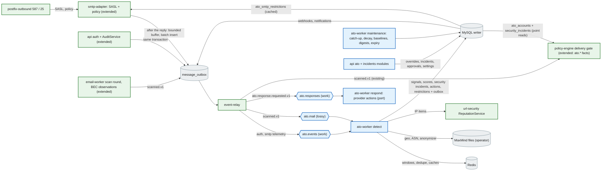

# Step 8.4: Account takeover (ATO) detection core

**Status:** designed by the architect on 2026-11-16 on commit `f0f9da4` (step 7.2 committed, **not complete**: CI and a cluster apply pending). **Gap analysis and design approved by the product owner on 2026-11-16 with the defaults recorded in §0** (off by default and enabled per organization by a platform operator; operator-provided MaxMind GeoLite2 City/ASN data later, synthetic test database now, Anonymous IP optional; ATO risk fields in the policy language now; one security incident model shared with ATP; IP and indicator lookups only through url-security's `ReputationService`; build order 7.3 → 8.1 → 8.4). Revised the same evening for those decisions. **Implemented and verified locally on 2026-11-18 (WP1–WP6; §13, §14); not committed; CI and a Kubernetes cluster apply not done; identity-provider adapters are step 8.5.** Steps 7.3 (policy builder, [22-policy-builder.md](22-policy-builder.md), ADR-0063) and 8.1 (journaling and archiving, [23-journaling-archiving.md](23-journaling-archiving.md), ADR-0064–0069, topology v12, contracts §31) are **committed before 8.4 starts**; 8.4 builds on them and never on their uncommitted state. §13 (deviations) and §14 (verification) are filled by the work packages.

**Brief (product owner, authoritative):** [docs/plan/briefs/account-takeover-ato.md](../briefs/account-takeover-ato.md), sections 1–16. **Scope of 8.4:** everything in the brief except the identity-provider-specific adapters for Microsoft Entra ID / Microsoft 365 and Google Workspace (step 8.5, on the provider-integration framework of step 8.2, not built yet). 8.4 delivers the gap analysis (§1), the architecture (§2), gateway-observed ATO sources, the detection engine, account risk scoring, incidents on the security incident model shared with ATP, the response framework with the responses the gateway enforces itself, ATO risk fields in the policy language (held or quarantined through the existing delivery gate), the provider-neutral adapter port with its contract tests and a local fake adapter, RabbitMQ and Redis integration, the API, the admin portal pages, notifications, reports, monitoring and the tests of brief §14 that need no real identity provider.

**ADRs of the step** (full text in §7; created by WP1 on 2026-11-18 as **ADR-0070–0075** (after 8.1's 0064–0069; 8.2 and 8.5 claim 0076 onwards); the placeholders ADR-ATO-1 … ADR-ATO-6 of the design were replaced by these numbers in this note (mapping in the table and §13 WP1)):

| Placeholder                                                                               | File (WP1 picks `NNNN`)                          | Decision                                                                                                                                                                                                         |
| ----------------------------------------------------------------------------------------- | ------------------------------------------------ | ---------------------------------------------------------------------------------------------------------------------------------------------------------------------------------------------------------------- |
| ADR-ATO-1 → [0070](../../architecture/adr/0070-ato-account-and-event-model.md)            | `0070-ato-account-and-event-model.md`            | Monitored subjects without new user/tenant tables; source events and their producers; the `ato-worker` and its three queues (a lossy mail feed with catch-up); the provider port (8.5)                           |
| ADR-ATO-2 → [0071](../../architecture/adr/0071-ato-detection-scoring-and-incidents.md)    | `0071-ato-detection-scoring-and-incidents.md`    | Explainable rules, statistical baselines and correlation; integer account score with decay, caps and floors; per-tenant settings; overrides; one active ATO incident per account on the shared incident model    |
| ADR-ATO-3 → [0072](../../architecture/adr/0072-ato-response-safeguards-and-approvals.md)  | `0072-ato-response-safeguards-and-approvals.md`  | Response catalogue, impact levels, approvals with separation of duties, automation conditions, rollback, idempotency, provider-confirmed status                                                                  |
| ADR-ATO-4 → [0073](../../architecture/adr/0073-ato-enforcement-smtp-and-policy-facts.md)  | `0073-ato-enforcement-smtp-and-policy-facts.md`  | Sending restrictions and SMTP authentication blocks in the smtp-adapter policy and SASL services; ATO risk fields in `policy-dsl/1` so tenant policies hold or quarantine through the existing delivery gate     |
| ADR-ATO-5 → [0074](../../architecture/adr/0074-ato-geolocation-and-ip-intelligence.md)    | `0074-ato-geolocation-and-ip-intelligence.md`    | Operator-provided MaxMind databases, honest degradation, synthetic test database; anonymizer only from a reliable source; IP reputation only through `ReputationService`; breach intelligence from platform data |
| ADR-ATO-6 → [0075](../../architecture/adr/0075-security-incident-model-shared-ato-atp.md) | `0075-security-incident-model-shared-ato-atp.md` | One security incident model (`security_incidents`, events, links; categories, subjects, six states) shared by ATO now and ATP later; category handlers; generic incidents API with per-category permissions      |

This note is the single source for the step. Implementers see only their own work-package instructions plus this note; every name, key, table, column, event, queue, route, permission, metric and file below is binding unless an implementer records a deviation (§13) with evidence. Decision ids (PO*n*, D*n*) and section numbers are stable references.

---

## 0. Product-owner decisions (2026-11-16)

| #   | Decision (approved)                                                                                                                                                                                                                                                                                                       | Where in this design        |
| --- | ------------------------------------------------------------------------------------------------------------------------------------------------------------------------------------------------------------------------------------------------------------------------------------------------------------------------- | --------------------------- |
| PO1 | ATO is **off by default for every plan and organization**; a platform operator enables it per organization (`PUT /organizations/{id}/features/ato_detection`)                                                                                                                                                             | D21                         |
| PO2 | MaxMind **GeoLite2 City and ASN** data is provided by the operator later; tests use the synthetic database; the **Anonymous IP** database stays optional. Until the data is mounted every geographic rule is honestly `unavailable`                                                                                       | D7, ADR-0074                |
| PO3 | **ATO risk fields in the policy language now**: outbound and internal mail from an account whose ATO risk or incident severity crosses a tenant policy condition can be held or quarantined through the existing delivery gate, in addition to the direct SMTP sending restriction. Built on the 7.3 catalogue (ADR-0063) | D23, ADR-0073, §5.3         |
| PO4 | **One security incident model shared with ATP** (ATP gap analysis §5 D15; 8.4 starts first and builds it): generic `security_incidents`, `security_incident_events`, `security_incident_links` with a category and a subject; ATO detail in ATO tables; a generic incidents API and pages that ATP categories plug into   | D24, ADR-0075, §3, §5.2, §6 |
| PO5 | **IP reputation** stays behind url-security's `ReputationService`, so ATP-1's threat-intelligence platform (feeds, tenant indicators, confidence and trust gating; ATP gap analysis §4.3) plugs in without ATO changes                                                                                                    | D7 ("Reputation contract")  |
| PO6 | **Numbering and order:** build order 7.3, 8.1, 8.4. 8.1 takes ADR-0064–0069, topology v12 and contracts §31; 8.4 takes the next ADR numbers after 0069, the topology version after 12 and the next contracts section at implementation time; WP1 creates the ADR files                                                    | Header, §4.1, §13           |
| PO7 | At most six work packages in sequential waves with disjoint files                                                                                                                                                                                                                                                         | §12                         |

---

## 1. Gap analysis (brief §1; inspected read-only at `f0f9da4` plus the working tree and the 7.3/8.1 designs on 2026-11-16)

### 1.1 The ten inspections of brief §1

| #   | Brief item                                         | What exists (evidence)                                                                                                                                                                                                                                                                                                                                                                                                                                                                                                                                                                                                                                                                                                                                                                                                                                 | Decision for ATO                                                                                                                                                                                                                                                                                                                                                                                                                                                                                         |
| --- | -------------------------------------------------- | ------------------------------------------------------------------------------------------------------------------------------------------------------------------------------------------------------------------------------------------------------------------------------------------------------------------------------------------------------------------------------------------------------------------------------------------------------------------------------------------------------------------------------------------------------------------------------------------------------------------------------------------------------------------------------------------------------------------------------------------------------------------------------------------------------------------------------------------------------ | -------------------------------------------------------------------------------------------------------------------------------------------------------------------------------------------------------------------------------------------------------------------------------------------------------------------------------------------------------------------------------------------------------------------------------------------------------------------------------------------------------- |
| 1   | The complete repository                            | At `f0f9da4`: 13 deployables (`apps/*`), 21 packages, 121 tables (33 partitioned, 28 migrations, last `email_explorer_search`), topology v11 (6 exchanges, 21 quorum queues, 10 role users), 60 permissions, 277 `/api/v1` operations, admin portal with 22 pages (7.1) and the explorer/details (7.2). **At 8.4 start** (7.3 and 8.1 committed, per their notes): 279+ operations (7.3 adds `POST /policies/validate` and `POST /policies/dry-run`; 8.1 adds its archive routes), 132 tables (35 partitioned), 64 permissions, topology v12 (`email.archive` lossy work queue, 11 role users), ADRs to 0069, contracts to §31, the DSL catalogue with presentation metadata (`packages/policy-dsl/src/presentation.ts`) and `docs/api/policy-catalog.json`.                                                                                           | Build on it. Every count in this note is "the value in the tree at implementation time + the ATO delta", computed by the implementer.                                                                                                                                                                                                                                                                                                                                                                    |
| 2   | Authentication and login mechanisms                | `apps/api/src/modules/auth`: Argon2id passwords, JWT access + rotating refresh sessions (`user_sessions`, reuse detection, Redis deny-list), TOTP MFA and recovery codes, account lockout and per-IP failure block (`LoginThrottleService`, Redis `auth:fail:*` mirrored to `users.locked_until`), `login_audit_logs` (one row per login/MFA attempt including unknown accounts: email attempted, outcome, failure reason, IP, user agent; purged after `AUTH_LOGIN_AUDIT_RETENTION_DAYS`), `audit_logs` actions for credential, session and persistence changes (`apps/api/src/audit/audit.service.ts`), API keys (`X-API-Key`), the audited platform override, the trusted client-IP forwarder of the portal BFF (ADR-0060). Rows are written outside the login transaction by `LoginAuditService` (best effort).                                    | **Reuse** as the source of portal and API login telemetry. **Extend** two write paths: the `login_audit_logs` insert also writes an outbox event in the same transaction (`auth.login.recorded.v1`), and `AuditService.record` writes `auth.account.changed.v1` for a fixed allow-list of credential, session, persistence and data-access actions. No second login log, no change to lockout, throttling, MFA or sessions.                                                                              |
| 3   | User, tenant, domain and mailbox models            | `organizations` (+ settings, limits, plan-materialized `organization_features`), `users` (portal accounts, unique per organization), `domains`, `domain_recipient_addresses` (an optional recipient allow-list, not a mailbox registry), `smtp_connectors` (organization-level relay credentials: `sasl` with a generated `egc-…` username, `source_ip`, `client_certificate`), BEC executive/vendor profiles. **There is no mailbox table**: tenant mailboxes exist only as addresses in mail metadata (`email_messages.envelope_from`, `header_from`, recipients).                                                                                                                                                                                                                                                                                   | **No new user, tenant, domain or mailbox table.** An ATO "account" is a monitored subject (D1) that references `users.id`, `smtp_connectors.id` or a tenant mailbox address; display data is joined live from the owning tables.                                                                                                                                                                                                                                                                         |
| 4   | SMTP authentication mechanisms                     | `postfix-outbound` 587 (STARTTLS + SASL) → smtp-adapter Dovecot-auth server (`SaslServerService`, `ConnectorAuthService`): PLAIN/LOGIN over TLS only, connector looked up by `sasl_username`, Argon2id, per-IP failure throttle (`sa:authfail:{ip}`), 2 s failure delay, temporary failures close the connection. Outcomes exist only in logs and `smtp_sasl_auth_total{mech,result}`: **no durable SASL record**. The SASL identity is a connector, not a mailbox; `smtpd_sasl_authenticated_header=no`. Policy delegation (contexts `submission`/`relay` at RCPT and END-OF-MESSAGE) knows the connector, sender, recipients and the Postfix queue id. The stored outbound message has the client IP but **not** the connector.                                                                                                                      | **Extend** the smtp-adapter (no new SMTP component, no Postfix configuration change): asynchronous AUTH and submission telemetry recorded after the reply (never on the reply path, D4), and the two enforcement points of ADR-0073 (sending restriction in the policy service, authentication block in the SASL service).                                                                                                                                                                               |
| 5   | Email ingestion and delivery pipelines             | LMTP ingestion (`mail.message.received.v1`), MIME parse, scan round → `mail.message.scanned.v1` (direction, engines, union of reason codes, outbox in the round-completion transaction), risk score (`message_risk_scores`), policy-engine delivery gate (5.2/5.3: `policy-input/1` assembled from the round's rows by `buildPolicyInput`, evaluated per recipient, stored in `policy_execution_logs` with `inputSha256`, reproduced by the api dry-runs of 7.3), quarantine (5.3), delivery-worker. Per-recipient direction (`email_recipients.direction`: `outbound`/`internal`). The event-relay blocks an aggregate while one of its rows is nacked; a full `reject-publish` queue nacks every publish routed to it.                                                                                                                               | **Reuse** `mail.message.scanned.v1` as the durable per-message source of outbound behaviour and findings, consumed from a **lossy** queue so ATO can never back-pressure the mail path, with a catch-up job that re-reads `email_messages` (D3). **Extend** the delivery gate only through the DSL: four `ato.*` fields whose facts the policy-engine reads from the ATO tables in its evaluation transaction and stores with the evaluation (D23). No change to ingestion, scanning order or the floor. |
| 6   | Security scanning and risk scoring engines         | Rspamd (spam/phishing codes, all directions), URL engine (`url.phishing_*`, credential forms, lookalikes, DNSBL), attachment engine (ClamAV, YARA, known hashes), sandbox (execution disabled), DLP (23 detectors incl. financial identifiers, outbound), BEC engine (deterministic rules, lexicons, link rules; **inbound only**: outbound/internal mail is `skipped` with `bec.not_inbound` and only the opt-in history pairs are updated, step 4.4 B1), risk scoring 5.1 (message level, integer, versioned profiles), threat intelligence: platform `threat_indicators` (types `ip`, `domain`, `url`, `email`, `file_sha256`), `@email-gateway/url-security` `ReputationService` (`lookup(items, signal)` over providers `local_feed` (uncached), `dnsbl`, `rdap`; breakers; HMAC-authenticated Redis cache); the `ip_reputation` table is unused. | **Reuse** the engines' findings as signals. **Extend** the BEC engine with outbound **observations** (lexicon intent categories and link rules on outbound text, recorded in a new column, verdict and reason codes unchanged; D6) — this is the "one outbound mode" of ATP gap analysis §3.11, owned by 8.4 and extended by ATP-7. **Reuse** `ReputationService` for every IP lookup (PO5, D7); no new engine, no second phishing/BEC detector, no new reputation store.                                |
| 7   | Audit logs, notification services, incidents       | `audit_logs` (partitioned, compliance, `AuditService` scrubs credentials), `login_audit_logs`, notification-worker (`notification.alert_requested.v1`, throttle windows `notification_alert_windows`, per-user preferences `PREFERENCE_KINDS` in `packages/webhooks/src/notifications.ts`, templates, SMTP via `postfix-notify`), webhook-worker (10 metadata-only public types, `EG-Signature`, retries, replay). **No incident lifecycle exists**: "DLP incidents" (`GET /dlp/incidents`) are a read view over `dlp_scan_results` without states, assignment or notes.                                                                                                                                                                                                                                                                               | **Reuse** `audit_logs` for every ATO administrative and automated action (no `ato_audit_logs`). **New, shared:** the security incident model of D24 (PO4) — ATO is its first category; ATP-4 adds its categories later. **Extend** notifications (one ATO event, ATO kinds, templates, preferences) and webhooks (two generic incident types and two ATO types projected by the existing fanout). The DLP view is not migrated in 8.4 (§11).                                                             |
| 8   | API and frontend architecture                      | `/api/v1` conventions of 6.1 (coded errors, strict schemas, signed tenant-bound v1 cursors, rate classes, Idempotency-Key, route inventory, coverage manifests, OpenAPI snapshot), RBAC by permission keys (`RequirePermissions`, `RequireAnyPermission`), tenant scope from the principal; admin portal (Next.js, same-origin BFF, generated client with drift check, design system, dev fixture mode, Playwright suite); the 7.3 policy builder renders every DSL field from `GET /policies/catalog` (labels, groups, units, contexts) and never evaluates policy logic in the browser (ADR-0063).                                                                                                                                                                                                                                                   | New api modules `ato` and `incidents` and new portal pages following every convention (§5, §6); the policy builder gets the ATO fields through the catalogue only, plus an ATO section in its synthetic-facts form.                                                                                                                                                                                                                                                                                      |
| 9   | MySQL tables and migrations                        | 132 tables at 8.4 start (35 partitioned; monthly `RANGE COLUMNS`, composite keys, no foreign keys on partitioned tables, partition registry with retention), read/write split (data plane on the writer only), Prisma wrong-read mitigation (writer reads echo-checked, transaction budgets ≥ 120 s). No ATO or incident table exists.                                                                                                                                                                                                                                                                                                                                                                                                                                                                                                                 | Two forward migrations: `security_incidents` (3 shared tables) and `account_takeover` (16 ATO tables, 4 partitioned; one column on `bec_scan_results`, one on `policy_execution_logs`) (§3).                                                                                                                                                                                                                                                                                                             |
| 10  | Integration points for external identity providers | None implemented: step 8.2 (M365 / Google Workspace connectors) is not built; Microsoft 365 / Google Workspace exist only as destination presets; the `sso` feature flag has no implementation; today's integration surfaces are API keys and SMTP connectors.                                                                                                                                                                                                                                                                                                                                                                                                                                                                                                                                                                                         | A provider-neutral port, an ingestion runner, the response path for provider actions, a contract test kit and a local fake adapter in 8.4 (D15); 8.5 adds only adapters and their bindings to 8.2's connectors.                                                                                                                                                                                                                                                                                          |

### 1.2 Reuse, extend, new

| Component                                                      | Verdict         | What 8.4 does                                                                                                                                                                                                   |
| -------------------------------------------------------------- | --------------- | --------------------------------------------------------------------------------------------------------------------------------------------------------------------------------------------------------------- |
| api auth (logins, lockout, MFA, sessions)                      | Reuse           | Unchanged behaviour; `login_audit_logs` insert + outbox event in one transaction; a channel marker (portal vs direct API) from the trusted forwarder                                                            |
| `audit_logs` / `AuditService`                                  | Extend          | Outbox event for an allow-list of actions (same transaction); ATO and incident actions are audited here                                                                                                         |
| smtp-adapter SASL and policy services                          | Extend          | Telemetry after the reply; sending restrictions (policy) and authentication blocks (SASL), cached, fail closed                                                                                                  |
| Scan pipeline, risk scoring 5.1                                | Reuse           | Read-only consumers of `scanned.v1`, scan rows and risk rows                                                                                                                                                    |
| Policy DSL, policy-engine, policy builder (5.2/5.3/7.3)        | Extend          | Four `ato.*` fields with presentation metadata (catalogue), a `strictOnly` field attribute, an optional `ato` block in `policy-input/1`, the facts reader in the policy-engine, stored facts for dry-runs (D23) |
| BEC engine (4.4)                                               | Extend          | Outbound observation mode (no verdict change)                                                                                                                                                                   |
| URL/IP reputation (`url-security`)                             | Reuse           | `ReputationService` for IP items; the cache gains a key namespace option (ATO entries never collide with URL entries)                                                                                           |
| `threat_indicators`                                            | Reuse           | `ip` rows (through `ReputationService`'s local feed); `email` rows (platform scope) as breach intelligence, loaded by an operator importer (D7)                                                                 |
| notification-worker, alert windows, preferences                | Extend          | New event `ato.notification.requested.v1`, kinds, templates, opt-outs                                                                                                                                           |
| webhook-worker, `@email-gateway/webhooks`                      | Extend          | Four public types: `security.incident.created`, `security.incident.updated`, `ato.account.risk_changed`, `ato.response.completed`                                                                               |
| event-relay, outbox, `processOnce`, consumer library, topology | Reuse/extend    | New events registered; three new queues and bindings (next topology version after 8.1's v12); one new broker user                                                                                               |
| api conventions, RBAC, OpenAPI, portal shell                   | Reuse           | New `ato` and `incidents` modules, four permissions, new pages                                                                                                                                                  |
| Security incidents                                             | **New, shared** | `@email-gateway/security-incidents` (`packages/security-incidents`): vocabulary, state machine, transactional `IncidentStore`, category-handler registry; 3 generic tables; generic API and pages (D24)         |
| ATO detection library                                          | **New**         | `@email-gateway/ato-detection` (`packages/ato-detection`): rules, windows, baselines, scoring, explanations, response machine, transactional ATO store, GeoIP reader, provider port, test kit                   |
| ATO worker                                                     | **New**         | `apps/ato-worker` (roles `detect`, `respond`, `maintenance`, `provider`)                                                                                                                                        |
| ATO tables                                                     | **New**         | 16 tables (§3)                                                                                                                                                                                                  |

### 1.3 What is NOT duplicated (explicit)

- No second login log, lockout, MFA, session store or API-key mechanism; `login_audit_logs` stays the system of record for sign-in auditing (365 days, raw user agent, attempted e-mail). `ato_auth_events` is an enriched 90-day projection (geolocation, ASN, device family, reputation) that also carries SMTP and identity-provider authentications in one shape; it never stores the attempted e-mail of an unknown account.
- No new user, tenant, domain or mailbox table (D1).
- No second phishing, URL, attachment, DLP or BEC detector: ATO consumes their findings; outbound lexicon matching runs inside the BEC engine.
- No second IP reputation store, feed or lookup path and no `ato_ip_reputation_cache` table: every IP lookup goes through `ReputationService` (PO5).
- No `ato_device_profiles` table: device history is the account baseline plus `ato_auth_events`.
- No `ato_audit_logs` table: `audit_logs` (administrative and automated actions) plus `security_incident_events` (the investigation timeline the portal shows).
- **No ATO-specific incident system** (`ato_incidents`, `ato_incident_events` are not created): incidents are rows of the shared model with category `account_takeover`; ATO-only incident fields live in `ato_incident_details` (D24). ATP-4 reuses the same tables, store, API and pages.
- No `ato_detection_rules` table: the rule catalogue is versioned code (`ato-rules/1`); tenants tune it through bounded settings (no tenant-defined logic is executed).
- **No second policy evaluation path:** tenant holds on ATO risk are ordinary `policy-dsl/1` rules evaluated by the existing engine and floor; the builder, validator, test and dry-run routes of 7.3 are reused (D23).
- No copy of outbound messages: messages are referenced by `(id, received_at)`; ATO keeps daily per-account aggregates only.
- No second notification channel or webhook delivery: ATO requests alerts from the notification-worker and is projected by the webhook-worker fanout.
- No new SMTP daemon and no Postfix change: enforcement lives in the existing smtp-adapter services.
- No approval system copied from quarantine: an ATO approval is a state of the response action (the quarantine approval model of 5.3 is message-specific); the separation-of-duties rule is the same.

### 1.4 Constraints found during inspection

1. **Build order 7.3 → 8.1 → 8.4 (PO6).** At 8.4 start 7.3 and 8.1 are committed. 8.4 extends their committed files additively (the DSL package, the policies api module, the policy-engine evaluation, the builder's synthetic-facts form, the topology, the ADR index, the execution plan). Generated files (`docs/api/openapi.json`, `docs/api/policy-catalog.json`, `apps/admin-portal/src/lib/api/*.gen.ts`, `infrastructure/rabbitmq/definitions.json`) are regenerated from the tree, never hand-edited.
2. **Numbers from 8.1:** ADR-0064–0069, topology v12 (`email.archive` becomes a lossy work queue, policy `work-lossy` with dead-lettered heads), contracts §31, 64 permissions, 132 tables. 8.4 expects ADR-0070–0075, topology v13, contracts §32 and recomputes them at implementation (§13). 8.4 uses no archive, journal or legal-hold object.
3. **The policy DSL is versioned data.** `POLICY_FIELDS` is closed; field names are stable; a removed or changed field is a new DSL version; adding a field is additive within `policy-dsl/1`. `policy-input/1` is a strict schema and its canonical SHA-256 is stored per evaluation (`policy_execution_logs.input_sha256`) and reproduced by dry-runs; therefore the ATO block is an **optional** key, absent for every evaluation without ATO facts, so every stored hash stays reproducible (D23).
4. **Local data.** The local MySQL holds the product owner's own platform super-admin account. The `ato_detection` feature is **off** for every existing organization (no plan default, no backfill, D21), so no detection rule, policy fact or response ever applies to it; tests create synthetic organizations only.
5. **Event-relay ordering.** A nacked publish blocks its aggregate; therefore ATO events use their own aggregate types (D2) and the high-volume mail feed is lossy (D3).

### 1.5 Requirement traceability (brief §3–§15)

Legend: **Built** = implemented and tested in 8.4; **Built, operator data** = implemented, active only when the operator provides a database or feed; **Port (8.5)** = rule, port, runner and tests with the fake adapter in 8.4, real telemetry from the 8.5 adapters; **Not available** = no reliable source exists, stated in the product.

| Brief requirement                                                                                                                                                            | Design                                                                                                        | 8.4 status                                       |
| ---------------------------------------------------------------------------------------------------------------------------------------------------------------------------- | ------------------------------------------------------------------------------------------------------------- | ------------------------------------------------ |
| §3A multiple failed logins; success after failures                                                                                                                           | A1, A2 (portal, API, SMTP AUTH; IdP sign-ins via the port)                                                    | Built                                            |
| §3A new IP; unusual device or browser; unusual login time                                                                                                                    | C1, C3, C4                                                                                                    | Built                                            |
| §3A unusual geography; impossible travel; geographically inconsistent sessions                                                                                               | G1, G2, G3 (GeoIP City)                                                                                       | Built, operator data (MaxMind, PO2)              |
| §3A VPN / proxy / anonymizer (never proof alone)                                                                                                                             | G4 weak, capped by the weak-only rule (D11)                                                                   | Built, operator data (Anonymous IP DB, optional) |
| §3A known malicious IPs                                                                                                                                                      | T1 (platform threat feed via `ReputationService`), T2 (ATO DNSBL zones)                                       | Built (T2: operator-configured zones)            |
| §3A unexpected changes in authentication patterns                                                                                                                            | C5, C6, A3, K1–K3, X2                                                                                         | Built                                            |
| §3B breach intelligence                                                                                                                                                      | T4 over platform `email` indicators loaded by the importer                                                    | Built, operator data                             |
| §3B exposed-credential attempts; spraying; brute force; stuffing; suspicious ranges; unusual success rates                                                                   | A1, A2, T3, T5, T6 and the platform IP campaign windows (D8)                                                  | Built                                            |
| §3C unusual volume; sudden increase; abnormal frequency; unusual recipients and external activity; attachment distribution                                                   | O1–O5                                                                                                         | Built                                            |
| §3C suspicious SMTP authentication                                                                                                                                           | Connector rules A1, A2, C1, C6, G1, T1, T3, X3                                                                | Built                                            |
| §3C unexpected mailbox access; forwarding; inbox rules; delegates; OAuth consent/tokens                                                                                      | M1–M4, Q1, Q2, X5                                                                                             | Port (8.5)                                       |
| §3D unusual sender behaviour; subject patterns; bulk; reply chains; financial language; communication change; external communication; phishing from an authenticated account | O1, O3, O5, O7, O9, O10, P1–P5, X1, X4                                                                        | Built (P4 needs the BEC observation mode, D6)    |
| §4 engine: rules, baselines, anomaly, threat intel, correlation, scoring; no LLM authority                                                                                   | D9–D11; no LLM or ML in 8.4                                                                                   | Built                                            |
| §5 score 0–100, bands per tenant, signals stored, reasons, weights, decay, dedupe, baselines, explanations, analyst override                                                 | D11, D12, `ato_risk_signals`, `ato_risk_scores`, `ato_risk_overrides`                                         | Built                                            |
| §6 incident fields, six states, audit trail                                                                                                                                  | D12, D24, `security_incidents`, `security_incident_events`, `security_incident_links`, `ato_incident_details` | Built                                            |
| §7 alert; notify admins; notify SOC; escalate; restrict SMTP sending; block SMTP auth                                                                                        | D13, D14                                                                                                      | Built                                            |
| §7 hold or quarantine outbound mail of a risky account (PO3)                                                                                                                 | D23 (tenant policy over `ato.*` fields through the delivery gate)                                             | Built                                            |
| §7 require MFA; revoke sessions/tokens; suspend; password reset; remove forwarding rules                                                                                     | Provider action types through the port (D15)                                                                  | Port (8.5)                                       |
| §7 safeguards: no single weak signal, thresholds, approvals, rollback, recorded, idempotent, provider confirmation                                                           | D11 gates, D13                                                                                                | Built                                            |
| §8 provider-specific adapters; differing capabilities                                                                                                                        | D15 capability model                                                                                          | Port (8.5)                                       |
| §9 tables, tenant-aware indexes, dedupe, retention, score history, no secrets, migrations, partitioning                                                                      | §3, D22                                                                                                       | Built                                            |
| §10 RabbitMQ events, Redis uses, durable queues, retries, dead letters, idempotent consumers                                                                                 | D2, D3, D8                                                                                                    | Built                                            |
| §11 dashboard, account explorer, incident management, policy configuration                                                                                                   | §6                                                                                                            | Built (mailbox-change views show an 8.5 state)   |
| §12 e-mail alerts, dashboard notifications, webhooks, incident reports, daily/weekly summaries, critical alerts, no credentials                                              | D16                                                                                                           | Built                                            |
| §13 monitoring list; never block the SMTP critical path; asynchronous detection                                                                                              | D19, D3, D4                                                                                                   | Built (dashboards: step 10.3)                    |
| §14 tests 1–8, 11, 12, 14, 16–20                                                                                                                                             | §10                                                                                                           | Built                                            |
| §14 tests 9, 10, 13, 15 (forwarding, OAuth, session revocation, IdP failures)                                                                                                | Fake adapter through the real runner and response path (§10)                                                  | Built against the fake; real providers 8.5       |
| §15 "identity-provider integrations functional where configured"                                                                                                             | None configurable before 8.2/8.5                                                                              | 8.5                                              |

---

## 2. Architecture and decisions

### 2.0 Invariants (never traded away)

1. **ATO never blocks or slows the mail path.** No ATO code runs inside an SMTP reply except the two cached restriction checks of ADR-0073. Telemetry is recorded after the reply into a bounded buffer; a full buffer drops telemetry (counted), never mail. The high-volume mail feed is a lossy queue, so a stopped ATO worker can never make the broker nack a mail event.
2. **The delivery gate never depends on the ato-worker.** The policy-engine reads ATO facts from MySQL rows (two indexed point reads in its own transaction, only for outbound/internal mail of ATO-enabled organizations, D23); a stopped worker means stale facts, never a stalled evaluation.
3. **MySQL is the source of truth; Redis holds only short-term state** (windows, dedupe markers, caches, attribution hints) with TTLs. Losing Redis loses at most in-window counts, never a signal, score, incident, restriction or action.
4. **Tenant from trusted context.** Workers take the organization from the event envelope and echo-check every row they read; the api takes it from the principal. Platform-wide IP windows hold no tenant identifier.
5. **Explainable and deterministic.** Every signal has a stable code, evidence and an explanation template; scores are integer arithmetic over stored signals with versioned rules and settings; policy facts are stored with the evaluation that used them. No LLM and no learned model decides anything in 8.4.
6. **No single weak signal drives an incident or an automated restrictive action** (D11 gates, D13 conditions). ATO policy fields may only make a decision stricter (`strictOnly`, D23).
7. **Never claim what did not happen.** A provider action is `succeeded` only on provider confirmation; a gateway restriction is `applied` (written to the enforcement table the SMTP adapters read); a notification is `queued`, never "delivered".
8. **No secrets, no message content.** No password, SASL secret, token, MFA code, raw attempted SMTP username, subject, body, attachment or recipient address is stored in an ATO or incident table, event, log, metric or notification. ATO never reads object storage.
9. **Idempotent everywhere**: `processOnce` ledgers, deterministic keys, unique keys, idempotent window updates, state-machine transitions under row locks.
10. **Safe by default**: the feature is off until a platform operator enables it per organization (PO1), tenants start in `monitor` mode with a learning period, high-impact automation is off until a tenant enables it, platform-organization and protected accounts are never acted on automatically.

### 2.1 Brief roles (Agents 2–9) mapped to work packages

| Agent (brief §2)      | Work packages (§12)                                                                                   |
| --------------------- | ----------------------------------------------------------------------------------------------------- |
| 1 Principal Architect | This note; WP1 (ADRs); reviews of every WP                                                            |
| 2 Backend Developer   | WP5 (api `ato` + `incidents`, notifications, webhooks), WP3 (auth producers, policy facts in the api) |
| 3 Database Engineer   | WP1 (schema, migrations, partitions, retention), WP5 (query plans)                                    |
| 4 SMTP Engineer       | WP3 (smtp-adapter telemetry and enforcement)                                                          |
| 5 Processing Engineer | WP1 (events, topology), WP2 (windows, stores), WP3 (policy-engine facts), WP4 (worker)                |
| 6 Security Engineer   | WP2 (rules, baselines, scoring, recommendations), WP3 (BEC observations, DSL fields)                  |
| 7 Frontend Developer  | WP6 (portal pages, incident pages, builder ATO facts)                                                 |
| 8 DevOps Engineer     | WP4 (deployment, monitoring, GeoIP), WP6 (stack runs, cluster suite)                                  |
| 9 QA Engineer         | Tests in every WP; WP6 (end-to-end, Playwright, regression)                                           |

### 2.2 Data flow



### D1. Monitored subjects ("accounts") without new user or tenant tables (ADR-0070)

An ATO account is one row of `ato_accounts` per monitored subject of one organization. Three kinds exist in 8.4:

| Kind             | Subject key (`subject_hash` = SHA-256 of the string) | Where it comes from                                                                                     | Display                                                          |
| ---------------- | ---------------------------------------------------- | ------------------------------------------------------------------------------------------------------- | ---------------------------------------------------------------- |
| `mailbox`        | `mailbox:<lower-cased full address>`                 | Envelope sender of an outbound or internal message, or (8.5) the primary address of a provider identity | The address (stored, it has no other table)                      |
| `gateway_user`   | `user:<users.id>`                                    | Portal and direct-API logins and audited account actions of a `users` row                               | `users.email`, `display_name` joined live                        |
| `smtp_connector` | `connector:<smtp_connectors.id>`                     | SASL AUTH and submissions of a connector                                                                | `smtp_connectors.name`, `auth_type`, `sasl_username` joined live |

- **Why three kinds:** they are three different credentials. A tenant mailbox (its M365/Google password) is never seen by the gateway; its compromise shows in what it sends (and, in 8.5, in provider sign-ins). A portal user is a gateway credential with its own sign-ins. A SASL connector is a relay credential shared by a tenant's mail server or application; its compromise shows in SASL authentications and in the identities it sends as.
- **Linking.** A `gateway_user` and a `mailbox` with the same address in the same organization are the same person for correlation (X1) and for display ("also a portal user"); they keep separate scores because they are separate credentials. 8.5 maps provider identities to `mailbox` accounts through `ato_account_identities`.
- **No duplication of the directory:** `ato_accounts` stores no name, status, role, password or MFA data; `user_id` and `connector_id` have no foreign keys (the trail survives deletion), the maintenance role marks accounts `retired` when their user or connector is deleted.
- **The subject hash function** `atoSubjectHash(kind, subject)` lives in `@email-gateway/security-contracts` (WP1) so the ATO library, the smtp-adapter and the policy-engine compute identical keys without depending on each other.
- **API keys are not accounts in 8.4** (no per-request telemetry); their creation is a signal on the creating user (K4). Recorded limitation (§11).
- **Address normalization:** the full address lower-cased (local part and domain), no sub-address stripping (`a+x@` and `a@` are different accounts; recorded limitation).

### D2. Event model and contracts (ADR-0070, ADR-0075)

Source events are named after the producing domain, not after their consumer, so other consumers (SIEM export, analytics) can use them; ATO outputs use the brief's `ato.*` names with `.v1`; incident events are generic (`security.incident.*`) because ATP categories reuse them. All payloads are strict zod schemas in `@email-gateway/event-contracts`, ids as decimal strings, written through `message_outbox` and published by the event-relay. New outbox aggregate types keep ATO and incident rows out of other aggregates' ordering chains.

| Event (registry)                | Exchange         | Aggregate type (`aggregate_id`)                | Producer (transaction)                                                                                            | Bound to                                            |
| ------------------------------- | ---------------- | ---------------------------------------------- | ----------------------------------------------------------------------------------------------------------------- | --------------------------------------------------- |
| `auth.login.recorded.v1`        | `email.events`   | `login` (`login_audit_logs.id`)                | api `LoginAuditRepository.insert` (same transaction as the row)                                                   | `ato.events`                                        |
| `auth.account.changed.v1`       | `email.events`   | `audit` (`audit_logs.id`)                      | api `AuditService.record` for `ATO_ACCOUNT_CHANGE_ACTIONS` (same client/transaction as the audit row)             | `ato.events`                                        |
| `smtp.auth.recorded.v1`         | `email.events`   | `smtp_telemetry` (organization id)             | smtp-adapter telemetry flusher (batch of ≤ 200 AUTH decisions of one organization)                                | `ato.events`                                        |
| `smtp.submission.recorded.v1`   | `email.events`   | `smtp_telemetry` (organization id)             | smtp-adapter telemetry flusher (batch of ≤ 200 accepted submissions at END-OF-MESSAGE)                            | `ato.events`                                        |
| `ato.account.risk.updated.v1`   | `email.security` | `ato_account` (`ato_accounts.id`)              | ATO store (worker or api) when the level changes                                                                  | `email.webhooks`                                    |
| `security.incident.created.v1`  | `email.security` | `security_incident` (`security_incidents.id`)  | `IncidentStore` (worker or api), every category                                                                   | `email.webhooks`                                    |
| `security.incident.updated.v1`  | `email.security` | `security_incident`                            | `IncidentStore` (status, severity, assignee, resolution; evidence additions at most once per 15 min per incident) | `email.webhooks`                                    |
| `ato.response.requested.v1`     | `email.security` | `ato_response` (`ato_response_actions.id`)     | ATO store, **provider actions only** (execute, rollback)                                                          | `ato.responses`                                     |
| `ato.response.completed.v1`     | `email.security` | `ato_response`                                 | ATO store on every terminal state (gateway actions inline, provider actions by the respond role)                  | `email.webhooks`                                    |
| `ato.restriction.changed.v1`    | `email.security` | `ato_restriction` (`ato_smtp_restrictions.id`) | ATO store (applied, lifted) and the expiry sweeper                                                                | none (smtp-adapter outbox tail; analytics firehose) |
| `ato.notification.requested.v1` | `email.security` | `ato_notification` (organization id)           | ATO store (first event of a throttle window)                                                                      | `email.notifications`                               |

Consumed existing event: `mail.message.scanned.v1` (`email.security`) on `ato.mail` (and, unchanged, on the policy-engine's queue).

Why not the brief's names for every event: `ato.login.failed` / `ato.login.success` / `ato.login.detected` are one fact with an outcome field (`auth.login.recorded.v1`), a type per outcome would double the contracts and bindings with no routing benefit; `ato.authentication.anomaly`, `ato.mailbox.activity.detected` and `ato.outbound.anomaly.detected` are detection results with no consumer that needs them as messages, so they are persisted signals (`ato_risk_signals`) exposed through the API and summarized by `ato.account.risk.updated.v1` and the incident events; `ato.incident.created` / `updated` become `security.incident.created.v1` / `updated.v1` with `category: 'account_takeover'` (PO4: one incident event family for ATO and ATP). Mailbox activity from providers arrives through the port (D15), not the broker.

Payloads (strict; `iso` = ISO 8601 UTC with ms; `decimal` = decimal id string; every string bounded):

- `auth.login.recorded.v1`: `{ loginAuditId: decimal, occurredAt: iso, outcome: 'success'|'failure'|'locked'|'mfa_required'|'mfa_failure'|'rate_limited', failureReason: string ≤ 64 | null, accountKnown: boolean, userId: decimal | null, channel: 'portal'|'api' }`. Envelope `organizationId`: the user's organization; for an unknown account the **platform organization** (`organizations.kind = 'platform'`, resolved once and cached; if absent the event is skipped and counted).
- `auth.account.changed.v1`: `{ auditLogId: decimal, auditCreatedAt: iso, action: <one of ATO_ACCOUNT_CHANGE_ACTIONS>, actorType: 'user'|'api_key'|'system', actorPublicId: uuid | null, resourceType: string ≤ 64, resourcePublicId: string ≤ 64 | null }`. Only for rows with a non-null `organization_id`.
- `ATO_ACCOUNT_CHANGE_ACTIONS` (exported constant of event-contracts, verified against the api by a WP3 test): `auth.refresh_token_reused`, `auth.password_changed`, `auth.password_reset`, `auth.mfa_enabled`, `auth.mfa_disabled`, `auth.recovery_codes_regenerated`, `session.revoked_all`, `user.mfa_reset`, `user.roles_changed`, `role.created`, `role.updated`, `user.invited`, `apikey.created`, `smtp_connector.created`, `smtp_connector.secret_rotated`, `webhook.created`, `message.revealed`, `quarantine.downloaded`, `quarantine.entry_released`, `platform.override_started`. (WP3 corrects a name that differs in the code and records it.)
- `smtp.auth.recorded.v1`: `{ producer: { instance: string ≤ 64 }, entries: [1..200] of { seq: 0..199, occurredAt: iso, result: 'ok'|'fail'|'throttled'|'blocked', mechanism: 'plain'|'login'|'unknown', connectorId: decimal | null, clientIp: canonical IP ≤ 45 | null, usernameClass: 'connector'|'unknown_generated_format'|'unknown_other', usernameHash: 16 lower-hex | null, failureReason: 'bad_credentials'|'connector_inactive'|'organization_inactive'|'malformed'|'ato_blocked'|'ip_throttled' | null } }`. `usernameHash` = first 16 hex of HMAC-SHA256(`SMTP_ATO_USERNAME_HASH_KEY`, username) **only for unknown usernames**; a known username is represented by `connectorId`. Entries of unknown usernames go into a batch of the platform organization. Infrastructure failures (`temp`) are not entries.
- `smtp.submission.recorded.v1`: `{ producer: { instance }, entries: [1..200] of { seq, occurredAt: iso, context: 'submission'|'relay', connectorId: decimal, connectorAuthType: 'sasl'|'source_ip'|'client_certificate', queueId: string ≤ 32 | null, clientIp: string ≤ 45 | null, heloName: string ≤ 255 | null, tlsProtocol: string ≤ 16 | null, senderAddress: lower-cased address ≤ 320, recipientCount: 0..10000, sizeBytes: integer ≥ 0 } }`.
- `ato.account.risk.updated.v1`: `{ accountId: decimal, accountPublicId: uuid, kind, score: 0..100, level, previousScore, previousLevel, trigger: 'signal'|'decay'|'override'|'dismissal'|'settings'|'feedback', computedAt: iso }`.
- `security.incident.created.v1`: `{ incidentId: decimal, incidentPublicId: uuid, category: 'account_takeover', subject: { type: 'ato_account', publicId: uuid }, origin: 'detection'|'manual', severity, status: 'open', detectedAt: iso, reasonCodes: codes [0..16] }` (category, subject type and origin enums are appended by later steps; consumers must ignore unknown values).
- `security.incident.updated.v1`: `{ incidentId, incidentPublicId, category, subject: { type, publicId }, status, previousStatus, severity, previousSeverity, assigned: boolean, changedFields: ('status'|'severity'|'assignee'|'resolution'|'evidence')[1..5], actorType: 'system'|'user'|'api_key', updatedAt: iso }`.
- `ato.response.requested.v1`: `{ actionId: decimal, actionPublicId: uuid, phase: 'execute'|'rollback', actionType, provider, incidentId: decimal | null, accountId: decimal, requestedAt: iso }`.
- `ato.response.completed.v1`: `{ actionId, actionPublicId, phase, actionType, provider, status: 'succeeded'|'failed'|'unsupported'|'rolled_back'|'rollback_failed'|'attested'|'rejected'|'cancelled'|'expired', providerStatus: 'applied'|'confirmed'|'unconfirmed'|'unsupported'|'failed' | null, resultCode: string ≤ 64 | null, incidentPublicId: uuid | null, accountPublicId: uuid, completedAt: iso }`.
- `ato.restriction.changed.v1`: `{ restrictionId: decimal, kind: 'send_block'|'auth_block', scope: 'mailbox'|'connector'|'connector_ip', connectorId: decimal | null, mailboxSha256: 64 hex | null, status: 'active'|'lifted'|'expired', expiresAt: iso, changedAt: iso }`.
- `ato.notification.requested.v1`: `{ kind: 'incident_alert'|'approval_requested'|'response_failed'|'digest', audience: 'tenant'|'soc'|'platform_soc', severity: 'low'|'medium'|'high'|'critical' | null, refs: { incidentPublicId?: uuid, actionPublicId?: uuid, accountPublicId?: uuid }, window: { from: iso, to: iso }, counts: { suppressedBefore: int, incidents?: int, criticalIncidents?: int, pendingApprovals?: int, restrictedAccounts?: int }, digestPeriod: 'daily'|'weekly' | null, requestedAt: iso }`; refs required per kind (incident_alert: incidentPublicId; approval_requested and response_failed: actionPublicId; digest: none).

### D3. Where detection runs: a new `ato-worker`, never on the mail path (ADR-0070)

- **New deployable `apps/ato-worker`** (`@email-gateway/ato-worker`, HTTP port 3085: probes and `/metrics` only), NestJS like the other workers, writer-only MySQL, Redis, RabbitMQ user `eg-ato`. Roles (`ATO_WORKER_ROLES`, comma list, default `detect,respond,maintenance,provider`): `detect` consumes `ato.events` and `ato.mail`; `respond` consumes `ato.responses` (provider actions); `maintenance` runs leader-elected periodic jobs (MySQL `GET_LOCK('eg:ato:<job>')`); `provider` runs the provider ingestion runner (idle until 8.5 binds providers). Compose runs all roles in one container; Kubernetes runs `ato-detect` (role `detect`, 2 replicas, scales with queue depth) and `ato-respond` (roles `respond,maintenance,provider`, 1 replica).
- **Not inside an existing worker:** the email-worker scales with mail and must keep its failure domain; the webhook-worker and notification-worker are delivery channels; the policy-engine is the delivery gate (it only _reads_ ATO facts, D23); the api serves requests. ATO has its own volume, state and scaling profile. It is a module of the gateway (same database, broker, identity, portal), not a separate application (brief "do not create a separate application").
- **Queues (topology version after 8.1's v12; v13 expected):**

| Queue           | Role / policy                                                                                                                                                                                                                                                                                                                                                                   | Home exchange    | Bindings                                                                                                                                                                                  | Consumer (ledger)                          | Retry                    | Reconciled                                     |
| --------------- | ------------------------------------------------------------------------------------------------------------------------------------------------------------------------------------------------------------------------------------------------------------------------------------------------------------------------------------------------------------------------------- | ---------------- | ----------------------------------------------------------------------------------------------------------------------------------------------------------------------------------------- | ------------------------------------------ | ------------------------ | ---------------------------------------------- |
| `ato.events`    | work, `reject-publish` at 1 000 000 (ATO-only events: a full queue only defers ATO rows in the outbox)                                                                                                                                                                                                                                                                          | `email.security` | `email.events` `org.*.auth.login.recorded.v1`, `org.*.auth.account.changed.v1`, `org.*.smtp.auth.recorded.v1`, `org.*.smtp.submission.recorded.v1`; `email.security` `retry.ato.events.#` | `ato-worker.events` (service `ato-worker`) | hold, 10, 2 s–60 s, 24 h | No (no-op acks without a ledger row)           |
| `ato.mail`      | **work, lossy without dead-lettered heads**: `overflow: drop-head`, `max-length` 500 000 (`ATO_MAIL_QUEUE_MAX_LENGTH` constant), **no dead-letter exchange in the policy** (500 000 dropped heads must not flood `email.dead-letter`, unlike the existing `work-lossy` policy whose heads are dead-lettered); consumer dead letters are still published by the consumer library | `email.security` | `email.security` `org.*.mail.message.scanned.v1`, `retry.ato.mail.#`                                                                                                                      | `ato-worker.mail`                          | hold, 5, 2 s–60 s, 6 h   | No (lossy; catch-up instead)                   |
| `ato.responses` | work, `reject-publish`                                                                                                                                                                                                                                                                                                                                                          | `email.security` | `email.security` `org.*.ato.response.requested.v1`, `retry.ato.responses.#`                                                                                                               | `ato-worker.respond`                       | hold, 10, 5 s–60 s, 24 h | Yes (`RECONCILE_QUEUES` gains `ato.responses`) |

Plus `email.webhooks` gains four bindings (`email.security` `org.*.security.incident.created.v1`, `org.*.security.incident.updated.v1`, `org.*.ato.account.risk.updated.v1`, `org.*.ato.response.completed.v1`) and `email.notifications` gains `email.security` `org.*.ato.notification.requested.v1`. Each event is bound only on the exchange it is published to (the five exchanges also bind `email.events` with `org.#`; binding both would duplicate). No new queue name is a dot-prefix of another, so every retry binding is the plain `retry.<queue>.#`.

- **Why `ato.mail` is lossy:** `scanned.v1` is a mail-path event; a full `reject-publish` queue would nack its publish and block the message's aggregate in the relay (§1.4.5), stalling delivery. Drop-head bounds the queue instead. **Catch-up** (maintenance role, every `ATO_MAIL_CATCHUP_INTERVAL_SECONDS`) restores completeness from the source of truth: per ATO-enabled organization, it walks `email_messages` (index `email_messages_org_received_dir_verdict_idx`, `direction IN ('outbound','internal')`) from its cursor (`stream_cursors.name = 'ato-mail-catchup:<organizationId>'`, `last_event_at` = high-water `received_at`) up to `now − ATO_MAIL_CATCHUP_LAG_SECONDS`, takes each message's latest completed scan round, derives the deterministic key and processes the messages whose key is not in the ledger through the same handler. Keys: `atoMailKey(messageId, scanId)` = UUID built from the first 16 bytes of SHA-256(`eg-ato-mail/v1\0<messageId>\0<scanId>`) with version nibble 8 and the RFC 9562 variant (like `webhookEventId`), used as the `processOnce` event id by both the live consumer and catch-up, so a message is processed once whichever path sees it first. The first run of an organization starts at `max(now − ATO_MAIL_CATCHUP_MAX_AGE_HOURS, feature enabled time)`.
- **Prefetch and transactions:** `ATO_EVENTS_PREFETCH`, `ATO_MAIL_PREFETCH`, `ATO_RESPONSES_PREFETCH`; every writer transaction runs with `ATO_TX_TIMEOUT_MS` (≥ 120 000, the 4.2 §6 wrong-read rule) and every read that decides something is echo-checked (organization and key; mismatch = retryable `inconsistent_read`).
- **No-op fast paths without a transaction or ledger row:** inbound `scanned.v1`; organizations without the feature, not `active`, or with ATO `mode` = `off` (cached per organization for `ATO_SETTINGS_CACHE_SECONDS`).

### D4. SMTP telemetry from the smtp-adapter (Agent 4)

- **AUTH:** `SaslServerService.verify` sends the reply first, then calls `AtoTelemetryRecorder.recordAuth(...)` (synchronous push into memory, never awaited by the reply path). Results `ok`, `fail`, `throttled` and the new `blocked` (D14) are recorded; `temp` (infrastructure) is not.
- **Submissions:** at END-OF-MESSAGE in the `submission` and `relay` contexts the policy service resolves the connector (the existing cached resolver), answers, then records `{ connectorId, context, queueId, clientIp, heloName, tlsProtocol (encryption_protocol), senderAddress, recipientCount, sizeBytes }` for messages it passed (`DUNNO`).
- **Buffer and flush:** one in-process buffer (`SMTP_ATO_TELEMETRY_BUFFER_MAX` entries; overflow drops the newest entry, counted `dropped`); a flusher every `SMTP_ATO_TELEMETRY_FLUSH_MS` groups entries by (organization, kind) into batches of ≤ `SMTP_ATO_TELEMETRY_BATCH_MAX` and inserts one `message_outbox` row per batch (one multi-row insert per flush, writer, short transaction); on a database error entries stay buffered up to `SMTP_ATO_TELEMETRY_MAX_AGE_MS`, then are dropped (`expired`). Shutdown flushes once with a 5 s bound. `SMTP_ATO_TELEMETRY_ENABLED=false` records nothing.
- **Loss model (documented):** telemetry is at most once between the adapter and the outbox (a crash loses ≤ one flush interval), at least once afterwards. Durable facts never depend on it: outbound volume and findings come from `scanned.v1` (D6), restrictions do not depend on telemetry. Alerts on any drop (D19).
- **Connector attribution of messages:** the detect role stores `ato:sub:{organizationId}:{queueId}` → `{ connectorId, clientIp, helo, tls }` (TTL 2 h) when it processes a submission batch; the mail handler looks it up by `email_messages.mta_queue_id` (the same postfix-outbound queue id). Missing → `connector: unattributed` (counted). Attribution is evidence, never an enforcement input on its own.
- **No feature lookup on the SMTP path:** the adapter records for every organization; the worker drops events of organizations without ATO (only platform IP windows count them, D8).

### D5. Portal and API login telemetry and account changes (Agent 2)

- `LoginAuditRepository.insert` writes the `login_audit_logs` row and the `auth.login.recorded.v1` outbox row in **one** writer transaction (a failure still never changes the login answer; `LoginAuditService` keeps logging it). `LoginAuditEntry` gains `channel`: `portal` when the request came through the trusted forwarder (ADR-0060; the middleware marks the request on `accepted`), else `api`. The channel is not stored in `login_audit_logs` (no schema change there).
- `AuditService.record` selects the inserted row's `id` and `createdAt` and, when the action is in `ATO_ACCOUNT_CHANGE_ACTIONS` and `organizationId` is not null, writes `auth.account.changed.v1` with the same client (inside the caller's transaction; without one, both inserts run in a new transaction).
- The worker reads the `login_audit_logs` / `audit_logs` row back on the writer (echo-checked); payloads carry ids and enums only.
- **Unknown accounts** (`accountKnown = false`): platform IP windows always (D8); an `ato_auth_events` row (organization = platform, `account_id` NULL) only when the platform organization has ATO enabled. The attempted e-mail is never copied: the worker counts it in Redis as an HMAC under `ATO_HMAC_KEY`.

### D6. Outbound mail and findings (Agents 5, 6)

- **Source:** `mail.message.scanned.v1` with `direction ∈ {outbound, internal}` (D3). Reads on the writer, echo-checked, partition-pruned by `received_at`: the message (`envelope_from`, `header_from`, `client_ip`, `mta_queue_id`, `size_bytes`, `recipient_count`, `attachment_count`, `subject_key`, `risk_score`), recipients (`address_domain`, `direction`; ≤ 1000), attachments (`sha256`, sniffed type; ≤ 100), the `In-Reply-To`/`References` header rows, the round's finals (`scan_engine_results` of the payload's `scanId`), `message_risk_scores` (level, hard blocks), `dlp_scan_results` (detector categories, counts only) and `bec_scan_results.outbound_observations`. Reply parents are looked up by `email_messages_org_message_id_key_received_idx` (≤ 180 days back). Recipient **addresses are never stored**: registrable domains (url-security `registrableDomainOf`) and counts only.
- **The mailbox account** is the lower-cased envelope sender; null-sender messages are skipped.
- **BEC outbound observations (extends ADR-0033 B1 additively; the "one outbound mode" of ATP gap analysis §3.11, extended later by ATP-7):** for outbound and internal messages of organizations with `ato_detection` enabled (the BEC tenant-data cache reads the feature) and `BEC_OUTBOUND_OBSERVATIONS_ENABLED=true`, the BEC engine reads the stored subject and text/HTML bodies with its existing limits and computes `evaluateOutboundObservations` (new pure function of `@email-gateway/bec`: lexicon category counts for `payment_request`, `bank_change`, `gift_card`, `wire_transfer`, `invoice_change`, `payroll_change`, `urgency`, `secrecy`, `credential_request`; financial-identifier counts (`iban`, `swift`, `ifsc_account`, `amount`); link flags from the round's URL results (`credentialHarvesting`, `credentialForm`, `lookalike`, `malicious`)). Stored in `bec_scan_results.outbound_observations` as `{ version: 'bec-outbound-obs/1', status: 'complete'|'incomplete'|'unavailable', reason: code | null, categories: {...}, financialIdentifiers: {...}, links: {...} }` (counts and booleans only, no spans, no text). The verdict stays `skipped`, `reason_codes`, `signals` and score are unchanged (`bec.not_inbound`), so risk scoring, policy and delivery are unaffected. Any read or time-budget failure of the observation sets `status: 'unavailable'` and **never** fails the BEC attempt. Metric `scan_bec_outbound_observations_total{status}`.

### D7. Enrichment: geolocation, ASN, anonymizers, IP reputation, devices, breach intelligence (ADR-0074)

- **Geolocation source (PO2):** operator-provided MaxMind databases in MMDB format, provided later by the operator, never shipped in the repository or images and never downloaded by the gateway: `ATO_GEOIP_CITY_DB_PATH` (GeoLite2-City or GeoIP2-City), `ATO_GEOIP_ASN_DB_PATH` (GeoLite2-ASN or GeoIP2-ISP), `ATO_GEOIP_ANONYMOUS_DB_PATH` (GeoIP2-Anonymous-IP, commercial, **optional**). Each is optional. Reader: `@maxmind/geoip2-node` (Apache-2.0); fallback `maxmind` (MIT) if the official reader cannot be used (deviation recorded). The worker reloads a file when its modification time changes (checked every `ATO_GEOIP_RELOAD_SECONDS`), swaps the reader atomically, exports the build epoch and age, and marks lookups `stale` when the database is older than `ATO_GEOIP_MAX_AGE_DAYS`.
- **License and refresh:** GeoLite2 requires a MaxMind account and acceptance of the GeoLite2 EULA (attribution "This product includes GeoLite2 data created by MaxMind, available from https://www.maxmind.com"; outdated copies must be replaced); GeoIP2 databases are commercial. Production refresh is MaxMind's `geoipupdate` as a sidecar of the ATO pods (Kustomize component `infrastructure/kubernetes/components/ato-geoip`, credentials from the Secret `email-gateway-geoip`), documented in `docs/deployment/account-takeover.md`. The base manifests run without it (geolocation unavailable).
- **Honest degradation:** without the City database every geo rule (G1–G3) has availability `unavailable` (`geoip_not_configured`), no location is ever guessed (no WHOIS, no timezone or language inference), events carry `geo_status = 'unavailable'`, the dashboard geography widget and the rule catalogue say so. A stale database keeps working but every located event carries `geo_status = 'stale'` and the `AtoGeoIpDatabaseStale` alert fires. Without the ASN database C2 is unavailable; without the Anonymous IP database G4 is unavailable.
- **Geolocatable addresses:** public unicast only. Private, loopback, link-local, CGNAT, multicast, reserved and documentation ranges get `geo_status = 'private'`, except documentation ranges (RFC 5737, RFC 3849) when `ATO_GEOIP_ALLOW_DOCUMENTATION_RANGES=true`, which is refused at start unless `APP_ENV ∈ {local, ci}` (tests only).
- **Accuracy:** a location with `accuracy_radius` above `geo.maxAccuracyRadiusKm` (tenant setting) is "country only": it may feed G1 but never G2 or G3.
- **Synthetic test database:** `packages/ato-detection/test-fixtures/geoip/` holds `synthetic-city.mmdb`, `synthetic-asn.mmdb`, `synthetic-anonymous.mmdb`, generated deterministically by `pnpm --filter @email-gateway/ato-detection geoip:synthetic` from `synthetic-geoip.json` with a minimal MMDB v2 writer (test-only export) and read back with the production reader by a unit test (byte-identical regeneration asserted). Content (documentation ranges, RFC 5398 documentation ASNs): `192.0.2.0/25` Mumbai IN (19.0760, 72.8777, 20 km, AS64500); `192.0.2.128/25` Pune IN (18.5204, 73.8567, 20 km, AS64500); `198.51.100.0/24` London GB (51.5074, −0.1278, 10 km, AS64501); `203.0.113.0/25` São Paulo BR (−23.5505, −46.6333, 20 km, AS64502); `203.0.113.128/25` New York US (40.7128, −74.0060, 10 km, AS64503, anonymous VPN in the anonymous database); `2001:db8::/48` Sydney AU (−33.8688, 151.2093, 50 km, AS64504); `2001:db8:1::/48` DE country only (accuracy 1000 km, AS64505).
- **Anonymizers:** only from the Anonymous IP database (`is_anonymous_vpn`, `is_public_proxy`, `is_tor_exit_node`, `is_hosting_provider`, `is_residential_proxy` → `anonymizer_flags` bitmask). Always a **weak** signal (G4) and a reason to downgrade travel evidence, never proof (brief §3A). No Tor list or ASN heuristic is used (no reliable source in the platform).
- **IP reputation:** `ReputationService` of `@email-gateway/url-security` with the `local_feed` provider (platform `threat_indicators` of type `ip`, `org_scope = 0`, never cached) and, when `ATO_DNSBL_IP_ZONES` is set, a DNSBL provider over those zones only (operators must list exploited-host zones such as XBL/CSS, **never** policy lists such as PBL that list residential ranges); cache namespace `ato` (`eg:ato:rep:v1:…`, HMAC under `ATO_HMAC_KEY`). Tenant settings add trusted networks (suppress C1/G1/G2/O7 for those ranges) and blocked networks (treated as listed, high). Errors and timeouts are `error`, never `clear`.
- **Reputation contract (PO5, binding for ATP-1):** every ATO IP lookup goes through exactly one adapter file, `apps/ato-worker/src/enrichment/reputation.ts` (`AtoReputation.lookupIps(organizationId, ips, signal)`), which builds `ReputationItem { kind: 'ip', value }` and calls `ReputationService.lookup(items, signal)`; rules consume only the normalized `AtoIpReputation { status: 'listed'|'clear'|'error', severity: ThreatSeverity | null, category: ThreatCategory | null, confidence: 'high'|'medium'|'low' | null, providers: string[] }` (stored in `ato_auth_events.reputation`). `confidence` is `null` today (the platform feed has no trust model; T1 maps feed severity, §D10). When ATP-1 adds feed ingestion, tenant indicators (organization-scoped lookups and cache keys) and confidence/trust gating behind `ReputationService`, only this adapter passes the organization through and maps the confidence; no rule, table or event of ATO changes, and T1 then takes `strong` only for `confidence = 'high'` from a trusted source (already written into the rule definition as "when confidence is present"). ATO never reads `threat_indicators` for IPs directly and never writes reputation data.
- **Breach intelligence (operator data):** rule T4 checks platform `threat_indicators` rows of type `email` (`org_scope = 0`, not expired) by SHA-256 of the account address. The importer CLI `pnpm --filter @email-gateway/ato-worker breach:import -- --source <name> --file <path> [--severity medium] [--expires-days 365]` loads an operator-provided file of addresses, **keeps only addresses whose domain is an active tenant domain**, upserts `threat_indicators` (`source = 'feed:<name>'`, `organization_id` NULL, `category = 'other'`), prints counts only and writes one `audit_logs` row (`threat_intel.breach_imported`, counts only). No third-party breach API is called (it would send tenant addresses out; recorded limitation). Passwords are never involved. (ATP-1's feed framework may later take over this import; T4 reads the same rows.)
- **Devices:** user agents parsed with `bowser` (MIT, already in the lockfile) into `<browser> <major> · <os> · <platform>` (≤ 96 characters) and a device hash (first 16 hex of SHA-256 of `browser|major|os|platform`). SMTP clients have no user agent; their "client fingerprint" is the HELO name and TLS protocol from submission telemetry, used only for display and connector baselines.

### D8. Short-term state in Redis, durable state in MySQL, deduplication (ADR-0071)

- **Redis (main `REDIS_URL`, prefix `ato:`, every key with a TTL; library module `windows/`, a minimal Redis interface, Lua for atomic idempotent updates):**

| Key pattern                                              | Type / bound                                  | TTL                          | Purpose                                                                                                                                                                           |
| -------------------------------------------------------- | --------------------------------------------- | ---------------------------- | --------------------------------------------------------------------------------------------------------------------------------------------------------------------------------- |
| `ato:w:{org}:{acct}:{metric}:m{minute}`                  | counter                                       | 2 h                          | 1-minute buckets for ≤ 60-minute windows (`af` auth failures, `as` successes, `mf` MFA failures, `msg`, `rcpt`, `ext`, `newdom`, `spam`, `rev` reveals, `rel` releases/downloads) |
| `ato:w:{org}:{acct}:{metric}:h{hour}`                    | counter                                       | 50 h                         | 1-hour buckets for 24-hour windows                                                                                                                                                |
| `ato:s:{org}:{acct}:{set}:m{10-minute bucket}`           | set, ≤ 200 members (not added beyond)         | 2 h                          | distinct failure IPs, success prefixes, external domains, senders (connectors), subject-key HMACs                                                                                 |
| `ato:att:{org}:{acct}:{sha256}`                          | set of recipient-domain HMACs ≤ 200 + counter | 2 h                          | attachment spread                                                                                                                                                                 |
| `ato:seen:{org}:{acct}:{kind}`                           | set ≤ 200                                     | 48 h                         | novelty already seen today (prefixes, countries, ASNs, devices, domains) relative to the last baseline                                                                            |
| `ato:last:{org}:{acct}`                                  | hash                                          | 30 d                         | last successful authentication location (fallback `ato_accounts.last_auth_geo`)                                                                                                   |
| `ato:ip:{ip}:f:m{minute}` / `ato:ip:{ip}:a:m{10-minute}` | counter / set of account HMACs ≤ 500          | 2 h                          | **platform-wide** failures and distinct targeted accounts per IP (spraying, stuffing)                                                                                             |
| `ato:ipflag:{ip}`                                        | string (reason, counts)                       | `ATO_IP_CAMPAIGN_FLAG_HOURS` | IP flagged as an attack source                                                                                                                                                    |
| `ato:sub:{org}:{queueId}`                                | JSON                                          | 2 h                          | connector attribution (D4)                                                                                                                                                        |
| `ato:dd:{eventKey}:{metric}`                             | marker                                        | 2 h                          | idempotency of window updates (Lua `SET NX` + `INCRBY`/`SADD` atomically)                                                                                                         |
| `ato:sigdd:{org}:{dedupeKey}`                            | marker                                        | the rule's dedupe window     | fast-path signal dedupe                                                                                                                                                           |
| `eg:ato:rep:v1:…`                                        | url-security cache entries                    | url-security TTLs            | IP reputation answers                                                                                                                                                             |

- **Idempotent window updates:** every update is keyed by the source event key (`eventId` or `eventId:seq` or the mail key) through `ato:dd:*`, so redeliveries never double count. Window reads use `MGET`/`SCARD` of the needed buckets only.
- **Redis is required by the `detect` role** (readiness): if it is down, events are held and retried (transient), never processed without windows; the mail path is unaffected.
- **MySQL** holds everything durable: auth events, daily aggregates, baselines, signals, scores, incidents, actions, restrictions, settings.
- **Signal dedupe:** every rule defines a dedupe key (rule code, account, rule-specific subject such as IP prefix, country pair, message id, and a time bucket). Persisting a signal takes the account row lock first, then checks `(organization_id, account_id, dedupe_key)` (index) inside the dedupe window; a duplicate increments `occurrences` and `last_occurred_at` and **never** raises the score (the score uses the signal once, D11). Redis `ato:sigdd:*` only skips work early.
- **Platform IP campaign windows:** every portal and SMTP authentication failure (all organizations, also without ATO) increments the per-IP windows; an IP is flagged when it fails against ≥ `ATO_IP_CAMPAIGN_MIN_ACCOUNTS` distinct accounts within `ATO_IP_CAMPAIGN_WINDOW_MINUTES` (counted `ato_ip_campaigns_flagged_total`). Only counts leave this structure (an explanation says "this IP failed against N accounts across the platform in the last hour"); no tenant identity.

### D9. Behavioural baselines (ADR-0071)

- **Storage:** `ato_account_activity_daily` (one row per account and UTC day: counts, 24-hour histogram, bounded sets of IP prefixes, countries, ASNs, devices, recipient domains, attachment types, connectors or senders, content counts) is updated in the detect transaction; `ato_account_baselines.baseline` (`ato-baseline/1` JSON, ≤ 32 KiB) is rebuilt by the maintenance role daily at `ATO_BASELINE_REBUILD_HOUR_UTC` (batches of `ATO_BASELINE_BATCH`) from the last `baselines.windowDays` (default 28) of daily rows and `ato_auth_events`.
- **Content of a baseline:** top IP prefixes (≤ 50, IPv4 /24, IPv6 /48), ASNs (≤ 20), countries (≤ 20), devices (≤ 20), channels, hour-of-day and weekday histograms in the organization's time zone (`organization_settings.timezone`), daily series (messages, recipients, external recipients; 28 values), maximum hourly messages per day (28 values), external recipient domains (≤ 200 with counts), attachment types (≤ 30), connectors (mailbox) or sender hashes (connector, ≤ 200), content counts (BEC intent categories, DLP financial, phishing, spam), event count, active days, maturity.
- **Maturity:** `mature` when active days ≥ `baselines.minActiveDays` (7) and events ≥ `baselines.minEvents` (30). Immature accounts get no baseline-relative signals (C1–C4, G1, O1 relative thresholds, O2, O3, O6, O7, O10, P4, P5); absolute thresholds (`immature*` parameters) still apply. A tenant's first `learningDays` (14) after ATO is enabled are a **learning period**: baseline-relative rules record `informational` signals (weight 0, never scored) so the portal can show what would have fired.
- **Statistics (`ato-baseline/1`, integer arithmetic):** median and MAD over the series (MAD scaled by 1483/1000), threshold = `max(absMin, median + k × max(MAD, max(1, median/10)))` with `k` = `baselines.volumeK` (6); hourly spikes against `max(absMinPerHour, maxHourly × hourlyMultiplier‰ / 1000)`; novelty = membership in the baseline sets ∪ today's `ato:seen:*`.
- **Same-day novelty:** after a novelty signal the value is added to `ato:seen:*`, so one new IP prefix, country, device or domain produces at most one signal per day and account.

### D10. Detection rules and correlation (ADR-0071; catalogue `ato-rules/1` in `@email-gateway/ato-detection`, Agent 6)

- **Categories (score groups):** `authentication`, `access_context`, `geography`, `threat_intel`, `account_change`, `outbound_behaviour`, `outbound_content`, `mailbox_configuration`, `oauth_activity`, `provider_risk`, `correlation`.
- **Strengths:** `weak` (common benign explanations: new IP, new device, VPN, unusual hour), `moderate`, `strong` (high-confidence evidence of compromise or abuse).
- **Every rule** has: stable code, category, strength, default weight (0–100), applicable account kinds and sources, a params schema with bounds and defaults, a dedupe key definition, required capabilities (`geoip_city`, `geoip_asn`, `geoip_anonymous`, `dnsbl`, `breach_intel`, `bec_observations`, `provider:<stream>`), an explanation template, and whether it is baseline-relative.
- **Evaluation:** `evaluateRules(input, settings, capabilities)` is a pure function over the observation, the account snapshot, the baseline view, the window snapshot (read by the library's `windows` module) and context (now, learning, time zone, trusted networks and contexts). Correlation rules run **inside the transaction after the account lock** over the account's recent persisted signals (and those of linked accounts with the same address) plus the new ones (`evaluateCorrelation`).
- **The catalogue (defaults; every weight, threshold and window is tenant-tunable within bounds, every rule can be disabled; no weight can be raised above 100 or set below 0):**

| Id  | Code                                        | Category              | Strength                                                                                                                        | Weight | Kinds / source                                     | Condition (defaults)                                                                                                                                                                       | Dedupe window               |
| --- | ------------------------------------------- | --------------------- | ------------------------------------------------------------------------------------------------------------------------------- | ------ | -------------------------------------------------- | ------------------------------------------------------------------------------------------------------------------------------------------------------------------------------------------ | --------------------------- |
| A1  | `ato.auth.bruteforce`                       | authentication        | moderate                                                                                                                        | 20     | user, connector, mailbox (8.5)                     | ≥ 10 failures in 15 min                                                                                                                                                                    | account, hour               |
| A2  | `ato.auth.success_after_failures`           | authentication        | moderate (strong 40 when the failures came from ≥ 3 IPs or the success IP is flagged)                                           | 30     | same                                               | success after ≥ 5 failures in the previous 30 min                                                                                                                                          | account, success event      |
| A3  | `ato.auth.mfa_failures`                     | authentication        | moderate                                                                                                                        | 30     | user                                               | ≥ 3 MFA failures in 15 min after a correct password                                                                                                                                        | account, hour               |
| A4  | `ato.auth.lockout`                          | authentication        | weak                                                                                                                            | 8      | user                                               | the login throttle locked the account                                                                                                                                                      | account, day                |
| C1  | `ato.access.new_ip_prefix`                  | access_context        | weak                                                                                                                            | 8      | user, connector, mailbox (8.5)                     | success from a prefix not in the baseline, today's seen set or trusted networks/contexts                                                                                                   | account, prefix, day        |
| C2  | `ato.access.new_asn`                        | access_context        | weak                                                                                                                            | 10     | same; needs `geoip_asn`                            | success from an ASN not in the baseline                                                                                                                                                    | account, ASN, day           |
| C3  | `ato.access.new_device`                     | access_context        | weak                                                                                                                            | 10     | user, mailbox (8.5)                                | success with a device hash not in the baseline                                                                                                                                             | account, device, day        |
| C4  | `ato.access.unusual_hour`                   | access_context        | weak                                                                                                                            | 5      | user, connector                                    | success in an hour holding < 2 % of ≥ 30 baseline events (± 1 hour)                                                                                                                        | account, day                |
| C5  | `ato.access.channel_change`                 | access_context        | weak                                                                                                                            | 5      | user                                               | first direct-API login of an account whose baseline has only portal logins                                                                                                                 | account, 7 days             |
| C6  | `ato.access.concurrent_ips`                 | access_context        | moderate                                                                                                                        | 20     | connector, mailbox (8.5)                           | successes from ≥ 4 distinct prefixes in 60 min and above the baseline maximum                                                                                                              | account, hour               |
| G1  | `ato.geo.new_country`                       | geography             | weak                                                                                                                            | 12     | user, connector, mailbox (8.5); `geoip_city`       | success from a country not in the baseline                                                                                                                                                 | account, country, day       |
| G2  | `ato.geo.impossible_travel`                 | geography             | moderate                                                                                                                        | 30     | user, mailbox (8.5); `geoip_city`                  | consecutive successes ≥ 500 km apart after subtracting both accuracy radii, implied speed > 900 km/h, neither in trusted networks; downgraded to weak 10 when either side is an anonymizer | account, country pair, hour |
| G3  | `ato.geo.inconsistent_sessions`             | geography             | moderate                                                                                                                        | 20     | user (live `user_sessions`), connector (successes) | ≥ 2 countries ≥ 500 km apart active within 60 min                                                                                                                                          | account, hour               |
| G4  | `ato.geo.anonymizer`                        | geography             | weak                                                                                                                            | 10     | user, connector, mailbox (8.5); `geoip_anonymous`  | success from an anonymous VPN, proxy, Tor exit or hosting range                                                                                                                            | account, IP, day            |
| T1  | `ato.ti.malicious_ip_success`               | threat_intel          | strong (feed severity high/critical; when ATP-1 supplies confidence: only `high` from a trusted source) / moderate 25 otherwise | 45     | all auth sources                                   | success from an IP listed through `ReputationService` (platform feed) or a tenant blocked network                                                                                          | account, IP, day            |
| T2  | `ato.ti.dnsbl_listed_success`               | threat_intel          | moderate                                                                                                                        | 20     | all auth sources; `dnsbl`                          | success from an IP listed by an ATO DNSBL zone                                                                                                                                             | account, IP, day            |
| T3  | `ato.ti.attack_source_success`              | threat_intel          | strong                                                                                                                          | 45     | all auth sources                                   | success from an IP flagged as an attack source (D8)                                                                                                                                        | account, IP, day            |
| T4  | `ato.ti.breach_listed`                      | threat_intel          | weak                                                                                                                            | 10     | mailbox, user; `breach_intel`                      | the account address is a platform `email` indicator (checked on the account's first event of the day)                                                                                      | account, 30 days            |
| T5  | `ato.ti.targeted_by_campaign`               | threat_intel          | weak                                                                                                                            | 5      | all auth sources                                   | failures against the account from a flagged IP                                                                                                                                             | account, day                |
| T6  | `ato.ti.malicious_ip_attempt`               | threat_intel          | weak                                                                                                                            | 5      | all auth sources                                   | failure from a listed IP                                                                                                                                                                   | account, day                |
| K1  | `ato.account.refresh_token_reuse`           | account_change        | strong                                                                                                                          | 50     | user                                               | `auth.refresh_token_reused`                                                                                                                                                                | account, event              |
| K2  | `ato.account.mfa_disabled`                  | account_change        | weak                                                                                                                            | 10     | user                                               | `auth.mfa_disabled`                                                                                                                                                                        | account, event              |
| K3  | `ato.account.credentials_changed`           | account_change        | weak                                                                                                                            | 5      | user                                               | password changed/reset, MFA enabled (new authenticator), recovery codes regenerated, `user.mfa_reset` of the account                                                                       | account, day                |
| K4  | `ato.account.persistence_created`           | account_change        | weak                                                                                                                            | 10     | user                                               | API key, SMTP connector or webhook created, connector secret rotated                                                                                                                       | account, event              |
| K5  | `ato.account.privilege_change`              | account_change        | weak                                                                                                                            | 10     | user                                               | roles changed, role created/updated, user invited by the account; `platform.override_started`                                                                                              | account, day                |
| K6  | `ato.account.bulk_data_access`              | account_change        | moderate                                                                                                                        | 20     | user                                               | ≥ 20 message reveals, quarantine downloads or releases in 60 min                                                                                                                           | account, hour               |
| O1  | `ato.outbound.volume_spike`                 | outbound_behaviour    | moderate (strong 40 at ≥ 3 × the threshold and ≥ 200 messages)                                                                  | 25     | mailbox, connector                                 | messages in 60 min or 24 h above the robust threshold (mature) or above 200/h, 1000/day (immature)                                                                                         | account, hour               |
| O2  | `ato.outbound.recipient_fanout`             | outbound_behaviour    | moderate                                                                                                                        | 20     | mailbox, connector                                 | distinct external recipient domains in 60 min ≥ max(20, 3 × baseline hourly maximum)                                                                                                       | account, hour               |
| O3  | `ato.outbound.new_recipient_domains`        | outbound_behaviour    | moderate                                                                                                                        | 20     | mailbox                                            | ≥ 80 % of ≥ 20 external recipients in 60 min to domains never seen                                                                                                                         | account, hour               |
| O4  | `ato.outbound.attachment_spread`            | outbound_behaviour    | moderate                                                                                                                        | 20     | mailbox, connector                                 | one attachment hash to ≥ 20 external recipients across ≥ 5 domains in 60 min, its type absent from the baseline                                                                            | account, hash, day          |
| O5  | `ato.outbound.mass_subject`                 | outbound_behaviour    | moderate                                                                                                                        | 15     | mailbox                                            | ≥ 30 messages with one subject key in 60 min to distinct recipients, unusual for the baseline                                                                                              | account, hour               |
| O6  | `ato.outbound.unusual_hour`                 | outbound_behaviour    | weak                                                                                                                            | 5      | mailbox                                            | ≥ 10 messages in an hour holding < 2 % of the baseline                                                                                                                                     | account, day                |
| O7  | `ato.outbound.new_client_ip`                | outbound_behaviour    | weak                                                                                                                            | 8      | mailbox, connector                                 | a submission from a client prefix never used by the account                                                                                                                                | account, prefix, day        |
| O8  | `ato.outbound.connector_sender_spread`      | outbound_behaviour    | moderate                                                                                                                        | 20     | connector                                          | ≥ 20 distinct sender mailboxes in 60 min and ≥ 3 × the baseline                                                                                                                            | account, hour               |
| O9  | `ato.outbound.reply_without_parent`         | outbound_behaviour    | weak                                                                                                                            | 8      | mailbox                                            | ≥ 5 replies in 60 min whose `In-Reply-To` parent is unknown to the organization                                                                                                            | account, hour               |
| O10 | `ato.outbound.sender_identity_mismatch`     | outbound_behaviour    | weak                                                                                                                            | 8      | mailbox, connector                                 | header From address ≠ envelope sender on ≥ 10 messages in 60 min, absent from the baseline                                                                                                 | account, hour               |
| P1  | `ato.content.phishing_sent`                 | outbound_content      | strong                                                                                                                          | 45     | mailbox, connector (attributed)                    | outbound message with URL phishing/credential-harvesting codes, Rspamd phishing codes or BEC observation link flags `credentialHarvesting`/`malicious`                                     | account, message            |
| P2  | `ato.content.malware_sent`                  | outbound_content      | strong                                                                                                                          | 50     | same                                               | outbound attachment or sandbox verdict `malicious`, or a malware hard block in the risk row                                                                                                | account, message            |
| P3  | `ato.content.spam_sent`                     | outbound_content      | moderate                                                                                                                        | 20     | same                                               | ≥ 3 outbound `spam` verdicts in 60 min                                                                                                                                                     | account, hour               |
| P4  | `ato.content.bec_language`                  | outbound_content      | moderate                                                                                                                        | 20     | mailbox; `bec_observations`                        | BEC observations with `bank_change`, `gift_card`, `payroll_change`, `wire_transfer`, `invoice_change` or `credential_request`, none in the baseline window                                 | account, category, day      |
| P5  | `ato.content.financial_identifiers`         | outbound_content      | weak                                                                                                                            | 10     | mailbox                                            | DLP financial detectors or observation financial identifiers on an outbound message, none in the baseline window                                                                           | account, day                |
| M1  | `ato.mailbox.external_forwarding`           | mailbox_configuration | strong                                                                                                                          | 45     | mailbox; `provider:mailbox_audit`                  | forwarding (rule or mailbox setting) to an external domain never contacted                                                                                                                 | account, target domain      |
| M2  | `ato.mailbox.suspicious_inbox_rule`         | mailbox_configuration | moderate                                                                                                                        | 30     | mailbox; provider                                  | new rule that deletes, moves to a rarely used folder, marks read or forwards, or matches finance/security keywords                                                                         | account, rule hash          |
| M3  | `ato.mailbox.delegation_added`              | mailbox_configuration | moderate                                                                                                                        | 20     | mailbox; provider                                  | delegate or full-access permission added                                                                                                                                                   | account, delegate hash      |
| M4  | `ato.mailbox.unusual_access`                | mailbox_configuration | moderate                                                                                                                        | 20     | mailbox; provider                                  | mailbox access by another identity or a client type absent from the baseline                                                                                                               | account, day                |
| Q1  | `ato.oauth.risky_consent`                   | oauth_activity        | moderate 25 (strong 40 for user consent to mail-read/send, full-access or offline scopes of an unverified app)                  | 25     | mailbox; provider                                  | OAuth consent event                                                                                                                                                                        | account, app hash           |
| Q2  | `ato.oauth.token_anomaly`                   | oauth_activity        | moderate                                                                                                                        | 20     | mailbox; provider                                  | provider token anomaly event                                                                                                                                                               | account, day                |
| R1  | `ato.provider.risk_event`                   | provider_risk         | provider level high → strong 40, medium → moderate 25, low → weak 10                                                            | 40     | mailbox; provider                                  | provider risk event (the provider's own detection)                                                                                                                                         | account, provider event     |
| X1  | `ato.correlation.login_then_outbound`       | correlation           | strong                                                                                                                          | 40     | mailbox (+ linked user)                            | a moderate/strong access, geography or threat-intel signal of the account or its linked user ≤ 24 h before an outbound behaviour/content signal                                            | account, day                |
| X2  | `ato.correlation.attack_then_change`        | correlation           | strong                                                                                                                          | 45     | user, connector                                    | an authentication signal, then a success, then an account-change signal within 2 h                                                                                                         | account, day                |
| X3  | `ato.correlation.connector_compromise`      | correlation           | strong                                                                                                                          | 45     | connector                                          | a connector authentication anomaly (C1, G1, T1, T3, A2) then an attributed outbound behaviour/content signal within 2 h                                                                    | account, day                |
| X4  | `ato.correlation.multi_category`            | correlation           | moderate                                                                                                                        | 20     | all                                                | moderate or strong signals in ≥ 3 categories within 24 h                                                                                                                                   | account, day                |
| X5  | `ato.correlation.config_change_after_login` | correlation           | strong                                                                                                                          | 40     | mailbox; provider                                  | M1–M3 or Q1 within 24 h after an access, geography or threat-intel signal                                                                                                                  | account, day                |

IdP sign-ins (8.5) are evaluated by the same A, C, G and T rules with source `idp_sign_in`. In 8.4 the M, Q and R rules and IdP sign-ins are exercised only with the fake adapter.

- **Explanations:** each code has a template rendered by `renderExplanation(code, evidence)` (English, no message content), e.g. `ato.geo.impossible_travel`: "Sign-ins from {fromCountry} and {toCountry} {distanceKm} km apart within {elapsedMinutes} minutes (about {speedKmh} km/h)". Evidence is guarded by `assertEvidenceSafe` (allow-listed keys: `ip`, `ipPrefix`, `country`, `asn`, `asnOrg`, `deviceLabel`, `distanceKm`, `speedKmh`, `elapsedMinutes`, `count`, `threshold`, `baseline`, `windowMinutes`, `messageId` (public), `connectorId` (public), `failures`, `distinctIps`, `distinctAccounts`, `categories`, `codes`, `permille`, `action`, `provider`, `ruleHash`, `domain` (registrable recipient or forwarding domain), `attachmentType`; ≤ 4 KiB; strings ≤ 128; no address, subject, URL or token).

### D11. Account risk scoring (`ato-score/1`, ADR-0071)

- **Inputs:** the account's `active` signals within ten half-lives of their category (bounded query), the resolved settings (version recorded), the active override, `now`.
- **Contribution of a signal:** `c = ⌊⌊weight × multiplier[category] / 1000⌋ × DECAY[k] / 1000⌋` with `k = min(160, ⌊16 × age / halfLife[category]⌋)`, `age = now − last_occurred_at`, `DECAY[k] = round(1000 × 2^(−k/16))` committed as a literal table of 161 integers (`DECAY[160] = 0`; integer arithmetic only, like 5.1).
- **Groups:** per category, contributions sorted descending: `total = c₁ + ⌊(c₂ + c₃ + c₄) × 250 / 1000⌋`, capped by `GROUP_CAP[category]` (authentication 50, access_context 30, geography 40, threat_intel 60, account_change 50, outbound_behaviour 50, outbound_content 70, mailbox_configuration 60, oauth_activity 50, provider_risk 60, correlation 60). Repetition adds little, so duplicates and floods cannot inflate a score.
- **Raw score:** `min(100, Σ totals)`.
- **Gates (brief §3A "never proof alone", §7 "not on a single weak signal"):** if every contributing signal is `weak`, `score = min(raw, scoring.weakOnlyCap)` (45, validated `< incidentThreshold`); if a `strong` or `correlation` signal younger than one half-life contributes, `score = max(raw, scoring.strongFloor)` (60, validated `≥ incidentThreshold`).
- **Override:** `compromised` (active) → `max(score, 90)`; `benign` (active) → `min(score, bands.medium − 1)` unless a `strong` signal occurred after the override was set, in which case the override is marked `contradicted` (timeline, notification) and not applied.
- **Levels (per-tenant bands, defaults of the brief):** `low` 0–29, `medium` 30–49, `high` 50–74, `critical` 75–100 (`scoring.bands.medium < high < critical`, each 10–95).
- **History and explanation:** a score row (`ato_risk_scores`) is written when the score changes by ≥ 1 point on a signal, override, dismissal or settings trigger, and on decay only when the level changes or the score dropped ≥ 5 points since the last row; the explanation (`ato-score/1`, top 10 contributions with code, category, strength, weight, multiplier, decay per mille, contribution; group totals and caps; gates; override) is stored with the row and copied to `ato_accounts.risk_explanation`.
- **Decay sweep:** maintenance role every `ATO_DECAY_SWEEP_INTERVAL_SECONDS` rescans accounts with `risk_score > 0` whose `risk_updated_at` is older than the interval. (The policy facts of D23 read `ato_accounts.risk_score`, so a decayed score reaches the policy within one sweep interval.)
- **Tunable per tenant (bounds in `ATO_SETTINGS_BOUNDS`):** bands, incident threshold (30–90, ≥ `bands.medium`), weak-only cap (20–89), strong floor (40–95), category multipliers (500–2000 ‰), category half-lives (60–43 200 min; defaults: authentication 360, access_context 1440, geography 1440, threat_intel 4320, account_change 4320, outbound_behaviour 1440, outbound_content 4320, mailbox_configuration 10 080, oauth_activity 10 080, provider_risk 4320, correlation 4320), per-rule enable/weight/params. Group caps, the stacking factor and the decay table are part of `ato-score/1` (a change is a new scorer version).
- **Worked examples (defaults, fresh signals):** VPN sign-in alone G4 10 + C1 8 → weak only → 18 low. New country + new device + new IP → access 10 + ⌊8 × 0.25⌋ = 12, geography 12 → 24 low. Impossible travel G2 30 + G1 12 + C3 10 → geography 30 + 3 = 33, access 10 → 43 medium (no incident). Password spraying success T3 45 + C1 8 + G1 12 → 65, strong floor → 65 high → incident. Brute force + success + MFA disabled A1 20, A2 30, K2 10, X2 45 → 35 + 10 + 45 = 90 critical. Phishing sent P1 45 → strong floor 60 high → incident; + O1 25 → 70; + X1 40 → 100 critical. Refresh-token reuse K1 50 → 60 high.

### D12. ATO incidents on the shared model (ADR-0071, ADR-0075)

- **Category and subject:** an ATO incident is a `security_incidents` row with `category = 'account_takeover'`, `subject_type = 'ato_account'`, `subject_ref_id = ato_accounts.id`, `subject_public_id = ato_accounts.public_id`, plus one `ato_incident_details` row (same transaction). The state machine, assignment, notes, timeline, resolution, links and incident events are the shared `IncidentStore` of D24; ATO adds only its handler (detail, opening rule, transition hooks, report sections).
- **Opening:** in the transaction that rescored an account, when `score ≥ scoring.incidentThreshold`, no `benign` override applies, the account has no active `account_takeover` incident and (after a `false_positive` resolution of the same account) at least `incidentReopenCooldownMinutes` (60) passed or a strong signal fired. One active ATO incident per account (unique active marker of D24). Severity = the level at opening (`high`/`critical`; `medium` if a tenant lowered the threshold below the high band). `reason_codes` = the contributing rule codes (≤ 16); `title_code` = the top contribution's code.
- **Updating:** new signals of the account link to the active incident (`security_incident_links` of types `ato_signal`, `ato_auth_event`, `message`; bounded: 2 000 signals, 1 000 auth events, 500 messages, then counts only in `ato_incident_details`), the peak score and severity escalate automatically (never de-escalate automatically), timeline events are written per transaction (one `evidence_linked` entry listing ≤ 10 codes), `security.incident.updated.v1` with `evidence` at most once per 15 min per incident.
- **States and transitions** (shared `INCIDENT_TRANSITIONS` of D24, enforced by the store; actor and reason recorded): `open → investigating | confirmed | false_positive | resolved`; `investigating → confirmed | false_positive | resolved`; `confirmed → mitigated | resolved`; `mitigated → resolved | confirmed`; `false_positive` and `resolved` are terminal. `false_positive` requires a resolution code in (`false_positive`, `benign_activity`, `duplicate`) and `resolved` one in (`remediated`, `benign_activity`, `duplicate`, `other`), both with a note (10–4000 characters); `confirmed` requires a note. A terminal incident never re-opens: new signals open a new incident (opening rule).
- **False-positive handling (ATO transition hook):** resolving as `false_positive` dismisses the incident's active signals (`status = dismissed`, who and why), rescoring the account (trigger `dismissal`), and may in the same request add trusted contexts (IP CIDR, ASN, country, device; expiry ≤ 365 days) for the account (`categoryFeedback`, §5.2). Every FP resolution is counted (`ato_incidents_resolved_total{resolution}`) for the false-positive rate.
- **Fields of brief §6:** tenant, account (subject: id, address or user/connector), risk score (at open, peak, current), severity, detection timestamp, detection reason (`ato_incident_details.detection_reason`: codes, contributions, versions), related IPs (≤ 20 with country, ASN, reputation, counts), geography and devices (summaries, where available), related login events, outbound e-mails and scan findings (links), recommended actions, status, assigned analyst, investigation notes (timeline), resolution details. Audit trail: `security_incident_events` (every state, severity, assignment, note, response and override change) plus `audit_logs` for every user action.
- **Manual incidents:** an analyst may open one for an account (`POST /incidents` with `category: 'account_takeover'`), e.g. after a user report.

### D13. Responses, approvals and safeguards (ADR-0072)

- **Catalogue (`RESPONSE_CATALOGUE`):**

| Action type              | Provider | Impact                                    | Rollback                       | Execution in 8.4                                                                                                               |
| ------------------------ | -------- | ----------------------------------------- | ------------------------------ | ------------------------------------------------------------------------------------------------------------------------------ |
| `alert_tenant_admins`    | gateway  | low                                       | –                              | inline: `ato.notification.requested.v1` (queued, `unconfirmed`)                                                                |
| `notify_soc`             | gateway  | low                                       | –                              | inline: notification to the tenant SOC contacts and, for critical incidents, the platform SOC address                          |
| `escalate_investigation` | gateway  | low                                       | –                              | inline: severity at least `high` (shared store `escalate`), `escalated` timeline entry, SOC notification                       |
| `restrict_smtp_sending`  | gateway  | high                                      | lift                           | inline: `ato_smtp_restrictions` `send_block` (mailbox or connector)                                                            |
| `block_smtp_auth`        | gateway  | high (connector), medium (connector + IP) | lift                           | inline: `ato_smtp_restrictions` `auth_block`                                                                                   |
| `record_manual_action`   | manual   | low                                       | –                              | `attested` (an analyst states what they did elsewhere, e.g. revoked portal sessions through the Users page); never "succeeded" |
| `revoke_sessions`        | provider | medium                                    | –                              | port (8.5); `unsupported` without an adapter                                                                                   |
| `require_mfa`            | provider | medium                                    | provider-dependent             | port                                                                                                                           |
| `require_password_reset` | provider | high                                      | –                              | port                                                                                                                           |
| `suspend_account`        | provider | high                                      | re-enable (provider-dependent) | port                                                                                                                           |
| `remove_forwarding_rule` | provider | medium                                    | provider-dependent             | port                                                                                                                           |
| `revoke_oauth_grant`     | provider | medium                                    | –                              | port                                                                                                                           |

- **Gateway actions run inline** in the transaction that authorizes them (the detect transaction for automation, the api approval transaction for a manual approval), because their effect is a row in the gateway's own database; one store function (`executeGatewayAction`) serves both. **Provider actions** are executed asynchronously by the `respond` role through `ato.response.requested.v1` (provider calls must never run inside a database transaction).
- **States:** `pending_approval → approved | rejected | expired | cancelled`; `approved → succeeded | failed | executing | unsupported` (`executing` only for provider actions awaiting confirmation); `executing → succeeded | failed`; `succeeded → rollback_requested` (when the type supports rollback) `→ rolled_back | rollback_failed`; `record_manual_action` is created `attested`. One non-terminal action per (incident, type, target) (`dedupe_hash` + `active_marker` unique); a second request is `409 ato_response_active`.
- **Approval:** medium and high impact need an approval by a user holding `ato:respond` with an MFA session, who is not the requester (four eyes; for system requests any other approver), within `ATO_APPROVAL_TTL_HOURS` (expired by the maintenance role). Low impact needs none. API keys may request, never approve or roll back.
- **Automation (tenant `automation.<actionType>`):** `off` (never proposed), `recommend` (proposed only, default for medium/high), `automatic` (default for the three low-impact gateway actions). A medium or high-impact action is executed automatically only when **all** hold: tenant `mode = 'enforce'`; `automation.<type>.mode = 'automatic'`; the account level ≥ `automation.<type>.minLevel` (default `critical`, allowed `high`|`critical`); at least one `strong` or `correlation` signal **and** signals from ≥ 2 categories contribute; the account is not `protected`, has no active `benign` override and does not belong to the platform organization; the organization's automatic medium/high actions in the last hour are below `automation.maxAutomaticPerHour` (default 10, ≤ 100) and below the platform cap `ATO_MAX_AUTOMATED_RESPONSES_PER_ORG_PER_HOUR`; `ATO_AUTOMATED_RESPONSES_ENABLED=true`. Otherwise the action is created `pending_approval` and the guard reason is recorded and counted (`ato_automation_guard_total{reason}`).
- **Restriction parameters:** duration `automation.<type>.durationMinutes` or the request's (15 min–7 days, default `restrictions.defaultDurationMinutes` 240); mode `reject` (default) or `defer` (D14).
- **Rollback and recovery:** `POST /ato/responses/{id}/rollback` (MFA, reason) lifts the restriction in the same transaction (`rolled_back`) or, for provider actions, sends a rollback request. Recovery of an account = lift restrictions, clear the override, add trusted contexts if needed, resolve the incident; provider-side recovery (re-enable, password reset) is 8.5.
- **Recorded:** every state change writes `ato_response_action_logs` (attempts), a `security_incident_events` entry (event types `ato.response_*`), an `audit_logs` row (actor user, API key or `system` with `metadata.automation = { settingsVersion, reason }`) and, for terminal states, `ato.response.completed.v1`.
- **Status semantics:** gateway restrictions end `succeeded` with `provider_status = 'applied'` ("enforced by every SMTP adapter within `SMTP_ATO_RESTRICTION_CACHE_SECONDS`"); notifications `succeeded` with `unconfirmed` and `result_code = 'queued_for_delivery'`; provider actions `succeeded` only with `provider_status = 'confirmed'` and a provider reference.
- **Recommendations** (`recommendResponses`, stored in `ato_incident_details.recommended_actions` with availability `available | requires_provider | manual | policy`): mailbox with outbound behaviour/content signals → `restrict_smtp_sending` (mailbox) + provider `revoke_sessions`, `require_password_reset`, `remove_forwarding_rule` when M1/M2 fired, and a `policy` hint "hold outbound mail of high-risk accounts" with a link to the builder preset (D23) when the tenant has no active rule over `ato.*`; connector with authentication anomalies → `block_smtp_auth` (connector + the suspicious IP), with outbound abuse also `restrict_smtp_sending` (connector), `block_smtp_auth` (connector) and a manual "rotate the connector secret" (existing `POST /smtp-connectors/{id}/rotate-secret`); gateway user → manual: revoke sessions, reset MFA, disable the user (existing identity administration); always `alert_tenant_admins`; critical → `escalate_investigation` and `notify_soc`.

### D14. SMTP restriction and authentication blocking (ADR-0073, Agent 4)

- **Table `ato_smtp_restrictions`** (tenant-scoped, temporary, ≤ 7 days, `active | lifted | expired`), written only through the ATO store (worker and api).
- **Sending restriction (`send_block`, scopes `mailbox`, `connector`):** checked in `PolicyDecisionService.connectorRecipient` (contexts `submission` and `relay`) after the sender check and before suppression and rate limits: a match on the connector or on SHA-256 of the lower-cased envelope sender answers `REJECT 5.7.1 Sending temporarily restricted by security policy` (mode `reject`) or `DEFER_IF_PERMIT 4.7.1 Sending temporarily restricted by security policy, try again later` (mode `defer`). Inbound, reinjection and bounce contexts are never affected. `reject` is the default because a deferred message stays in the tenant MTA's queue and would be delivered after the restriction is lifted, including an attacker's queued mail; `defer` exists for tenants that prefer queueing.
- **Authentication block (`auth_block`, scopes `connector`, `connector_ip` (IPv4/IPv6 CIDR)):** checked in `ConnectorAuthService.authenticate` after the connector lookup and before the secret is verified: a match answers `fail` (Postfix `535`, after the usual failure delay), indistinguishable from wrong credentials, recorded with result `blocked`, **not** counted in the per-IP failure counter (the legitimate server's IP is not throttled). Platform-wide IP blocks are not offered in 8.4 (the per-IP throttle exists; §11).
- **Lookup and cache:** one Redis entry per organization `sa:ato:r:{organizationId}` (JSON: version, active rows' kind, scope, connector id, mailbox hash, CIDR range, mode, expiry; ≤ `ATO_MAX_ACTIVE_RESTRICTIONS_PER_ORG` 500 rows, enforced at creation) loaded from the writer with `TTL SMTP_ATO_RESTRICTION_CACHE_SECONDS` (default 15, 1–60); expired rows are ignored at read time. Invalidation: the smtp-adapter's outbox tail (`DomainCacheInvalidator`, `SMTP_CACHE_INVALIDATION_POLL_MS`) also handles `ato.restriction.changed.v1` by deleting the organization's key. **Fail closed:** a database or Redis error throws, so the policy tempfails (existing behaviour) and the SASL server closes the auth connection (temporary).
- **Kill switch:** `SMTP_ATO_ENFORCEMENT_ENABLED=false` stops enforcing (an emergency control for a false-positive storm, documented in the runbook; changes are audited by deployment, and the metric `smtp_ato_restrictions_enforced_total` shows enforcement).
- **Mail already accepted** before a restriction is not held by the restriction itself; tenants who want that use an `ato.*` policy rule (D23), which holds or quarantines it at the delivery gate.

### D15. Provider adapter port (8.5 adds adapters; ADR-0070, ADR-0072)

```ts
type IdentityProviderKind = 'microsoft_entra' | 'google_workspace' | 'fake';
type ProviderStream =
  | 'sign_ins'
  | 'risk_events'
  | 'oauth_consents'
  | 'mailbox_audit'
  | 'forwarding_changes'
  | 'delegation_changes'
  | 'session_events';
type ProviderActionType =
  | 'revoke_sessions'
  | 'require_mfa'
  | 'require_password_reset'
  | 'suspend_account'
  | 'remove_forwarding_rule'
  | 'revoke_oauth_grant';

interface ProviderCapabilities {
  streams: Partial<Record<ProviderStream, { supported: boolean; latencySeconds?: number }>>;
  actions: Partial<
    Record<
      ProviderActionType,
      {
        supported: boolean;
        rollback: boolean;
        confirmation: 'synchronous' | 'polling';
      }
    >
  >;
}
interface ProviderIdentityRef {
  provider: IdentityProviderKind;
  externalId: string;
  userPrincipalName?: string;
  primaryEmail?: string;
}
interface ProviderEvent {
  // normalized; never a raw provider payload
  provider: IdentityProviderKind;
  eventId: string /* provider id, dedupe */;
  stream: ProviderStream;
  occurredAt: string;
  identity: ProviderIdentityRef;
  outcome?: 'success' | 'failure' | 'interrupted';
  failureCode?: string;
  ip?: string;
  userAgent?: string;
  deviceIdHash?: string;
  providerLocation?: { countryCode?: string; city?: string; lat?: number; lon?: number };
  riskLevel?: 'low' | 'medium' | 'high';
  riskDetail?: string;
  mailbox?: {
    change:
      | 'forwarding_added'
      | 'forwarding_removed'
      | 'inbox_rule_added'
      | 'inbox_rule_changed'
      | 'delegate_added'
      | 'permission_added'
      | 'access';
    targetDomain?: string;
    ruleHash?: string;
    ruleTraits?: string[];
    clientType?: string;
  };
  oauth?: {
    appIdHash: string;
    appDisplayName?: string;
    scopes: string[];
    consentType: 'user' | 'admin';
    publisherVerified?: boolean;
  };
}
interface ProviderIngestPage {
  events: ProviderEvent[];
  cursor: string;
  hasMore: boolean;
  retryAfterMs?: number;
}
type ProviderActionResult =
  | { status: 'confirmed'; providerReference: string; confirmedAt: string }
  | { status: 'pending'; providerReference: string; pollAfterMs: number }
  | { status: 'unsupported' }
  | { status: 'failed'; code: string; retryable: boolean };

interface IdentityProviderAdapter {
  readonly kind: IdentityProviderKind;
  readonly version: string;
  capabilities(): ProviderCapabilities;
  health(signal: AbortSignal): Promise<{ ok: boolean; code?: string }>;
  ingest(
    stream: ProviderStream,
    cursor: string | null,
    signal: AbortSignal,
  ): Promise<ProviderIngestPage>;
  resolveIdentity(address: string, signal: AbortSignal): Promise<ProviderIdentityRef | null>;
  execute(
    request: {
      actionPublicId: string;
      idempotencyKey: string;
      type: ProviderActionType;
      identity: ProviderIdentityRef;
      params: Record<string, string | number | boolean>;
    },
    signal: AbortSignal,
  ): Promise<ProviderActionResult>;
  confirm(
    ref: { type: ProviderActionType; providerReference: string },
    signal: AbortSignal,
  ): Promise<ProviderActionResult>;
  rollback?(
    request: {
      actionPublicId: string;
      idempotencyKey: string;
      type: ProviderActionType;
      identity: ProviderIdentityRef;
      providerReference: string;
    },
    signal: AbortSignal,
  ): Promise<ProviderActionResult>;
}
```

- **Runner (8.4, `provider` role):** claims due `ato_provider_integrations` rows (`FOR UPDATE SKIP LOCKED`, `status = 'active'`, `next_poll_at ≤ now`), for each supported stream fetches pages (≤ `ATO_PROVIDER_MAX_PAGES_PER_POLL`), and per page runs one transaction: `processOnce(ledger 'ato-worker.provider', key = UUID of SHA-256(integrationId|stream|cursorBefore))`, identity mapping (`ato_account_identities`; unknown identities resolved by primary e-mail to a `mailbox` account), detection through the same pipeline (rules, store), cursor and health update. Failures back off exponentially (`next_poll_at`), `status = 'error'` after `ATO_PROVIDER_MAX_CONSECUTIVE_FAILURES`, metrics and alerts (D19).
- **Actions:** the `respond` role executes provider actions with `idempotencyKey = actionPublicId`; `confirmed` → `succeeded`; `pending` → `executing` with `next_check_at` (the maintenance role calls `confirm`); `failed` retryable → retried by the queue policy, then `failed`; no integration, no identity or no capability → `unsupported` (never executed, never claimed).
- **Registry:** in 8.4 production the registry is empty; the fake adapter is registered only when `ATO_PROVIDER_FAKE_ENABLED=true` and `APP_ENV ∈ {local, ci}` (refused otherwise). There is no API to create integrations in 8.4 (tests insert rows); 8.5 binds 8.2's connectors (`connector_ref`).
- **Contract kit:** `describeProviderAdapterContract(name, factory, fixtures)` (Vitest, `@email-gateway/ato-detection/testing`) asserts: declared capabilities match behaviour; unsupported actions return `unsupported` (never throw, never confirm); `confirmed` always carries a provider reference; `execute` is idempotent per idempotency key (no second effect); `confirm` of a pending action converges; cursors are monotonic and resumable; events validate against the strict `providerEventSchema` (bounded strings, no token- or secret-shaped values); duplicates by `eventId` are tolerated; errors are classified (retryable or not); `retryAfterMs` is honoured; `health` never echoes credentials; `rollback` exists only when declared. The fake adapter passes it and scripts events, failures, throttling and pending confirmations for the worker tests.

### D16. Notifications, webhooks and reports (Agent 2)

- **E-mail alerts** (notification-worker, existing mailer, at least once): kinds `incident_alert` (new or escalated ATO incidents with severity ≥ `notifications.incidentMinSeverity`, default `high`), `approval_requested`, `response_failed`, `digest` (daily and weekly). Recipients: active, verified users of the organization holding `ato:respond` (alerts, approvals, failures) or `ato:read` (digests), minus opt-outs (`PREFERENCE_KINDS` in `packages/webhooks/src/notifications.ts` gains `ato_incident`, `ato_approval_requested`, `ato_digest`), capped by `NOTIFICATION_MAX_RECIPIENTS`; plus `notifications.socEmails` (≤ 5, tenant setting) for audience `soc`, `organization_settings.notification_email` when `notifications.includeOrganizationContact`; plus `NOTIFY_ATO_PLATFORM_SOC_EMAIL` (empty = off) for audience `platform_soc` (critical incidents only; organization slug, incident public id, severity, portal link). Templates (`ato-templates.ts`): organization name, severity, account **masked** (`j***@example.com` per ADR-0062, connector name, or user display name), top reason titles, counts, portal link (`/incidents/<id>`, `/ato/responses?status=pending_approval`); never an IP address, password, token, subject, recipient or URL. Throttle windows (`notification_alert_windows`): kind `ato_incident` scope `-` per `notifications.throttleMinutes` (default 15); `ato_approval` scope = action public id; `ato_digest` scope `daily|weekly` with `window_start` = period start (exactly once per period).
- **Digests:** the maintenance role checks hourly; at `notifications.digest.hourLocal` (default 8) in the organization's time zone it requests the daily digest (previous local day) and on Mondays the weekly one (previous ISO week) when enabled; counts: ATO incidents opened by severity, resolved by resolution, false positives, active critical, pending approvals, restricted accounts, top rule codes.
- **Admin dashboard notifications:** the portal shell shows a badge with active critical ATO incidents and pending approvals (`GET /ato/attention`, §5) for holders of `ato:read`.
- **Webhooks:** four public types, version 1, metadata only (`@email-gateway/webhooks` catalogue; `WEBHOOK_EVENT_TYPES` 10 → 14; subscriptions may select up to all catalogue types): `security.incident.created` (data `{ incident: { id, category, status, severity, origin, detectedAt, reasonCodes }, subject: { type, id } }`), `security.incident.updated` (`{ incident: { id, category, status, severity }, subject: { type, id }, previous: { status, severity }, changedFields }`), `ato.account.risk_changed` (`{ account: { id, kind }, risk: { score, level, previousLevel } }`), `ato.response.completed` (`{ response: { id, type, status, provider, providerStatus }, incident: { id } | null, account: { id, kind } }`). Webhook severity: critical and high → `high`, medium → `medium`, low → `low` (the level is in `data`). No address, IP or name in webhooks. Receivers filter incidents by `data.incident.category` (ATP categories arrive under the same types later; the catalogue documents "ignore unknown categories").
- **Security incident report:** `GET /incidents/{id}/report` (JSON: generic summary, timeline, notes, resolution, related messages masked per ADR-0062; category sections — ATO: detection reason and explanation, signals, related IPs/geography/devices, responses), audited (`security_incident.report_exported`); the portal renders a print view (browser "Save as PDF").

### D17. API (Agent 2; modules `apps/api/src/modules/ato` and `apps/api/src/modules/incidents`, OpenAPI tags `ato`, `incidents`)

- Every 6.1 convention: strict schemas, coded errors (`ato_*` codes in `ato.errors.ts`, `incident_*` codes in `incidents.errors.ts`), `X-Request-Id`, signed tenant-bound v1 cursors on every list, allow-listed filters and sorts, bounded ranges on partitioned tables, scan budgets for residual filters, rate classes (`expensive`: overview, report; `sensitive`: every mutation), **Idempotency-Key on every mutation** (transactional mechanism), route inventory and coverage manifests, OpenAPI examples (placeholders containing `EXAMPLE` where a value looks like an identifier), `x-eg-*` extensions. Tenant scope from the principal; another tenant's id answers like a missing one (`404 ato_*_not_found`, `404 incident_not_found`). Lists and reads on the replica (echo-checked); mutations and read-after-write on the writer through the stores.
- Routes: §5. Feature gate: when `ato_detection` is off, ATO reads answer with `monitoring.featureEnabled = false` and empty data, ATO mutations `403 ato_not_enabled`; incident routes for category `account_takeover` behave the same.
- **Per-category permissions on the generic incident routes (D24):** the controller requires any read (or manage) permission of a registered category (`RequireAnyPermission(...INCIDENT_READ_PERMISSIONS)`; in 8.4 exactly `ato:read`, resp. `ato:manage`); the service restricts every query to the categories whose permission the principal holds and answers `404 incident_not_found` for an incident of another category, exactly like another tenant's.
- **Audited reads:** the first page of an account's auth events (`ato.auth_events.viewed`, account public id, no IPs) and the incident report.
- Capabilities (geo, ASN, anonymizer, DNSBL, breach indicators present, provider adapters, BEC observations) come from the `system_settings` row `ato.worker.capabilities`, written by the worker's maintenance role every 5 min (`{ geoipCity: { loaded, buildEpoch, stale }, geoipAsn, geoipAnonymous, dnsblZones: n, breachIndicators: n, providers: [kinds], updatedAt }`); missing or older than 15 min → every capability `unknown`.

### D18. Admin portal (Agent 7; §6)

New navigation section **Account security** (pages gated by operation ids), a top-level **Incidents** item (generic, category-aware), the shell badge (D16), the five page groups of brief §11 on the existing design system (tables, filters, tabs, accessible charts with table views, states, dev fixtures, `useCan`), masked recipient data and links to the existing message details (ADR-0062), confirmations with reasons for every mutation, `Idempotency-Key` generated per action and reused on retry, MFA-required states for approvals and rollbacks, "available in step 8.5" states for mailbox configuration, OAuth and provider views, and a geography "unavailable" state when no GeoIP database is configured. The 7.3 policy builder shows the ATO fields automatically from the catalogue; WP6 adds the ATO section to its synthetic-facts form and the preset (D23).

### D19. Monitoring (Agent 8)

- **ato-worker metrics** (no tenant, account, address or IP labels): `ato_events_total{source,result}` (`source`: `portal_login`, `account_change`, `smtp_auth`, `smtp_submission`, `outbound_message`, `provider`; `result`: `processed`, `skipped_feature`, `skipped_direction`, `skipped_org`, `duplicate`, `unattributed`, `error`), `ato_detection_duration_seconds{source}`, `ato_detection_lag_seconds{source}` (event occurrence → commit), `ato_signals_total{category,strength}`, `ato_incidents_opened_total{severity}`, `ato_incidents_resolved_total{resolution}`, `ato_incidents_active{severity}` (gauge), `ato_responses_total{action,outcome}`, `ato_responses_pending_approval` (gauge), `ato_restrictions_active{kind}` (gauge), `ato_automation_guard_total{reason}`, `ato_geoip_lookups_total{database,result}`, `ato_geoip_database_age_seconds{database}`, `ato_geoip_database_loaded{database}`, `ato_reputation_lookups_total{provider,result}`, `ato_redis_operation_seconds{operation}`, `ato_redis_errors_total{operation}`, `ato_db_query_seconds{query}`, `ato_ip_campaigns_flagged_total`, `ato_mail_catchup_processed_total`, `ato_mail_catchup_lag_seconds`, `ato_baseline_rebuild_total{result}`, `ato_provider_operations_total{provider,operation,outcome}`, `ato_provider_poll_seconds{provider}`; plus the consumer library's messaging metrics.
- **smtp-adapter:** `smtp_ato_telemetry_total{kind,result}` (`recorded`, `flushed`, `dropped`, `expired`, `error`), `smtp_ato_telemetry_buffer_entries`, `smtp_ato_restriction_lookups_total{result}` (`hit`, `miss`, `error`), `smtp_ato_restrictions_enforced_total{kind,mode}`, `smtp_sasl_auth_total{result="blocked"}`. **email-worker:** `scan_bec_outbound_observations_total{status}`. **policy-engine:** `policy_ato_facts_total{result}` (`resolved`, `unknown_account`, `disabled`, `not_applicable`, `error`), `policy_ato_facts_seconds`. **api:** `incident_operations_total{category,operation,result}`.
- **Alert rules** `infrastructure/monitoring/rules/ato.rules.yml` with promtool tests (`infrastructure/monitoring/tests/ato.rules.test.yml`): `AtoWorkerDown`, `AtoEventsBacklog` (warn 50 000, page 500 000 ready), `AtoMailQueueNearBound` (> 250 000 for 10 min: drops possible), `AtoDetectionLagHigh` (p95 > 300 s for 15 min), `AtoDeadLetters`, `AtoSmtpTelemetryDropped`, `AtoRestrictionLookupErrors` (page: submissions tempfail), `AtoPolicyFactsErrors` (policy evaluations failing on ATO reads), `AtoGeoIpDatabaseStale`, `AtoResponseFailures`, `AtoProviderFailures` (inactive until 8.5), `AtoFalsePositiveRateHigh` (> 50 % of ≥ 20 resolutions in 7 days), `AtoCredentialAttackCampaign`, `AtoAutomationGuardTripped`, `AtoMailCatchupBehind` (> 1 h). Prometheus scrape job `ato-worker`. Redis performance and MySQL query performance: the histograms above plus EXPLAIN-checked plans in the api integration tests; Grafana dashboards are step 10.3.

### D20. Security and privacy

- Stored: IP addresses, coarse locations (city, coordinates rounded to 4 decimals, accuracy), ASN, device family labels, rule evidence (allow-listed), account addresses of the tenant's own mailboxes and users, analyst notes (input, ≤ 4000 characters, never mail content), the ATO policy facts block (score, levels, statuses; no address) per outbound evaluation. Retention bounded (D22).
- Never stored: passwords, SASL secrets, tokens, MFA codes, recovery codes, raw attempted SMTP usernames (keyed hash only, in events, never in tables), attempted e-mails of unknown portal accounts (Redis HMAC only), subjects (Redis HMAC of `subject_key` only), bodies, attachments, recipient addresses (domains and HMACs only), raw user agents (labels and hash).
- Secrets: `ATO_HMAC_KEY` (ato-worker only), `SMTP_ATO_USERNAME_HASH_KEY` (smtp-adapter only), `RABBITMQ_ATO_PASSWORD`; MaxMind credentials only in the `geoipupdate` sidecar. Never logged; logs carry ids, codes and counts (no IPs above debug).
- The ato-worker has no object-storage access and no Internet egress (DNS only, for DNSBL).
- Approvals and rollbacks need an MFA session; separation of duties; every mutation audited; settings changes audited with changed paths and the version.
- Examples in OpenAPI and docs are obvious placeholders containing `EXAMPLE`; test credentials are built at runtime; no secret-shaped literal (`whsec_`, `AKIA`, `ghp_`, `sk-`, `egk_`, PEM blocks, long base64) anywhere in the diff.

### D21. Enablement and protection of local data (PO1)

- New feature key `ato_detection` in `FEATURE_KEYS` with **`false` in every plan**: existing organizations get a `false` plan row at the next seed run and nothing else; a platform operator enables ATO per organization with the existing `PUT /organizations/{id}/features/ato_detection`. Plan defaults are a product-owner decision after calibration on real data (§11).
- Tenants start with `mode = 'monitor'` (signals, scores, incidents, notifications, recommendations, policy facts; no automatic medium/high action) and a learning period.
- **Never** enable `ato_detection` for, or act on, pre-existing organizations or users in tests or locally; tests create synthetic organizations (slug prefixes `it-ato-`, `e2e-`), synthetic users, connectors and events, and remove them; seed checks count only seeded users. The platform organization's accounts are never acted on automatically (D13). Because the feature is off for every pre-existing organization, the policy facts of D23 are absent for their mail (unknown, never a hold).

### D22. Retention, partitioning and volume (Agent 3)

Estimate at 1M messages/day (40 % outbound, 50 000 sending mailboxes, 2 000 connectors, 200 000 SMTP AUTHs/day with successes aggregated per connector/IP/hour, up to 100 000 failures/day under attack, 5 000 portal logins/day):

| Table                                                                                           | Partitioning (registry)               | Rows                                | Retention                                                                                                                                                                                                                                                                                              |
| ----------------------------------------------------------------------------------------------- | ------------------------------------- | ----------------------------------- | ------------------------------------------------------------------------------------------------------------------------------------------------------------------------------------------------------------------------------------------------------------------------------------------------------ |
| `ato_auth_events`                                                                               | monthly on `occurred_at`, tier detail | ≈ 150 000/day (≈ 14 M kept)         | 3 months                                                                                                                                                                                                                                                                                               |
| `ato_account_activity_daily`                                                                    | monthly on `day_start`, tier core     | ≈ 52 000/day (≈ 9 M kept)           | 6 months                                                                                                                                                                                                                                                                                               |
| `ato_risk_signals`                                                                              | monthly on `detected_at`, tier core   | ≈ 5 000/day                         | 13 months (incidents of the last year keep their evidence)                                                                                                                                                                                                                                             |
| `ato_risk_scores`                                                                               | monthly on `computed_at`, tier core   | ≈ 10 000/day                        | 13 months                                                                                                                                                                                                                                                                                              |
| `security_incidents` (+ events, links), `ato_incident_details`, actions, action logs, overrides | not partitioned                       | hundreds/day                        | row purge by the ato-worker maintenance role for category `account_takeover`: closed incidents older than `ATO_RETENTION_INCIDENT_DAYS` (730) with their events, links, details and actions; action logs and cleared overrides 730 days. ATP-4 sets its categories' retention (ATP gap analysis §5 D5) |
| Restrictions                                                                                    | not partitioned                       | few                                 | lifted/expired rows 400 days                                                                                                                                                                                                                                                                           |
| Trusted contexts                                                                                | not partitioned                       | few                                 | expired rows 30 days after expiry                                                                                                                                                                                                                                                                      |
| Settings versions                                                                               | not partitioned                       | few                                 | 730 days except the current version                                                                                                                                                                                                                                                                    |
| Accounts, baselines, identities                                                                 | not partitioned                       | ≈ 52 000 per 1M/day                 | retired (subject deleted or no event for 13 months, no active incident) → deleted                                                                                                                                                                                                                      |
| Provider integrations                                                                           | not partitioned                       | per 8.5 binding                     | with the binding                                                                                                                                                                                                                                                                                       |
| `policy_execution_logs.ato_facts` (column)                                                      | existing table (6 months)             | ≤ 400 000/day non-null, ≈ 200 bytes | with the row                                                                                                                                                                                                                                                                                           |

Plus `message_idempotency` ≈ +400 000 rows/day (30-day purge, existing) and ≈ 2 outbox rows/s. Organization deletion: the deferred organization purge job must delete every `ato_*` and `security_incident*` row of the organization (recorded in the organization-deletion runbook).

### D23. ATO risk fields in the policy language (PO3, ADR-0073; Agents 5, 6)

Tenant policies can hold or quarantine outbound and internal mail of a risky account through the existing delivery gate. Everything runs through the committed 7.3/5.2 machinery: the closed DSL catalogue (`POLICY_FIELDS`), its presentation metadata (`presentation.ts`, ADR-0063), the validator, `buildPolicyInput`, the evaluator and floor, the builder, validate, test and dry-run routes.

**Fields** (appended to `POLICY_FIELDS`, `policy-dsl/1` stays; directions `outbound`, `internal`; not AI-derived; new attribute `strictOnly: true`):

| Field                   | Type | Ops                           | Values / bounds                                                                         | Meaning (catalogue description)                                                                                                                               | Presentation (label, group, unit)                                  |
| ----------------------- | ---- | ----------------------------- | --------------------------------------------------------------------------------------- | ------------------------------------------------------------------------------------------------------------------------------------------------------------- | ------------------------------------------------------------------ |
| `ato.risk_score`        | int  | `eq gt gte lt lte between`    | 0–100                                                                                   | ATO risk score of the sending mailbox account at evaluation time; 0 for an unmonitored sender of an ATO-enabled organization; unknown when ATO is not enabled | "Sender account takeover risk score", `account_takeover`, `score`  |
| `ato.risk_level`        | enum | `equals in gte lte` (ordered) | `low`, `medium`, `high`, `critical` (`ATO_RISK_LEVELS`)                                 | ATO risk level of the sending mailbox account (the tenant's bands)                                                                                            | "Sender account takeover risk level", `account_takeover`, –        |
| `ato.incident_severity` | enum | `equals in gte lte` (ordered) | `low`, `medium`, `high`, `critical` (`SECURITY_INCIDENT_SEVERITIES`)                    | Severity of the sender's active account takeover incident; unknown without an active incident                                                                 | "Active account takeover incident severity", `account_takeover`, – |
| `ato.incident_status`   | enum | `equals in`                   | `open`, `investigating`, `confirmed`, `mitigated` (`SECURITY_INCIDENT_ACTIVE_STATUSES`) | Status of the sender's active account takeover incident; unknown without an active incident                                                                   | "Active account takeover incident status", `account_takeover`, –   |

- **`strictOnly` (new `PolicyFieldDefinition` attribute, default `false`):** an ATO fact may only make a decision stricter. The validator refuses a `strictOnly` field in exceptions (rule `unless`, policy `exceptions`) and in the `when` of `ALLOW` and override rules with the new violation code `field_strict_only` ("Account takeover fields may only make a decision stricter: not in exceptions, ALLOW or override rules"); `fieldContexts` returns `exception: false`, `relaxingWhen: false`, `holdRule: true` for them. Rationale: a stale or missing score must never release mail, and an attacker must not gain an exception by sending from an account with low recorded risk.
- **Presentation:** group id `account_takeover` ("Account takeover") appended to `POLICY_FIELD_GROUP_IDS` after `bec`; labels above; `suggestions: null`. `docs/architecture/policy-dsl.md` (field table, checked by `docs.test.ts`) and `docs/api/policy-catalog.json` (drift-checked snapshot) are updated by regeneration.
- **Vocabulary:** `ATO_RISK_LEVELS`, `SECURITY_INCIDENT_SEVERITIES`, `SECURITY_INCIDENT_ACTIVE_STATUSES` live in `@email-gateway/security-contracts` (WP1), imported by `policy-dsl`, `security-incidents` and `ato-detection` (one definition).
- **Input:** `policyInputSchema` gains the **optional** key `ato`: `{ version: 'ato-policy-facts/1', accountKnown: boolean, riskScore: 0..100, riskLevel: ATO_RISK_LEVELS, incidentSeverity: … | null, incidentStatus: … | null }`. `POLICY_INPUT_VERSION` stays `policy-input/1`: the key is absent for every input without ATO facts, so every stored `input_sha256` (all evaluations before 8.4, all inbound mail, all organizations without ATO) is byte-identical and dry-runs stay reproducible. The block carries its own version for future change. `PolicyRoundRows` gains the optional `ato?: AtoPolicyFactsRow | null` (`{ accountKnown, riskScore, riskLevel, incidentSeverity, incidentStatus }`), validated by `buildPolicyInput` (malformed → `PolicyInputError`, never partial); `buildPolicyInput` drops it for inbound mail. Evaluator: the fields read `input.ato`; absent → unknown (three-valued logic; an unknown condition never matches a hold rule's `when`); `incidentSeverity`/`incidentStatus` null → unknown.
- **When facts exist:** the policy-engine resolves them for **every** outbound or internal round of an organization whose `ato_detection` feature is enabled and whose ATO `mode` is not `off`, when the round has an authenticated sender (outbound/internal: the organization-authenticated envelope sender, `sender.authenticated.address`), whether or not a policy references `ato.*` (so a stored evaluation always shows what ATO said; cost bounded below). The sender maps to the `mailbox` account by `atoSubjectHash('mailbox', <lower-cased address>)`. No account row → `accountKnown: false`, score 0, level `low`, no incident.
- **Reader (policy-engine `apps/policy-engine/src/evaluation/ato-facts.repository.ts`, inside the evaluation transaction, writer, echo-checked):** query 1 — `organization_features` (feature `ato_detection`, enabled) LEFT JOIN `ato_settings` (`JSON_UNQUOTE(settings->'$.mode')`) by their unique organization keys; disabled or `off` → no facts. Query 2 — `ato_accounts` by the unique key `(organization_id, kind='mailbox', subject_hash)` LEFT JOIN `security_incidents` on `id = active_incident_id AND organization_id = ? AND category = 'account_takeover' AND active_marker = 1`. Two indexed point reads per outbound round of an ATO-enabled organization (≤ ≈ 5/s at 1M/day), measured by `policy_ato_facts_seconds`. A read error fails the evaluation transaction like any database error (retried by the existing consumer policy); the ato-worker is never involved.
- **Stored with the evaluation:** `policy_execution_logs.ato_facts JSON NULL` (new column, WP1) holds exactly the `ato` block used (NULL when absent). This makes the decision explainable ("held because the sender's ATO level was high at 10:42") and dry-runs reproducible.
- **Dry-runs and test (api policies module, 7.3 routes, additive):** per-round dry-run and sample dry-run take the ATO facts from the stored evaluation of the round when it exists (`ato_facts`, NULL → absent: reproducible); a round without a stored evaluation uses the current account state read on the replica with the same reader logic. The responses gain `atoFactsSource: 'stored' | 'current' | 'none'` (additive key; OpenAPI regenerated). `POST /policies/test` synthetic facts gain `ato?: { riskScore, riskLevel, incidentSeverity?, incidentStatus?, accountKnown? (default true) }` (`syntheticFactsSchema`, `buildSyntheticInput`); `POST /policies/validate` reports `field_strict_only`. The api never evaluates in the browser (ADR-0063 unchanged).
- **Builder (portal, WP6):** the fields appear through the catalogue with no portal code naming them; the synthetic-facts form gains an "Account takeover" section rendered from the catalogue vocabularies; preset "Outbound from a high-risk account" (`direction: outbound`, `ato.riskLevel: high`); the summary renders e.g. "Sender account takeover risk level is at least High". The recommendation of D13 links to the builder's new-policy page with this preset.
- **Order of protection:** the SMTP sending restriction (D14) stops new submissions at RCPT; the policy rule holds or quarantines mail already accepted (or mail of tenants who prefer holding to rejecting). Race (documented): the ATO evaluation of a message runs in parallel with its policy evaluation, so the message that _causes_ the score rise is evaluated against the previous score; the next messages see the new score. Staleness: a decayed score reaches `ato_accounts` within `ATO_DECAY_SWEEP_INTERVAL_SECONDS`.
- **Not done:** ATO facts are not inputs of the 5.1 message risk score (that is ATP-7's `risk-input/2`, ATP gap analysis §3.11) and no platform-default rule uses them (the floor is unchanged; holds are always the tenant's own rule).

### D24. One security incident model shared by ATO and ATP (PO4, ADR-0075; Agents 1, 3, 5, 2)

- **Package `@email-gateway/security-incidents`** (`packages/security-incidents`, WP2): vocabulary re-exported from `@email-gateway/security-contracts` (`SECURITY_INCIDENT_CATEGORIES = ['account_takeover']`, `SECURITY_INCIDENT_SUBJECT_TYPES = ['ato_account']`, `SECURITY_INCIDENT_LINK_TYPES = ['message', 'ato_signal', 'ato_auth_event']`, `SECURITY_INCIDENT_ORIGINS = ['detection', 'manual']`, `SECURITY_INCIDENT_STATUSES` (six), `SECURITY_INCIDENT_ACTIVE_STATUSES`, `SECURITY_INCIDENT_SEVERITIES`, `SECURITY_INCIDENT_RESOLUTION_CODES`; every list **append-only**), `INCIDENT_TRANSITIONS`, `canTransitionIncident(from, to)`, `requiredResolution(to)`, `IncidentStore` (transaction client first: `open`, `lockForUpdate`, `transition`, `assign`, `setSeverity` (system escalation only raises), `escalate`, `addNote`, `link` (per-type caps), `recordEvent`, `timeline`, `emitCreated`, `emitUpdated` (15-min evidence throttle via `last_update_event_at`), `audit`), the handler interface and registry:

```ts
interface IncidentCategoryHandler {
  readonly category: SecurityIncidentCategory;
  readonly subjectTypes: readonly SecurityIncidentSubjectType[];
  readonly permissions: { read: PermissionKey; manage: PermissionKey };
  /** Resolves a manual-creation subject reference inside the tenant (null = not found). */
  resolveSubject(
    tx,
    organizationId: bigint,
    ref: { type: string; publicId: string },
  ): Promise<{ refId: bigint; refTime: Date | null; publicId: string } | null>;
  /** Category-specific detail for reads and the report (bounded, no message content). */
  loadDetail(tx, incident): Promise<Record<string, unknown>>;
  /** Hook inside the transition transaction (ATO: dismiss signals and rescore on false_positive). */
  onTransition?(tx, incident, from, to, actor, feedback: unknown): Promise<void>;
  /** Strict zod schema of the category's PATCH `categoryFeedback` (null = none accepted). */
  readonly feedbackSchema: z.ZodType | null;
  reportSections(tx, incident): Promise<Array<{ id: string; title: string; data: unknown }>>;
}
```

- **Tables** (§3): `security_incidents` (generic columns: category, subject reference, origin, severity, six states, assignment, timestamps, resolution, `reason_codes`, `title_code`, active marker, row version), `security_incident_events` (timeline and audit trail; generic event types plus category-prefixed ones such as `ato.response_requested`), `security_incident_links` (evidence references by type). Category detail lives in category tables (`ato_incident_details` in 8.4).
- **One active incident per subject and category:** unique `(organization_id, category, subject_type, subject_ref_id, active_marker)`.
- **API** (§5.2): `/api/v1/incidents` generic list/detail/create/update/notes/timeline/messages/report with a `category` filter, per-category permission checks (D17) and category detail; ATO-specific evidence and responses under `/api/v1/ato/incidents/{incidentId}/…` (the id must be an `account_takeover` incident, else `404`).
- **Portal** (§6): generic incident list and detail pages with category panels; the ATO panels are the first.
- **Events and webhooks:** `security.incident.created.v1` / `updated.v1` and the public types `security.incident.created` / `updated` (D2, D16).
- **What ATP-4 adds without a second incident system** (ATP gap analysis §3.11, §4.6): categories appended (for example `message_threat`, `threat_campaign`), subject types (`message` with `subject_ref_time` = `received_at`, `campaign`, `indicator`), link types (`campaign`, `indicator`, `sandbox_analysis`, `url`, and `incident` to link an ATO incident when an ATP escalation concerns an internal sender), origins (`policy_escalation` for the DSL `ESCALATE` action, `retro_detection`), its category handlers and detail tables, its permissions in the handler (for example `atp:read`/`atp:manage`, decided in ATP-4; the generic routes' `RequireAnyPermission` lists grow automatically from the registry), its portal panels and notification kinds, its retention (ATP gap analysis §5 D5) and, if needed, moving the incident purge from the ato-worker into a shared job. ATP-4 changes no generic column, state, transition or route.
- **Not migrated:** the DLP "incidents" read view (`GET /dlp/incidents`, a view over `dlp_scan_results`) stays as it is; folding it into the shared model is a later decision (§11).

---

## 3. Data model (two forward migrations, WP1)

Created with `pnpm db:migrate:dev --create-only` (names `security_incidents`, then `account_takeover`), SQL reviewed by hand (partitioning clauses and generated columns written by hand, online DDL where possible), verified on the throwaway schema `email_gateway_verify` (docs/database/README.md procedure, dropped afterwards) and applied with `pnpm db:migrate`; never `migrate reset`. Conventions of ADR-0014: `BIGINT UNSIGNED` ids, `organization_id` on every row, `DATETIME(3)` UTC, `utf8mb4_unicode_ci`, partitioned tables with `(id, <partition column>)` primary keys, no foreign keys in either direction on partitioned tables, every unique key ending with the partition column, `PARTITION BY RANGE COLUMNS(<column>) (PARTITION pmax VALUES LESS THAN (MAXVALUE))`. Enum values are only ever appended. After them: the current table count + 19 (4 partitioned), two new columns.

### 3.1 Migration `security_incidents` (shared)

**`security_incidents`**: `id` PK; `public_id` CHAR(36) unique (UUIDv7); `organization_id` FK organizations (Restrict); `category` ENUM(`account_takeover`); `subject_type` ENUM(`ato_account`); `subject_ref_id` BIGINT UNSIGNED; `subject_ref_time` DATETIME(3) NULL (partition key of a partitioned subject; NULL for `ato_account`); `subject_public_id` VARCHAR(64); `origin` ENUM(`detection`,`manual`); `status` ENUM(`open`,`investigating`,`confirmed`,`false_positive`,`mitigated`,`resolved`); `severity` ENUM(`low`,`medium`,`high`,`critical`); `title_code` VARCHAR(64) NULL; `reason_codes` JSON (≤ 16 codes); `detector_version` VARCHAR(32) NULL (`ato-rules/1`); `detected_at`; `first_evidence_at` NULL; `last_evidence_at` NULL; `evidence_count` INT UNSIGNED default 0; `assigned_user_id` NULL FK users (SetNull); `assigned_at` NULL; `escalated_at` NULL; `confirmed_at`, `mitigated_at`, `resolved_at` NULL; `resolved_by_user_id` NULL (no FK); `resolution_code` ENUM(`remediated`,`false_positive`,`benign_activity`,`duplicate`,`other`) NULL; `resolution_note` VARCHAR(4000) NULL; `last_update_event_at` NULL; `created_by_type` ENUM(`system`,`user`,`api_key`); `created_by_id` VARCHAR(64) NULL; `active_marker` TINYINT UNSIGNED **GENERATED ALWAYS AS (IF(status IN ('open','investigating','confirmed','mitigated'), 1, NULL)) STORED** (read-only in Prisma); `row_version` INT UNSIGNED default 1; `created_at`, `updated_at`. Unique `(organization_id, category, subject_type, subject_ref_id, active_marker)`; indexes `(organization_id, detected_at, id)`, `(organization_id, category, status, detected_at, id)`, `(organization_id, category, severity, detected_at, id)`, `(organization_id, assigned_user_id, status)`, `(organization_id, subject_type, subject_ref_id, detected_at)`, `(category, status, resolved_at)` (retention purge).

**`security_incident_events`**: `id` PK; `organization_id`; `incident_id` FK security_incidents (Cascade); `event_type` VARCHAR(48) (generic: `created`, `evidence_linked`, `severity_changed`, `status_changed`, `assigned`, `note_added`, `escalated`, `report_exported`; ATO: `ato.response_requested`, `ato.response_approved`, `ato.response_rejected`, `ato.response_cancelled`, `ato.response_expired`, `ato.response_succeeded`, `ato.response_failed`, `ato.response_unsupported`, `ato.response_attested`, `ato.response_rollback_requested`, `ato.response_rolled_back`, `ato.response_rollback_failed`, `ato.override_set`, `ato.override_cleared`, `ato.override_contradicted`, `ato.feedback_applied`); `actor_type` ENUM(`system`,`user`,`api_key`); `actor_id` VARCHAR(64) NULL (public id); `from_status`, `to_status`, `from_severity`, `to_severity` NULL; `note` TEXT NULL; `details` JSON NULL; `created_at`. Indexes `(incident_id, created_at, id)`, `(organization_id, created_at)`.

**`security_incident_links`**: `id` PK; `organization_id`; `incident_id` FK (Cascade); `link_type` ENUM(`message`,`ato_signal`,`ato_auth_event`); `ref_id` BIGINT UNSIGNED; `ref_time` DATETIME(3) (partition key of the referenced row); `created_at`. Unique `(incident_id, link_type, ref_id, ref_time)`; index `(organization_id, incident_id, link_type, ref_time)`.

### 3.2 Migration `account_takeover`

**`bec_scan_results`** (partitioned, existing): `ADD COLUMN outbound_observations JSON NULL` (`ALGORITHM=INSTANT`; if MySQL refuses it for this table, `INPLACE` with `LOCK=NONE`, recorded).

**`policy_execution_logs`** (partitioned, existing): `ADD COLUMN ato_facts JSON NULL` (same rule; the Prisma field `atoFacts Json? @map("ato_facts")` with a doc comment "`ato-policy-facts/1` block used by the evaluation (step 8.4 D23); NULL when absent").

**`ato_settings`** — one row per organization: `id` PK; `organization_id` unique, FK organizations (Restrict); `settings` JSON (normalized `ato-settings/1`); `settings_sha256` CHAR(64); `version` INT UNSIGNED (1, +1 per change); `row_version` INT UNSIGNED default 1 (CAS); `learning_started_at` DATETIME(3); `updated_by_user_id` BIGINT UNSIGNED NULL FK users (SetNull); `created_at`, `updated_at`.

**`ato_settings_versions`** — append-only: `id` PK; `organization_id` FK (Restrict); `version` INT UNSIGNED; `settings` JSON; `settings_sha256`; `created_by_user_id` NULL (no FK); `created_at`. Unique `(organization_id, version)`.

**`ato_accounts`**: `id` PK; `public_id` CHAR(36) unique (UUIDv7); `organization_id` FK (Restrict); `kind` ENUM(`mailbox`,`gateway_user`,`smtp_connector`); `subject_hash` CHAR(64); `address` VARCHAR(320) NULL (lower-cased); `domain_id` BIGINT UNSIGNED NULL; `user_id` NULL; `connector_id` NULL (no FKs); `status` ENUM(`active`,`retired`) default `active`; `protected` BOOLEAN default false; `protected_reason` VARCHAR(512) NULL; `protected_by_user_id` NULL; `protected_at` NULL; `risk_score` TINYINT UNSIGNED default 0; `risk_level` ENUM(`low`,`medium`,`high`,`critical`) default `low`; `risk_updated_at` NULL; `risk_explanation` JSON NULL; `last_signal_at` NULL; `active_incident_id` NULL (→ `security_incidents.id`, no FK); `override_id` NULL; `first_seen_at`; `last_seen_at`; `last_auth_success_at` NULL; `last_auth_geo` JSON NULL; `row_version` INT UNSIGNED default 1; `created_at`, `updated_at`. Unique `(organization_id, kind, subject_hash)`; indexes `(organization_id, risk_score, id)`, `(organization_id, last_signal_at, id)`, `(organization_id, address, id)`, `(organization_id, kind, last_seen_at)`, `(organization_id, domain_id, risk_score, id)`, `(risk_updated_at, risk_score)` (decay sweep).

**`ato_account_baselines`**: `account_id` PK, FK ato_accounts (Cascade); `organization_id`; `baseline` JSON; `version` VARCHAR(32); `event_count` INT UNSIGNED; `active_days` SMALLINT UNSIGNED; `mature` BOOLEAN; `matured_at` NULL; `window_start`, `window_end`; `rebuilt_at`; `created_at`, `updated_at`. Index `(organization_id, rebuilt_at)`.

**`ato_account_activity_daily`** — PARTITIONED monthly on `day_start`: `id` AUTO_INCREMENT; `day_start` DATETIME(3) (UTC midnight); `organization_id`; `account_id`; `auth_success`, `auth_failure`, `messages`, `recipients`, `external_recipients`, `internal_recipients`, `attachments`, `findings`, `max_hour_messages` INT UNSIGNED default 0; `hour_counts` JSON (24 × `{ m, a }`); `ip_prefixes` JSON (≤ 20 `{ p, n, cc?, asn? }`); `recipient_domains` JSON (≤ 100 `{ d, n }`); `attachment_types` JSON (≤ 20); `peers` JSON (≤ 10 connectors of a mailbox or ≤ 50 sender hashes of a connector); `content` JSON (counts); `created_at`, `updated_at`. PK `(id, day_start)`; unique `(organization_id, account_id, day_start)`; index `(organization_id, day_start)`.

**`ato_auth_events`** — PARTITIONED monthly on `occurred_at`: `id`; `occurred_at`; `organization_id`; `account_id` NULL; `source` ENUM(`portal_login`,`portal_mfa`,`smtp_auth`,`idp_sign_in`); `channel` ENUM(`portal`,`api`,`smtp`,`idp`); `outcome` ENUM(`success`,`failure`,`locked`,`mfa_required`,`mfa_failure`,`rate_limited`,`throttled`,`blocked`); `failure_code` VARCHAR(64) NULL; `ip_address` VARCHAR(45) NULL; `ip_prefix` VARCHAR(49) NULL; `country_code` CHAR(2) NULL; `region` VARCHAR(64) NULL; `city` VARCHAR(64) NULL; `latitude` DECIMAL(8,4) NULL; `longitude` DECIMAL(9,4) NULL; `accuracy_km` SMALLINT UNSIGNED NULL; `geo_status` ENUM(`located`,`not_found`,`private`,`unavailable`,`stale`); `asn` INT UNSIGNED NULL; `asn_org` VARCHAR(128) NULL; `anonymizer_flags` SMALLINT UNSIGNED NULL; `reputation` JSON NULL (`AtoIpReputation`, D7); `device_hash` CHAR(16) NULL; `device_label` VARCHAR(96) NULL; `mechanism` VARCHAR(16) NULL; `attempt_count` INT UNSIGNED default 1; `last_occurred_at`; `source_ref` VARCHAR(64) NULL; `dedupe_key` CHAR(64); `created_at`. PK `(id, occurred_at)`; unique `(organization_id, dedupe_key, occurred_at)`; indexes `(organization_id, account_id, occurred_at, id)`, `(organization_id, occurred_at, id)`, `(organization_id, ip_address, occurred_at)`. Successful SMTP AUTHs are aggregated: one row per (connector, IP, hour) with `occurred_at` = the hour start, `attempt_count` and `last_occurred_at` updated.

**`ato_risk_signals`** — PARTITIONED monthly on `detected_at`: `id`; `detected_at`; `organization_id`; `account_id`; `rule_code` VARCHAR(64); `category` ENUM(the eleven categories); `strength` ENUM(`weak`,`moderate`,`strong`); `weight` TINYINT UNSIGNED; `status` ENUM(`active`,`dismissed`,`informational`); `dedupe_key` CHAR(64); `occurrences` INT UNSIGNED default 1; `first_occurred_at`; `last_occurred_at`; `evidence` JSON; `source_kind` ENUM(`auth_event`,`message`,`telemetry`,`audit`,`provider`,`correlation`,`window`); `source_ref` VARCHAR(64) NULL; `message_id` NULL; `message_received_at` NULL; `auth_event_id` NULL; `auth_event_occurred_at` NULL; `incident_id` NULL (→ `security_incidents.id`); `rules_version` VARCHAR(16); `settings_version` INT UNSIGNED; `dismissed_at` NULL; `dismissed_by_user_id` NULL; `dismiss_reason` VARCHAR(512) NULL; `created_at`, `updated_at`. PK `(id, detected_at)`; indexes `(organization_id, account_id, detected_at, id)`, `(organization_id, account_id, dedupe_key)`, `(organization_id, incident_id, detected_at)`, `(organization_id, detected_at, id)`, `(organization_id, category, detected_at)`.

**`ato_risk_scores`** — PARTITIONED monthly on `computed_at`: `id`; `computed_at`; `organization_id`; `account_id`; `score` TINYINT UNSIGNED; `level` ENUM; `previous_score`; `previous_level` ENUM; `trigger` ENUM(`signal`,`decay`,`override`,`dismissal`,`settings`,`feedback`); `explanation` JSON; `scorer_version` VARCHAR(16); `rules_version` VARCHAR(16); `settings_version` INT UNSIGNED; `created_at`. PK `(id, computed_at)`; indexes `(organization_id, account_id, computed_at, id)`, `(organization_id, computed_at, level)`.

**`ato_risk_overrides`**: `id` PK; `public_id` unique; `organization_id` FK; `account_id` FK ato_accounts (Cascade); `verdict` ENUM(`benign`,`compromised`); `reason` VARCHAR(1000); `expires_at`; `created_by_user_id` NULL (no FK); `created_at`; `cleared_at` NULL; `cleared_by_user_id` NULL; `clear_reason` VARCHAR(1000) NULL; `contradicted_at` NULL. Index `(organization_id, account_id, created_at)`.

**`ato_trusted_contexts`**: `id` PK; `public_id` unique; `organization_id`; `account_id` FK (Cascade); `kind` ENUM(`ip_cidr`,`asn`,`country`,`device`); `value` VARCHAR(64); `ip_version` TINYINT UNSIGNED NULL; `range_start`, `range_end` VARBINARY(16) NULL; `reason` VARCHAR(512); `source` ENUM(`analyst`,`false_positive_feedback`); `incident_id` NULL; `created_by_user_id` NULL; `created_at`; `expires_at`. Unique `(account_id, kind, value)`; index `(organization_id, account_id)`. Removal deletes the row (the audit log keeps the trail).

**`ato_incident_details`** (ATO category detail of a security incident): `incident_id` PK, FK security_incidents (Cascade); `organization_id`; `account_id` FK ato_accounts (Restrict); `risk_score_at_open`, `peak_risk_score` TINYINT UNSIGNED; `detection_reason` JSON; `recommended_actions` JSON; `related_ips` JSON; `geo_summary` JSON NULL; `device_summary` JSON NULL; `signal_count`, `auth_event_count`, `message_count`, `finding_count` INT UNSIGNED default 0; `last_signals_event_at` NULL; `created_at`, `updated_at`. Index `(organization_id, account_id)`.

**`ato_response_actions`**: `id` PK; `public_id` unique; `organization_id` FK; `incident_id` NULL FK security_incidents (Restrict); `account_id` FK ato_accounts (Restrict); `action_type` VARCHAR(48); `provider` VARCHAR(32) (`gateway`, `manual`, provider kinds); `impact` ENUM(`low`,`medium`,`high`); `target` JSON; `params` JSON; `status` ENUM(`pending_approval`,`approved`,`executing`,`succeeded`,`failed`,`rejected`,`cancelled`,`expired`,`unsupported`,`rollback_requested`,`rolled_back`,`rollback_failed`,`attested`); `requires_approval` BOOLEAN; `authorization` ENUM(`manual`,`automation_policy`,`low_impact_default`); `requested_by_type` ENUM(`system`,`user`,`api_key`); `requested_by_id` VARCHAR(64) NULL; `request_reason` VARCHAR(1000) NULL; `approved_by_user_id` NULL; `decided_at` NULL; `decision_reason` VARCHAR(1000) NULL; `approval_expires_at` NULL; `executed_at`, `completed_at` NULL; `effective_until` NULL; `next_check_at` NULL; `provider_reference` VARCHAR(128) NULL; `provider_status` ENUM(`applied`,`confirmed`,`pending`,`unconfirmed`,`unsupported`,`failed`) NULL; `result_code` VARCHAR(64) NULL; `attempts` SMALLINT UNSIGNED default 0; `restriction_id` NULL; `rolled_back_by_user_id` NULL; `rollback_reason` VARCHAR(1000) NULL; `dedupe_hash` CHAR(64); `active_marker` **GENERATED ALWAYS AS (IF(status IN ('pending_approval','approved','executing','rollback_requested'), 1, NULL)) STORED**; `row_version`; `created_at`, `updated_at`. Unique `(organization_id, dedupe_hash, active_marker)`; indexes `(organization_id, status, created_at, id)`, `(organization_id, incident_id)`, `(organization_id, account_id, created_at)`, `(status, approval_expires_at)`, `(status, next_check_at)`.

**`ato_response_action_logs`**: `id` PK; `organization_id`; `action_id` FK (Cascade); `phase` ENUM(`authorize`,`execute`,`confirm`,`rollback`); `attempt_no` SMALLINT UNSIGNED; `outcome` ENUM(`succeeded`,`pending`,`failed`,`unsupported`,`retry_scheduled`,`skipped`); `provider_status` VARCHAR(32) NULL; `error_code` VARCHAR(64) NULL; `duration_ms` INT UNSIGNED; `created_at`. Indexes `(action_id, created_at)`, `(created_at)`.

**`ato_smtp_restrictions`**: `id` PK; `public_id` unique; `organization_id` FK; `kind` ENUM(`send_block`,`auth_block`); `scope` ENUM(`mailbox`,`connector`,`connector_ip`); `connector_id` NULL; `mailbox_sha256` CHAR(64) NULL; `mailbox_address` VARCHAR(320) NULL; `ip_cidr` VARCHAR(49) NULL; `ip_version` TINYINT UNSIGNED NULL; `range_start`, `range_end` VARBINARY(16) NULL; `mode` ENUM(`reject`,`defer`); `status` ENUM(`active`,`lifted`,`expired`); `reason_code` VARCHAR(64); `response_action_id` NULL; `starts_at`; `expires_at`; `lifted_at` NULL; `lifted_by_type` ENUM(`user`,`system`) NULL; `lifted_by_id` VARCHAR(64) NULL; `lift_reason` VARCHAR(512) NULL; `subject_hash` CHAR(64) (SHA-256 of `kind|scope|connectorId|mailboxSha256|cidr`); `active_marker` **GENERATED (IF(status = 'active', 1, NULL)) STORED**; `created_at`, `updated_at`. Unique `(organization_id, subject_hash, active_marker)`; indexes `(organization_id, status, expires_at)`, `(status, expires_at)`.

**`ato_provider_integrations`**: `id` PK; `public_id` unique; `organization_id` FK; `provider` VARCHAR(32); `connector_ref` VARCHAR(64) NULL (8.2 connector public id; opaque in 8.4); `binding_key` CHAR(64) (SHA-256 of `provider|connector_ref or -`); `status` ENUM(`active`,`paused`,`error`,`disabled`); `capabilities` JSON; `cursors` JSON; `last_success_at` NULL; `last_error_code` VARCHAR(64) NULL; `consecutive_failures` SMALLINT UNSIGNED default 0; `next_poll_at`; `row_version`; `created_at`, `updated_at`. Unique `(organization_id, binding_key)`; index `(status, next_poll_at)`.

**`ato_account_identities`**: `id` PK; `organization_id`; `account_id` FK (Cascade); `provider` VARCHAR(32); `external_id` VARCHAR(128); `external_id_hash` CHAR(64); `user_principal_name` VARCHAR(320) NULL; `first_seen_at`, `last_seen_at`. Unique `(organization_id, provider, external_id_hash)`; index `(account_id)`.

### 3.3 Registry, seed, shared vocabulary

**Partition registry** (`packages/database/src/partitioning/registry.ts`): `monthly('ato_auth_events', 'occurred_at', 3, 'detail')`, `monthly('ato_account_activity_daily', 'day_start', 6, 'core')`, `monthly('ato_risk_signals', 'detected_at', 13, 'core')`, `monthly('ato_risk_scores', 'computed_at', 13, 'core')`.

**Seed catalog** (`packages/database/src/seed/catalog.ts`): permissions `ato:read` ("View account takeover dashboards, accounts, signals and incidents (step 8.4)"), `ato:manage` ("Triage account takeover incidents, notes, overrides and trusted contexts (step 8.4)"), `ato:respond` ("Request, approve and roll back account takeover responses (step 8.4)"), `ato:configure` ("Configure account takeover detection, scoring, notifications and automation (step 8.4)"); grants: `super_admin` all (automatic), `organization_admin` all tenant permissions (automatic), `security_analyst` `ato:read`, `ato:manage`, `ato:respond`, `compliance_auditor` `ato:read`, `platform_admin` `ato:read`; not in `TENANT_READ_PERMISSIONS`. Feature key `ato_detection` appended to `FEATURE_KEYS`, `false` in every plan. No generic `incident:*` permission (D24: incident access is per category).

**`@email-gateway/security-contracts`** (WP1): `ATO_RISK_LEVELS`, `SECURITY_INCIDENT_CATEGORIES`, `SECURITY_INCIDENT_SUBJECT_TYPES`, `SECURITY_INCIDENT_LINK_TYPES`, `SECURITY_INCIDENT_ORIGINS`, `SECURITY_INCIDENT_STATUSES`, `SECURITY_INCIDENT_ACTIVE_STATUSES`, `SECURITY_INCIDENT_SEVERITIES`, `SECURITY_INCIDENT_RESOLUTION_CODES`, `ATO_POLICY_FACTS_VERSION = 'ato-policy-facts/1'`, `atoSubjectHash(kind, subject)` and `atoMailboxSha256(address)` (pure, Node `crypto`), with unit tests; the Prisma enums mirror the lists (a test compares them).

---

## 4. Contracts and configuration

### 4.1 Topology (next version, WP1)

`TOPOLOGY_VERSION` + 1 (**v13** after 8.1's v12), queues + 3 (`ato.events`, `ato.mail`, `ato.responses`; D3), bindings + 14 (`ato.events` 4 + retry, `ato.mail` 1 + retry, `ato.responses` 1 + retry, `email.webhooks` + 4, `email.notifications` + 1), policies + 3. `QueueDefinition` gains optional `lossyMaxLength?: number` and `lossyDeadLetterHeads?: false` for lossy work queues; `policyFor('work-lossy', queue, options)` omits `dead-letter-exchange`, `dead-letter-routing-key` and `dead-letter-strategy` when `lossyDeadLetterHeads === false` and uses `lossyMaxLength` (default `LOSSY_WORK_QUEUE_MAX_LENGTH`); `scan.url.inspect`, `scan.sandbox` and 8.1's `email.archive` are unchanged (a test asserts their policies byte-for-byte). `infrastructure/rabbitmq/definitions.json` regenerated (`pnpm --filter @email-gateway/event-contracts topology:export`). Role user **`eg-ato`** (`RABBITMQ_ATO_USER`, `RABBITMQ_ATO_PASSWORD`, `RABBITMQ_ATO_URL`; role `ato-worker`): configure `^$`, write `^email\.(security|events)$`, read `^ato\.(events|mail|responses)$`, topics `email.security` `^retry\.ato\.(events|mail|responses)\.` and `email.events` `^dead-letter\.ato\.(events|mail|responses)(\.|$)`. `eg-ops` may replay the three queues (topic `email.security` `^retry\.ato\.(events|mail|responses)\.`). Dead-letter replay covers them automatically. Vhost description `email-gateway topology v13`; `docs/architecture/messaging-topology.md` v13 entry. Cluster-test rule: the 3-node RabbitMQ suite is re-run (WP6).

### 4.2 Configuration keys (all appended to `.env.example` with working values appended to the local `.env`; secrets as `__GENERATE__`; existing values and secrets never changed)

| Key                                                                                                                                                                                                                                 | Default                                                                       | Read by                   | Section owner (wave)                    |
| ----------------------------------------------------------------------------------------------------------------------------------------------------------------------------------------------------------------------------------- | ----------------------------------------------------------------------------- | ------------------------- | --------------------------------------- |
| `RABBITMQ_ATO_USER`, `RABBITMQ_ATO_PASSWORD` (`__GENERATE__`), `RABBITMQ_ATO_URL` (`amqp://${RABBITMQ_ATO_USER}:${RABBITMQ_ATO_PASSWORD}@…/${RABBITMQ_VHOST}`)                                                                      | `eg-ato`                                                                      | rabbitmq-init, ato-worker | WP1 (RabbitMQ section)                  |
| `SMTP_ATO_TELEMETRY_ENABLED`, `SMTP_ATO_TELEMETRY_FLUSH_MS` (100–10 000), `SMTP_ATO_TELEMETRY_BATCH_MAX` (10–500), `SMTP_ATO_TELEMETRY_BUFFER_MAX` (1 000–100 000), `SMTP_ATO_TELEMETRY_MAX_AGE_MS`                                 | `true`, 1000, 200, 10000, 60000                                               | smtp-adapter              | WP3                                     |
| `SMTP_ATO_USERNAME_HASH_KEY` (`__GENERATE__`, ≥ 32)                                                                                                                                                                                 | –                                                                             | smtp-adapter              | WP3                                     |
| `SMTP_ATO_RESTRICTION_CACHE_SECONDS` (1–60), `SMTP_ATO_ENFORCEMENT_ENABLED`                                                                                                                                                         | 15, `true`                                                                    | smtp-adapter              | WP3                                     |
| `BEC_OUTBOUND_OBSERVATIONS_ENABLED`                                                                                                                                                                                                 | `true`                                                                        | email-worker (bec)        | WP3                                     |
| `NOTIFY_ATO_PLATFORM_SOC_EMAIL`                                                                                                                                                                                                     | empty (off)                                                                   | notification-worker       | WP5                                     |
| `ATO_WORKER_ROLES`, `ATO_WORKER_HOST_PORT`                                                                                                                                                                                          | `detect,respond,maintenance,provider`, 3085                                   | ato-worker, Compose       | WP4                                     |
| `ATO_EVENTS_PREFETCH`, `ATO_MAIL_PREFETCH`, `ATO_RESPONSES_PREFETCH`, `ATO_TX_TIMEOUT_MS` (≥ 120 000)                                                                                                                               | 32, 32, 4, 120000                                                             | ato-worker                | WP4                                     |
| `ATO_SETTINGS_CACHE_SECONDS`, `ATO_HMAC_KEY` (`__GENERATE__`)                                                                                                                                                                       | 30, –                                                                         | ato-worker                | WP4                                     |
| `ATO_GEOIP_CITY_DB_PATH`, `ATO_GEOIP_ASN_DB_PATH`, `ATO_GEOIP_ANONYMOUS_DB_PATH`, `ATO_GEOIP_RELOAD_SECONDS`, `ATO_GEOIP_MAX_AGE_DAYS`, `ATO_GEOIP_ALLOW_DOCUMENTATION_RANGES`                                                      | empty ×3, 3600, 35, `false` (local `.env`: the synthetic fixtures and `true`) | ato-worker                | WP4                                     |
| `ATO_DNSBL_IP_ZONES`, `ATO_DNS_SERVERS`, `ATO_REPUTATION_TIMEOUT_MS`                                                                                                                                                                | empty, empty (system), 1500                                                   | ato-worker                | WP4                                     |
| `ATO_IP_CAMPAIGN_MIN_ACCOUNTS`, `ATO_IP_CAMPAIGN_WINDOW_MINUTES`, `ATO_IP_CAMPAIGN_FLAG_HOURS`                                                                                                                                      | 10, 60, 24                                                                    | ato-worker                | WP4                                     |
| `ATO_AUTOMATED_RESPONSES_ENABLED`, `ATO_MAX_AUTOMATED_RESPONSES_PER_ORG_PER_HOUR`, `ATO_MAX_ACTIVE_RESTRICTIONS_PER_ORG`                                                                                                            | `true`, 10, 500                                                               | ato-worker, api           | WP4                                     |
| `ATO_APPROVAL_TTL_HOURS`                                                                                                                                                                                                            | 24                                                                            | ato-worker, api           | WP4                                     |
| `ATO_DECAY_SWEEP_INTERVAL_SECONDS`, `ATO_BASELINE_REBUILD_HOUR_UTC`, `ATO_BASELINE_BATCH`, `ATO_MAINTENANCE_INTERVAL_SECONDS`, `ATO_RETENTION_INCIDENT_DAYS`                                                                        | 900, 2, 500, 60, 730                                                          | ato-worker                | WP4                                     |
| `ATO_MAIL_CATCHUP_INTERVAL_SECONDS`, `ATO_MAIL_CATCHUP_LAG_SECONDS`, `ATO_MAIL_CATCHUP_BATCH`, `ATO_MAIL_CATCHUP_MAX_AGE_HOURS`                                                                                                     | 600, 900, 1000, 24                                                            | ato-worker                | WP4                                     |
| `ATO_PROVIDER_FAKE_ENABLED`, `ATO_PROVIDER_POLL_INTERVAL_SECONDS`, `ATO_PROVIDER_MAX_PAGES_PER_POLL`, `ATO_PROVIDER_MAX_CONSECUTIVE_FAILURES`                                                                                       | `false`, 60, 10, 10                                                           | ato-worker                | WP4                                     |
| `ATO_DIGEST_ENABLED`                                                                                                                                                                                                                | `true`                                                                        | ato-worker                | WP4                                     |
| `API_ATO_OVERVIEW_CACHE_SECONDS`, `API_ATO_REPORT_MAX_ITEMS`                                                                                                                                                                        | 60, 500                                                                       | api                       | WP4 (`.env.example`), WP5 (`config.ts`) |
| `RECONCILE_QUEUES` (existing): `.env.example` default and Compose default gain `ato.responses`; the local `.env` is **not** edited (existing key; the product owner adds `ato.responses` by hand, stated in the README and runbook) | –                                                                             | event-relay               | WP4                                     |

The policy facts of D23 need no configuration key (they follow the per-organization feature and ATO mode).

### 4.3 ATO settings (`ato-settings/1`, strict, every key optional, defaults from `DEFAULT_ATO_SETTINGS`, bounds `ATO_SETTINGS_BOUNDS`)

```jsonc
{
  "mode": "monitor", // "monitor" | "enforce" ("off" pauses ATO for the tenant, including policy facts)
  "learningDays": 14, // 0–60
  "scoring": {
    "bands": { "medium": 30, "high": 50, "critical": 75 },
    "incidentThreshold": 50,
    "weakOnlyCap": 45,
    "strongFloor": 60,
    "incidentReopenCooldownMinutes": 60,
    "categoryMultipliers": { "<category>": 1000 }, // ‰, 500–2000
    "halfLifeMinutes": { "<category>": 1440 }, // 60–43200
  },
  "rules": { "<rule code>": { "enabled": true, "weight": 20, "params": {} } },
  "ipReputation": {
    "useLocalFeed": true,
    "useDnsbl": true,
    "trustedNetworks": ["<cidr>"],
    "blockedNetworks": ["<cidr>"],
  }, // ≤ 100 each
  "baselines": { "windowDays": 28, "minActiveDays": 7, "minEvents": 30, "volumeK": 6 },
  "geo": { "impossibleTravelKmh": 900, "minDistanceKm": 500, "maxAccuracyRadiusKm": 500 },
  "notifications": {
    "incidentMinSeverity": "high",
    "throttleMinutes": 15,
    "digest": { "daily": true, "weekly": true, "hourLocal": 8 },
    "socEmails": [],
    "includeOrganizationContact": true,
  },
  "automation": {
    "maxAutomaticPerHour": 10,
    "<actionType>": { "mode": "recommend", "minLevel": "critical", "durationMinutes": 240 },
  },
  "restrictions": { "defaultMode": "reject", "defaultDurationMinutes": 240 },
}
```

Validation also enforces `bands.medium < bands.high < bands.critical`, `incidentThreshold ≥ bands.medium`, `weakOnlyCap < incidentThreshold ≤ strongFloor`, unique valid CIDRs (IPv4 prefix ≥ /8, IPv6 ≥ /32), `socEmails` valid and unique, `automation.<type>` only for catalogue types with `mode = 'automatic'` allowed for medium/high impact only with `minLevel ∈ {high, critical}`, per-rule params against each rule's schema. Every change creates a new `version` (`ato_settings_versions`) and an audit row with the changed paths.

GeoIP paths: the local `.env` holds host-relative paths of the synthetic fixtures (`../../packages/ato-detection/test-fixtures/geoip/synthetic-*.mmdb`, relative to `apps/ato-worker`, for `pnpm --filter @email-gateway/ato-worker dev`); the Compose service mounts `./packages/ato-detection/test-fixtures/geoip` read-only at `/opt/ato/geoip` and sets the container paths explicitly; production mounts the `geoipupdate` volume at `/var/lib/geoip`.

### 4.4 Library contracts (WP2; consumed by WP4 and WP5)

**`@email-gateway/security-incidents`** (`packages/security-incidents`): `src/vocabulary.ts` (re-exports of §3.3 lists, types), `src/transitions.ts` (`INCIDENT_TRANSITIONS`, `canTransitionIncident`, `requiredResolution`, `RESOLUTION_REQUIREMENTS`), `src/registry.ts` (`IncidentCategoryHandler`, `IncidentCategoryRegistry` with `register`, `get`, `readPermissions()`, `managePermissions()`, `categoriesReadableBy(permissions)`), `src/store.ts` (`IncidentStore`, D24; every method takes the Prisma transaction client first; `emit*` are registry-validated outbox inserts; `audit` mirrors `AuditService.record`: scrubbing, clipping, `requestId`/`correlationId` from `@email-gateway/logger`), `src/report.ts` (generic report assembly), `src/testing/` (row builders; never imported by runtime code). Pure TypeScript except the store.

**`@email-gateway/ato-detection`** (`packages/ato-detection`): entry points `@email-gateway/ato-detection` (runtime) and `@email-gateway/ato-detection/testing` (test kit; never imported by runtime code, asserted by a test in each consumer). Runtime code is pure TypeScript except `windows/` (a minimal Redis interface), `store/` (a Prisma transaction client) and `geoip/` (files). Depends on `@email-gateway/security-incidents` and `@email-gateway/security-contracts`.

| Module                                     | Exports (binding names)                                                                                                                                                                                                                                                                                                                                                                                                                                                                                                                                                                                                                                                                                                                                                                                                                                                                                                                                                                                                                            |
| ------------------------------------------ | -------------------------------------------------------------------------------------------------------------------------------------------------------------------------------------------------------------------------------------------------------------------------------------------------------------------------------------------------------------------------------------------------------------------------------------------------------------------------------------------------------------------------------------------------------------------------------------------------------------------------------------------------------------------------------------------------------------------------------------------------------------------------------------------------------------------------------------------------------------------------------------------------------------------------------------------------------------------------------------------------------------------------------------------------- |
| `versions.ts`                              | `ATO_RULES_VERSION = 'ato-rules/1'`, `ATO_SCORER_VERSION = 'ato-score/1'`, `ATO_BASELINE_VERSION = 'ato-baseline/1'`, `ATO_SETTINGS_SCHEMA_VERSION = 'ato-settings/1'`                                                                                                                                                                                                                                                                                                                                                                                                                                                                                                                                                                                                                                                                                                                                                                                                                                                                             |
| `taxonomy.ts`                              | `ACCOUNT_KINDS`, `SIGNAL_CATEGORIES` (11), `SIGNAL_STRENGTHS`, `RISK_LEVELS` (= `ATO_RISK_LEVELS`), `RESPONSE_STATUSES`, `RESPONSE_IMPACTS`, `AUTH_SOURCES`, `AUTH_OUTCOMES`, `GROUP_CAPS`                                                                                                                                                                                                                                                                                                                                                                                                                                                                                                                                                                                                                                                                                                                                                                                                                                                         |
| `settings.ts`                              | `atoSettingsSchema` (strict input), `DEFAULT_ATO_SETTINGS`, `ATO_SETTINGS_BOUNDS`, `resolveAtoSettings(stored: unknown): { settings: ResolvedAtoSettings; invalid: boolean }`, `settingsDiffPaths(a, b)`, `canonicalSettingsJson(s)` + SHA-256                                                                                                                                                                                                                                                                                                                                                                                                                                                                                                                                                                                                                                                                                                                                                                                                     |
| `rules/catalogue.ts`                       | `ATO_RULES` (the §D10 table as data: code, category, strength, defaultWeight, kinds, sources, paramsSchema, defaults, dedupe, capabilities, baselineRelative, title, explanation template), `ruleByCode`, `ruleAvailability(rule, capabilities)`                                                                                                                                                                                                                                                                                                                                                                                                                                                                                                                                                                                                                                                                                                                                                                                                   |
| `rules/evaluate.ts`                        | `evaluateRules(input: RuleInput, settings, capabilities): SignalCandidate[]` and `evaluateCorrelation(input: CorrelationInput, settings): SignalCandidate[]`; types `Observation` (`auth`, `account_change`, `outbound_message`, `smtp_submission`, `provider`), `AccountSnapshot`, `BaselineView`, `WindowSnapshot`, `RuleContext` (`now`, `learning`, `timeZone`, `trustedNetworks`, `trustedContexts`), `AtoIpReputation`, `SignalCandidate` (code, category, strength, weight, dedupeKey, dedupeWindowMinutes, evidence, sourceKind, sourceRef, message/auth refs, informational)                                                                                                                                                                                                                                                                                                                                                                                                                                                              |
| `scoring.ts`                               | `DECAY_PERMILLE` (161 literal integers), `scoreAccount(signals, settings, override, now): ScoreResult` (score, level, contributions, groups, gates, override outcome), `levelFor(score, bands)`                                                                                                                                                                                                                                                                                                                                                                                                                                                                                                                                                                                                                                                                                                                                                                                                                                                    |
| `baseline.ts`                              | `buildBaseline(days: ActivityDayRow[], authEvents: BaselineAuthRow[], settings, now): Baseline`, `baselineView(b)`, `robustThreshold(series, k, absMin)`, `medianMad(series)`                                                                                                                                                                                                                                                                                                                                                                                                                                                                                                                                                                                                                                                                                                                                                                                                                                                                      |
| `explain.ts`                               | `renderExplanation(code, evidence): string`, `renderScoreExplanation(result)`, `assertEvidenceSafe(evidence)`                                                                                                                                                                                                                                                                                                                                                                                                                                                                                                                                                                                                                                                                                                                                                                                                                                                                                                                                      |
| `incident-handler.ts`                      | `atoIncidentHandler(deps)`: the `IncidentCategoryHandler` of `account_takeover` (subject `ato_account`, permissions `ato:read`/`ato:manage`, detail from `ato_incident_details` + account, false-positive hook: dismiss signals, trusted contexts, rescore; feedback schema; report sections)                                                                                                                                                                                                                                                                                                                                                                                                                                                                                                                                                                                                                                                                                                                                                      |
| `responses.ts`                             | `RESPONSE_CATALOGUE`, `RESPONSE_TRANSITIONS`, `recommendResponses(account, contributors, capabilities, hasAtoPolicyRule)`, `automationDecision(input)` (returns `{ automatic: true }` or `{ automatic: false, reason }` with an `AutomationGuardReason`), `responseDedupeHash(incidentId, type, target)`                                                                                                                                                                                                                                                                                                                                                                                                                                                                                                                                                                                                                                                                                                                                           |
| `net.ts`, `geo.ts`, `device.ts`, `keys.ts` | `classifyIp(ip, { allowDocumentationRanges })`, `ipPrefix(ip, v4Bits, v6Bits)`, `cidrContains`, `parseCidr`; `haversineKm`, `assessTravel(prev, next, settings)`; `deviceFromUserAgent(ua)` (bowser); `atoMailKey(messageId, scanId)`, `providerPageKey(integrationId, stream, cursor)`, re-exports of `atoSubjectHash`/`atoMailboxSha256`, `restrictionSubjectHash(...)`, `hmacKey(key, purpose, value)`                                                                                                                                                                                                                                                                                                                                                                                                                                                                                                                                                                                                                                          |
| `windows/`                                 | `AtoWindows` (constructor takes a `RedisLike` with `eval`, `mget`, `get`, `set`, `scard`, `del`, `expire`): `record(observationKey, account, observation, now)` (idempotent, Lua) and `snapshot(account, observation, now): WindowSnapshot`; platform IP windows `recordAuthFailure(ip, accountHmac, now)`, `ipFlag(ip)`; `rememberSeen`, `seenToday`; `setLastSuccess`, `lastSuccess`; `setSubmissionAttribution`, `submissionAttribution`                                                                                                                                                                                                                                                                                                                                                                                                                                                                                                                                                                                                        |
| `store/`                                   | `AtoStore` (constructor `{ now, incidents: IncidentStore, config: { approvalTtlHours, automatedResponsesEnabled, maxAutomatedPerOrgPerHour, maxActiveRestrictionsPerOrg } }`), every method takes the transaction client first: `ensureSettings`, `loadSettings`, `saveSettings` (CAS, version row, audit), `ensureAccount`, `lockAccounts(ids ascending)`, `recordAuthEvent`, `upsertActivityDay`, `recordSignals` (dedupe under lock), `rescore(trigger)`, `applyIncidentPolicy` (opens/updates the ATO incident through `IncidentStore` + `ato_incident_details`), `createManualIncident`, `linkEvidence`, `requestResponse`, `decideResponse` (approve/reject; approval executes gateway actions), `cancelResponse`, `requestRollback`, `executeGatewayAction`, `completeProviderAction`, `expireApprovals`, `expireRestrictions`, `setOverride`, `clearOverride`, `addTrustedContext`, `removeTrustedContext`, `setProtected`, `purgeClosedIncidents`, `emit(eventType, aggregate, payload)` (registry-validated outbox insert), `audit(...)` |
| `geoip/`                                   | `GeoIpService` (`open(paths, options)`, `reloadIfChanged()`, `lookup(ip): GeoResult`, `status()` per database: loaded, buildEpoch, ageSeconds, stale)                                                                                                                                                                                                                                                                                                                                                                                                                                                                                                                                                                                                                                                                                                                                                                                                                                                                                              |
| `provider/`                                | the D15 types, `providerEventSchema`, `ProviderRegistry`, `normalizeProviderEvent(event): Observation`                                                                                                                                                                                                                                                                                                                                                                                                                                                                                                                                                                                                                                                                                                                                                                                                                                                                                                                                             |
| `testing/`                                 | `FakeIdentityProviderAdapter`, `describeProviderAdapterContract`, `writeMmdb` (minimal MMDB v2 writer), `SYNTHETIC_GEOIP` (the fixture spec), observation and row builders, `InMemoryRedis` (for unit tests)                                                                                                                                                                                                                                                                                                                                                                                                                                                                                                                                                                                                                                                                                                                                                                                                                                       |

### 4.5 Source layout and ownership

| Area              | Path                                                                                                                                                                                                                                                                                                                                                                                | Owner |
| ----------------- | ----------------------------------------------------------------------------------------------------------------------------------------------------------------------------------------------------------------------------------------------------------------------------------------------------------------------------------------------------------------------------------- | ----- |
| Shared vocabulary | `packages/security-contracts/src/ato.ts`, `src/security-incidents.ts` (+ index exports, tests)                                                                                                                                                                                                                                                                                      | WP1   |
| Incident library  | `packages/security-incidents/**`                                                                                                                                                                                                                                                                                                                                                    | WP2   |
| ATO library       | `packages/ato-detection/**` (`src/{versions,taxonomy,settings,scoring,baseline,explain,incident-handler,responses,net,geo,device,keys}.ts`, `src/rules/**`, `src/windows/**`, `src/store/**`, `src/geoip/**`, `src/provider/**`, `src/testing/**`, `scripts/generate-synthetic-geoip.ts`, `test-fixtures/geoip/**`, `integration/**`)                                               | WP2   |
| Policy facts      | `packages/policy-dsl/src/{fields,input,presentation,synthetic,definition,evaluate}.ts` (+ tests), `apps/policy-engine/src/evaluation/ato-facts.repository.ts` (+ wiring in `facts.repository.ts`/`input-builder.ts`/`evaluation.service.ts`), `apps/api/src/modules/policies/**` (dry-run, test, catalogue view), `docs/architecture/policy-dsl.md`, `docs/api/policy-catalog.json` | WP3   |
| smtp-adapter      | `apps/smtp-adapter/src/ato/**` (`telemetry-recorder.ts`, `restriction.service.ts`, `ato.module.ts`), changes in `sasl/`, `connectors/connector-auth.service.ts`, `policy/policy-decision.service.ts`, `tenancy/domain-cache-invalidator.service.ts`, `shared/replies.ts`, `config.ts`                                                                                               | WP3   |
| Worker            | `apps/ato-worker/**` (`src/{main,app.module,config,instrumentation}.ts`, `src/detect/**`, `src/respond/**`, `src/maintenance/**`, `src/provider/**`, `src/enrichment/**` (incl. `reputation.ts`, D7), `src/reads/**`, `src/metrics/**`, `src/cli/breach-import.ts`, `integration/**`)                                                                                               | WP4   |
| api modules       | `apps/api/src/modules/ato/**` (`ato.module.ts`, `api-docs.ts`, `ato.errors.ts`, `controllers/*.controller.ts`, `services/**`, `repositories/**`, `dto/*.schemas.ts`, `mappers/**`), `apps/api/src/modules/incidents/**` (same layout, `incidents.errors.ts`, the category registry provider)                                                                                        | WP5   |
| Channels          | `packages/webhooks/**` (catalogue, preferences), `apps/webhook-worker/**`, `apps/notification-worker/**` (ATO kinds, templates)                                                                                                                                                                                                                                                     | WP5   |
| Portal            | `apps/admin-portal/src/features/ato/**`, `src/features/incidents/**`, `src/app/(console)/ato/**`, `src/app/(console)/incidents/**`, `src/features/policies/builder/**` (synthetic-facts ATO section, preset), `src/lib/navigation.ts`, `src/features/shell/**` (badge), `src/server/dev-mocks/fixtures/{ato,incidents}.ts` (+ registration, policy catalogue fixture regenerated)   | WP6   |

---

## 5. API (WP5; policy routes WP3)

Permissions: R = `ato:read`, M = `ato:manage`, P = `ato:respond`, C = `ato:configure`. K = API keys accepted, U = users only, MFA = `@RequireMfa()`. Every mutation: `sensitive` class, `Idempotency-Key` required (transactional), audited. Every list: v1 cursor, `limit` 1–100 (default 25).

### 5.1 `/api/v1/ato` (module `ato`, tag `ato`)

| #   | Route                                                           | Operation id (`_v1`)                         | Perm, principal | Notes                                                                                                                                                                                                                                                                                                                                                                                                                                                                                                                                                                                                                                                                                                                                                                                                                                                                                                                                                                                                      |
| --- | --------------------------------------------------------------- | -------------------------------------------- | --------------- | ---------------------------------------------------------------------------------------------------------------------------------------------------------------------------------------------------------------------------------------------------------------------------------------------------------------------------------------------------------------------------------------------------------------------------------------------------------------------------------------------------------------------------------------------------------------------------------------------------------------------------------------------------------------------------------------------------------------------------------------------------------------------------------------------------------------------------------------------------------------------------------------------------------------------------------------------------------------------------------------------------------- |
| 1   | `GET /ato/overview?range=24h\|7d\|30d`                          | `AtoOverviewController_overview`             | R, K            | `expensive`, cached `API_ATO_OVERVIEW_CACHE_SECONDS` per organization and range; `{ generatedAt, range, from, to, monitoring { featureEnabled, mode, learning, learningEndsAt }, accounts { monitored, byKind, highRisk, criticalRisk }, incidents { active, activeBySeverity, critical, openedInRange, trend[{ bucketStart, low, medium, high, critical }], resolvedInRange { remediated, falsePositive, other } }, logins { failedInRange, suspiciousInRange }, outbound { suspiciousInRange, restrictedAccounts, policyHeldInRange }, geography { available, reason, topCountries[{ countryCode, successfulAuth, newCountrySignals }] (≤ 10), impossibleTravelInRange }, responses { pendingApproval, executedInRange, failedInRange }, attention { criticalIncidents, pendingApprovals } }` (incidents = `security_incidents` of category `account_takeover`; `policyHeldInRange` = `policy_execution_logs` of the range with non-null `ato_facts` and a hold disposition, bounded by the range index) |
| 2   | `GET /ato/attention`                                            | `AtoOverviewController_attention`            | R, K            | `{ criticalIncidents, pendingApprovals }`, cached 30 s (shell badge)                                                                                                                                                                                                                                                                                                                                                                                                                                                                                                                                                                                                                                                                                                                                                                                                                                                                                                                                       |
| 3   | `GET /ato/accounts`                                             | `AtoAccountsController_list`                 | R, K            | filters `kind` (multi), `level` (multi), `minScore`, `hasActiveIncident`, `protected`, `domainId`, `q` (address prefix ≥ 2 characters); sorts `-riskScore` (default), `-lastSignalAt`, `address`; residual filters with the scan budget                                                                                                                                                                                                                                                                                                                                                                                                                                                                                                                                                                                                                                                                                                                                                                    |
| 4   | `GET /ato/accounts/{accountId}`                                 | `AtoAccountsController_get`                  | R, K            | subject (address / user display / connector), score, level, explanation (rendered + structured), override, protected, restrictions, active incident (public id, severity, status), baseline summary (top prefixes, countries, ASNs, devices with first/last seen; hour histogram; volume stats; maturity), trusted contexts, linked accounts, provider identities, capabilities                                                                                                                                                                                                                                                                                                                                                                                                                                                                                                                                                                                                                            |
| 5   | `PATCH /ato/accounts/{accountId}`                               | `AtoAccountsController_update`               | M, U            | `{ protected: boolean, reason, expectedRowVersion }`                                                                                                                                                                                                                                                                                                                                                                                                                                                                                                                                                                                                                                                                                                                                                                                                                                                                                                                                                       |
| 6   | `GET /ato/accounts/{accountId}/signals`                         | `AtoAccountsController_signals`              | R, K            | range `from`/`to` (default 30 days, ≤ 400), filters `category`, `status`, `strength`                                                                                                                                                                                                                                                                                                                                                                                                                                                                                                                                                                                                                                                                                                                                                                                                                                                                                                                       |
| 7   | `GET /ato/accounts/{accountId}/auth-events`                     | `AtoAccountsController_authEvents`           | R, K            | range (default 7 days, ≤ 90), filters `outcome`, `source`, `ip`, `country`; first page audited                                                                                                                                                                                                                                                                                                                                                                                                                                                                                                                                                                                                                                                                                                                                                                                                                                                                                                             |
| 8   | `GET /ato/accounts/{accountId}/activity`                        | `AtoAccountsController_activity`             | R, K            | `from`/`to` (≤ 180 days): daily rows (counts, top domains, content counts); bare object                                                                                                                                                                                                                                                                                                                                                                                                                                                                                                                                                                                                                                                                                                                                                                                                                                                                                                                    |
| 9   | `GET /ato/accounts/{accountId}/score-history`                   | `AtoAccountsController_scoreHistory`         | R, K            | range (default 30 days, ≤ 400)                                                                                                                                                                                                                                                                                                                                                                                                                                                                                                                                                                                                                                                                                                                                                                                                                                                                                                                                                                             |
| 10  | `PUT /ato/accounts/{accountId}/override`                        | `AtoAccountsController_setOverride`          | M, U            | `{ verdict, reason (10–1000), expiresInHours (1–720) }`; rescoring in the same transaction                                                                                                                                                                                                                                                                                                                                                                                                                                                                                                                                                                                                                                                                                                                                                                                                                                                                                                                 |
| 11  | `POST /ato/accounts/{accountId}/override/clear`                 | `AtoAccountsController_clearOverride`        | M, U            | `{ reason }`                                                                                                                                                                                                                                                                                                                                                                                                                                                                                                                                                                                                                                                                                                                                                                                                                                                                                                                                                                                               |
| 12  | `POST /ato/accounts/{accountId}/trusted-contexts`               | `AtoAccountsController_addTrustedContext`    | M, U            | `{ kind, value, reason, expiresInDays (1–365) }`                                                                                                                                                                                                                                                                                                                                                                                                                                                                                                                                                                                                                                                                                                                                                                                                                                                                                                                                                           |
| 13  | `DELETE /ato/accounts/{accountId}/trusted-contexts/{contextId}` | `AtoAccountsController_removeTrustedContext` | M, U            | 204                                                                                                                                                                                                                                                                                                                                                                                                                                                                                                                                                                                                                                                                                                                                                                                                                                                                                                                                                                                                        |
| 14  | `GET /ato/incidents/{incidentId}/signals`                       | `AtoIncidentEvidenceController_signals`      | R, K            | linked signals of an `account_takeover` incident (else `404 incident_not_found`)                                                                                                                                                                                                                                                                                                                                                                                                                                                                                                                                                                                                                                                                                                                                                                                                                                                                                                                           |
| 15  | `GET /ato/incidents/{incidentId}/auth-events`                   | `AtoIncidentEvidenceController_authEvents`   | R, K            | linked auth events                                                                                                                                                                                                                                                                                                                                                                                                                                                                                                                                                                                                                                                                                                                                                                                                                                                                                                                                                                                         |
| 16  | `POST /ato/incidents/{incidentId}/responses`                    | `AtoResponsesController_request`             | P, U/K          | `{ actionType, target?, durationMinutes?, mode?, reason, description? (manual) }`; returns the action (`pending_approval`, `succeeded`, `attested`, `unsupported`)                                                                                                                                                                                                                                                                                                                                                                                                                                                                                                                                                                                                                                                                                                                                                                                                                                         |
| 17  | `GET /ato/responses`                                            | `AtoResponsesController_list`                | R, K            | filters `status` (multi), `actionType`, `incidentId`, `accountId`; sort `-createdAt`                                                                                                                                                                                                                                                                                                                                                                                                                                                                                                                                                                                                                                                                                                                                                                                                                                                                                                                       |
| 18  | `GET /ato/responses/{responseId}`                               | `AtoResponsesController_get`                 | R, K            | with attempts and the restriction                                                                                                                                                                                                                                                                                                                                                                                                                                                                                                                                                                                                                                                                                                                                                                                                                                                                                                                                                                          |
| 19  | `POST /ato/responses/{responseId}/approve`                      | `AtoResponsesController_approve`             | P, U, MFA       | `{ reason? }`; not the requester nor the creator of a requesting API key (`403 ato_approval_self`); gateway actions execute in the same transaction                                                                                                                                                                                                                                                                                                                                                                                                                                                                                                                                                                                                                                                                                                                                                                                                                                                        |
| 20  | `POST /ato/responses/{responseId}/reject`                       | `AtoResponsesController_reject`              | P, U            | `{ reason }`                                                                                                                                                                                                                                                                                                                                                                                                                                                                                                                                                                                                                                                                                                                                                                                                                                                                                                                                                                                               |
| 21  | `POST /ato/responses/{responseId}/cancel`                       | `AtoResponsesController_cancel`              | P, U/K          | pending only                                                                                                                                                                                                                                                                                                                                                                                                                                                                                                                                                                                                                                                                                                                                                                                                                                                                                                                                                                                               |
| 22  | `POST /ato/responses/{responseId}/rollback`                     | `AtoResponsesController_rollback`            | P, U, MFA       | `{ reason }`; restrictions lifted in the same transaction                                                                                                                                                                                                                                                                                                                                                                                                                                                                                                                                                                                                                                                                                                                                                                                                                                                                                                                                                  |
| 23  | `GET /ato/restrictions`                                         | `AtoRestrictionsController_list`             | R, K            | filters `status` (default `active`), `kind`, `scope`                                                                                                                                                                                                                                                                                                                                                                                                                                                                                                                                                                                                                                                                                                                                                                                                                                                                                                                                                       |
| 24  | `GET /ato/settings`                                             | `AtoSettingsController_get`                  | R, K            | stored and effective settings, version, `rowVersion`, bounds, capabilities, sources (gateway sources with last event time), identity providers (`microsoft_entra`, `google_workspace`: `availableInStep: '8.5'`), `policy { atoFieldsInUse: boolean }` (whether an active tenant policy references `ato.*`)                                                                                                                                                                                                                                                                                                                                                                                                                                                                                                                                                                                                                                                                                                |
| 25  | `PUT /ato/settings`                                             | `AtoSettingsController_update`               | C, U            | `{ expectedRowVersion, settings }`; `409 ato_settings_conflict`, `400 ato_settings_invalid` with paths                                                                                                                                                                                                                                                                                                                                                                                                                                                                                                                                                                                                                                                                                                                                                                                                                                                                                                     |
| 26  | `GET /ato/rules`                                                | `AtoRulesController_list`                    | R, K            | catalogue with effective state, params bounds and availability                                                                                                                                                                                                                                                                                                                                                                                                                                                                                                                                                                                                                                                                                                                                                                                                                                                                                                                                             |

### 5.2 `/api/v1/incidents` (module `incidents`, tag `incidents`; generic, category-aware, D24)

Permission column: "read" = `RequireAnyPermission(...registry.readPermissions())` (8.4: `ato:read`), "manage" = `RequireAnyPermission(...registry.managePermissions())` (8.4: `ato:manage`); the service then checks the incident's category permission (missing → `404 incident_not_found`).

| #   | Route                                  | Operation id (`_v1`)           | Perm, principal | Notes                                                                                                                                                                                                                                                                                                                                                                                                                                                      |
| --- | -------------------------------------- | ------------------------------ | --------------- | ---------------------------------------------------------------------------------------------------------------------------------------------------------------------------------------------------------------------------------------------------------------------------------------------------------------------------------------------------------------------------------------------------------------------------------------------------------- |
| I1  | `GET /incidents`                       | `IncidentsController_list`     | read, K         | filters `category` (multi; default: every category the caller can read), `status` (multi), `severity` (multi), `assignee` (`me`, `unassigned`, user public id), `subjectType`, `subjectId` (public id), `origin`, `detectedFrom`/`detectedTo`; sorts `-detectedAt` (default), `-severity`; items carry `category`, `subject { type, id, display }` (display joined per category: masked per ADR-0062 where it is a recipient, the account address for ATO) |
| I2  | `POST /incidents`                      | `IncidentsController_create`   | manage, U/K     | manual incident `{ category, subject: { type, id }, severity?, reason }`; `409 incident_active` if one is active for the subject; `404 incident_subject_not_found`; `422 incident_category_unsupported`                                                                                                                                                                                                                                                    |
| I3  | `GET /incidents/{incidentId}`          | `IncidentsController_get`      | read, K         | generic fields (brief §6), allowed transitions for the caller, assignment, resolution, `detail` (category detail: ATO = account, scores at open/peak/current, detection reason rendered + structured, related IPs, geography, devices, counts, recommendations with availability, responses summary)                                                                                                                                                       |
| I4  | `PATCH /incidents/{incidentId}`        | `IncidentsController_update`   | manage, U/K     | `{ expectedRowVersion, status?, severity?, assigneeId? (null = unassign), resolution? { code, note }, note?, categoryFeedback? }` (`categoryFeedback` validated by the category handler; ATO: `{ trustedContexts[], dismissSignals: true }`); `409 incident_conflict`, `422 incident_transition_invalid`                                                                                                                                                   |
| I5  | `POST /incidents/{incidentId}/notes`   | `IncidentsController_addNote`  | manage, U/K     | `{ note (1–4000) }`                                                                                                                                                                                                                                                                                                                                                                                                                                        |
| I6  | `GET /incidents/{incidentId}/timeline` | `IncidentsController_timeline` | read, K         | incident events oldest first                                                                                                                                                                                                                                                                                                                                                                                                                               |
| I7  | `GET /incidents/{incidentId}/messages` | `IncidentsController_messages` | read, K         | linked messages: public id, received time, direction, final verdict and action, risk level, recipient count, external domain count, finding codes; **no subject, no recipient address**                                                                                                                                                                                                                                                                    |
| I8  | `GET /incidents/{incidentId}/report`   | `IncidentsController_report`   | read, U/K       | `expensive`, audited, bounded by `API_ATO_REPORT_MAX_ITEMS`; generic sections + category sections                                                                                                                                                                                                                                                                                                                                                          |

### 5.3 Policy routes (existing 5.2/7.3 routes, additive changes, WP3)

`GET /policies/catalog`: four `ato.*` fields with presentation, the `account_takeover` group and the `strictOnly` attribute (and contexts) per field. `POST /policies/validate`: violation code `field_strict_only`. `POST /policies/test`: synthetic facts `ato` (D23). `POST /messages/{messageId}/scans/{scanId}/policy/dry-run` and `POST /policies/dry-run`: ATO facts from the stored evaluation or current state, response key `atoFactsSource` (per round). Policy execution reads (`GET /policies/executions`, message policy views): `atoFacts` (the stored block) on the evaluation detail where the existing view shows inputs. OpenAPI regenerated; no new route.

Responses use public ids only; addresses of the tenant's own accounts are returned to `ato:read` holders (they are sender identities, shown in clear by ADR-0062); recipient data only as domains and counts; IPs, locations and devices returned to `ato:read` holders.

---

## 6. Admin portal (WP6)

| Route                                                | Page                                         | Gate (operation)                 | Content                                                                                                                                                                                                                                                                                                                                                                                                                                                                                                                                      |
| ---------------------------------------------------- | -------------------------------------------- | -------------------------------- | -------------------------------------------------------------------------------------------------------------------------------------------------------------------------------------------------------------------------------------------------------------------------------------------------------------------------------------------------------------------------------------------------------------------------------------------------------------------------------------------------------------------------------------------- |
| `/ato`                                               | ATO dashboard                                | `AtoOverviewController_overview` | Range selector; tiles: monitored accounts, high-risk accounts, critical incidents, suspicious logins, suspicious outbound activity, restricted accounts, mail held by ATO policy, pending approvals; geographic anomaly overview (top countries bar chart + table, impossible travel count, unavailable state); incident trends (stacked bars by severity + table); monitoring state (mode, learning)                                                                                                                                        |
| `/ato/accounts`                                      | Account risk explorer                        | `AtoAccountsController_list`     | Table (account, kind, score, level, last signal, active incident, restrictions, protected), filters, sorts, cursor pages                                                                                                                                                                                                                                                                                                                                                                                                                     |
| `/ato/accounts/[accountId]`                          | Account details                              | `AtoAccountsController_get`      | Tabs: overview (score gauge, level, explanation, override and protected controls), sign-ins (auth events with IP, location, device, outcome), devices and IPs, outbound activity (daily chart, top domains, link to the explorer filtered by sender), mailbox changes (8.5 state), detection reasons (signals with explanations), score history, trusted contexts                                                                                                                                                                            |
| `/incidents`                                         | Incident list (generic)                      | `IncidentsController_list`       | Category filter (only readable categories; the ATO navigation item opens `?category=account_takeover`), status, severity, assignee incl. "me", table with category and subject, "New incident" (category picker limited to manageable categories; ATO: account picker)                                                                                                                                                                                                                                                                       |
| `/incidents/[incidentId]`                            | Incident details (generic + category panels) | `IncidentsController_get`        | Generic: summary (category, subject, severity, status, detection time), status workflow with resolution, assignment, notes and timeline, related messages (masked, links to `/messages/[id]`), report link. ATO panels (registered for `account_takeover`): account and scores, detection reason, risk signals, related sign-ins, related IPs/geography/devices, recommended remediation with request buttons (and the policy preset link), responses (approve, reject, cancel, roll back), false-positive feedback in the resolution dialog |
| `/incidents/[incidentId]/report`                     | Incident report (print view)                 | `IncidentsController_report`     | Print-friendly report with generic and category sections                                                                                                                                                                                                                                                                                                                                                                                                                                                                                     |
| `/ato/responses`                                     | Responses and approvals                      | `AtoResponsesController_list`    | Pending approvals first, all actions, active restrictions tab (`AtoRestrictionsController_list`)                                                                                                                                                                                                                                                                                                                                                                                                                                             |
| `/ato/settings`                                      | ATO policy configuration                     | `AtoSettingsController_get`      | Tabs: thresholds and scoring, detection rules (catalogue with enable/weight/params and availability), IP reputation (trusted/blocked networks, sources), baselines, notifications, automated responses, delivery policy (whether an `ato.*` rule is active; button "Create a hold rule" → builder with the preset), identity providers (sources and their status; M365/Google "step 8.5"); edits with `AtoSettingsController_update`                                                                                                         |
| `/policies/new`, `/policies/[id]/versions/[n]` (7.3) | Policy builder (existing)                    | existing                         | `ato.*` fields appear from the catalogue in the "Account takeover" group (offered only in `when` of hold rules per `contexts`); synthetic-facts form section "Account takeover" (risk score, level, incident severity, status, account known) and preset "Outbound from a high-risk account"; dry-run results show `atoFactsSource`                                                                                                                                                                                                          |

Navigation: section **Account security** (ATO dashboard, Accounts, Responses, Settings) and a top-level **Incidents** item visible when `IncidentsController_list` is allowed (ATP later adds its categories to the same page). Dev fixtures `server/dev-mocks/fixtures/ato.ts` and `incidents.ts` for every operation the pages use; the dev policy catalogue fixture is regenerated from `docs/api/policy-catalog.json`. Playwright `tests/portal-e2e/specs/ato.spec.ts` and `incidents.spec.ts` with seeded synthetic data (§10.6). No portal file names an `ato.*` DSL field (ADR-0063 guard).

---

## 7. ADR texts (WP1 creates the files verbatim, with numbers and today's status line)

### ADR-0070: Account takeover account and event model

**Status:** Proposed (step 8.4 architect, 2026-11-16; gap analysis approved by the product owner on 2026-11-16). Amends ADR-0024 (topology: three ATO queues, a lossy queue variant without dead-lettering of dropped heads), ADR-0033 decision B1 (additively: outbound observations, verdict unchanged), ADR-0016 (login and account-change events from the auth module, behaviour unchanged), ADR-0054 (public ATO and security incident webhook types). Supersedes nothing.

**Context.** The brief asks for account takeover detection as an extension of the gateway, from gateway-observed sources in 8.4 and identity providers in 8.5, without new user or tenant tables and without blocking the SMTP critical path. The gateway sees three different credentials: tenant mailboxes (only through the mail they send), portal users (sign-ins, sessions, account changes) and SMTP connectors (SASL authentications and submissions). SASL outcomes are not recorded durably today; the stored outbound message does not name its connector; the event-relay blocks an aggregate on a nacked publish and a full `reject-publish` queue nacks every publish routed to it.

**Decision.**

1. An ATO account is a monitored subject (`ato_accounts`) of kind `mailbox`, `gateway_user` or `smtp_connector`, keyed by a hash of the subject (`atoSubjectHash` in security-contracts) and referencing `users.id`, `smtp_connectors.id` or the mailbox address; no directory data is copied.
2. Source events: `auth.login.recorded.v1` and `auth.account.changed.v1` (api, written in the same transaction as the `login_audit_logs` or `audit_logs` row), `smtp.auth.recorded.v1` and `smtp.submission.recorded.v1` (smtp-adapter, batched after the SMTP reply, at most once into the outbox), and the existing `mail.message.scanned.v1` for outbound and internal mail. ATO outputs: `ato.account.risk.updated.v1`, `ato.response.requested.v1`, `ato.response.completed.v1`, `ato.restriction.changed.v1`, `ato.notification.requested.v1`; incidents use the shared `security.incident.created.v1` / `updated.v1` (ADR-0075). Each has its own aggregate type.
3. A new deployable `ato-worker` (roles `detect`, `respond`, `maintenance`, `provider`) consumes `ato.events` (work), `ato.mail` (lossy: drop-head at 500 000, no dead-lettering of dropped heads) and `ato.responses` (work). Completeness of the lossy mail feed comes from a catch-up job over `email_messages` with deterministic keys shared with the live consumer.
4. The BEC engine records outbound observations (intent lexicon counts, financial identifiers, link flags) for organizations with ATO enabled, in a new column, without changing its verdict, codes or score.
5. Identity providers are reached only through a provider-neutral port (streams, actions, capabilities, confirmation), a runner and a contract test kit; 8.5 adds adapters bound to 8.2's connectors.

**Alternatives considered.** A mailbox table (duplicates the provider directories and has no source of truth in the gateway). Synchronous telemetry inserts on the SMTP path (couples AUTH latency and availability to ATO). Consuming `mail.message.received.v1` (earlier but needs a second read for findings; `scanned.v1` arrives before delivery anyway because the delivery gate waits for it). A normal `reject-publish` mail feed (an ATO outage would stall mail delivery). The existing `work-lossy` policy (dead-letters dropped heads: up to 500 000 dead letters during an outage). Running detection in the email-worker or the api (couples scaling and failure domains). Publishing every detection as an event (no consumer needs it; signals are rows). Hard-coding provider behaviour into the engine (forbidden by the brief).

**Consequences.** One more deployable and broker user; three queues and fourteen bindings; telemetry can be lost in an adapter crash (bounded, alerted) but durable facts never depend on it; the catch-up job reads the message index of ATO-enabled tenants periodically; 8.5 needs no schema or topology change for adapters.

### ADR-0071: Account takeover detection, scoring and incidents

**Status:** Proposed (step 8.4 architect, 2026-11-16). Supersedes nothing. Builds on ADR-0075 for incidents.

**Context.** The brief asks for rule-based, baseline, anomaly, threat-intelligence and correlation detection that is explainable, an account score 0–100 with configurable weights and bands, decay, deduplication, history, analyst overrides, and incidents with six states and an audit trail; it forbids treating a VPN or new location alone as proof and forbids an LLM as the sole authority. Step 5.1 established integer, versioned, explainable scoring for messages.

**Decision.**

1. A versioned rule catalogue (`ato-rules/1`, about 50 rules in eleven categories with strengths `weak`, `moderate`, `strong`) in the pure library `@email-gateway/ato-detection`; every rule has a code, evidence, an explanation template, a dedupe key, bounded parameters and declared capabilities. Correlation rules run under the account lock over persisted signals.
2. Short-term windows live in Redis with idempotent updates; daily aggregates and baselines (`ato-baseline/1`, robust median/MAD statistics, rebuilt daily) live in MySQL; immature accounts and the tenant's learning period suppress baseline-relative signals.
3. The account score (`ato-score/1`) is integer arithmetic: weight × category multiplier × a committed half-life decay table, per-category groups (largest plus a quarter of the next three, capped), a weak-only cap below the incident threshold and a strong floor above it, overrides (`compromised` ≥ 90, `benign` capped unless contradicted by a later strong signal), per-tenant bands. Every change is a history row with its explanation and the rules and settings versions.
4. A signal is deduplicated under the account row lock; repetitions increase its occurrence count, never the score.
5. One active `account_takeover` incident per account on the shared security incident model (ADR-0075), opened at the tenant's threshold, escalating automatically, closed only by analysts through the six-state machine; ATO detail in `ato_incident_details`; false-positive resolutions dismiss signals and may add trusted contexts. No LLM and no learned model decides anything; a future model must be evidence-driven (labels from incident resolutions) and shadowed first.

**Alternatives considered.** Summing raw signal weights (floods inflate scores). Floating-point decay (platform-dependent rounding). Redis-only baselines (lost on flush). Tenant-defined rules (executing tenant logic; unbounded). A learned anomaly model (no validated data; not explainable). Re-opening closed incidents (breaks the audit trail). ATO-specific incident tables (a second incident system once ATP-4 arrives; rejected by the product owner, ATP gap analysis §5 D15).

**Consequences.** Scores are reproducible from stored signals; defaults are engineering defaults without an accuracy claim; calibration needs real data and the false-positive metric; changing group caps or the decay table needs a new scorer version.

### ADR-0072: Account takeover response safeguards and approvals

**Status:** Proposed (step 8.4 architect, 2026-11-16). Supersedes nothing.

**Context.** The brief asks for configurable responses with safeguards: no automatic disabling on a single weak signal, configurable thresholds, approval of high-impact actions unless a tenant policy authorizes automation, rollback and recovery, recorded and idempotent actions, and no success claim without provider confirmation.

**Decision.**

1. A response catalogue with impact levels (low, medium, high), rollback support and execution kind: gateway actions (alerts, SOC notification, escalation, SMTP sending restriction, SMTP authentication block) execute inline in the authorizing transaction; provider actions (session revocation, MFA, password reset, suspension, forwarding-rule removal, OAuth grant revocation) execute asynchronously through the port; manual actions are attestations.
2. Medium and high-impact actions need an approval by another user holding `ato:respond` with an MFA session, within a time limit; API keys never approve or roll back.
3. Automation per tenant and action type (`off`, `recommend`, `automatic`); a medium or high-impact action runs automatically only in `enforce` mode, at or above the configured level, with a strong or correlation signal and signals from two categories, for an account that is not protected, not under a benign override and not in the platform organization, within per-organization and platform hourly caps.
4. One non-terminal action per incident, type and target; state transitions under row locks; every change logged (attempt log, incident timeline, audit log, completion event).
5. Status semantics: `applied` for gateway restrictions, `queued` for notifications, `confirmed` only with a provider reference; missing adapters or capabilities yield `unsupported`.

**Alternatives considered.** Executing gateway actions through the queue (an extra hop for a database write; two executors). Reusing quarantine approvals (message-specific). Automatic suspension on high scores (forbidden by the brief's safeguards). Allowing API keys to approve (no human in the loop).

**Consequences.** Safe defaults delay containment until an analyst approves unless a tenant opts into automation; the hourly caps can delay legitimate automation during a large attack (an alert fires); 8.5 adds adapters without changing the state machine.

### ADR-0073: ATO enforcement: SMTP restriction, authentication blocking and policy facts

**Status:** Proposed (step 8.4 architect, 2026-11-16; policy facts approved by the product owner on 2026-11-16). Amends ADR-0019 (smtp-adapter policy and SASL services gain ATO checks; Postfix unchanged), ADR-0043 (additively: four `ato.*` fields, the `strictOnly` field attribute, an optional `ato` block in `policy-input/1`) and ADR-0063 (the catalogue presentation carries the new group and contexts; no client evaluation). Supersedes nothing.

**Context.** The brief asks to temporarily restrict SMTP sending and block suspicious SMTP authentication safely, fast, reversibly, audited and tenant-scoped, without slowing the SMTP path; the product owner also asked that tenant policies can hold or quarantine outbound mail of risky accounts through the existing delivery gate. Outbound submissions pass the smtp-adapter policy service (`submission`, `relay`) and SASL server; the policy service already fails closed. The delivery gate evaluates the closed `policy-dsl/1` catalogue over `policy-input/1`, whose canonical hash is stored per evaluation and reproduced by dry-runs.

**Decision.**

1. `ato_smtp_restrictions` rows (`send_block` for a mailbox or connector, `auth_block` for a connector or a connector and CIDR), temporary (≤ 7 days), tenant-scoped, written only through the ATO store.
2. Sending restrictions are checked at RCPT in the `submission` and `relay` contexts: `REJECT 5.7.1` (default) or `DEFER_IF_PERMIT 4.7.1`; authentication blocks answer a normal SASL failure without verifying the secret and without counting a failure against the client IP.
3. One cached entry per organization in Redis (≤ 60 s, default 15 s), invalidated by `ato.restriction.changed.v1` through the existing outbox tail; lookup errors fail closed (temporary failure); a deployment kill switch disables enforcement in an emergency.
4. Four DSL fields `ato.risk_score`, `ato.risk_level`, `ato.incident_severity`, `ato.incident_status` (outbound and internal) with presentation metadata, marked `strictOnly` (refused in exceptions and in ALLOW/override rules). The policy-engine reads the sender mailbox account and its active ATO incident with two indexed point reads in its evaluation transaction, for organizations with ATO enabled, and stores the block with the evaluation (`policy_execution_logs.ato_facts`). The block is an optional key of `policy-input/1` (version `ato-policy-facts/1`), absent otherwise, so every stored input hash stays reproducible. Dry-runs use the stored block; synthetic tests accept it.
5. Holds happen only through tenant policy rules; the platform floor and default policy do not use ATO facts.

**Alternatives considered.** Postfix access maps (credentials and data in the edge container, slower changes). Disabling the connector (changes tenant configuration; affects every mailbox behind it; not temporary). Deferring by default (queued attacker mail would be delivered after the restriction is lifted). For policy facts: a new `policy-input/2` (would make every stored evaluation non-reproducible), a Redis projection of scores (a second source of truth, non-deterministic), reading the facts at dry-run time only (decisions would not be explainable afterwards), letting ATO facts relax decisions (a stale score could release mail), a platform-default ATO hold (uncalibrated; holds stay a tenant choice).

**Consequences.** Containment within the cache TTL at SMTP; mail accepted before a restriction can be held by a tenant rule; the message that raises a score is evaluated against the previous score (parallel processing); every outbound evaluation of an ATO-enabled organization costs two point reads and stores about 200 bytes; tenants see `5.7.1` bounces from their own MTA for a restricted mailbox.

### ADR-0074: Geolocation and IP intelligence for account takeover detection

**Status:** Proposed (step 8.4 architect, 2026-11-16; data source approved by the product owner on 2026-11-16). Supersedes nothing.

**Context.** Geographic rules need IP geolocation; the repository has no GeoIP database and cannot ship one (licensing). VPN, proxy and anonymizer indicators may be used only where reliable intelligence exists and never as proof alone. IP reputation and breach intelligence must not duplicate the platform's threat intelligence, which ATP-1 will extend (feeds, tenant indicators, confidence and trust).

**Decision.**

1. Operator-provided MaxMind databases (GeoLite2/GeoIP2 City and ASN, provided later by the operator; Anonymous IP optional) read in-process from mounted MMDB files, reloaded on change, refreshed by MaxMind's `geoipupdate` sidecar, never shipped or downloaded by the gateway; licence terms documented.
2. Honest degradation: without a database the dependent rules are unavailable and say so; nothing is inferred from other sources; stale databases are flagged and alerted; locations above the accuracy limit are country-only.
3. Anonymizer flags only from the Anonymous IP database, always weak signals.
4. Every IP reputation lookup goes through url-security's `ReputationService` from one adapter in the ato-worker (platform threat feed, optional ATO DNSBL zones of exploited hosts only) with a namespaced cache; rules consume a normalized result with an optional confidence; tenant trusted and blocked networks in settings. ATP-1 extends `ReputationService` (feeds, tenant indicators, confidence and trust gating) without changes to ATO rules, tables or events.
5. Breach intelligence from platform `email` threat indicators loaded by an operator importer restricted to tenant domains; no third-party breach API.
6. Tests use a deterministic synthetic database over documentation ranges, allowed only in local and CI environments.

**Alternatives considered.** Shipping GeoLite2 in images (licence forbids redistribution and requires updates). A free IP-to-country CSV (less accurate, no ASN or accuracy radius, still needs updates). Online geolocation APIs (sends user IPs to a third party, latency). Tor exit lists as threat intelligence (conflates privacy tools with attacks). Querying third-party breach APIs (sends tenant addresses out). Reading `threat_indicators` directly for IPs (bypasses ATP-1's trust model).

**Consequences.** Geographic detection depends on the operator's MaxMind licence and update job; without it the product shows unavailable states; anonymizer detection needs a commercial database.

### ADR-0075: One security incident model shared by ATO and ATP

**Status:** Proposed (step 8.4 architect, 2026-11-16; product-owner decision D15 of the ATP gap analysis, approved 2026-11-16: "one model shared by ATP and ATO, built by whichever of ATP-4 and 8.4 starts first"). Supersedes nothing.

**Context.** The ATO brief asks for incidents with six states, assignment, notes, resolution and an audit trail; the ATP brief asks for security incidents created by escalations and late detections. Two incident systems would duplicate state machines, APIs, pages, notifications and audit. No incident lifecycle exists today ("DLP incidents" are a read view over scan results).

**Decision.**

1. Three generic tables: `security_incidents` (category, subject reference, origin, severity, six states, assignment, timestamps, resolution, reason codes, one active incident per category and subject), `security_incident_events` (timeline and audit trail) and `security_incident_links` (typed evidence references). Category detail lives in category tables (`ato_incident_details` first). Enum lists (categories, subject types, link types, origins) are append-only.
2. A shared library `@email-gateway/security-incidents` owns the vocabulary, the transition table, the transactional `IncidentStore` (with outbox events `security.incident.created.v1` / `updated.v1`) and a category-handler registry (subject resolution, detail, transition hooks, feedback schema, report sections, read and manage permissions).
3. A generic `/api/v1/incidents` API with a category filter; access is per category: routes require any registered category permission and the service restricts every query to the caller's readable categories, answering `404` for others. Category-specific evidence and actions live under the category's own routes (`/ato/incidents/{id}/…`).
4. Generic portal list and detail pages with category panels; public webhook types `security.incident.created` / `updated` carrying the category.
5. ATO (8.4) is the first category; ATP-4 adds categories, subject types, link types, origins, handlers, permissions and panels without changing generic columns, states, transitions or routes.

**Alternatives considered.** ATO-specific tables (a second system for ATP). One table with every category's columns (sparse, couples steps). Generic `incident:*` permissions (would grant ATP data to ATO analysts and vice versa). Folding DLP findings in now (no lifecycle requirement in 8.4).

**Consequences.** ATO pays a small indirection (detail table, handler); ATP-4 reuses everything; per-category retention and purge are set by each category (ATO: 730 days in the ato-worker).

---

## 8. Alternatives considered (design level)

| Topic                    | Chosen                                                                                                                    | Rejected and why                                                                                                                                                                                                                |
| ------------------------ | ------------------------------------------------------------------------------------------------------------------------- | ------------------------------------------------------------------------------------------------------------------------------------------------------------------------------------------------------------------------------- |
| Account model            | Subjects referencing users/connectors/addresses                                                                           | A mailbox table (no source of truth); one account per person across kinds (different credentials, different risks)                                                                                                              |
| Outbound source          | `scanned.v1` on a lossy queue + catch-up                                                                                  | `received.v1` (findings need another hop); submission telemetry (best effort); a `reject-publish` queue (back-pressure on mail)                                                                                                 |
| SMTP telemetry           | Buffered, batched outbox rows after the reply                                                                             | Synchronous insert per AUTH (latency, availability coupling); direct broker publish from the adapter (new dependency, second transport); log scraping                                                                           |
| Connector attribution    | Queue-id map from submission telemetry                                                                                    | Storing the connector on `email_messages` (change to the ingestion transaction and the largest table)                                                                                                                           |
| Baselines                | MySQL daily aggregates + nightly rebuild, Redis windows                                                                   | Redis-only (not durable); per-event JSON baseline updates (hot-row contention); hourly MySQL rows (24× volume)                                                                                                                  |
| Scoring                  | Integer groups, decay table, caps and floors                                                                              | Weighted average; floating point; learned model                                                                                                                                                                                 |
| Gateway action execution | Inline in the authorizing transaction                                                                                     | Through `ato.responses` (extra hop, two executors)                                                                                                                                                                              |
| Enforcement point        | smtp-adapter policy and SASL, plus tenant DSL rules at the delivery gate                                                  | Postfix maps; connector disable; a hard-wired ATO hold in the floor                                                                                                                                                             |
| Policy facts             | Optional `ato` block in `policy-input/1`, read in the evaluation transaction, stored per evaluation                       | `policy-input/2` (breaks reproducibility of stored hashes); Redis projection (second truth); facts only when a policy references `ato.*` (stored evaluations could not show what ATO said; dry-runs of drafts would lack facts) |
| Incidents                | Shared `security_incidents` + category detail + handler registry                                                          | ATO-only tables; a sparse all-category table; generic incident permissions                                                                                                                                                      |
| Geolocation              | Operator MaxMind files                                                                                                    | Bundled databases, online APIs, inference                                                                                                                                                                                       |
| IP reputation            | One adapter over `ReputationService`                                                                                      | Direct `threat_indicators` reads; an ATO cache table                                                                                                                                                                            |
| Shared logic             | `@email-gateway/ato-detection` + `@email-gateway/security-incidents` with transactional stores (like `message-lifecycle`) | Duplicating scoring, state machines and incident logic in api and worker                                                                                                                                                        |
| Feature default          | Off for every plan (PO1)                                                                                                  | On for enterprise plans (uncalibrated thresholds on real tenants; local data protection)                                                                                                                                        |

---

## 9. Risks and mitigations

| Risk                                                                  | Mitigation                                                                                                                                                                                                    |
| --------------------------------------------------------------------- | ------------------------------------------------------------------------------------------------------------------------------------------------------------------------------------------------------------- |
| False positives restrict legitimate senders                           | Monitor mode and learning period by default; weak-only cap; automation off for medium/high; approvals; protected accounts; caps; kill switch; FP metric and alert                                             |
| False positives hold legitimate mail through an ATO policy rule       | Holds only by the tenant's own rule (quarantine, releasable through 5.3); `strictOnly` prevents relaxing misuse; dry-run against recent mail before publishing (7.3); overview tile "mail held by ATO policy" |
| Attacker triggers mass restrictions (DoS via forged signals)          | Signals need authenticated evidence (successes, own outbound mail); automation requires strong + two categories; hourly caps; approval by default                                                             |
| ATO outage stalls mail                                                | Lossy `ato.mail`, ATO-only events on `ato.events`, telemetry off the reply path; restriction lookups cached with a 60 s maximum; policy facts read rows only (no worker dependency)                           |
| Policy-engine slowed by ATO reads                                     | Two point reads on unique/primary keys, only for outbound/internal mail of ATO-enabled organizations; `policy_ato_facts_seconds`; EXPLAIN in tests; `AtoPolicyFactsErrors` alert                              |
| Restriction lookup errors tempfail outbound mail                      | Fail closed is intended (security control); cache keeps lookups rare; `AtoRestrictionLookupErrors` pages; kill switch                                                                                         |
| Telemetry loss hides SMTP attacks                                     | Bounded buffer, drop and expiry metrics and alerts; durable facts from `scanned.v1`; Postfix logs remain                                                                                                      |
| Redis memory growth                                                   | TTL on every key, capped sets, per-account key budget documented (≈ 2 KiB/active account), `ato_redis_errors_total`                                                                                           |
| GeoIP missing or stale                                                | Honest unavailable states, alerts, runbook                                                                                                                                                                    |
| Hot accounts (bulk senders) contend on the daily row and account lock | Short transactions (≈ 2–5 ms), lock only when signals exist, ascending lock order for two accounts; measured in the high-volume test                                                                          |
| Shared incident model shaped too narrowly for ATP                     | Append-only enums, subject `ref_time` for partitioned subjects, category detail tables, handler hooks, per-category permissions; ATP-4's additions listed in D24                                              |
| Changes to committed 7.3/8.1 files break them                         | Additive changes only; their test suites (`policy-dsl`, policies api, builder, archive) re-run in the WP that touches them and in WP6 regression                                                              |
| Scoring disagreement between api and worker                           | One transactional store in the library used by both                                                                                                                                                           |
| Privacy of IP/location history                                        | 90-day auth events, audited first-page reads, permissions not in the read-only set, no IPs in notifications or webhooks                                                                                       |
| Acting on the product owner's local account                           | Feature off for existing organizations; synthetic organizations in tests; platform organization never automated                                                                                               |

---

## 10. Test plan (brief §14 without a real identity provider; synthetic accounts and events only)

### 10.1 Libraries (WP2; Vitest unit tests without I/O except fixtures; package integration tests against the local MySQL writer and Redis)

`security-incidents`: every allowed and refused transition, resolution requirements, registry permissions, store against MySQL (open, unique active per subject, transition under lock with row-version CAS, assignment, notes, links caps, timeline, outbox events with the 15-min evidence throttle, audit rows), a second fake category registered in tests to prove category isolation (list filtering and 404 by category permission). `ato-detection`: every rule (fires, does not fire at the boundary, dedupe key, learning/immature behaviour, capability unavailable), correlation rules, scoring (decay table literal, groups, caps, weak-only cap, strong floor, overrides incl. contradiction, bands, determinism, worked examples of D11), baselines (median/MAD, maturity, novelty), settings schema and bounds, explanation templates for every code, evidence guard, the ATO incident handler (opening, escalation, FP hook), response state machine (every allowed and refused transition), recommendations (incl. the policy hint) and automation guards (every reason), windows (idempotent updates, caps, TTLs; Lua scripts against a real Redis in the package's integration test), store functions against MySQL (synthetic organizations), geo math (haversine, accuracy subtraction, speeds), IP classification incl. documentation ranges, device fingerprints, the synthetic MMDB generator (byte-identical regeneration, read back by the production reader), the provider contract kit run against the fake adapter.

### 10.2 Producers, enforcement and policy facts (WP3)

smtp-adapter unit + integration: telemetry recorded after the reply (reply latency unchanged under a slow database), buffer overflow and expiry, batching per organization, unknown usernames hashed, platform organization batches; restriction check (mailbox and connector, reject and defer, expiry, other tenants unaffected, inbound/reinjection unaffected, cache and invalidation from the outbox tail, fail closed on database and Redis errors, kill switch); auth block (connector, connector + CIDR, no secret verification, no per-IP failure count, `blocked` telemetry). api auth: login outbox in the same transaction (both rows or none), channel portal vs api, account-change allow-list (every listed action exists in the code), no event for platform-only rows. email-worker: outbound observations computed for ATO-enabled organizations only, verdict/codes/score unchanged (byte-for-byte comparison of the existing result fields), failures never fail the attempt. **policy-dsl:** catalogue completeness (presentation for the four fields, group, units), `strictOnly` in exceptions, policy exceptions, ALLOW and override rules (`field_strict_only`), allowed in QUARANTINE/REQUIRE_APPROVAL/REJECT/ALERT rules; `buildPolicyInput` with and without `ato` (inputs without ATO are byte-identical to the 7.3 baseline: a golden `inputSha256` fixture of the existing test corpus must not change), inbound drops the block, malformed rows throw; evaluator three-valued behaviour (absent → unknown; `gte high` on `critical` matches; null incident → unknown); synthetic facts with `ato`; `docs.test.ts` field table; determinism tests extended. **policy-engine:** the reader (feature off → none; mode `off` → none; unknown sender → `accountKnown: false`; account with active incident; incident of another organization or category ignored; echo-check mismatch → retryable), `ato_facts` stored, a tenant rule `ato.risk_level gte high → QUARANTINE` holds outbound mail of a high-risk account and not of a low one, inbound unaffected, the floor unchanged. **api policies:** catalogue snapshot (`docs/api/policy-catalog.json` drift), validate code, test with `ato`, per-round and sample dry-runs with `atoFactsSource` (stored, current, none) and `reproducible` true for stored rounds.

### 10.3 Worker integration (`apps/ato-worker/integration`, WP4; real MySQL writer, Redis, RabbitMQ; synthetic organizations, users, connectors, messages and events; injected clock)

Brief §14 scenarios: (1) brute force on portal logins and on SMTP AUTH; (2) credential stuffing and password spraying from one IP across accounts and organizations (campaign flag, T3 on success, T5 on targets); (3) new country and (5) impossible travel with the synthetic GeoIP database (documentation ranges), including the anonymizer downgrade and the accuracy guard, and the unavailable path without a database; (4) new device; (6) suspicious IP reputation (platform `ip` indicator through `ReputationService`'s local feed; DNSBL against a `dns-sink` test zone); (7) abnormal outbound volume (immature absolute and mature robust thresholds); (8) unusual recipients (fan-out, new domains, attachment spread, mass subject); phishing and malware sent from an authenticated account (synthetic scan rows); (9) suspicious forwarding rules and (10) OAuth anomalies through the fake provider and the runner; (11) risk escalation and decay over time (score history rows, level events); (12) false-positive handling and analyst override (dismissal, trusted contexts, cooldown, contradiction); (13) session revocation through the fake adapter (pending → confirmed, failure, unsupported); (14) SMTP restriction applied by automation and by approval, then lifted and expired (restriction rows, outbox events); (15) identity-provider failures (auth error, throttling, timeouts → backoff, health, metrics; action never claimed); (16) tenant isolation (two organizations, same IP and addresses, nothing crosses; platform windows hold no tenant data); (17) duplicate events (redelivered events, duplicate batches, live + catch-up of the same message: one effect); (18) high-volume ingestion (≥ 50 000 synthetic scanned events and ≥ 20 000 telemetry entries across ≥ 20 organizations: no loss, no duplicates, lag and throughput reported in `docs/performance/ato.md` as a laptop baseline); (19) recovery after worker failure (process killed mid-batch, restart, ledger and catch-up complete the work; `ato.mail` overflow with drop-head, then catch-up restores every message). Incidents are `security_incidents` rows of category `account_takeover` with `ato_incident_details`. Approval-gated responses (worker: automation guards). Learning and monitor modes. Feature off: nothing persisted. Platform organization never automated. Incident purge by retention.

### 10.4 API (WP5)

e2e (stubbed dependencies): every route of §5.1 and §5.2, strict schemas, coded errors, cursors, rate classes, Idempotency-Key replay and conflicts, route inventory (`NEW_IN_8_4`), coverage manifests `route-coverage/ato.ts` and `route-coverage/incidents.ts`, route-security (exact permissions incl. `RequireAnyPermission` lists, `@UserOnly`, `@RequireMfa`), OpenAPI snapshot and examples. Integration (MySQL writer + replica, Redis): every route against real rows written by the library stores, transitions, approvals (self-approval refused, MFA required, expiry), rollback lifting restrictions, overrides rescoring, FP feedback through `PATCH /incidents/{id}`, settings CAS and validation, overview figures computed independently from the fixtures, EXPLAIN of every list plan at volume (≥ 100 000 signals and auth events for one organization; ≥ 10 000 incidents), cross-tenant suites `tenant-isolation-ato.test.ts` and `tenant-isolation-incidents.test.ts` (every route with a foreign id answers like a missing one; lists never include foreign rows), **cross-category** tests (a role with only another category's permission — simulated with a test-registered fake category — sees no ATO incident and gets 404). Webhooks: catalogue schemas, projection of the four events, payload guard (no address, IP or name). Notification-worker: templates (masked account, no IP/token), recipients by permission and opt-outs, throttle windows, digests once per period, platform SOC audience.

### 10.5 Stack suites (`tests/integration/ato-*.test.ts`, WP6; apps profile + smtp-test profile, built images one at a time)

`ato-smtp.test.ts`: a synthetic SASL connector; wrong passwords through `postfix-outbound:587` (`535`), success, a platform threat indicator for the client IP → incident; restriction approved through the api by a second MFA analyst → the next submission from that mailbox gets `550 5.7.1` at RCPT, another mailbox of the same tenant and another tenant still `250`; rollback → `250`; `auth_block` on the connector → `535` with the right password, lifted → `235`; outbound volume with low tenant thresholds → O1; a message with a known phishing URL through the pipeline → P1. `ato-policy.test.ts`: a tenant policy `ato.risk_level gte high → QUARANTINE` published through the api; an analyst override `compromised` on a synthetic mailbox account → its next outbound message is quarantined with the decisive rule and `ato_facts` stored; another mailbox delivered; an organization without ATO delivers (facts absent); release through 5.3 works. `ato-portal.test.ts`: real logins through the api with the trusted forwarder carrying documentation IPs → brute force, success after failures, impossible travel (synthetic GeoIP mounted in the container), refresh-token reuse → K1. `ato-resilience.test.ts`: SIGKILL of the ato-worker container during a burst, restart, no duplicate signals, catch-up completeness. Every suite creates and removes its own organizations, users, connectors and policies, purges ATO queues it filled, and never touches pre-existing organizations or users.

### 10.6 Portal (WP6)

Component tests (Vitest, Testing Library, MSW, axe) for every page and dialog; dev fixtures; Playwright `ato.spec.ts` and `incidents.spec.ts` against the real stack with seeded synthetic ATO data (dashboard figures computed independently from the seed plan; explorer filters; account tabs; incident workflow on `/incidents/[id]`: assign, note, investigate, confirm, request `restrict_smtp_sending`, approval by a second MFA user, applied state, rollback; false-positive resolution with feedback; category filter; settings save and conflict; RBAC per role (read-only user sees no ATO navigation; no Incidents item without a category permission); isolation (foreign ids look missing); responsive widths; axe on every page). Policy builder (extending the 7.3 specs): the "Account takeover" group offers the four fields in a hold rule's `when` and not in exceptions; validate shows `field_strict_only` for an ALLOW rule; test with the preset; publish. The ADR-0063 guards still pass.

### 10.7 Regression

All unit, e2e and integration suites; every stack suite (incl. 7.3's policy and 8.1's archive suites); the whole Playwright suite; promtool for all rule files; both Kubernetes overlays rendered; the 3-node RabbitMQ cluster suite (topology change); clean-schema migration check; `db:seed` twice; secret-shaped string scan of the diff; the product owner's portal account untouched (count and `updated_at` before/after).

---

## 11. Not in scope, deferred and known limitations (stated plainly)

- **8.5:** Microsoft Entra ID / Microsoft 365 and Google Workspace adapters (sign-in logs, risk events, OAuth consent, mailbox audit, forwarding and delegation changes, session events; provider-confirmed actions) and their bindings to 8.2's connectors; provider integration management API and portal configuration. In 8.4 those views show "available in step 8.5".
- **Operator data required:** MaxMind City/ASN (GeoLite2 licence; provided later, PO2) and Anonymous IP (commercial, optional) databases; ATO DNSBL zones; breach intelligence files. Without them the dependent rules are unavailable (never guessed).
- **ATP-owned follow-ups:** ATP-1 extends `ReputationService` (feeds, tenant indicators, confidence and trust); ATP-4 adds incident categories, subjects, links, origins, handlers, permissions, panels and retention on the shared model (D24); ATP-7 extends the outbound BEC observation mode and adds the ATO account risk as an input of message risk scoring (`risk-input/2`) and a BEC rule.
- **Not available:** credential breach checks against third-party APIs (would send tenant addresses out); password breach checks in the auth module (HIBP range queries are a separate auth follow-up); API-key misuse detection (no per-request telemetry); platform-wide SMTP IP blocks (per-IP throttle exists); a platform ATO view across tenants (metrics and alerts only).
- **Deferred:** address-level recipient novelty from the BEC communication history (needs BEC engine changes); outbound bounce-rate signals; machine learning (needs labelled data); Grafana dashboards (10.3); plan defaults for `ato_detection` (product owner, after calibration); the organization purge of ATO and incident rows (with the deferred organization purge job); folding the DLP incident view into the shared model.
- **Limitations:** telemetry is best effort between the adapter and the outbox; connector attribution of messages can be missing; sub-addressed mailboxes are separate accounts; mail accepted before a restriction is delivered unless a tenant ATO policy rule holds it; the message that raises a score is evaluated by the policy against the previous score; policy facts reflect the score at the last rescore (decay within one sweep interval); the local `.env` keeps its `RECONCILE_QUEUES` (add `ato.responses` by hand); production-scale throughput, CI and a cluster apply are not verifiable locally; defaults are engineering defaults without an accuracy claim.

---

## 12. Work packages (four sequential waves, six packages; packages of one wave touch disjoint files)

| Wave | Package | Title                                                                            | Agents     |
| ---- | ------- | -------------------------------------------------------------------------------- | ---------- |
| 1    | WP1     | Data model, shared vocabulary, contracts, topology, ADRs, plan rows              | 1, 3, 5    |
| 2    | WP2     | Libraries `@email-gateway/security-incidents` and `@email-gateway/ato-detection` | 6, 5, 3    |
| 2    | WP3     | Signal producers, SMTP enforcement and ATO policy facts                          | 4, 2, 6, 5 |
| 3    | WP4     | `ato-worker`, deployment and monitoring                                          | 5, 6, 8, 9 |
| 3    | WP5     | API (`ato`, `incidents`), notifications and webhooks                             | 2, 3, 9    |
| 4    | WP6     | Admin portal, end-to-end suites and closing                                      | 7, 9, 8, 1 |

Shared-file ownership: wave 1 WP1 (`schema.prisma`, migrations, partition registry, seed, `packages/security-contracts`, `packages/event-contracts`, RabbitMQ definitions/init, `.env.example`/`.env` RabbitMQ keys, Compose `rabbitmq-init` env, database and architecture docs, ADR files and index, execution plan rows, this note); wave 2 WP2 (`pnpm-lock.yaml`, root `package.json` (`test:integration` chain gains the two libraries), `apps/api/package.json` (workspace dependencies on the two libraries), `packages/security-incidents/**`, `packages/ato-detection/**`), WP3 (`.env.example`/`.env`, `docker-compose.yml`, existing Kubernetes manifests of the services it changes, `packages/policy-dsl/**`, `packages/bec/**`, `apps/smtp-adapter/**`, `apps/email-worker/**` (BEC), `apps/policy-engine/**`, `apps/api/src/modules/auth/**`, `apps/api/src/audit/**`, `apps/api/src/modules/policies/**`, `docs/api/openapi.json`, `docs/api/policy-catalog.json`, `docs/architecture/policy-dsl.md`, the generated portal client); wave 3 WP4 (`pnpm-lock.yaml`, root `package.json` (`test:integration` chain gains the worker), `.env.example`/`.env`, `docker-compose.yml`, `infrastructure/**`, `packages/url-security/src/reputation/**`, `apps/ato-worker/**`, docs it lists, bug fixes with tests in `packages/ato-detection/**` and `packages/security-incidents/**`), WP5 (`apps/api/src/app.module.ts`, `apps/api/src/config.ts`, `apps/api/src/modules/{ato,incidents}/**`, api route tests, `packages/webhooks/**`, `apps/webhook-worker/**`, `apps/notification-worker/**`, `docs/api/openapi.json`, `docs/api/README.md`, `docs/security/rbac.md`, the generated portal client; never edits the libraries); wave 4 WP6 (everything it needs, this note). Packages of waves 2 and 3 use package-scoped commands (`pnpm --filter …`) while the other package of the wave may be mid-change, run repo-wide gates last, and record (never "fix") failures caused by the other package's files. Only one package per wave changes dependencies (`pnpm install`): WP2 in wave 2, WP4 in wave 3.

---

## 13. Deviations log

WP1 (alone in wave 1) and WP6 (alone in wave 4) edit this note directly. WP2–WP5 run two at a time in the same working tree and therefore **never edit this note**: each records its deviations, decisions taken within this design and verification results in its own package note `docs/plan/steps/24-account-takeover-core.wpN.md` (the convention of step 7.3; created by that package only); WP6 merges those notes verbatim into the headings below (headings two levels lower) and into §14, and keeps the files.

Numbers another step may also claim are taken at implementation time (PO6): ADR numbers after every number used in `docs/architecture/adr/` **or claimed by another step note** (8.1 claims ADR-0064–0069; 8.4 expects 0070–0075), the topology version = the tree's `TOPOLOGY_VERSION` + 1 (expected v13 after 8.1's v12), the contracts section after the highest present or claimed number (expected §32 after 8.1's §31). If 8.1 is unexpectedly not committed when 8.4 starts, WP1 stops and records it (the build order is a product-owner decision), rather than taking 8.1's numbers.

### WP1

Implemented on 2026-11-18 on `build/platform` at `e018ae5` (7.3 `ebf1082` and 8.1 `2f44c1c` committed; precondition met: ADR-0064–0069 present, `TOPOLOGY_VERSION` was 12, contracts §31 present). The package was run in two sittings (the first stopped at the 5-hour usage limit after the code, migrations and broker apply; the second, after a restart, re-inspected the tree, re-verified everything below and finished the ADRs, plan rows and docs). Nothing was committed.

**Numbers taken (PO6).** ADR-ATO-1 … 6 → **ADR-0070 … 0075** (0064–0069 used by 8.1; 8.2 and 8.5 claim 0076 onwards in their notes): 0070 `ato-account-and-event-model`, 0071 `ato-detection-scoring-and-incidents`, 0072 `ato-response-safeguards-and-approvals`, 0073 `ato-enforcement-smtp-and-policy-facts`, 0074 `ato-geolocation-and-ip-intelligence`, 0075 `security-incident-model-shared-ato-atp`; every placeholder in this note replaced (the header table keeps the mapping). Topology **v13**. Contracts **§32**. Migrations `20261118060000_security_incidents` and `20261118060100_account_takeover` (after 8.1's `20261116224538_journaling_archiving`).

**Done.** (1) Six ADR files, texts verbatim from §7 with the placeholders replaced by linked numbers and the status line "Proposed (step 8.4; architect 2026-11-16, file created by step 8.4 WP1 on 2026-11-18, not yet implemented end to end; …)"; six index rows; amendment notes on the index rows of 0016, 0019, 0024 (topology v13), 0033, 0043, 0054, 0063 (the accepted ADR files themselves are not edited, as 8.1 did). (2) Execution plan rows 8.4 (design and ADR links, ATO policy fields through the delivery gate, shared incident model, topology v13, status "designed, not implemented" with WP1 progress; "Verifiable locally" now says "once built (not yet)") and 8.5 ("adapters plug into the 8.4 port and contract kit"). (3) `@email-gateway/security-contracts` `src/ato.ts` and `src/security-incidents.ts` (lists of §3.3 plus `ATO_ACCOUNT_KINDS`, `ATO_SUBJECT_KINDS`, `atoRiskLevelRank`, `normalizeAtoMailboxAddress`, zod schemas), exported from the index, unit tests, and the Prisma-enum equality test (in `security-incidents.test.ts`, reading `schema.prisma`, as `sandbox.test.ts` does, because the database package does not depend on security-contracts). (4) The two migrations (hand-written partition clauses and `active_marker` columns, both `ADD COLUMN` `ALGORITHM=INSTANT`), `schema.prisma` (19 models, 34 enums, `PolicyExecutionLog.atoFacts`, `BecScanResult.outboundObservations`), partition registry (+4, 39), seed (4 permissions with grants per §3.3, feature `ato_detection` false in every plan; no `incident:*` permission). (5) The eleven events with strict schemas, `ATO_ACCOUNT_CHANGE_ACTIONS` (20), eight aggregate types, examples; topology v13 (`QueueDefinition.lossyMaxLength` / `lossyDeadLetterHeads: false`, `ATO_MAIL_QUEUE_MAX_LENGTH = 500000`, byte-identity test of the three existing lossy policies), `definitions.json` regenerated (re-export byte-identical), `init.mjs` (`eg-ato`, `eg-ops` replay prefixes, header), Compose `rabbitmq-init` env, `.env.example` RabbitMQ section, three `RABBITMQ_ATO_*` keys appended to the local `.env` (generated password, never printed), applied through `pnpm rabbitmq:init`; integration suites `messaging-topology`, `messaging-permissions`, `messaging-legacy-cleanup` and `support/broker.ts` updated. (6) Docs: `docs/database/` README, partitioning, retention, schema-reference, indexing, er-diagram; `messaging-topology.md` (v13 status entry, queues, routes, policies, users, topic permissions); `rabbitmq-messaging.md` (upgrade to v13, lossy `ato.mail` with catch-up, replay); `data-ownership.md` (ATO section with WP-level owners, queue rows); `contracts.md` §32 and its index row.

**Deviations and decisions within the design.**

1. **`RECONCILE_QUEUES` in the local `.env`.** §4.2 says the local `.env` is not edited for this existing key; the orchestrator's implementation instructions asked WP1 to add `ato.responses` to it if the design requires it (D3 does), so it was appended in place (only that value changed, every other line byte-identical). The `.env.example` and Compose defaults stay with WP4 as §4.2 assigns. Consequence until the images are rebuilt: an event-relay container recreated with this `.env` but an image built before v13 would refuse `ato.responses` as an unknown queue (its config validates against its own topology); the full gate rebuilds every image first.
2. **`packages/common/src/messaging/content-guard.test.ts`** (outside the WP1 path list) updated: it asserts the number of registered event types (26 → 37, the eleven 8.4 types listed). Required by "update every topology/registry test count"; the content guard itself passes for every new example.
3. **`apps/webhook-worker/src/fanout/projection.test.ts` fails by design until WP5** ("covers exactly the eight event types bound to `email.webhooks`": the topology now binds twelve). `apps/*` is outside WP1; WP5 adds the four projections (D16) and the test passes again. Runtime is safe meanwhile: `projectCandidates` returns `[]` for an unknown type (no-op ack), and nothing publishes the four types yet.
4. **Event-contracts mirrors.** `ato-events.ts` mirrors the vocabulary lists (event-contracts depends on neither security-contracts nor the database); their equality with `@email-gateway/security-contracts` is asserted by `@email-gateway/security-incidents` (WP2) as the note states.
5. **`ato.mail` fills on a running stack** until the ato-worker exists (WP4): every `scanned.v1` is routed to it and the head is dropped at 500 000 (no dead letters). Expected and harmless (the relay never blocks); the runbook says to purge it by name if wanted. All three ATO queues were empty at the end of WP1.
6. ADR status lines say "Proposed (step 8.4; …)" rather than the bare "Proposed (step 8.4)", keeping the §7 provenance text verbatim after it.

### WP2

Package note [24-account-takeover-core.wp2.md](24-account-takeover-core.wp2.md), merged verbatim by WP6 on 2026-11-18 (headings two levels lower; the file is kept).

### Step 8.4 WP2: libraries `@email-gateway/security-incidents` and `@email-gateway/ato-detection`

Package note of WP2 (design [24-account-takeover-core.md](24-account-takeover-core.md) §12, §13). WP2 never edits the design note; WP6 merges this note into §13 "WP2" and §14.

Implemented on 2026-11-18 on `build/platform` (HEAD `e018ae5`, 8.1 `2f44c1c` committed) in wave 2, concurrently with WP3 in the same working tree. Nothing committed. The package ran in two sittings: the first wrote both libraries, their tests, the synthetic GeoIP fixtures, the lockfile and the api workspace dependencies; the second (after a restart) re-inspected everything against §2.0, D1, D7–D15, D24, §3, §4.3, §4.4, §10.1, fixed what is listed below, wired the root integration chain, wrote the READMEs and this note and ran the gates.

#### Done

- **`packages/security-incidents`** (D24, §4.4): vocabulary re-exported from `@email-gateway/security-contracts`; `INCIDENT_TRANSITIONS` exactly as D12 with `canTransitionIncident`, `RESOLUTION_REQUIREMENTS`, `requiredResolution`, `checkTransition` and note lengths (10–4 000, free notes 1–4 000); `IncidentCategoryHandler` and `IncidentCategoryRegistry` (`register`, `get`, `readPermissions`, `managePermissions`, `categoriesReadableBy`); `IncidentStore` (transaction client first: `open` with the unique active marker mapped to `IncidentActiveConflictError`, `lockForUpdate`, `transition` with row-version CAS and the handler hook, `assign`, `setSeverity` (system only raises), `escalate`, `addNote`, `link` with the per-type caps 2 000 / 1 000 / 500, `recordEvent`, `timeline`, `emitCreated`, `emitUpdated` with the 15-minute evidence throttle on `last_update_event_at`, `audit`); registry-validated outbox insert; audit rows mirroring `AuditService.record`; report assembly (`security-incident-report/1`); test builders under `/testing`; README.
- **`packages/ato-detection`** with the entry points `.` and `./testing` and every module and binding name of the §4.4 table (checked against the built `dist`): versions, taxonomy, settings (`ato-settings/1`, §4.3 rules), the 53 rules of D10 as data, `evaluateRules` / `evaluateCorrelation`, scoring (`DECAY_PERMILLE` literal of 161 integers, D11 exactly), baselines, explanations and the evidence guard, `atoIncidentHandler`, responses (catalogue, transitions, recommendations with the `policy` hint, every automation guard, dedupe hash), net/geo/device/keys, `windows/` (Lua, `ato:dd:*` idempotency, every D8 key, TTL and cap), `store/` (`AtoStore`), `geoip/` (`GeoIpService`), `provider/` (D15 port, `providerEventSchema`, `ProviderRegistry`, `normalizeProviderEvent`), `testing/` (fake adapter, contract kit, MMDB v2 writer, `SYNTHETIC_GEOIP`, builders, `InMemoryRedis`); script `geoip:synthetic` and the three committed synthetic databases; README.
- **Wiring**: root `test:integration` builds `@email-gateway/ato-detection...` and runs `security-incidents` then `ato-detection` integration suites at the end of the chain; `apps/api/package.json` gains the two workspace dependencies (no api source touched); `pnpm install` once (the lockfile adds the two importers, `@maxmind/geoip2-node` 7.1.0, `maxmind` 5.0.8, `mmdb-lib` 3.0.3, `tiny-lru` 13.1.1; a final `pnpm install --frozen-lockfile` reports it up to date).

#### Fixed in the second sitting

1. `ato-detection` typecheck failed in two tests (`provider.test.ts` object literal against a `Pick`, `windows.test.ts` readonly arrays); test-only typing fixes.
2. **Correlation rules X1–X5 had no test.** Added `src/correlation.test.ts` (18 tests): each rule fires, its boundary (24 h / 2 h windows), order of the pattern, freshness requirement (old evidence alone never correlates), applicable kinds, tunable params and disabling, linked-account signals (X1), dismissed / informational / existing correlation signals ignored, per-account per-day dedupe, determinism, evidence safety and the rendered explanation.
3. `AtoStore.recentSignals` ordered ascending with `take: 5000`, so an account with more than 5 000 recent signals would have lost its **newest** ones from scoring and correlation; it now reads the newest 5 000 (`RECENT_SIGNALS_LIMIT`) and returns them oldest first.
4. The library audit row lacked the api's platform-override metadata: `IncidentActor.override` (optional) is now copied into `metadata.override` exactly like `AuditService.record`; unit tests for `writeAuditRow` (override, request id, correlation id, clipping, system actor).
5. Test HMAC keys of the window tests were string literals; they are now built at runtime (`randomBytes`).

#### Decisions within the design

1. **GeoIP reader.** Lookups use the official `@maxmind/geoip2-node` `ReaderModel` (no fallback needed, so no deviation). The file is opened with `maxmind`'s `Reader` (MIT, the dependency `@maxmind/geoip2-node` itself uses) only to read `metadata.databaseType` and `buildEpoch` before the swap (wrong database type refused, stale age computed); `maxmind` is therefore a direct dependency pinned to the exact version the official reader resolves. Both versions are older than 14 days (7.1.0: 2026-07-16; 5.0.8: 2026-11-01); licences Apache-2.0, MIT (transitive `mmdb-lib` MIT, `tiny-lru` BSD-3-Clause).
2. **Correlation orchestration** stays with the caller (WP4's detect transaction): `evaluateCorrelation` is pure and the store provides `recentSignals(tx, org, accountIds, settings, now)` (the account plus linked accounts with the same address, passed by the caller) and `recordSignals`; §4.4 lists no correlation method on the store.
3. **Additional exports beyond the §4.4 minimum** (all used by WP4/WP5 or the tests): `IncidentStore.findActive`, `findByPublicId(…, categories)` and `list(…, { categories })` (category isolation lives in the store queries, D17), `recordEvidence`, `recordReportExport`; `IncidentCategoryRegistry.find`, `has`, `categories`, `categoriesManageableBy`; `AtoStore.findAccount`, `recordAuthSuccess`, `recentSignals`, `dismissIncidentSignals`, `liftRestriction`, `trustedContexts`, `runAutomation`, `requestNotification`, `purgeHistory`, `clearActiveIncident`, `findAction`; `providerEventKey`; `mergeAtoSettings`, `normalizeAtoSettings`, `settingsSha256`, `isLearning`; `capabilitySet`; `scoreExplanation`.
4. **The `/testing` entry point imports Vitest** (the contract kit `describeProviderAdapterContract` declares suites), so it loads only inside Vitest; runtime modules never import it or Vitest (asserted by `src/boundary.test.ts` in both packages).
5. **Category isolation test**: the database enum holds only `account_takeover`, so the second fake category (`fake_category`, `fake:read` / `fake:manage`) is registered in the registry only; the test proves that a principal holding only the fake permission neither finds nor lists ATO incidents, and that another tenant's id looks missing. `IncidentStore.open` refuses a category the schema does not know.
6. **Synthetic organizations** of the integration suites use the slug prefixes `it-ato-` (ATO store) and `it-ato-si-` (incident store); every row is removed in `afterAll`. Platform-wide sweeps (`expireApprovals`, `expireRestrictions`, `purgeClosedIncidents`) are tested on a 2020 clock so they can only match the test's own rows.

#### Deviations

None from the design. (The `maxmind` direct dependency is the metadata read of decision 1, not the fallback reader the design allows as a deviation.)

#### Verification (2026-11-18, local)

- `@email-gateway/security-incidents`: lint, typecheck, build green; unit **6 files / 58 tests**; integration **12 tests** against the MySQL writer.
- `@email-gateway/ato-detection`: lint, typecheck, build green; unit **18 files / 443 tests**; integration **2 files / 31 tests** against the MySQL writer and Redis (store 27, Lua windows 4).
- `pnpm --filter @email-gateway/ato-detection geoip:synthetic` regenerates the three `.mmdb` files with identical MD5 sums (also asserted twice by `src/geoip.test.ts`).
- After the suites: 0 organizations with slug `it-ato-*`, 0 `security_incidents`, 0 `ato_accounts` in the main schema; the product owner's account unchanged (`active`, `updated_at` 2026-11-16).
- Prettier clean on both packages, root `package.json` and `apps/api/package.json`. Secret-shape scan (`whsec_`, `AKIA`, `ghp_`, `sk-`, `egk_`, PEM headers, long base64) of both packages, the synthetic databases and the manifest/lockfile diff: no finding (two Prisma type names matched the long-token pattern only).
- **Repo-wide** (run last, WP3 mid-change): `pnpm lint` 66/66, `pnpm typecheck` 66/66. `turbo run test` (portal-e2e excluded): 58/64 tasks; none of the six failures is in a WP2 path:
  - `webhook-worker` projection test: by design until WP5 (WP1 deviation 3).
  - `admin-portal` `policy-fixtures.test.ts` (dev catalogue fixture is no longer a verbatim copy of `docs/api/policy-catalog.json`): caused by WP3's catalogue change; the fixture regeneration is WP6's (§4.5). The other eight portal failures were timeouts under full parallel load (`generate-api` drift check and the quick ones pass when run alone).
  - `sandbox-controller` (trace-parser line cap), `bec` (exhaustive aggregation grid), `email-worker` (DLP corpus, AppModule wiring), `policy-dsl` (Vitest RPC timeout, all 1 832 tests passed): timeouts under full parallel load; each passes alone (461, 198, 632, 1 832 tests).
- Not run by WP2: the full root `test:integration` chain, `test:e2e`, Playwright, image builds (orchestrator's full gate).

#### Left open (for later packages)

- WP4 consumes the store and windows (detect transaction incl. correlation, maintenance sweeps, provider runner, `AtoReputation` adapter) and owns any bug fix in these libraries in wave 3 (§12).
- WP5 builds the category registry provider and the `/incidents` and `/ato` routes on `IncidentStore` / `AtoStore` and maps `IncidentError` / `AtoStoreError` codes.
- WP6 regenerates the portal's policy catalogue fixture (failure above).

### WP3

Package note [24-account-takeover-core.wp3.md](24-account-takeover-core.wp3.md), merged verbatim by WP6 on 2026-11-18 (headings two levels lower; the file is kept).

### Step 8.4 WP3: signal producers, SMTP enforcement and ATO policy facts

Package note of [24-account-takeover-core.md](24-account-takeover-core.md) §12 (wave 2, concurrent with WP2; Agents 4, 2, 6, 5). WP6 merges it into §13 and §14 of the design note. Implemented on 2026-11-18 on `build/platform` at `e018ae5` (7.3 `ebf1082`, 8.1 `2f44c1c` committed; WP1 in the working tree). The package ran in two sittings: the first wrote the code and tests below; the second (after a restart) re-inspected every task against the design, re-ran every check, filled the gaps listed under "Second sitting", and wrote this note. Nothing was committed.

#### What was built

**A. smtp-adapter (D4, D14, D19; `apps/smtp-adapter/src/ato/`).**

- `AtoTelemetryRecorder`: AUTH decisions recorded by `SaslServerService` **after** the reply line (`ok`, `fail`, `throttled`, `blocked`, plus `malformed` failures; never `temp`), accepted submissions recorded by `PolicyDecisionService` at END-OF-MESSAGE in `submission`/`relay` after the `DUNNO` answer (`setImmediate`, connector from the existing cached resolver). Synchronous push into one bounded buffer (full → newest dropped, `dropped`); flusher every `SMTP_ATO_TELEMETRY_FLUSH_MS` groups by (organization, kind) into batches of ≤ `SMTP_ATO_TELEMETRY_BATCH_MAX`, validates each batch against `smtpAuthRecordedV1` / `smtpSubmissionRecordedV1` and writes **one** `messageOutbox.createMany` per flush on the writer (aggregate `smtp_telemetry`, `aggregate_id` = organization id). Database error → entries requeued (oldest first) until `SMTP_ATO_TELEMETRY_MAX_AGE_MS`, then `expired`. Unknown usernames → first 16 hex of HMAC-SHA256(`SMTP_ATO_USERNAME_HASH_KEY`, username), batches of the platform organization (resolved once, 60 s negative cache; absent → dropped and counted). Shutdown flush bounded to 5 s. `SMTP_ATO_TELEMETRY_ENABLED=false` records nothing.
- `AtoRestrictionService`: one Redis entry `sa:ato:r:{organizationId}` (versioned JSON of the active rows, ≤ 500), loaded from the writer, TTL `SMTP_ATO_RESTRICTION_CACHE_SECONDS`; rows past `expires_at` ignored at read time even while cached; an unusable entry is reloaded; Redis or database errors propagate (**fail closed**). `DomainCacheInvalidator` (existing outbox tail) deletes the key on `ato.restriction.changed.v1`.
- `send_block` in `PolicyDecisionService.connectorRecipient` after the sender checks and before suppression and rate limits: `REJECT 5.7.1 Sending temporarily restricted by security policy` / `DEFER_IF_PERMIT 4.7.1 Sending temporarily restricted by security policy, try again later` (constants in `shared/replies.ts`). Inbound, reinjection, bounce and END-OF-MESSAGE never consult restrictions.
- `auth_block` in `ConnectorAuthService.authenticate` after the connector lookup and before the secret (and before the verification cache): result `blocked`, same `FAIL` as wrong credentials after the usual delay, no per-IP failure count, telemetry `blocked` / `ato_blocked`; lookup error → `temp`.
- Kill switch `SMTP_ATO_ENFORCEMENT_ENABLED` (false → no lookup at all). Config keys of §4.2 with zod bounds (`atoConfigShape`). Metrics `smtp_ato_telemetry_total{kind,result}`, `smtp_ato_telemetry_buffer_entries`, `smtp_ato_restriction_lookups_total{result}`, `smtp_ato_restrictions_enforced_total{kind,mode}`, `smtp_sasl_auth_total{result="blocked"}`.
- Compose (`smtp-adapter` env), Kubernetes (`smtp-adapter.yaml`), `.env.example` SMTP section, local `.env` (keys appended, generated hash key never printed), README section, runbook [smtp-ato-enforcement.md](../../runbooks/smtp-ato-enforcement.md) (detection, diagnosis, lift, kill switch, key), cross-link from `smtp-policy-service-down.md`.

**B. api auth producers (D5).** `LoginAuditRepository.insert` writes the `login_audit_logs` row and `auth.login.recorded.v1` (aggregate `login`) in one writer transaction; envelope organization = the user's, the platform organization for unknown accounts (cached; absent → event skipped, row still written, warned); `failureReason` null for `success`/`mfa_required`. `channel` = `portal` when the trusted-forwarder middleware accepted the request (a module-private `WeakSet`, `viaTrustedForwarder(req)`; nothing a handler can forge), else `api`; carried through `ClientContext`, never stored. `AuditService.record` selects the new row's `id`/`createdAt` and, for `ATO_ACCOUNT_CHANGE_ACTIONS` with a non-null organization, writes `auth.account.changed.v1` (aggregate `audit`) with the caller's client, or both inserts in a new transaction. A failure of the login write never changes the login answer (`LoginAuditService` unchanged).

**C. BEC outbound observations (D6).** `evaluateOutboundObservations` (+ `outboundLinkFlags`, `unavailableOutboundObservations`, vocabularies) in `packages/bec/src/rules/outbound-observations.ts`; the email-worker tenant-data cache reads `organization_features.ato_detection` (echo-checked); for outbound/internal mail of enabled organizations with `BEC_OUTBOUND_OBSERVATIONS_ENABLED` the engine stores `bec_scan_results.outbound_observations`; verdict/codes/signals/score unchanged; failures → `status: 'unavailable'` with a reason, never an attempt failure; `scan_bec_outbound_observations_total{status}` (zero series registered). Compose and `email-worker-bec.yaml` pass the flag.

**D. ATO policy facts (D23, §5.3).**

- `packages/policy-dsl`: four fields appended (`ato.risk_score`, `ato.risk_level`, `ato.incident_severity`, `ato.incident_status`; outbound/internal; vocabularies imported from `@email-gateway/security-contracts`); `PolicyFieldDefinition.strictOnly` (default false); violation `field_strict_only` in rule `unless`, policy `exceptions`, and the `when` of `ALLOW` and override rules; group `account_takeover` after `bec` with the D23 labels and unit `score`; `fieldContexts` honours `strictOnly`; optional `ato` key in `policyInputSchema` (`ato-policy-facts/1`), `POLICY_INPUT_VERSION` unchanged; `PolicyRoundRows.ato?`, validated by `buildPolicyInput` (malformed → `PolicyInputError`), dropped for inbound, never emitted when absent or null; evaluator three-valued (absent/null → unknown); `syntheticFactsSchema`/`buildSyntheticInput` accept `ato` (`accountKnown` default true). `docs/architecture/policy-dsl.md` (field table, strict-only and ATO-facts paragraphs, violation table) and `docs/api/policy-catalog.json` regenerated.
- `apps/policy-engine`: `AtoFactsRepository` (two echo-checked point reads inside the evaluation transaction), wired into `buildInputWithDirectory` for outbound/internal rounds with an authenticated sender; `policy_execution_logs.ato_facts` written with the evaluation; metrics `policy_ato_facts_total{result}`, `policy_ato_facts_seconds`.
- `apps/api` policies module: catalogue view with the new fields, group, `strictOnly` and contexts; validate reports `field_strict_only`; test accepts `ato`; per-round and sample dry-runs take the stored evaluation's `ato_facts` when one exists, else the current state from `AtoPolicyFactsRepository` (replica, same rules, echo-checked); response key `atoFactsSource` (`stored` | `current` | `none`); stored-evaluation views (round dry-run `stored`, `GET` evaluations of a message, executions) expose `atoFacts`. `docs/api/openapi.json` and `apps/admin-portal/src/lib/api/schema.gen.ts` regenerated (`UPDATE_OPENAPI=1 … openapi`, `api:generate`; no operation changed, `operations.gen.ts` identical).

#### Deviations and decisions within the design

1. **`ATO_ACCOUNT_CHANGE_ACTIONS` corrected (D2 "WP3 corrects a name").** `quarantine.entry_released` is not an audit action anywhere in the code (only an OpenAPI example of the audit-log list). A release is audited as `quarantine.release_requested` (operator release or approval request) or `quarantine.self_released` (end-user self-release); both replace it, so the list has **21** entries, not 20. The edit is in `packages/event-contracts/src/ato-events.ts` (a WP1 file; the design assigns the correction to WP3), with a test there that the old name is absent and `apps/api/src/audit/ato-account-change-actions.test.ts` asserting every listed action is a string literal in the api sources.
2. **Open cross-package mismatch (WP2, not fixed here).** `packages/ato-detection/src/rules/evaluate.ts` still maps `quarantine.entry_released` (in the K6 action map and `DATA_ACCESS_ACTIONS`) and has no entry for the two replacement names, so releases never feed K6 bulk-data-access. WP2 (or WP4, which may fix library bugs with tests) must replace it with `quarantine.release_requested` and `quarantine.self_released`.
3. **`SMTP_ATO_TELEMETRY_BATCH_MAX` bounds 10–200, not 10–500.** The contract (`smtp.*.recorded.v1`, D2) carries at most 200 entries (`SMTP_TELEMETRY_MAX_ENTRIES`); a larger value would only produce batches the contract refuses. `SMTP_ATO_TELEMETRY_MAX_AGE_MS` got bounds 1 000–3 600 000 (the design gave none).
4. **`SMTP_ATO_USERNAME_HASH_KEY`** is optional in the schema but **required while telemetry is enabled** (startup error otherwise), so an operator who disables telemetry needs no key.
5. **Kubernetes secret.** The hash key is mounted from its own Secret `email-gateway-smtp-ato-key` (key `username-hash-key`, `/var/run/secrets/smtp-ato`, smtp-adapter only), not from `email-gateway-secrets` which every Deployment mounts (D20: "smtp-adapter only"; same pattern as the URL cache MAC key). Documented in the runbook; `docs/deployment/` (outside WP3's paths) should list the Secret (WP4/WP6). Both overlays render.
6. **Telemetry details.** `throttled` entries are unresolved (the throttle answers before the username lookup), so they go to the platform organization with a username hash; AUTH without TLS and an unknown mechanism are `fail` / `malformed` entries; `temp` is never recorded. Submissions without a usable envelope sender (null sender) are not entries (no mailbox account). An invalid queue id, HELO or TLS protocol is sent as null rather than dropping the entry. A batch that fails its contract (a recorder bug) is dropped and counted `error`, never written.
7. **Restriction matching.** When both a `reject` and a `defer` `send_block` match, `reject` wins. `connector_ip` blocks match only for their own connector (scope semantics of D14) and the same IP version; ranges compare as fixed-length hex of `range_start`/`range_end`. The restriction check also runs before the connector-auth verification cache, so a cached successful verification never bypasses a block.
8. **Audit events that do not fit the contract.** If an audited ATO action cannot form a valid `auth.account.changed.v1` (for example a non-UUID actor id), the audit row is written without the event and a warning is logged: ATO telemetry never fails the audited change.
9. **Policy facts reader.** The incident join also requires `subject_type = 'ato_account'`; an active incident whose `subject_ref_id` is not the account is ignored (never this account's facts). The api's current-state reader throws `InconsistentAtoFactsReadError` (500) on a replica echo mismatch rather than answering with another tenant's data.
10. **OpenAPI shape of the additive keys.** `atoFactsSource`, `atoFacts` and `strictOnly` are always sent by the api but declared optional in the response schemas, so clients generated before 8.4 and views of other modules that reuse the evaluation schema stay valid (stated in each description).
11. **BEC observation statuses.** `incomplete` when the analysed text was cut by a limit (`text_*` reasons) or the round has no usable URL results (`url_unavailable`); `unavailable` for a missing parse row, an unreadable part, a wrong read, the time budget (`timeout`) or an unexpected error. `authority` is not observed (inbound-only category).
12. **Portal dev fixture (outside the WP3 path list).** `apps/admin-portal/src/server/dev-mocks/fixtures/policy-catalog.data.ts` is a verbatim copy of `docs/api/policy-catalog.json` checked by the 7.3 drift test; it was regenerated mechanically from the new snapshot (additions only, 191 lines) so the drift check stays green. No portal code names an `ato.*` field (ADR-0063); the builder's synthetic-facts section and preset remain WP6.
13. **Test outbox rows.** The api integration fixtures keep `message_outbox` rows by policy (append-only), so login and audit tests now leave `auth.login.recorded.v1` / `auth.account.changed.v1` rows of deleted synthetic organizations (and some of the platform organization) unpublished while the relay is stopped. When the relay runs they go to `ato.events`, where the ato-worker drops organizations without the feature. Harmless; noted for WP4/WP6 stack runs.

#### Second sitting (gaps filled)

- Added the §10.2 case "reply latency unchanged under a slow database": `sasl-server.service.test.ts` answers 20 AUTH round trips while the outbox insert never completes (replies within 2 s, buffer keeps accepting).
- Moved the username hash key to its own Kubernetes Secret (deviation 5) and documented it in the runbook.
- Verified the golden `inputSha256` fixture independently: the committed 7.3 `packages/policy-dsl` (`git archive HEAD`, with the HEAD `policy-dsl.md` for the worked examples) reproduces all 17 hashes of `golden-input-sha256.json` exactly.
- Regenerated the portal catalogue fixture (deviation 12); added step 8.4 sections to `apps/policy-engine/README.md` and `apps/email-worker/README.md`.
- Found and recorded the WP2 action-name mismatch (deviation 2).

#### Verification (2026-11-18, local)

- **smtp-adapter:** typecheck, lint; unit 34 files / 366 tests; integration 6 files / 74 tests (`integration/ato.test.ts` 8: telemetry batches after the reply incl. platform-organization hashes, END-OF-MESSAGE entry only for passed mail, `send_block` mailbox and connector in both modes with expiry, other tenants and mailboxes unaffected, invalidation through the outbox tail, kill switch, `auth_block` per connector and per range with the right secret, no per-IP count, fail closed).
- **api:** typecheck, lint; unit (policies, auth, audit, http) 41 files / 391 tests; e2e all 40 files / 1148 tests (incl. `openapi.test.ts`: OpenAPI and policy-catalogue snapshots match, `policy-builder`, `route-inventory`, `route-security`, `legacy-coverage`, `trusted-forwarder`); integration `auth-ato-events` 6, `ato-policy-facts` 6, and the 7.3/earlier `policies`, `policy-builder`, `auth`, `insights-audit` (47 total, green).
- **policy-dsl:** typecheck, lint, 12 files / 1832 tests (incl. `ato-input.test.ts` 28, `docs.test.ts`, `presentation.test.ts`, determinism properties).
- **policy-engine:** typecheck, lint, unit 15 files / 193 tests; integration 3 files / 43 tests (`ato-facts.test.ts` 7: high-risk account held by `ato.risk_level gte high → QUARANTINE` with `ato_facts` stored, low-risk account delivered, feature off / mode off / inbound without facts, floor unchanged, reader rules).
- **bec:** typecheck, lint, 198 tests. **email-worker:** typecheck, lint, 70 files / 632 tests; `integration/bec-scan.test.ts` 15 (incl. outbound observations stored for an ATO-enabled organization only).
- **event-contracts:** 11 files / 200 tests (after the action-list correction).
- **admin-portal:** `api:check` (generated client matches `docs/api/openapi.json`), typecheck, full unit suite 109 files / 1223 tests (7.3 builder suites incl. `catalog-smoke` over the real catalogue with the four new fields).
- **Kubernetes:** base and both overlays render (`kubectl kustomize`).
- **Repo-wide (run last):** `turbo typecheck` 66/66, `turbo lint` 66/66, `turbo test --continue` 62/64: `@email-gateway/webhook-worker` (1 test, WP1 deviation 3, the four projections are WP5's) and `@email-gateway/email-worker` (a DLP concurrency timing assertion under full parallel load; 632/632 when rerun alone). No failure is caused by WP2's files. `turbo test:e2e` 28/28.
- **Prettier:** every WP3 file clean. **Secret scan** of the WP3 diff: no `whsec_`, `AKIA`, `ghp_`, `sk-`, `egk_`, PEM or long base64; only SHA-256 hex digests (golden hashes); test HMAC keys built at runtime (`'test-…'.padEnd(40, '0')`).
- **Local data:** `ato_detection` enabled for 0 organizations; no synthetic organization (`it-sa-*`, `it-pe-*`, `eg-it-*`, `itpe*`) left; `ato_smtp_restrictions` and `ato_accounts` empty; the product owner's account present and untouched. No migration was written (WP1's schema sufficed; no schema defect found).

#### Not done here (by design or owned elsewhere)

- Builder synthetic-facts section and preset, Playwright builder specs (WP6); stack suites `ato-smtp` / `ato-policy` (WP6); alert rules `AtoSmtpTelemetryDropped`, `AtoRestrictionLookupErrors`, `AtoPolicyFactsErrors` (WP4, `infrastructure/monitoring`).
- Deployment docs listing the `email-gateway-smtp-ato-key` Secret (WP4/WP6, deviation 5); the WP2 action-name fix (deviation 2).
- Live verification against real providers is not part of 8.4 (no Microsoft or Google endpoint was called).

### WP4

Package note [24-account-takeover-core.wp4.md](24-account-takeover-core.wp4.md), merged verbatim by WP6 on 2026-11-18 (headings two levels lower; the file is kept).

### Step 8.4 WP4: ato-worker, deployment and monitoring

Package note of [24-account-takeover-core.md](24-account-takeover-core.md) §12 (wave 3, concurrent with WP5 in the same working tree; Agents 5, 6, 8, 9). WP4 never edits the design note; WP6 merges this note into §13 "WP4" and §14. Implemented on 2026-11-18 on `build/platform` (HEAD `e018ae5`; 7.3 `ebf1082` and 8.1 `2f44c1c` committed; WP1–WP3 in the working tree). Nothing committed. No real identity provider (Microsoft or Google) was called; the fake adapter is the only provider used.

#### What was built

**A. `apps/ato-worker` (`@email-gateway/ato-worker`, port 3085).**

- `config.ts`: every WP4 key of §4.2 with zod bounds (the transaction budget ≥ 120 000 ms, `ATO_HMAC_KEY` ≥ 32 characters, DNSBL zone syntax, DNS server syntax); `ATO_GEOIP_ALLOW_DOCUMENTATION_RANGES` and `ATO_PROVIDER_FAKE_ENABLED` refused unless `APP_ENV` ∈ {local, ci}; `RABBITMQ_ATO_URL` required only for the detect and respond roles. Roles `detect`, `respond`, `maintenance`, `provider` (`ATO_WORKER_ROLES`).
- `app.module.ts` / `components.ts`: Nest module (writer MySQL, Redis, metrics, AMQP with passive verification of the role's queues, health with mysql, redis and rabbitmq), three `QueueConsumer`s (`ato.events` → `ato-worker.events`, `ato.mail` → `ato-worker.mail`, `ato.responses` → `ato-worker.respond`; the progress recorder on `ato.responses` only, the reconciled queue), the leader-elected maintenance jobs (`GET_LOCK('eg:ato:<job>')`), the provider runner loop, GeoIP reload and the breach-capability refresh on every replica.
- Detection (`src/detect/**`): the five source handlers of D5/D4/D6 with the no-op fast paths (inbound, feature off, organization inactive, mode off; settings cache `ATO_SETTINGS_CACHE_SECONDS`), echo-checked writer reads of `login_audit_logs`, `audit_logs`, `email_messages` and the round's risk, DLP and BEC observation rows; platform IP windows for every authentication failure (also unknown accounts and organizations without ATO; attempted e-mails as HMACs); SMTP AUTH successes aggregated per connector, IP and hour; connector attribution through `ato:sub:{org}:{queueId}`; mailbox and attributed-connector detection of outbound/internal rounds (D6, registrable domains and counts only). The two-phase pipeline (`detect/pipeline.ts`) and `AtoStore` do the rest (signals, correlation, rescoring, incidents, automation).
- `src/enrichment/reputation.ts`: **the only caller of `ReputationService`** (D7 contract, enforced by a boundary unit test): `AtoReputation.lookupIps(organizationId, ips, signal)`, platform feed always, DNSBL over `ATO_DNSBL_IP_ZONES`, cache namespace `ato` sealed with `ATO_HMAC_KEY`, `confidence: null`. Plus GeoIP with metrics and reload, the enricher (campaign flag, tenant networks, devices, T4 breach check), metered Redis.
- `src/respond/respond.consumer.ts`: provider actions through the registry (`idempotencyKey` = action public id), identity resolution through `ato_account_identities` or the adapter, D15 result semantics through `AtoStore.completeProviderAction`; retryable failures retried by the queue (attempts recorded, `failed` at the tenth); no adapter, integration, identity or capability → `unsupported`.
- `src/maintenance/jobs.ts`: `mail-catchup` (D3, cursors `ato-mail-catchup:<org>`, shared `atoMailKey`), `decay`, `baselines` (daily cutoff at `ATO_BASELINE_REBUILD_HOUR_UTC`), `expiry` (approvals, restrictions with `ato.restriction.changed.v1`), `confirm` (provider confirmations, backoff ≤ 15 min), `digests` (D16: daily and Monday-weekly at the tenant's local hour, exactly once per period by the throttle window), `retention` (D22, category `account_takeover` only), `retirement`, `status` (gauges, `ato_incidents_resolved_total` from incident rows, the capabilities row every 5 minutes).
- `src/provider/**`: the registry (empty in production; the fake adapter only with the flag in local/ci), the per-organization provider context, the ingestion runner of D15 (SKIP LOCKED claims, one ledgered transaction per page with the cursor, identity mapping, backoff, `error` after `ATO_PROVIDER_MAX_CONSECUTIVE_FAILURES`, `retryAfterMs` honoured).
- `src/cli/breach-import.ts`: the D7 importer (active tenant domains only, counts only, one audit row).
- Metrics: every ato-worker series of D19 plus `ato_maintenance_runs_total{job,result}` and `ato_maintenance_leader{job}` (operations view).

**B. url-security:** `UrlCache` gains the `namespace` option (`url` default, `ato`); reputation answers of the `ato` namespace live under `eg:ato:rep:v1:…`; chains and dynamic results stay `url`-only. Existing tests unchanged; `namespace.test.ts` (5 tests) proves the layout, MAC separation, no cross-namespace reads or overwrites and caching through `ReputationService`.

**C. Integration tests** (`apps/ato-worker/integration`, 6 files, 44 tests): every scenario of §10.3 — see "Verification".

**D. Deployment:** Compose service `ato-worker` (apps profile, `RABBITMQ_ATO_URL`, Redis, writer `DATABASE_URL`, synthetic GeoIP mounted read-only at `/opt/ato/geoip` with container paths, healthcheck, host port `${ATO_WORKER_HOST_PORT:-3085}`); Compose and Kubernetes event-relay `RECONCILE_QUEUES` defaults gain `ato.responses`; Kubernetes `base/ato-detect.yaml` (2 replicas, HPA 2–8, PDB) and `base/ato-respond.yaml` (1 replica) with probes, resources, NetworkPolicies (MySQL, Redis, RabbitMQ, DNS, OTLP; no object storage, no Internet), Secret references; component `components/ato-geoip` (native `geoipupdate` sidecar, Secret `email-gateway-geoip`, shared volume `/var/lib/geoip`, sidecar-only HTTPS egress). Monitoring: Prometheus job `ato-worker`; `rules/ato.rules.yml` (every alert of D19, 16 rules) with `tests/ato.rules.test.yml` (one test per alert). `.env.example`: the ATO worker and api section and the `RECONCILE_QUEUES` default; the local `.env`: the 40 new keys appended (generated `ATO_HMAC_KEY`, never printed; nothing rotated; `RECONCILE_QUEUES` not edited by WP4 — WP1 had already added `ato.responses`). Root `test:integration` chain gains the worker (build and suite).

**E. Docs:** [docs/deployment/account-takeover.md](../../deployment/account-takeover.md), [docs/runbooks/account-takeover.md](../../runbooks/account-takeover.md), [docs/performance/ato.md](../../performance/ato.md), [apps/ato-worker/README.md](../../../apps/ato-worker/README.md).

#### Library fixes (with tests)

1. **K6 action names** (WP3 deviation 2): `packages/ato-detection/src/rules/evaluate.ts` mapped `quarantine.entry_released`, an action that does not exist; the K6 map and `DATA_ACCESS_ACTIONS` now use `quarantine.release_requested` and `quarantine.self_released`. Test in `src/evaluate.test.ts` asserts every data-access action is in `ATO_ACCOUNT_CHANGE_ACTIONS` and fires K6.
2. **A runtime entry for the fake adapter**: `@email-gateway/ato-detection/testing` imports Vitest (contract kit), so the worker could not register the fake adapter at runtime in local/ci (D15). New export `@email-gateway/ato-detection/fake-provider` (`dist/testing/fake-provider.js`, no Vitest import); `src/boundary.test.ts` asserts the entry and its imports.
3. **Deadlock of the daily row upsert**: `AtoStore.upsertActivityDay` used `INSERT IGNORE` then `SELECT … FOR UPDATE`; on an existing row the shared lock of the ignored insert had to be upgraded, and concurrent events of one hot account (a relay connector) deadlocked — 11 % of the events of the first laptop volume run were retried after MySQL 1213 (`P2010`). Now `INSERT … ON DUPLICATE KEY UPDATE organization_id = organization_id` (exclusive lock at once): 0 retries. Regression test `integration/activity-concurrency.test.ts` (32 concurrent transactions on one account-day, no failure, every delta counted).

#### Deviations and decisions within the design

1. **Two-phase detection.** D3 describes the detection inside the writer transaction. To keep transactions short (§9 "hot accounts": ≈ 2–5 ms, lock only when signals exist), the pipeline reads, records the Redis windows (idempotent per observation key and account, D8) and evaluates the rules _before_ the ledger transaction, which then writes the auth event, the day row and — only when rules fired — signals, correlation, rescoring, incident and automation. Consequences: a duplicate is recognised first (ledger read); a retried event never double counts (window idempotency); an event that ends dead-lettered may have counted in the short-term windows (stated: Redis is short-term state, D8). Enrichment (GeoIP, `ReputationService`, DNSBL) and provider calls never run inside a transaction.
2. **`last_seen_at`** of an account is refreshed at most once a minute (the per-event upsert of the account row was a second hot-row write); used only for retirement and baseline selection.
3. **Platform IP windows count routable client IPs only.** D8 says "every portal and SMTP authentication failure"; failures from private, loopback, link-local or CGNAT addresses (a proxy hop, a container network) are not counted, because a shared private address would be flagged as an attack source for every tenant. Documentation ranges count only with the test seam.
4. **`AtoReputation.lookupIps` result.** D7 names `AtoIpReputation`; the adapter returns `{ reputation: AtoIpReputation | null, dnsblListed: boolean | null }` per IP, because T1 (feed) and T2 (DNSBL zone) are separate rules: the DNSBL listing is not folded into the feed reputation. `reputation` is null when the tenant disabled the local feed; a DNSBL error is `null` (unknown), never `false`. Lookups are made for routable addresses only.
5. **T4 gate key.** "Checked on the account's first event of the day" is implemented with a Redis marker `ato:t4:{org}:{account}:{day}` (48 h TTL), an addition to the D8 key table.
6. **Account-change attribution.** The account of `auth.account.changed.v1` is the acting user's `gateway_user` account; for `user.mfa_reset` the target user (`resourcePublicId`). Changes by API keys or the system are `unattributed` (API keys are not accounts in 8.4, D1).
7. **Login source.** `mfa_failure` outcomes are recorded with source `portal_mfa`; every other login outcome (incl. `mfa_required`) with `portal_login`.
8. **SMTP batches** are processed entry by entry under derived ledger keys (UUID of `eventId`/`auth|sub`/`seq`), so a redelivered batch never counts an entry twice and each transaction stays short; `ato_events_total` counts SMTP telemetry per entry.
9. **Outbound findings** (D6) are classified from the round's reason codes (`phishing.*`, `fuzzy.phish`, `url.phishing_high_confidence`, `url.dynamic_phishing`, `url.credential_form*`, `url.dynamic_cross_origin_form`, `url.feed_malicious`, `url.dnsbl_phishing`; malware: `attachment.malware`, `url.dnsbl_malware`), the risk row's hard blocks (`hb.known_phishing`, `hb.malware_*`), the round verdict (`spam`), DLP categories (`financial`, `bank_account`, `payment_card`) and the BEC observations (counts, financial identifiers other than `amount`, link flags). Messages with a queue id but no attribution are counted `unattributed` (D4).
10. **Null senders** (bounces, malformed envelope senders) are acked as `unattributed` without a ledger row (no mailbox account).
11. **Respond retries.** A retryable provider failure records `retry_scheduled` (attempts + 1) without a ledger row and throws, so the queue's retry policy (hold, 10 × 5–60 s) applies; the tenth attempt is final (`failed`). Confirmations of `executing` actions are polled by the `confirm` job with an exponential backoff of at most 15 minutes.
12. **Provider events refused by the schema** (e.g. a secret-shaped id) are counted `error` and skipped; the page's cursor still moves (a malformed event is never processed). M4 (`unusual_access`) has no known-client-type baseline in 8.4: every `access` change with a client type is "unknown" until 8.5 tracks client types (stated limitation; M4 is provider-only).
13. **Baselines** of accounts first seen before today's rebuild cutoff are built at the next rebuild (immature until the D9 maturity rule holds); rebuilt accounts are not selected again before the next cutoff.
14. **Resolutions metric.** Incidents are resolved in the api; `ato_incidents_resolved_total{resolution}` is counted by the maintenance `status` leader from incident rows resolved since its previous pass (no history at start).
15. **Platform-wide sweeps** (`expireApprovals`, `expireRestrictions`, `purgeClosedIncidents`, `purgeHistory`) are the library's, without an organization filter; the integration suites that exercise them run on 2021 clocks so they can only match the suites' own rows (WP2's precedent).
16. **Test seam `platformOrganizationId`** (components/`OrgContextCache`, integration only, never set by the module): a synthetic `kind = 'platform'` organization stands in for the platform organization, so the unknown-account path is tested without enabling ATO for the real platform organization (D21).
17. **Kubernetes Secrets.** `ATO_HMAC_KEY` comes from its own Secret `email-gateway-ato-key` (key `hmac-key`), mounted by the two ATO Deployments only; `RABBITMQ_ATO_URL` from the key `rabbitmq-ato-url` of `email-gateway-secrets`. The GeoIP component is not enabled in the overlays (operator data later, PO2); it is rendered through a scratch overlay (base + component) and documented. The `geoipupdate` image is pinned (`ghcr.io/maxmind/geoipupdate:v7.1.1`) but was not pulled locally (no MaxMind account).
18. **Phase timings.** `ato_db_query_seconds{query}` carries `prepare` (unlocked phase) and `ledger_tx` (the ledger transaction) — the D19 histogram with these two query labels.
19. **No schema defect** was found; no migration written.

#### Verification (2026-11-18, local)

- **ato-worker:** lint, typecheck, build (`nest build`) green; unit 6 files / 26 tests; integration 6 files / 44 tests against the real MySQL writer, Redis, RabbitMQ (throwaway vhosts), the synthetic GeoIP databases and the dns-sink zone `rbl.scan.test`:
  - `auth.test.ts` 14: scenarios 1 (portal and SMTP brute force, SMTP success aggregation), 2 (spraying across two organizations and an unknown account: campaign flag, T5, T3 strong → incident; platform IP keys hold HMACs only), 3/4/5 (impossible travel IN→GB with G1, C1, C2 and same-day novelty; new device C3; anonymizer downgrade G2 weak + G4; the accuracy guard; no GeoIP → `unavailable`, no geo rule, capabilities `loaded: false`), 6 (platform-feed IP: T6, T1 strong with the stored `AtoIpReputation`; DNSBL T2 with `eg:ato:rep:v1` cache entries), K1 + X2 (critical, one `security.incident.created.v1`), 16 (tenant isolation), 17 (redelivered login and SMTP batch), unknown accounts (platform row only with platform ATO on), feature off (nothing persisted).
  - `outbound.test.ts` 8: scenario 7 (O1 immature at 201/h; mature O1 relative), 8 (O2, O3, O4, O5 once per hour), P1 → incident with the message linked, X1 after a listed-IP login, recommendations incl. the policy hint, P2, P4/P5 from BEC observations, O9, connector attribution (D4), fast paths (inbound, feature off: no ledger row; null sender `unattributed`), live + catch-up exactly once with the cursor.
  - `responses.test.ts` 9: scenario 14 (automatic send_block in enforce mode with the alert; monitor-mode guard → approval by another analyst → applied → rollback lifted → a second approval → expiry; approval expiry), 13 (revoke_sessions confirmed and idempotent; require_mfa pending → confirmed by the poll; retryable then final failure, never claimed, `response_failed`; unsupported by capability and without an integration), 9/10 (runner: M1, Q1 strong, X5, cursors, no reprocessing), 15 (throttling honours `retryAfterMs`, auth errors back off, `error` after the configured failures, metrics).
  - `lifecycle.test.ts` 9: scenario 11 (escalation high → critical, decay with a `decay` score row and level event, no de-escalation), 12 (false positive dismisses signals, adds the trusted context, clears the incident; cooldown; benign override contradicted with the audit row), learning (relative signals informational, weight 0), the platform organization guard, baseline rebuild, digests (daily + weekly once, Kolkata window), retention purge and the resolutions metric, retirement, the breach importer and T4.
  - `broker.test.ts` 3: redelivery (one effect), `ato.responses` end to end, `ato.mail` bounded at 50 (TEST-ONLY policy on the throwaway vhost): heads dropped without dead letters, catch-up restores all 200; scenario 19: a real `node dist/main.js` SIGKILLed after a quarter of 1 200 events, the restarted consumer completes every event exactly once (ledger 1 200, day rows 1 200).
  - `volume.test.ts` 1: scenario 18, 50 000 scanned events + 24 000 telemetry entries, 20 organizations, no loss, no duplicates — numbers in [docs/performance/ato.md](../../performance/ato.md) (119 scanned events/s, 157 telemetry entries/s, 0 retries; laptop only, 1M/day not verified).
- **url-security:** lint, typecheck green; unit 15 files / 350 tests (existing tests unchanged + `namespace.test.ts` 5); integration 2 files / 42 tests.
- **ato-detection:** lint, typecheck, build green; unit 18 files / 445 tests; integration 3 files / 32 tests (the new concurrency regression fails with the old upsert — MySQL 1213 — and passes with the fix).
- **security-incidents:** lint, typecheck green; unit 6 files / 58 tests; integration 12 tests.
- **Image:** `docker compose build ato-worker` (alone) built; a one-off container (detect role) with the Compose environment: `/health/ready` ok (mysql, redis, rabbitmq), the three synthetic databases loaded from `/opt/ato/geoip`; stopped. The host-run worker (`node dist/main.js`, roles detect,respond) attached one consumer to each ATO queue as `eg-ato` and shut down cleanly.
- **Kubernetes:** `kubectl kustomize` renders both overlays (with `ato-detect`, `ato-respond`, the event-relay `RECONCILE_QUEUES` incl. `ato.responses`); base + `components/ato-geoip` renders through a scratch overlay (sidecar, volumes, paths, egress on both Deployments).
- **Monitoring:** `promtool check config` (17 rule files) and `promtool test rules` for all 17 test files green (`prom/prometheus:v3.6.0`, the repository's method); `ato.rules.yml` 16 rules.
- **Compose:** `docker compose config` valid; Prettier clean on every WP4 file.
- **Repo-wide (run last, WP5 mid-change):** `pnpm lint` 67/67. `pnpm typecheck` 66/67: `@email-gateway/admin-portal` fails in `src/features/integrations/webhook-form.tsx` and `src/features/settings/notification-forms.tsx` (the webhook catalogue and notification preference kinds grew in `packages/webhooks`, WP5; the portal is WP6's) — recorded, not fixed. `pnpm test --continue` 62/65: `admin-portal` (`src/test/roles.test.ts` vs `docs/security/rbac.md`, WP5's file), `bec` and `email-worker` (pass alone: 198 and 632 tests; timeouts under full parallel load, as WP2/WP3 recorded). `pnpm test:e2e --continue`: `click-service` failed under load and passes alone (13 tests). The full root `test:integration` chain, Playwright and the cluster suite were not run by WP4 (orchestrator's full gate); the chain now builds and runs the worker suite.
- **Secret scan** of the WP4 files and diff hunks (`whsec_`, `AKIA`, `ghp_`, `sk-`, `egk_`, PEM headers, long base64): no finding. Test keys are built at runtime or are repeated characters.
- **Local data:** no `it-ato-*` organization, plan, indicator or capabilities row left; `ato_detection` enabled for 0 organizations; the product owner's account untouched (`active`, `updated_at` 2026-11-16). No migration written.

#### Left open

- Live verification with real identity-provider test tenants (8.5; never called here).
- The full root integration chain, Playwright and the 3-node cluster suite (orchestrator / WP6).
- Portal type errors and the RBAC fixture failure caused by WP5's catalogue changes (WP5/WP6).
- Hot-account throughput (one connector carrying a tenant's whole outbound mail) is bounded by its daily-row lock; pre-aggregation is the next step if production measurements require it ([performance/ato.md](../../performance/ato.md)).
- M4 needs a client-type baseline (8.5).

### WP5

Package note [24-account-takeover-core.wp5.md](24-account-takeover-core.wp5.md), merged verbatim by WP6 on 2026-11-18 (headings two levels lower; the file is kept).

### Step 8.4 WP5: API (`ato`, `incidents`), notifications and webhooks

Package note of WP5 (design [24-account-takeover-core.md](24-account-takeover-core.md) §12, §13; Agents 2, 3, 9). WP5 never edits the design note; WP6 merges this note into §13 "WP5" and §14.

Implemented on 2026-11-18 on `build/platform` (HEAD `e018ae5`; 7.3 `ebf1082` and 8.1 `2f44c1c` committed; WP1–WP3 in the working tree) in wave 3, concurrently with WP4 in the same working tree. Nothing committed. No migration, no dependency change (`pnpm install` not run).

#### Done

**A. api module `ato`** (`apps/api/src/modules/ato`): the 26 routes of §5.1 with the exact operation ids (`AtoOverviewController_overview` … `AtoRulesController_list`, asserted by `openapi.test.ts`), permissions R/M/P/C, principals (U where marked; `@RequireMfa()` on approve and rollback), rate classes (`expensive`: overview; `sensitive`: every mutation through `TransactionalIdempotency`), the transactional Idempotency-Key on all 11 mutations, signed v1 cursors on the 8 lists, allow-listed filters and sorts, bounded ranges on the partitioned tables (signals ≤ 400 days, auth events ≤ 90, activity ≤ 180, score history ≤ 400; incident evidence from a day before the first evidence, ≤ 400 days), scan budgets for residual filters (accounts, signals, auth events), `ato.errors.ts` (`ato_not_enabled`, `ato_account_not_found`, `ato_account_conflict`, `ato_response_not_found`, `ato_response_active` (+`responseId`), `ato_response_state`, `ato_response_expired`, `ato_response_invalid`, `ato_approval_self`, `ato_approver_invalid`, `ato_rollback_unsupported`, `ato_override_invalid`, `ato_override_not_found`, `ato_trusted_context_invalid`, `ato_trusted_context_not_found`, `ato_settings_conflict` (+`currentRowVersion`), `ato_settings_invalid` (+`issues[{path,message}]`, never values), `incident_not_found`, `inconsistent_read`) with `mapAtoStoreError` over every `AtoStoreError` code. Feature gate D17 (writer read of `organization_features`): reads → empty lists / zero overview with `featureEnabled: false` / details 404; mutations → `403 ato_not_enabled` (checked inside the mutation transaction). Audited read: first page of auth events (`ato.auth_events.viewed`: account, range days, filter names, count; no IP). Capabilities from `system_settings` `ato.worker.capabilities` (missing, malformed or older than 15 min → all `unknown`). Overview cached per organization and range (`API_ATO_OVERVIEW_CACHE_SECONDS`, key-value store; cache failures fall back to the database), `policyHeldInRange` from `policy_execution_logs` (hold dispositions with non-null `ato_facts`, index `(organization_id, disposition, received_at)`); attention cached 30 s. Settings GET/PUT through `AtoStore.saveSettings` (CAS, versions, audit with changed paths; `expectedRowVersion: 0` creates the default row first), `policy.atoFieldsInUse` computed from the active versions of active policies. Responses, approvals, rejections, cancellations and rollbacks through the `AtoStore` (four eyes, approval window, API keys never approve or roll back). Reads on the replica (`PrismaReadService.client`), echo-checked; mutations and read-after-write on the writer in the idempotency transaction.

**B. api module `incidents`** (`apps/api/src/modules/incidents`): `incident-categories.ts` (the category definitions: handler factory, feature key, the category's `403`, subject display, manual opening, detail/report augmentation, error mapping; `account_takeover` registers `atoIncidentHandler`; `registerIncidentCategory` for ATP-4; `incidentPermissionLists()` gives the routes' `RequireAnyPermission` lists — 8.4: exactly `ato:read` / `ato:manage`), `IncidentStores` (registry + `IncidentStore` + `AtoStore` with the api's safeguard keys, exported to the `ato` module), the 8 routes of §5.2, service-level category filtering (readable = categories whose read permission the principal holds **and** whose feature is on; other categories 404; mutations need the category's manage permission (else 404) and feature (else its 403)), transitions through `IncidentStore` (CAS → `409 incident_conflict`; `422 incident_transition_invalid` with `reason`, `from`, `to`; `incident_active` with the active incident's public id; `incident_subject_not_found`; `incident_category_unsupported`; `incident_assignee_invalid`; `incident_closed`; `incident_feedback_invalid`), `categoryFeedback` validated by the handler schema (FP: signals dismissed, trusted contexts added, account rescored), timeline, linked messages (no subject, no recipient address; risk level and finding codes from the round's latest `message_risk_scores` revision; external domains from `email_recipients.address_domain` minus the tenant's domains), the report (`expensive`, audited `security_incident.report_exported` + `report_exported` timeline entry, bounded by `API_ATO_REPORT_MAX_ITEMS`), metric `incident_operations_total{category,operation,result}`.

**C.** `app.module.ts` (both modules), `config.ts` `atoApiConfigShape` (bounds below), `http/openapi.ts` tags `ato` and `incidents`.

**D. Tests.** e2e: `test/ato.e2e.test.ts` (164: every route success with a body parsing with its schema, 401, 403 per permission, API keys on user-only routes, MFA, foreign ids 404, malformed ids 400, feature gate, replay/reuse/missing key on every keyed route, approval self, approve → restriction → rollback, response active, request validation, account CAS, overrides, trusted contexts, settings CAS/invalid/first save, capabilities, audited first page, cursors incl. tampered and other filters, overview cache, expensive class 429), `test/incidents.e2e.test.ts` (13, incl. the **cross-category** suite with a test-registered `fake_category` (`fake:read`/`fake:manage`) that joins the permission lists before the routes load); `test/support/ato-fixtures.ts` (in-memory doubles raising the libraries' own coded errors); route inventory `NEW_IN_8_4` (354 operations, 33 v1 lists, 71 keyed operations), coverage manifests `route-coverage/ato.ts` (26) and `route-coverage/incidents.ts` (8), route-security (exact permissions incl. the registry `any` lists, users, MFA, classes, cursors), OpenAPI (operation ids, tags, `EXAMPLE` placeholders, no secret shapes, snapshot). Integration (writer + replica + Redis, rows written by the library stores of the running api): `integration/ato.test.ts` (13, incl. EXPLAIN at volume: 120 000 signals and 120 000 auth events for one organization), `integration/incidents.test.ts` (6, incl. EXPLAIN with 12 000 incidents), `tenant-isolation-ato.test.ts`, `tenant-isolation-incidents.test.ts`; support `integration/support/ato.ts` (synthetic `it-ato-*` organizations, users, sessions, an API key; cleanup of every ATO/incident row). Unit: `src/modules/ato/domain/ato-views.test.ts` (capabilities, explanation, opaque refs, `ato.*` detection, trend buckets, evidence ranges, error mapping), `config.test.ts` (ATO keys).

**E. Webhooks and notifications (D16).** `packages/webhooks`: catalogue +4 types (`security.incident.created`, `security.incident.updated`, `ato.account.risk_changed`, `ato.response.completed`; `WEBHOOK_EVENT_TYPES` 10 → 14; strict metadata-only schemas; severity mapping `incidentWebhookSeverity`; filter `minSeverity` only; descriptions say receivers must ignore unknown categories), `PREFERENCE_KINDS` + `ato_incident`, `ato_approval_requested`, `ato_digest`; tests `catalogue-ato.test.ts`. `apps/webhook-worker`: projection of the four source events (`FANOUT_SOURCE_TYPES` 8 → 12, equal to `eventTypesBoundTo('email.webhooks')` again: WP1 deviation 3 resolved), builders from the payload (response: the account kind read on the writer, echo-checked; read label `ato_account`), unit `fanout/ato-projection.test.ts`, integration `integration/ato-fanout.test.ts` (FanoutService on the writer). `apps/notification-worker`: `ato.notification.requested.v1` added to the queue's types; `AtoNotificationHandler` (feature/mode gate, send-time facts, `incident_alert` re-checked against `notifications.incidentMinSeverity`, approvals only while pending, failures only while failed, digests per period switch with counts read at send time; audiences tenant / soc / platform_soc), `ato-reads.ts`, `ato-templates.ts` (masked mailbox per ADR-0062, connector or user display name, reason titles derived from the codes, portal links `/incidents/<id>`, `/ato/responses?status=pending_approval`, `/ato`; never IP, token, subject, recipient or URL), metric `notification_ato_messages_total{kind,audience,result}`, config `NOTIFY_ATO_PLATFORM_SOC_EMAIL`; tests `ato-templates.test.ts`, `ato-notification.handler.test.ts`, `config.test.ts`, integration `integration/ato-notifications.test.ts` (real broker vhost, SMTP sink).

**F.** `docs/api/openapi.json` regenerated (`UPDATE_OPENAPI=1 … test:e2e -- openapi`); `apps/admin-portal/src/lib/api/schema.gen.ts` and `operations.gen.ts` regenerated (`api:generate`; `api:check` green). `docs/api/README.md` (two sections, webhook types, preference kinds, not offered, changelog), `docs/security/rbac.md` (four permissions, matrix rows, catalog count 68, the per-category incident access rule, route table, separation of duties).

#### Configuration keys (for WP4/WP6 to verify in `.env.example`, Compose and Kubernetes)

- api (read with zod bounds; WP4 owns `.env.example`/`.env`): `API_ATO_OVERVIEW_CACHE_SECONDS` 1–3600 (60), `API_ATO_REPORT_MAX_ITEMS` 1–5000 (500), `ATO_APPROVAL_TTL_HOURS` 1–168 (24), `ATO_AUTOMATED_RESPONSES_ENABLED` bool (true), `ATO_MAX_AUTOMATED_RESPONSES_PER_ORG_PER_HOUR` 0–100 (10), `ATO_MAX_ACTIVE_RESTRICTIONS_PER_ORG` 1–500 (500). The ato-worker should use the same bounds for the shared keys.
- notification-worker: **`NOTIFY_ATO_PLATFORM_SOC_EMAIL`** (empty = off; an e-mail address, lower-cased). Not added to `.env.example`, Compose or Kubernetes by WP5 (WP4's files); the default keeps the audience off. Closer review fix: now in `.env.example` (empty, documented), the local `.env`, `docker-compose.yml` (notification-worker, `${NOTIFY_ATO_PLATFORM_SOC_EMAIL:-}`), `infrastructure/kubernetes/base/notification-worker.yaml` (empty; set per overlay) and `docs/deployment/account-takeover.md`.

#### Deviations and decisions within the design

1. **Library defects worked around in the api (WP4 owns the fixes; recorded, not edited):**
   - `AtoStore.setProtected` (and no store method) advances `ato_accounts.row_version`, so the CAS of `PATCH /ato/accounts/{id}` (`expectedRowVersion`) would never detect a concurrent change. The api locks the row through the store, compares, calls `setProtected`, then advances `row_version` in the same transaction (`AtoAccountVersionRepository.bump`, tested in e2e and integration).
   - `assembleIncidentReport` names linked messages by **internal** id (`messageId: refId.toString()`) and `atoIncidentHandler.loadDetail` (also in the `ato.detection` report section) returns the account's **internal** `userId`/`connectorId`. §5 answers public ids only: the api maps report messages through `message_identities` (a message without an identity is left out) and replaces the account's user/connector ids with public ids (`ATO_INCIDENT_CATEGORY.augmentDetail` / `augmentReport`).
   - Errors thrown by the ATO handler's transition hook (e.g. an invalid trusted context in FP feedback) are `AtoStoreError`s, not `IncidentError`s; the incident service maps them through the category's `mapError` (422 instead of 500).
2. **Signals, auth events, score points and timeline entries** have no public id column; their `id` in responses is an opaque, stable 20-hex reference (SHA-256 of kind, id and partition time), never the internal id.
3. **Account list sorts:** `-lastSignalAt` lists accounts that had a signal; `address` lists accounts with an address (connectors have none) — rows without the sort column are not part of that order (documented in OpenAPI).
4. **Response list** without an account or incident filter reads one bounded index range of `(organization_id, status, created_at, id)` per requested status (≤ 13) and merges them (no `(organization_id, created_at)` index exists; no migration in WP5). **Restriction list** sorts by id within `(organization_id, status, …)`: the only list with a filesort in EXPLAIN, accepted because restrictions are few per organization (≤ 500 active, ended rows purged after 400 days); asserted and explained in `integration/ato.test.ts`.
5. **Incident list:** when every schema category is readable (8.4: always, for an ATO reader) no `category IN (…)` condition is sent, so `-detectedAt` pages read `(organization_id, detected_at, id)` in index order (an `IN` made MySQL sort, seen in EXPLAIN); the echo check still asserts the categories.
6. **Incident list range filter** is named `detectedFrom`/`detectedTo` as in §5.2 (the v1 list helper only offers `from`/`to` or `field.gte`), built as the v1 strict list schema plus the two keys.
7. **Baseline summary** returns counts per prefix, country, ASN and device (the stored `ato-baseline/1` has no first/last-seen times per item; §5.1 #4 mentions them).
8. **Notification digests** count over the request's `window` (`[from, to)`); the producer (WP4, maintenance role) must put the digested period there. "Restricted accounts" counts active SMTP restrictions at the end of the window. The worker cannot import `@email-gateway/ato-detection` (no new dependency): it reads the tenant's notification settings leniently with the documented defaults and derives reason titles from the rule codes (`ato.geo.impossible_travel` → "Geo: impossible travel").
9. **Notification preference kind per notice:** `incident_alert` and `response_failed` → `ato_incident`; `approval_requested` → `ato_approval_requested`; `digest` → `ato_digest`. Throttle window kinds read for the "events in this window" line: `ato_incident`, `ato_approval` (scope = action public id), `ato_digest` (scope = period).
10. **Webhook payload guard:** `subject` is now refused only when it carries text (as `recipients`): a mail subject is a string, the incident subject reference is the object `{ type, id }` the design requires. Tested both ways.
11. **`ato.response.completed` severity** (not given by D16): failed/rollback_failed → `medium`, otherwise `info`. Sub-key = phase (execute/rollback), so both completions of one action are distinct public events.
12. **Manual incidents** default to severity `medium` when `severity` is omitted.
13. **Files outside the listed paths, edited because the change requires them:** `apps/api/src/http/openapi.ts` (the two tag descriptions; the OpenAPI test requires every used tag described) and `apps/api/src/modules/webhooks/webhooks.mapper.test.ts` (the event catalogue now has 15 envelope types).
14. **Portal code not edited (WP6):** the regenerated client widens two unions, so `pnpm --filter @email-gateway/admin-portal typecheck` reports 4 errors in `src/features/integrations/webhook-form.tsx` (its local `EVENT_TYPES` list and `.max(10)`) and `src/features/settings/notification-forms.tsx` (labels for `ato_incident`, `ato_approval_requested`, `ato_digest`). WP6 adds the four types and three labels there (outside WP5's paths).

#### Verification (2026-11-18, local)

See the summary returned to the orchestrator; numbers below are from the runs of this package.

- api: `lint` and `typecheck` clean (src, test, integration); unit 166 files / 2420 tests; e2e 42 files / 1327 tests (incl. `ato` 164, `incidents` 13, route inventory, route security, OpenAPI snapshot); integration (new suites): `ato` 13, `incidents` 6, `tenant-isolation-ato` 3, `tenant-isolation-incidents` 3.
- EXPLAIN at volume (120 000 signals and auth events; 12 000 incidents): account signals `range` on `(organization_id, account_id, detected_at, id)` (backward index scan, index only), incident signals on `(organization_id, incident_id, detected_at)`, account auth events on `(organization_id, account_id, occurred_at, id)`, score history on `(organization_id, account_id, computed_at, id)`, accounts on `(organization_id, risk_score, id)` / `(organization_id, last_signal_at, id)`, responses on `(organization_id, status, created_at, id)`; incidents on `(organization_id, detected_at, id)` / `(organization_id, category, status|severity, detected_at, id)`; no filesort except restrictions (deviation 4).
- webhooks: lint, typecheck, build, 11 files / 116 tests. webhook-worker: lint, typecheck, 13 files / 206 tests (the projection-equals-bindings test passes again); integration `ato-fanout` 3. notification-worker: lint, typecheck, 13 files / 91 tests; integration `ato-notifications` 5.
- `docs/api/openapi.json` regenerated and matching; portal `api:check` green.
- Secret-shape scan of the WP5 additions: clean (only the guard regexes of the tests).
- api full `test:integration` (64 files, run while WP4 worked in the tree): 671 passed, 4 skipped, 3 failed + 1 suite error. Not WP5: `quarantine.test.ts` self-service preferences (a replica-lag read; passes alone, 18/18) and `common.test.ts` SmtpEmailSender against the Compose Postfix (`SMTP 451` from the mail-plane policy service: environment/stack, not touched by WP5). WP5: `tenant-isolation-ato` / `tenant-isolation-incidents` failed once on `MFA verification failed with 401` (a TOTP step boundary under load in the shared fixture login); fixed by retrying the login in `integration/support/ato.ts` and creating only the two approvers with MFA; the four WP5 suites then passed together (25/25).
- notification-worker `test:integration` 3 files / 18 tests; webhook-worker `test:integration` 2 files / 19 tests.
- Repo-wide (run last): `turbo lint` 67/67; `turbo typecheck` 66/67 — the one red task is `@email-gateway/admin-portal` (deviation 14: the regenerated client vs two portal forms, WP6). Repo-wide `test`/`test:e2e` not run by WP5 (orchestrator's full gate).
- After the suites: 0 `it-ato-*`/`it-wh-*` organizations, 0 `security_incidents`, 0 `ato_accounts`, `ato_detection` enabled for 0 organizations; the product owner's account unchanged (`active`, `updated_at` 2026-11-16).
- Local data: every suite creates `it-ato-*` (api, notification-worker) or `it-wh-*` (webhook-worker) organizations and removes them; the product owner's account was not touched.

### WP6

Implemented on 2026-11-18 on `build/platform` (HEAD `e018ae5`; WP1–WP5 in the working tree) alone in wave 4 (Agents 7, 9, 8, 1). Nothing committed. No real identity provider (Microsoft or Google) was called; no migration written.

**Built.**

- **Portal pages (§6, D18)** in `apps/admin-portal/src/features/ato/**` and `features/incidents/**` with routes under `app/(console)/ato/**` and `app/(console)/incidents/**`: `/ato` (eight tiles, incident trend and top-country charts with table views, the geography "unavailable" state, monitoring mode and learning, the feature-off state), `/ato/accounts` (filters `kind`, `level`, `minScore`, `incident`, `protected`, `q`, `sort` in the URL), `/ato/accounts/[accountId]` (tabs overview — score, stored explanation with rule titles, override and protection controls —, sign-ins, devices and IPs, outbound activity with an explorer link filtered by sender, mailbox changes (8.5 state), detection reasons, score history, trusted contexts), `/ato/responses` (pending approvals first, all responses, restrictions), `/ato/settings` (eight tabs on one CAS draft of `ato-settings/1`, rule catalogue with availability, delivery policy with "Create a hold rule", identity providers "step 8.5"), `/incidents` (generic, category filter limited to readable categories, "New incident" for manageable categories with the ATO account picker), `/incidents/[incidentId]` (generic summary, workflow with resolutions, assignment, severity, notes, timeline, related messages linking `/messages/[id]`; the registered ATO panels: account and scores, detection reason, recommendations with request buttons, the provider and manual hints and the policy preset link, responses with approve/reject/cancel/roll back, signals, sign-ins, IPs/geography/devices; false-positive feedback in the resolution dialog) and `/incidents/[incidentId]/report` (print view). Every mutation asks for a reason where the api takes one, uses one `Idempotency-Key` per intent (reused by "Retry the same request"), shows MFA-required states for approve and roll back and explains the coded errors of §5.
- **Navigation and shell:** section "Account security" (ATO dashboard, Accounts, Responses, ATO settings), the top-level "Incidents" item (Security section) gated by `IncidentsController_list`, and the attention badge on the ATO dashboard item (`GET /ato/attention`, polled every 60 s for `ato:read` holders). Page inventory rows 27–31.
- **Builder (D23):** the synthetic-facts form's "Account takeover" section is rendered from the catalogue group `account_takeover` (labels, vocabularies, bounds; facts keys derived from the field names); preset "Outbound from a high-risk account" (id = the library's `ATO_POLICY_PRESET`); `/policies/new?testPreset=<id>` opens the Test panel with that example; dry-run results show `atoFactsSource` (sample table column "ATO facts", per-round row "Account takeover facts"). A guard test asserts that no portal source and no portal-e2e file names a catalogue ATO field (generated schema and the verbatim catalogue fixture excepted); the ADR-0063 build guards pass.
- **Dev fixtures** `server/dev-mocks/fixtures/ato.ts` (26 operations) and `incidents.ts` (8), with an OpenAPI-validated fixture test (MFA, four eyes, restriction applied and lifted, CAS, replay, category permissions). The dev policy catalogue fixture is the verbatim copy of `docs/api/policy-catalog.json` (regenerated by WP3; drift test green).
- **Component tests** (Vitest, Testing Library, MSW, axe): `ato-pages.test.tsx`, `account-page.test.tsx`, `responses-settings.test.tsx`, `incidents.test.tsx`, `builder/ato-facts.test.tsx`, additions to `facts-form`, `panels`, `new-policy-page`, `app-shell` and `navigation` tests, `ato-fixtures.test.ts`.
- **Playwright** (`tests/portal-e2e`): `seed/ato.ts` writes the e2e tenants' ATO rows through `AtoStore` / `IncidentStore` (feature enabled for the two `e2e-portal-*` tenants only, learning ended, five alpha mailboxes and one beta mailbox, scores and incidents asserted against the D11 arithmetic while seeding), `cleanup.ts` removes every ATO and incident row of those tenants; `specs/ato.spec.ts` (7 tests), `specs/incidents.spec.ts` (5), the builder ATO test in `policy-builder.spec.ts`, the ATO responsive test in three projects, the navigation contract (`support/contract.ts`) and `navigation.spec.ts` reading the item labels only.
- **Stack suites** (`tests/integration`): `ato-smtp.test.ts` (6), `ato-policy.test.ts` (2), `ato-portal.test.ts` (1), `ato-resilience.test.ts` (1) with `support/ato.ts`; each creates `it-ato-*` organizations, users, connectors and policies and removes them, purges the three ATO queues.
- **Closing docs:** page inventory, contracts §32, data ownership, overview (16th module, 14 deployables), ADR index, README, execution plan row 8.4, this note (§13 package notes merged verbatim, §14).

**Fixes outside the WP6 paths (verified defects, with evidence).**

1. **K1 never fired on real traffic** (`apps/ato-worker/src/detect/account-change.handler.ts`): the api audits a refresh-token reuse with the system actor on the session family (`SessionService.rotate`: actor `system`, `resourceType 'session'`, `resourceId` = family id), and the worker attributed account changes only to a user actor or a user resource, so the event was counted `unattributed`. The worker integration test had used a user actor (a shape the api never writes). Fix: the session family's user is resolved (`user_sessions.family_id`, echo-checked organization). Evidence: the updated `integration/auth.test.ts` K1 case with the api's shape fails without the fix (`expected [...] to include 'ato.account.refresh_token_reuse'`) and passes with it (14/14); `ato-portal.test.ts` raises K1 through the real api.
2. **Portal compile errors and the RBAC fixture left by WP5** (WP5 deviation 14, WP4 left-open): `webhook-form.tsx` offers the four new webhook types (max = catalogue size), `notification-forms.tsx` labels `ato_incident`, `ato_approval_requested`, `ato_digest`; `src/test/roles.ts` gains the four `ato:*` permissions per `docs/security/rbac.md` (the roles test parses the document).
3. `tests/portal-e2e/package.json` gains `@email-gateway/ato-detection` and `@email-gateway/security-incidents` (seeding through the stores); `pnpm-lock.yaml` updated by `pnpm install --offline`.
4. **Stale step 1.1 schema suites** (found by the one-run `pnpm test:integration`, 2026-11-19): `tests/integration/schema.test.ts` (132 → 151 tables, 35 → 39 partitioned with `day_start`, `occurred_at`, `detected_at`, `computed_at`, the 19 tenant-owned tables with NOT NULL `organization_id`, `policy_execution_logs.ato_facts` JSON NULL), `partitions.test.ts` (registry 35 → 39 with the four ATO tables) and `seed.test.ts` (68 permissions, 12 features per seeded organization) still asserted the 8.1 counts; WP1 had updated the messaging suites only. Evidence: 7 failures in the first run (`expected [ …(151) ] to deeply equal [ …(132) ]`, `expected [ …(39) ] to have a length of 35`, `permissions: 64 → 68`); after the update `schema` 131/131, `partitions` 6/6, `seed` 8/8; values read from the live schema and checked against §3.
5. **673 poison outbox rows** (`auth.login.recorded.v1` 528, `auth.account.changed.v1` 145, `last_error = unknown_event_type`, written 15:00–18:48 IST on 2026-11-18 while the `event-relay` container still ran a pre-v13 image — the consequence WP1 deviation 1 predicted) made `services.test.ts` fail (`outbox_poison_rows` 673). Fixed with the runbook's [poison rows](../../runbooks/rabbitmq-messaging.md#poison-rows) procedure: the fix was already deployed (relay rebuilt on v13), the exact id list was reviewed (all 673 poison rows, both types, nothing else) and reset (`attempts = 0`, `last_error = NULL`); all 673 published within seconds, `outbox_poison_rows` 0, and no ATO row was written (`ato_detection` enabled for no organization: the worker skips them). `services` 13/13 afterwards. No data row was edited or deleted.
6. **`apps/api/integration/ato.test.ts`** asserted `?kind=gateway_user` → `[]`, which only holds without a running ato-worker: in the stack run the fixture users' own api sign-ins become `gateway_user` accounts. Now asserts the filter's intent (only `gateway_user` rows, never the seeded mailbox). Evidence: failure `expected [ { …(15) }, … ] to deeply equal []` with the worker running; 13/13 after.
7. **`apps/api/integration/tenant-isolation-ato.test.ts`** compared a snapshot of organization B that included B's `gateway_user` accounts, which a running ato-worker creates and updates asynchronously from B's own fixture sign-ins (two failures: `lastAuthSuccessAt`/`lastAuthGeo` changed, then a fifth account appeared; every A→B route still answered 404). None of A's requests names such an account, so they are left out of the snapshot; everything else stays compared. 25/25 three times in a row with the four ATO/incident api suites.
8. **`apps/api/integration/incidents.test.ts`** read `?assignee=me` straight after the assignment although lists are replica reads (§5.2); it now uses the file's `eventually` helper. Evidence: `expected [] to include '<incident id>'` once; 6/6 after.
9. **`apps/api/integration/support/http.ts` `loginWithMfa`** (shared helper, pre-existing): `totpNow` may hand out the previous TOTP step so that one user can sign in several times per step; under load the verification can land after the next boundary (401, outside the ±1 window), seen once in `tenant-isolation-routing` (and by WP5 in its own suites). One retry with a fresh login on exactly `MFA verification failed with 401`. 7/7 after; the api suite 64/64 in the chain.

**Deviations and decisions within the design.**

1. **Navigation labels:** the settings item is "ATO settings", not "Settings": two navigation links with the same accessible name would be ambiguous (and existing specs select "Settings"). "Incidents" is the first item of the Security section (top level, not under Account security, so ATP categories join it without moving it).
2. **Builder preset link:** the preset is a synthetic-facts example (a rule template would have to name an `ato.*` field in the portal, which ADR-0063 forbids); "the builder's new-policy page with this preset" is `/policies/new?testPreset=outbound_high_risk_account`, which opens the Test panel with the example; the facts carry `riskScore: 65` with `riskLevel: high` because the facts schema requires both.
3. **Provider responses** (revoke sessions, require MFA, …) are not offered as request buttons in 8.4 (the api would record them `unsupported` without an adapter); recommendations show "Needs an identity-provider adapter (step 8.5)".
4. **Removing a trusted context** is a confirmation without a reason field (`DELETE` takes no body; the api audits it). The false-positive feedback's trusted contexts carry the fixed reason "false positive feedback" (the resolution note is stored with the transition).
5. **Real sign-ins are ATO events in the e2e run:** the suite's own portal logins create `gateway_user` accounts of the e2e tenants while the ato-worker runs, so the dashboard spec adds those accounts' figures (read on the writer) to the seed plan's mailbox figures, and the explorer checks filter `kind=mailbox`.
6. **Stack suites:** short test traffic needs lowered tenant thresholds (A1 at 3 failures, A2 after 2, O1 at 10 messages an hour, incident threshold 35 with weak-only cap 30, learning off), saved through the api and followed by a wait of `ATO_SETTINGS_CACHE_SECONDS` (+2 s), because the fixture users' own api logins are ATO events that may cache the defaults. The mailbox restriction case opens the mailbox incident manually (an analyst after a user report, D12) so the restriction flow is independent of detection timing; the connector incident comes from real A1/A2 detection. **T1 from a platform `ip` indicator is not exercisable through Postfix locally:** the `smtp-tools` client has a private Compose address, which the worker never looks up (WP4 deviation 3, D7); the suite asserts that no reputation is stored and no T1 raised, and T1 stays covered by the worker suite's documentation-range seam.
7. **Dev fixtures** mirror a deployment without operator GeoIP data (geography unavailable) and enable ATO for every fixture tenant (dev mode only).

---

## 14. Verification record

WP6 and the step verifier fill the step-level record. WP1 (2026-11-18, local, `build/platform` at `e018ae5` plus the WP1 working tree):

- **Clean schema** `email_gateway_verify` (created and granted by root in the container, dropped and revoked afterwards): all 32 migrations applied, `db:partitions apply` 39 actions, `prisma migrate diff --from-url … --to-schema-datamodel prisma/schema.prisma --exit-code` → `No difference detected` (exit 0); **151 tables** (132 + 19), **39 partitioned** (35 + 4).
- **Main schema**: `pnpm db:migrate` (no pending), `pnpm db:partitions apply` (ok, 0 errors), `pnpm db:seed` twice (68 permissions, 9 roles, 244 grants, 4 plans; identical output both times), `pnpm db:status` up to date; 151 tables, 39 partitioned; `ato_detection` enabled for **0** organizations (2 plan rows, both false); the product owner's account untouched. `prisma validate` and `prisma format --check` clean.
- **EXPLAIN** (empty tables, MySQL 8.4): D23 query 1 `organization_features` by `organization_features_organization_id_feature_key_key` and `ato_settings` by `ato_settings_organization_id_key`, both `const`; D23 query 2 (`ato_accounts` by `(organization_id, kind, subject_hash)` joined to `security_incidents` by primary key) and the unique keys of `security_incidents` (active marker), `ato_response_actions`, `ato_smtp_restrictions`, `ato_auth_events` (with `occurred_at`) and `ato_account_activity_daily` resolve as const single-row lookups ("no matching row in const table").
- **Broker**: `pnpm rabbitmq:init` → `verified email-gateway: 6 exchanges, 24 quorum queues with policies, 72 bindings, 12 role users`; vhost description `email-gateway topology v13`; policies `eg.ato.mail` = `{ delivery-limit 20, overflow drop-head, max-length 500000 }` (no dead-letter keys), `eg.ato.events` / `eg.ato.responses` = work; `topology:export` reproduces `definitions.json` byte for byte.
- **Packages**: `security-contracts` 13 files / 167 tests, `event-contracts` 11 / 200, `database` 15 / 168 (lint, typecheck, test green); integration `messaging-topology` 26, `messaging-permissions` 55, `messaging-legacy-cleanup` 2 (83 passed against the live broker).
- **Repo-wide**: `pnpm lint` 62/62, `pnpm typecheck` 62/62; `pnpm test --continue`: 59 of 60 tasks green; the one red task is `@email-gateway/webhook-worker` (1 test, deviation 3 above, owned by WP5). Two timeouts under full parallel load (`sandbox-controller` trace-parser line cap, `email-worker` DLP corpus) passed when rerun alone (461 and 628 tests). Prettier run on every changed file; secret-shape scan of the diff clean.
- **Not run by WP1**: `test:e2e`, the full `test:integration`, Playwright, image builds, the 3-node cluster suite (WP6 and the orchestrator's full gate).

WP2–WP5 recorded their package verification in their notes (§13). **WP6 and the step-level record (2026-11-18, local, `build/platform` at `e018ae5` plus the working tree of WP1–WP6; nothing committed):**

- **Stack switch:** private `.env` backup (mode 600, scratchpad), `SMTP_ADAPTER_HOST=smtp-adapter` (the only line changed), images rebuilt one at a time (`api`, `admin-portal` (three times, after portal fixes), `smtp-adapter`, `policy-engine`, `email-worker`, `notification-worker`, `webhook-worker`, `event-relay`, `ato-worker` (twice: after the K1 fix)); `docker compose --profile apps --profile smtp-test up -d --wait` all healthy; `pnpm rabbitmq:init` → `verified email-gateway: 6 exchanges, 24 quorum queues with policies, 72 bindings, 12 role users`; `postfix logrotate` before the chains. One transient registry DNS failure on the first `policy-engine` build was retried.
- **Stack suites (new):** `ato-portal` 1/1 (A1, A2, G2 IN → GB with the synthetic GeoIP, K1 after a real refresh-token reuse, no password, token or e-mail in ATO rows), `ato-policy` 2/2 (tenant rule `ato.risk_level gte high → QUARANTINE`, compromised override → quarantined by the rule with `ato_facts` stored, other mailbox delivered with facts `low`, an organization without ATO delivered with no facts, release through 5.3; per-round dry-run `atoFactsSource: stored`, `reproducible: true`), `ato-smtp` 6/6 (535 ×3 then 235, A1 + A2 → connector incident; the private client address is not looked up; mailbox restriction approved by a second MFA analyst → `550 5.7.1 … Sending temporarily restricted by security policy` at RCPT, another mailbox and another tenant 250, roll back → 250, restriction `lifted`; `auth_block` → 535 with the right password, `blocked` telemetry, lifted → 235; O1 after 11 messages; P1 strong from a platform phishing-domain indicator → incident), `ato-resilience` 1/1 (30 submissions, ato-worker SIGKILLed after 10 and restarted: every message counted exactly once in the daily activity, no duplicated signal, worker healthy). First runs found test issues fixed in the suites (the worker's settings cache, Postfix's recipient prefix on the 550 text, an A2 threshold) and the K1 defect fixed in the worker (§13 WP6).
- **Worker suite after the K1 fix:** `apps/ato-worker` `integration/auth.test.ts` 14/14; the K1 case fails without the fix (evidence in §13 WP6).
- **Playwright** (api and portal on the host per docs/frontend/running-and-testing.md, `AUTH_ACCESS_TOKEN_TTL_SECONDS=60`, dns-sink): full suite **107 tests** in three projects. Final full run: 106 passed, 1 failed (the ATO dashboard figures: the overview is cached 60 s while the suite's own sign-ins changed the e2e tenant's `gateway_user` figures); the test now reloads until the api figures equal the plan plus the writer's readings (§13 WP6 deviation 5) and passed (`auth.spec` + `ato.spec`, 14/14). Earlier runs found and fixed: real sign-ins counted in the dashboard and explorer, a single category select when one category is readable, the ALLOW action only without a holding action in the builder, focusable scroll regions (axe `scrollable-region-focusable`) and the report's mobile overflow. New/extended: `ato.spec.ts` 7, `incidents.spec.ts` 5, the builder ATO test, the ATO responsive test ×3, navigation contract with the five new items.
- **Portal:** `api:check` green, typecheck, lint, 115 files / 1 276 tests (Vitest, MSW, axe), production build with `assert-no-mock-layer` and `assert-no-policy-evaluator` green; the ATO-field guard test green.
- **Repo gate:** `pnpm format:check` clean (after formatting the ADR index); `pnpm lint` 67/67; `pnpm typecheck` 67/67; `pnpm test` 65/65 tasks; `turbo run test:e2e` 28/28 (api 1 327 tests incl. OpenAPI snapshot, route inventory and catalogue drift); `pnpm build` 40/40 with the portal guards; `pnpm db:status` up to date; `pnpm db:seed` twice (68 permissions, 9 roles, 244 grants, 4 plans; identical); both Kustomize overlays render; `promtool check rules` 17/17 and `promtool test rules` 17/17 (`prom/prometheus:v3.6.0`).
- **Clean schema** `email_gateway_verify` (created and granted by root, dropped and revoked afterwards): 32 migrations applied, partition maintenance 39 actions, 0 errors, `migrate diff --exit-code` exit 0; 151 tables (+ `_prisma_migrations`), 39 partitioned.
- **`pnpm test:integration` in one run:** **not green in one uninterrupted run; every suite green after the fixes, recorded honestly.** (1) The first attempt (2026-11-18 23:00 IST) was killed by SIGTERM when the package session ended, inside `routing-rate-limit` after five passing stack files; its fixtures (`it-smtp-591515f6-rl`, `-rl-redis` and their plan) were removed with the suite's own `SmtpFixtures.cleanup()` (a temporary test file, deleted afterwards). (2) Before the second attempt the six images still built before 8.4 that depend on changed packages were rebuilt one at a time (`db-migrate` 62 s, `archive-worker` 98 s, `delivery-worker` 91 s, `click-service` 91 s, `sandbox-controller` 84 s, `url-browser-worker` 670 s), the stack switched (`SMTP_ADAPTER_HOST=smtp-adapter`, profiles `apps`, `smtp-test`, `search`, `url-browser`, all healthy, `postfix logrotate` on `postfix-outbound`, `rabbitmq:init` verified v13). (3) **Run 2 (2026-11-19 00:02–01:13 IST, 4 247 s):** build 28/28; `tests/integration` 63 files: 56 passed, 1 skipped, **6 failed (9 tests)** — the ATO stack suites all passed (`ato-smtp` 6, `ato-policy` 2, `ato-portal` 1, `ato-resilience` 1), as did every earlier stack suite (incl. `archive-smtp` 19, `quarantine-smtp` 15, `policy-smtp` 17, `lifecycle-event-relay` 3, `attachment-resilience` 3, `risk-smtp` 9, `dlp-smtp` 11, `webhooks-smtp` 9, `routing-rate-limit` 2); the failures were the stale schema/partition/seed counts (§13 WP6 fix 4), `services` on the 673 poison rows (fix 5), and two grant assertions (below); the `&&` chain stopped there. After fixes 4 and 5 the six files were re-run: `schema` 131, `partitions` 6, `seed` 8, `services` 13 green. (4) **The remaining chain** (api through ato-worker, the same commands as the script) was run in segments while the defects it found were fixed (§13 WP6 fixes 6–9): final runs **api 64 files / 677 passed, 1 skipped**; smtp-adapter 6/74; message-lifecycle 3/17; mail-routing 2/22; rspamd 2/22; clamav 1/12; delivery-worker 6/47; policy-engine 3/43; notification-worker 3/18; webhook-worker 2/19; archive-worker 4/25; email-worker 20/154 (+1 skipped); event-relay 3/22; url-security 2/42; bec and dlp (no infrastructure suites); click-service 1/10; sandbox-controller 2/14; security-incidents 1/12; ato-detection 3/32; ato-worker 6/44 (last segment exit 0, 1 079 s). One 8.1 test failed once inside the chain and passed twice alone (`archive-worker` `index-ediscovery` "runs a case search…": `hitCount` 0 instead of 2; probable cause: `drainIndex` stops while an index attempt rescheduled under load is not yet due; not changed, 8.1's test). **Not fixable here:** `accounts.test.ts` (migrator: 5 schema grants, expected 3) and `replication.test.ts` (reader: 3 grants, expected 2) fail because the parallel step 8.2 build uses the schemas `email_gateway_wt82` and `email_gateway_wt82_shadow` on the same MySQL with grants to `gateway_migrator`, `gateway_app` and `gateway_reader`; those grants belong to the 8.2 worktree and were left alone (the assertions pass once they are revoked when 8.2 finishes). The full gate after the closer is the orchestrator's.
- **3-node RabbitMQ cluster suite on v13:** **passed** (2026-11-18 23:42 IST): app containers and OpenSearch stopped, `--profile rabbitmq-cluster` nodes 1–3 healthy, `init.mjs --mgmt-url … --users` → `verified email-gateway: 6 exchanges, 24 quorum queues with policies, 72 bindings, 12 role users` (v13 incl. `eg-ato`), `test:cluster` 1/1: `events=3000 confirmed=3000 leader_before=rabbit@rmq1 killed=rabbit@rmq1 leader_after=rabbit@rmq2 unconfirmed_outcomes=20 republished=20 ledger_rows=3000 handled_twice=0 ledger_duplicates=0 lost=0` (17 s); the three nodes and their three test-only volumes removed afterwards (procedure step 5).
- **Secret-shape scan** of the whole step diff (tracked changes and untracked files, 461 files): no `whsec_`, `AKIA`, `ghp_`, `sk-` key, `egk_` or PEM block outside the guard regexes of tests and the verification texts; no long base64 except Markdown table rules; the three synthetic GeoIP databases hold documentation ranges only.
- **Local data:** the product owner's account `sarvesh.patel1@kratikal.com`: 1 row, `active`, MFA on, `updated_at` 2026-11-16T18:17:51.273Z before and after every run (never used by any suite; its session rows went from 301 to 310 during the session, not caused by the suites, which never sign in as that user). Every suite created only `it-ato-*`, `it-smtp-*` or `e2e-portal-*` organizations and removed them: after the last run (2026-11-19 02:30 IST) the database holds the three pre-existing organizations only (`platform`, `demo`, `sarvesh`), 0 `security_incidents`, 0 `ato_accounts`, 0 response actions, 0 SMTP restrictions, `ato_detection` enabled for 0 organizations, 0 poison outbox rows; `ato.events`, `ato.mail`, `ato.responses` empty. `email.dead-letter` holds 4 messages, all fatal residue of test cleanups that removed rows before a consumer read them: three `notification.alert_requested.v1` of earlier steps (2026-11-12/13/17, `domain_not_found`/`organization_not_found`) and one `ato.notification.requested.v1` of this run (`incident_not_found`, organization 25174, removed); left in place (no purge of a shared queue). `.env` restored (`cmp` identical with the private backup; `SMTP_ADAPTER_HOST=host.docker.internal`), `postfix` recreated from it and healthy; the stack is left running.
- **Not verified here:** CI, a Kubernetes cluster apply, production volumes, real MaxMind data, live identity-provider tenants (8.5; no Microsoft or Google endpoint was called).

**Step verifier, round 1 (2026-11-19 02:27–05:30 IST, local, `build/platform` at `e018ae5` plus the WP1–WP6 working tree; nothing committed):**

- **Install and client:** `pnpm install --frozen-lockfile --offline` (lockfile up to date), `pnpm db:generate` ok.
- **Migrations:** main schema `pnpm db:migrate` (32 migrations, none pending), `pnpm db:status` up to date, `pnpm db:partitions apply` ok (0 actions, 0 errors). Clean schema `email_gateway_verify` (created and granted by root, dropped and revoked afterwards): 32 migrations applied, partition maintenance 39 actions, 0 errors, `migrate diff --exit-code` → `No difference detected`; 151 tables (+ `_prisma_migrations`), 39 partitioned.
- **Repo gate:** `pnpm format:check` clean; `pnpm lint` 67/67; `pnpm typecheck` 67/67; `pnpm test` 65/65 tasks (11 828 tests, no timeout this time); `pnpm test:e2e` 28/28 (api 1 327, click-service 13); `pnpm build` 40/40 with `assert-no-mock-layer` and `assert-no-policy-evaluator`.
- **Images** rebuilt one at a time from the current tree (`api` 126 s, `smtp-adapter` 97 s, `policy-engine` 102 s, `email-worker` 98 s, `notification-worker` 94 s, `webhook-worker` 92 s, `event-relay` 137 s, `ato-worker` 97 s, `admin-portal` 144 s; the other app images were built by WP6 after their last source change). Stack switch: private `.env` backup, `SMTP_ADAPTER_HOST=smtp-adapter` (only line changed), ClamAV healthy first, profiles `apps`, `smtp-test`, `search`, `url-browser` all healthy (`db-migrate`, `mysql-grants`, `rabbitmq-init` exit 0), `postfix logrotate` on `postfix-outbound`, `pnpm rabbitmq:init` → `verified email-gateway: 6 exchanges, 24 quorum queues with policies, 72 bindings, 12 role users`; no host process on 3000–3070 or 3200.
- **`pnpm test:integration` (02:50–04:00, one run):** build ok; `tests/integration` 63 files: 59 passed, 1 skipped, 3 failed (3 tests of 518). (1) `accounts.test.ts` and `replication.test.ts`: the parallel step 8.2 worktree's schema grants (`email_gateway_wt82`, `email_gateway_wt82_shadow` for `gateway_migrator`, `gateway_app`, `gateway_reader`) still exist; not 8.4's, left alone (as recorded by WP6). (2) **`ato-resilience.test.ts`: test defect, fixed.** The burst authenticates 30 times from the `smtp-tools` address, which is exactly the shipped `POSTFIX_CLIENT_AUTH_RATE_LIMIT` (30 per 60 s anvil window), and suites running in parallel authenticate from the same address, so submission 29 got `450 4.7.1 Error: too many AUTH commands from 172.18.0.4` (WP6's run passed by timing). The suite now treats that temporary reply as a real client does: it waits for the anvil window (65 s) and retries the same submission (at most three times); the shipped limit and every assertion are unchanged. Re-run alone: 1/1. Every other stack suite passed, from step 2.2 to 8.1 and the ATO suites (`archive-smtp` 19, `quarantine-smtp` 15, `lifecycle-event-relay` 3, `routing-rate-limit` 2, `attachment-resilience` 3, `policy-smtp` 17, `risk-smtp` 9, `webhooks-notifications` 2, `scan-resilience` 3, `ato-smtp` 6, `smtp-fail-closed` 2, `ato-portal` 1, `ato-policy` 2, `dlp-smtp` 11, `webhooks-smtp` 9, `sandbox-smtp` 6, `bec-smtp` 5, `url-smtp` 4, `url-browser` 1, `schema` 131, `partitions` 6, `seed` 8, `services` 13, messaging suites, …).
- **Rest of the chain** (the same commands as the script, in order, after the `&&` stop): api 64 files / 677 passed, 1 skipped; smtp-adapter 6/74; message-lifecycle 3/17; mail-routing 2/22; rspamd 2/22; clamav 1/12; delivery-worker 6/47; policy-engine 3/43; notification-worker 3/18; webhook-worker 2/19; archive-worker 4/25 (incl. 8.1 `index-ediscovery`, green this time); email-worker 20/154 (+1 skipped); event-relay 3/22; url-security 2/42; bec and dlp (no infrastructure suites); click-service 1/10; sandbox-controller 2/14; security-incidents 1/12; ato-detection 3/32; ato-worker 6/44. All green.
- **Scratch-file defect, fixed:** `apps/ato-worker/integration/lifecycle.test.ts` (breach importer case) left its synthetic operator file `it-ato-breach-<suffix>.txt` in the OS temp directory on every run (12 found). The file is now removed as soon as the import has read it (`finally`); the suite 9/9 and no new file afterwards; the 12 leftovers and two empty `eg-it-pool-*` directories (step 4.2 `attachment-resilience`) were deleted.
- **Playwright** (`pnpm test:portal`) against the Compose `api` (recreated with an override: `AUTH_ACCESS_TOKEN_TTL_SECONDS=60`, `DNS_SERVERS=172.31.250.53`, network `mailtest`) and `admin-portal` containers: run 1: 106 passed, 1 flaky (`ato.spec` dashboard: tiles equal after reloads, but the shell badge showed `1 critical incident` instead of 2 for 15 s). **Test defect, fixed:** a `gateway_user` incident raised by the suite's own sign-ins reaches the overview before the badge, whose `GET /ato/attention` is cached 30 s and polled every 60 s; the badge check now reloads until the badge shows the current figure read on the writer (90 s bound), like the tiles. `ato` + `incidents` + `auth` specs afterwards: one run with 1 failure in `incidents.spec` "false-positive resolution …" whose details were lost (the run's results were overwritten by an aborted follow-up command), then `incidents.spec` alone 5/5 and the three specs together 19/19. Run 2 of the whole suite: **106 passed, 1 flaky**: the step 8.1 `archive.spec` "organization admin enables archiving …" found no result for 30 s after the captures were done and the index queue was empty (the archive page showed "No results match these filters"), passed on retry; the same signature as WP6's one-off 8.1 `index-ediscovery` miss (search right after the index queue drained returns nothing). Not changed (8.1's code and test; cause not proven); to be looked at in 8.1's scope. Afterwards `api` recreated without the override (variables gone, `default` network only).
- **3-node RabbitMQ cluster suite on v13** (procedure of the runbook: app containers and OpenSearch stopped by name, nodes 1–3 healthy, `init.mjs --users` → `verified email-gateway: 6 exchanges, 24 quorum queues with policies, 72 bindings, 12 role users`): `test:cluster` 1/1, `events=3000 confirmed=3000 leader_before=rabbit@rmq1 killed=rabbit@rmq1 leader_after=rabbit@rmq2 unconfirmed_outcomes=20 republished=20 ledger_rows=3000 handled_twice=0 ledger_duplicates=0 lost=0`; the three nodes and exactly their three test volumes removed.
- **Restored and clean:** `.env` restored from the private backup (`cmp` identical, `SMTP_ADAPTER_HOST=host.docker.internal`), stack recreated with the four profiles, all healthy, Postfix on `host.docker.internal`. Postfix queues (`postfix`, `postfix-outbound`, `postfix-notify`) empty; every work queue 0 (`email.analytics` is the dormant drop-head buffer without consumer); `email.dead-letter` 6: the four recorded by WP6 plus two fatal test-cleanup leftovers of this run (`notification.alert_requested.v1` of organization 25455 `organization_not_found`, `ato.notification.requested.v1` of organization 25779 `incident_not_found`; both organizations removed by their suites), left in place (shared queue). MySQL: only `platform`, `demo`, `sarvesh`; 0 `security_incidents`, `ato_accounts`, response actions, SMTP restrictions; `ato_detection` enabled for 0 organizations; 0 unpublished outbox rows; no `e2e-portal` or `it-` users; no sandbox runner containers or volumes; the archive buckets and OpenSearch archive index empty. The product owner's account unchanged (`active`, MFA on, `updated_at` 2026-11-16 18:17:51.273).
- **No sleep** during the runs (`pmset -g log`), no OOM kill.

**Step closer, review round (2026-11-19 05:30–08:10 IST, local, same working tree; nothing committed):** seven review findings (medium and above) checked against the code.

- **High: stale reads after `FOR UPDATE` under REPEATABLE READ: premise rejected for this deployment, hardened anyway.** The writer runs `transaction-isolation = READ-COMMITTED` (`infrastructure/mysql/conf.d/gateway.cnf`, ADR-0004; `SELECT @@global.transaction_isolation` = `READ-COMMITTED` locally), and Prisma sets no isolation level of its own, so every ordinary read after a lock wait already sees the committed row. The store still depended silently on a server setting that a managed MySQL defaults the other way, so the level is now pinned: `ATO_TRANSACTION_ISOLATION` (ato-detection) is passed by the worker (`AtoDb` through `withTransactionDefaults`, which gained an optional `isolationLevel`) and by every ATO and incident mutation of the api (`IdempotencyService.execute` gained `isolationLevel`). Tests: `common` `db.test.ts`, `ato-worker` `shared/db.test.ts`, api `idempotency.service.test.ts`, and two forced-interleaving integration cases in `ato-detection/integration/activity-concurrency.test.ts` (B takes a consistent read, A commits, B continues: no lost activity delta, the signal is deduplicated).
- **Four eyes bypass through an API key: fixed.** `decideResponse` also refuses (`ato_self_approval` → `403 ato_approval_self`) the user who created the requesting API key (`api_keys.created_by_user_id`, compared by internal and public id); the response view's `canDecide` is false for that user (`requestedByKeyCreatorPublicId` in the read). OpenAPI descriptions, ADR-0072 item 2, §5.1 #19 and the README updated. Tests: `ato-detection/integration/review-fixes.test.ts`, api `integration/ato.test.ts` (real key, real MFA sessions), `ato.e2e.test.ts`, `ato-views.test.ts`.
- **Lock order api incident mutation vs detection: fixed.** `IncidentCategoryHandler.lockSubject` (new, optional) is called by `IncidentStore.lockForUpdate` before the incident row; the ATO handler locks the subject account, so account → incident holds everywhere. The api already retried one deadlock (`IdempotencyService`, `isWriteConflict`), so the report's "always 500" was overstated, but a second deadlock did reach the client. Tests: `security-incidents/integration/store.test.ts` (hook order) and `review-fixes.test.ts` (detection holding the account, api resolving the incident: both commit; this case deadlocked before the fix).
- **Shared and expired restrictions: fixed.** On the active-subject unique key the existing row is locked; past `expires_at` it is expired in the same transaction and the new restriction inserted; still running it is extended to the later expiry (owning action's `effective_until` too, `ato.restriction.changed.v1`). A rollback lifts a restriction only when no other succeeded action references it (`restriction_kept_shared` otherwise). Tests in `review-fixes.test.ts`.
- **Hourly automation caps under concurrency: fixed.** `AtoStore.lockAutomation` takes the organization's `ato_settings` row `FOR UPDATE` before counting; the detect pipeline takes it before the incident policy whenever `automationMayExecute(settings, level)` (so the order is automation row → notification windows), and `runAutomation` re-takes it lazily. Test: two concurrent detections with `maxAutomaticPerHour: 1` → one automatic action, the other `tenant_hourly_cap` (failed before the fix).
- **Provider actions stuck `approved`: fixed.** `AtoStore.failStaleProviderActions` (maintenance `expiry` job) settles `approved` provider actions and unpolled `rollback_requested` ones without progress for `RESPONSE_STALE_AFTER_MS` (25 h: the `ato.responses` retry age plus margin) as `failed` / `rollback_failed` with `provider_retry_exhausted` (timeline, audit, completion event, `response_failed` notification; the active marker is freed). Runbook corrected (cancel applies to `pending_approval` only). Tests: `review-fixes.test.ts`, `ato-worker/integration/responses.test.ts`.
- **`NOTIFY_ATO_PLATFORM_SOC_EMAIL` not deployable: fixed.** `.env.example` (empty = off, documented), local `.env` (appended, empty), `docker-compose.yml` (notification-worker), `infrastructure/kubernetes/base/notification-worker.yaml`, `docs/deployment/account-takeover.md`, README.
- **Test defect found by this run, fixed:** `apps/ato-worker/integration/outbound.test.ts` (mature account O2) asserted exactly one `recipient_fanout` signal, but its 30 messages span 15.5–30 minutes ago and the dedupe bucket is the UTC clock hour; run between hh:00 and hh:30 UTC the two buckets give two signals (reproduced at 02:19 UTC). The assertion is now "at least one, at most one per UTC hour spanned".

Verification of this round: `pnpm format:check` clean; `pnpm lint` 67/67; `pnpm typecheck` 67/67; `pnpm test` 65/65 tasks, 11 833 tests (a first run had one 5 s timeout in `mail-routing` `transitions.test.ts` under load; passes alone in 0.3 s and in the full rerun); `pnpm test:e2e` 28/28 (api 1 328, click-service 13; OpenAPI snapshot and portal types regenerated); `pnpm build` 40/40 with both portal asserts; `pnpm db:migrate` none pending, `pnpm db:status` up to date, `db:partitions apply` 0 errors; clean schema `email_gateway_verify` 32 migrations, 39 partition actions, `migrate diff --exit-code` 0 ("No difference detected"), 151 tables + `_prisma_migrations`, 39 partitioned, dropped and revoked. Images `api` (128 s) and `ato-worker` (99 s) rebuilt one at a time (the only images whose code changed); stack switched as in round 1 (`.env` backup, `SMTP_ADAPTER_HOST=smtp-adapter`), four profiles healthy, `pnpm rabbitmq:init` verified v13. `pnpm test:integration`: `tests/integration` 63 files, 60 passed, 1 skipped, 2 failed (2 of 518 tests: `accounts.test.ts` and `replication.test.ts`, the parallel step 8.2 worktree's schema grants on the shared MySQL; `ato-resilience` green); the rest of the chain run segment by segment: api 64/678 (+1 skipped), smtp-adapter 74, message-lifecycle 17, mail-routing 22, rspamd 22, clamav 12, delivery-worker 47, policy-engine 43, notification-worker 18, webhook-worker 19, archive-worker 25, email-worker 154 (+1 skipped), event-relay 22, url-security 42, bec/dlp (no suites), click-service 10, sandbox-controller 14, security-incidents 13, ato-detection 40, ato-worker: first run 1 failure (the hour-boundary defect above), rerun after the fix 6 files / 45 tests green. The chain therefore still cannot pass in one uninterrupted `&&` run while the 8.2 grants exist. Afterwards `.env` restored (`cmp` identical, `SMTP_ADAPTER_HOST=host.docker.internal`), stack recreated with the four profiles, all healthy; Postfix queues empty; no `it-` organization, ATO or incident row left (only `platform`, `demo`, `sarvesh`); owner account unchanged; `email.dead-letter` 8 (6 before this round, 2 more test-cleanup leftovers of the suites, not inspected; left in place, shared queue). Playwright and the 3-node cluster suite were not rerun in this round (no portal or topology change; the portal types changed only in two operation descriptions).

**Orchestrator gate (2026-11-19 08:05–08:25 IST, local, before the commit):**

| Check                                                                                                                                                                  | Result                                                                                                                                                                                                                               |
| ---------------------------------------------------------------------------------------------------------------------------------------------------------------------- | ------------------------------------------------------------------------------------------------------------------------------------------------------------------------------------------------------------------------------------ |
| `pnpm install --frozen-lockfile --offline`                                                                                                                             | pass                                                                                                                                                                                                                                 |
| `pnpm format:check`, `pnpm lint`, `pnpm typecheck`                                                                                                                     | pass (lint and typecheck 67/67)                                                                                                                                                                                                      |
| `pnpm test`                                                                                                                                                            | pass, 65/65 tasks                                                                                                                                                                                                                    |
| `pnpm test:e2e`                                                                                                                                                        | pass, 28/28 tasks                                                                                                                                                                                                                    |
| `pnpm build`                                                                                                                                                           | pass, 40/40 tasks                                                                                                                                                                                                                    |
| `pnpm db:status`                                                                                                                                                       | pass, schema up to date                                                                                                                                                                                                              |
| Portal image rebuilt; `pnpm test:portal` with the api on the Playwright override (60 s access tokens, test DNS, mailtest network), api recreated without it afterwards | pass, 107/107, no flaky tests                                                                                                                                                                                                        |
| Secret-shaped strings in the diff and new files                                                                                                                        | none                                                                                                                                                                                                                                 |
| Owner account                                                                                                                                                          | unchanged (one active row)                                                                                                                                                                                                           |
| Integration chain                                                                                                                                                      | not rerun; taken from the verifier and closer runs above. `accounts.test.ts` and `replication.test.ts` fail only while the parallel step 8.2 worktree's schema grants exist on the shared MySQL; they are rerun after the 8.2 rebase |

The work-package notes (`24-account-takeover-core.wp2.md` to `.wp5.md`) were merged into §13 by WP6 and are not committed.
