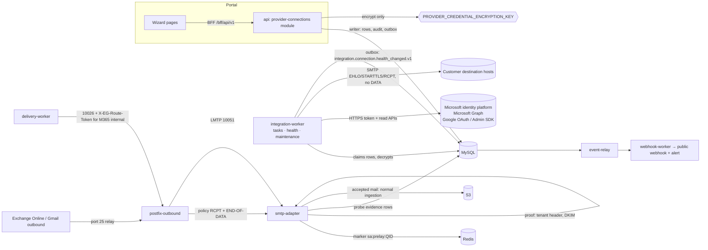

# Step 8.2: Microsoft 365 and Google Workspace connectors

**Status (2026-11-19):** implemented (WP1–WP6) and verified locally against the provider simulators after the serialized merge onto step 8.4 (`59f2683`); the migration is applied to the main schema; review findings fixed by the step closer on 2026-11-20 (§14); uncommitted (the orchestrator commits). **Not complete:** live verification with real Microsoft 365 and Google Workspace test tenants (§15), CI and a Kubernetes cluster apply. Record: §13 (deviations), §14 (verification). Originally: designed by the architect on 2026-11-17, read-only, on commit `00051ee` (steps 1.1–7.3 committed; CI and a cluster apply pending) plus the uncommitted working tree of step 8.1 (journaling and archiving, [23-journaling-archiving.md](23-journaling-archiving.md), ADR-0064–0069, topology v12), which is treated as in flux. **Not implemented. Not yet approved by the product owner** (open questions in §15, each with a recommended default). §13 (deviations) and §14 (verification) are filled by the work packages.

**Parallel build (product-owner decision, 2026-11-17).** After 8.1 is committed, steps 8.4 ([24-account-takeover-core.md](24-account-takeover-core.md), ADR-0070–0075, topology v13), 8.2 (this note) and 8.5 are implemented **at the same time in separate git worktrees**. Stack integration tests, gates and commits are serialized in the order **8.4 → 8.2 → 8.5**. This step is therefore designed against the **approved design** of 8.4 (not its code) and is written so that it never depends on an 8.4 file, table, event or permission. Reserved numbers: **ADR-0076–0081**, **topology v14** (a strict superset of v12 + this step's delta, rebased onto 8.4's v13 at merge time), **contracts §33** (8.1 has §31, 8.4 claims §32), Prisma migration folder `<timestamp>_provider_integrations`, independent of every other step's migration and sorting after 8.4's at merge (§16).

**Brief (product owner, authoritative):** Prompt 8.2 (Microsoft 365: Exchange Online connector configuration, inbound, outbound and internal routing, connector validation, mail-flow configuration instructions, domain verification, integration health monitoring; Google Workspace: inbound gateway, outbound routing, internal routing, SMTP relay configuration, domain verification, integration health monitoring; requirements: secure OAuth2 where applicable, least-privilege permissions, credential encryption, configuration validation, loop prevention, failover handling, integration audit logs, customer-specific setup documentation; **never modify customer mail-flow configuration without explicit authorization**; setup wizard APIs and frontend workflows), plus the **provider-integration framework** that step 8.5 (ATO identity-provider adapters, [brief](../briefs/account-takeover-ato.md), port in [24-account-takeover-core.md §D15](24-account-takeover-core.md#d15-provider-adapter-port-85-adds-adapters-ado-1-adr-ato-3)) reuses.

**ADRs of the step** (full text in §8; WP1 creates the files verbatim with today's status line, adds the index rows and the amendment line on ADR-0019):

| ADR  | File                                                      | Decision                                                                                                                                                                                                                                                              |
| ---- | --------------------------------------------------------- | --------------------------------------------------------------------------------------------------------------------------------------------------------------------------------------------------------------------------------------------------------------------- |
| 0076 | `0076-provider-integration-framework.md`                  | Tenant provider connections, grants per permission profile, platform-owned vs customer-owned apps, least-privilege read-only mail-flow profiles, asynchronous verification, tenant binding proof, the reuse surface for 8.5                                           |
| 0077 | `0077-provider-credential-custody-and-encryption.md`      | AES-256-GCM credential encryption with row-bound AAD and key rotation, key custody (api encrypts, workers decrypt), access tokens only in process memory, no secret ever returned, logged, audited or published                                                       |
| 0078 | `0078-provider-relay-tenant-attribution.md`               | Accepting Microsoft 365 / Google Workspace outbound and internal mail from shared provider infrastructure: provider egress ranges + linked sender domain + TLS + tenant proof (tenant header, aligned DKIM) at ingestion; amends ADR-0019 decision 5 and step 2.2 D10 |
| 0079 | `0079-connector-validation-probes-and-health.md`          | Observational validation (no write access to the customer), probe addresses intercepted at ingestion, SMTP reachability probes, health checks and transitions, alerts; the mail path never calls a provider API                                                       |
| 0080 | `0080-setup-wizard-explicit-authorization-and-guides.md`  | Server-computed wizard, preview → impact token → apply for every gateway-side mail-flow change, customer-side changes only as generated instructions with attestations, customer-specific setup guides                                                                |
| 0081 | `0081-provider-mail-flow-loop-prevention-and-failover.md` | Loop prevention (gateway traces and hop limits, per-connection route token for Microsoft 365 internal routing, validation and health signals) and failover (multiple smart hosts, Postfix retry, no fail-open bypass)                                                 |

This note is the single source for the step. Implementers see only their own work-package instructions plus this note; every name, key, table, column, event, route, permission, metric and file below is binding unless an implementer records a deviation (§13) with evidence. Decision ids (D*n*), invariants (I*n*) and section numbers are stable references.

---

## 0. Scope in one paragraph

8.2 makes Microsoft 365 (Exchange Online) and Google Workspace (Gmail) first-class mail platforms behind the gateway. It adds (1) a **provider-integration framework**: tenant provider connections, encrypted credentials, OAuth2 client-credentials (Microsoft identity platform, admin consent) and service-account JWT bearer with domain-wide delegation (Google), least-privilege permission profiles, token acquisition, provider API clients, health checks and an extension point for 8.5; (2) **mail flow**: inbound routing reuses the step 2.3 destination presets, outbound and internal routing get a new **provider relay** path on the existing `postfix-outbound` relay listener with tenant attribution and proof (ADR-0078), loop prevention and failover rules; (3) **validation and monitoring**: probe addresses, SMTP reachability probes, provider tenant and domain checks, mail-flow evidence from delivery data, periodic health with alerts and webhooks; (4) a **setup wizard** (API and admin-portal workflow) with explicit authorization for every gateway-side change and **customer-specific setup guides** for every customer-side change. The gateway **never writes to a customer's Microsoft 365 or Google Workspace tenant** in 8.2: every permission it requests is read-only (I3).

---

## 1. Gap analysis (inspected read-only on 2026-11-17 at `00051ee` plus the 8.1 working tree and the approved 8.4 design)

### 1.1 What exists, per area of the brief

| #   | Area                                                                                    | What exists (evidence)                                                                                                                                                                                                                                                                                                                                                                                                                                                                                                                                                                                                                                                                                                           | Verdict for 8.2                                                                                                                                                                                                                                                                                                                                                                 |
| --- | --------------------------------------------------------------------------------------- | -------------------------------------------------------------------------------------------------------------------------------------------------------------------------------------------------------------------------------------------------------------------------------------------------------------------------------------------------------------------------------------------------------------------------------------------------------------------------------------------------------------------------------------------------------------------------------------------------------------------------------------------------------------------------------------------------------------------------------- | ------------------------------------------------------------------------------------------------------------------------------------------------------------------------------------------------------------------------------------------------------------------------------------------------------------------------------------------------------------------------------- |
| 1   | Domains (step 2.1, `apps/api/src/modules/domains`)                                      | Ownership by DNS TXT (`DOMAIN_VERIFICATION_LABEL`, "first to verify wins"), status machine, background checks (`DomainCheckScheduler`, `DOMAIN_RECHECK_*`), expected and observed MX/SPF/DKIM/DMARC records (`domain_dns_records`, `mx_observations`), gateway MX hosts (`GATEWAY_MX_HOSTS`), SPF include (`GATEWAY_SPF_INCLUDE`), DKIM keys and rotation, `domain.status.changed.v1` / `domain.dns.records_changed.v1`. Docs: `docs/domains/onboarding.md`.                                                                                                                                                                                                                                                                     | **Reuse** unchanged. Gateway domain ownership stays TXT-only (I6). 8.2 **adds** a _provider_ verification per linked domain (the domain is verified in the Microsoft 365 / Google tenant: Graph `domains`, Admin SDK `domains`) as a consistency check and as the tenant-binding proof (D4); it reads the stored MX/SPF/DKIM results instead of resolving DNS itself.           |
| 2   | Routing (step 2.3, `packages/mail-routing`, `apps/api/src/modules/domain-destinations`) | Per-recipient direction (`inbound`/`outbound`/`internal`), destination servers with presets `microsoft_365` (one customer host under `*.mail.protection.outlook.com` / `*.mx.microsoft`, port 25, TLS `verify`) and `google_workspace` (five `aspmx` hosts with priorities, `verify`) in `mail_destination_presets`; `PUT /domains/{id}/destinations` (`domain:routing_manage`, audit, `domain.routing.changed.v1`); host safety (R3); Postfix next-hop lists = failover across hosts; Postfix retry 5 days; hop enforcement `evaluateHops` (`ROUTING_MAX_GATEWAY_PASSES` 4, `ROUTING_MAX_RECEIVED_HEADERS` 25); internal mail never to the Internet.                                                                            | **Reuse** the presets and the destinations service for inbound and for the delivery leg of internal mail (the wizard's inbound apply calls `DomainDestinationsService.replace`). **Extend** `packages/mail-routing` with pure provider-relay rules (egress range matching, proof evaluation) and the route-token derivation (D9). No change to direction resolution or presets. |
| 3   | smtp-adapter (step 2.2, `apps/smtp-adapter`)                                            | Policy delegation per listener context (`policy-decision.service.ts`: `relay` context resolves a connector by client certificate, then source IP; sender domain must belong to the connector's organization; per-org rate limits, suppressions, size), socketmap maps, Dovecot-auth SASL, LMTP ingestion (`ingestion.service.ts`: per-organization groups from the envelope sender for outbound, `screen()` before storage = loop check + outbound `From` check with `550` (ADR-0019 d5), deterministic S3 keys, `deletions`), connector cache (`ConnectorResolver`, 30 s), Redis. Connector auth types `sasl`, `source_ip`, `client_certificate`; **D10 forbids `source_ip` with shared-IP platforms** but does not enforce it. | **Extend**: a fourth connector auth type `provider_relay` resolved after certificate and source-IP connectors (D7), an END-OF-MESSAGE marker, proof verification and probe interception in LMTP ingestion (D8, D10). **Enforce** D10: new `source_ip` networks may not overlap provider egress ranges (D7.6). No new SMTP component, no new listener.                           |
| 4   | Postfix (`infrastructure/postfix*`)                                                     | `postfix` (inbound MX 25), `postfix-outbound`: `smtp` relay listener (25, `smtpd_tls_security_level=may`, `smtpd_tls_ask_ccert=yes`, RCPT and END-OF-DATA policy with `policy_context=relay`, `content_filter` → LMTP 10051), `submission` 587 (SASL), 10026/10027 reinjection; TLS client policy per destination from the socketmap.                                                                                                                                                                                                                                                                                                                                                                                            | **Reuse unchanged.** Microsoft 365 outbound connectors deliver only to port 25, which is exactly the existing relay listener; the relay already calls the policy service at RCPT and END-OF-DATA. **No Postfix configuration change** in 8.2.                                                                                                                                   |
| 5   | Delivery-worker (step 2.3/3.x)                                                          | Reinjection prepends exactly one `X-Gateway-Trace` (organization-neutral HMAC) and never edits the EML otherwise (R10).                                                                                                                                                                                                                                                                                                                                                                                                                                                                                                                                                                                                          | **Extend** minimally: for `internal` deliveries to a domain linked to a Microsoft 365 connection with internal routing on, also prepend `X-EG-Route-Token` (D9, ADR-0081).                                                                                                                                                                                                      |
| 6   | Integrations page (step 7.1/8.1, `apps/admin-portal/src/features/integrations`)         | `/integrations`: webhooks section, link cards (API keys, SMTP connectors, archive) and an `UnavailableState step="8.2"` card "Microsoft 365 and Google Workspace". Mail-servers page has destinations and connectors tabs. Navigation item `integrations` gated by webhook/API-key/connector list operations.                                                                                                                                                                                                                                                                                                                                                                                                                    | **Replace** the unavailable card with a provider-connections section; **new** pages: connection list, new-connection chooser, connection detail with the wizard, consent callback. The mail-servers connectors tab shows `provider_relay` connectors read-only with a link to their connection.                                                                                 |
| 7   | Credentials and encryption                                                              | `apps/api/src/crypto/secret-box.ts` (`DATA_ENCRYPTION_KEY`, MFA secrets), `packages/webhooks/src/secret-cipher.ts` (dedicated `WEBHOOK_SECRET_ENCRYPTION_KEY` + `_PREVIOUS`, AES-256-GCM, row-bound AAD `v1.<kid>.<iv>.<tag>.<ct>`, api encrypts / worker decrypts), archive per-tenant envelope encryption (8.1). Idempotent secret-bearing routes with redacted replay (ADR-0057).                                                                                                                                                                                                                                                                                                                                             | **Reuse the pattern** of the webhook secret cipher with a dedicated key `PROVIDER_CREDENTIAL_ENCRYPTION_KEY` (ADR-0077); ADR-0057 for credential uploads.                                                                                                                                                                                                                       |
| 8   | OAuth2 / identity providers                                                             | None. `jose` is an api dependency (JWT). No outbound HTTP client to Microsoft or Google; Microsoft 365 / Google exist only as destination presets and in docs; the `sso` feature flag is not implemented; 8.4 designs `ato_provider_integrations.connector_ref` as "8.2 connector public id; opaque in 8.4".                                                                                                                                                                                                                                                                                                                                                                                                                     | **New**: `@email-gateway/provider-integrations` (D1–D6), `provider_connections.public_id` is 8.4's `connector_ref` (D6).                                                                                                                                                                                                                                                        |
| 9   | Audit, notifications, webhooks                                                          | `audit_logs` (api `AuditService`; workers insert directly: `apps/webhook-worker/src/delivery/recorder.ts`, `apps/archive-worker/src/shared/db.ts`), webhook-worker fanout over `email.webhooks` (public types projected from internal events, alert kinds `threat_detected`, `domain_dns_failed`, `webhook_disabled`), notification-worker.                                                                                                                                                                                                                                                                                                                                                                                      | **Reuse**: every integration action is an `audit_logs` row (no `integration_audit_logs` table); **extend**: one internal event `integration.connection.health_changed.v1`, one public webhook type `integration.health_changed`, one alert kind `integration_unhealthy` (D12).                                                                                                  |
| 10  | Workers and scheduling                                                                  | Domain checks run in the api (`domain-check-scheduler.service.ts`); outbound HTTP lives in workers (webhook-worker SSRF-guarded client); leader election by MySQL `GET_LOCK`; claims with `FOR UPDATE SKIP LOCKED`.                                                                                                                                                                                                                                                                                                                                                                                                                                                                                                              | **New** deployable `apps/integration-worker` (roles `tasks`, `health`, `maintenance`): provider API calls, SMTP probes and health evaluation never run in the api (D11).                                                                                                                                                                                                        |
| 11  | Customer documentation                                                                  | `docs/domains/destination-servers.md` documents Microsoft 365 inbound connectors and Enhanced Filtering, Google inbound gateway, and states that **Exchange Online outbound through the gateway is not supported** (shared certificate and IP ranges, no SMTP AUTH) and Gmail outbound only with SMTP AUTH or a client certificate.                                                                                                                                                                                                                                                                                                                                                                                              | **Supersede** the outbound sections with the provider relay (ADR-0078) and add `docs/integrations/microsoft-365.md` and `google-workspace.md` (templates of the generated guides, D14).                                                                                                                                                                                         |

### 1.2 Reuse, extend, new (summary)

| Component                                                  | Verdict      | What 8.2 does                                                                                                         |
| ---------------------------------------------------------- | ------------ | --------------------------------------------------------------------------------------------------------------------- |
| Domain onboarding, DNS checks, DKIM                        | Reuse        | Reads stored results; links verified domains to a connection                                                          |
| Destination presets and destinations service               | Reuse        | Inbound apply = `replace` with the provider preset, through preview/impact token (D13)                                |
| `packages/mail-routing`                                    | Extend       | `provider-relay.ts` (egress matching, proof rules), `route-token.ts`                                                  |
| smtp-adapter policy, connectors, ingestion                 | Extend       | `provider_relay` connectors, marker, proof, probes, metrics                                                           |
| Postfix                                                    | Reuse        | No change                                                                                                             |
| Delivery-worker reinjection                                | Extend       | Optional `X-EG-Route-Token` header on internal deliveries to linked Microsoft 365 domains                             |
| `smtp_connectors`                                          | Extend       | Enum value `provider_relay`, column `provider_connection_id`                                                          |
| Credential cipher pattern, ADR-0057                        | Reuse        | Dedicated provider key and AAD                                                                                        |
| `audit_logs`, webhooks, notifications, outbox, event-relay | Reuse/extend | One internal event, one public type, one alert kind                                                                   |
| Provider-integration library                               | **New**      | `packages/provider-integrations` (`@email-gateway/provider-integrations`)                                             |
| Integration worker                                         | **New**      | `apps/integration-worker`                                                                                             |
| Tables                                                     | **New**      | 11 tables (§3)                                                                                                        |
| api module                                                 | **New**      | `apps/api/src/modules/provider-connections` (tag `provider-connections`)                                              |
| Portal pages                                               | **New**      | `/integrations/providers/**`                                                                                          |
| Local provider fake                                        | **New**      | `infrastructure/provider-fake` (Compose, test profiles only) and an in-process fake in the library's `testing` export |

### 1.3 What is NOT duplicated (explicit)

- No second domain-ownership mechanism: TXT verification stays authoritative (I6, §15 Q6).
- No second destination model: inbound routing uses `domain_mail_servers` and the presets of step 2.3.
- No new SMTP listener, no Postfix change, no second connector table: the provider relay is a connector auth type on the existing relay listener.
- No second loop detector: `X-Gateway-Trace`, the ingestion loop check and `evaluateHops` stay the loop stops; the route token only prevents the customer-side re-routing that would otherwise trigger them.
- No integration-specific audit table, notification channel or webhook delivery path.
- No identity-provider telemetry, account-takeover rule or response action (8.4/8.5).
- No DNS resolver in the worker for domain records: the api's domain checks are the source.

### 1.4 Constraints found during inspection

1. **Exchange Online outbound has no tenant-unique transport credential.** Its outbound connectors cannot use SMTP AUTH, present Microsoft's shared certificate and connect from shared Microsoft ranges; Gmail's outbound routes to custom hosts behave the same way. Tenant attribution must therefore come from message-level evidence that only the customer's own provider tenant can produce: a DKIM signature by the customer's own domain (keys only that tenant's provider signs with) and, for Microsoft 365, the tenant id that Exchange Online stamps on outgoing mail. This evidence exists only after DATA, so it is checked at LMTP ingestion, before anything is stored (ADR-0078).
2. **LMTP ingestion determines the outbound organization from the envelope sender domain at RCPT.** Null-sender (`MAIL FROM:<>`) messages from a provider cannot be attributed at RCPT and are refused in 8.2 (§11, §15 Q3).
3. **Microsoft 365 outbound connectors deliver to port 25 only**: the relay listener (already `policy_context=relay` at RCPT and END-OF-DATA) is the only possible entry; the provider path is resolved after certificate and source-IP connectors, so existing connectors are unaffected.
4. **The delivery-worker prepends exactly one header today** (a test asserts it); the route token is a second, conditional header (D9).
5. **Parallel build.** 8.4 changes `policy-decision.service.ts`, `config.ts` and `app.module.ts` of the smtp-adapter, the api `app.module.ts`/`config.ts`, `packages/webhooks`, the webhook and notification workers, the seed catalogue, the event registry and topology, the portal navigation and dev mocks. 8.2 keeps its logic in **new files** and touches those shared files only with small additive hooks listed in §16.
6. **Local data.** The local MySQL holds the product owner's platform super-admin account; 8.2 creates no connection, grant or relay connector for any existing organization and seeds only platform data (permissions, egress range snapshot). Tests use synthetic organizations.

### 1.5 Requirement traceability

| Brief requirement                                     | Design                                                                                                                   | 8.2 status                                     |
| ----------------------------------------------------- | ------------------------------------------------------------------------------------------------------------------------ | ---------------------------------------------- |
| M365 Exchange Online connector configuration          | Generated guide (inbound partner connector, Enhanced Filtering, outbound connector, transport rules), attestations (D14) | Built (customer applies; gateway never writes) |
| M365 inbound routing                                  | Destination preset apply via wizard (D13), MX and SMTP reachability checks (D10)                                         | Built                                          |
| M365 outbound routing                                 | Provider relay with tenant header + aligned DKIM proof (D7, D8)                                                          | Built                                          |
| M365 internal mail routing                            | Provider relay → `internal` → destination; route token transport-rule exception (D9)                                     | Built                                          |
| M365 connector validation                             | Probe address (EAC "Validate connector"), proof results, SMTP probe, tenant/domain checks (D10)                          | Built                                          |
| M365 mail-flow configuration instructions             | `setup-guide/1` with the customer's values and PowerShell (D14)                                                          | Built                                          |
| M365 / Google domain verification                     | Gateway TXT (existing) + provider-side verification per linked domain (D4)                                               | Built                                          |
| M365 / Google integration health monitoring           | Health checks, transitions, alerts, webhooks, metrics (D11, D12)                                                         | Built                                          |
| Google inbound gateway configuration                  | Preset apply + guide (inbound gateway IPs, reject non-gateway, TLS) + attestations                                       | Built                                          |
| Google outbound routing                               | Provider relay with aligned, fresh, non-replayed DKIM (D8)                                                               | Built                                          |
| Google internal routing                               | Provider relay → `internal`; message-category loop rule + hop limits (D9)                                                | Built                                          |
| Google SMTP relay configuration                       | Guide: gateway as a host, outbound route, SMTP relay service settings so device/app mail follows the route               | Built (customer applies)                       |
| Secure OAuth2 where applicable                        | Microsoft admin consent + client credentials; Google JWT bearer (DWD); signed single-use state (D2, D3)                  | Built                                          |
| Least-privilege permissions                           | Read-only permission profiles, one platform app per profile, excess/missing permission checks (D2)                       | Built                                          |
| Credential encryption                                 | ADR-0077                                                                                                                 | Built                                          |
| Configuration validation                              | Strict schemas, host safety, preview diffs, validation runs (D10, D13)                                                   | Built                                          |
| Loop prevention                                       | ADR-0081                                                                                                                 | Built                                          |
| Failover handling                                     | ADR-0081 (smart hosts, preset failover, Postfix retry, provider API isolation, no fail-open)                             | Built                                          |
| Integration audit logs                                | `audit_logs` actions of §5.4                                                                                             | Built                                          |
| Customer-specific setup documentation                 | `GET …/setup-guide` (JSON and Markdown), docs templates (D14)                                                            | Built                                          |
| Never modify customer mail flow without authorization | No write permission requested at all (I3); gateway-side changes need preview + impact token + confirmation (D13)         | Built                                          |
| Setup wizard APIs and frontend workflows              | §5, §6                                                                                                                   | Built                                          |
| Framework reused by 8.5                               | D6                                                                                                                       | Built (8.5 adds profiles, adapters, checks)    |

---

## 2. Architecture and decisions

### 2.0 Invariants (never traded away)

- **I1 Mail path independence.** No SMTP decision, ingestion or delivery ever calls a Microsoft or Google API or waits for the integration-worker. A provider outage, revoked consent or expired credential degrades health and wizard functions only.
- **I2 Tenant from trusted context.** The api takes the organization from the principal's `TenantScope`; the relay takes it from the verified sender domain and proves it with provider evidence; never from a header, query parameter or client claim. Another organization's connection is `404`.
- **I3 No write access to customer tenants.** Every permission profile of 8.2 is read-only; the registry refuses a mail-flow profile containing a write permission (unit test with a deny list). The gateway produces instructions; the customer's administrator applies them. 8.5 profiles that can act on a tenant are separate grants with their own consent and the ATO approval gates of 8.4 (ADR-ATO-3).
- **I4 Explicit authorization for gateway-side mail-flow changes.** Destinations, relay connectors and outbound activation change only through preview → impact token → apply with an explicit confirmation, by a user holding both `integration:manage` and the change's own permission; every apply is audited (D13).
- **I5 Secrets never leave custody.** Client secrets, service-account keys and access tokens are never returned, logged, audited, published on the outbox, put in Redis or shown again; only fingerprints and expiry dates are visible (ADR-0077).
- **I6 Gateway domain ownership is TXT verification.** Provider-side verification is evidence, never a substitute (until §15 Q6 says otherwise).
- **I7 Fail closed on the relay.** Missing evidence, DNS or Redis trouble during the proof is a temporary failure (`451`), never an acceptance.
- **I8 Bodies never in MySQL.** Probe messages are not stored anywhere; only bounded, non-content evidence rows.
- **I9 Idempotent.** Consent completion, credential upload, applies, validation runs, probes and health transitions can be repeated without a second effect.
- **I10 Tenant binding proof.** A connection becomes `active` only when the provider tenant is verified (token acquired for that tenant) **and** at least one TXT-verified domain of the organization is verified in that tenant; one provider tenant binds to at most one non-disabled connection platform-wide.

### 2.1 Components and data flow



### D1. Provider connections and permission profiles (ADR-0076)

- A **provider connection** (`provider_connections`) is one organization's link to one Microsoft 365 tenant or one Google Workspace customer. An organization may have several (several tenants), a provider tenant at most one non-disabled connection platform-wide (`active_tenant_key` unique, I10).
- A connection holds **grants** (`provider_connection_grants`), one per **permission profile**. A profile is versioned code in `packages/provider-integrations/src/profiles/` with: `key`, `provider`, `purpose` (`mail_flow` in 8.2; 8.5 adds `ato_telemetry`, `ato_response`), `version`, `permissions` (Microsoft application permissions / Google OAuth scopes), `readOnly: boolean`, `authMethods` allowed, `platformAppConfigKey` (which operator-configured app serves it), `requiredFor` (wizard steps and checks), `description` for the consent screen text.
- **8.2 profiles** (read-only, I3):

| Profile key        | Provider         | Permissions                                                                                                                                         | Used for                                                                                                                                                                                                              |
| ------------------ | ---------------- | --------------------------------------------------------------------------------------------------------------------------------------------------- | --------------------------------------------------------------------------------------------------------------------------------------------------------------------------------------------------------------------- |
| `m365.mail_flow`   | microsoft_365    | Microsoft Graph application permissions `Organization.Read.All`, `Domain.Read.All`                                                                  | Tenant id and name (`GET /v1.0/organization?$select=id,displayName,verifiedDomains`), domain verification and Exchange MX target (`GET /v1.0/domains/{name}`, `GET /v1.0/domains/{name}/serviceConfigurationRecords`) |
| `google.mail_flow` | google_workspace | OAuth scopes `https://www.googleapis.com/auth/admin.directory.customer.readonly`, `https://www.googleapis.com/auth/admin.directory.domain.readonly` | Customer id (`GET /admin/directory/v1/customers/my_customer`), domains and their verification (`GET /admin/directory/v1/customer/my_customer/domains`)                                                                |

- **Deny list** for `purpose: mail_flow` (unit test): any Microsoft permission matching `ReadWrite`, `Mail.`, `MailboxSettings.`, `Exchange.ManageAsApp`, `full_access_as_app`, `Directory.`, `User.`, `Policy.`, `Application.`; any Google scope not ending in `.readonly`, and `https://mail.google.com/`, `gmail.*`.
- **Why one platform app per profile:** a Microsoft multi-tenant app's admin consent grants every permission the app declares; one app for mail flow and ATO would force every customer to grant ATO permissions to get routing. Separate apps (mail-flow app now; 8.5 adds ATO apps) keep each consent minimal. The same holds for Google domain-wide delegation, which is granted per service-account client id.
- **8.5 adds profiles** in a new file `src/profiles/ato.ts` registered by one import line in `src/profiles/index.ts`; `profile` is a `VARCHAR(48)` column, so new profiles need no migration.

### D2. Authentication methods (ADR-0076, ADR-0077)

| `auth_method`                            | Provider         | Who owns the credential                                                        | Customer secret stored?        | Flow                                                                                                                                                                                                                                                                                                                                                                                                                                                             |
| ---------------------------------------- | ---------------- | ------------------------------------------------------------------------------ | ------------------------------ | ---------------------------------------------------------------------------------------------------------------------------------------------------------------------------------------------------------------------------------------------------------------------------------------------------------------------------------------------------------------------------------------------------------------------------------------------------------------- |
| `platform_app` (recommended)             | microsoft_365    | Operator: multi-tenant Entra app per profile (`PROVIDER_M365_MAILFLOW_APP_*`)  | No                             | Admin consent (D3) → the worker requests a client-credentials token **for the consenting tenant** (`POST {login}/{tenantId}/oauth2/v2.0/token`, `scope=https://graph.microsoft.com/.default`, client secret or certificate assertion) → `GET /organization` → tenant verified                                                                                                                                                                                    |
| `customer_app_secret`                    | microsoft_365    | Customer: single-tenant app registration in their tenant                       | Yes (client secret, encrypted) | Admin creates the app with exactly the profile's permissions and grants admin consent in their tenant; uploads tenant id, client id, secret, optional expiry → the worker verifies the same way                                                                                                                                                                                                                                                                  |
| `platform_service_account` (recommended) | google_workspace | Operator: service account per profile (`PROVIDER_GOOGLE_MAILFLOW_SA_KEY_FILE`) | No                             | The guide shows the service account's **client id** and the profile's scopes; the admin authorizes them under domain-wide delegation and names a **delegated admin** (subject e-mail, ideally a dedicated admin with a custom read-only role) → `POST …/verify` → the worker signs a JWT bearer assertion (RS256, `iss` = SA e-mail, `sub` = subject, `scope` = profile scopes, `aud` = token URL, ≤ 1 h) and calls the customer endpoint → customer id verified |
| `customer_service_account`               | google_workspace | Customer: their own service account JSON key                                   | Yes (key JSON, encrypted)      | Same as above with the uploaded key                                                                                                                                                                                                                                                                                                                                                                                                                              |

- Customer certificate credentials for Microsoft apps are **not** in 8.2 (§15 Q12). The platform Microsoft app may use a client secret or a certificate (`PROVIDER_M365_MAILFLOW_APP_CERT_FILE` + `_CERT_THUMBPRINT`, assertion signed with `jose`); the config refuses a secret in `production` unless `PROVIDER_M365_ALLOW_PLATFORM_SECRET=true` (default `false`; local/ci `true`).
- **Endpoints are configuration, never tenant input**: `PROVIDER_M365_LOGIN_URL` (`https://login.microsoftonline.com`), `PROVIDER_M365_GRAPH_URL` (`https://graph.microsoft.com`), `PROVIDER_GOOGLE_TOKEN_URL` (`https://oauth2.googleapis.com/token`), `PROVIDER_GOOGLE_ADMIN_URL` (`https://admin.googleapis.com`). `http:` is refused unless `PROVIDER_ALLOW_HTTP_ENDPOINTS=true`, which is refused outside `APP_ENV ∈ {local, ci}` (local/ci point at `provider-fake`). Tenant ids are validated (`^[0-9a-f-]{36}$` lower-case GUID for Microsoft; `^C[0-9a-z]{6,16}$` for Google customer ids; delegated admin e-mails by the address validator) before they are put in a URL path.
- **HTTP client** (`src/http/provider-http.ts`): Node `fetch` with `AbortSignal.timeout(INTEGRATION_HTTP_TIMEOUT_MS)`, `redirect: 'error'`, response bodies read through a byte cap (`INTEGRATION_HTTP_MAX_RESPONSE_BYTES`, 1 MiB), JSON only, `429`/`503` honour `Retry-After` (capped 60 s), classified errors `{ code, retryable }` (`invalid_client`, `consent_missing`, `unauthorized_client`, `tenant_not_found`, `forbidden`, `throttled`, `unavailable`, `timeout`, `bad_response`), never including response bodies, tokens or secrets in messages.
- **Tokens** are cached **only in process memory** per `(grantId, credentialVersion, scopeSet)` until 5 minutes before expiry; never in Redis or MySQL (ADR-0077).

### D3. Microsoft admin consent (OAuth2) and Google delegation confirmation

1. `POST /provider-connections/{id}/grants` `{ profile: 'm365.mail_flow', authMethod: 'platform_app' }` → grant `pending_consent`; the api creates a **consent state**: 32 random bytes (base64url) returned once in the consent URL; only its SHA-256 is stored (`provider_consent_states`: organization, connection, grant, **user**, `expires_at` = now + `PROVIDER_CONSENT_STATE_TTL_SECONDS` (600)). Response: `consentUrl = {PROVIDER_M365_LOGIN_URL}/organizations/v2.0/adminconsent?client_id={appId}&scope=https://graph.microsoft.com/.default&redirect_uri={PROVIDER_CONSENT_REDIRECT_URL}&state={state}`.
2. The admin consents at Microsoft and is redirected to the portal page `/integrations/providers/consent-callback?tenant=…&admin_consent=True&state=…` (or `error`, `error_description`). The page (inside the signed-in console) posts `{ state, tenant, adminConsent, error? }` to `POST /provider-connections/consent/complete`.
3. The api hashes the state, loads it **for the caller's organization and user**, refuses expired, used or foreign states (`404 consent_state_invalid`), marks it used (single use, same transaction), stores `claimed_tenant_id`, sets the grant `verifying` and `verify_requested_at`, audits `integration.grant_consented`. A provider `error` sets the grant `error` with `last_error_code = consent_declined` (no text from the provider is stored beyond a 256-character sanitized description in the audit details).
4. The worker (`tasks` role) verifies (D11): token for `claimed_tenant_id`; `GET /organization`; tenant id must equal the claim; records observed permissions from the token's `roles` claim (decoded, not trusted for anything but reporting), missing/excess permissions; grant `active` or `error`. The connection becomes `configuring` (or stays). **Closer review (2026-11-19):** the tenant stays a claim at this point (the redirect's `tenant` is unsigned and the shared platform app gets a token for every tenant that ever consented to it, so a working token proves nothing about the caller); `external_tenant_id`, `external_tenant_name`, `tenant_verified_at` and `active_tenant_key` are written only on the domain proof of D4 (`TenantBinder`), then I10 is evaluated.
5. **Google:** no redirect exists for domain-wide delegation. `POST /provider-connections/{id}/grants` with `platform_service_account` returns `{ clientId, scopes, adminConsoleSteps }`; the admin authorizes them and calls `POST …/grants/{profile}/verify` `{ subjectEmail }` → `verifying` → worker verification (token + customer endpoint).
6. **Revocation:** `DELETE /provider-connections/{id}/grants/{profile}` sets the grant `revoked`, wipes `credential_ciphertext`, and returns the provider-side removal steps (remove the enterprise app / delegation). The gateway cannot revoke consent at the provider (I3).

### D4. Tenant binding and domain verification (ADR-0076, I6, I10)

- `PUT /provider-connections/{id}/domains` `{ domainIds: [...] }` links gateway domains of the organization (`status = active`, TXT-verified; `pending` domains are refused `422 domain_not_verified`), each domain to at most one connection (`409 domain_linked_elsewhere`). Max `PROVIDER_MAX_DOMAINS_PER_CONNECTION` (500).
- The worker checks each linked domain at the provider: Microsoft `GET /domains/{name}` (`isVerified`, `supportedServices` contains `Email`) and `serviceConfigurationRecords` (the `Mx` record's `mailExchange` → `provider_mx_host`, used to prefill and cross-check the Microsoft 365 destination host); Google `domains` list (`verified`, primary or secondary domain; domain aliases are reported as `alias`). Result `provider_verification ∈ {verified, unverified, absent}`.
- **Tenant binding on proof of control (closer review, 2026-11-19; `apps/integration-worker/src/tasks/tenant-binding.ts`):** after every provider domain check (verifier, domain-check task, health role) the worker binds the claimed tenant only when ≥ 1 linked domain that is `active` at the gateway (TXT-verified, which only this organization can have) is `verified` in the claimed tenant by a check made at or after the grant's current `verified_at` (a grant verification of an unbound connection resets every link to `unknown`, so results of an earlier claim never count). It reads the tenant identity once more (must equal the claim, `tenant_mismatch`), writes the tenant fields and `active_tenant_key` (duplicate → grant `error` `tenant_bound_elsewhere`), audits `integration.tenant_bound` and evaluates I10 in the same transaction. Applies to every auth method (Microsoft `platform_app` claims from the redirect, Google `platform_service_account` claims through the named delegated admin). The wizard's `connect` step is done when the grant is `active`; the `domains` step shows `binding_pending` until the binding. `ProviderConnectionReader` (8.5) returns `externalTenantId` only for a bound connection. Residual: an administrator who knows another tenant's id can learn whether it consented to the platform app (grant `active` vs `consent_missing`); nothing about that tenant is stored, shown or reserved. A signed consent flow (authorization code / id_token with a nonce bound to the state) would remove it (later step).
- **I10:** the connection's status becomes `active` only after the wizard's `connect` and `domains` steps are done, i.e. the grant is `active`, the tenant id is verified and ≥ 1 linked domain is `verified` at the provider. Without it the relay never accepts mail for the connection (D7) and the apply routes refuse (`409 connection_not_bound`).
- A connection whose tenant later stops listing a linked domain gets the health check `domains.provider_verified` = `fail` (critical for domains with outbound or internal routing active); the relay keeps accepting (I1: health never changes mail flow automatically) but the alert fires. §15 Q7 asks whether outbound should be suspended automatically.

### D5. Credential custody (ADR-0077)

- `ProviderCredentialCipher` (library, `src/crypto/credential-cipher.ts`): the webhook cipher's construction with key `PROVIDER_CREDENTIAL_ENCRYPTION_KEY` (64 hex) and `_PREVIOUS` (decrypt only), output `v1.<kid>.<iv>.<tag>.<ciphertext>`, AAD `provider-credential:v1:<organizationId>:<connectionPublicId>:<grantPublicId>:<credentialVersion>`. Plaintext is a strict JSON document per method: `customer_app_secret` `{ clientSecret }`; `customer_service_account` `{ type: 'service_account', client_email, private_key, private_key_id, token_uri }` (other fields dropped; `token_uri` must equal `PROVIDER_GOOGLE_TOKEN_URL`).
- **Custody:** the api **encrypts** (never decrypts); the integration-worker **decrypts**; 8.5's ato-worker will decrypt for ATO grants (8.5 extends the custody list in its ADR). Platform app secrets and the platform service-account key are held **only** by the integration-worker (and 8.5's ato-worker for ATO apps); the api holds only the platform app **client ids** (to build consent URLs).
- **Rotation:** `PUT …/grants/{profile}/credentials` replaces the credential (`credential_version` + 1), re-verifies. Key rotation: move the key to `_PREVIOUS`; the maintenance role re-encrypts every grant whose `credential_key_version` is the previous kid (batch 100, logged counts), then the operator clears `_PREVIOUS`.
- **Visibility:** responses show `credentialFingerprint` (the first 12 hex characters of `credential_fingerprint` = SHA-256 of `clientId|<private_key_id or "secret">|credentialVersion`; it identifies a credential version without revealing anything about the secret), `credentialSetAt`, `credentialExpiresAt`; never the value. The upload route uses ADR-0057 (idempotent, redacted replay).
- **Expiry:** customer secrets with an expiry (optional field) produce `credential.expiry` warnings at 30 days and critical at 7 days.

### D6. Reuse surface for 8.5 (and 8.4's `connector_ref`)

- `provider_connections.public_id` **is** the `connector_ref` of 8.4's `ato_provider_integrations` (opaque there). 8.5 binds an ATO integration to a connection that has an active ATO grant.
- Exported from `@email-gateway/provider-integrations` (stable API, documented in `packages/provider-integrations/README.md`):
  - `PERMISSION_PROFILES`, `profileByKey`, `registerPermissionProfiles` (array concatenation at module load; 8.5's `profiles/ato.ts`).
  - `ProviderCredentialCipher`.
  - `ProviderGrantStore` (writer reads of a connection + grant with decrypted credential, status updates with `row_version` CAS) and `ProviderTokenService.getAccessToken(grantRef, signal)` (methods per auth method, memory cache, classified errors).
  - `MicrosoftGraphClient` (`get`, `list` with `@odata.nextLink` paging restricted to the configured Graph origin, `$select`, throttling) and `GoogleAdminClient` (`get`, `list` with `pageToken`).
  - `HEALTH_CHECKS` registry (`registerHealthChecks`, 8.5 adds ATO telemetry checks) and `evaluateHealth` (pure).
  - `testing`: `FakeProviderServer` (in-process HTTP fake of the four endpoints with scripted failures), `describeProviderClientContract`.
- **Not exported:** wizard, guides, mail-flow logic (8.2-only).
- **8.5's three requirements are built in 8.2** (they are stated in [26-ato-provider-adapters.md §0.3](26-ato-provider-adapters.md) R1–R3; building them now keeps the 8.5 merge additive):
  - **R1 Token options.** `getAccessToken(grant, signal, options?: { resource?: 'graph' | 'o365_management' | 'google'; subject?: string })`. 8.2 itself uses only the defaults (`graph` for Microsoft, the grant's delegated admin as `subject` for Google). The memory cache key is `(grantPublicId, credentialVersion, resource, subject ?? '')`; the cache is an LRU bounded by `PROVIDER_TOKEN_CACHE_MAX` (library option, default 2 000 entries). `o365_management` maps to the configured `PROVIDER_M365_MANAGEMENT_URL` origin + `/.default` and is accepted by the token service only for profiles whose `purpose` starts with `ato_` (a mail-flow grant asking for it is a programming error, `credential_unavailable`). 8.2 adds the key `PROVIDER_M365_MANAGEMENT_URL` (default `https://manage.office.com`) only to the library option type, **not** to any app's configuration; 8.5 adds the configuration key.
  - **R2 Purpose-scoped generic checks.** The periodic and validation checks `credentials.token` and `permissions.granted` iterate only over grants whose profile `purpose` is `mail_flow`; grants of other purposes are reported by checks their own step registers (`registerHealthChecks`).
  - **R3 Custody list.** ADR-0077 names the decrypting holders as "the integration-worker and any worker a later ADR adds"; 8.5's ADR-0082 adds the `ato-respond` deployment.
  - **Low-level request primitive.** The library exports `providerRequest(options: { origin: URL; method: 'GET' | 'POST' | 'PATCH' | 'DELETE'; path: string; query?; headers?; body?: unknown; maxResponseBytes?: number; timeoutMs?: number; retryAfterCapMs?: number; signal }): Promise<{ status; headers; json: unknown }>` (`src/http/provider-http.ts`) with the D2 rules (configured origins only, `redirect: 'error'`, byte cap, classified errors without bodies or tokens). 8.2's `MicrosoftGraphClient` and `GoogleAdminClient` use only `GET` through it; the 8.2 deny list (D1) applies to **profiles**, not to this primitive, so 8.5 can use it for its write-capable clients under its own ADR.
  - **Connection view for 8.5's port.** `ProviderConnectionReader` (`src/grants/connection-reader.ts`) returns `{ publicId, organizationId (decimal string), provider, displayName, status, externalTenantId, linkedDomains: { name, providerVerified }[], grants: { publicId, profile, status, observedPermissions, subjectEmail }[], updatedAt }` for one connection or all connections of an organization, from the writer, never including ciphertext. It is the single 8.2 surface 8.5's binding file reads.

### D7. Provider relay: acceptance at RCPT (ADR-0078; smtp-adapter, `apps/smtp-adapter/src/provider-relay/**`)

1. **Connector:** a `provider_relay` row in `smtp_connectors` (auth type appended, `provider_connection_id` unique) is created by the outbound apply (D13) with `require_tls = true`. Its outbound state is the connection's `outbound_mode` (`off` | `probe_only` | `active` | `suspended`). It is visible read-only in `GET /smtp-connectors` and cannot be edited, rotated or deleted there (`409 connector_managed_by_provider_connection`).
2. **Egress ranges:** platform data `provider_egress_ranges` of the **active** `provider_egress_range_sets` row per provider; loaded by the adapter into memory (sorted ranges per IP version, binary search), refreshed every `PROVIDER_EGRESS_CACHE_SECONDS` (60); a load failure keeps the last loaded set and logs; an empty set means no provider relay for that provider. `PROVIDER_EGRESS_EXTRA_RANGES` (JSON `{ "microsoft_365": ["cidr"…], "google_workspace": [...] }`) adds ranges **only in `APP_ENV ∈ {local, ci}`** (refused otherwise) so the Compose test clients count as provider infrastructure.
3. **Resolution order in the `relay` context** (`resolveConnector` in `policy-decision.service.ts` gets one extra branch at the end, delegating to `ProviderRelayResolver.resolve(request)`): client certificate connector → source-IP connector → **provider relay**. Provider relay resolves when: `PROVIDER_RELAY_ENABLED=true`; the client address is in the egress set of provider `P`; the envelope sender is non-empty and its domain `D` is an `active`, `outbound_enabled` domain of an active organization `O`; `D` is linked to a connection `C` of `O` with `C.provider = P`, `C.status = 'active'`, `C.outbound_mode ∈ {probe_only, active}`; `C`'s `provider_relay` connector is `active`. Result: a `ConnectorView` with `authType: 'provider_relay'`, plus `{ provider, connectionPublicId, outboundMode, tenantId }`. Cached per `(P, D)` 30 s (`sa:prelay:conn:{P}:{D}`, the existing `RedisJsonCache`). **Shared provider clients (closer review, 2026-11-19):** for a client in the provider egress ranges, a client-certificate or (legacy) source-IP connector applies only to senders of its own organization; every other sender is resolved by the provider relay (or denied). Microsoft and Google present one certificate and one address pool for every customer, so without this rule one organization could register the provider's certificate fingerprint and capture (and deny) every other organization's provider-relay traffic. Outside the provider ranges the step 2.2 order is unchanged.
4. **Checks after resolution** (existing flow, unchanged order): TLS required (`MUST_STARTTLS` without `encryption_protocol`); sender domain belongs to `O` (implied); DKIM readiness; suppressions; tenant rate limits; size. **Additional:** the recipient on `PROVIDER_PROBE_DOMAIN` → accepted only for provider-relay sessions (D10) and refused for every other context with `550 5.1.1 Recipient address rejected`; `outbound_mode = probe_only` and a non-probe recipient → `451 4.7.1 Outbound routing through the gateway is not active yet for this organization` (the provider queues and retries; nothing bounces while the wizard is incomplete); `suspended` → `451 4.7.1 Outbound routing through the gateway is suspended` (§15 Q7).
5. **Null sender** from provider ranges (no attribution possible at RCPT, §1.4.2) → `550 5.7.1 Null-sender mail is not accepted on the provider relay`; counted (`smtp_provider_relay_total{result="null_sender_refused"}`).
6. **`source_ip` hardening (step 2.2 D10 enforced):** the api refuses new or changed `source_ip` networks overlapping an active provider egress range (`422 network_shared_provider`); existing overlapping connectors stay working and raise the platform alert `SmtpConnectorOnSharedProviderRange` (metric `smtp_connector_shared_provider_networks`, computed by the integration-worker maintenance role).
7. **Unmatched:** a client in provider ranges that matches nothing above gets today's `RELAY_DENIED` (`554 5.7.1 Relay access denied`) — no oracle about which domains use the relay.

### D8. Provider relay: marker and proof at ingestion (ADR-0078)

1. **Marker (END-OF-MESSAGE, `relay` context):** when the session resolves to a provider-relay connector, the policy service writes `sa:prelay:{queue_id}` = `{ v: 1, organizationId, connectionPublicId, provider, tenantId, outboundMode, tlsProtocol, tlsCipher, clientAddress }` with TTL `PROVIDER_RELAY_MARKER_TTL_SECONDS` (3600 in the design; **closer review:** default 432 000 and never below Postfix's `maximal_queue_lifetime`, 5 d, so a first LMTP delivery that comes late or a queue file delivered in several batches still finds the marker; markers are not deleted after ingestion) **before** answering `DUNNO`; a Redis error → `DEFER_IF_PERMIT 4.3.5` (I7). A provider-egress client whose session no longer resolves to any connector at END-OF-MESSAGE (connection, connector or link changed after RCPT accepted its recipients) → `DEFER_IF_PERMIT 4.7.1 Provider relay authorization changed, try again later` (`smtp_provider_relay_total{result="state_changed"}`), never a marker-less relay. The queue id is the one LMTP ingestion receives as XFORWARD IDENT.
2. **Ingestion (LMTP 10051):** for every outbound transaction the service reads the marker (one `GET`; Redis error → `451 4.3.0` for all recipients). No marker → today's behaviour. With a marker:
   - **Header evidence** (extended `HeaderScanner`, still bounded by `INGEST_HEADER_MAX_BYTES`): every `X-MS-Exchange-CrossTenant-Id` value (case-insensitive name, trimmed, lower-cased) and every `DKIM-Signature` header (raw, for the verifier).
   - **DKIM verification** (`mailauth` `dkimVerify`, streaming: the message bytes are teed into the verifier alongside the S3 upload sink, or a null sink for probe-only transactions), DNS through `PROVIDER_RELAY_DNS_SERVERS` (empty = system) with `PROVIDER_RELAY_DNS_TIMEOUT_MS` (2000). A signature counts as **aligned pass** when: result `pass`; `d=` equals the header-From domain `F` or is a parent of it (`F` ends with `.` + `d`); `d` is an active verified domain of `O` linked to `C`; no `l=` tag; `h=` covers `from`; algorithm `rsa-sha256` or `ed25519-sha256`; key ≥ 1024 bits.
   - **Proof rules** (pure, `packages/mail-routing/src/provider-relay.ts`, `evaluateProviderProof(evidence, policy)`), policy `provider-relay-proof/1` stored on the connection (`relay_proof`):
     - Microsoft 365 default: `tenantHeader: 'required'`, `dkimAligned: 'required'`. Tenant header passes when at least one `X-MS-Exchange-CrossTenant-Id` is present and **every** present value equals `C.external_tenant_id` (a forged second value with another tenant's id fails).
     - Google Workspace default: `dkimAligned: 'required'`, `dkimMaxAgeSeconds: 3600` (an aligned signature must carry `t=` within `[now − 3600 s, now + 300 s]`), `dkimReplayMax: 5` within `PROVIDER_RELAY_DKIM_REPLAY_WINDOW_SECONDS` (604 800): Redis `INCR sa:prelay:dkim:{sha256(b= value)}` with TTL = window; a count above the max fails (`dkim_replayed`). Redis error → `451`.
     - Tenant overrides are bounded: `tenantHeader` may be `off` only for Microsoft 365 **and** only with `dkimAligned: required` **and** (closer review) with `dkimMaxAgeSeconds` and `dkimReplayMax` (DKIM is then the only proof, with the Google replay bounds); `dkimAligned` may never be `off` for Google; at least one rule is always required. Changing them is a gateway-side mail-flow change (preview/apply, D13, audited).
   - **Outcomes:** `pass` → normal ingestion (the stored EML is unchanged; `email_events` gains `details.providerRelay = { provider, connectionId, proof: 'pass' }` on the received event); `fail` → outcome `provider_proof_failed` → `550 5.7.26 Sender not authenticated by the linked provider tenant` for every recipient of the transaction (ADR-0078 amends ADR-0019 d5: a third post-queue DSN case; the DSN goes to the envelope sender, an address in `O`'s own domain), the S3 object (if uploaded) is added to `deletions`; `temperror` (DNS, Redis, verifier error) → `451 4.3.0`. Metrics `smtp_provider_proof_total{provider,rule,result}`; a structured warning log without addresses beyond domains.
   - **From check** (existing `fromMatchesSender`) and the **loop check** run first, unchanged.
   - **Counters** (health evidence, best effort): the adapter aggregates per connection and UTC hour `accepted`, `proof_failed`, `temp_failed`, `probes` in memory and flushes every `PROVIDER_RELAY_COUNTER_FLUSH_SECONDS` (30) with `INSERT … ON DUPLICATE KEY UPDATE col = col + ?` into `provider_relay_counters` (writer, outside any mail transaction; a flush failure is logged and counted, the counts are dropped after 3 failed flushes — they are not mail data).
3. **Internal mail** through the relay is classified by the existing routing module (`internal` when the recipient domain is an active domain of `O`) and delivered to the destination servers; nothing provider-specific happens at ingestion beyond the proof.

### D9. Loop prevention and internal routing (ADR-0081)

- **Gateway side (existing, unchanged):** organization-bound HMAC `X-Gateway-Trace` per direction; ingestion refuses a second pass in the same direction (`554 5.4.6`); `evaluateHops` stops alternating-direction loops after `ROUTING_MAX_GATEWAY_PASSES` (4) with `loop_detected`; destination hosts equal to gateway hosts are refused.
- **Microsoft 365 internal routing** needs a customer-side transport rule that sends internal mail out through the outbound connector; the copy the gateway delivers back would match the same rule again. The gateway therefore marks its internal deliveries with a **route token**: `X-EG-Route-Token: <token>` where `token = base32(HMAC-SHA256(PROVIDER_ROUTE_TOKEN_KEY, "route-token:v1:" + connectionPublicId + ":" + version))[0..32]` (`deriveRouteToken`, `packages/mail-routing/src/route-token.ts`). The delivery-worker prepends it (after `X-Gateway-Trace`) only when the delivery is `internal`, the recipient domain is linked to a connection with `provider = microsoft_365`, `internal_routing = true`, `outbound_mode = active` (lookup cached 60 s per domain id; DB error → the reinjection is retried, never sent without the header). Rotation: `route_token_pending_version` — the gateway sends the **current** version until the admin attests the updated rule (`m365.internal_routing_rules_updated`), then switches (both values accepted by the rule pattern the guide generates during rotation).
- **Customer rules generated by the guide** (Exchange Online PowerShell): rule A (priority 0) "Route internal mail through the email security gateway": `-FromScope InOrganization -SentToScope InOrganization -RouteMessageOutboundConnector "<connector name>" -ExceptIfHeaderMatchesMessageHeader X-EG-Route-Token -ExceptIfHeaderMatchesPatterns '^<token>$'`; rule B (lowest priority) "Remove the gateway route token": `-HeaderContainsMessageHeader X-EG-Route-Token -HeaderContainsWords '<token>' -RemoveHeader X-EG-Route-Token`. The token never reaches a mailbox, so users cannot copy it to bypass inspection.
- **Google Workspace internal routing:** the Gmail routing rule applies to **Internal – sending** messages; mail returning from the gateway arrives through the inbound gateway as received mail and is not re-routed. No token is used. The gateway hop limits are the backstop; validation and health detect loops.
- **Detection:** health check `routing.loops` (any `loop_detected` delivery or `554 5.4.6` ingestion refusal for a linked domain in 24 h → critical), validation check `routing.no_loops`.

### D10. Validation: probes and SMTP checks (ADR-0079)

- **Validation runs** (`provider_validation_runs`, `POST /provider-connections/{id}/validations` `{ kind: full | credentials | inbound | outbound }`) are claimed by the worker's `tasks` role (poll `INTEGRATION_TASK_POLL_MS`, `FOR UPDATE SKIP LOCKED`, lease 120 s). Results are a bounded list of check results (`provider-validation/1`): `{ code, subject, status: pass | warn | fail | skipped | error, severity, evidence (≤ 2 KiB, non-secret), remediation (guide anchor) }`.
- **Checks** (codes stable; `required` = blocks the wizard's `validate` step):

| Code                                   | Kind(s)           | Required       | What                                                                                                                                                                                          |
| -------------------------------------- | ----------------- | -------------- | --------------------------------------------------------------------------------------------------------------------------------------------------------------------------------------------- |
| `credentials.token`                    | all               | yes            | Token acquisition per active grant                                                                                                                                                            |
| `permissions.granted`                  | full, credentials | yes (missing)  | Missing permissions fail; excess permissions warn ("over-privileged; remove …")                                                                                                               |
| `tenant.identity`                      | full, credentials | yes            | Tenant/customer id unchanged since binding                                                                                                                                                    |
| `domains.gateway_verified`             | full, inbound     | yes            | Every linked domain `active` at the gateway                                                                                                                                                   |
| `domains.provider_verified`            | full, inbound     | yes (≥ 1)      | Verified in the provider tenant                                                                                                                                                               |
| `dns.mx_gateway`                       | full, inbound     | yes            | Stored MX observation of the domain points to `GATEWAY_MX_HOSTS` (step 2.1 results; stale > 24 h → `warn`)                                                                                    |
| `inbound.destination`                  | full, inbound     | yes            | Domain has destinations with the connection's provider preset                                                                                                                                 |
| `inbound.destination_matches_provider` | full, inbound     | no (warn)      | Microsoft 365: the destination host equals `provider_mx_host`                                                                                                                                 |
| `inbound.smtp`                         | full, inbound     | yes            | SMTP probe per destination host (below)                                                                                                                                                       |
| `inbound.recent_deliveries`            | full, inbound     | no             | Last 24 h deliveries to the domain: delivered / deferred / TLS errors (reader)                                                                                                                |
| `dns.spf_gateway`                      | full, outbound    | yes (outbound) | Stored SPF result includes `GATEWAY_SPF_INCLUDE`                                                                                                                                              |
| `dns.dkim_provider`                    | full, outbound    | no (warn)      | Stored DKIM observations show the provider's selectors for the domain (Microsoft `selector1`/`selector2` CNAMEs; Google: the configured selector if known) — evidence only, the probe decides |
| `outbound.probe`                       | full, outbound    | yes (outbound) | A probe arrived on the provider relay within the run's window and its proof passed (below)                                                                                                    |
| `routing.no_loops`                     | full              | yes            | No loop refusals for linked domains in 24 h                                                                                                                                                   |
| `lockdown.attested`                    | full              | no (warn)      | The admin attested the customer-side lockdown steps (inbound connector restriction / reject non-gateway mail)                                                                                 |

- **SMTP probe** (`inbound.smtp`, worker, `nodemailer`'s `SMTPConnection`; the gateway's mail path is not involved): resolve the destination host (`INTEGRATION_PROBE_DNS_SERVERS`, empty = system), re-validate with `validateDestinationHost`, connect to port 25 within `INTEGRATION_SMTP_PROBE_TIMEOUT_MS` (15 000), EHLO with `INTEGRATION_PROBE_HELO` (default `POSTFIX_OUTBOUND_MYHOSTNAME`), STARTTLS required, certificate verified against the preset's `tls_verify_names` semantics (`nexthop` + names, leading dot = subdomains), TLS ≥ 1.2, `MAIL FROM:<>`, `RCPT TO:<postmaster@{domain}>`, `RSET`, `QUIT`. **No DATA is ever sent.** Evidence: banner host (truncated), TLS version, certificate subject/SANs match, RCPT reply code class. A `5xx` at RCPT is `warn` (providers may refuse probes from non-gateway addresses), a connection or TLS failure `fail`.
- **Outbound probe:** a run of kind `outbound`/`full` with outbound mode not `off` gets a **probe address** `eg-probe-<26 lower-case base32>@{PROVIDER_PROBE_DOMAIN}` (token = 16 random bytes; only `sha256(token)` stored; expires after `PROVIDER_PROBE_TTL_SECONDS` (86 400)); status `awaiting_probe`. The guide tells the admin to use Exchange admin center **Connectors → (outbound connector) → Validate** with that address, or (Google) to send any message from a user of a linked domain to it. The smtp-adapter (D7.4) accepts probe recipients only on provider-relay sessions; LMTP ingestion **intercepts** them: verifies the proof exactly as D8, inserts a `provider_probe_observations` row (unique `(token_hash, queue_id)`, idempotent), answers `250` for probe recipients, stores **nothing** in S3, writes no message row (I8). Non-probe recipients of the same transaction follow the normal path. The worker completes the run when an observation for its token exists (or `expired` after the TTL).
- **What validation cannot prove** (stated in the portal and the guide): that Exchange Online's inbound connector restricts senders to the gateway, that Enhanced Filtering is on, that Gmail rejects non-gateway mail. These are **attested** by the admin (`lockdown.attested`); reading Exchange configuration needs `Exchange.ManageAsApp` with a directory role and is out of scope (§15 Q5).

### D11. The integration-worker (ADR-0079)

- **Deployable** `apps/integration-worker` (`@email-gateway/integration-worker`, NestJS like the other workers, HTTP port `INTEGRATION_WORKER_HTTP_PORT` 3086 for `/health/live`, `/health/ready`, `/metrics` only; Compose host port `INTEGRATION_WORKER_HOST_PORT` 3086). MySQL writer (claims, updates, audit, outbox) and reader (delivery statistics), no RabbitMQ (events leave through `message_outbox` and the event-relay), no Redis.
- **Roles** (`INTEGRATION_WORKER_ROLES`, default `tasks,health,maintenance`):
  - `tasks`: grant verifications (`status = verifying`), validation runs (`queued`, `awaiting_probe` completion), on-demand health checks; concurrency `INTEGRATION_TASK_CONCURRENCY` (4).
  - `health`: every `INTEGRATION_HEALTH_TICK_SECONDS` (60) claims connections with `next_health_check_at ≤ now` (`status IN ('configuring','active')`), runs the periodic checks (`credentials.token`, `permissions.granted`, `tenant.identity`, `domains.provider_verified`, `dns.mx_gateway`, `inbound.recent_deliveries`, `outbound.relay_activity` (last accepted provider-relay message and proof failures in 24 h, from `provider_relay_counters`, §3; outbound active with no accepted message for `INTEGRATION_RELAY_IDLE_WARN_HOURS` (72) → `warn`; proof failures > 20 % of ≥ 20 → `fail`), `routing.loops`, `credential.expiry`, `egress.ranges_fresh`), upserts `provider_health_checks`, evaluates the status (`evaluateHealth`: worst severity of failing checks → `critical` / `warning` / `healthy`), and on a change inserts `provider_health_events`, updates the connection, writes an audit row (`integration.health_changed`, actor `system`) and the outbox event `integration.connection.health_changed.v1` in **one transaction**. Interval `INTEGRATION_HEALTH_INTERVAL_SECONDS` (900); a provider-API failure backs off that connection's provider checks (×2 up to 3600 s) without delaying the mail-flow checks.
  - `maintenance` (leader-elected `GET_LOCK('eg:integration:maintenance')`): expire consent states and probe tokens, purge per retention (§3.3), re-encrypt credentials after key rotation, compute `smtp_connector_shared_provider_networks`, egress staleness gauge.
- **CLI** `node dist/cli/egress-import.js --provider <p> --file <json> --source <url> --published-at <iso>` (operator): validates (CIDR syntax, public ranges only, ≤ 5000 entries, IPv4 prefix ≥ /8, IPv6 ≥ /16), creates the next `provider_egress_range_sets` version with its ranges and switches `active` in one transaction, audits `integration.egress_ranges_imported` (actor `system`, operator name from `--operator`), refuses a set that removes > 50 % of the active ranges unless `--force`. No automatic Internet fetch in 8.2 (§15 Q8).

### D12. Audit, events, webhooks, notifications

- **Audit** (`audit_logs`, actions in §5.4): api actions through `AuditService.record`; worker actions inserted directly (pattern of `apps/archive-worker/src/shared/db.ts`). Details never contain secrets, tokens, consent state values or probe tokens (a unit test scans audit details produced by every route in the api e2e suite for the secret fixtures).
- **Internal event** `integration.connection.health_changed.v1` (registry, schema `integrationHealthChangedV1`): envelope `organizationId`; aggregate type `provider_connection`, aggregate id = connection public id; payload `{ connectionId, provider, previousStatus, status, changedAt, failingChecks: string[] (≤ 10 codes) }`. Published on `email.events` (routing key `org.<orgId>.integration.connection.health_changed.v1`, the registry's convention), bound to `email.webhooks` (topology v14, +1 binding).
- **Public webhook type** `integration.health_changed` (packages/webhooks catalogue; metadata only: connection id, provider, statuses, failing check codes, changedAt) projected by the webhook-worker fanout.
- **Alert kind** `integration_unhealthy` (security alerts of 6.2, `notification.alert_requested.v1`): requested by the fanout when `status` becomes `critical`; recipients hold `integration:read`; throttle scope = connection id, `INTEGRATION_ALERT_THROTTLE_MINUTES` (60) via `notification_alert_windows`; preference kind `integration_unhealthy` (opt-out); template: organization, provider, connection name, failing check titles, portal link `/integrations/providers/<id>?tab=health`.

### D13. Setup wizard and explicit authorization (ADR-0080)

- **Wizard state is computed** by the api from rows (`GET /provider-connections/{id}/wizard`), never stored as free state. Steps and their `done` conditions:

| Step       | Done when                                                                                                                                               | Blocked by            |
| ---------- | ------------------------------------------------------------------------------------------------------------------------------------------------------- | --------------------- |
| `connect`  | The connection's `*.mail_flow` grant is `active` and the tenant is verified                                                                             | –                     |
| `domains`  | ≥ 1 linked domain, every linked domain gateway-active, ≥ 1 provider-verified (I10 → connection `active`)                                                | `connect`             |
| `inbound`  | Every linked domain has destinations with the provider preset (applied through the wizard or already present) and the inbound attestations are recorded | `domains`             |
| `outbound` | `outbound_mode` chosen: `off` (skipped) or the relay connector exists (`probe_only`)                                                                    | `domains`             |
| `validate` | The latest `full` validation run is `passed` or `warning` (all required checks pass)                                                                    | `inbound`, `outbound` |
| `activate` | `outbound_mode = active` (or `off`), internal routing chosen                                                                                            | `validate`            |

- **Preview → impact token → apply** for every gateway-side change: `POST /provider-connections/{id}/mail-flow/preview` `{ change }` where `change` is one of `inbound` `{ domainIds, microsoftHosts?: { [domainId]: host } }`, `outbound` `{ mode: 'probe_only' }`, `activate` `{ outboundMode: 'active', internalRouting: boolean }`, `proof` `{ relayProof }`, `suspend`, `disable_outbound`. The api computes the concrete **change set** (per domain: current vs new destination servers; connector create/update; mode transitions; proof policy) and returns it with `impactToken` = base64url(HMAC-SHA256(`PROVIDER_IMPACT_TOKEN_KEY`, canonical JSON of `{ orgId, connectionId, connection row_version, change set, userId, expiresAt }`)) + `expiresAt` (`PROVIDER_IMPACT_TOKEN_TTL_SECONDS`, 900). `POST …/mail-flow/apply` `{ change, impactToken, confirm: true }` recomputes the change set, compares the HMAC (constant time), refuses a stale or foreign token (`409 impact_changed` with the new preview), checks permissions (`integration:manage` **and** `domain:routing_manage` for `inbound`, `connector:manage` for `outbound`/`activate`/`proof`/`suspend`/`disable_outbound`), applies in **one writer transaction** (destinations through `DomainDestinationsService.replace` in the same transaction — WP5 extracts a transaction-accepting method, keeping the public behaviour; connector rows; connection columns), audits `integration.mail_flow_applied` with the change set (no secrets), writes the existing `domain.routing.changed.v1` events for destination changes. `Idempotency-Key` required.
- **Activation preconditions:** `activate` requires the `validate` step done and, for outbound, an `outbound.probe` pass within the last 7 days.
- **Customer-side changes** are never applied by the gateway (I3): the guide's steps carry **attestation codes**; `POST /provider-connections/{id}/attestations` `{ code, attested: boolean }` records `{ code, userId, at }` in `attestations` (audited `integration.attestation_recorded`). Attestations are statements, not proofs, and are labelled so.
- **Disconnect:** `DELETE /provider-connections/{id}` (`integration:manage` + `connector:manage`; preview/impact token as `disable` change): grants revoked and credentials wiped, relay connector `disabled` and `provider_connection_id` kept for history, `outbound_mode = off`, status `disabled`, `active_tenant_key` NULL; **destinations are kept** (removing them would break inbound mail; the response says so and links to the destinations page). The response includes the provider-side cleanup steps.

### D14. Customer-specific setup guides (ADR-0080)

- `GET /provider-connections/{id}/setup-guide` (JSON `setup-guide/1`) and `?format=markdown` (`text/markdown; charset=utf-8`, download name `setup-<provider>-<connection-name-slug>.md`). Generated by `generateSetupGuide(input)` (library, pure, snapshot-tested) from: provider, connection, linked domains (with `provider_mx_host`), gateway values (`GATEWAY_MX_HOSTS`, `GATEWAY_EGRESS_NETWORKS`, `GATEWAY_RELAY_HOSTS`, `GATEWAY_RELAY_TLS_NAME`, `GATEWAY_SPF_INCLUDE`), the active probe address (if a run awaits one), the platform app/SA client id and profile permissions, the route token (only for callers with `integration:manage`; masked `••••` + last 4 otherwise), and the attestation state.
- **Sections (Microsoft 365):** 1 Overview and what the gateway will never do; 2 Grant read-only access (admin consent or app registration with exactly the profile permissions); 3 Domains (gateway TXT status, Microsoft verification); 4 Inbound: MX change (values), the gateway destination (prefilled host), **inbound partner connector** (`New-InboundConnector -Name "Email security gateway" -ConnectorType Partner -SenderDomains * -RequireTls $true -TlsSenderCertificateName <GATEWAY_RELAY_TLS_NAME> -RestrictDomainsToCertificate $true`, or the IP variant with `-SenderIPAddresses <egress> -RestrictDomainsToIPAddresses $true`), **Enhanced Filtering** (`Set-InboundConnector -Identity "Email security gateway" -EFSkipLastIP $true`), direct-delivery lockdown guidance; 5 Outbound: DKIM signing for each linked domain (`New-DkimSigningConfig`/`Set-DkimSigningConfig -Enabled $true`), SPF include, **outbound connector** (`New-OutboundConnector -Name "Email security gateway outbound" -ConnectorType Partner -RecipientDomains * -SmartHosts <GATEWAY_RELAY_HOSTS> -UseMXRecord $false -TlsSettings DomainValidation -TlsDomain <GATEWAY_RELAY_TLS_NAME> -IsTransportRuleScoped $false`), validation with the probe address; 6 Internal routing (connector scoped by transport rule + rules A and B of D9); 7 Validate and activate; 8 Failover and outages (ADR-0081); 9 Disconnect and cleanup. **Google Workspace:** 1–3 as above (delegation instead of consent); 4 Inbound gateway (gateway egress IPs, **Reject all mail not from gateway IPs**, **Require TLS**), MX change, gateway destination (preset); 5 Outbound: DKIM "Authenticate email" for each linked domain, SPF, **Hosts** (add the gateway: `GATEWAY_RELAY_HOSTS`, port 25, "Require secure transport (TLS)", "Require CA signed certificate"), **Outbound gateway** or a **Routing** rule (Outbound and Internal – sending) "Change route → <gateway host>"; **SMTP relay service** settings for devices and applications (allowed senders, require SMTP authentication, require TLS) so that relayed device mail follows the same route; probe; 6 Internal routing; 7–9 as above.
- Docs templates: `docs/integrations/microsoft-365.md`, `docs/integrations/google-workspace.md` (same content with placeholders `example.com`, `gateway.example.net`, `11111111-2222-3333-4444-555555555555`); `docs/domains/destination-servers.md` outbound sections point to them.
- **No secret-shaped values** in guides, docs or fixtures (a guide snapshot test asserts no `whsec_`, `AKIA`, `ghp_`, `sk-`, `egk_`, `-----BEGIN` substrings).

### D15. Failover (ADR-0081)

- **Inbound to the provider:** Google preset = five MX hosts in priority order (Postfix next-hop list); Microsoft 365 = one host load-balanced by Microsoft. Deferrals retry for 5 days (step 2.3). Health shows deferral and TLS-failure rates.
- **Provider to the gateway (outbound, internal):** the guide lists every `GATEWAY_RELAY_HOSTS` entry as a smart host (Microsoft) / recommends a host name with several addresses (Google); providers queue and retry while the gateway is unavailable (Exchange Online ≈ 24–48 h, Gmail ≈ up to 5 days, per their documentation; stated as provider behaviour, not guaranteed by the gateway).
- **No fail-open bypass:** the gateway never instructs or configures a fallback to direct delivery. An emergency bypass is a documented **customer-side** procedure in the guide (disable the outbound connector / routing rule), with the explicit warning that mail then leaves uninspected (§15 Q10).
- **Provider API outages** affect only health and wizard steps (I1); `credentials.token` failures back off; `unavailable`/`throttled` are `error` (not `fail`) in health and do not flip a healthy connection to critical until they persist for `INTEGRATION_HEALTH_ERROR_GRACE_MINUTES` (60).
- **Egress data:** a stale set (`published_at` older than `PROVIDER_EGRESS_MAX_AGE_DAYS`, 45) keeps working and raises `ProviderEgressRangesStale`.

### D16. Permissions and roles

- New permissions (seed catalogue, appended): `integration:read` ("View Microsoft 365 and Google Workspace connections, their health, validations and setup guides (step 8.2; never credentials)"), `integration:manage` ("Connect, consent, upload credentials, validate and change Microsoft 365 and Google Workspace connections (step 8.2)").
- Grants: `super_admin` all (automatic), `organization_admin` all tenant permissions (automatic), `domain_admin` both, `security_analyst` `integration:read`; `integration:read` added to `TENANT_READ_PERMISSIONS` (`read_only_user`, `platform_admin`; §15 Q11). No feature flag (all plans: routing is basic gateway functionality).
- Mail-flow applies additionally require `domain:routing_manage` (inbound) or `connector:manage` (outbound) (D13).

### D17. Security and privacy

- Consent state single-use, bound to organization + user + grant, 10 minutes; callback page never logs query strings (the BFF and api request logs redact `state`, `code`, `tenant` query parameters on the consent routes — the portal page posts them in a JSON body, never as API query parameters).
- No user-supplied URL is ever fetched (endpoints from configuration); tenant ids and e-mails validated; Graph `@odata.nextLink` followed only on the configured Graph origin.
- Customer secrets accepted only over the api's normal TLS; request bodies of credential routes are excluded from request logging (existing redaction list gains the paths).
- Rate limits: `@RateLimit` classes of 6.1: credential and consent routes `sensitive` (10/min per principal), validation creation 10/hour per connection, apply 30/min.
- The provider relay discloses nothing to unauthenticated clients beyond today's relay-denied answers (D7.7).
- Data in provider responses kept: tenant id and display name, domain names and verification flags, MX target host, granted permission names; nothing about users, mailboxes or messages.

### D18. Monitoring

- **integration-worker metrics:** `provider_token_requests_total{provider,method,result}`, `provider_api_requests_total{provider,api,result}`, `provider_api_duration_seconds{provider,api}`, `provider_validation_runs_total{kind,result}`, `provider_connections{provider,status,health}` (gauge), `provider_health_transitions_total{provider,to}`, `provider_egress_set_age_seconds{provider}`, `smtp_connector_shared_provider_networks` (gauge), `integration_worker_task_lag_seconds`.
- **smtp-adapter metrics:** `smtp_provider_relay_total{provider,result}` (`accepted`, `probe`, `not_active`, `suspended`, `null_sender_refused`, `no_connection`, `tls_required`), `smtp_provider_proof_total{provider,rule,result}`, `smtp_provider_probe_observations_total{provider,result}`, `smtp_provider_egress_ranges{provider}` (loaded count), `smtp_provider_egress_load_errors_total`.
- **delivery-worker:** `delivery_route_token_headers_total`.
- **Alert rules** `infrastructure/monitoring/rules/integrations.rules.yml` with promtool tests: `IntegrationWorkerDown`, `ProviderEgressRangesStale`, `ProviderEgressRangesEmpty` (a provider has connections with outbound active but 0 loaded ranges), `ProviderRelayProofFailuresHigh` (> 20 % of ≥ 50 relay messages fail proof in 30 min), `ProviderConnectionsCritical` (any connection critical for 30 min, ticket), `ProviderTokenFailures` (> 50 % token failures for a provider over 30 min), `SmtpConnectorOnSharedProviderRange`, `IntegrationTaskBacklog` (lag > 300 s for 15 min).

---

## 3. Data model (one forward migration `provider_integrations`, WP1)

Created with `pnpm db:migrate:dev --create-only --name provider_integrations` in the 8.2 worktree, SQL reviewed by hand, verified on a throwaway schema (§12.0 database isolation) and applied to the main schema **only at the serialized merge** (§16). Conventions of ADR-0014: `BIGINT UNSIGNED` ids, `organization_id` on every tenant row, `DATETIME(3)` UTC, `utf8mb4_unicode_ci`, enum values only appended, `public_id CHAR(36)` UUIDv7 for API ids. **No table is partitioned** (low volume; retention by the maintenance role). The migration references only tables that exist at `00051ee` (`organizations`, `users`, `domains`, `smtp_connectors`) and none of 8.1's or 8.4's. After it: the tree's table count + 11, one changed table.

Prisma enums (new): `IntegrationProvider { microsoft_365 google_workspace }`, `ProviderConnectionStatus { draft connecting configuring active disabled }`, `ProviderOutboundMode { off probe_only active suspended }`, `ProviderHealthStatus { unknown healthy warning critical }`, `ProviderAuthMethod { platform_app customer_app_secret platform_service_account customer_service_account }`, `ProviderGrantStatus { pending_consent verifying active error revoked }`, `ProviderDomainVerification { unknown verified unverified absent alias }`, `ProviderValidationKind { full credentials inbound outbound }`, `ProviderValidationStatus { queued running awaiting_probe passed warning failed expired cancelled }`, `ProviderCheckStatus { pass warn fail skipped error }`, `ProviderCheckSeverity { info warning critical }`, `ProviderTenantHeaderResult { match mismatch absent not_applicable }`, `ProviderDkimResult { aligned_pass unaligned_pass fail none temperror replayed stale }`, `ProviderProofResult { pass fail temperror }`, `ProviderEgressSetStatus { active superseded }`, `ProviderActorType { user system api_key }`. Changed: `SmtpConnectorAuthType` gains `provider_relay` (appended).

### 3.1 Tables

**`provider_connections`**: `id` PK; `public_id` unique; `organization_id` FK organizations (Restrict); `provider` IntegrationProvider; `display_name` VARCHAR(128); `status` default `draft`; `external_tenant_id` VARCHAR(64) NULL; `external_tenant_name` VARCHAR(256) NULL; `tenant_verified_at` NULL; `active_tenant_key` VARCHAR(100) NULL **unique** (`<provider>:<external_tenant_id>` while `status <> 'disabled'`, set by the worker at verification in the same transaction that checks it; a duplicate → grant `error` `tenant_bound_elsewhere`); `outbound_mode` default `off`; `internal_routing` BOOLEAN default false; `relay_proof` JSON NULL (`provider-relay-proof/1`; NULL = provider default); `route_token_version` SMALLINT UNSIGNED default 1; `route_token_pending_version` SMALLINT UNSIGNED NULL; `attestations` JSON NULL (`provider-attestations/1`: ≤ 32 `{ code, userId (public), at }`); `health_status` default `unknown`; `health_checked_at`, `health_changed_at`, `next_health_check_at`, `health_claimed_until` NULL; `last_relay_accepted_at` NULL (written by the counter flush); `created_by_user_id` NULL FK users (SetNull); `disabled_at` NULL; `disabled_by_user_id` NULL (no FK); `row_version` INT UNSIGNED default 1; `created_at`, `updated_at`. Unique `(organization_id, display_name)`; indexes `(organization_id, status)`, `(status, next_health_check_at)`.

**`provider_connection_grants`**: `id` PK; `public_id` unique; `organization_id`; `connection_id` FK (Cascade); `profile` VARCHAR(48); `profile_version` SMALLINT UNSIGNED; `auth_method`; `status` default `pending_consent`; `client_id` VARCHAR(128) NULL (non-secret); `subject_email` VARCHAR(320) NULL (Google delegated admin); `credential_ciphertext` TEXT NULL; `credential_key_id` VARCHAR(8) NULL; `credential_version` INT UNSIGNED default 0; `credential_fingerprint` CHAR(64) NULL; `credential_set_at`, `credential_expires_at` NULL; `requested_permissions` JSON; `observed_permissions`, `missing_permissions`, `excess_permissions` JSON NULL; `claimed_tenant_id` VARCHAR(64) NULL; `consented_at` NULL; `consented_by_user_id` NULL (no FK); `verify_requested_at`, `verified_at`, `verify_claimed_until` NULL; `last_token_at` NULL; `last_error_code` VARCHAR(64) NULL; `consecutive_failures` SMALLINT UNSIGNED default 0; `row_version`; `created_at`, `updated_at`. Unique `(connection_id, profile)`; indexes `(status, verify_requested_at)`, `(organization_id, connection_id)`, `(credential_key_id)`.

**`provider_consent_states`**: `id` PK; `organization_id`; `connection_id` FK (Cascade); `grant_id` FK provider_connection_grants (Cascade); `user_id` FK users (Cascade); `state_sha256` CHAR(64) unique; `expires_at`; `used_at` NULL; `created_at`. Index `(expires_at)`.

**`provider_connection_domains`**: `id` PK; `organization_id`; `connection_id` FK (Cascade); `domain_id` FK domains (Cascade) **unique**; `provider_verification` default `unknown`; `provider_checked_at` NULL; `provider_mx_host` VARCHAR(253) NULL; `inbound_applied_at` NULL; `inbound_applied_by_user_id` NULL (no FK); `created_at`, `updated_at`. Index `(connection_id)`.

**`provider_validation_runs`**: `id` PK; `public_id` unique; `organization_id`; `connection_id` FK (Cascade); `kind`; `status` default `queued`; `requested_by_type` ProviderActorType; `requested_by_id` VARCHAR(64) NULL (public id); `probe_token_sha256` CHAR(64) NULL unique; `probe_expires_at` NULL; `results` JSON NULL (`provider-validation/1`, ≤ 64 entries, ≤ 64 KiB); `summary` JSON NULL (`{ pass, warn, fail, skipped, error }`); `claimed_until` NULL; `attempts` SMALLINT UNSIGNED default 0; `started_at`, `completed_at` NULL; `created_at`, `updated_at`. Indexes `(connection_id, created_at)`, `(status, created_at)`.

**`provider_probe_observations`**: `id` PK; `organization_id`; `connection_id` FK (Cascade); `validation_run_id` NULL FK provider_validation_runs (SetNull); `token_sha256` CHAR(64); `queue_id` VARCHAR(32); `provider`; `client_ip` VARCHAR(45); `tls_protocol` VARCHAR(16) NULL; `tls_cipher` VARCHAR(64) NULL; `envelope_from_domain` VARCHAR(253); `header_from_domain` VARCHAR(253) NULL; `tenant_header` ProviderTenantHeaderResult; `dkim` ProviderDkimResult; `dkim_domains` JSON (≤ 5 `d=` values); `dkim_age_seconds` INT NULL; `proof_result` ProviderProofResult; `failure_code` VARCHAR(64) NULL; `received_at`; `created_at`. Unique `(token_sha256, queue_id)`; index `(connection_id, received_at)`.

**`provider_health_checks`** (latest result per check and subject): `id` PK; `organization_id`; `connection_id` FK (Cascade); `check_code` VARCHAR(64); `subject` VARCHAR(253) default `''` (domain name, profile key or `''`); `status` ProviderCheckStatus; `severity` ProviderCheckSeverity; `evidence` JSON NULL (≤ 2 KiB); `first_failed_at` NULL; `checked_at`; `updated_at`. Unique `(connection_id, check_code, subject)`.

**`provider_health_events`** (transitions, append-only): `id` PK; `organization_id`; `connection_id` FK (Cascade); `from_status`, `to_status` ProviderHealthStatus; `failing_checks` JSON (≤ 10 codes); `created_at`. Indexes `(connection_id, created_at)`, `(created_at)`.

**`provider_relay_counters`**: `id` PK; `organization_id`; `connection_id` FK (Cascade); `hour_start` DATETIME(3); `accepted`, `proof_failed`, `temp_failed`, `probes` INT UNSIGNED default 0; `updated_at`. Unique `(connection_id, hour_start)`; index `(hour_start)`.

**`provider_egress_range_sets`** (platform): `id` PK; `provider`; `version` INT UNSIGNED; `status` ProviderEgressSetStatus; `source` VARCHAR(512); `published_at` DATETIME(3) NULL (the provider publication date of the data); `sha256` CHAR(64); `range_count` INT UNSIGNED; `imported_by` VARCHAR(64); `imported_at`. Unique `(provider, version)`; index `(provider, status)`.

**`provider_egress_ranges`** (platform): `id` PK; `set_id` FK provider_egress_range_sets (Cascade); `provider`; `cidr` VARCHAR(49); `ip_version` TINYINT UNSIGNED; `range_start`, `range_end` VARBINARY(16). Unique `(set_id, cidr)`; index `(provider, ip_version, range_start)`.

**`smtp_connectors`** (existing): `auth_type` ENUM appended `provider_relay` (`ALGORITHM=INSTANT` for an appended enum value; else `INPLACE, LOCK=NONE`, recorded); `ADD COLUMN provider_connection_id BIGINT UNSIGNED NULL`, unique index, FK provider_connections (Restrict). Prisma: `providerConnectionId BigInt? @unique @map("provider_connection_id") @db.UnsignedBigInt` with relation `providerConnection ProviderConnection? @relation(fields: [providerConnectionId], references: [id], onDelete: Restrict)` and a doc comment "provider_relay only (step 8.2 D7)".

**Back-relations** on existing models (Prisma requires them; additive): `Organization.providerConnections ProviderConnection[]`, `User.createdProviderConnections ProviderConnection[] @relation("ProviderConnectionCreatedBy")`, `User.providerConsentStates ProviderConsentState[]`, `Domain.providerConnectionDomain ProviderConnectionDomain?`.

### 3.2 Seed (WP1, `packages/database/src/seed/catalog.ts` and a new `packages/database/src/seed/provider-egress.ts`)

- Permissions and grants of D16.
- **Egress range snapshot** (`PROVIDER_EGRESS_SNAPSHOT`, version 1, `source` = the provider's publication URL, `published_at = 2026-06-01T00:00:00.000Z`, `imported_by = 'seed'`), inserted by `pnpm db:seed` only when the provider has **no** set (idempotent; never overwrites an operator import). The snapshot is a convenience, **not** authoritative: production operators import current data with the CLI before enabling outbound relay (the staleness alert fires otherwise). Content (from the providers' published lists as known to the architect; WP1 copies them verbatim and the deployment doc says to verify):
  - `microsoft_365` (Exchange Online Protection outbound, Microsoft 365 endpoints "Exchange Online" category): `40.92.0.0/15`, `40.107.0.0/16`, `52.100.0.0/15`, `52.102.0.0/16`, `52.103.0.0/17`, `104.47.0.0/17`, `2a01:111:f400::/48`, `2a01:111:f403::/48`.
  - `google_workspace` (Google mail netblocks, `_netblocks*.google.com` SPF records): `35.190.247.0/24`, `64.233.160.0/19`, `66.102.0.0/20`, `66.249.80.0/20`, `72.14.192.0/18`, `74.125.0.0/16`, `108.177.8.0/21`, `173.194.0.0/16`, `209.85.128.0/17`, `216.58.192.0/19`, `216.239.32.0/19`, `172.217.0.0/19`, `172.217.32.0/20`, `172.217.128.0/19`, `172.217.160.0/20`, `172.217.192.0/19`, `172.253.56.0/21`, `172.253.112.0/20`, `108.177.96.0/19`, `35.191.0.0/16`, `130.211.0.0/22`, `2001:4860:4000::/36`, `2404:6800:4000::/36`, `2607:f8b0:4000::/36`, `2800:3f0:4000::/36`, `2a00:1450:4000::/36`, `2c0f:fb50:4000::/36`.

### 3.3 Retention (maintenance role)

| Table                         | Kept                                               |
| ----------------------------- | -------------------------------------------------- |
| `provider_consent_states`     | deleted 24 h after `expires_at`                    |
| `provider_validation_runs`    | 180 days, and at most the newest 50 per connection |
| `provider_probe_observations` | 30 days                                            |
| `provider_health_events`      | 365 days                                           |
| `provider_relay_counters`     | 35 days                                            |
| `provider_egress_range_sets`  | superseded sets: the newest 5 per provider         |

Organization purge (`docs/runbooks/organization-deletion.md`): `ProviderTenantDataRepository.purgeOrganization` (WP5) deletes, in order, `provider_relay_counters`, `provider_probe_observations`, `provider_health_events`, `provider_health_checks`, `provider_validation_runs`, `provider_consent_states`, `provider_connection_domains`, `provider_connection_grants`, then sets `smtp_connectors.provider_connection_id = NULL` of the organization's relay connectors (the connectors themselves are purged by the existing connector purge), then `provider_connections`. The tenant data **export** includes connections, grants (without ciphertext), domains, validation runs and health events.

---

## 4. Contracts and configuration

### 4.1 Topology v14 (WP1)

`TOPOLOGY_VERSION = 14` (the 8.2 worktree goes from 8.1's v12 to v14; v13 is reserved for 8.4 and merged in at the serialized merge, §16). Delta: `email.webhooks` binds `eventBinding('email.events', 'integration.connection.health_changed.v1')` (+1 binding); no queue, exchange, policy or broker user is added (the integration-worker publishes only through the outbox). Doc comment entry "v14 (step 8.2 D12, ADR-0079) …"; vhost description `email-gateway topology v14`; `infrastructure/rabbitmq/definitions.json` regenerated (`pnpm --filter @email-gateway/event-contracts topology:export`); `docs/architecture/messaging-topology.md` v14 entry; `init.mjs` needs no change (bindings are declarative). Topology tests: binding count + 1.

### 4.2 Event contract (WP1, `packages/event-contracts`)

`integration.connection.health_changed.v1` in `registry.ts` (producer `integration-worker`, exchange `email.events`, aggregate `provider_connection`), schema `integrationHealthChangedV1` in `events.ts`: `{ connectionId: uuid, provider: 'microsoft_365' | 'google_workspace', previousStatus: health enum, status: health enum, changedAt: iso, failingChecks: string[] (≤ 10, each /^[a-z0-9_.]{1,64}$/) }` (strict), example in `examples.ts`, tests in a new `integration-events.test.ts`. Contracts doc `docs/architecture/contracts.md` §33 "Provider integrations (step 8.2)": the event, `provider-relay-proof/1`, `provider-validation/1`, `setup-guide/1`, `provider-attestations/1`, the marker `sa:prelay:{queueId}` v1, the route token header.

### 4.3 Library contracts (`@email-gateway/provider-integrations`, WP2)

```ts
export type IntegrationProvider = 'microsoft_365' | 'google_workspace';
export type ProviderAuthMethod =
  'platform_app' | 'customer_app_secret' | 'platform_service_account' | 'customer_service_account';

export interface PermissionProfile {
  key: string; // 'm365.mail_flow'
  version: number;
  provider: IntegrationProvider;
  purpose: 'mail_flow' | 'ato_telemetry' | 'ato_response';
  readOnly: boolean;
  permissions: readonly string[]; // Graph application permissions or Google scopes
  authMethods: readonly ProviderAuthMethod[];
  platformApp: {
    clientIdKey: string;
    secretKey?: string;
    certFileKey?: string;
    certThumbprintKey?: string;
    saKeyFileKey?: string;
  };
  title: string;
  description: string;
}

export interface GrantRef {
  organizationId: bigint;
  connectionPublicId: string;
  profile: string;
}
export interface ProviderError {
  code: ProviderErrorCode;
  retryable: boolean;
  retryAfterMs?: number;
}
export type ProviderErrorCode =
  | 'invalid_client'
  | 'consent_missing'
  | 'unauthorized_client'
  | 'tenant_not_found'
  | 'forbidden'
  | 'throttled'
  | 'unavailable'
  | 'timeout'
  | 'bad_response'
  | 'credential_unavailable';

export interface ProviderTokenService {
  getAccessToken(
    grant: GrantRef,
    signal: AbortSignal,
  ): Promise<{ token: string; expiresAt: Date; observedPermissions: string[] }>;
}
export interface TenantIdentity {
  tenantId: string;
  displayName: string;
  verifiedDomains: { name: string; isDefault: boolean }[];
}
export interface ProviderDirectory {
  // implemented per provider
  tenant(grant: GrantRef, signal: AbortSignal): Promise<TenantIdentity>;
  domain(
    grant: GrantRef,
    name: string,
    signal: AbortSignal,
  ): Promise<{ status: 'verified' | 'unverified' | 'absent' | 'alias'; mxHost: string | null }>;
}

export interface HealthCheckDefinition {
  code: string;
  provider: IntegrationProvider | 'any';
  severityOnFail: 'warning' | 'critical';
  periodic: boolean;
  title: string;
  remediation: string; // guide anchor
}
export function evaluateHealth(
  results: readonly {
    code: string;
    status: CheckStatus;
    severity: CheckSeverity;
    firstFailedAt: Date | null;
  }[],
  now: Date,
  graceMinutes: number,
): 'healthy' | 'warning' | 'critical' | 'unknown';

export function buildAdminConsentUrl(input: {
  loginUrl: string;
  clientId: string;
  redirectUri: string;
  state: string;
}): string;
export function generateSetupGuide(input: SetupGuideInput): SetupGuide; // setup-guide/1
export function renderSetupGuideMarkdown(guide: SetupGuide): string;
export function signImpactToken(key: Buffer, body: ImpactTokenBody): string; // D13
export function verifyImpactToken(
  key: Buffer,
  token: string,
  body: ImpactTokenBody,
  now: Date,
): boolean;
export class ProviderCredentialCipher {
  /* D5 */
}
export function parseEgressImport(json: unknown): {
  provider: IntegrationProvider;
  cidrs: string[];
};
```

`packages/mail-routing` additions (WP3): `src/provider-relay.ts` (`ProviderEgressIndex` build/lookup over `{ version, start, end }`, `evaluateProviderProof(evidence, policy, now)`, `providerRelayProofPolicySchema` (`provider-relay-proof/1`), `DEFAULT_PROVIDER_RELAY_PROOF`, `isProbeAddress(address, probeDomain)`, `probeTokenOf(address)`), `src/route-token.ts` (`deriveRouteToken(key, connectionPublicId, version)`, `ROUTE_TOKEN_HEADER = 'X-EG-Route-Token'`), exported from `src/index.ts`. They are pure and used by the smtp-adapter, the delivery-worker (route token), the api (proof policy validation, route token in guides) and the integration-worker.

### 4.4 Configuration keys (WP1 appends all of them to `.env.example`, each section with its "read by" comment, and appends working values to the local `.env`; secrets as `__GENERATE_64__`; existing values and secrets never changed)

| Key                                                                                                                                                     | Default (`.env.example`)                                              | Local `.env`                                                                                                                                                                     | Read by                                    |
| ------------------------------------------------------------------------------------------------------------------------------------------------------- | --------------------------------------------------------------------- | -------------------------------------------------------------------------------------------------------------------------------------------------------------------------------- | ------------------------------------------ |
| `PROVIDER_CREDENTIAL_ENCRYPTION_KEY`, `PROVIDER_CREDENTIAL_ENCRYPTION_KEY_PREVIOUS`                                                                     | `__GENERATE_64__`, empty                                              | generated, empty                                                                                                                                                                 | api (encrypt), integration-worker          |
| `PROVIDER_IMPACT_TOKEN_KEY`                                                                                                                             | `__GENERATE_64__`                                                     | generated                                                                                                                                                                        | api                                        |
| `PROVIDER_ROUTE_TOKEN_KEY`                                                                                                                              | `__GENERATE_64__`                                                     | generated                                                                                                                                                                        | api, delivery-worker                       |
| `PROVIDER_M365_LOGIN_URL`, `PROVIDER_M365_GRAPH_URL`                                                                                                    | `https://login.microsoftonline.com`, `https://graph.microsoft.com`    | `http://provider-fake:8480/m365/login`, `http://provider-fake:8480/m365/graph` (host runs: `http://127.0.0.1:${PROVIDER_FAKE_HOST_PORT}/…`)                                      | api (consent URL), integration-worker      |
| `PROVIDER_GOOGLE_TOKEN_URL`, `PROVIDER_GOOGLE_ADMIN_URL`                                                                                                | `https://oauth2.googleapis.com/token`, `https://admin.googleapis.com` | `http://provider-fake:8480/google/token`, `http://provider-fake:8480/google/admin`                                                                                               | integration-worker                         |
| `PROVIDER_ALLOW_HTTP_ENDPOINTS`                                                                                                                         | `false`                                                               | `true` (refused unless `APP_ENV ∈ {local, ci}`)                                                                                                                                  | api, integration-worker                    |
| `PROVIDER_M365_MAILFLOW_APP_CLIENT_ID`                                                                                                                  | empty (= platform app unavailable)                                    | `11111111-2222-3333-4444-555555555555`                                                                                                                                           | api, integration-worker                    |
| `PROVIDER_M365_MAILFLOW_APP_CLIENT_SECRET`                                                                                                              | empty                                                                 | `__GENERATE__` value (the provider-fake reads the same key)                                                                                                                      | integration-worker, provider-fake          |
| `PROVIDER_M365_MAILFLOW_APP_CERT_FILE`, `PROVIDER_M365_MAILFLOW_APP_CERT_THUMBPRINT`                                                                    | empty                                                                 | empty                                                                                                                                                                            | integration-worker                         |
| `PROVIDER_M365_ALLOW_PLATFORM_SECRET`                                                                                                                   | `false`                                                               | `true`                                                                                                                                                                           | integration-worker                         |
| `PROVIDER_GOOGLE_MAILFLOW_SA_KEY_FILE`, `PROVIDER_GOOGLE_MAILFLOW_SA_CLIENT_ID`                                                                         | empty, empty                                                          | empty, empty (the stack tests use `customer_service_account` with runtime keys, §10.5)                                                                                           | integration-worker (file), api (client id) |
| `PROVIDER_CONSENT_REDIRECT_URL`                                                                                                                         | `${PORTAL_PUBLIC_URL}/integrations/providers/consent-callback`        | same                                                                                                                                                                             | api                                        |
| `PROVIDER_CONSENT_STATE_TTL_SECONDS`, `PROVIDER_IMPACT_TOKEN_TTL_SECONDS`                                                                               | 600, 900                                                              | same                                                                                                                                                                             | api                                        |
| `PROVIDER_MAX_CONNECTIONS_PER_ORG`, `PROVIDER_MAX_DOMAINS_PER_CONNECTION`                                                                               | 10, 500                                                               | same                                                                                                                                                                             | api                                        |
| `PROVIDER_PROBE_DOMAIN`, `PROVIDER_PROBE_TTL_SECONDS`                                                                                                   | `probe.mail-gateway.test`, 86400                                      | same                                                                                                                                                                             | api, smtp-adapter, integration-worker      |
| `GATEWAY_EGRESS_NETWORKS`, `GATEWAY_RELAY_HOSTS`, `GATEWAY_RELAY_TLS_NAME`                                                                              | `192.0.2.10/32`, `out.gateway.local`, `out.gateway.local`             | same (documentation values; production: the real egress CIDRs and relay names)                                                                                                   | api (guides)                               |
| `PROVIDER_RELAY_ENABLED`                                                                                                                                | `true`                                                                | `true`                                                                                                                                                                           | smtp-adapter                               |
| `PROVIDER_RELAY_DNS_SERVERS`, `PROVIDER_RELAY_DNS_TIMEOUT_MS`                                                                                           | empty (system), 2000                                                  | the dns-sink address for Compose (`172.31.250.53` — WP4 confirms the address), 2000                                                                                              | smtp-adapter                               |
| `PROVIDER_RELAY_MARKER_TTL_SECONDS`, `PROVIDER_EGRESS_CACHE_SECONDS`, `PROVIDER_RELAY_COUNTER_FLUSH_SECONDS`                                            | 3600, 60, 30                                                          | same                                                                                                                                                                             | smtp-adapter                               |
| `PROVIDER_RELAY_DKIM_REPLAY_WINDOW_SECONDS`                                                                                                             | 604800                                                                | same                                                                                                                                                                             | smtp-adapter                               |
| `PROVIDER_EGRESS_EXTRA_RANGES`                                                                                                                          | empty                                                                 | `{"microsoft_365":["172.31.250.70/32"],"google_workspace":["172.31.250.71/32"]}` (WP4 assigns the provider-sender test client addresses; refused unless `APP_ENV ∈ {local, ci}`) | smtp-adapter                               |
| `INTEGRATION_WORKER_ROLES`, `INTEGRATION_WORKER_HTTP_PORT`, `INTEGRATION_WORKER_HOST_PORT`                                                              | `tasks,health,maintenance`, 3086, 3086                                | same                                                                                                                                                                             | integration-worker, Compose                |
| `INTEGRATION_TASK_POLL_MS`, `INTEGRATION_TASK_CONCURRENCY`, `INTEGRATION_TX_TIMEOUT_MS` (≥ 120 000)                                                     | 2000, 4, 120000                                                       | same                                                                                                                                                                             | integration-worker                         |
| `INTEGRATION_HEALTH_TICK_SECONDS`, `INTEGRATION_HEALTH_INTERVAL_SECONDS`, `INTEGRATION_HEALTH_ERROR_GRACE_MINUTES`, `INTEGRATION_RELAY_IDLE_WARN_HOURS` | 60, 900, 60, 72                                                       | 10, 60, 60, 72                                                                                                                                                                   | integration-worker                         |
| `INTEGRATION_HTTP_TIMEOUT_MS`, `INTEGRATION_HTTP_MAX_RESPONSE_BYTES`                                                                                    | 10000, 1048576                                                        | same                                                                                                                                                                             | integration-worker                         |
| `INTEGRATION_SMTP_PROBE_TIMEOUT_MS`, `INTEGRATION_PROBE_DNS_SERVERS`, `INTEGRATION_PROBE_HELO`                                                          | 15000, empty, empty (= `POSTFIX_OUTBOUND_MYHOSTNAME`)                 | 5000, the dns-sink address, empty                                                                                                                                                | integration-worker                         |
| `INTEGRATION_PROBE_CA_FILE`                                                                                                                             | empty (system CAs)                                                    | the test-PKI CA path (`infrastructure/test-pki`, as the sinks use; refused unless local/ci)                                                                                      | integration-worker                         |
| `PROVIDER_EGRESS_MAX_AGE_DAYS`, `INTEGRATION_ALERT_THROTTLE_MINUTES`                                                                                    | 45, 60                                                                | same                                                                                                                                                                             | integration-worker, webhook-worker         |
| `PROVIDER_FAKE_HOST_PORT`, `PROVIDER_FAKE_ADMIN_TOKEN`                                                                                                  | 18093, `__GENERATE__`                                                 | 18093, generated                                                                                                                                                                 | provider-fake (test profiles only)         |

Configuration validation (zod, per app): keys hex-64; URLs `https:` unless the local flag; `GATEWAY_EGRESS_NETWORKS` CIDR list (1–64); `GATEWAY_RELAY_HOSTS` host list (1–10, `validateDestinationHost`-style names); `PROVIDER_PROBE_DOMAIN` a multi-label domain that is not a tenant domain (checked at runtime: the api refuses to verify a tenant domain equal to or under it, `422 domain_reserved`, via `DOMAIN_RESERVED_SUFFIXES` semantics); `PROVIDER_EGRESS_EXTRA_RANGES` refused outside local/ci.

### 4.5 Source layout and ownership

| Area               | Path                                                                                                                                                                                                                                                                                                                                                                                                                                                                                                                                                                                                                                                      | Owner |
| ------------------ | --------------------------------------------------------------------------------------------------------------------------------------------------------------------------------------------------------------------------------------------------------------------------------------------------------------------------------------------------------------------------------------------------------------------------------------------------------------------------------------------------------------------------------------------------------------------------------------------------------------------------------------------------------- | ----- |
| Schema and seed    | `packages/database/prisma/schema.prisma`, `packages/database/prisma/migrations/<ts>_provider_integrations/`, `packages/database/src/seed/{catalog,provider-egress,seed}.ts` (+ tests)                                                                                                                                                                                                                                                                                                                                                                                                                                                                     | WP1   |
| Event and topology | `packages/event-contracts/src/{registry,events,examples,topology}.ts`, `integration-events.test.ts`, `infrastructure/rabbitmq/definitions.json`                                                                                                                                                                                                                                                                                                                                                                                                                                                                                                           | WP1   |
| Package skeletons  | `packages/provider-integrations/{package.json,tsconfig*.json,vitest*.config.ts,src/index.ts,README.md}`, `apps/integration-worker/{package.json,tsconfig*.json,nest-cli.json,vitest*.config.ts}`, dependency lines in `apps/api`, `apps/smtp-adapter`, `apps/delivery-worker` `package.json`, root `package.json` (`test:integration` chain), `pnpm-lock.yaml`                                                                                                                                                                                                                                                                                            | WP1   |
| Library            | `packages/provider-integrations/src/**` (`profiles/`, `crypto/`, `http/`, `microsoft/`, `google/`, `tokens/`, `grants/`, `health/`, `validation/`, `guides/`, `impact/`, `egress/`, `testing/`), `integration/**`                                                                                                                                                                                                                                                                                                                                                                                                                                         | WP2   |
| Mail path          | `packages/mail-routing/src/{provider-relay,route-token}.ts` (+ tests, index exports), `apps/smtp-adapter/src/provider-relay/**` (`provider-relay.module.ts`, `egress-index.service.ts`, `provider-relay-resolver.service.ts`, `relay-marker.store.ts`, `proof-verifier.ts`, `probe-recorder.repository.ts`, `relay-counters.service.ts`), hooks in `policy/policy-decision.service.ts`, `connectors/connector-resolver.service.ts`, `ingestion/{ingestion.service,header-scanner,message-reader}.ts`, `shared/replies.ts`, `config.ts`, `app.module.ts`; `apps/delivery-worker/src/reinjection/**` + `src/routing/route-token.repository.ts`, `config.ts` | WP3   |
| Worker and infra   | `apps/integration-worker/src/**`, `integration/**`, `infrastructure/provider-fake/**`, `infrastructure/dns-sink/{Corefile,relay-proof.test forwarding}`, `docker-compose.yml`, `infrastructure/kubernetes/base/integration-worker.yaml` (+ kustomization line), `infrastructure/monitoring/{prometheus.yml,rules/integrations.rules.yml,tests/integrations.rules.test.yml}`, `docs/deployment/provider-integrations.md`, `docs/runbooks/provider-integrations.md`                                                                                                                                                                                         | WP4   |
| api                | `apps/api/src/modules/provider-connections/**`, `apps/api/src/modules/smtp-connectors/**` (provider_relay read-only, shared-range refusal), `apps/api/src/modules/domain-destinations/services/domain-destinations.service.ts` (transaction-accepting replace), `apps/api/src/modules/tenant-data/provider-tenant-data.repository.ts` (+ module registration), `apps/api/src/app.module.ts`, `apps/api/src/config.ts`, api tests and route coverage, `docs/api/openapi.json`, `docs/api/README.md`, `docs/security/rbac.md`, generated portal client                                                                                                      | WP5   |
| Channels           | `packages/webhooks/src/{catalogue,notifications}.ts`, `apps/webhook-worker/src/**` (projection, alert request), `apps/notification-worker/src/**` (template)                                                                                                                                                                                                                                                                                                                                                                                                                                                                                              | WP5   |
| Portal and docs    | `apps/admin-portal/src/features/integrations/providers/**`, `src/app/(console)/integrations/providers/**`, `src/features/integrations/integrations-page.tsx`, `src/features/mail-servers/connectors-tab.tsx`, `src/lib/navigation.ts`, `src/server/dev-mocks/**`, `src/test/roles.ts`, `tests/portal-e2e/**`, `tests/integration/provider-*.test.ts`, `docs/integrations/**`, `docs/domains/destination-servers.md`, `docs/frontend/page-inventory.md`, `README.md`                                                                                                                                                                                       | WP6   |

---

## 5. API (WP5; module `apps/api/src/modules/provider-connections`, OpenAPI tag `provider-connections`)

### 5.1 Conventions

All routes under `/api/v1`, 6.1 conventions (coded errors, strict zod schemas, signed tenant-bound cursors for lists, `Idempotency-Key` on every POST/PUT/DELETE that changes state, rate classes, route inventory and coverage manifests, OpenAPI snapshot), `TenantScope` from the principal, platform users only through the audited override, reads from the reader except read-after-write, ids are public ids. No business logic in controllers: services `ProviderConnectionsService`, `ProviderGrantsService`, `ProviderMailFlowService`, `ProviderValidationService`, `ProviderGuideService`; repositories per table group; mappers that never emit ciphertext.

### 5.2 Routes

| #   | Route                                                         | Operation id                                  | Permission(s)                                    | Behaviour                                                                                                                                                                                                                                                |
| --- | ------------------------------------------------------------- | --------------------------------------------- | ------------------------------------------------ | -------------------------------------------------------------------------------------------------------------------------------------------------------------------------------------------------------------------------------------------------------- |
| 1   | `GET /provider-integrations/catalog`                          | `ProviderCatalogController_get_v1`            | `integration:read`                               | Providers, profiles (key, version, title, permissions, read-only, auth methods **available** given configuration), probe domain, gateway values for guides (MX hosts, egress networks, relay hosts), egress set versions and `publishedAt` per provider  |
| 2   | `GET /provider-connections`                                   | `ProviderConnectionsController_list_v1`       | `integration:read`                               | Cursor list; filters `provider`, `status`, `health`; rows: id, provider, displayName, status, tenantName, outboundMode, internalRouting, health, healthChangedAt, domainCount, createdAt                                                                 |
| 3   | `POST /provider-connections`                                  | `ProviderConnectionsController_create_v1`     | `integration:manage`                             | `{ provider, displayName }` → `draft`; limit `PROVIDER_MAX_CONNECTIONS_PER_ORG` (`409 connection_limit`); audit `integration.connection_created`                                                                                                         |
| 4   | `GET /provider-connections/{id}`                              | `ProviderConnectionsController_get_v1`        | `integration:read`                               | Details incl. grants (status, method, clientId, subjectEmail masked, credentialFingerprint (12 hex), set/expiry dates, missing/excess permissions, lastErrorCode), domains, relay connector id, proof policy, attestations, health summary, `rowVersion` |
| 5   | `PATCH /provider-connections/{id}`                            | `ProviderConnectionsController_update_v1`     | `integration:manage`                             | `{ displayName, rowVersion }` only (mail-flow fields change through §D13); audit                                                                                                                                                                         |
| 6   | `DELETE /provider-connections/{id}`                           | `ProviderConnectionsController_disconnect_v1` | `integration:manage` + `connector:manage`        | `{ impactToken, confirm: true }` (preview change `disable`) → D13 disconnect; returns `{ connection, providerCleanupSteps }`                                                                                                                             |
| 7   | `GET /provider-connections/{id}/wizard`                       | `ProviderConnectionsController_wizard_v1`     | `integration:read`                               | Steps with `status` (`not_started`, `in_progress`, `done`, `blocked`, `skipped`), blocker codes, next action                                                                                                                                             |
| 8   | `POST /provider-connections/{id}/grants`                      | `ProviderGrantsController_create_v1`          | `integration:manage`                             | `{ profile, authMethod }` → `pending_consent`; platform app: `{ consentUrl, expiresAt }`; platform SA: `{ clientId, scopes }`; customer methods: the credential step; one grant per profile (`409 grant_exists`, use replace)                            |
| 9   | `POST /provider-connections/consent/complete`                 | `ProviderGrantsController_completeConsent_v1` | `integration:manage`                             | `{ state, tenant?, adminConsent?, error?, errorDescription? }` → D3.3; returns the connection id for the portal redirect                                                                                                                                 |
| 10  | `PUT /provider-connections/{id}/grants/{profile}/credentials` | `ProviderGrantsController_setCredentials_v1`  | `integration:manage`                             | Customer methods only: M365 `{ tenantId, clientId, clientSecret, expiresAt? }`; Google `{ serviceAccountKey (object), subjectEmail }`; encrypt, `verifying`; ADR-0057 redacted replay; `sensitive` rate class                                            |
| 11  | `POST /provider-connections/{id}/grants/{profile}/verify`     | `ProviderGrantsController_verify_v1`          | `integration:manage`                             | Re-verify (Google platform SA: `{ subjectEmail }` required the first time) → `verifying`                                                                                                                                                                 |
| 12  | `DELETE /provider-connections/{id}/grants/{profile}`          | `ProviderGrantsController_revoke_v1`          | `integration:manage`                             | `revoked`, ciphertext wiped; provider-side removal steps; refused while outbound is active (`409 outbound_active`: disable outbound first)                                                                                                               |
| 13  | `GET /provider-connections/{id}/domains`                      | `ProviderDomainsController_list_v1`           | `integration:read`                               | Linked domains: name, gateway status, provider verification, providerMxHost, destination provider, inbound applied, MX/SPF observations summary                                                                                                          |
| 14  | `PUT /provider-connections/{id}/domains`                      | `ProviderDomainsController_replace_v1`        | `integration:manage`                             | `{ domainIds }` (D4); unlinking a domain with outbound active for it requires outbound to be off for it (`409`); audit `integration.domains_linked`; triggers a provider domain check (task)                                                             |
| 15  | `POST /provider-connections/{id}/mail-flow/preview`           | `ProviderMailFlowController_preview_v1`       | `integration:manage` (+ the change's permission) | D13 preview → `{ change, changeSet, impactToken, expiresAt, warnings }`                                                                                                                                                                                  |
| 16  | `POST /provider-connections/{id}/mail-flow/apply`             | `ProviderMailFlowController_apply_v1`         | `integration:manage` + change permission         | D13 apply; `Idempotency-Key`; `409 impact_changed`, `409 connection_not_bound`, `409 validation_required`                                                                                                                                                |
| 17  | `GET /provider-connections/{id}/mail-flow`                    | `ProviderMailFlowController_get_v1`           | `integration:read`                               | Desired vs observed: per domain destinations, MX/SPF, outbound mode, proof policy, relay activity (24 h counters), route token version (token value only with `integration:manage`)                                                                      |
| 18  | `POST /provider-connections/{id}/attestations`                | `ProviderAttestationsController_record_v1`    | `integration:manage`                             | `{ code, attested }` (codes of the provider's guide); audit                                                                                                                                                                                              |
| 19  | `POST /provider-connections/{id}/validations`                 | `ProviderValidationsController_create_v1`     | `integration:manage`                             | `{ kind }` → run `queued`; returns `probeAddress` (once) when the run awaits a probe; 10/hour per connection                                                                                                                                             |
| 20  | `GET /provider-connections/{id}/validations`                  | `ProviderValidationsController_list_v1`       | `integration:read`                               | Cursor list of runs (summary)                                                                                                                                                                                                                            |
| 21  | `GET /provider-connections/{id}/validations/{runId}`          | `ProviderValidationsController_get_v1`        | `integration:read`                               | Run with results and probe observations (no token)                                                                                                                                                                                                       |
| 22  | `GET /provider-connections/{id}/health`                       | `ProviderHealthController_get_v1`             | `integration:read`                               | Status, checks (latest), last 20 transitions                                                                                                                                                                                                             |
| 23  | `POST /provider-connections/{id}/health/check`                | `ProviderHealthController_checkNow_v1`        | `integration:manage`                             | Sets `next_health_check_at = now` (rate 6/hour); `202`                                                                                                                                                                                                   |
| 24  | `GET /provider-connections/{id}/setup-guide`                  | `ProviderGuideController_get_v1`              | `integration:read`                               | `setup-guide/1` JSON or `?format=markdown` (D14); route token masked without `integration:manage`                                                                                                                                                        |

Errors (stable codes, `ProviderConnectionsErrors`): `connection_not_found` (404), `connection_limit`, `connection_disabled`, `connection_not_bound`, `grant_exists`, `grant_not_found`, `auth_method_unavailable` (platform app not configured), `auth_method_not_allowed`, `consent_state_invalid`, `credential_invalid` (schema, e.g. a key JSON without `private_key`), `domain_not_verified`, `domain_linked_elsewhere`, `domain_not_in_organization` (404 semantics), `impact_changed`, `validation_required`, `outbound_active`, `attestation_unknown`, `proof_policy_invalid`, `network_shared_provider` (smtp-connectors), `connector_managed_by_provider_connection` (smtp-connectors).

### 5.3 Changes to existing routes (WP5)

- `GET /smtp-connectors`, `GET /smtp-connectors/{id}`: `authType` enum gains `provider_relay`; new nullable `providerConnectionId`. `PATCH`, rotate, `DELETE` on a `provider_relay` connector → `409 connector_managed_by_provider_connection`. `POST /smtp-connectors` keeps the three auth types.
- `POST`/`PATCH /smtp-connectors` with `source_ip` networks overlapping an active provider egress range → `422 network_shared_provider` (D7.6).
- `GET /webhooks/event-types` lists `integration.health_changed`; notification preferences accept `integration_unhealthy`.

### 5.4 Audit actions (`audit_logs.action`; resource type `provider_connection`)

`integration.connection_created`, `integration.connection_updated`, `integration.connection_disconnected`, `integration.grant_created`, `integration.grant_consented`, `integration.grant_credentials_set`, `integration.grant_verified` (system), `integration.grant_verification_failed` (system), `integration.grant_revoked`, `integration.domains_linked`, `integration.mail_flow_previewed` (only the change kind and counts), `integration.mail_flow_applied` (change set), `integration.attestation_recorded`, `integration.validation_requested`, `integration.validation_completed` (system), `integration.health_changed` (system), `integration.credentials_reencrypted` (system, counts), `integration.egress_ranges_imported` (system, platform). Details: ids, provider, profile, method, status codes, counts, domain names; **never** secrets, tokens, consent states, probe tokens, route token values or provider error bodies.

---

## 6. Admin portal (WP6)

- **Integrations page** (`/integrations`): the `UnavailableState step="8.2"` card is replaced by a **Microsoft 365 and Google Workspace** section (gate `ProviderConnectionsController_list_v1`): connections table (provider logo-free icon, name, tenant, health badge, outbound mode, domains) and "Connect" (gate `ProviderConnectionsController_create_v1`). Navigation `integrations` item gate gains `ProviderConnectionsController_list_v1`.
- **`/integrations/providers/new`**: choose provider and name → `create` → the detail page.
- **`/integrations/providers/[connectionId]`**: header (name, provider, tenant, status, health) and tabs:
  - **Setup** — the wizard (stepper of D13 with server-computed states): _Connect_ (auth method cards with what is requested and why, permission list, "Grant consent in Microsoft" button opening the consent URL in the same tab, credential forms for customer methods (secret inputs with no echo, ADR-0057 behaviour), Google delegation steps with copy buttons and "I have authorized" → verify); _Domains_ (multi-select of active domains with gateway and provider verification states); _Inbound_ (per-domain current vs proposed destinations, Microsoft host prefilled from `providerMxHost`, preview diff dialog → confirm checkbox "I understand that all inbound mail for these domains will be delivered to …" → apply; customer-side steps from the guide with attestation toggles); _Outbound and internal_ (mode choice, proof policy (advanced, read-only defaults), preview/apply to `probe_only`, guide steps with attestations); _Validate_ (start run, probe address with copy button and countdown, live polling every 5 s, results grouped by area with remediation links into the guide); _Activate_ (preview/apply with a confirmation that names the effect).
  - **Health** — status, checks table, transitions timeline, "Check now".
  - **Validations** — run history and details.
  - **Setup guide** — rendered guide with copyable code blocks, "Download Markdown".
  - **Settings** — rename, revoke grants, disconnect (preview → typed confirmation of the connection name).
- **`/integrations/providers/consent-callback`**: reads `state`, `tenant`, `admin_consent`, `error`, `error_description` from the URL, immediately replaces the URL (history) to drop them, posts `ProviderGrantsController_completeConsent_v1`, then redirects to the connection's Setup tab; failure states with retry.
- **Mail servers → Connectors tab**: `provider_relay` connectors shown read-only with a badge and a link to the connection.
- Every mutation: confirmation, `Idempotency-Key` per action reused on retry, `useCan` gates by operation id, accessible stepper and tables, dev-fixture mode (`src/server/dev-mocks/fixtures/provider-connections.ts` + registration), no policy or proof evaluation in the browser (the server's results are rendered).
- `docs/frontend/page-inventory.md` rows for the four pages.

---

## 7. Alternatives considered (design level)

| Topic                               | Chosen                                                                                                                         | Rejected (and why)                                                                                                                                                                                                                                                                                                                                                                                                                                                                                                                                                                                                                         |
| ----------------------------------- | ------------------------------------------------------------------------------------------------------------------------------ | ------------------------------------------------------------------------------------------------------------------------------------------------------------------------------------------------------------------------------------------------------------------------------------------------------------------------------------------------------------------------------------------------------------------------------------------------------------------------------------------------------------------------------------------------------------------------------------------------------------------------------------------ |
| Customer-side configuration         | Generated, customer-specific instructions + attestations; read-only permissions (I3)                                           | **Configure Exchange Online / Gmail through their APIs** (`Exchange.ManageAsApp` + Exchange administrator role; Google has no public API for Gmail routing at all): needs tenant-wide write rights, contradicts least privilege and "never modify customer mail flow without explicit authorization", and only half the providers could be covered. Kept as §15 Q5 for a later opt-in.                                                                                                                                                                                                                                                     |
| Outbound tenant attribution         | Provider egress ranges + linked sender domain + TLS at RCPT, then tenant header and aligned DKIM proof at ingestion (ADR-0078) | **SMTP AUTH from the provider** (Exchange Online outbound connectors cannot authenticate; Gmail routes can, but only to a fixed credential per route, which would be one more customer secret per tenant and does not cover Microsoft). **Per-tenant client certificates** (Exchange Online presents Microsoft's shared certificate). **Per-tenant listener port or host name** (Microsoft connectors deliver to port 25 only; host-name-based attribution via SNI is not reliable for Exchange Online). **`source_ip` connectors over provider ranges** (step 2.2 D10 forbids them: any tenant of the provider could relay as any other). |
| Where the proof runs                | LMTP ingestion, before the EML is stored, with the existing post-queue DSN path                                                | **Milter / pre-queue DATA proxy** (a second content-inspection hop in front of Postfix; more moving parts and a new failure mode on the mail path). **Postfix `check_policy_service` at END-OF-DATA** (the policy protocol does not carry the message body).                                                                                                                                                                                                                                                                                                                                                                               |
| Microsoft 365 internal routing loop | Route-token header with a customer transport-rule exception, removed by a second rule (ADR-0081)                               | **Rely on gateway hop limits only** (every internal message would loop until `ROUTING_MAX_GATEWAY_PASSES`, quadrupling traffic and ending in failures). **Exception on the gateway's IP or certificate** (internal mail returning from the gateway arrives through the inbound connector; Exchange Online transport rules cannot reliably see the connector, and an IP exception does not survive Enhanced Filtering).                                                                                                                                                                                                                     |
| Provider API runtime                | A new `integration-worker`; the api never calls providers                                                                      | **Calls from the api** (an outbound-Internet dependency and long timeouts inside request handling, and the api would need decrypt rights). **Inside webhook-worker or archive-worker** (unrelated failure domains and custody).                                                                                                                                                                                                                                                                                                                                                                                                            |
| Credential encryption               | Dedicated AES-256-GCM key with row-bound AAD (pattern of the webhook cipher)                                                   | **`DATA_ENCRYPTION_KEY`** (shared with MFA secrets; one key compromise exposes both and rotation is coupled). **Archive envelope encryption** (per-tenant key hierarchy is built for bulk content and crypto-shredding; overkill for a few credentials and coupled to 8.1). **A KMS** (not available in every deployment mode; the cipher keeps a `kid` so a KMS-backed key provider can be added later).                                                                                                                                                                                                                                  |
| Health and events                   | Rows + transitions + one outbox event, public webhook type and alert kind                                                      | **A separate `integration_audit_logs` table** (duplicates `audit_logs` and its retention, export and purge). **Health through RabbitMQ only** (the portal needs current state; transitions need durability).                                                                                                                                                                                                                                                                                                                                                                                                                               |
| Wizard state                        | Computed from rows                                                                                                             | **A stored wizard step pointer** (drifts from reality when a grant is revoked or a domain is unlinked outside the wizard).                                                                                                                                                                                                                                                                                                                                                                                                                                                                                                                 |
| Egress ranges                       | Operator-imported versioned sets, seeded snapshot                                                                              | **Fetch the providers' published lists from the Internet automatically** (a new outbound dependency of the mail path's trust data; signature and format changes; kept as §15 Q8). **Hard-coded ranges** (cannot be updated without a release).                                                                                                                                                                                                                                                                                                                                                                                             |
| Exchange Online inbound             | Partner inbound connector restricted to the gateway's certificate (recommended) or IPs + Enhanced Filtering                    | **Only MX change** (direct-to-tenant delivery bypasses the gateway; Microsoft documents the connector lock-down for exactly this).                                                                                                                                                                                                                                                                                                                                                                                                                                                                                                         |

---

## 8. ADR texts (WP1 creates the files verbatim with the status line "Proposed (step 8.2 architect, 2026-11-17)"; WP6 replaces it with "Accepted (date, evidence)" after the verification of §14)

### ADR-0076: Provider-integration framework: tenant provider connections, grants per permission profile, least-privilege read-only mail-flow access

**Status:** Proposed (step 8.2 architect, 2026-11-17). Design: [docs/plan/steps/25-m365-google-connectors.md](../../plan/steps/25-m365-google-connectors.md) D1–D6.

**Context.** Step 8.2 must connect an organization's Microsoft 365 tenant or Google Workspace customer to the gateway with OAuth2 where applicable and least-privilege permissions, and step 8.5 must reuse the same connections for identity-provider telemetry and response actions. Microsoft multi-tenant applications receive every permission they declare at admin consent; Google domain-wide delegation is granted per service-account client id and scope list. The gateway has no outbound HTTP client to either provider and no notion of a provider tenant.

**Decision.**

1. A **provider connection** (`provider_connections`) links one organization to one provider tenant (Microsoft tenant id, Google customer id). A provider tenant binds to at most one non-disabled connection platform-wide (`active_tenant_key` unique). A connection becomes `active` only when its tenant is verified by a token acquired for that tenant **and** at least one TXT-verified gateway domain of the organization is verified in that tenant (tenant binding proof).
2. A connection holds **grants**, one per **permission profile**. Profiles are versioned code (`@email-gateway/provider-integrations` `src/profiles/`), each with a purpose, a permission list, a read-only flag, the allowed authentication methods and the operator-configured platform app that serves it. Each profile is served by its **own** platform app or service account, so a customer consents only to what the feature needs.
3. Step 8.2 defines exactly two profiles, both **read-only** (`m365.mail_flow`: Graph `Organization.Read.All`, `Domain.Read.All`; `google.mail_flow`: Admin SDK `admin.directory.customer.readonly`, `admin.directory.domain.readonly`). A unit-tested deny list refuses any write-capable permission in a `mail_flow` profile. The gateway never writes to a customer tenant in 8.2.
4. Authentication methods: Microsoft `platform_app` (admin consent to the operator's multi-tenant app, then client-credentials tokens for the consenting tenant) and `customer_app_secret` (the customer's single-tenant app); Google `platform_service_account` (domain-wide delegation authorized by the customer's administrator for the operator's service account, JWT bearer with a named delegated administrator) and `customer_service_account`.
5. Consent uses a single-use, organization-, user- and grant-bound **state** (only its SHA-256 stored, 10-minute TTL); the tenant claimed by the redirect is verified by the worker before anything is trusted.
6. Provider endpoints are configuration, never tenant input; tenant ids and e-mail subjects are validated before use; responses are byte-capped, redirects refused, errors classified without bodies or tokens.
7. All provider API traffic runs in the `integration-worker` (ADR-0079); the api never calls a provider.
8. **Reuse surface:** profiles registry, credential cipher, grant store, token service (with resource and subject options), a low-level request primitive, read-only Graph and Admin SDK clients, a connection reader and the health-check registry are a stable exported API. A later step adds profiles and checks by new files and one registration line; profiles that can act on a tenant are separate grants with their own consent and their own ADR.

**Consequences.** Customers grant two read-only permissions for mail-flow features. Operators register one Microsoft multi-tenant app and one Google service account per profile. Configuration of the customer's mail flow is never automated by the gateway (ADR-0080). The framework is the base of step 8.5.

**Alternatives considered.** One platform app for every feature (forces customers to grant ATO permissions for routing). Storing tokens (unnecessary custody). Write permissions to automate connectors (rejected, ADR-0080).

### ADR-0077: Provider credential custody and encryption

**Status:** Proposed (step 8.2 architect, 2026-11-17). Design: 25-m365-google-connectors.md D5, D17.

**Context.** Customer-owned methods require storing a Microsoft client secret or a Google service-account key; platform methods require the operator's own app secrets or keys. Access tokens are short-lived bearer credentials. The repository already encrypts webhook secrets with a dedicated AES-256-GCM key and row-bound associated data, and MFA secrets with `DATA_ENCRYPTION_KEY`.

**Decision.**

1. Customer credentials are encrypted with AES-256-GCM under a dedicated key `PROVIDER_CREDENTIAL_ENCRYPTION_KEY` (64 hex; `_PREVIOUS` decrypt-only for rotation), stored as `v1.<kid>.<iv>.<tag>.<ciphertext>` with AAD `provider-credential:v1:<organizationId>:<connectionPublicId>:<grantPublicId>:<credentialVersion>`, so a ciphertext copied to another row does not decrypt.
2. The plaintext is a strict per-method JSON document; unknown fields of uploaded service-account keys are dropped; the key's `token_uri` must equal the configured token endpoint.
3. **Custody:** the api encrypts and never decrypts; the integration-worker decrypts; any further decrypting holder is added by a later ADR (step 8.5 adds its response worker). Platform app secrets, certificates and service-account keys are held only by the workers that use them; the api holds only platform client ids.
4. Access tokens live only in process memory (bounded LRU, until 5 minutes before expiry); never in MySQL, Redis, logs, audit details, events or responses.
5. No credential is ever returned after upload; responses show a fingerprint, the set date and the declared expiry. Upload routes follow ADR-0057 (idempotent, redacted replay). Request bodies of credential routes are excluded from request logs.
6. Key rotation: the maintenance role re-encrypts grants under the previous key id in batches and reports counts; the operator then clears `_PREVIOUS`. Revocation and disconnection wipe the ciphertext.

**Consequences.** One more key to provision and rotate per deployment; credential exposure requires both the database and the worker's key. A KMS-backed key provider can replace the environment key later behind the same `kid` format.

**Alternatives considered.** Reusing `DATA_ENCRYPTION_KEY` (coupled rotation and blast radius); the 8.1 per-tenant envelope hierarchy (overkill for a handful of credentials); storing refresh tokens (no flow in 8.2 needs them).

### ADR-0078: Provider relay: accepting Microsoft 365 and Google Workspace outbound and internal mail from shared provider infrastructure

**Status:** Proposed (step 8.2 architect, 2026-11-17). Design: 25-m365-google-connectors.md D7, D8. **Amends [ADR-0019](0019-smtp-gateway-topology.md)** decision 5 (a third post-queue refusal case, `provider_proof_failed`) and step 2.2 D10 (now enforced: `source_ip` connectors may not cover provider egress ranges).

**Context.** Exchange Online outbound connectors cannot use SMTP AUTH, present Microsoft's shared certificate and connect from address ranges shared by every Microsoft 365 tenant; Gmail outbound routes behave the same way. Step 2.2 therefore documented outbound through the gateway as unsupported for Exchange Online and forbade `source_ip` connectors on shared ranges, because any tenant of the provider could relay as any other. The only tenant-unique evidence is in the message: a DKIM signature by the customer's own domain (keys only that customer's provider tenant signs with) and, for Microsoft 365, the `X-MS-Exchange-CrossTenant-Id` header Exchange Online stamps.

**Decision.**

1. A fourth connector authentication type `provider_relay`, one connector per connection, created only through the wizard's explicit-authorization apply (ADR-0080), resolved on the existing `postfix-outbound` relay listener **after** client-certificate and source-IP connectors: client address in the provider's active egress set, non-empty envelope sender whose domain is an active, outbound-enabled domain of an active organization, linked to an `active` connection of that provider with outbound mode `probe_only` or `active`. TLS is required. Unmatched clients receive today's relay-denied answer.
2. At END-OF-MESSAGE the policy service writes a short-lived marker (`sa:prelay:{queueId}`) naming the organization and connection; a Redis failure defers.
3. LMTP ingestion verifies the **proof** before anything is stored: Microsoft 365 requires every `X-MS-Exchange-CrossTenant-Id` value to equal the connection's verified tenant id **and** an aligned DKIM pass by a linked domain; Google Workspace requires an aligned DKIM pass with a signature time within one hour and a replay counter. Proof failure refuses every recipient of the transaction with `550 5.7.26` (a post-queue DSN to the envelope sender of the organization's own domain); verification trouble is `451`. Tenant overrides may relax only the Microsoft tenant header (never DKIM) and are themselves explicit-authorization changes.
4. Null-sender mail from provider ranges is refused on the provider relay.
5. Egress ranges are versioned platform data imported by operators (seeded with a snapshot); the adapter keeps the last loaded set on load errors.
6. The mail path never calls a provider API (I1). Accepted mail continues on the normal outbound or internal path unchanged.

**Consequences.** Exchange Online and Gmail outbound and internal mail can be routed through the gateway without a shared-IP relay hole. Customers must enable DKIM signing for each linked domain before activation (validated by the probe). A message that legitimately loses its DKIM signature inside the provider (rare transport-rule rewrites) is refused instead of relayed; the guide warns about body-modifying transport rules before the connector.

**Alternatives considered.** SMTP AUTH; per-tenant certificates; per-tenant ports or host names; `source_ip` connectors over provider ranges; a milter or pre-queue proxy (see the design note §7).

### ADR-0079: Connector validation probes and integration health monitoring

**Status:** Proposed (step 8.2 architect, 2026-11-17). Design: 25-m365-google-connectors.md D10, D11, D12, D18.

**Context.** The brief requires connector validation and health monitoring for both providers while the gateway has read-only access to the customer's tenant and must never let a provider outage affect mail flow.

**Decision.**

1. Validation is **observational**: provider API reads (token, permissions, tenant identity, domain verification and Microsoft's MX target), stored gateway DNS results (MX, SPF, DKIM), SMTP reachability probes to the destination hosts (EHLO, STARTTLS with certificate verification, `RCPT TO:<postmaster@domain>`, never DATA), recent delivery statistics, loop evidence, and an **outbound probe**: a single-use probe address on a reserved domain that the customer sends to (Exchange admin center "Validate connector", or any message for Google). The relay accepts probe recipients only on provider-relay sessions; ingestion intercepts them, verifies the proof, records a bounded evidence row and stores no content.
2. What cannot be observed with read-only access (inbound connector restriction, Enhanced Filtering, Gmail "reject non-gateway mail") is **attested** by the administrator and labelled as an attestation.
3. A new deployable `integration-worker` (roles `tasks`, `health`, `maintenance`) runs verifications, validation runs and periodic health checks, with database claims (`FOR UPDATE SKIP LOCKED`, leases) and a leader-elected maintenance role. It uses MySQL and the outbox; no RabbitMQ consumer and no Redis.
4. Health is the worst severity of the latest failing checks, with a grace period for provider-API errors; transitions are stored, audited and published as `integration.connection.health_changed.v1` (topology v14: one binding to `email.webhooks`), projected as the public webhook `integration.health_changed` and the alert `integration_unhealthy`.
5. Health never changes mail flow automatically (I1); outbound suspension is an explicit administrator action.

**Consequences.** One more worker to deploy and monitor; validation needs the administrator to send one probe message. Customer-side lock-down is a statement, not a proof, and the portal says so.

**Alternatives considered.** Exchange configuration reads with `Exchange.ManageAsApp` (write-capable role); test messages with DATA to the customer (puts content into customer mailboxes); health in the api (provider calls on request threads).

### ADR-0080: Setup wizard with explicit authorization; customer-side changes only as customer-specific instructions

**Status:** Proposed (step 8.2 architect, 2026-11-17). Design: 25-m365-google-connectors.md D13, D14.

**Context.** The brief requires setup wizard APIs and frontend workflows, customer-specific setup documentation, and that the customer's mail-flow configuration is never modified without explicit authorization. Gateway-side settings (destinations, relay connector, outbound activation, proof policy) change where the customer's mail goes; customer-side settings (MX, connectors, transport rules, Gmail routing) live in the customer's tenant.

**Decision.**

1. The wizard state (`connect`, `domains`, `inbound`, `outbound`, `validate`, `activate`) is computed by the api from stored rows, never stored as a pointer.
2. Every gateway-side mail-flow change uses **preview → impact token → apply**: the preview returns the concrete change set and an HMAC impact token bound to organization, connection row version, change set, user and a 15-minute expiry; the apply recomputes the change set and refuses a changed or foreign token; it requires `confirm: true`, an `Idempotency-Key`, `integration:manage` **and** the change's own permission (`domain:routing_manage` or `connector:manage`), runs in one writer transaction and is audited with the change set.
3. Outbound activation requires a passed validation and a passed outbound probe within seven days.
4. The gateway **never** changes customer-side configuration (it holds no permission to). Customer-side steps are delivered as a **customer-specific setup guide** (JSON `setup-guide/1` and Markdown) generated from the connection's own values, with attestation codes the administrator records.
5. Disconnecting keeps inbound destinations (removing them would break inbound mail) and returns the provider-side cleanup steps.

**Consequences.** Two clicks and a confirmation for every gateway-side change; impact tokens expire. Customer-side configuration remains the customer's responsibility and is documented per customer.

**Alternatives considered.** Direct PUTs without preview (no explicit authorization of the concrete effect); automated configuration through provider APIs (write permissions, see ADR-0076).

### ADR-0081: Loop prevention and failover for provider mail flow

**Status:** Proposed (step 8.2 architect, 2026-11-17). Design: 25-m365-google-connectors.md D9, D15.

**Context.** Routing outbound and internal mail from Exchange Online or Gmail through the gateway and back to the same provider creates loop risks (a transport rule matching the gateway's own internal delivery again) and new availability dependencies in both directions.

**Decision.**

1. The existing loop stops remain authoritative: organization-bound `X-Gateway-Trace`, the ingestion second-pass refusal and `evaluateHops` with `ROUTING_MAX_GATEWAY_PASSES`.
2. **Microsoft 365 internal routing** uses a per-connection **route token** (`X-EG-Route-Token`, HMAC-derived, versioned): the delivery-worker adds it to internal deliveries to domains of a Microsoft 365 connection with internal routing active; the generated transport rule that routes internal mail to the gateway excepts messages carrying the current token, and a second rule removes the header so it never reaches a mailbox. Rotation switches versions only after the administrator attests the updated rules. A database error retries the reinjection instead of sending without the header.
3. **Google Workspace internal routing** applies only to "Internal – sending" mail; the gateway's deliveries arrive as received mail and are not re-routed; no token is needed.
4. Validation and health report loop refusals as a failing required check.
5. **Failover:** inbound uses the provider presets' host lists and Postfix's retry; providers queue and retry towards every gateway relay host listed in the guide; the gateway never configures or recommends an automatic fail-open path to direct delivery; an emergency bypass is a documented customer-side procedure with an explicit warning; provider API outages degrade only health and the wizard.

**Consequences.** Customers apply two transport rules for Microsoft 365 internal routing; the token is a routing marker, not a security credential (the proof of ADR-0078 is the security control), but it is still masked for readers without `integration:manage`.

**Alternatives considered.** Hop limits only (traffic amplification and failures); IP- or connector-based rule exceptions (unreliable with Enhanced Filtering); automatic bypass on gateway outage (uninspected mail without an authorization).

---

## 9. Risks and mitigations

| Risk                                                                                  | Mitigation                                                                                                                                                                                                                                                                                                          |
| ------------------------------------------------------------------------------------- | ------------------------------------------------------------------------------------------------------------------------------------------------------------------------------------------------------------------------------------------------------------------------------------------------------------------- |
| Tenant A relays as tenant B over shared provider ranges                               | ADR-0078 proof: the sender domain must be linked to an active connection, and the message must carry B's tenant header (Microsoft) and an aligned DKIM pass by B's linked domain; DKIM keys of B's domain are only in B's provider tenant; Google replay counter and freshness window                               |
| DKIM replay of a captured Google-signed message through another Google tenant         | `t=` freshness (1 h), replay counter per signature (`dkimReplayMax` 5 in 7 days), the replayed mail still carries B's own From and goes to recipients the attacker chose; the residual risk is documented in the guide and §11                                                                                      |
| Wrong or stale egress ranges (mail deferred or relay open to non-provider hosts)      | Operator import with validation and 50 % removal guard, staleness and empty-set alerts, proof is still required inside the ranges (a non-provider host inside a stale range still cannot produce the proof); a provider host outside the loaded ranges is relay-denied as today and the provider queues and retries |
| Provider changes header names or DKIM behaviour                                       | Proof rules are data (`provider-relay-proof/1`), bounded overrides per connection through the wizard, metrics per rule, `ProviderRelayProofFailuresHigh` alert                                                                                                                                                      |
| Probe domain abused as an open relay recipient                                        | Accepted only on provider-relay sessions, single-use tokens with TTL, intercepted at ingestion, nothing stored or delivered                                                                                                                                                                                         |
| Credential leak through logs, audit, events or responses                              | ADR-0077; the audit-secret scan test; request-log redaction of credential and consent routes; mappers never read ciphertext columns                                                                                                                                                                                 |
| Consent CSRF / tenant confusion (an attacker's tenant bound to a victim organization) | State bound to organization, user and grant, single use, 10 minutes; the tenant id from the redirect is only a claim, verified by token acquisition; I10 requires a TXT-verified domain of the organization verified in that tenant                                                                                 |
| One tenant bound by two organizations                                                 | `active_tenant_key` unique; the second binding fails with `tenant_bound_elsewhere`                                                                                                                                                                                                                                  |
| Microsoft internal-routing loop if the admin forgets the exception rule               | Hop limits stop it after 4 passes; `routing.loops` health check critical; the activation guide shows rule A and B together; validation `routing.no_loops`                                                                                                                                                           |
| Activation by an administrator who did not understand the effect                      | Preview diff + impact token + typed confirmation in the portal + both permissions + audit; activation preconditions (validation and probe)                                                                                                                                                                          |
| Provider throttling or outage                                                         | Back-off per connection, `error` status with grace, no effect on mail flow (I1)                                                                                                                                                                                                                                     |
| Parallel build collisions with 8.4/8.5                                                | New files only, small additive hooks, shared-file ledger and merge notes (§16); reserved ADR, topology and contract numbers                                                                                                                                                                                         |
| Body-modifying transport rules before the outbound connector break DKIM → `550`       | Guide warning; the outbound probe uses real mail flow so a breaking rule fails validation before activation; `probe_only` answers `451` (no bounces) until activation                                                                                                                                               |
| Synthetic test values mistaken for secrets by scanners                                | `EXAMPLE` placeholders only, runtime-generated test keys, snapshot test forbidding secret-shaped prefixes                                                                                                                                                                                                           |

---

## 10. Test plan (local fakes and contract tests only; no real Microsoft or Google endpoint is ever contacted)

### 10.1 Library (WP2; Vitest, in-process `FakeProviderServer`, no infrastructure)

- Profiles: registry, deny list (every forbidden pattern refused for `mail_flow`), `registerPermissionProfiles` with a test ATO profile, version handling.
- Credential cipher: round trip, AAD binding (copied ciphertext fails), previous-key decrypt, tampering, malformed formats, key-length validation; strict plaintext schemas (unknown fields dropped, wrong `token_uri` refused).
- HTTP primitive: configured-origin enforcement, `redirect: 'error'`, byte cap, timeout, `Retry-After` cap, error classification table (each provider error shape → code), no body or token in any error message or log (spy on the logger).
- Token service: Microsoft client secret and certificate assertion (assertion claims verified by the fake), Google JWT bearer (claims, `sub`, `scope`, lifetime), cache hits and expiry, LRU bound, `resource`/`subject` options (R1), `o365_management` refused for `mail_flow` profiles.
- Directory clients: tenant identity, domain status mapping (`verified`, `unverified`, `absent`, `alias`), MX target extraction, paging only on the configured origin (a foreign `@odata.nextLink` is refused).
- `evaluateHealth` table tests (grace, severities, unknown), `buildAdminConsentUrl`, impact token sign/verify (tampering, expiry, other user), egress import parser (invalid CIDR, private ranges, prefix limits, size limits).
- Guides: snapshot per provider × outbound mode × internal routing × auth method; Markdown rendering; masking of the route token; **no secret-shaped substrings** (`whsec_`, `AKIA`, `ghp_`, `sk-`, `egk_`, `-----BEGIN`).
- `describeProviderClientContract`: the same contract suite runs against the in-process fake and (WP4) the Compose `provider-fake`, asserting both behave identically for the scripted scenarios.

### 10.2 Mail path (WP3)

- `packages/mail-routing`: egress index (IPv4/IPv6, boundaries, overlapping ranges), proof evaluation table (every rule × result, forged second tenant header, unaligned and parent-domain alignment, `l=` tag, `h=` without `from`, short keys, stale/future `t=`, replay count), proof-policy schema bounds (Google DKIM off refused, Microsoft header off without DKIM refused), probe address parsing, route-token derivation vectors (fixed key `EXAMPLE` hex in tests only).
- smtp-adapter unit: resolver ordering (certificate and source-IP connectors win), every D7.4/D7.5 reply, cache, marker write and Redis failure → `DEFER_IF_PERMIT`, probe recipient refused outside provider-relay sessions, `source_ip` behaviour unchanged.
- smtp-adapter ingestion unit: marker absent (today's behaviour byte-for-byte; the existing tests stay green), proof pass/fail/temperror, probe interception (no S3 put, no message row, observation idempotent), mixed probe and normal recipients, counters flush and failure handling.
- smtp-adapter integration (`apps/smtp-adapter/integration/provider-relay.test.ts`, real MySQL writer and Redis, DKIM keys generated at test runtime, a local DNS stub inside the test process for `_domainkey` lookups via `PROVIDER_RELAY_DNS_SERVERS`): end-to-end policy → marker → LMTP ingestion with signed messages; replay counter; the `550 5.7.26` outcome and `deletions`.
- delivery-worker: header present only for the right deliveries, order after `X-Gateway-Trace`, the existing "exactly one header" test updated to "exactly one trace header, plus the route token only when …", DB error → retry.

### 10.3 Worker (WP4; `apps/integration-worker/integration/*.test.ts`; real MySQL writer and reader, in-process fake, injected clock; synthetic organizations `it-prov-*`)

- Grant verification for each auth method (success, consent missing, wrong tenant, tenant bound elsewhere, missing and excess permissions).
- Validation runs: each check code with pass/warn/fail fixtures, SMTP probe against a local in-process SMTP server with test-PKI certificates (TLS failure, `5xx` at RCPT = warn, never DATA — the server asserts it), probe completion and expiry, claims and leases (two workers, `SKIP LOCKED`), idempotent re-runs.
- Health: periodic schedule, back-off, grace, transitions write the event, audit and outbox row in one transaction (rollback test), no transition on equal status.
- Maintenance: retention per table, consent/probe expiry, re-encryption after key rotation (counts, idempotent), shared-network gauge, egress import CLI (validation, 50 % guard, `--force`, audit).
- Contract suite against the Compose `provider-fake` (smtp-test profile) — the same assertions as 10.1.

### 10.4 API (WP5)

- Unit tests per service (wizard computation table, change-set computation, permission combinations, impact token refusal paths, attestation codes per provider, guide masking).
- e2e (`apps/api/test/provider-connections.e2e.test.ts`, stubbed dependencies as the existing e2e suites): every route of §5.2 — strict schemas, coded errors, cursors, rate classes, `Idempotency-Key` replay and conflicts, ADR-0057 redacted replay for credential upload, cross-tenant `404`, platform override audit; route inventory `NEW_IN_8_2`; coverage manifest `apps/api/test/route-coverage/provider-connections.ts` registered in `index.ts`; route-security matrix; OpenAPI snapshot regenerated (`UPDATE_OPENAPI=1 pnpm --filter @email-gateway/api test:e2e -- openapi`).
- Audit-secret scan: every audit row produced by the e2e suite is scanned for the credential fixtures, consent states and probe tokens.
- Integration (`apps/api/integration/provider-connections.test.ts`, real MySQL): apply transactions (destinations + connector + connection in one transaction, rollback on failure), `smtp_connectors` refusals (`network_shared_provider`, managed connector), organization purge order, tenant export.
- Channels: webhook projection of `integration.health_changed`, alert request with throttle, notification template rendering (WP5 unit tests in `packages/webhooks`, `apps/webhook-worker`, `apps/notification-worker`).

### 10.5 Stack (WP6; `tests/integration/provider-integrations.test.ts`; Compose `apps` + `smtp-test` profiles; images built one at a time; run only after the rebase onto the committed 8.4, §16)

1. Synthetic organization with two TXT-active domains under `relay-proof.test` (DKIM keys generated by the test at runtime and published through the provider-fake's DNS responder that dns-sink forwards `relay-proof.test` to).
2. Microsoft 365 connection via `customer_app_secret` (credentials known to the provider-fake, generated at runtime) and via `platform_app` (the fake's consent endpoint redirects to a test callback URL; the test posts `consent/complete`): tenant binding, domain verification from the fake's directory, I10.
3. Google Workspace connection via `customer_service_account` with an RSA key generated at runtime and registered with the fake (never committed).
4. Inbound apply (preview → apply) to the `sink-m365` / `sink-google` presets; `inbound.smtp` against the sinks with the test-PKI CA; an inbound message delivered.
5. Outbound `probe_only` apply; a probe sent from `provider-sender-m365` (172.31.250.70, in `PROVIDER_EGRESS_EXTRA_RANGES`) with the tenant header and an aligned DKIM signature → validation `outbound.probe` pass; a normal recipient in `probe_only` → `451`.
6. Activation; an outbound message → relayed and delivered to the external sink; forged tenant header → `550 5.7.26`; unsigned → `550`; null sender → `550`; a message from a non-provider address → relay denied; Google path with replay of the same signature six times → the sixth refused.
7. Microsoft 365 internal routing: internal message relayed → delivered to `sink-m365` with `X-EG-Route-Token`; a loop simulation (the sink re-sends to the relay with the header absent) stops at the hop limit and turns `routing.loops` critical → webhook `integration.health_changed` received by the webhook receiver and an `integration_unhealthy` alert requested.
8. Disconnect: relay connector disabled, destinations kept, outbound refused afterwards.
9. Failover: `sink-google` stopped → delivery to `sink-google-alt` (existing step 2.3 behaviour, asserted again for a wizard-applied destination).

### 10.6 Portal (WP6)

Component tests (Vitest, Testing Library, MSW, axe) for every page, the wizard states, the consent callback (URL scrubbing, error states), credential forms (no echo, no persistence in storage), preview/apply dialogs (diff rendering, typed confirmation, impact-changed handling), role gates; dev fixtures; Playwright `provider-connections.spec.ts` against the stack (the fake provider).

### 10.7 Regression

`pnpm lint`, `typecheck`, `test`, `test:e2e`, `test:integration`, the previous stack suites touching the relay listener and delivery (`smtp-gateway`, `routing`, `outbound`, `webhooks`), RabbitMQ topology tests and the 3-node cluster suite on v14 (after rebase on the merged topology).

---

## 11. Not in scope, deferred and known limitations

- **No write access to customer tenants** in any form (Exchange connector/transport-rule creation, Gmail routing changes, DKIM enabling): instructions and attestations only (§15 Q5).
- **No Exchange Online configuration reads** (`Get-InboundConnector` etc. need `Exchange.ManageAsApp`); lock-down is attested.
- **Null-sender mail** (non-delivery reports, auto-replies with `<>`) from Microsoft 365 or Google is refused on the provider relay in 8.2; customers keep NDRs on the provider's direct path (the guide scopes the outbound connector accordingly, §15 Q3).
- **No automatic egress-range fetch** from the Internet (§15 Q8).
- **No customer certificate credentials** for Microsoft apps (§15 Q12).
- **No identity-provider telemetry, ATO profiles or response actions** (8.4/8.5).
- **No per-connection SMTP TLS client certificates** for the provider relay (the providers do not support per-tenant certificates).
- **Microsoft 365 with the tenant header off** has the same replay residual risk as Google below (bounded by the required `dkimMaxAgeSeconds` and `dkimReplayMax`).
- **Marker loss:** a relay marker lost with Redis data (not eviction: Redis runs `noeviction`) lets that queue file be ingested on the ordinary outbound path without the proof; LMTP ingestion cannot tell it apart because the relay and submission listeners share one content filter (a separate relay LMTP transport would allow failing closed; later step).
- **Consent oracle:** an organization administrator who knows another Microsoft tenant id (or a Google admin address) can learn whether that tenant consented (delegated) to the platform app; nothing about it is stored, shown or reserved (D4).
- **Google DKIM replay residual risk:** a message signed by tenant B's Google domain and captured within its freshness window can be replayed through another Google tenant up to `dkimReplayMax` times; it carries B's own From and content. Documented, alerting on proof anomalies; stronger binding (ARC or a Google tenant header) is a future enhancement if Google exposes one.
- **No automatic outbound suspension** on health failures (§15 Q7).
- **No provider-side domain verification as a substitute** for gateway TXT verification (§15 Q6).
- **Provider egress range snapshot** in the seed is not authoritative; operators import current data.
- **No SSO** (the `sso` feature flag stays unimplemented).

---

## 12. Work packages (four sequential waves, six packages; packages of one wave touch disjoint files)

| Wave | Package | Title                                                                                                       |
| ---- | ------- | ----------------------------------------------------------------------------------------------------------- |
| 1    | WP1     | Data model, seed, event contract, topology v14, configuration keys, package skeletons, ADR files, plan rows |
| 2    | WP2     | Library `@email-gateway/provider-integrations`                                                              |
| 2    | WP3     | Mail path: `mail-routing` additions, smtp-adapter provider relay and proof, delivery-worker route token     |
| 3    | WP4     | `integration-worker`, provider-fake, Compose, Kubernetes, monitoring, deployment docs                       |
| 3    | WP5     | API module, existing-route changes, OpenAPI, generated portal client, webhooks and notifications            |
| 4    | WP6     | Admin portal, stack and Playwright suites, customer docs, README, closing                                   |

**Shared-file ownership:** wave 1 WP1 (`schema.prisma`, migration, seed, `packages/event-contracts`, `infrastructure/rabbitmq/definitions.json`, `.env.example` and local `.env` (every key of §4.4), `pnpm-lock.yaml`, root `package.json`, the `package.json` dependency lines of `apps/api`, `apps/smtp-adapter`, `apps/delivery-worker`, the two new package skeletons with **every** runtime and dev dependency they will need declared up front (so waves 2–4 never change the lockfile; a missing dependency found later is recorded as a deviation and added by the package that owns that `package.json`, followed by one `pnpm install` run that only that package performs in its wave), ADR files 0076–0081, `docs/architecture/adr/README.md`, the amendment line on ADR-0019, `docs/plan/execution-plan.md` row 8.2, `docs/architecture/contracts.md` §33, `docs/architecture/messaging-topology.md`, `docs/database/**`); wave 2 WP2 (`packages/provider-integrations/**` except `package.json`), WP3 (`packages/mail-routing/**`, `apps/smtp-adapter/**`, `apps/delivery-worker/**`); wave 3 WP4 (`apps/integration-worker/**`, `infrastructure/**` except rabbitmq, `docker-compose.yml`, `docs/deployment/**`, `docs/runbooks/provider-integrations.md`), WP5 (`apps/api/**`, `packages/webhooks/**`, `apps/webhook-worker/**`, `apps/notification-worker/**`, `docs/api/**`, `docs/security/rbac.md`, `docs/runbooks/organization-deletion.md`, `apps/admin-portal/src/lib/api/*.gen.ts`); wave 4 WP6 (`apps/admin-portal/**` except the generated client, `tests/**`, `docs/integrations/**`, `docs/domains/destination-servers.md`, `docs/frontend/**`, `README.md`, ADR status lines, this note's §13/§14, the execution-plan status line).

### 12.0 Database isolation in the parallel build

- The three worktrees share the local MySQL server. The 8.2 worktree **never applies its migration to the main schema** (`email_gateway`) before the serialized merge. It works against its own schema **`email_gateway_wt82`** (worktree `.env` overrides of the writer and reader URLs only; the GTID replica replicates the new schema): `CREATE DATABASE email_gateway_wt82` on the writer, `pnpm db:migrate` (applies 1.1–8.1 + 8.2 there), `pnpm db:seed`, `pnpm db:partitions apply`. All 8.2 integration tests run against it. Clean-database verification uses `email_gateway_verify` as documented in `docs/database/README.md` and is dropped afterwards. `email_gateway_wt82` is dropped after the merge (the merge record says so). Never `prisma migrate reset`.
- The migration folder is created as `<UTC timestamp>_provider_integrations`. **At the merge** (after 8.4 is committed) the folder is renamed to a fresh timestamp if it does not sort after 8.4's last migration (it has not been applied to the main schema, so renaming is safe); its SQL does not reference any 8.4 table.
- Redis keys of 8.2 use the prefixes `sa:prelay:` (smtp-adapter); no other store is written.

---

## 13. Deviations log

(Filled by the work packages: WP id, decision id, what changed, why, evidence.)

### WP1

Implemented on 2026-11-18 in the 8.2 worktree (`build/step-8.2`, base `e018ae5`). Results:

- **Schema and migration** `20261118071212_provider_integrations`: the 16 enums and 11 models of §3 (block appended at the end of `schema.prisma`), `provider_relay` appended to `SmtpConnectorAuthType`, `SmtpConnector.providerConnectionId` (unique, FK RESTRICT) and the four back-relations. SQL generated with `migrate diff --from-migrations … --to-schema-datamodel …` (`migrate dev --create-only` refuses non-interactive shells, as `docs/database/README.md` documents) and edited by hand: `MODIFY auth_type` `ALGORITHM=INSTANT` (accepted by MySQL 8.4), `ADD COLUMN` `INSTANT`, the unique key `INPLACE, LOCK=NONE`, the `smtp_connectors` FK the default algorithm (COPY, tiny table, precedent step 5.2); no partitioning; references only `organizations`, `users`, `domains`, `smtp_connectors`.
- **Verification:** `email_gateway_wt82` (`pnpm db:migrate`, `pnpm db:partitions apply`, `pnpm db:seed` twice, drift `migrate diff --exit-code` = no difference, `pnpm db:status` up to date); clean `email_gateway_verify` (all 31 migrations, partitions 35 actions then 0, drift exit 0, 143 tables, 35 partitioned, seed twice: 66 permissions, 241 role grants, egress sets created on the first run only, 8 + 27 ranges), dropped afterwards. The main schema `email_gateway` was not touched (no `provider_*` table, no 8.2 row in `_prisma_migrations`). Checks: `@email-gateway/database`, `@email-gateway/event-contracts`, `@email-gateway/provider-integrations`, `@email-gateway/common` build, typecheck, lint and unit tests pass; `topology:export` wrote v14 (6 exchanges, 21 queues, 59 bindings, 21 policies).

Deviations:

- **D-WP1-1 (§4.4): three key names end in `_PATH`, not `_FILE`.** `@email-gateway/config` `resolveFileSecrets` treats every non-empty `<KEY>_FILE` as secret indirection and reads the file in **every** service's config loader (evidence: with `INTEGRATION_PROBE_CA_FILE=/pki/ca/ca.pem` in the local `.env`, `db:partitions` failed with `ENOENT /pki/ca/ca.pem`); the repository convention for plain file paths is `_PATH` (`NOTIFY_SMTP_CA_PATH`, `WEBHOOK_EXTRA_CA_PATH`). Renamed: `PROVIDER_M365_MAILFLOW_APP_CERT_PATH`, `PROVIDER_GOOGLE_MAILFLOW_SA_KEY_PATH`, `INTEGRATION_PROBE_CA_PATH` (WP2's `platformApp.certFileKey` / `saKeyFileKey` name these keys; WP4 reads them). The local value of `INTEGRATION_PROBE_CA_PATH` is **empty** (the container path `/pki/ca/ca.pem` exists only in the test-pki volume and is set by `docker-compose.yml`, WP4, as for `WEBHOOK_EXTRA_CA_PATH`). `PROVIDER_RELAY_DNS_SERVERS` and `INTEGRATION_PROBE_DNS_SERVERS` hold `172.31.250.53` locally as designed (container address; host runs set their own).
- **D-WP1-2 (§3.2): egress helpers live in `@email-gateway/database`.** `src/seed/provider-egress.ts` exports `PROVIDER_EGRESS_SNAPSHOT`, `parseEgressCidr` (strict: canonical CIDR only, prefix ≥ /8), `compareEgressRanges`, `egressSetSha256` (= SHA-256 hex of the canonical CIDRs in IPv4-then-IPv6 address order joined by `\n`; the schema comment states it) and `seedProviderEgress` (re-exported from `seed.ts`, so from the package root). WP2's import (`parseEgressImport`) should reuse them so the seed and operator imports hash identically. `source` strings: the Microsoft 365 URLs-and-IP-ranges page and Google's outbound SMTP ranges page (stored, never fetched). `imported_at` defaults to `now()`.
- **D-WP1-3 (§16.1 seed.ts):** the call is `seedProviderEgress(tx)` **inside** the catalog transaction of `seedCatalog` (so `--catalog-only` seeds it too); `CatalogSummary` gains `providerEgressSetsCreated`.
- **D-WP1-4 (§4.2):** `AggregateType` gains `provider_connection` (the registry's aggregate of the event); the vocabularies `INTEGRATION_PROVIDER_VALUES`, `INTEGRATION_HEALTH_STATUS_VALUES`, `INTEGRATION_HEALTH_MAX_FAILING_CHECKS`, `INTEGRATION_CHECK_CODE_PATTERN` are exported with the schema; the schema also refuses `previousStatus = status` and duplicate check codes. The vhost description needs no code change (`init.mjs` derives `email-gateway topology v<N>` from the definitions).
- **D-WP1-5 (file outside the WP1 list):** `packages/common/src/messaging/content-guard.test.ts` counts the registered event types (26 → 27, asserts the new type); a direct consequence of the registry entry.
- **D-WP1-6 (database isolation):** the worktree also uses its own shadow schema `email_gateway_wt82_shadow` (granted to the migrator like `email_gateway_shadow`), so `migrate diff` in parallel worktrees never shares a shadow schema; the worktree `.env` points `DATABASE_URL`, `MIGRATION_DATABASE_URL`, `DATABASE_READ_URL` at `email_gateway_wt82` and `SHADOW_DATABASE_URL` at `email_gateway_wt82_shadow` (to be restored, and both schemas dropped, at the merge). The schemas were created and granted by root over the host client (`127.0.0.1:3307`), not by `docker compose exec` (the stack belongs to 8.4 in this phase).
- **D-WP1-7 (skeletons):** `@email-gateway/provider-integrations` and `@email-gateway/integration-worker` scripts use `--passWithNoTests` and `eslint --no-error-on-unmatched-pattern` until WP2/WP4 add suites; `vitest` is a declared dev dependency of the library (as instructed). `apps/integration-worker` has no `src/` yet, so its `build` and `typecheck` fail with TS18003 until WP4 adds `src/main.ts`: a repository-wide `pnpm build`/`typecheck` is red between WP1 and WP4. `@email-gateway/common` (prom-client) and `@email-gateway/logger` (pino) carry the metrics and logging dependencies, as in archive-worker; `apps/delivery-worker` already depended on `@email-gateway/mail-routing`.
- **D-WP1-8 (docs):** the `email.webhooks` row of the queue table in `messaging-topology.md` is not widened (a note line under the table states the v14 binding) to keep the shared table merge-friendly; contracts §33 also gets its index row.
- **Expected failures owned by later packages:** `apps/webhook-worker` `projection.test.ts` ("covers exactly the eight event types bound to email.webhooks") fails until WP5 adds the `integration.health_changed` projection; `tests/integration/schema.test.ts` (132 tables), `seed.test.ts` (64 permissions) and `messaging-topology.test.ts` (v12) need the 8.2 counts (WP6 / the merge, §16.2).

### WP2

Implemented on 2026-11-18 in the 8.2 worktree (`packages/provider-integrations/src/**`, `integration/**`, `README.md`; `package.json` unchanged, no dependency missing). Checks (`pnpm --filter @email-gateway/provider-integrations …`): `build`, `lint`, `typecheck` clean; `test` 11 files / 157 tests (incl. 16 guide snapshots and the contract suite against the in-process fake); `test:integration` 6 tests on `email_gateway_wt82` (synthetic `it-prov-*` organizations, cleaned up; the fixtures refuse the main schema). No real Microsoft or Google endpoint is contacted; RSA keys are generated at test runtime; no secret-shaped literal is committed. Reuse surface documented in the package README.

Deviations and decisions the note left open:

- **D-WP2-1 (D6 `testing`): namespace export, not a subpath.** The skeleton's `package.json` has no `exports` map (WP2 may not edit it), so the testing surface is `import { testing } from '@email-gateway/provider-integrations'` (`testing.FakeProviderServer`, `testing.describeProviderClientContract`, helpers). It loads only `node:http` and `jose`, no test runner: `describeProviderClientContract(t, name, connect)` takes the runner functions (`describe`, `it`, `beforeAll`, `afterAll`, `beforeEach`) as an argument and asserts with `node:assert`, so production code importing the package never needs Vitest.
- **D-WP2-2 (D5): key id derived from the key.** `kid` = `k` + the first 7 hex characters of SHA-256(key) (8 characters, fits `credential_key_id VARCHAR(8)`), instead of the webhook cipher's constant `k1`; the maintenance role's re-encryption needs to find rows still under the previous key (`ProviderGrantStore.reencryptBatch({ fromKeyId = previousKeyId })`). The stored document carries its method (`{ method: 'customer_app_secret', clientSecret }` / `{ method: 'customer_service_account', key }`) so a ciphertext of one method never decrypts as another.
- **D-WP2-3 (D2, §4.3): `acceptStatuses` instead of a `not_found` code.** Graph answers `404` for a domain that is not in the tenant; `providerRequest` returns statuses listed in `acceptStatuses` instead of throwing (the clients' `nullOn`), so the error-code list of §4.3 is unchanged. `providerRequest` also accepts `path: ''` (the configured URL is the complete endpoint, as for `PROVIDER_GOOGLE_TOKEN_URL`), an `observe` hook (metrics) and an optional `tokenEndpoint` hint for classification.
- **D-WP2-4 (D2): classification of Google delegation errors.** Google's token endpoint answers `unauthorized_client` / `invalid_scope` when domain-wide delegation does not cover the requested scopes; these map to `consent_missing` (the Google counterpart of a missing admin consent). Microsoft `unauthorized_client` keeps its own code unless AADSTS 700016 (app not in the tenant = not consented). `invalid_grant` maps to `invalid_client`. Full table in the README.
- **D-WP2-5 (R1): Graph token scope is a constant resource.** `graph` requests `https://graph.microsoft.com/.default` (`m365GraphScope`, overridable) rather than `PROVIDER_M365_GRAPH_URL` + `/.default`, because locally the Graph URL points at the fake (`…/m365/graph`), which is not a token resource; `o365_management` is `<PROVIDER_M365_MANAGEMENT_URL origin>/.default` as R1 says. A `subject` option for a Microsoft grant is refused (`credential_unavailable`), like `o365_management` for a non-`ato_*` profile.
- **D-WP2-6 (D11, D15): `evaluateHealth` has an optional fourth parameter `previous`.** With only `error` results inside the grace window (or only `skipped`), the pure function cannot tell "healthy" from "unknown"; passing the connection's current status keeps it (D15: an outage within the grace window does not flip a healthy connection). The three-parameter call of §4.3 is unchanged.
- **D-WP2-7 (D13, D14): attestation codes defined.** The note names only `m365.internal_routing_rules_updated`; WP2 defines the full list in `src/guides/attestations.ts` (`ATTESTATIONS`): Microsoft 365 `m365.inbound_connector_created`, `m365.enhanced_filtering_enabled` (both required for the wizard's `inbound` step), `m365.direct_delivery_locked_down` (lockdown, `lockdown.attested`), `m365.outbound_connector_created`, `m365.internal_routing_rules_created` (required for `activate` with internal routing), `m365.internal_routing_rules_updated`; Google `google.inbound_gateway_configured` (inbound), `google.reject_non_gateway_enabled` (lockdown), `google.outbound_route_configured`, `google.smtp_relay_configured`, `google.internal_routing_configured` (activate with internal routing). WP5 validates `POST …/attestations` codes against it (`attestationByCode`).
- **D-WP2-8 (D14, D9): Microsoft 365 internal routing uses a separate rule-scoped connector.** Rule A's `-RouteMessageOutboundConnector` needs a connector with `-IsTransportRuleScoped $true`, while the outbound connector of section 5 is `$false` (D14); the guide therefore creates `Email security gateway internal` (same smart hosts and TLS settings, rule-scoped) for rule A. Rule B is moved to the last priority with `Set-TransportRule … -Priority ((Get-TransportRule).Count - 1)`. During a route-token rotation both rules accept the current and the pending token (`^(<current>|<pending>)$`). Guide section/step ids are stable anchors; every `#…` remediation of `HEALTH_CHECKS` exists in both providers' guides (unit test). The Markdown uses `<a id>` anchors (portable).
- **D-WP2-9 (D11): egress import format.** `parseEgressImport` reads `{ "schema"?: "provider-egress-import/1", "provider", "cidrs" }` (the operator converts the provider's published list; no fetch, §15 Q8), canonicalizes (lower case, RFC 5952), refuses host bits, IPv4 < /8, IPv6 < /16, > 5 000 entries and any range that **overlaps** a special-purpose block (not only its end points: `100.0.0.0/8` around CGNAT is refused), de-duplicates, and hashes with `@email-gateway/database` `egressSetSha256` (D-WP1-2), so the seed snapshot and an identical import hash equally (tested). `diffEgressSets` gives the > 50 % removal guard for `--force`.
- **D-WP2-10 (§10.1, R4): fake scope.** `FakeProviderServer` issues client-credentials tokens for any consented `<resource>/.default` (including `https://manage.office.com`) and Google tokens for any user of a customer domain (directory reads need an admin), which covers 8.5 R4 without changes. It also simulates the admin-consent redirect (`setConsentTenant`) for WP6, has an admin HTTP API (`/_fake/*`, bearer `adminToken`, constant-time compared; disabled without a token) and uses the request's `Host` for JWT audiences and paging links, so WP4 can run this class as the Compose `provider-fake` (`PROVIDER_FAKE_ADMIN_TOKEN`) and run the same contract suite against it.
- **D-WP2-11 (additions beyond §4.3, all exported):** `platformCredentialsFromEnv` (platform apps and service accounts from each profile's `platformApp` key names; refuses a platform secret unless allowed), `resolveProviderEndpoints`, `withProviderRetry` (bounded retries of `throttled`/`unavailable` in both clients), `ProviderGrantStore.updateConnectionStatus` and `reencryptBatch`, `comparePermissions`, `evaluateCredentialExpiry` (30/7 days), `failingCheckCodes`, `checksForRun`/`validationOutcome`/`boundEvidence`, `createConsentState`/`hashConsentState`/`sanitizeProviderErrorDescription`, `exampleSetupGuideInput` (docs templates), `setupGuideFileName`.
- **Open for later packages:** WP4 wires the token service, directories and health/validation into the integration-worker (including the `observe`/`onTokenRequest` metrics hooks) and runs `describeProviderClientContract` against the Compose `provider-fake`; WP5 uses the cipher (encrypt only), consent state, impact tokens, guides and attestations; WP6 renders the docs templates from `exampleSetupGuideInput`.

### WP3

Implemented on 2026-11-18 in the 8.2 worktree (`build/step-8.2`), touching only `packages/mail-routing/**`, `apps/smtp-adapter/**` and `apps/delivery-worker/**` (no `package.json` change, no lockfile change). Results:

- **`@email-gateway/mail-routing`**: `src/provider-relay.ts` (`ProviderEgressIndex`, `egressRangesFromCidrs`, `providerRelayProofPolicySchema`, `providerRelayProofIssues`, `parseProviderRelayProofPolicy`, `DEFAULT_PROVIDER_RELAY_PROOF`, `classifyDkimSignature`, `dkimReplayCandidates`, `evaluateProviderProof`, `isProbeAddress`, `probeTokenOf`, `isProbeDomain`, `probeTokenSha256`, `generateProbeToken`, `probeAddress`) and `src/route-token.ts` (`deriveRouteToken`, `ROUTE_TOKEN_HEADER`, `routeTokenHeaderLine`, `base32Lower`), exported from the index; table tests (`provider-relay.test.ts`, `route-token.test.ts` with vectors computed independently in Python).
- **smtp-adapter**: `src/provider-relay/**` (`provider-relay.module.ts` (global), `provider-relay.config.ts`, `egress-index.service.ts`, `provider-relay-resolver.service.ts`, `provider-relay-policy.service.ts`, `relay-marker.store.ts`, `proof-verifier.ts`, `provider-relay-ingestion.service.ts`, `probe-recorder.repository.ts`, `relay-counters.service.ts`, `provider-relay.metrics.ts`, `provider-relay.replies.ts`) with unit tests; hooks: `policy-decision.service.ts` (optional `ProviderRelayPolicy`: probe refusal, last `resolveConnector` branch, `checkRecipient`, marker at END-OF-MESSAGE), `ingestion.service.ts` (optional `ProviderRelayIngestion`: `begin`, groups without probes, DKIM tee, `conclude` before storage, `finish` for probe replies and counters), `header-scanner.ts` (`crossTenantIds`, `dkimSignatures`, optional fields, ≤ 32 each), `message-reader.ts` (`tee`), `tenant-split.ts` (outcome `provider_proof_failed`), `ingestion.repository.ts` (`details.providerRelay`), `shared/replies.ts` (`PROVIDER_PROOF_FAILED`), `config.ts` (keys of §4.4 + the APP_ENV rule), `app.module.ts` (`ProviderRelayModule`). Integration suite `integration/provider-relay.test.ts` with `integration/provider-relay-support/{dkim,dns-stub}.ts`.
- **delivery-worker**: `PROVIDER_ROUTE_TOKEN_KEY` (config), `src/routing/route-token.repository.ts`, reinjector hook, `delivery_route_token_headers_total`, wiring in `delivery.module.ts`; unit tests; integration suite `integration/route-token.test.ts`; `integration/support/worker.ts` wires the repository like `DeliveryModule`; the "exactly one header" test of `integration/reinjection.test.ts` now also asserts that no route token is added to the outbound group.
- **Verification (worktree rules: no Compose state change, no writes to MinIO or RabbitMQ, schema `email_gateway_wt82` only)**: `lint`, `typecheck`, `test`, `build` pass for `@email-gateway/mail-routing` (211 unit tests), `@email-gateway/smtp-adapter` (426) and `@email-gateway/delivery-worker` (165); `@email-gateway/mail-routing test:integration` (22) passes on `email_gateway_wt82`; `apps/smtp-adapter/integration/provider-relay.test.ts` (11) and `apps/delivery-worker/integration/route-token.test.ts` (5) pass on `email_gateway_wt82` and the local Redis, run with a temporary vitest config without the `globalSetup` that pauses Compose services (deleted afterwards); no row and no `sa:prelay:*` key remained afterwards (checked). Not run in this phase (they write MinIO and pause Compose services; the orchestrator's full gate after the rebase runs them): the existing smtp-adapter and delivery-worker integration suites, including the updated `reinjection.test.ts`.

Deviations:

- **D-WP3-1 (D8, I9): the Google replay counter counts distinct queue files.** Instead of a bare `INCR`, `sa:prelay:dkim:{sha256(b=)}` is a Redis set of Postfix queue ids maintained by one Lua script (`SISMEMBER`/`SCARD`/`SADD`, TTL = `PROVIDER_RELAY_DKIM_REPLAY_WINDOW_SECONDS` from the first use, growth stopped at `dkimReplayMax + 1`). Why: Postfix retries a tempfailed LMTP delivery with the same queue id; an `INCR` per attempt would turn a few DNS hiccups into a `dkim_replayed` refusal of a legitimate message. The sixth distinct queue file is still refused (asserted in unit and integration tests). Counted only for aligned, fresh signatures (`dkimReplayCandidates`).
- **D-WP3-2 (D10): probe replies follow the proof.** A probe recipient gets `250` when the proof passes and `550 5.7.26` when it fails (the observation is recorded in both cases, with `proof_result`), and `451` without an observation when the proof could not be evaluated or the evidence row could not be written (so Postfix retries and the observation is recorded later). "Answers 250 for probe recipients" read as "the probe is accepted, not stored"; refusing a failed probe makes Exchange admin center's "Validate connector" show the failure too. A redelivered probe (same token and queue id) answers again without a second row and is not counted twice.
- **D-WP3-3 (D7.4, D7.5): reply placement and wire texts.** The policy actions `451 4.7.1 Outbound routing through the gateway is not active yet for this organization`, `451 4.7.1 Outbound routing through the gateway is suspended` (numeric 4xx access actions) and `REJECT 5.7.1 Null-sender mail is not accepted on the provider relay` live in `src/provider-relay/provider-relay.replies.ts`, because the catalogue test of `shared/replies.ts` pins exactly the step 2.2 action set; `PROVIDER_PROOF_FAILED` (an LMTP reply) is in `shared/replies.ts`. A probe-domain recipient outside a provider-relay session (every context other than `relay`, a non-provider relay session, a malformed probe local part, any subdomain of `PROVIDER_PROBE_DOMAIN`) gets the existing unknown-user action: on the wire `550 5.1.1 … Recipient address rejected: User unknown` (indistinguishable from an unknown user).
- **D-WP3-4 (D7.1, D7.4): TLS is enforced for provider-relay sessions whatever `smtp_connectors.require_tls` says** (metric `tls_required`), and `smtp_provider_relay_total` `accepted`/`probe` count recipients that passed the provider-relay checks at RCPT (before the unchanged step 2.2 checks that follow).
- **D-WP3-5 (I7): fail-closed additions.** (a) Before the first successful egress load, provider decisions tempfail (`EgressIndexUnavailableError` → `DEFER_IF_PERMIT 4.3.5`) instead of relay-denying provider mail permanently. (b) When ingestion tempfails a marked transaction, the marker's TTL is extended to 5 days (`RELAY_MARKER_RETRY_TTL_SECONDS`, Postfix's default `maximal_queue_lifetime`): a retry after the 1-hour TTL would otherwise be ingested without the proof. Residual risk (documented): losing Redis data loses markers, and such queue files would be ingested as ordinary outbound mail of the sender's organization. (c) A header block cut by `INGEST_HEADER_MAX_BYTES` fails the proof (`header_block_truncated`): evidence beyond the limit (a second tenant header) would be unseen. (d) A marker whose organization or provider does not match the transaction, or whose connection is gone, fails (`550 5.7.26`); an invalid stored `relay_proof`, a connection lookup error or a marker read error is `451`.
- **D-WP3-6 (D8 bounds, binding for WP5's `proof` change):** `providerRelayProofPolicySchema` = strict `{ tenantHeader?: 'required' | 'off', dkimAligned: 'required' | 'off', dkimMaxAgeSeconds?: 300–86 400, dkimReplayMax?: 1–100 }` (no version field). `providerRelayProofIssues`: Microsoft 365 needs `tenantHeader` and may set it `off` only with `dkimAligned: 'required'`; Google Workspace may not have `tenantHeader`, never `dkimAligned: 'off'`, and must keep both `dkimMaxAgeSeconds` and `dkimReplayMax` (the §11 residual-risk bounds); the freshness and replay options need `dkimAligned: 'required'`.
- **D-WP3-7 (D8): evidence vocabulary.** A verified signature with `l=`, without `from` in `h=`, with another algorithm or an RSA key under 1024 bits (or of unknown size) is `dkim = fail` with `failure_code = dkim_weak`; an unaligned or unlinked pass is `unaligned_pass` (`dkim_unaligned`). Failure codes: `header_block_truncated`, `tenant_header_absent`, `tenant_header_mismatch`, `dkim_none`, `dkim_failed`, `dkim_weak`, `dkim_unaligned`, `dkim_stale`, `dkim_replayed`, `dkim_temperror`, `verifier_error`, `replay_counter_error`. "Linked" = a gateway-`active` domain of the organization linked to the connection (provider-side verification is not required here; health reports it, I1). The expected tenant id is the connection's `external_tenant_id` read at ingestion, not the marker copy.
- **D-WP3-8 (D9, D10): token encodings (for WP4/WP5).** `probeTokenSha256(token)` = SHA-256 hex of the 26-character lower-case base32 token text; `generateProbeToken()` and `probeAddress()` are exported for the worker. The route token uses lower-case RFC 4648 base32 without padding and the hex-decoded 32-byte `PROVIDER_ROUTE_TOKEN_KEY`; `deriveRouteToken` refuses a malformed key, a non-lower-case-UUID connection id and a version outside 1–65 535.
- **D-WP3-9 (D9): route-token transport in the delivery-worker.** The header line is streamed ahead of the EML body instead of being added to the SMTP client's DATA prefix: `smtp-client.test.ts` pins "the prefix is exactly one header line" as an injection guard, which stays. Order on the wire is unchanged (trace, then route token, then the EML); `SIZE` includes the line. `PROVIDER_ROUTE_TOKEN_KEY` is optional in the worker's config (existing deployments and tests start without it); a qualifying delivery without it is retried (`RouteTokenUnavailableError`), never sent. The qualifying rule does not test `provider_connections.status` (an `active` outbound mode exists only on an active connection) but does require the connection's organization to equal the reinjection's. `delivery_route_token_headers_total` counts sessions that carried the header.
- **D-WP3-10 (file outside the hook list): `connectors/connector-resolver.service.ts`** narrows the `usable()` auth type: WP1's `provider_relay` enum value made the step 2.2 file fail `tsc` (`SmtpConnectorAuthType` no longer assignable to the cached DTO's three values). Behaviour unchanged.
- **D-WP3-11 (D18): additional adapter series** `smtp_provider_relay_counter_flush_errors_total` and `smtp_provider_relay_marker_errors_total{operation}`; `smtp_provider_probe_observations_total{result}` also has `duplicate` and `error`. The resolver reuses the `connector` label of `smtp_cache_errors_total` (the cache-name union is a bounded label set).
- **D-WP3-12 (D8.2): counter semantics.** Per transaction: `accepted` when the proof passed and an organization group was stored (duplicates are not counted), `proof_failed` on a proof failure, `temp_failed` on a proof temperror or a storage tempfail, `probes` per newly recorded observation. The `last_relay_accepted_at` update never touches `row_version` (it binds impact tokens) and its failure never re-adds counts already written.
- **D-WP3-13 (§4.4): `PROVIDER_PROBE_TTL_SECONDS`** is validated by the adapter's config but not used: probe linking relies on the run's `probe_expires_at` (written by the worker from that key). `PROVIDER_PROBE_DOMAIN` must have at least two labels.
- **Not in WP3:** the `source_ip` overlap refusal of D7.6 is the api's (WP5); the alert rules of D18 are WP4's.

### WP4

Implemented on 2026-11-18 in the 8.2 worktree (`build/step-8.2`), touching only `apps/integration-worker/src/**`, `integration/**`, `README.md`, `infrastructure/provider-fake/**`, `infrastructure/dns-sink/Corefile`, `infrastructure/kubernetes/base/{integration-worker,kustomization,config}.yaml`, `infrastructure/monitoring/{prometheus.yml,rules/integrations.rules.yml,tests/integrations.rules.test.yml}`, `docker-compose.yml`, `docs/deployment/{provider-integrations,README}.md` and `docs/runbooks/provider-integrations.md` (`apps/integration-worker/package.json` unchanged). Results:

- **Worker** (`@email-gateway/integration-worker`): `config.ts` (every worker key of §4.4 with bounds; `https:` only unless `PROVIDER_ALLOW_HTTP_ENDPOINTS`, refused outside local/ci like `INTEGRATION_PROBE_CA_PATH`; a platform client secret refused unless `PROVIDER_M365_ALLOW_PLATFORM_SECRET`), `app.module.ts`/`main.ts` (`/health/live`, `/health/ready`, `/metrics` on `INTEGRATION_WORKER_HTTP_PORT`), `components.ts` (role loops), `providers/provider-runtime.ts` (library grant store, token service, directories, metrics hooks), `tasks/` (grant verification with tenant binding, `active_tenant_key` uniqueness and I10; provider domain checks; validation runs with probe completion), `checks/` (every D10/D11 check, SMTP probe, DNS), `health/health-runner.ts` (claims, back-off ×2 ≤ 3600 s, grace, transition = `provider_health_events` + connection columns + audit `integration.health_changed` + outbox `integration.connection.health_changed.v1` in one transaction), `maintenance/maintenance.ts` (leader `eg:integration:maintenance`: probe expiry, §3.3 retention, re-encryption after key rotation, gauges incl. `smtp_connector_shared_provider_networks` and the egress set age), `cli/egress-import.ts` (→ `dist/cli/egress-import.js`, D11 incl. `--operator`, `--force`, `--dry-run`), `metrics/integration-metrics.ts` (D18).
- **provider-fake** (`infrastructure/provider-fake/{Dockerfile,server.mjs,dns.mjs}`): the library's `FakeProviderServer` (compiled `dist/testing/fake-provider-server.js` + `jose` only, node base image) behind a front server adding `/health`, `/_fake/dns/*` and `/_fake/reset`; the admin API of the library fake (`/_fake/*`, Bearer `PROVIDER_FAKE_ADMIN_TOKEN`, constant-time) registers tenants, domains, apps, consents, customers, service-account public keys at runtime; the admin-consent redirect; the local platform app is registered at start; a zero-dependency authoritative DNS responder for `relay-proof.test` (UDP+TCP, TC on oversize, REFUSED outside the zone).
- **Compose**: `integration-worker` (apps, host port 3086, container values: endpoints `http://provider-fake:8480/…`, `INTEGRATION_PROBE_DNS_SERVERS=172.31.250.53` (dns-sink address confirmed), `INTEGRATION_PROBE_CA_PATH=/pki/ca/ca.pem` from the `test-pki` volume), `provider-fake` (smtp-test, mailtest `172.31.250.72`, host `127.0.0.1:${PROVIDER_FAKE_HOST_PORT:-18093}`), `provider-sender-m365` (`.70`) and `provider-sender-google` (`.71`) from `email-gateway/smtp-tools:local`; environment lines on `api`, `smtp-adapter` (+ `mailtest` network for dns-sink), `delivery-worker`, `webhook-worker`. dns-sink forwards `relay-proof.test` to `172.31.250.72:5300` without cache. Kubernetes: `integration-worker.yaml` (Deployment ×2, ServiceAccount, Service, PDB, NetworkPolicy: MySQL, DNS, OTLP, 443/25 to public addresses), kustomization line, ConfigMap keys. Monitoring: scrape job, the eight D18 alerts with promtool tests, runbook anchors for every alert.
- **Checks** (scoped; worktree rules: no Compose state change, schema `email_gateway_wt82` only): `pnpm --filter @email-gateway/integration-worker build | lint | typecheck | test` (31 unit tests) and `test:integration` (7 files, 48 tests on `email_gateway_wt82`, the in-process fake, injected clock; synthetic `it-prov-*` organizations, 0 left afterwards); the contract suite `describeProviderClientContract` passes against `infrastructure/provider-fake/server.mjs` started in-process with the compiled library fake; `docker compose --profile apps --profile smtp-test config -q` exit 0; `kubectl kustomize infrastructure/kubernetes/base` renders; promtool (`prom/prometheus:v3.6.0`, throwaway `--network none` container) `check rules` (8 rules), `test rules` pass, `check config prometheus.yml` valid; Prettier clean.
- **Not run in this phase** (they need a Compose state change, which belongs to 8.4 until the rebase): building the `provider-fake` and `integration-worker` images (one at a time) and the smoke test with the smtp-test profile; the contract suite against the Compose `provider-fake` (`PROVIDER_FAKE_URL=http://127.0.0.1:18093 PROVIDER_FAKE_DNS=127.0.0.1:1053 pnpm --filter @email-gateway/integration-worker test:integration -- provider-fake-contract`). A host-side run of the image's runtime layout was also not performed. All of these belong to the full gate after the rebase.

Deviations:

- **D-WP4-1 (D10): the SMTP probe is a minimal client over `node:net`/`node:tls`, not nodemailer's `SMTPConnection`.** Why: (a) "never DATA" is structural (the client has no code path that writes `DATA`; `send()` throws on a `DATA` line or CR/LF injection); (b) the TCP connection goes to the address already resolved and checked (public, not metadata) while TLS uses the host name as SNI, so there is no DNS-rebinding window between validation and connect; (c) the chain is verified (`rejectUnauthorized`, TLS ≥ 1.2, optional test CA) and names are matched with the preset's Postfix `match=` semantics (`nexthop`, leading dot = subdomains, single-label wildcards), which `SMTPConnection` does not offer. The `nodemailer` dependency declared by WP1 is unused; WP4 may not edit `package.json` (WP6 or the merge may drop it).
- **D-WP4-2 (D12): outbox `aggregate_id` is the decimal `provider_connections.id`**, as contracts §33 (WP1) specifies, not the public id named in D12; the payload's `connectionId` is the public id.
- **D-WP4-3 (§5.4): additional system audit action `integration.connection_bound`** for an I10 status change made by the worker (`draft`/`connecting`/`configuring` → `configuring`/`active`; metadata: ids, provider, statuses, verified domain count). I10 promotions bump `row_version` (impact tokens); health columns never do.
- **D-WP4-4 (D9): `routing.loops` / `routing.no_loops` see only `email_deliveries.failure_reason = 'loop_detected'`** for linked domains (24 h, reader). The `554 5.4.6` ingestion refusal is an LMTP reply that no component persists (smtp-adapter), so the worker cannot observe it; recording it needs a WP3-area change (an evidence row or counter), left open.
- **D-WP4-5 (D11): on-demand health** (`POST …/health/check` sets `next_health_check_at = now`) is picked up by the `health` role's next tick (≤ `INTEGRATION_HEALTH_TICK_SECONDS`), not by the `tasks` role; newly linked domains (`provider_verification = 'unknown'`) are checked by a separate `tasks` loop (`tasks/domain-checks.ts`) that handles at most `INTEGRATION_TASK_CONCURRENCY` connections per pass and stamps only their links (a defect found in review — links of the other connections were stamped and delayed by a minute — fixed and covered by `integration/domain-checks.test.ts`).
- **D-WP4-6 (D18): additional series** `provider_connections_outbound_active{provider}` (the input of `ProviderEgressRangesEmpty`, joined with the adapter's `smtp_provider_egress_ranges`), `provider_grant_verifications_total{provider,result}`, `provider_smtp_probes_total{result}`, `integration_maintenance_deleted_total{table}`, `provider_credentials_reencrypted_total{result}`, `integration_worker_leader{job}`. Leader-written gauges are zeroed on the other replicas.
- **D-WP4-7 (D18): `ProviderConnectionsCritical` counts only non-disabled connections** (`status!="disabled"`): a disabled connection is no longer evaluated and keeps its last health status, so it would alert forever after a disconnect (promtool case added).
- **D-WP4-8 (validation bounds):** a run whose lease expired more than 3 times (`VALIDATION_MAX_ATTEMPTS`) is `failed` with an `error` result instead of being retried forever; `awaiting_probe` runs are expired by the maintenance role (every 5 minutes) with `outbound.probe = fail (probe_expired)`; a grant verification retries provider unavailability with back-off (30 s ×2, ≤ 30 min) up to 8 consecutive failures, then errs.
- **D-WP4-9 (Compose):** the api's `PROVIDER_M365_LOGIN_URL` is the **host** URL of the fake (`http://127.0.0.1:${PROVIDER_FAKE_HOST_PORT}/m365/login`), because it is the URL a browser on the host follows for admin consent; the worker uses the container URL. The fake's address `172.31.250.72` is fixed (the design left it open) because dns-sink forwards to it.
- **D-WP4-10 (open, outside the WP4 file list): Kubernetes `api.yaml` and `delivery-worker.yaml` do not yet provide the new keys.** The api's configuration (WP5) requires `PROVIDER_CREDENTIAL_ENCRYPTION_KEY`, `PROVIDER_IMPACT_TOKEN_KEY` and `PROVIDER_ROUTE_TOKEN_KEY`, so api pods rendered from `base` would fail at start. Needed: in `api.yaml`, `PROVIDER_CREDENTIAL_ENCRYPTION_KEY_FILE` from the Secret `email-gateway-provider-credential-key` (item `key`) + `_PREVIOUS` (`previous-key`, optional), as `WEBHOOK_SECRET_ENCRYPTION_KEY` is wired, and the impact- and route-token keys from their Secret; in `delivery-worker.yaml`, `PROVIDER_ROUTE_TOKEN_KEY` (optional there). `docs/deployment/provider-integrations.md` (rollout step 4) states that this is not yet in `base`. Neither file is on WP4's list or in the §16.1 ledger, so this needs an owner decision before the merge.

### WP5

Implemented on 2026-11-18 in the 8.2 worktree (`build/step-8.2`). Results:

- **api module** `apps/api/src/modules/provider-connections` (tag `provider-connections`): the 24 routes of §5.2 with the operation ids given (9 controllers, no business logic), services `ProviderConnectionsService`, `ProviderGrantsService`, `ProviderMailFlowService`, `ProviderValidationService`, `ProviderGuideService`, three repositories (the grant select never reads `credential_ciphertext`), mappers, `ProviderConnectionsErrors`, the per-connection limit guard (validations 10/hour, check now 6/hour), config keys of §4.4 read by the api; `DomainDestinationsService.replaceInTransaction` + `plan` (public `replace` unchanged, it now wraps them); `POST /domains` refuses the probe domain and names under it (`422 domain_reserved`); registered in `app.module.ts`. Existing routes (§5.3): `provider_relay` read-only in `/smtp-connectors` with `providerConnectionId`, `409 connector_managed_by_provider_connection`, `422 network_shared_provider` against the active egress sets. Tenant data: `ProviderTenantDataRepository` (purge in the §3.3 order, per connection on `connection_id`-leading indexes; export `provider-tenant-export/1`) registered in `tenant-data.module.ts`; runbook section in `docs/runbooks/organization-deletion.md`. Channels: catalogue type `integration.health_changed`, alert kind `integration_unhealthy` (preference, throttle `INTEGRATION_ALERT_THROTTLE_MINUTES` in the webhook-worker), fanout projection and alert request on `critical`, notification template with `/integrations/providers/<id>?tab=health`.
- **Docs and generated files:** `docs/api/openapi.json` regenerated (344 operations, 69 keyed), `docs/api/README.md` section and changelog, `docs/security/rbac.md` (66 permissions, matrix rows, route table), portal `schema.gen.ts` / `operations.gen.ts` regenerated with `api:generate`.
- **Checks (2026-11-18):** api typecheck, lint, build; api unit (`src`, incl. new `wizard.test.ts`, `provider-mail-flow.service.test.ts`, `provider-grants.service.test.ts`, `provider-tenant-data.repository.test.ts`, config tests) pass; api e2e 41 files / 1176 tests pass (route inventory `NEW_IN_8_2`, coverage manifest, route-security rows, OpenAPI snapshot, `provider-connections.e2e.test.ts` with the audit-secret scan); api integration `integration/provider-connections.test.ts` 13/13 against `email_gateway_wt82` (real writer and replica); `@email-gateway/webhooks`, `@email-gateway/webhook-worker`, `@email-gateway/notification-worker` typecheck, lint, build and unit tests pass.

Deviations and notes:

- **D14 / library (open issue for the library owner):** `generateSetupGuide` refuses any gateway name with `_` (`SAFE_HOST` in `packages/provider-integrations/src/guides/setup-guide.ts`), so the default `GATEWAY_SPF_INCLUDE=_spf.mail-gateway.test` of `.env.example` makes `GET …/setup-guide` answer `500`. WP5 may not edit the library; the e2e and integration suites set `GATEWAY_SPF_INCLUDE=spf.mail-gateway.test`. Fix: allow a leading `_` label for the SPF include (one regex), then drop the suite overrides. The Markdown download name is the library's `setup-microsoft-365-<slug>.md` (hyphenated provider), not `setup-microsoft_365-…`.
- **D3 consent URL:** the library's `buildAdminConsentUrl` has one `allowHttp` flag for the login origin and the redirect; the api passes `true` outside `APP_ENV` staging/production (the local console is plain http). Configuration already refuses an http login URL without `PROVIDER_ALLOW_HTTP_ENDPOINTS` and an http redirect / portal URL in staging/production.
- **D17 rate classes:** `sensitive` for grant creation, consent completion, credential upload, verification, revocation, disconnect and validation creation; connection create, domain links, attestations, apply (own 30/min) and check now (own 6/hour) are keyed without a class (`ProviderIdempotency(op, null)`). `PATCH /provider-connections/{id}` is a `rowVersion` CAS, not keyed (§5.1 keys POST/PUT/DELETE).
- **§5.4 audit actions:** two additive actions, `integration.grant_verification_requested` (re-verify) and `integration.health_check_requested` (check now). Previews record only kind and counts.
- **D13 impact token:** transported as `<base64url HMAC>.<expiry Unix seconds>`; the expiry is inside the HMAC body, so it cannot be extended; bound to organization, connection `row_version`, change set, principal public id.
- **D17 request-log redaction:** the api writes no access log of URLs or bodies (metrics use route templates), so there is no list to extend in WP5's files; the logger's global redact list (`packages/logger`, not WP5's) does not name `clientSecret`, `serviceAccountKey` or `state` — recommended addition. The integration suite asserts that no captured log line contains a credential, consent state, probe token or route token.
- **§10.4 integration suite:** under the worktree rules (no Redis/MinIO writes) the suite replaces `RedisService`, `S3Service` and `KeyValueStore` with in-process stand-ins (`createIntegrationApp` gained an `override` option); everything else is the real AppModule on MySQL. The other api integration suites, the webhook-worker and notification-worker integration suites (RabbitMQ vhosts) were **not run** in this phase; they run in the full gate after the rebase.
- **Portal (WP6):** the regenerated client adds `provider_relay`, `providerConnectionId` and `integration_unhealthy`; `pnpm --filter @email-gateway/admin-portal typecheck` fails in `src/features/mail-servers/connectors-tab.tsx`, `src/features/settings/notification-forms.tsx` and `src/server/dev-mocks/fixtures/mail-servers.ts` until WP6 updates them (WP6-owned files, not edited by WP5).

### Merge onto 8.4 (2026-11-19)

Serialized merge (§16.2) of the uncommitted WP1–WP5 work onto the step 8.4 commit `59f2683`: a temporary commit rebased onto `build/platform`, then `git reset --soft build/platform` + `git reset`, so the 8.2 work is again uncommitted on top of `59f2683` for WP6.

- **Conflicts (44 files) and resolutions** — every one "8.4's content first, 8.2's block appended", 8.4's lines never reordered: `schema.prisma` (back-relations on `Organization` and `User` appended after 8.4's); `seed/catalog.ts` (8.4's four `ato:*` rows, then `integration:read`/`integration:manage`; `TENANT_READ_PERMISSIONS` has both); `event-contracts` `events.ts`, `examples.ts`, `registry.ts` (`AggregateType` gains `provider_connection` after 8.4's types), `registry.test.ts`, `topology.ts`/`topology.test.ts` (v14 = v13 + one binding); `webhooks` `catalogue.ts`/`catalogue.test.ts` (fifteen types: 8.4's four, then `integration.health_changed`); webhook-worker `projection.ts`, `builders.ts`, `projection.test.ts` (thirteen source events); api `app.module.ts` (`IncidentsModule`, `AtoModule`, then `ProviderConnectionsModule`), `config.ts` (`atoApiConfigShape` then `providerApiConfigShape`), `http/openapi.ts` (tags `ato`, `incidents`, then `provider-connections`), `route-coverage/index.ts`, `route-inventory.e2e.test.ts` (`NEW_IN_8_4` then `NEW_IN_8_2`), `route-security.e2e.test.ts`, `openapi.test.ts`, `webhooks.mapper.test.ts`; smtp-adapter `config.ts` (`atoConfigShape` then `providerRelayConfigShape`; both validations), `policy-decision.service.ts` (8.4's `restrictions`/`telemetry` constructor parameters, then the optional `providerRelay`; END-OF-MESSAGE keeps 8.4's telemetry hook and passes `context` to 8.2's marker call), `README.md`; `common` `content-guard.test.ts` (38 event types); root `package.json` (`test:integration`: 8.4's filters and suites, then 8.2's); `docker-compose.yml`, Kubernetes `kustomization.yaml`, `prometheus.yml` (ato-worker, then integration-worker); `.env.example` (8.4 section, then 8.2's); docs (`contracts.md` §32 before §33 and both index rows, `messaging-topology.md` (v14 entry "v13 + step 8.2's binding" above v13; event table row appended), `adr/README.md` (0076–0081 after 0075), `execution-plan.md` (8.4's rows, 8.2's row text), `docs/api/README.md`, `docs/database/{README,er-diagram,indexing,schema-reference}.md`, `docs/security/rbac.md`). Generated files (`pnpm-lock.yaml` auto-merged; `definitions.json`, `openapi.json`, `schema.gen.ts`, `operations.gen.ts`) were taken from 8.4 and regenerated.
- **Fixes needed by the merge (not textual conflicts):** (1) `PolicyDecisionService.recordSubmission` (8.4 D4) skips `provider_relay` connectors — 8.4's `smtp.submission.recorded.v1` allows only `sasl | source_ip | client_certificate` (`SMTP_CONNECTOR_AUTH_TYPE_VALUES`) and a provider relay is shared provider infrastructure, not an account credential (typecheck error; the 8.4 contract stays unchanged). (2) `provider-relay-policy.test.ts` passes 8.4's two new constructor arguments (no restriction, telemetry off). (3) Portal `webhook-form.tsx` `EVENT_TYPES` (8.4) gains `integration.health_changed` (typecheck error). (4) Count assertions: `catalogue.test.ts` 15, `webhooks.mapper.test.ts` 16 envelopes, `openapi.test.ts` 378 operations / 83 keyed, `route-inventory` 378 / v1 lists 35 / 83 keyed, `seed-catalog.test.ts` 70; stack suites (not run here; WP6 runs them): `tests/integration/schema.test.ts` (the eleven tables added to the tenant-owned and platform lists, 162), `seed.test.ts` (70 permissions), `messaging-topology.test.ts` (v14, 73 bindings, the `email.webhooks` binding list), `messaging-legacy-cleanup.test.ts` (v14). (5) A flaky 8.2 unit test, not merge-caused: `provider-mail-flow.service.test.ts` flipped the **last** base64url character of the impact-token HMAC (A ↔ B differ only in padding bits, so the token sometimes stayed valid); it now flips the first character.
- **Migration folder:** `20261118071212_provider_integrations` unchanged — it already sorts after 8.4's `20261118060100_account_takeover` (no rename; SQL untouched).
- **Topology v14:** six exchanges, 24 quorum queues, **73 bindings** (68 queue + 5 exchange; v13: 72), 24 policies (`topology:export` output).
- **Counts after 8.4 + 8.2** (as the tests now assert): **162 tables** (151 + 11), 39 partitioned (unchanged), 33 migrations; **70 permissions** (68 + 2), 254 system-role grants; 38 registered event types; 15 public webhook types; 378 operations under `/api/v1`.
- **Regenerated:** `pnpm install --frozen-lockfile --offline` (lockfile auto-merged, accepted unchanged), `pnpm db:generate`, `topology:export` (`infrastructure/rabbitmq/definitions.json`), `UPDATE_OPENAPI=1 vitest run --dir test openapi` (`docs/api/openapi.json`; `policy-catalog.json` unchanged), `api:generate` (`schema.gen.ts`, `operations.gen.ts`).
- **Checks (worktree, no Docker):** `pnpm format:check` clean; `pnpm lint` 70/70; `pnpm typecheck` all but `@email-gateway/admin-portal` (the known WP6 files only: `connectors-tab.tsx`, `notification-forms.tsx`, `dev-mocks/fixtures/mail-servers.ts`); `pnpm test`: all green except the portal `src/test/roles.test.ts` (role fixtures lack `integration:*`; WP6 file) — under the full parallel run a few long portal suites (users, message explorer, generate-api drift check), `email-worker` DLP registration and `sandbox-controller` (`analyzer_child_missing`: the package was not built in the worktree) also failed; each passed when re-run alone (sandbox-controller after `turbo run build`). api `route-inventory`, `route-security` and `openapi` e2e suites pass (114 tests).
- **Local `.env`:** the database URLs point at the main schemas again (`email_gateway`, `email_gateway_shadow`); `RECONCILE_QUEUES` synced to the main value (8.4 added `ato.responses`); the 8.4 keys appended; the main `.env` received the 8.2 keys. Both files have the same key set. The `email_gateway_wt82` schemas are not dropped and no migration ran against the main schema.
- **Open for WP6:** apply the migration to the main schema (`pnpm db:migrate`, `db:seed`, `db:status`), verify from scratch on `email_gateway_verify`, drop `email_gateway_wt82`/`_wt82_shadow`; the portal files above plus role fixtures (`src/test/roles.ts`, `dev-mocks/fixtures/roles.ts`: both `integration:*` permissions); navigation gate; the stack suites with the updated counts; the 3-node cluster suite on v14 (§16.2 item 3); both steps' smtp-adapter integration suites (§16.2 item 5), including 8.4's `integration/ato.test.ts` with the `provider_relay` telemetry skip; D-WP4-10 (Kubernetes `api.yaml`/`delivery-worker.yaml` keys) still open.

### WP6

Implemented on 2026-11-19 in the 8.2 worktree (`build/step-8.2`, uncommitted on top of `59f2683`), after the merge onto 8.4. Results:

- **Portal** (`apps/admin-portal/src/features/integrations/providers/**`, routes `src/app/(console)/integrations/providers/{page,new,[connectionId],consent-callback}`): the Integrations section (connections table, "Connect" gated by `ProviderConnectionsController_create_v1`; the `UnavailableState step="8.2"` card is gone), `/integrations/providers/new`, `/integrations/providers/[connectionId]` with the tabs Setup (stepper of the server-computed wizard, auth method cards with the read-only permissions, admin-consent button opening the consent URL in the same tab, customer credential forms (secret as a password input with `autocomplete=new-password`, cleared after upload; the Google key read from a file in memory, never echoed), Google delegation steps with copy buttons and "I have authorized", domain linking, inbound per-domain current destinations with the Microsoft host prefilled from `providerMxHost`, outbound probe mode, proof policy read-only, validation with the probe address shown once and a countdown, activation with the internal-routing choice and the route token), Health (checks, transitions, check now), Validations (runs and results with remediation links into the guide), Setup guide (rendered with anchors, copy buttons, Download Markdown through the BFF) and Settings (rename with `rowVersion`, grants and revocation with the provider removal steps, suspend / outbound off, disconnect); the consent callback page; Mail servers → SMTP connectors shows `provider_relay` connectors read-only with a badge and a link (`Open provider connection`; no edit, rotate or delete). Every mutation goes through `useApiMutation` (one Idempotency-Key per intent, reused by Retry). Navigation gate gains `ProviderConnectionsController_list_v1`; role fixtures carry `integration:read` / `integration:manage` per D16; the WP5 type errors (`connectors-tab.tsx`, `notification-forms.tsx` with the `integration_unhealthy` preference, `dev-mocks/fixtures/mail-servers.ts`) are fixed.
- **Dev fixtures** `src/server/dev-mocks/fixtures/provider-connections.ts` (registered in `dev-mocks/index.ts`): the 24 operations over per-organization state with a simulated worker (verification after 3 s, validation runs, a probe arriving 6 s later), single-use consent states whose "consent URL" is the portal's own callback, preview → impact token → apply with `impact_changed`, redacted replay of the consent URL and probe address; contract test `provider-fixtures.test.ts` validates every answer against `docs/api/openapi.json`.
- **Tests:** `providers.test.tsx` (22 component tests: pure helpers, section, new-connection create with contract and Idempotency-Key, wizard stepper with server blockers, inbound preview with `impact_changed` and typed confirmation, apply retry with the same key, admin consent, customer secret never echoed nor stored, Google delegation, validation probe address, health, guide download, disconnect, consent callback scrubbing / declined / invalid / missing state, read-only provider relay connectors, axe on the pages), `provider-fixtures.test.ts` (3), the navigation and dev-mock tests; `tests/integration/provider-integrations.test.ts` (§10.5, 10 cases); `tests/portal-e2e/specs/provider-connections.spec.ts`.
- **Docs:** `docs/integrations/microsoft-365.md` and `google-workspace.md` (introduction, placeholders, and the example guide **generated** by the library and kept identical by `src/guides/docs-templates.test.ts`), `docs/domains/destination-servers.md` outbound sections superseded with links, `docs/frontend/page-inventory.md` (row 20 widened, rows 32–34, row 8 note), README (status, service and test-service lists, section, layout, documentation).

Deviations and fixes outside the WP6 file list (all from the merge's open issues or found by the stack suite):

- **D-WP6-1 (D7, defect found by the stack suite; `apps/smtp-adapter/src/socketmap/socketmap-lookup.service.ts`): the provider relay never got past Postfix.** `postfix-outbound`'s relay listener runs `smtpd_relay_restrictions = check_ccert_access relay_ccert, check_client_access relay_client, reject` **before** the RCPT policy; `relay_client` answered `OK` only for source-IP connectors, so every provider session was refused `554 5.7.1 Access denied` before `policy_context=relay` could resolve the provider relay (the WP3 integration suite talks to the policy and LMTP services directly and could not see it). Fix (no Postfix change, as the design requires): `relay_client` also answers `OK OK` for an address inside an active provider egress range (when `PROVIDER_RELAY_ENABLED`), `TEMP` before the first egress load (fail closed, D-WP3-5); the RCPT policy remains the only decision (unmatched sessions get today's relay-denied answer, D7.7). Unit test added (`socketmap-lookup.service.test.ts`); the smtp-adapter image was rebuilt.
- **D-WP6-2 (D14, library): `SAFE_SPF_INCLUDE`.** `generateSetupGuide` accepts an SPF include whose non-final labels start with `_` (`_spf.example.net`, `_spf._netblocks.example.net`); every other gateway name keeps `SAFE_HOST`. Test added; the `GATEWAY_SPF_INCLUDE` overrides of `apps/api/test/provider-connections.e2e.test.ts` and `apps/api/integration/provider-connections.test.ts` are removed.
- **D-WP6-3 (D17, `packages/logger`):** the global redact list gains `clientSecret`, `serviceAccountKey`, `private_key` and `state` (top level and one level down; no service logs a field named `state` for anything else — checked); tests added.
- **D-WP6-4 (D-WP4-10, Kubernetes):** `api.yaml` mounts `PROVIDER_CREDENTIAL_ENCRYPTION_KEY_FILE` (+ optional `_PREVIOUS`) from `email-gateway-provider-credential-key`, `PROVIDER_IMPACT_TOKEN_KEY_FILE` from the new Secret `email-gateway-provider-impact-token-key` and `PROVIDER_ROUTE_TOKEN_KEY_FILE` from the new Secret `email-gateway-provider-route-token-key`; `delivery-worker.yaml` mounts the route-token key; ConfigMap comment and `docs/deployment/provider-integrations.md` (rollout step 4, Secrets table) updated; `kubectl kustomize infrastructure/kubernetes/base` renders.
- **D-WP6-5 (navigation test):** the gate test reads row 20 (Integrations) from `docs/frontend/page-inventory.md` instead of the step 7.1 design note (`changedLater = {20}`), because the gate gained `integration:read`; every other 7.1 row is still compared with the design note.
- **D-WP6-6 (portal, health tab):** `GET …/health` returns check titles but not remediations; the tab mirrors the library's `HEALTH_CHECKS[].remediation` anchors per code (`HEALTH_REMEDIATION`), codes without an entry (8.5) show no link.
- **D-WP6-7 (D17, consent callback):** the page captures the redirect parameters once, scrubs the query string with `history.replaceState` in a layout effect (before any request; the BFF never receives them as query parameters and does not forward `Referer`), and posts a JSON body. Residual: when the portal session has expired, the middleware's login redirect carries the callback path with its query in `next` (single-use, user- and organization-bound state, 10 minutes); the alternative would make an expired session lose the consent.
- **D-WP6-8 (customer docs):** the two templates embed the generator's example guide verbatim between markers (`UPDATE_GUIDE_DOCS=1 pnpm --filter @email-gateway/provider-integrations test -- docs-templates` regenerates; a test fails on drift and on secret-shaped substrings).
- **D-WP6-9 (§10.5 step 7):** a re-routed copy is not refused by ingestion's `554 5.4.6` (that check compares `out` traces; internal deliveries carry `in` traces): the copy loops through the provider relay until the delivery-worker's hop limit fails it with `loop_detected` (four passes), which turns `routing.loops` critical — the webhook `integration.health_changed` (`failingChecks` contains `routing.loops`) and the `integration_unhealthy` alert window follow. The suite strips the sink's own `Delivered-To` / `Return-Path` from each copy (the test sink would otherwise refuse it as its own loop).
- **D-WP6-10 (stack observation):** a mode change (probe → active, disconnect) reaches the relay within about a minute: the provider-relay resolution and the connector caches are 30 s each (D7.3); the suite polls the RCPT answer. Relay denial on the relay listener answers `550 5.7.1 … Relay access denied` (policy) or `554 5.7.1 … Access denied` (Postfix's relay restrictions, for addresses outside every range), not the `554` the design quoted.
- **D-WP6-11 (test support, `tests/**`):** `ApiSession.delete` accepts a body (disconnect), `swaks` takes the Compose `service` (the provider senders), `tests/integration/schema.test.ts` expects `provider_relay` and the `provider_connection_id` foreign key, the portal e2e cleanup deletes the eleven provider tables (connections after `smtp_connectors`).
- **D-WP6-12 (Playwright):** the spec uses the customer-app-secret method (the fixture's origin guard aborts any browser request outside the portal, so the admin-consent redirect to the fake is covered by the stack suite instead) and cancels the inbound preview (alpha's destinations are read by other specs).

---

## 14. Verification record

Recorded by WP6 on 2026-11-19 in the 8.2 worktree (uncommitted on top of `59f2683`, step 8.4), with the Docker stack handed over after 8.4's commit (Compose project `email-gateway`, run from the worktree). No real Microsoft or Google endpoint was contacted: every provider interaction went to the in-process fake or the Compose `provider-fake`. **Live verification against real Microsoft 365 and Google Workspace test tenants is pending** (§15 product-owner decision): 8.2 is "implemented and verified against simulators, live verification pending", not complete.

**Database (§12.0, §16.2 item 4).**

- Clean schema `email_gateway_verify` (created and granted by root, as `docs/database/README.md` documents): `migrate deploy` 33 migrations, `db:partitions apply` 39 actions then 0, `migrate diff --exit-code` "No difference detected", **162 tables, 39 partitioned**, `smtp_connectors.auth_type` = `enum('sasl','source_ip','client_certificate','provider_relay')`, seed twice: **70 permissions, 254 role grants**, egress sets `microsoft_365` v1 (8 ranges) and `google_workspace` v1 (27) created on the first run only. Dropped, grant revoked.
- Main schema `email_gateway`: `pnpm db:migrate` applied `20261118071212_provider_integrations` (no rename needed, it sorts after 8.4's `20261118060100_account_takeover`), `pnpm db:partitions apply` (0 actions), `pnpm db:seed` twice (egress sets created once), `pnpm db:status` "up to date", drift exit 0; 162 tables, 39 partitioned. Organizations 1, 2 and 16946 and user 21416 untouched (checked).
- `email_gateway_wt82` and `email_gateway_wt82_shadow` dropped; their grants (`gateway_app`, `gateway_reader`, `gateway_migrator` on the escaped names) revoked; primary and replica show only `email_gateway` and `email_gateway_shadow` (plus the pre-existing grants on `email_gateway_shadow` / `email_gateway_perf`).

**Images and stack.** Built one at a time from the worktree: provider-fake (new), integration-worker (new), api, smtp-adapter, delivery-worker, webhook-worker, notification-worker, event-relay, email-worker, policy-engine, archive-worker, ato-worker, click-service, sandbox-controller, db-migrate, admin-portal, url-browser-worker (all OK); smtp-adapter rebuilt after D-WP6-1 and admin-portal after the a11y fix. `SMTP_ADAPTER_HOST=smtp-adapter` for the stack runs ("stack switch"), `docker compose --profile apps --profile smtp-test up -d --wait`; `rabbitmq-init` verified topology v14: 6 exchanges, 24 quorum queues, **73 bindings**, 12 role users.

**Stack suite §10.5** (`tests/integration/provider-integrations.test.ts`): **10/10** in 179 s — (1)+(2a) Microsoft 365 customer app secret, tenant binding and provider domain verification (I10); (2b) admin consent through the fake's redirect, single-use state; (3) Google customer service account key generated at run time; (4) inbound preview → impact token → apply (`impact_changed` on a stale token), mail delivered to `sink-m365` / `sink-google`; (5) `probe_only`: `451 4.7.1` for normal recipients, the probe with tenant header and aligned DKIM passes `outbound.probe`, no message row; (6) activation, relayed outbound mail delivered with `details.providerRelay`, forged tenant header and unsigned mail bounced `5.7.26`, null sender `550`, a non-provider address refused; (6b) Google probe, activation and the replay limit (the sixth copy bounced `5.7.26`); (7) internal routing delivers `X-EG-Route-Token` after `X-Gateway-Trace`, a re-routed copy loops until the hop limit (`loop_detected`), `routing.loops` critical, webhook `integration.health_changed` received and the `integration_unhealthy` alert window written; (8) disconnect: relay connector disabled, destinations kept, outbound refused; (9) failover to `sink-google-alt` with `sink-google` stopped. Earlier runs found D-WP6-1 (fixed) and the test issues of D-WP6-9/-10.

**Regression (§10.7, §16.2 items 3 and 5).**

- smtp-adapter integration (both steps): 7 files / 85 tests (incl. 8.4's `ato.test.ts` with the `provider_relay` telemetry skip and 8.2's `provider-relay.test.ts`).
- delivery-worker integration 52, webhook-worker 19, notification-worker 18, integration-worker 48 (7 files, twice; after removing the worktree schema guards and adding the live-worker pause, §13 WP6), the contract suite against the Compose `provider-fake` 15, library integration 6, api `integration/provider-connections.test.ts` 13 (without the SPF override).
- Stack suites: `schema` (updated for `provider_relay`), `seed`, `messaging-topology`, `messaging-legacy-cleanup`, `accounts`, `replication`, `services` (7 files, 191 tests; the two 8.4 suites `accounts`/`replication` pass again after the worktree schemas were dropped); `smtp-*`, `routing-*`, `webhooks-*`, `ato-*` (20 files, 82 tests).
- RabbitMQ 3-node cluster suite on v14 (runbook procedure; cluster volumes removed afterwards): 3 000/3 000 confirmed, leader `rmq1` killed, `rmq2` elected, 40 republished, 0 handled twice, 0 lost.
- Playwright (`tests/portal-e2e`, api with 60-second tokens through a Compose override, the rebuilt portal image): **112/112 passed, no retry needed** (16.3 min), incl. `provider-connections.spec.ts` (5) and the updated `pages.spec.ts` (Integrations shows the connections section; "Arrives in step 8.2" absent). Two findings of earlier runs were fixed: scrollable command blocks of the guide were not keyboard-focusable (axe `scrollable-region-focusable`; `tabIndex=0`) and the spec was not retry-safe (D-WP6-12).
- Repo-wide gate (worktree, stack up): `pnpm format:check` clean; `pnpm lint` 70/70 (after one portal fix: the `tabIndex` of the guide's scrollable code blocks carries a justified `jsx-a11y/no-noninteractive-tabindex` exception); `pnpm typecheck` 70/70; unit tests `turbo run test --continue --concurrency=3`: 12 308 tests passed in 67 of 68 packages; in the admin portal (117 files, 1 296 passed, incl. `providers.test.tsx` 22 and `provider-fixtures.test.ts` 3) two long suites timed out under the parallel load (`generate-api` drift check after 184 s, 8.4's `incidents.test.tsx`) and pass when run alone (16/16), as the merge record observed; an earlier run's step 3.3 exhaustive `mail-routing` transition test timed out under load the same way and passes alone (211/211). Targeted: provider-integrations 162 (incl. docs-template and SPF tests), logger 52, api unit 2 471 and provider e2e 26, smtp-adapter socketmap 59.

**Restored afterwards:** `SMTP_ADAPTER_HOST=host.docker.internal` (both `.env` files carry the same keys and values), `postfix`/`postfix-outbound` and `api` recreated without the e2e override.

**Not done here:** CI, a Kubernetes cluster apply (`kubectl kustomize` renders only), live provider tenants, a single uninterrupted `pnpm test:integration` run (the orchestrator's full gate runs it after this record).

**Step verifier, round 1 (2026-11-19 13:15–23:15 IST, local, worktree `build/step-8.2` = `59f2683` plus the uncommitted 8.2 work; nothing committed; no real Microsoft or Google endpoint contacted).**

- **Install and client:** `pnpm install --frozen-lockfile --offline` (lockfile up to date), `pnpm db:generate` ok.
- **Migrations:** main schema `pnpm db:migrate` (33 migrations, none pending), `pnpm db:status` up to date, `pnpm db:partitions apply` (0 actions, 0 errors), `migrate diff --exit-code` against the main schema exit 0. Clean schema `email_gateway_verify` (created and granted by root, dropped and its grant revoked afterwards; primary and replica show only `email_gateway` and `email_gateway_shadow`): 33 migrations applied, partition maintenance 39 actions then 0, "No difference detected", **162 tables, 39 partitioned**, the eleven `provider_*` tables present, seed twice: 70 permissions, 254 role grants, egress sets `microsoft_365` and `google_workspace` created on the first run only.
- **Repo gate:** `pnpm format:check` clean; `pnpm lint` 70/70; `pnpm typecheck` 70/70; `pnpm test` 68/68 tasks, 12 310 tests (67 tasks replayed from the Turborepo cache of identical inputs); `pnpm test:e2e` 29/29 tasks (api 43 files / 1 356 tests, click-service 13); `pnpm build` 42/42. Secret-shape scan of the whole step diff (tracked and untracked files): no `whsec_`, `AKIA`, `ghp_`, `sk-`, `egk_` or PEM private key.
- **Images:** every app image had been built from the current tree by WP6 after its last source change (checked by modification time), except `admin-portal` (`guide-tab.tsx` changed after its build): rebuilt alone (151 s). Stack switch: private `.env` backup (mode 600, scratchpad), `SMTP_ADAPTER_HOST=smtp-adapter` (the only line changed), ClamAV healthy, profiles `apps`, `smtp-test`, `search`, `url-browser` up and healthy (`db-migrate`, `mysql-grants`, `rabbitmq-init` exit 0), `postfix logrotate` on `postfix-outbound` before each chain, `pnpm rabbitmq:init` → `verified email-gateway: 6 exchanges, 24 quorum queues with policies, 73 bindings, 12 role users`; no host process on 3000–3099 or 3200.
- **`pnpm test:integration`, four attempts; not green in one uninterrupted run, every suite green, recorded honestly:**
  1. **Run 1 (13:29–15:22):** stack suite 64 files: 62 passed, 1 skipped (`sandbox-exec`, opt-in), **1 failed**: `messaging-db-outage` (`smtp-source: 450 4.3.5 … Policy service temporarily unavailable`). **Cause: environment, not 8.2.** A stack suite stops and starts `redis` (`smtp-fail-closed`, `routing-rate-limit`); the restarted container got a new address (172.18.0.28 → 172.18.0.26) while the inbound `rspamd` kept the old one (it resolves `REDIS_SERVERS` once), so every Rspamd scan waited on Redis connect timeouts (~400 timeouts per 10 min in its log; inbound acceptance fell to about 1.3 msg/s: `smtp-concurrency` 4.0 msg/s instead of ~120, `messaging-backlog` 266 s to accept 500), and the db-outage pause then fell inside the slow submission. `docker compose restart rspamd` restored it; `messaging-db-outage` alone: passed (300 accepted in 37.5 s, 300/300 delivered). The rest of the chain (api … integration-worker) run separately: all green.
  2. **Run 2 (16:46–18:04):** stack suite 62 passed, 1 skipped, **1 failed**: `smtp-fail-closed` "defers … while Redis is down" got `450 4.7.1 Error: too many AUTH commands` instead of the SASL `454`. **Test defect (step 8.4 suite), fixed:** `ato-resilience` authenticates 30 times from the `smtp-tools` address, the whole `POSTFIX_CLIENT_AUTH_RATE_LIMIT` budget (30 per 60 s), and the next suite inherited an exhausted budget. `tests/integration/ato-resilience.test.ts` now records its last AUTH and its `afterAll` waits until that anvil window has passed (the limit and every assertion unchanged). Verified back to back: `ato-resilience` 1/1 then `smtp-fail-closed` 2/2. Rspamd stayed healthy (no IP change).
  3. **Run 3 (18:08–19:33):** stack suite **63 passed, 1 skipped; 525 tests passed, 3 skipped** (every stack suite 2.2–8.4 and `provider-integrations` 10/10; `smtp-concurrency` 119.6 msg/s, `messaging-db-outage` 300/300). Then api **1 failed file**: `tenant-isolation-incidents.test.ts` `afterAll` (`Foreign key constraint violated` on `organization.deleteMany`; 691 tests passed). **Test defect (step 8.4 fixtures), fixed:** the live ato-worker recorded a fixture user's last sign-in (`ato_auth_events`, a `gateway_user` `ato_accounts` row, 130 ms after the login) after `deleteAtoRows` had run. `apps/api/integration/support/fixtures.ts` `registerCleanup(fn, { rerunOnConflict })` reruns such idempotent cleanups (1 s apart) before each retry of the organization delete, and `support/ato.ts` registers `deleteAtoRows` with it. The two left organizations (`it-ato-…`, 27753/27754) and their three ATO rows were removed. api ATO and incident suites afterwards: 4 files / 29 passed.
  4. **Run 4 (19:36–21:40):** **the Mac slept** 19:57–20:45 (`pmset -g log`: Clamshell Sleep on battery), so `quarantine-smtp` failed 6 of 15 (digest wait timed out, `401` after the wake, one count assertion); not a product failure. Every other stack file passed (62 passed, 1 skipped). `quarantine-smtp` alone afterwards: 15/15. **Rest of the chain** (same commands as the script, 21:47–22:19): api 65 files / 691 passed + 1 skipped (incl. `tenant-isolation-incidents` with the fix and `provider-connections` 13), smtp-adapter 7/85, message-lifecycle 3/17, mail-routing 2/22, rspamd 2/22, clamav 1/12, delivery-worker 7/52, policy-engine 3/43, notification-worker 3/18, webhook-worker 2/19, archive-worker 4/25, email-worker 20/154 + 1 skipped, event-relay 3/22, url-security 2/42, bec and dlp (no infrastructure suites), click-service 1/10, sandbox-controller 2/14, security-incidents 1/13, ato-detection 4/40, ato-worker 6/45, provider-integrations 1/6, integration-worker 7/48: exit 0.
- **Playwright** (`E2E_API_ORIGIN=http://localhost:3200 pnpm test:portal`, api recreated with the documented override: `AUTH_ACCESS_TOKEN_TTL_SECONDS=60`, `DNS_SERVERS=172.31.250.53`, network `mailtest`; the rebuilt portal image): **112/112 passed, no retry, no flaky** (16.8 min). Afterwards `api` recreated without the override (variables gone, `default` network only).
- **3-node RabbitMQ cluster suite on v14** (topology changed; runbook procedure: app containers and OpenSearch stopped by name, nodes 1–3 healthy, `init.mjs --users` → `… 73 bindings, 12 role users`): 1/1, `events=3000 confirmed=3000 leader_before=rabbit@rmq1 killed=rabbit@rmq1 leader_after=rabbit@rmq3 unconfirmed_outcomes=40 republished=40 ledger_rows=3000 handled_twice=0 ledger_duplicates=23 lost=0`; the three nodes and exactly their three test volumes removed.
- **Scratch-directory defect, fixed:** `apps/email-worker/integration/attachment-resilience.test.ts` left an empty `eg-it-pool-*` directory in the OS temp directory on every run on macOS (the pool's `start()` refuses `required` rlimits without prlimit after the directory was made). The directory is now removed when the start fails; the suite 4 passed + 1 skipped and no new directory; three empty leftovers deleted.
- **Restored and clean:** `.env` restored from the private backup (`cmp` identical, `SMTP_ADAPTER_HOST=host.docker.internal`; the main `.env` has the same keys and values), stack recreated with the four profiles, all healthy, Postfix on `host.docker.internal`. Postfix queues (`postfix`, `postfix-outbound`, `postfix-notify`) empty; every work queue 0 (`email.analytics` is the dormant drop-head buffer). `email.dead-letter` 13 (6 recorded by 8.4, the rest fatal test-cleanup residue of removed organizations: `notification.alert_requested.v1` / `ato.notification.requested.v1`, `organization_not_found` / `incident_not_found`), left in place (shared queue). MySQL: only `platform`, `demo`, `sarvesh`; 0 `it-`/`e2e-portal` users, 0 provider connections, validation runs or `provider_relay` connectors, 0 unpublished outbox rows. The Playwright platform user's ATO residue in the platform organization (account `platform-admin@e2e-portal.test`, retired, with an open incident written by the ato-worker during the portal run) and orphaned platform-organization ATO auth events, signals and scores of deleted fixture users were removed; 16 platform-organization auth events without an account were left (not attributable). No sandbox runner containers or volumes. Owner account `sarvesh.patel1@kratikal.com` (user 21416): `active`, MFA on, never used by a suite; its `updated_at`/`last_login_at` (2026-11-19 08:39 UTC) and three new sessions come from the owner's own Chrome sign-ins (desktop user agent, not the headless test browser).
- **Open (needs a decision, not 8.2):** (a) Rspamd keeps a stale Redis address after a Redis container restart in Compose (run 1); a resolver or `upstream` setting, or the redis-restarting suites restarting `rspamd`, would remove the flake. (b) MinIO `gateway-mail` holds objects under `org/<id>/` of organizations that no longer exist (the open point of step 7.3 §14): 23 661 objects under 497 prefixes were written during these runs (about 74 500 in total); not deleted. (c) Platform-organization ATO rows of fixture platform users are not removed by the api fixtures or the portal e2e cleanup (removed by hand here).

**Step closer (2026-11-19 23:00 – 2026-11-20, local, same worktree; nothing committed; no real Microsoft or Google endpoint contacted).** Review findings (medium and above), each confirmed against the code and fixed with tests:

1. **High — a forged consent could bind another customer's tenant** (`provider-grants.service.ts` stores the unsigned redirect `tenant`; Google `subjectEmail` likewise; the shared platform app/service account gets a token for every tenant that ever consented). **Fixed:** the worker no longer binds on a working token. A verified grant becomes `active` but the tenant stays a claim (nothing stored on the connection; linked domains reset to `unknown`); `TenantBinder` (`apps/integration-worker/src/tasks/tenant-binding.ts`, called after every provider domain check by the verifier, the domain-check task and the health role) binds `external_tenant_id`, `external_tenant_name`, `tenant_verified_at` and `active_tenant_key` only when a linked, gateway-TXT-verified domain is verified in the claimed tenant by a check at or after the grant's `verified_at`, re-reads the tenant identity, audits `integration.tenant_bound` and evaluates I10 (which now also requires `active_tenant_key`). Wizard: `connect` is done on an active grant, `domains` shows `binding_pending` until the binding; `ProviderConnectionReader` returns only a bound tenant; the portal polls the connection while the binding is pending and says "Not bound yet". Tests: worker integration "another organization claiming a consented tenant never binds it" (B's forged `platform_app` claim with its own verified domain: grant `active`, connection `configuring`, no tenant id/name/key, link `absent`, audit without the tenant name; A, which controls a tenant domain, binds it afterwards) and "a provider result of an earlier claim is never taken as proof"; updated expectations for every verification case; wizard unit test; stack suite step (1) and the Playwright connection spec now expect no tenant before the domain proof. Residual (documented D4, §11, ADR-0076): an administrator who knows a tenant id learns whether it consented to the platform app; a signed consent flow would remove it.
2. **High — a shared provider certificate could capture other organizations' provider traffic** (`policy-decision.service.ts` returned a certificate connector before the provider relay). **Fixed:** for a client in the provider egress ranges, a certificate or (legacy) source-IP connector applies only to senders of its own organization; every other sender goes to the provider relay (or `RELAY_DENIED`). Outside the ranges the step 2.2 order is unchanged. Tests: smtp-adapter unit tests for a squatted certificate (victim relayed through its own connection, `RELAY_DENIED` without one, unchanged off-range) and a legacy source-IP connector; stack `smtp-outbound` (certificate and source-IP connectors) and `smtp-relay-control` green. An operator fingerprint denylist was not added: with this rule a registered provider fingerprint has no effect on other organizations.
3. **Medium — a late first LMTP delivery was ingested without proof** (marker TTL 1 h). **Fixed:** the marker is written with max(`PROVIDER_RELAY_MARKER_TTL_SECONDS`, 5 d = Postfix `maximal_queue_lifetime`); default 432 000 in config, `.env.example` and Compose; markers are not deleted after ingestion (split recipient batches; Redis runs `noeviction`). Ingestion still cannot fail closed on a missing marker because the relay and submission listeners share one LMTP content filter; the remaining case is Redis data loss (documented residual, §11, ADR-0078). Tests: marker TTL assertion, config default.
4. **Medium — a resolution change between RCPT and END-OF-MESSAGE relayed without a marker.** **Fixed:** a provider-egress client that resolves to no connector at END-OF-MESSAGE gets `DEFER_IF_PERMIT 4.7.1 Provider relay authorization changed, try again later` (`smtp_provider_relay_total{result="state_changed"}`). Test: smtp-adapter unit test (RCPT accepted, relay gone at END-OF-MESSAGE → deferred, no marker, counted).
5. **Medium — Microsoft 365 `tenantHeader: off` had no replay bound.** **Fixed:** `providerRelayProofIssues` requires `dkimMaxAgeSeconds` and `dkimReplayMax` with the header off; OpenAPI text, contracts §33, ADR-0078 and §11 updated. Tests: mail-routing unit tests, api mail-flow service test (`proof_policy_invalid` without the bounds; accepted with them).

Closer gate (2026-11-20): `pnpm format:check` clean; `pnpm lint` 70/70; `pnpm typecheck` 70/70; `pnpm test -- --continue` 68/68 tasks, 12 316 tests in the final run after the last edit (67 tasks replayed from the Turborepo cache of identical inputs; earlier full runs hit load-induced timeouts in untouched timing tests of `email-worker`, `api` and `admin-portal` at a host load of about 20–30, and each of those packages passed when run again); `pnpm test:e2e` 29/29 (api 43 files / 1 356, click-service 13; OpenAPI snapshot and portal client regenerated); `pnpm build` 42/42; `pnpm db:status` 33 migrations, up to date. Integration suites touched by the fixes: integration-worker 7 files / 50 tests, provider-integrations 1/6, smtp-adapter 7/85, api `provider-connections` 13/13. Images rebuilt one at a time (`smtp-adapter`, `integration-worker`, `api`, `admin-portal`); stack switch (`.env` backup, `SMTP_ADAPTER_HOST=smtp-adapter`, four profiles): stack suites `provider-integrations` 10/10, `smtp-outbound` 10/10, `smtp-relay-control` 17/17. Playwright `specs/provider-connections.spec.ts` (api with the override): first run failed on the stale tenant header (the portal stopped polling once the grant was active), fixed in the portal; rerun 5/5. Restored: api without the override, `.env` byte-identical to the backup (`SMTP_ADAPTER_HOST=host.docker.internal`), stack healthy, Postfix queues empty, only organizations 1, 2 and 16946, no provider rows, no `it-`/e2e users; RabbitMQ unchanged (`email.dead-letter` 13 residue, `email.analytics` dormant buffer). Not rerun (not touched): the full `pnpm test:integration` chain and the full Playwright suite; the open points of the verifier round 1 stand.

**Orchestrator gate (2026-11-20 00:30–00:44 IST, worktree, before the commit):**

| Check                                                                                                              | Result                                                                                                                                                                                                                                             |
| ------------------------------------------------------------------------------------------------------------------ | -------------------------------------------------------------------------------------------------------------------------------------------------------------------------------------------------------------------------------------------------- |
| `pnpm install --frozen-lockfile --offline`                                                                         | pass                                                                                                                                                                                                                                               |
| `pnpm format:check`, `pnpm lint`, `pnpm typecheck`                                                                 | pass                                                                                                                                                                                                                                               |
| `pnpm test`                                                                                                        | pass, 68/68 tasks                                                                                                                                                                                                                                  |
| `pnpm test:e2e`                                                                                                    | pass, 29/29 tasks                                                                                                                                                                                                                                  |
| `pnpm build`                                                                                                       | pass, 42/42 tasks                                                                                                                                                                                                                                  |
| `pnpm db:status`                                                                                                   | pass, 33 migrations, schema up to date                                                                                                                                                                                                             |
| api image rebuilt; `pnpm test:portal` with the api on the Playwright override, api recreated without it afterwards | pass, 112/112                                                                                                                                                                                                                                      |
| Secret-shaped strings in the diff and new files                                                                    | none                                                                                                                                                                                                                                               |
| Owner account                                                                                                      | unchanged (one active row)                                                                                                                                                                                                                         |
| Full `pnpm test:integration` in one uninterrupted run                                                              | not done: every suite passed across the verifier's four runs (failures were environment and 8.4 test defects, fixed); on 2026-11-19 the product owner chose lighter checks (one combined review, affected suites only) instead of a fifth full run |

---

## 15. Open product-owner questions (each with a recommended default; the design implements the default)

**Product-owner decision (2026-11-17, 23:10 IST):** all fourteen recommended defaults below are **accepted** (Q1–Q14). Live verification against real Microsoft 365 and Google Workspace test tenants: the product owner will provide test tenants; until that verification is done, 8.2 is recorded as "implemented and verified against simulators, live verification pending", not complete. Verification: the normal full process (full gate) before the commit.

| #   | Question                                                                                                                                   | Recommended default                                                                                                                                                   |
| --- | ------------------------------------------------------------------------------------------------------------------------------------------ | --------------------------------------------------------------------------------------------------------------------------------------------------------------------- |
| Q1  | Which authentication method is offered as the default?                                                                                     | Platform app (Microsoft admin consent) / platform service account (Google delegation); customer-owned methods as "advanced" for customers who forbid third-party apps |
| Q2  | Should integrations be a paid feature (feature flag per plan)?                                                                             | No: routing through Microsoft 365 / Google is basic gateway functionality, available on all plans                                                                     |
| Q3  | Null-sender mail (NDRs, `<>` auto-replies) from the providers through the relay?                                                           | Refused in 8.2; NDRs stay on the provider's direct path (the guide scopes the connector); revisit with header-From attribution in a later step                        |
| Q4  | Is outbound relay for Microsoft 365 acceptable with the documented requirement that every linked domain has provider DKIM signing enabled? | Yes; activation is blocked until the probe proves it                                                                                                                  |
| Q5  | Should the gateway offer an opt-in "configure Exchange Online for me" mode with `Exchange.ManageAsApp` (write-capable)?                    | Not in 8.2 (least privilege, explicit authorization); reconsider as a separate, opt-in profile with its own ADR and per-change approval                               |
| Q6  | May provider-side domain verification replace the gateway TXT verification for linked domains?                                             | No: TXT stays authoritative; provider verification is evidence and part of the tenant binding proof                                                                   |
| Q7  | Should outbound relay be suspended automatically when a linked domain disappears from the provider tenant or the tenant changes?           | No automatic suspension (I1); critical health + alert; administrators suspend through the wizard (`suspend` change)                                                   |
| Q8  | Automatic periodic import of provider egress ranges from the providers' published sources?                                                 | Not in 8.2; operator CLI import with staleness alerts; automatic fetch with signature/format checks as a later operations task                                        |
| Q9  | Probe domain name in production                                                                                                            | An operator-owned subdomain not used by any tenant (for example `probe.<gateway domain>`), configured per deployment; the api refuses tenant domains under it         |
| Q10 | Emergency bypass when the gateway is down                                                                                                  | Customer-side documented procedure only (disable the outbound connector or routing rule), with the warning that mail then leaves uninspected; no automatic fail-open  |
| Q11 | Should `read_only_user` and `platform_admin` see integrations (`integration:read`)?                                                        | Yes (no secrets are ever visible); `security_analyst` too; managing needs `domain_admin` or `organization_admin`                                                      |
| Q12 | Customer-owned Microsoft apps with certificate credentials (instead of a client secret)?                                                   | Deferred; platform app (recommended) supports certificates on the operator side; add customer certificates when a customer requires it                                |
| Q13 | Maximum connections per organization and domains per connection                                                                            | 10 and 500 (configuration)                                                                                                                                            |
| Q14 | Retention of validation runs, probe observations, health events                                                                            | 180 days (max 50 runs per connection), 30 days, 365 days (§3.3)                                                                                                       |

---

## 16. Shared files ledger and MERGE NOTES

### 16.1 Shared files (exact additions; everything else 8.2 touches is new)

| File                                                                                                 | Owner    | Exact addition                                                                                                                                                                                                                                                                                                                                                                                                                    |
| ---------------------------------------------------------------------------------------------------- | -------- | --------------------------------------------------------------------------------------------------------------------------------------------------------------------------------------------------------------------------------------------------------------------------------------------------------------------------------------------------------------------------------------------------------------------------------- |
| `packages/database/prisma/schema.prisma`                                                             | WP1      | The 16 new enums and 11 new models of §3 in a block headed `// Step 8.2: provider integrations (docs/plan/steps/25-m365-google-connectors.md §3)` appended at the end of the file; `SmtpConnectorAuthType` gains `provider_relay` (last value); `SmtpConnector` gains `providerConnectionId` + relation; back-relations on `Organization`, `User` (2), `Domain` (one line each, appended as the last relation field of the model) |
| `packages/database/prisma/migrations/<ts>_provider_integrations/`                                    | WP1      | New folder (renamed at merge if needed, §12.0)                                                                                                                                                                                                                                                                                                                                                                                    |
| `packages/database/src/seed/catalog.ts`                                                              | WP1      | Two permission rows (`integration:read`, `integration:manage`) appended to the permission list; role grants of D16 (`domain_admin` both, `security_analyst` read); `integration:read` appended to `TENANT_READ_PERMISSIONS`                                                                                                                                                                                                       |
| `packages/database/src/seed/seed.ts`                                                                 | WP1      | One call `await seedProviderEgress(prisma)` after the catalogue (new file `provider-egress.ts`)                                                                                                                                                                                                                                                                                                                                   |
| `packages/event-contracts/src/{registry,events,examples}.ts`                                         | WP1      | One registry entry, one schema, one example (appended)                                                                                                                                                                                                                                                                                                                                                                            |
| `packages/event-contracts/src/topology.ts`                                                           | WP1      | `TOPOLOGY_VERSION = 14`; doc entry "v14"; one `eventBinding` on `email.webhooks`; vhost description                                                                                                                                                                                                                                                                                                                               |
| `infrastructure/rabbitmq/definitions.json`                                                           | WP1      | Regenerated (`topology:export`), never hand-merged                                                                                                                                                                                                                                                                                                                                                                                |
| `.env.example` / local `.env`                                                                        | WP1      | One section `# Step 8.2: provider integrations (docs/plan/steps/25-m365-google-connectors.md §4.4)` appended at the end with every key of §4.4                                                                                                                                                                                                                                                                                    |
| root `package.json`                                                                                  | WP1      | `test:integration` filter chain gains `--filter=@email-gateway/provider-integrations... --filter=@email-gateway/integration-worker^...`                                                                                                                                                                                                                                                                                           |
| `apps/api/package.json`, `apps/smtp-adapter/package.json`, `apps/delivery-worker/package.json`       | WP1      | api: `"@email-gateway/provider-integrations": "workspace:*"`; smtp-adapter: `"mailauth": "^7.3.1"` (the version already in the lockfile through `tests`); delivery-worker: `"@email-gateway/mail-routing": "workspace:*"` only if not already present (WP1 checks)                                                                                                                                                                |
| `pnpm-lock.yaml`                                                                                     | WP1      | Regenerated by `pnpm install` (never hand-merged)                                                                                                                                                                                                                                                                                                                                                                                 |
| `docs/architecture/adr/README.md`                                                                    | WP1      | Six rows 0076–0081 appended                                                                                                                                                                                                                                                                                                                                                                                                       |
| `docs/architecture/adr/0019-smtp-gateway-topology.md`                                                | WP1      | One line under the status: "Amended by [ADR-0078](0078-provider-relay-tenant-attribution.md) (step 8.2): decision 5 gains the post-queue case `provider_proof_failed`; step 2.2 D10 is enforced."                                                                                                                                                                                                                                 |
| `docs/architecture/contracts.md`                                                                     | WP1      | New §33                                                                                                                                                                                                                                                                                                                                                                                                                           |
| `docs/architecture/messaging-topology.md`                                                            | WP1      | v14 entry                                                                                                                                                                                                                                                                                                                                                                                                                         |
| `docs/database/{README,schema-reference,er-diagram,indexing,retention}.md`                           | WP1      | New sections for the 11 tables; counts updated                                                                                                                                                                                                                                                                                                                                                                                    |
| `docs/plan/execution-plan.md`                                                                        | WP1, WP6 | Row 8.2 text (WP1: design note link and ADRs; WP6: status)                                                                                                                                                                                                                                                                                                                                                                        |
| `apps/smtp-adapter/src/policy/policy-decision.service.ts`                                            | WP3      | One branch at the end of `resolveConnector` (relay context) calling `ProviderRelayResolver.resolve`; one call writing the marker at END-OF-MESSAGE; probe-recipient check — each a few lines, logic in `src/provider-relay/**`                                                                                                                                                                                                    |
| `apps/smtp-adapter/src/ingestion/{ingestion.service,header-scanner}.ts`                              | WP3      | One hook before storage (`ProviderRelayIngestion.evaluate`), probe interception hook, two header names collected                                                                                                                                                                                                                                                                                                                  |
| `apps/smtp-adapter/src/{config,app.module}.ts`, `shared/replies.ts`                                  | WP3      | Keys of §4.4 for the adapter; `ProviderRelayModule` import; new reply constants                                                                                                                                                                                                                                                                                                                                                   |
| `apps/delivery-worker/src/{config.ts,reinjection/reinjector.ts}`                                     | WP3      | `PROVIDER_ROUTE_TOKEN_KEY`; one call to `RouteTokenRepository.headerFor(delivery)`                                                                                                                                                                                                                                                                                                                                                |
| `apps/api/src/{app.module,config}.ts`                                                                | WP5      | `ProviderConnectionsModule` import; keys of §4.4 read by the api                                                                                                                                                                                                                                                                                                                                                                  |
| `apps/api/src/modules/tenant-data/tenant-data.module.ts`                                             | WP5      | Registration of `ProviderTenantDataRepository` in the purge and export lists                                                                                                                                                                                                                                                                                                                                                      |
| `apps/api/test/route-inventory.e2e.test.ts`, `route-coverage/index.ts`, `route-security.e2e.test.ts` | WP5      | `NEW_IN_8_2` block; manifest registration; matrix rows                                                                                                                                                                                                                                                                                                                                                                            |
| `docs/api/openapi.json`, `apps/admin-portal/src/lib/api/{schema,operations}.gen.ts`                  | WP5      | **Regenerated** (`UPDATE_OPENAPI=1 …`, `pnpm --filter @email-gateway/admin-portal api:generate`), never hand-merged; tag `provider-connections`                                                                                                                                                                                                                                                                                   |
| `packages/webhooks/src/{catalogue,notifications}.ts`                                                 | WP5      | Public type `integration.health_changed`; alert kind `integration_unhealthy`                                                                                                                                                                                                                                                                                                                                                      |
| `docs/security/rbac.md`                                                                              | WP5      | Two permissions and the role matrix rows                                                                                                                                                                                                                                                                                                                                                                                          |
| `docker-compose.yml`                                                                                 | WP4      | Services `integration-worker` (profile `apps`), `provider-fake`, `provider-sender-m365`, `provider-sender-google` (profile `smtp-test`); new environment lines on `api`, `smtp-adapter`, `delivery-worker`, `webhook-worker` only where the service uses `environment:` instead of `env_file`                                                                                                                                     |
| `infrastructure/dns-sink/Corefile`                                                                   | WP4      | One server block forwarding `relay-proof.test` (no cache) to the provider-fake DNS responder                                                                                                                                                                                                                                                                                                                                      |
| `infrastructure/kubernetes/base/kustomization.yaml`                                                  | WP4      | One resource line `integration-worker.yaml`; config map keys                                                                                                                                                                                                                                                                                                                                                                      |
| `infrastructure/monitoring/prometheus.yml`                                                           | WP4      | One scrape job                                                                                                                                                                                                                                                                                                                                                                                                                    |
| `apps/admin-portal/src/lib/navigation.ts`                                                            | WP6      | The `integrations` item's gate list gains `ProviderConnectionsController_list_v1`                                                                                                                                                                                                                                                                                                                                                 |
| `apps/admin-portal/src/server/dev-mocks/{index.ts,fixtures/roles.ts}`, `src/test/roles.ts`           | WP6      | Fixture registration; the two permissions on the role fixtures                                                                                                                                                                                                                                                                                                                                                                    |
| `apps/admin-portal/src/features/integrations/integrations-page.tsx`                                  | WP6      | Unavailable card replaced by the providers section                                                                                                                                                                                                                                                                                                                                                                                |
| `docs/frontend/page-inventory.md`, `README.md`                                                       | WP6      | Four page rows; README integrations section and service list                                                                                                                                                                                                                                                                                                                                                                      |

### 16.2 MERGE NOTES (serialized order 8.4 → 8.2 → 8.5)

1. **Rebase the 8.2 branch onto the 8.4 commit.** Conflicts are expected only in files listed in §16.1. Resolve each as "8.4's content plus 8.2's appended block"; never reorder 8.4's lines.
2. **Generated files are regenerated, never hand-merged:** `pnpm install` (lockfile), `pnpm --filter @email-gateway/event-contracts topology:export` (definitions.json), `UPDATE_OPENAPI=1 pnpm --filter @email-gateway/api test:e2e -- openapi` (openapi.json, policy-catalog.json unchanged by 8.2), `pnpm --filter @email-gateway/admin-portal api:generate`, `pnpm --filter @email-gateway/database prisma generate` equivalent.
3. **Topology:** 8.4's v13 is the base; set `TOPOLOGY_VERSION = 14` with 8.4's additions **plus** 8.2's one binding; the v14 doc entry says "v13 + step 8.2's binding"; the topology tests' counts = 8.4's counts + 1 binding; run the 3-node cluster suite once on v14.
4. **Schema and migration:** keep 8.4's models; append 8.2's block; rename the 8.2 migration folder to a fresh timestamp if it sorts before 8.4's last migration; verify on `email_gateway_verify` (all migrations from scratch), then `pnpm db:migrate` on the main schema; `pnpm db:seed` (idempotent: permissions and egress snapshot only); `pnpm db:status` clean. Record the table count (8.1's 132 + 8.4's + 11) and permission count (64 + 8.4's + 2).
5. **smtp-adapter:** 8.4 also changes `policy-decision.service.ts`, `config.ts` and `app.module.ts`. 8.2's hooks are self-contained lines (one resolver branch at the end of the relay-context resolution, one marker call, one probe check, one module import, one config block); re-apply them on top of 8.4's version and run both steps' smtp-adapter unit and integration suites.
6. **api:** `app.module.ts` gains both modules (8.4's first); `config.ts` both blocks; the route inventory gets `NEW_IN_8_4` then `NEW_IN_8_2`; route-coverage index registers both manifests.
7. **Seed catalogue and RBAC:** 8.4's permissions first, then 8.2's; `TENANT_READ_PERMISSIONS` contains both steps' additions; `docs/security/rbac.md` rows for both.
8. **Webhooks and notifications:** catalogue and alert-kind lists contain both steps' additions (order: 8.4, 8.2); the webhook-worker fanout projections are independent functions.
9. **Portal:** navigation keeps 8.4's new section and 8.2's gate addition on `integrations`; dev-mock registrations both; role fixtures include both steps' permissions.
10. **`.env.example` / `.env`:** sections appended in step order; no key is shared between 8.4 and 8.2 (8.2's keys are all `PROVIDER_*`, `INTEGRATION_*`, `GATEWAY_EGRESS_NETWORKS`, `GATEWAY_RELAY_HOSTS`, `GATEWAY_RELAY_TLS_NAME`); host ports 3086 (integration-worker) and 18093 (provider-fake) do not collide with 8.4's 3085.
11. **Contracts doc:** §32 (8.4) before §33 (8.2).
12. **Then** run the stack suite (§10.5), Playwright, the regression gate (§10.7) and fill §14; drop `email_gateway_wt82`; commit 8.2. 8.5 then rebases onto it and adds its profiles, checks and keys by new files and one registration line each (D6).
