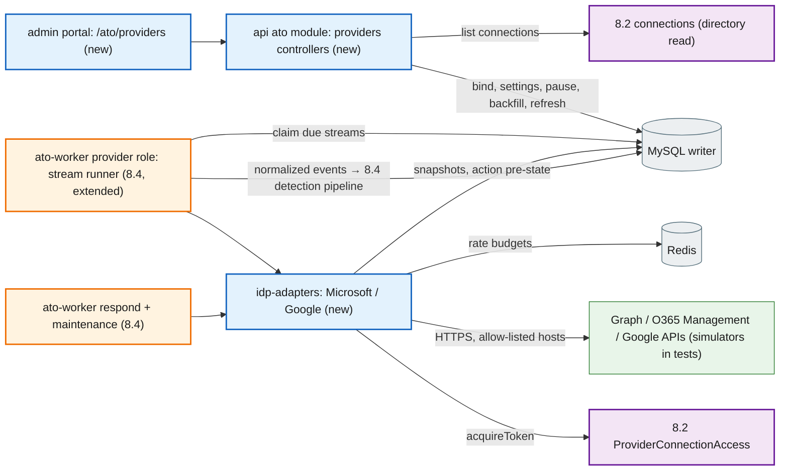

# Step 8.5: ATO identity-provider adapters (Microsoft Entra ID / Microsoft 365, Google Workspace)

**Status:** designed by the architect on 2026-11-17 on commit `00051ee` (Phases 1–7 incl. 7.3 committed; step 8.1 implemented in the working tree, not committed). (Approved by the product owner on 2026-11-17; the implementation status follows below.) Built on the **approved designs** of step 8.4 ([24-account-takeover-core.md](24-account-takeover-core.md), ADR-0070–0075 expected, topology v13, provider adapter port D15) and step 8.2 (provider-integration framework, designed in parallel as [25-m365-google-connectors.md](25-m365-google-connectors.md), ADR-0076–0081, topology v14; **read while it was still being written** — first pass with §0–§2 D1–D18, re-read the same evening (22:56 IST) with §3 data model, §4 contracts and configuration, §5 API and §6 portal present but its ADR texts, work packages and merge notes (§7–§16) not yet — and **not yet approved**: §0.3 states exactly what 8.5 uses from it, the additions 8.5 needs from it (R1–R4) and how the coupling is isolated in one binding file; §0.4 maps every 8.2 name 8.5 depends on to the 8.2 §3–§4 text; §14 says how it is reconciled at the rebase). §16 (deviations) and §17 (verification) are filled by the work packages.

**Implementation status (WP6, 2026-11-20):** implemented in six work packages (WP1–WP6, §15) in the worktree `email-gateway-wt85` (branch `build/step-8.5`) on `82e1b72` (8.4 `59f2683` and 8.2 committed), **uncommitted** (the orchestrator commits); verified locally against the provider simulators (§17). **Not complete:** live verification against real Microsoft and Google test tenants is pending (PQ7); the full `pnpm test:integration` chain, the full Playwright suite (orchestrator gate), CI and a cluster apply were not run here.

**Brief (product owner, authoritative):** [docs/plan/briefs/account-takeover-ato.md](../briefs/account-takeover-ato.md) (all of it; 8.5 completes §3C, §7 provider actions, §8, §13 "provider integration failures", §14 tests 9, 10, 13, 15 against real adapter code, §15 "identity-provider integrations functional where configured"). **Step brief:** Microsoft Entra ID / Microsoft 365 (Graph, Office 365 Management Activity) and Google Workspace (Admin SDK Reports and Directory, Gmail settings) adapters: ingestion of sign-in logs, risk events, OAuth consent grants, mailbox audit, forwarding and delegation changes; provider-confirmed response actions (session revocation, password reset, suspension, forwarding-rule removal, MFA enforcement, plus OAuth grant revocation from the 8.4 catalogue) with approvals, idempotency, rollback and status; least-privilege permissions, rate-limit and throttling handling, polling and subscription cursors, backfill, health; portal surfaces for connecting and monitoring adapters. **All tests use local fakes of the provider APIs; no real provider endpoint is ever called.**

**ADRs of the step** (numbers reserved by the product owner: **0082–0087**; full text in §8; WP3 creates the files verbatim with status "Proposed", WP6 sets "Accepted" after verification):

| ADR  | File                                                          | Decision                                                                                                                                                                                                                                                                                           |
| ---- | ------------------------------------------------------------- | -------------------------------------------------------------------------------------------------------------------------------------------------------------------------------------------------------------------------------------------------------------------------------------------------- |
| 0082 | `0082-ato-identity-provider-adapters-architecture.md`         | One package `@email-gateway/idp-adapters`, plain HTTPS clients without vendor SDKs, adapters bound per integration, built on 8.2 connections, grants, profiles and tokens and on the 8.4 port; the `ato-respond` deployment joins 8.2's credential custody and gets allow-listed HTTPS egress      |
| 0083 | `0083-ato-provider-telemetry-polling-cursors-backfill.md`     | Polling only (no inbound push endpoints), per-stream cursors with overlap/settle windows and event-id dedupe, primary and companion streams, bounded backfill in historical mode, cursor-confirmed mailbox state snapshots, rate budgets and throttling                                            |
| 0084 | `0084-ato-provider-least-privilege-and-capability-probing.md` | Six ATO permission profiles registered in 8.2's profile registry (separate apps/service accounts per profile), effective capabilities = declared ∩ granted ∩ probed ∩ configured, read-only probes, ATO health surfaced through 8.2's connection health, the linked-domain guard before any action |
| 0085 | `0085-ato-provider-confirmed-response-actions.md`             | Per-provider action semantics, read-back confirmation, pre-state capture for safe rollback, idempotency, honest `unsupported`, MFA enforcement through a tenant-designated group or organizational unit                                                                                            |
| 0086 | `0086-ato-provider-simulators-and-contract-tests.md`          | Dependency-free local simulators of Graph, Office 365 Management, Google Reports/Directory/Gmail and their token endpoints; test-only endpoint overrides refused outside `local`/`ci`; the 8.4 contract kit is a release gate                                                                      |

ADR-0087 is reserved and unused. **Topology:** 8.5 needs **no RabbitMQ topology change** (provider ingestion and health run in the ato-worker `provider` role from database rows; actions use 8.4's `ato.responses`); the reserved v15 is not taken (§14 M7).

This note is the single source for the step. Implementers see only their own work-package instructions plus this note; every name, key, table, column, route, metric and file below is binding unless an implementer records a deviation (§16) with evidence.

---

## 0. Inputs, dependencies and the parallel build

### 0.1 Build model (product owner, 2026-11-17)

After 8.1 is committed, 8.2, 8.4 and 8.5 are **implemented at the same time in separate git worktrees**; stack integration tests, gates and commits are serialized **8.4 → 8.2 → 8.5**. Reserved numbers: ADR-0076–0081 (8.2), 0082–0087 (8.5); topology v14 (8.2), v15 (8.5, unused); Prisma migration folder names sort after 8.4's and are independent (no edit of another step's migration).

8.5 is therefore split into two phases (§15):

| Phase           | Waves | Runs                                                                                                 | May touch                                                                                                                                                                                     |
| --------------- | ----- | ---------------------------------------------------------------------------------------------------- | --------------------------------------------------------------------------------------------------------------------------------------------------------------------------------------------- |
| **Pre-rebase**  | 1–2   | In the 8.5 worktree (branched from the 8.1 commit) **while 8.4 and 8.2 are being built**             | Only the new package `packages/idp-adapters/**`, `pnpm-lock.yaml` (WP1 only), this note's §16 and package notes. **No database, broker, Redis, MinIO or stack use; no existing file edited.** |
| **Post-rebase** | 3–5   | Only after 8.4 **and** 8.2 are committed and the 8.5 branch is rebased onto them (gate **G-R**, §15) | Everything listed in §13, serialized after 8.2's gate                                                                                                                                         |

Why: the adapters, their HTTP clients, mappers, cursors, snapshot logic and simulators depend only on the 8.4 port **types** and the 8.2 connection **interface**, which this note pins down (§0.2, §0.3); everything that needs 8.4 or 8.2 **code** (Prisma models, the ato-worker runner, the api module, the portal pages) waits for the rebase. The shared local MySQL is never migrated from the 8.5 worktree before 8.4 and 8.2 are committed.

### 0.2 The 8.4 port as 8.5 codes against it (D15 of the 8.4 note, verbatim types)

Pre-rebase, `packages/idp-adapters/src/port/ato-port.ts` holds a **verbatim copy** of the D15 types of the 8.4 note (`IdentityProviderKind`, `ProviderStream`, `ProviderActionType`, `ProviderCapabilities`, `ProviderIdentityRef`, `ProviderEvent`, `ProviderIngestPage`, `ProviderActionResult`, `IdentityProviderAdapter`) plus a local strict zod mirror `providerEventSchemaShim` (bounded strings: ids ≤ 128, names ≤ 256, scopes ≤ 50 × ≤ 128, ruleTraits ≤ 16 × ≤ 32, no value matching the secret-shape guard of §2.0 inv. 6) and **one additive optional field** that 8.5 needs (port extension PX1, §14):

- **PX1** `ProviderEvent.deviceLabel?: string` (≤ 96 characters, `<browser> · <os>` built by the adapter from structured provider device data; Entra sign-ins carry no raw user agent in Graph v1.0). The 8.4 pipeline uses it as the device label and `deviceIdHash` as the device hash when present.

Post-rebase (WP3) the file becomes `export type { … } from '@email-gateway/ato-detection'` (and `providerEventSchema` replaces the shim); any difference between the copy and the built 8.4 types is resolved in favour of the built types, and the adapters are adjusted (§14 M1).

8.5 adapters implement the port **plus extra methods** that the 8.5 wiring uses through a type guard (no change to the 8.4 interface): `probe(signal): Promise<ProbeReport>` (§D6) and `mailboxRefreshSupported(): boolean`.

Two further 8.4 additions are needed post-rebase (both additive, done by WP4 in 8.4's code; §14 M2, M3):

- **PX2** ProviderRegistry returns a **bound adapter per integration** (`adapterFor(integration)` through per-kind factories); the fake adapter's factory returns its single instance.
- **PX3** `RuleContext.historical: boolean` (default `false`): when `true` every rule's signal is recorded `informational` (weight 0, never scored), no incident opens or escalates, no response is proposed, no notification is requested; auth events, daily activity and baselines are still written. Used for backfilled events (D8).

### 0.3 What 8.5 uses from 8.2 (its D1–D6, D11, D12 as designed) and the port that isolates it

8.2 owns provider **connections** (`provider_connections`, one per Microsoft 365 tenant or Google Workspace customer; a provider tenant binds to at most one non-disabled connection platform-wide, 8.2 I10), **grants** per **permission profile** (`provider_connection_grants`; profiles are versioned code in `@email-gateway/provider-integrations` `src/profiles/`, one operator-owned platform app or service account per profile, or a customer-owned app/key), consent and delegation flows, **credential custody** (`PROVIDER_CREDENTIAL_ENCRYPTION_KEY`, api encrypts, workers decrypt; tokens only in process memory; 8.2 D5 names "8.5's ato-worker" as a future decrypting holder), **token acquisition** (`ProviderTokenService.getAccessToken(grantRef, signal)`), linked gateway domains with provider verification (8.2 D4), connection health with a check registry (`registerHealthChecks`, run by its integration-worker; health transitions publish `integration.connection.health_changed.v1`, the webhook `integration.health_changed` and the alert `integration_unhealthy`, 8.2 D12) and the local `provider-fake` (Compose) / `FakeProviderServer` (in-process). 8.5 builds on exactly that and never stores a credential or a token.

**What 8.5 adds to 8.2's package (post-rebase, WP3; new files plus one import line each, 8.2 D1 and D6 provide the seams):**

- `packages/provider-integrations/src/profiles/ato.ts`: the six ATO profiles of D5 (`purpose` `ato_telemetry` or `ato_response`), registered by one import line in `src/profiles/index.ts`.
- `packages/provider-integrations/src/health/ato.ts`: the check `ato.identity_provider` (D11), registered with `registerHealthChecks`.
- Platform app configuration keys for the ATO profiles (D5, §4.2), following 8.2's `PROVIDER_M365_MAILFLOW_APP_*` / `PROVIDER_GOOGLE_MAILFLOW_SA_KEY_FILE` pattern.

**Four requirements on 8.2's built code (R1–R4; WP3 adds them additively if 8.2 did not, recorded as deviations; §14 M4):**

- **R1 Token options:** `getAccessToken(grantRef, signal, options?: { resource?: 'graph' | 'o365_management'; subject?: string })`. Microsoft telemetry needs a second resource (`https://manage.office.com/.default`) for the Office 365 Management Activity API; Google Gmail settings reads and writes impersonate **each user** (domain-wide delegation `sub` = the user), not the grant's delegated admin. The cache key gains `(resource, subject)`; per-user Google tokens are cached in memory like every other token (≤ `ATO_IDP_GMAIL_TOKEN_CACHE_MAX` 2 000 subjects, LRU).
- **R2 Purpose-scoped generic checks:** 8.2's generic per-grant checks (`credentials.token`, `permissions.granted`) **skip grants whose profile purpose starts with `ato_`** — the integration-worker holds no ATO credentials; the ato-worker's probe (D6) covers those grants and its result reaches 8.2's health through `ato.identity_provider`.
- **R4 Token fake for ATO resources:** 8.2's `provider-fake` (Compose, `infrastructure/provider-fake/**`, port 8480, host port `PROVIDER_FAKE_HOST_PORT` 18093) and its in-process `FakeProviderServer` must issue client-credentials tokens for the scope `https://manage.office.com/.default` and Google JWT-bearer tokens whose `sub` is any user of a linked domain (not only the delegated admin), and must accept the ATO platform client ids of §4.2 (or the customer-owned methods used by the stack suite). If 8.2 built them narrower, WP3 extends them **additively** (new scope/subject branches only, its existing tests unchanged) and records the deviation.
- **R3 Custody list:** the `ato-respond` deployment (roles `respond,maintenance,provider`) holds `PROVIDER_CREDENTIAL_ENCRYPTION_KEY` (+ `_PREVIOUS`) for customer-owned ATO credentials and the platform ATO app/service-account credentials; the api holds only the ATO platform client ids (consent URLs); `ato-detect` and the integration-worker hold no ATO credential (ADR-0082 amends ADR-0077).

**The port** (`packages/idp-adapters/src/port/connection-port.ts`) keeps the adapters independent of 8.2's code, so they can be written before 8.2 exists and only one binding file changes if 8.2's names change:

```ts
export type ConnectionProvider = 'microsoft_365' | 'google_workspace'; // 8.2 provider values

export interface ProviderGrantView {
  publicId: string;
  profile: string; // e.g. 'm365.ato_telemetry' (D5)
  status: 'active' | 'pending' | 'error' | 'revoked'; // 8.2 grant states mapped to these four
  observedPermissions: readonly string[] | null; // as 8.2 last verified them (Microsoft `roles` claim; Google: the profile scopes once a token was obtained)
  subjectEmail: string | null; // Google: delegated admin for Admin SDK calls
}

export interface ProviderConnectionView {
  publicId: string; // 8.2 connection public id = ato_provider_integrations.connector_ref
  organizationId: string; // decimal string; echo-checked by every caller
  provider: ConnectionProvider;
  displayName: string; // ≤ 128
  status: 'configuring' | 'active' | 'error' | 'disabled'; // 8.2 connection states mapped to these four
  externalTenantId: string | null; // Entra tenant id / Google customer id (verified by 8.2)
  linkedDomains: readonly { name: string; providerVerified: boolean }[]; // 8.2 D4; gateway TXT-verified by construction
  grants: readonly ProviderGrantView[];
  updatedAt: string; // ISO
}

export interface ProviderAccessToken {
  accessToken: string; // memory only: never logged, persisted, returned or put in an error
  expiresAt: number; // epoch ms
}

export type TokenResource = 'graph' | 'o365_management' | 'google';

export class ConnectionAccessError extends Error {
  constructor(
    readonly code:
      | 'connection_not_found'
      | 'connection_inactive'
      | 'grant_missing'
      | 'consent_missing'
      | 'scope_not_granted'
      | 'credentials_invalid'
      | 'provider_unavailable'
      | 'throttled',
    readonly retryAfterMs?: number,
  ) {
    super(code);
  }
}

export interface ProviderConnectionAccess {
  get(
    organizationId: string,
    connectionPublicId: string,
    signal: AbortSignal,
  ): Promise<ProviderConnectionView | null>;
  list(organizationId: string, signal: AbortSignal): Promise<ProviderConnectionView[]>;
  acquireToken(
    connection: ProviderConnectionView,
    request: { profile: string; resource: TokenResource; subject?: string }, // R1
    signal: AbortSignal,
  ): Promise<ProviderAccessToken>; // throws ConnectionAccessError
}
```

Pre-rebase, `src/testing/in-memory-connections.ts` implements the port by minting `EXAMPLE-sim-token-<n>` tokens registered with the in-process simulators (granted permissions per token, so permission failures are real). Post-rebase, WP3 writes `packages/idp-adapters/src/bindings/provider-connections.ts` over `ProviderGrantStore`, `ProviderTokenService` and 8.2's connection reads (worker) and `connection-directory.ts` (api, read-only listing) — **the only files that know 8.2's names**.

**8.2 clients not reused for adapter traffic (not duplication):** 8.2's `MicrosoftGraphClient` and `GoogleAdminClient` are read-only (`get`, `list`), cover two of the four API families, cap bodies at 1 MiB and `Retry-After` at 60 s (8.2 D2). ATO needs writes (actions), the Office 365 Management and Gmail families, multi-megabyte audit blobs and longer provider back-offs. 8.5's `ProviderHttpClient` (D2) follows the same rules (configured origins only, `redirect: 'error'`, byte caps, classified errors without bodies or tokens) and maps its codes onto 8.2's vocabulary where they overlap; if 8.2 exports a lower-level request primitive with method, body and limit options, WP3 switches the transport of `ProviderHttpClient` to it and records the change (§14 M4).

### 0.4 Reconciliation with the 8.2 note §3–§4 (binding for WP3's `src/bindings/*.ts`; the built 8.2 code wins over this table)

| 8.5 port (§0.3)                                            | 8.2 name as designed (25-m365-google-connectors.md)                                                                                                                                                                                      | Mapping rule                                                                                                                                                                                                                                                                                                                                                                                                                |
| ---------------------------------------------------------- | ---------------------------------------------------------------------------------------------------------------------------------------------------------------------------------------------------------------------------------------- | --------------------------------------------------------------------------------------------------------------------------------------------------------------------------------------------------------------------------------------------------------------------------------------------------------------------------------------------------------------------------------------------------------------------------- |
| `ConnectionProvider`                                       | Prisma enum `IntegrationProvider { microsoft_365 google_workspace }`; TS `IntegrationProvider`                                                                                                                                           | identical values                                                                                                                                                                                                                                                                                                                                                                                                            |
| `ProviderConnectionView.status`                            | `ProviderConnectionStatus { draft connecting configuring active disabled }` (health is a separate `health_status`: `unknown healthy warning critical`)                                                                                   | `draft`, `connecting`, `configuring` → `configuring`; `active` → `active`; `disabled` → `disabled`. The port value `error` is **never produced** from 8.2 (kept so a later 8.2 state can map to it without a port change); a connection with `health_status = critical` stays `active` for ATO (ATO judges its own grants by probing, D6).                                                                                  |
| `ProviderConnectionView.externalTenantId`                  | `provider_connections.external_tenant_id` (set only when `tenant_verified_at` is not null)                                                                                                                                               | `null` unless `tenant_verified_at` is set                                                                                                                                                                                                                                                                                                                                                                                   |
| `ProviderConnectionView.linkedDomains`                     | `provider_connection_domains` (gateway domain id) + `provider_verification` (`ProviderDomainVerification { unknown verified unverified absent alias }`)                                                                                  | `name` from the gateway `domains` row; `providerVerified = provider_verification = 'verified'` (`alias` is **not** verified for the linked-domain guard, inv. 4)                                                                                                                                                                                                                                                            |
| `ProviderGrantView.status`                                 | `ProviderGrantStatus { pending_consent verifying active error revoked }`                                                                                                                                                                 | `pending_consent`, `verifying` → `pending`; others identical                                                                                                                                                                                                                                                                                                                                                                |
| `ProviderGrantView.observedPermissions`                    | `provider_connection_grants.observed_permissions` JSON                                                                                                                                                                                   | as stored; `null` when never verified                                                                                                                                                                                                                                                                                                                                                                                       |
| `ProviderGrantView.subjectEmail`                           | `provider_connection_grants.subject_email`                                                                                                                                                                                               | identical                                                                                                                                                                                                                                                                                                                                                                                                                   |
| `acquireToken(connection, { profile, resource, subject })` | `ProviderTokenService.getAccessToken(grant: GrantRef { organizationId: bigint; connectionPublicId; profile }, signal) → { token, expiresAt: Date, observedPermissions }` + R1 options                                                    | `organizationId` parsed with `BigInt`; `resource: 'graph' \| 'google'` → no option (8.2 default), `'o365_management'` → R1 `{ resource: 'o365_management' }`; `subject` → R1 `{ subject }`; result `{ accessToken: token, expiresAt: expiresAt.getTime() }`                                                                                                                                                                 |
| `ConnectionAccessError.code`                               | `ProviderErrorCode` (`invalid_client`, `consent_missing`, `unauthorized_client`, `tenant_not_found`, `forbidden`, `throttled`, `unavailable`, `timeout`, `bad_response`, `credential_unavailable`)                                       | `invalid_client`, `unauthorized_client`, `credential_unavailable` → `credentials_invalid`; `consent_missing` → `consent_missing`; `tenant_not_found` → `connection_inactive`; `forbidden` → `scope_not_granted`; `throttled` → `throttled` (with `retryAfterMs`); `unavailable`, `timeout`, `bad_response` → `provider_unavailable`; no grant row for the profile → `grant_missing`; grant not `active` → `consent_missing` |
| Profile registration                                       | `PermissionProfile { key, version, provider, purpose, readOnly, permissions, authMethods, platformApp: { clientIdKey, secretKey?, certFileKey?, certThumbprintKey?, saKeyFileKey? }, title, description }`; `registerPermissionProfiles` | D5 profiles use these fields exactly; `platformApp` names the §4.2 `PROVIDER_*_ATO_*` keys                                                                                                                                                                                                                                                                                                                                  |
| Health check registration                                  | `HealthCheckDefinition { code, provider, severityOnFail, periodic, title, remediation }`, `registerHealthChecks`, results upserted into `provider_health_checks (connection_id, check_code, subject)`                                    | `ato.identity_provider`: `provider: 'any'`, `severityOnFail: 'warning'`, `periodic: true`, `subject = ''`                                                                                                                                                                                                                                                                                                                   |
| Credential key                                             | `PROVIDER_CREDENTIAL_ENCRYPTION_KEY` (+ `_PREVIOUS`), "read by api (encrypt), integration-worker"                                                                                                                                        | R3 adds the ato-worker (only the `ato-respond` deployment receives it in Kubernetes)                                                                                                                                                                                                                                                                                                                                        |
| Endpoints                                                  | `PROVIDER_M365_LOGIN_URL`, `PROVIDER_M365_GRAPH_URL`, `PROVIDER_GOOGLE_TOKEN_URL`, `PROVIDER_GOOGLE_ADMIN_URL`, `PROVIDER_ALLOW_HTTP_ENDPOINTS`                                                                                          | token endpoints are used only through 8.2's token service; the ATO data endpoints are the separate `ATO_IDP_*_BASE_URL` keys (D2)                                                                                                                                                                                                                                                                                           |
| Organization purge                                         | `ProviderTenantDataRepository.purgeOrganization` deletes 8.2 tables then `provider_connections`                                                                                                                                          | independent: 8.5's tables reference connections only by public id; 8.5's rows are purged with 8.4's `ato_*` rows (§4.1 "Purge and export")                                                                                                                                                                                                                                                                                  |

Items of the 8.2 note not yet written at the re-read (ADR texts, work packages, merge notes) cannot change this table except through 8.2's built code; WP3 re-reads the committed 8.2 note and code at gate G-R and records any difference in §16.

---

## 1. Gap analysis (inspected read-only at `00051ee`, the 8.1 working tree, the approved 8.4 design and the 8.2 note as far as written on 2026-11-17)

### 1.1 What exists and what 8.4/8.2 will add

| Area                                                                        | State                                                                                                                                                                                                                                                                                                                                                                                                                            | 8.5 decision                                                                                                                                                |
| --------------------------------------------------------------------------- | -------------------------------------------------------------------------------------------------------------------------------------------------------------------------------------------------------------------------------------------------------------------------------------------------------------------------------------------------------------------------------------------------------------------------------- | ----------------------------------------------------------------------------------------------------------------------------------------------------------- |
| Identity-provider code                                                      | None. Microsoft 365 / Google Workspace exist only as **destination presets** (`apps/api/src/modules/domain-destinations`, `docs/domains/destination-servers.md`); the portal Integrations page shows an `UnavailableState step="8.2"` (`apps/admin-portal/src/features/integrations/integrations-page.tsx`); `PLAN_STEPS['8.2']` in `navigation.ts`.                                                                             | New package `@email-gateway/idp-adapters`; no change to destinations.                                                                                       |
| Provider port (8.4 D15, designed)                                           | Types, `providerEventSchema`, `ProviderRegistry`, `normalizeProviderEvent`, `FakeIdentityProviderAdapter`, `describeProviderAdapterContract` in `packages/ato-detection/src/{provider,testing}`; runner in `apps/ato-worker/src/provider/**` (role `provider`); provider actions through `ato.responses` (role `respond`); maintenance calls `confirm`.                                                                          | Implement two adapters against it; three additive extensions PX1–PX3 (§0.2); the runner moves from integration-level to stream-level scheduling (D7).       |
| `ato_provider_integrations` (8.4)                                           | `provider`, `connector_ref` (opaque), `binding_key`, `status`, `capabilities` JSON, `cursors` JSON, failure counters, `next_poll_at`; **no API creates rows in 8.4** (tests insert them).                                                                                                                                                                                                                                        | Extend (columns, §4.1); `cursors` becomes unused (kept, documented deprecated); bindings created through the new api routes (§6).                           |
| `ato_account_identities` (8.4)                                              | Provider identity ↔ mailbox account (`provider`, `external_id`, hash, UPN).                                                                                                                                                                                                                                                                                                                                                      | Extend with `integration_id`, directory status and refresh request (§4.1).                                                                                  |
| `ato_response_actions` (8.4)                                                | Catalogue incl. the six provider actions; states incl. `executing`, `rollback_requested`; `provider_reference`, `provider_status`, `next_check_at`.                                                                                                                                                                                                                                                                              | Extend with `integration_id` and `provider_state` (pre-state for rollback, §4.1).                                                                           |
| Rules M1–M4, Q1, Q2, R1, X5 (8.4)                                           | Implemented and tested against the fake adapter only; status "Port (8.5)".                                                                                                                                                                                                                                                                                                                                                       | Fed with real normalized provider events (§3.2 mapping).                                                                                                    |
| Outbound HTTP                                                               | Hardened clients exist for tenant-controlled destinations (`packages/url-security/src/net/guarded-post.ts`, egress proxy); `jose` in the api; no vendor SDK anywhere.                                                                                                                                                                                                                                                            | A provider HTTPS client with a **fixed host allow-list** (destinations are provider endpoints, not tenant input); no vendor SDK (D2).                       |
| Connections, grants, credentials, tokens, connection health (8.2, designed) | `@email-gateway/provider-integrations`: profiles registry (`registerPermissionProfiles`, purposes `mail_flow`, and `ato_telemetry`/`ato_response` reserved for 8.5), `ProviderGrantStore`, `ProviderTokenService`, read-only Graph/Google Admin clients, `HEALTH_CHECKS` registry, `FakeProviderServer`; integration-worker; `provider-fake` Compose service; I10 one tenant ↔ one connection; linked, provider-verified domains | Consume through `ProviderConnectionAccess` (§0.3) plus R1–R3; register six ATO profiles and one health check; 8.5 stores no credential or token             |
| Test fakes                                                                  | Dependency-free Node test servers in Compose (`infrastructure/webhook-receiver/server.mjs`, `infrastructure/url-test`), profile `smtp-test`; 8.2 adds `provider-fake` (tokens and its four read endpoints).                                                                                                                                                                                                                      | In-process simulators of the ATO endpoints + one Compose `idp-simulator` service in `smtp-test`; tokens in the stack come from 8.2's `provider-fake` (D12). |
| Kubernetes egress                                                           | NetworkPolicies per workload; 8.4 D20: ato-worker has no Internet egress.                                                                                                                                                                                                                                                                                                                                                        | `ato-respond` (roles `respond,maintenance,provider`) gains HTTPS egress to public addresses; `ato-detect` unchanged (D2, ADR-0082).                         |

### 1.2 Brief traceability (what 8.5 closes)

| Brief requirement                                                                                                     | Design                                                                                                             | Status after 8.5                                                                               |
| --------------------------------------------------------------------------------------------------------------------- | ------------------------------------------------------------------------------------------------------------------ | ---------------------------------------------------------------------------------------------- |
| §8 sign-in logs                                                                                                       | Entra `auditLogs/signIns`; Google Reports `login` (§3.2)                                                           | Built (Entra needs P1/P2 for API access; probed, D6)                                           |
| §8 risk events                                                                                                        | Entra `identityProtection/riskDetections`; Google `login` suspicious/hijack event names                            | Built (Entra P2 for full detail; probed)                                                       |
| §8 OAuth application activity; §3C suspicious OAuth consent or token usage                                            | Entra `directoryAudits` consent activities; Google Reports `token`; Entra token risk detections → `session_events` | Built (Google token anomalies: not available, §12)                                             |
| §8 mailbox audit; forwarding rule changes; delegation changes; §3C mailbox access, forwarding, inbox rules, delegates | Office 365 Management `Audit.Exchange`; Graph `messageRules`; Gmail settings snapshots                             | Built (Google mailbox **access**: not available; owner `MailItemsAccessed`: not ingested, PQ4) |
| §8 session and token events                                                                                           | Entra token risk detections                                                                                        | Built for Entra; Google: not available                                                         |
| §7 revoke sessions/tokens; require MFA; suspend; password reset; remove forwarding rules                              | §3.3 action matrix                                                                                                 | Built (M365 mailbox-level forwarding: `unsupported`, manual guidance, PQ3)                     |
| §7 safeguards: approval, idempotency, rollback, recorded, "never claim success unless the provider confirms"          | 8.4 response machine + D9                                                                                          | Built (read-back confirmation; pre-state rollback)                                             |
| §8 "do not assume every IdP exposes the same events or permissions"                                                   | D5, D6 capability model                                                                                            | Built                                                                                          |
| §11 provider integration configuration                                                                                | §7 portal                                                                                                          | Built                                                                                          |
| §13 provider integration failures                                                                                     | D11 metrics, alerts; 8.2 connection health, webhook and alert through `ato.identity_provider`                      | Built                                                                                          |
| §14 tests 9, 10, 13, 15                                                                                               | §11 (simulators, stack suite)                                                                                      | Built against local simulators; real tenants need customer test tenants                        |
| §15 "identity-provider integrations are functional where configured"                                                  | Whole step                                                                                                         | Built; live verification needs customer test tenants (§12)                                     |

### 1.3 What is NOT duplicated

No second connection, grant, credential, consent, token store, connection health machine, health webhook or health alert (8.2: ATO health reaches tenants through 8.2's `integration.health_changed` webhook and `integration_unhealthy` alert, D11); no second ATO pipeline, incident model, response state machine, approval flow or notification channel (8.4); no vendor SDK; no new queue; no new permission (bindings use 8.4's `ato:configure`, actions 8.4's `ato:respond`, reads `ato:read`, mailbox refresh `ato:manage`); no copy of directory data beyond the identity mapping 8.4 already defined; no provider payload stored raw.

---

## 2. Architecture and decisions

### 2.0 Invariants

1. **No real provider endpoint in any test.** Endpoint overrides are honoured only when `APP_ENV ∈ {local, ci}`; otherwise the configured base URL must equal the production default and the process refuses to start (D12).
2. **No secret leaves memory.** Access tokens live only inside a request; the HTTP client strips `Authorization` from every error, log and metric; provider error bodies are reduced to a code (≤ 64 characters from an allow-list) before they leave the client.
3. **Tenant from trusted context; one directory, one organization.** Integrations are rows of one organization; the 8.2 connection is echo-checked for the organization; a provider tenant belongs to at most one connection platform-wide (8.2 I10) and a connection to at most one active integration (D4).
4. **Linked-domain guard.** No provider action is executed for an identity whose primary address domain is not one of the connection's **linked domains that are TXT-verified at the gateway and verified in the provider tenant** (8.2 D4, I10) (D9). Ingested events of identities in other domains are dropped (counted `foreign_domain`).
5. **Never claim what did not happen.** `confirmed` only after a provider `2xx` **and**, for state-changing actions, a read-back that shows the requested state (D9); timeouts end `failed` with `provider_status = 'unconfirmed'`.
6. **Data minimization.** Normalized events only (8.4 `providerEventSchema`): no message content, no rule keywords, no forwarding or delegate **addresses** (domain and hashes only), no raw provider payload, no token-shaped value; `ProviderEvent` strings bounded.
7. **Reads never write.** Health probes and ingestion perform only reads, except the idempotent Office 365 Management subscription start (D7.4); every write is a 8.4 response action.
8. **Least privilege, honestly reported.** Capabilities are what was granted and what a probe proved, never assumed from the profile (D6).
9. **Idempotent everywhere.** Page keys (8.4 `providerPageKey`), event-id dedupe, cursor-confirmed snapshots, action pre-state and natural idempotency of provider writes.
10. **The mail path is untouched.** All provider I/O runs in the ato-worker `provider`, `respond` and `maintenance` roles.

### 2.1 Data flow



### D1. One adapter package, bound per integration (ADR-0082)

- **Package** `packages/idp-adapters` (`@email-gateway/idp-adapters`, pure library, dependency `zod` only; no vendor SDK). Layout (§4.4).
- **Factory** `createIdpAdapter(kind: 'microsoft_entra' | 'google_workspace', deps: AdapterDeps): IdentityProviderAdapter & IdpAdapterExtras` with

```ts
interface AdapterDeps {
  integration: {
    id: string;
    publicId: string;
    organizationId: string;
    provider: 'microsoft_entra' | 'google_workspace';
    connectionPublicId: string; // = ato_provider_integrations.connector_ref
    settings: IdpBindingSettings; // ato-idp-binding/1 (D10)
    health: IdpHealthDetail | null; // last probe (capabilities are derived from it, D6)
  };
  connections: ProviderConnectionAccess; // §0.3
  http: ProviderHttpClient; // D2
  budget: RateBudget; // D7.5
  mailboxState: MailboxStateStore; // D8.3
  actionState: ActionStateStore; // D9.3
  clock: () => Date;
  config: IdpAdapterConfig; // base URLs, timeouts, windows, page sizes (§5.1)
  metrics?: IdpMetricsSink; // counters without tenant labels
}
interface IdpAdapterExtras {
  probe(signal: AbortSignal): Promise<ProbeReport>;
  mailboxRefreshSupported(): boolean;
}
```

- **Versions:** Microsoft adapter `version = 'msgraph-ato/1'`, Google `version = 'gws-ato/1'`; recorded by 8.4 with every provider signal's evidence (`source_ref`) and action log.
- **Kinds:** 8.4's `IdentityProviderKind` (`microsoft_entra`, `google_workspace`) is used everywhere in ATO; 8.2's `ConnectionProvider` (`microsoft_365`, `google_workspace`) only in the connection port. Mapping `microsoft_365 → microsoft_entra`, `google_workspace → google_workspace` lives in `src/kinds.ts`.

### D2. Provider HTTPS client (ADR-0082)

`ProviderHttpClient` (`src/core/http.ts`) on Node's global `fetch`:

- **Host allow-list** per API family, from config: `graph` (`ATO_IDP_GRAPH_BASE_URL`, default `https://graph.microsoft.com`; `.env.example` value `${PROVIDER_M365_GRAPH_URL}`, 8.2's key), `o365` (`ATO_IDP_O365_MANAGEMENT_BASE_URL`, default `https://manage.office.com`), `google_admin` (`ATO_IDP_GOOGLE_ADMIN_BASE_URL`, default `https://admin.googleapis.com`; `.env.example` value `${PROVIDER_GOOGLE_ADMIN_URL}`), `gmail` (`ATO_IDP_GMAIL_BASE_URL`, default `https://gmail.googleapis.com`). A request URL whose origin is not the family's configured origin is refused (`blocked_host`), including `@odata.nextLink`, `NextPageUri` and `contentUri` values returned by the provider (only the path and query of a same-origin link are followed). `https:` only; `http:` only when 8.2's `PROVIDER_ALLOW_HTTP_ENDPOINTS=true` (itself refused outside `APP_ENV ∈ {local, ci}`; pre-rebase the adapter config takes an `allowHttpEndpoints` boolean that WP3 wires to that key). The ATO keys stay separate from 8.2's so the stack can point ATO traffic at `idp-simulator` while 8.2's traffic goes to `provider-fake`.
- **No redirects** (`redirect: 'error'`), no cookies, no proxy environment variables, `User-Agent: EmailGateway-ATO/1`, `Accept: application/json`, Graph `client-request-id` = a fresh UUID per request (returned as part of the provider reference).
- **Timeouts and caps:** `ATO_IDP_HTTP_TIMEOUT_MS` (15 000) total per request via `AbortSignal.any([signal, timeout])`; response body read up to `ATO_IDP_HTTP_MAX_RESPONSE_BYTES` (8 MiB; larger → `response_too_large`, retryable `false`); JSON parsed then validated by a per-endpoint zod schema (`.passthrough()` only where the provider adds fields; every field 8.5 reads is typed and bounded).
- **Error classification** (`src/core/errors.ts`, `ProviderCallError { code, retryable, retryAfterMs?, status? }`): `401` → `unauthorized` (token rejected; the cached token is dropped once and the request retried once); `403` → mapped by provider error code to `missing_permission` | `missing_license` | `forbidden`; `404` → `not_found`; `409`/`412` → `conflict`; `429` and Google `403` with reason `rateLimitExceeded`/`userRateLimitExceeded` → `throttled` (retryable, `retryAfterMs` from `Retry-After` seconds or HTTP date, else exponential 1 s → 64 s with full jitter, capped `ATO_IDP_MAX_BACKOFF_MS` 900 000); Google `dailyLimitExceeded`/`quotaExceeded` → `quota_exhausted` (retryable, 3 600 000 ms); `5xx`, network and timeout → `provider_unavailable` (retryable); schema failure → `unexpected_response` (not retryable; counted). Codes are an exported constant `PROVIDER_ERROR_CODES` (≤ 64 characters each).
- **Redaction:** errors and logs never contain headers, tokens, URLs with query strings, or response bodies; a debug log line carries family, method, path template (e.g. `/v1.0/users/{id}/revokeSignInSessions`), status and duration.

### D3. Providers, streams and roles (ADR-0083; mapping in §3)

Every provider declares, per 8.4 stream, `role: 'primary' | 'companion' | 'unsupported'`. A **primary** stream is polled with its own cursor. A **companion** stream's events are produced by its primary's polls (one provider feed carries several kinds of events); the runner never polls a companion (its `ingest` returns `{ events: [], cursor: 'companion:v1:<primary>', hasMore: false }`, which satisfies the 8.4 contract kit), its capability is `supported` iff the primary is, and its health mirrors the primary. Events of a disabled stream are dropped by the adapter before they leave a page (counted `stream_disabled`).

| Stream (8.4)         | Microsoft                                                                                             | Google                                                                       |
| -------------------- | ----------------------------------------------------------------------------------------------------- | ---------------------------------------------------------------------------- |
| `sign_ins`           | primary: Graph `GET /v1.0/auditLogs/signIns`                                                          | primary: Reports `activities.list` app `login`                               |
| `risk_events`        | primary: Graph `GET /v1.0/identityProtection/riskDetections`                                          | companion of `sign_ins` (suspicious and hijack events)                       |
| `session_events`     | companion of `risk_events` (token risk detection types)                                               | unsupported                                                                  |
| `oauth_consents`     | primary: Graph `GET /v1.0/auditLogs/directoryAudits` (consent activities)                             | primary: Reports app `token` (`authorize`)                                   |
| `mailbox_audit`      | primary: Office 365 Management `Audit.Exchange` + Graph `messageRules` (targeted fetch, weekly sweep) | companion of `forwarding_changes` (filters)                                  |
| `forwarding_changes` | companion of `mailbox_audit`                                                                          | primary: Gmail settings snapshot sweep (auto-forwarding, filters, delegates) |
| `delegation_changes` | companion of `mailbox_audit`                                                                          | companion of `forwarding_changes` (delegates)                                |

### D4. Bindings: an ATO integration over an 8.2 connection (ADR-0084)

- An **integration** (8.4 `ato_provider_integrations` row) binds one 8.2 connection to ATO for one organization: `connector_ref` = the connection public id; `binding_key` = SHA-256(`provider|connector_ref`) (8.4, unique per organization). At most one non-disabled integration per connection (the api checks under a `SELECT … FOR UPDATE` of the connection's integrations) and at most `ATO_IDP_MAX_INTEGRATIONS_PER_ORG` (5) non-disabled integrations per organization. Because a provider tenant belongs to at most one connection platform-wide (8.2 I10), a directory is bound to at most one organization; 8.5 adds no second uniqueness rule.
- **Eligibility:** the connection exists in the caller's organization (echo-checked), its provider maps to an ATO kind, its status is `active` (8.2 I10: tenant verified, ≥ 1 linked domain verified in the provider tenant — so ATO-only customers still complete 8.2's `connect` and `domains` steps with the read-only mail-flow grant; PQ9), its `*.ato_telemetry` grant is `active`, and the organization has `ato_detection` enabled (8.4 PO1). Response grants are optional and may be added later through 8.2's grant routes; capabilities follow (D6).
- **Lifecycle:** `active` → `paused` (by a user, or automatically `paused_reason = 'connection_inactive'` / `'telemetry_grant_inactive'` while the connection or the telemetry grant is not active) → `active`; `error` (8.4: after `ATO_PROVIDER_MAX_CONSECUTIVE_FAILURES`; recovers when a probe passes); `disabled` (unbound by a user, or `disabled_reason = 'connection_removed'` when 8.2 disables the connection or no longer returns it). Disabled integrations stop every poll, probe and action (pending provider actions of the integration end `failed` `integration_disabled`); their stream rows and mailbox items are deleted by the maintenance role after 30 days; signals, auth events and actions stay (8.4 retention).
- **Streams:** creating an integration creates one `ato_provider_streams` row per 8.4 stream with the provider's role (§D3), `enabled` from settings, `status = 'backfilling'` when `settings.backfillDays > 0` else `active`, `next_poll_at = now`. A first probe runs immediately (`next_health_at = now`).

### D5. Least-privilege permission profiles (ADR-0084)

Six profiles registered in 8.2's registry (`packages/provider-integrations/src/profiles/ato.ts`; 8.2's `PermissionProfile` fields of its §4.3: `key`, `version`, `provider`, `purpose`, `readOnly`, `permissions`, `authMethods` (all four 8.2 methods for the matching provider), `platformApp` (the `PROVIDER_M365_ATO_*` / `PROVIDER_GOOGLE_ATO_*` key names of §4.2), `title`, `description`). Following 8.2 D1 ("one platform app per profile"), **each profile is its own Microsoft multi-tenant app / Google service account with a disjoint permission set**, consented or delegated separately through 8.2's grant routes, so a tenant that wants telemetry only never grants a write permission. Profiles carry the reads their own actions need for read-back. The catalogue is also exported by 8.5 as `PERMISSION_REQUIREMENTS` (`src/requirements.ts`: which profile and permission each stream and action needs, licences, notes), served by `GET /ato/providers/requirements` and documented in `docs/deployment/ato-identity-providers.md`. **The permission names follow the providers' published references as known at design time; WP1/WP2 encode them as data, the operator verifies them at app registration, and a wrong or missing name shows as `missing_permission` in probes, never as a silent capability.**

**Microsoft (application permissions; Graph unless noted):**

| Profile key                  | Purpose         | `readOnly` | Permissions                                                                                                                                                                                                                                                 | Enables                                                                                                |
| ---------------------------- | --------------- | ---------- | ----------------------------------------------------------------------------------------------------------------------------------------------------------------------------------------------------------------------------------------------------------- | ------------------------------------------------------------------------------------------------------ |
| `m365.ato_telemetry`         | `ato_telemetry` | yes        | `AuditLog.Read.All`, `Directory.Read.All` (required with sign-in log reads; also service-principal reads for publisher verification), `IdentityRiskEvent.Read.All`, `User.Read.All`, `MailboxSettings.Read`; Office 365 Management APIs `ActivityFeed.Read` | all six supported streams, identity resolution, rule traits                                            |
| `m365.ato_response`          | `ato_response`  | no         | `User.Read.All`, `User.RevokeSessions.All`, `User.EnableDisableAccount.All`, `User-PasswordProfile.ReadWrite.All`, `MailboxSettings.ReadWrite`                                                                                                              | `revoke_sessions`, `suspend_account`, `require_password_reset`, `remove_forwarding_rule` (inbox rules) |
| `m365.ato_response_extended` | `ato_response`  | no         | `User.Read.All`, `GroupMember.ReadWrite.All` (MFA group), `DelegatedPermissionGrant.ReadWrite.All` (OAuth grant revocation; very powerful, PQ13)                                                                                                            | `require_mfa`, `revoke_oauth_grant`                                                                    |

Licensing (probed, D6): Graph sign-in logs need Entra ID P1 or P2; full risk detections need P2 (otherwise `riskLevel` is `hidden`); the Management Activity API needs unified audit logging. Some writes also need an Entra **directory role** for the app (e.g. password-profile updates of privileged users); the provider answers `403` and the action ends `failed` `missing_privileged_role`, never `succeeded`.

**Google (OAuth scopes for domain-wide delegation; prefix `https://www.googleapis.com/auth/`):**

| Profile key                    | Purpose         | `readOnly`    | Scopes                                                                                                                                                                                                                        | Enables                                                                                                                       |
| ------------------------------ | --------------- | ------------- | ----------------------------------------------------------------------------------------------------------------------------------------------------------------------------------------------------------------------------- | ----------------------------------------------------------------------------------------------------------------------------- |
| `google.ato_telemetry`         | `ato_telemetry` | no (see note) | `admin.reports.audit.readonly`, `admin.directory.user.readonly`, `gmail.settings.basic`                                                                                                                                       | `sign_ins`, `risk_events`, `oauth_consents`, `forwarding_changes`, `mailbox_audit`, `delegation_changes`; identity resolution |
| `google.ato_response`          | `ato_response`  | no            | `admin.directory.user` (suspend, password change at next sign-in), `admin.directory.user.security` (sign-out, token revocation), `gmail.settings.basic` (filter deletion), `gmail.settings.sharing` (disable auto-forwarding) | `revoke_sessions`, `suspend_account`, `require_password_reset`, `remove_forwarding_rule`, `revoke_oauth_grant`                |
| `google.ato_response_extended` | `ato_response`  | no            | `admin.directory.user`, `admin.directory.orgunit.readonly`                                                                                                                                                                    | `require_mfa` (move to a tenant-designated 2SV-enforced organizational unit, PQ2)                                             |

Note: Gmail has no read-only scope for settings that excludes mail content; `gmail.settings.basic` is the narrowest scope that reads filters, auto-forwarding and delegates, and it technically allows managing filters. The telemetry adapter never issues a write with it (unit test on the simulator call log; reads only), and the profile is marked `readOnly: false` with that explanation (8.2's mail-flow deny list does not apply to `ato_*` purposes; PQ14).

Admin SDK calls impersonate the grant's delegated admin (`subjectEmail`); Gmail settings calls impersonate each user (R1).

### D6. Health, probes and effective capabilities (ADR-0084)

- **Probe** (`adapter.probe(signal)`, read-only) runs at `next_health_at` (`ATO_IDP_HEALTH_INTERVAL_SECONDS`, 900), after a bind, on `POST …/health-check`, and after 3 consecutive failures of any stream. Steps: (1) the 8.2 connection view (status, grants and their observed permissions, linked domains, external tenant id; a connection that is no longer `active` ⇒ integration `paused` `connection_inactive`); (2) token acquisition per active ATO grant and resource (Google: Admin SDK as the delegated admin; a refused scope ⇒ `missing_permission` for every capability that needs it); (3) one cheap read per primary stream (`$top=1` / `maxResults=1` over a 1-hour window) mapping provider errors to `missing_permission`, `missing_license`, `not_configured` or `error`; (4) action prerequisites without writing: the response grant active and its permission observed; `require_mfa` needs `settings.mfaEnforcement` configured and the group or OU readable; (5) Google gmail streams: impersonation of one active user of a linked domain (the first from `users.list`) must succeed.
- **ProbeReport** `{ ok, code, checkedAt, streams: Record<ProviderStream, { availability, code? }>, actions: Record<ProviderActionType, { availability, code?, rollback, confirmation }>, grants: { profile, status, missingPermissions: string[] }[] }` with `availability ∈ {available, missing_permission, missing_license, not_configured, not_offered, error}` (`not_offered` = the provider has no such feature, e.g. Google `session_events`).
- **Effective capabilities** (`computeEffectiveCapabilities(declared, report, settings)`, `src/core/capabilities.ts`) = declared by the adapter ∩ `available` in the last report ∩ enabled in settings; written to 8.4's `capabilities` JSON and returned by `adapter.capabilities()`. A report older than 3 × the health interval makes every capability `unknown` for the api (actions still run; the adapter re-probes before the first action when the report is stale).
- **Integration health:** `healthy` (every enabled primary stream `available` and no stream failing), `degraded` (some enabled stream unavailable, throttled for > 15 min, or lag > `ATO_IDP_STREAM_LAG_WARN_SECONDS` 3 600), `unhealthy` (connection inactive, token acquisition failing, or every enabled stream failing), `unknown` (never probed). Stored on the integration (§4.1) and surfaced to 8.2's connection health (D11).

### D7. Polling, cursors and throttling (ADR-0083)

1. **Scheduling (8.4 runner, extended by WP4 — PX2 + stream rows):** the `provider` role claims due rows of `ato_provider_streams` (`enabled`, `role = 'primary'`, `status IN ('active','backfilling')`, `next_poll_at ≤ now`, integration `active`) with `FOR UPDATE SKIP LOCKED`, ≤ `ATO_IDP_CLAIM_BATCH` (10) per tick; per stream it fetches ≤ `ATO_PROVIDER_MAX_PAGES_PER_POLL` pages; each page runs 8.4's page transaction (`processOnce` key `providerPageKey(integrationId, stream, cursorBefore)`, identity mapping, detection, then the stream row's `cursor`, `cursor_seq`, `watermark_at`, counters). After the last page: `next_poll_at = now + settings.pollIntervalSeconds` (60–3 600, default 300) or `+ retryAfterMs`; failures back off exponentially per stream (`consecutive_failures`, cap 1 h); the integration's 8.4 failure counters aggregate the streams.
2. **Time windows** (`src/core/windows.ts`): a poll covers `[watermark − overlap, windowEnd]` with `windowEnd = now − settle`, paged completely before `watermark := windowEnd`. Defaults per family: Graph sign-ins and risk overlap 15 min, settle 2 min; Graph directory audits overlap 30 min, settle 5 min; Office 365 Management overlap 60 min, settle 10 min, windows ≤ 24 h and ≥ now − 7 days (provider limits); Google Reports overlap 60 min, settle 5 min. Late events inside the overlap are re-read; duplicates are dropped by event id (8.4 contract: "duplicates by eventId are tolerated"; 8.4 dedupes auth events by `dedupe_key` and signals by their dedupe keys). Constants `WINDOW_DEFAULTS`; overrides `ATO_IDP_OVERLAP_MINUTES_<FAMILY>` are not offered (code constants, changed with the adapter version).
3. **Cursors** (`src/core/cursor.ts`): base64url of strict JSON `{ v: 1, seq, wm, ws?, we?, page? }` (`seq` monotonic page counter, `wm` watermark, `ws`/`we` current window, `page` = provider continuation: Graph `$skiptoken` value only, Google `pageToken`, Office 365 `{ next?: path+query, blob?: { id, offset } }`) ≤ 4 096 characters; a cursor of another adapter version or malformed ⇒ `cursor_invalid` (the stream restarts at `now − overlap`, counted, never at the epoch). `seq` makes cursors strictly monotonic (contract kit).
4. **Office 365 Management Activity:** list content `GET /api/v1.0/{tenantId}/activity/feed/subscriptions/content?contentType=Audit.Exchange&startTime&endTime` (paging through `NextPageUri`, same origin only), fetch each blob's `contentUri` (same origin only), keep only allow-listed operations (`EXCHANGE_AUDIT_OPERATIONS`, §3.2), slice into pages of ≤ `ATO_IDP_PAGE_MAX_EVENTS` (200) events with the blob position in the cursor (blobs are immutable, a blob is re-fetched for the next slice). Error `AF20022` (no subscription) ⇒ `POST …/subscriptions/start?contentType=Audit.Exchange` once (idempotent, the only non-action write, inv. 7), then retry.
5. **Rate budgets** (`RateBudget` port; Redis implementation by WP4: key `ato:idp:rb:{integrationId}:{family}:s{epochSecond}`, `INCR` + `EXPIRE 5`): per integration and family `ATO_IDP_RATE_GRAPH_PER_SECOND` (5), `…_O365_PER_SECOND` (2), `…_GOOGLE_REPORTS_PER_SECOND` (2), `…_GOOGLE_DIRECTORY_PER_SECOND` (5), `…_GMAIL_PER_SECOND` (10). A request over budget waits ≤ 1 s, then the page ends early with `hasMore: true` and `retryAfterMs = 1000` (ingest) or the action fails `rate_budget` (retryable). A provider `throttled` answer sets the stream's `throttled_until` and returns `retryAfterMs` (ingest) or `failed` retryable (actions; 8.4's queue retry policy applies).
6. **Page size:** `$top` / `maxResults` = `ATO_IDP_PAGE_MAX_EVENTS` (200); events per page ≤ 200 after filtering.

### D8. Backfill, historical mode and mailbox state (ADR-0083)

1. **Backfill:** a new integration (or `POST …/backfill`) sets each enabled primary stream's `backfill_from = max(now − days, now − providerRetention(stream))` (`days` = `settings.backfillDays` 0–30, default 7, capped by `ATO_IDP_BACKFILL_MAX_DAYS` 30; provider retention constants: Graph sign-ins 30 d, risk detections 90 d, directory audits 30 d, Office 365 Management 7 d, Google Reports 180 d), the cursor to a window starting there and `status = 'backfilling'`; the stream returns to `active` when its watermark reaches `now − settle`. One backfill per stream at a time (`409 ato_provider_backfill_active`). Snapshot streams have no backfill (a sweep is the present state).
2. **Historical mode (PX3):** events with `occurredAt < now − ATO_IDP_HISTORICAL_SIGNAL_AGE_HOURS` (24) are processed with `RuleContext.historical = true` — they build auth history, daily activity and baselines, record signals as `informational`, and never open incidents, propose responses or notify. A three-month-old impossible-travel pair must not page an analyst today.
3. **Mailbox state snapshots** (`MailboxStateStore` port; MySQL implementation by WP4 over `ato_provider_mailbox_items`):
   - **Items:** `forwarding` (mailbox-level forwarding or auto-forwarding), `inbox_rule` (Graph message rule or Gmail filter), `delegate` (Gmail delegate, Exchange `GrantSendOnBehalfTo`), `mailbox_permission` (Exchange FullAccess), `send_as`. Identity of an item = `item_hash` = SHA-256(`provider|externalUserId|kind|providerItemId or canonical definition`); stored: kind, target **domain** (never the address), traits (≤ 16 codes, `MAILBOX_RULE_TRAITS`), enabled, provider item ref (rule or filter id only), first/last seen, removed.
   - **Diff → events:** a snapshot of one user yields `forwarding_added`/`forwarding_removed`, `inbox_rule_added`/`inbox_rule_changed`, `delegate_added`, `permission_added` events with deterministic `eventId = 'snap:' + SHA-256(itemHash|change|firstSeenOfThisVersion)` (≤ 128).
   - **Cursor-confirmed state (no lost changes on crash):** every item row written by a page carries `emitted_seq` = that page's cursor `seq`. When `ingest(cursor)` runs with a cursor whose `seq = S`, rows with `emitted_seq > S` count as **not yet known** (their page was never committed by the runner), so the change is re-emitted with the same event id and deduplicated downstream. Rows are written before the page is returned; the runner's commit of the cursor is what makes them "known".
   - **Google sweep** (primary `forwarding_changes`): walks Directory `users.list` (`customer=my_customer`, `maxResults=100`, active users only) with the page token in the cursor; per user (impersonated) reads `settings/autoForwarding`, `settings/filters`, `settings/delegates`; ≤ `ATO_IDP_SNAPSHOT_MAX_USERS_PER_POLL` (200) users per poll; a full sweep starts every `settings.snapshot.sweepIntervalHours` (6–168, Google default 24). **Priority refresh:** identities with `mailbox_refresh_requested_at` set (api route, §6) are processed first in the next poll and the flag cleared.
   - **Microsoft:** audit-driven — an allow-listed inbox-rule audit record triggers a targeted Graph `GET /v1.0/users/{id}/mailFolders/inbox/messageRules` for that user (when `MailboxSettings.Read` is granted; otherwise traits come from the audit record's parameter **names**); a weekly sweep (`sweepIntervalHours` default 168) over Graph `GET /v1.0/users?$select=id,userPrincipalName,mail,accountEnabled` lists rules for completeness; priority refresh as for Google. Mailbox-level forwarding on Microsoft comes only from audit (`Set-Mailbox` parameters); Graph cannot read it.
   - **Traits** (`classifyRule`, `src/core/traits.ts`): `forwards`, `redirects`, `forwards_as_attachment`, `forwards_external` (target domain not in the integration's directory domains), `deletes`, `moves_to_folder`, `moves_to_rarely_used_folder` (Archive, RSS, Conversation History, Junk, Deleted Items, Gmail labels removing `INBOX`), `marks_read`, `stops_processing`, `matches_finance_keywords`, `matches_security_keywords`, `matches_all_messages`; keyword lists are code constants (`FINANCE_KEYWORDS`, `SECURITY_KEYWORDS`: invoice, payment, wire, bank, payroll, remittance, IBAN, password, security, phishing, hacked, MFA, verification, helpdesk, IT support and equivalents); **keywords themselves are never stored or emitted**.

### D9. Provider-confirmed response actions (ADR-0085; matrix in §3.3)

1. **Execution path (8.4, unchanged in shape):** `respond` role consumes `ato.response.requested.v1`, loads the action, selects the integration (step 2), checks the linked-domain guard (inv. 4), the integration status and the effective capability, then calls `adapter.execute` (or `rollback`); `confirmed` → `succeeded` with `provider_status = 'confirmed'`; `pending` → `executing` with `next_check_at = now + pollAfterMs` (the maintenance role calls `confirm`); `failed` retryable → 8.4 queue retry, then `failed`; `unsupported` → `unsupported`. Each attempt is an `ato_response_action_logs` row (8.4) with `provider_status` and `error_code`.
2. **Integration selection** (WP4, `apps/ato-worker/src/respond/integration-selector.ts`): only `mailbox` accounts receive provider actions (`gateway_user` and `smtp_connector` ⇒ `unsupported` `not_a_mailbox_account`). Candidates = the integrations of the account's `ato_account_identities` rows (by `integration_id`), else the organization's `active` integrations whose connection's provider-verified linked domains (8.2 D4) contain the address domain; exactly one candidate is required (none ⇒ `unsupported` `no_integration`; several ⇒ `failed` `ambiguous_integration`, not retried). The identity comes from the identity row or `adapter.resolveIdentity(address)` (Graph `GET /v1.0/users/{address}`, then `$filter=mail eq` and `proxyAddresses/any(x:x eq 'smtp:<address>')` with `ConsistencyLevel: eventual`; Google `users.get(userKey=address)`, which resolves aliases); the resolved identity is upserted into `ato_account_identities` with `integration_id`. The chosen integration is stored on the action (`integration_id`).
3. **Pre-state and idempotency** (`ActionStateStore` port over `ato_response_actions.provider_state`, ≤ 2 KiB JSON, ids/booleans/enums only, never an address): before its first write the adapter reads the current provider state and saves `{ v: 1, phase: 'pre', pre: {…}, at }`; after a provider `2xx` it saves `phase: 'written'`. A repeated `execute` with the same idempotency key (`actionPublicId`) finds `written` and only confirms (no second effect); `pre` showing the target state already ⇒ `confirmed` with `result_code = 'already_in_state'` and **rollback becomes a no-op** (the gateway never re-enables an account, removes a group membership or restores an OU it did not change).
4. **Confirmation:** synchronous for endpoints whose `2xx` is the effect (session revocation, sign-out, deletion followed by a read-back absence check inside the same call); read-back polling for state changes (`confirmation: 'polling'`): `confirm` re-reads (e.g. `accountEnabled`, `suspended`, group membership, `orgUnitPath`, rule `isEnabled`, auto-forwarding `enabled`) and returns `confirmed` when the state matches, `pending` with `pollAfterMs` (10 s doubling to 5 min) otherwise; after `ATO_IDP_CONFIRM_TIMEOUT_MINUTES` (30) the worker ends the action `failed` with `provider_status = 'unconfirmed'` and `result_code = 'confirmation_timeout'` (the effect may still happen; the portal says so).
5. **Provider references** (≤ 128): Microsoft `msgraph:<action>:<client-request-id>`; Google `gws:<action>:<first 16 hex of SHA-256(integrationId|externalId|actionPublicId)>` (Google returns no request id); stored by 8.4 in `provider_reference`.
6. **MFA enforcement** (`require_mfa`): never creates or edits Conditional Access policies or 2SV settings. Microsoft: add the user to the tenant-designated security group `settings.mfaEnforcement.groupId` that the customer's own Conditional Access policy targets (then revoke sessions only if the analyst also requests `revoke_sessions`); rollback removes the membership only if `pre.member = false`. Google: move the user to the tenant-designated organizational unit `settings.mfaEnforcement.orgUnitPath` with 2-Step Verification enforced; `pre.orgUnitPath` is saved and restored on rollback; impact `high` (an OU move changes every policy of that OU; PQ2). Not configured ⇒ capability `not_configured`.
7. **Forwarding removal** (`remove_forwarding_rule`, params `{ itemId: <mailbox item public id> }` chosen from the account's mailbox state, or `{ scope: 'all_external' }`): Microsoft inbox rule → `PATCH …/messageRules/{id}` `isEnabled: false` (default `settings.forwardingRemoval.mode = 'disable'`, rollback re-enables) or `DELETE` (mode `delete`, no rollback); Microsoft mailbox-level forwarding ⇒ `unsupported` `requires_exchange_admin` (Graph cannot change it; the portal shows the manual step; PQ3). Google auto-forwarding → `PUT settings/autoForwarding { enabled: false }` (rollback not offered: the gateway does not keep the forwarding address); Google filter with a forward action → `DELETE settings/filters/{id}` (no rollback). `all_external` acts on every present item with trait `forwards_external`; one log row per item; the action is `succeeded` only when every item is confirmed, else `failed` with `result_code = 'partial'` and per-item outcomes in `provider_state`.
8. **OAuth grant revocation** (`revoke_oauth_grant`, params `{ appIdHash }` from a Q1 signal's evidence): the adapter lists the user's grants (Graph `GET /v1.0/users/{id}/oauth2PermissionGrants`; Google `tokens.list`) and revokes those whose client id hashes to `appIdHash` (Graph `DELETE /v1.0/oauth2PermissionGrants/{id}`; Google `tokens.delete`), then confirms absence by a re-list. No match ⇒ `confirmed` `already_in_state`.

### D10. Binding settings (`ato-idp-binding/1`)

Strict zod schema `idpBindingSettingsSchema` with defaults `DEFAULT_IDP_BINDING_SETTINGS` and bounds `IDP_BINDING_SETTINGS_BOUNDS` (`src/core/settings.ts`), stored in `ato_provider_integrations.settings`, changed with CAS on `row_version`, audited with changed paths:

```jsonc
{
  "streams": {
    "sign_ins": { "enabled": true },
    "risk_events": { "enabled": true },
    "session_events": { "enabled": true }, // ignored for Google (not offered)
    "oauth_consents": { "enabled": true },
    "mailbox_audit": { "enabled": true },
    "forwarding_changes": { "enabled": true },
    "delegation_changes": { "enabled": true },
  },
  "pollIntervalSeconds": 300, // 60–3600
  "backfillDays": 7, // 0–30 (≤ ATO_IDP_BACKFILL_MAX_DAYS)
  "snapshot": { "sweepIntervalHours": null }, // 6–168; null = provider default (Google 24, Microsoft 168)
  "actions": {
    "revoke_sessions": { "enabled": true },
    "require_mfa": { "enabled": true },
    "require_password_reset": { "enabled": true },
    "suspend_account": { "enabled": true },
    "remove_forwarding_rule": { "enabled": true },
    "revoke_oauth_grant": { "enabled": true },
  },
  "mfaEnforcement": { "groupId": null, "orgUnitPath": null }, // Microsoft: group object id (GUID); Google: OU path ≤ 512, starting with "/"
  "forwardingRemoval": { "mode": "disable" }, // "disable" | "delete" (Microsoft inbox rules only)
}
```

Validation: a companion stream may be enabled only with its primary (`ato_provider_settings_invalid`, path); `groupId` only for Microsoft, `orgUnitPath` only for Google; an action enabled here still needs a granted permission (D6) and 8.4's approval/automation rules. **Automation stays an 8.4 tenant setting** (`automation.<actionType>`); this note adds nothing to it.

### D11. Monitoring and notifications

- **Metrics** (ato-worker registry; no tenant, integration, identity or IP labels): `ato_idp_http_requests_total{provider,family,status_class}`, `ato_idp_http_seconds{provider,family}` (histogram), `ato_idp_throttled_total{provider,family}`, `ato_idp_rate_budget_waits_total{family}`, `ato_idp_events_total{provider,stream,result}` (`emitted`, `dropped_operation`, `stream_disabled`, `foreign_domain`, `replayed` (closing round CR-2), `invalid`), `ato_idp_stream_lag_seconds{provider,stream}` (gauge: max over integrations of `now − watermark`), `ato_idp_integrations{provider,health}` (gauge), `ato_idp_backfills_active{provider}` (gauge), `ato_idp_snapshot_items_total{provider,kind,change}`, `ato_idp_probe_total{provider,result}`, `ato_idp_actions_total{provider,action,outcome}` (`confirmed`, `pending`, `already_in_state`, `unsupported`, `failed`, `timeout`), `ato_idp_cursor_resets_total{provider,stream}`; 8.4's `ato_provider_operations_total` and `ato_provider_poll_seconds` stay.
- **Alerts** (new file `infrastructure/monitoring/rules/ato-idp.rules.yml`, promtool tests `infrastructure/monitoring/tests/ato-idp.rules.test.yml`): `AtoIdpStreamLagHigh` (lag > 3 600 s for 30 min), `AtoIdpIntegrationUnhealthy` (any `health="unhealthy"` for 15 min), `AtoIdpThrottledSustained` (throttled rate > 0.5/s for 30 min), `AtoIdpProbeFailures`, `AtoIdpActionsUnconfirmed` (timeouts > 0 in 1 h), `AtoIdpCursorResets`. 8.4's `AtoProviderFailures` becomes live.
- **Tenant-facing health through 8.2 (no second notification path):** the 8.2 health check **`ato.identity_provider`** (`packages/provider-integrations/src/health/ato.ts`, registered with `registerHealthChecks`, run by 8.2's integration-worker `health` role) reads the connection's non-disabled `ato_provider_integrations` row(s) by `connector_ref` (writer, one indexed read; no provider call, no ATO credential): no integration ⇒ `skipped`; `healthy` ⇒ `pass`; `degraded` for > 1 h ⇒ `warn` (severity warning); `unhealthy` ⇒ `fail` with severity **warning** (an ATO outage must not mark mail flow critical; PQ15) and evidence `{ health, failingStreams (≤ 7 codes), missingPermissions (≤ 10 names) }`; remediation anchor `docs/deployment/ato-identity-providers.md#troubleshooting`. 8.2's machinery then records the transition, publishes `integration.connection.health_changed.v1` and the public webhook `integration.health_changed`; 8.2's `integration_unhealthy` e-mail alert fires on `critical` only, so it does **not** fire for an ATO outage (by design: mail flow is fine).
- **Tenant e-mail alert for ATO outages (one 8.4 notification kind, no new event type):** because 8.2's alert does not cover it and its recipients are integration administrators rather than ATO responders, the ato-worker probe loop requests 8.4's `ato.notification.requested.v1` with the appended kind **`provider_unhealthy`** (§4.3; audience `tenant`, `refs.integrationPublicId`) in the **same transaction** that moves an integration's `health_status` to `unhealthy` from any other value, throttled through 8.4's `notification_alert_windows` per (organization, `provider_unhealthy`, integration) to one alert per 6 h; recovery sends nothing (the portal and webhook show it). Recipients: active, verified users holding `ato:configure`, minus opt-outs of the new preference kind `ato_provider_health` (`PREFERENCE_KINDS`), capped by `NOTIFICATION_MAX_RECIPIENTS`. Template (`provider_unhealthy`, in 8.4's `ato-templates.ts`): organization name, provider, integration display name, failing stream names and missing permission names (no tenant id, no address, no token), link `/ato/providers/<id>`. ATO operators are alerted by the Prometheus rules above; tenants also see ATO health on the 8.2 connection page and `/ato/providers` (PQ16).

### D12. Local simulators and test seams (ADR-0086)

- **In-process simulators** (`packages/idp-adapters/src/testing/simulators/**`): `GraphSimulator`, `O365ManagementSimulator` and `GoogleSimulator` on `node:http` bound to `127.0.0.1:0`, driven by a typed synthetic dataset (`SimDataset`: directories, users, sign-ins, risk detections, audits, consents, Exchange audit blobs, rules, filters, forwarding, delegates, grants, groups, OUs) and a **script API** (`sim.inject({ path, status, retryAfter, times })`, `sim.delayReadBack(n)`, `sim.revokePermission(name)`, `sim.setLicense(...)`, `sim.calls()` for assertions). They implement exactly the endpoints, query parameters, paging and error shapes of §3 that the adapters use (OData `$filter` subset: `ge`, `le`, `eq`, `and`, `in`; `$top`, `$skiptoken`, `$select`; Google `startTime`, `endTime`, `maxResults`, `pageToken`, `eventName`), validate bearer tokens against a token registry (in-process: tokens minted by `InMemoryConnectionAccess` with their granted permissions; stack mode: any non-empty bearer token, permissions per directory set through the admin API), and enforce each endpoint's required permission (so missing-permission paths are real). Token endpoints are **not** simulated by 8.5: in the stack, tokens come from 8.2's `provider-fake` (8.2 D2) through 8.2's token service.
- **Dependency-free:** simulator sources import only `node:*` modules and each other (a unit test scans the imports), so the compiled `dist/testing/simulators` runs standalone in `node:22-alpine`.
- **Compose service `idp-simulator`** (profile `smtp-test`, `node:22-alpine`, read-only mount of `packages/idp-adapters/dist/testing/simulators`, command `node /sim/main.js`, HTTP 8080 on the compose network, admin API on `127.0.0.1:${IDP_SIMULATOR_ADMIN_HOST_PORT:-18097}`, healthcheck `/health`, `mem_limit: 128m`). Base URLs in the local `.env` point the ato-worker container at it (`http://idp-simulator:8080/graph`, `/o365`, `/google-admin`, `/gmail`); 8.2's own keys keep pointing at `provider-fake` (§14 M5).
- **Endpoint override rule:** any `ATO_IDP_*_BASE_URL` different from its production default is refused at start unless `APP_ENV ∈ {local, ci}` (stricter than 8.2, whose endpoints are operator configuration: ATO endpoints have exactly one legitimate value); `http:` only as in D2. The production defaults are code constants.
- **Synthetic data only:** directories `11111111-2222-4333-8444-555555555555` (Entra, domain `contoso-it.example`) and `Cexample01` (Google customer id in 8.2's validated format, domain `fabrikam-it.example`), users `alex@contoso-it.example`…, documentation IP ranges (RFC 5737/3849) matching 8.4's synthetic GeoIP database, tokens `EXAMPLE-sim-token-<n>`; no real tenant, user, credential or IP.

---

## 3. Provider mapping

### 3.1 Normalized event fields (both providers)

`eventId` ≤ 128 (provider id, prefixed `entra:`, `o365:`, `gws:`, `snap:`); `occurredAt` ISO; `identity { provider, externalId (Entra object id / Google profile id), userPrincipalName?, primaryEmail? (lower-cased) }`; `ip` canonical; `deviceIdHash` = first 16 hex of SHA-256(provider device id), absent when none; `deviceLabel` (PX1); `providerLocation` copied when the provider supplies it (8.4 uses its own GeoIP for rules; provider location is display-only evidence); never `userAgent` for Entra (not in v1.0); Google `login` events carry no user agent either.

### 3.2 Streams

| Provider / source                                                                                                                                            | Raw → normalized                                                                                                                                                                                                                                                                                                                                                                                                                                                                                                                                                                                                                                                                                                                                                                                   | 8.4 rules fed                                                |
| ------------------------------------------------------------------------------------------------------------------------------------------------------------ | -------------------------------------------------------------------------------------------------------------------------------------------------------------------------------------------------------------------------------------------------------------------------------------------------------------------------------------------------------------------------------------------------------------------------------------------------------------------------------------------------------------------------------------------------------------------------------------------------------------------------------------------------------------------------------------------------------------------------------------------------------------------------------------------------- | ------------------------------------------------------------ |
| Entra sign-ins (`createdDateTime ge/le`, `$orderby` not used, `$top=200`)                                                                                    | `status.errorCode`: `0` → `success`; `50074`, `50076`, `50079`, `50158`, `53003`, `530032` (MFA or Conditional Access interruption) → `interrupted`; others → `failure` with `failureCode = 'entra_<code>'`; `ipAddress`; `deviceDetail.deviceId` → hash, `browser`/`operatingSystem` → label; `location`; `riskLevelDuringSignIn` (`low`/`medium`/`high`; `hidden`/`none` omitted)                                                                                                                                                                                                                                                                                                                                                                                                                | A1–A3, C1–C6, G1–G4, T1–T6 via `idp_sign_in` auth events, X2 |
| Entra risk detections (`lastUpdatedDateTime` window)                                                                                                         | `riskEventType` → `riskDetail` (code ≤ 64); `riskLevel` (`hidden` omitted); token types `anomalousToken`, `tokenIssuerAnomaly`, `attackerinTheMiddle`, `suspiciousAPITraffic` → stream `session_events`; others (`unfamiliarFeatures`, `leakedCredentials`, `impossibleTravel`, `anonymizedIPAddress`, `maliciousIPAddress`, `passwordSpray`, `newCountry`, …) → `risk_events`; detections with `riskState = 'dismissed'` dropped                                                                                                                                                                                                                                                                                                                                                                  | R1, Q2 (session_events)                                      |
| Entra directory audits (`activityDisplayName` in `Consent to application`, `Add delegated permission grant`, `Add app role assignment to service principal`) | `oauth { appIdHash = SHA-256(servicePrincipal object id), appDisplayName ≤ 128, scopes (parsed from `ConsentAction.Permissions`, ≤ 50), consentType (`ConsentContext.IsAdminConsent`), publisherVerified (Graph `servicePrincipals/{id}?$select=verifiedPublisher`when`Application.Read.All` is granted, cached 24 h per integration) }`; identity = `initiatedBy.user`                                                                                                                                                                                                                                                                                                                                                                                                                            | Q1, X5                                                       |
| Office 365 `Audit.Exchange` (`EXCHANGE_AUDIT_OPERATIONS`)                                                                                                    | `New-InboxRule`, `Set-InboxRule`, `UpdateInboxRules` → `inbox_rule_added`/`inbox_rule_changed` (+ targeted Graph rule fetch, traits); `Set-Mailbox` with `ForwardingSmtpAddress`/`ForwardingAddress`/`DeliverToMailboxAndForward` → `forwarding_added` (non-empty, `targetDomain`) / `forwarding_removed`; `Add-MailboxPermission` (FullAccess) → `permission_added`; `Add-RecipientPermission` → `permission_added` (`send_as`); `Set-Mailbox` `GrantSendOnBehalfTo` → `delegate_added`; `MailboxLogin`/`MailItemsAccessed` with `LogonType` ∈ {Admin, Delegate} → `access` (`clientType` from `ClientInfoString` family, ≤ 32); every other operation dropped (`dropped_operation`). Identity = the mailbox owner (`MailboxOwnerUPN`/`ObjectId` resolved through Graph user lookups, cached 1 h) | M1–M4, X5                                                    |
| Google Reports `login`                                                                                                                                       | `login_success` → `success`; `login_failure` → `failure` (`failureCode = 'gws_' + login_failure_type`); `login_challenge` with `login_challenge_status = 'Challenge Failed'` → `failure`, passed → `interrupted`; `logout` dropped; `suspicious_login` (medium), `suspicious_login_less_secure_app` (low), `suspicious_programmatic_login` (medium), `gov_attack_warning` (high), `account_disabled_password_leak` (high), `account_disabled_hijacked` (high), `account_disabled_spamming*` (medium) → stream `risk_events` with `riskDetail` = event name; `ipAddress`; identity = `actor.profileId`/`actor.email`                                                                                                                                                                                | as Entra sign-ins / R1                                       |
| Google Reports `token` (`authorize`)                                                                                                                         | `oauth { appIdHash = SHA-256(client_id), appDisplayName = app_name, scopes = scope (multi), consentType 'user', publisherVerified undefined }`                                                                                                                                                                                                                                                                                                                                                                                                                                                                                                                                                                                                                                                     | Q1, X5                                                       |
| Gmail settings snapshot (D8.3)                                                                                                                               | `forwarding_added`/`removed` (auto-forwarding `enabled` changes; `targetDomain`), `inbox_rule_added`/`changed` (filters; traits from `action.forward`, `addLabelIds` `TRASH`, `removeLabelIds` `INBOX`/`UNREAD`, criteria keywords classified), `delegate_added` (delegates with `verificationStatus = 'accepted'`)                                                                                                                                                                                                                                                                                                                                                                                                                                                                                | M1–M3, X5                                                    |

Unknown fields are ignored; malformed records are dropped and counted `invalid` (never a page failure unless the whole response fails its schema).

### 3.3 Actions

| Action (8.4)             | Microsoft (Graph v1.0)                                                                                                                       | Confirmation                                  | Rollback                                                     | Google                                                                                                                        | Confirmation            | Rollback                                            |
| ------------------------ | -------------------------------------------------------------------------------------------------------------------------------------------- | --------------------------------------------- | ------------------------------------------------------------ | ----------------------------------------------------------------------------------------------------------------------------- | ----------------------- | --------------------------------------------------- |
| `revoke_sessions`        | `POST /users/{id}/revokeSignInSessions` (`value: true`)                                                                                      | synchronous                                   | –                                                            | Directory `POST /admin/directory/v1/users/{key}/signOut` (204)                                                                | synchronous             | –                                                   |
| `require_password_reset` | `PATCH /users/{id}` `passwordProfile.forceChangePasswordNextSignIn = true` (cloud-only users; synced users ⇒ `failed` `on_premises_managed`) | synchronous (`2xx`; the flag is not readable) | –                                                            | `PUT /admin/directory/v1/users/{key}` `changePasswordAtNextLogin = true`                                                      | read-back               | – (8.4 catalogue)                                   |
| `suspend_account`        | `PATCH /users/{id}` `accountEnabled = false`                                                                                                 | read-back `accountEnabled`                    | `accountEnabled = true` only if `pre.enabled = true`         | `PUT …/users/{key}` `suspended = true`                                                                                        | read-back `suspended`   | `suspended = false` only if `pre.suspended = false` |
| `require_mfa`            | `POST /groups/{groupId}/members/$ref` (tenant group)                                                                                         | read-back membership                          | `DELETE …/members/{id}/$ref` only if `pre.member = false`    | `PUT …/users/{key}` `orgUnitPath = <tenant OU>`                                                                               | read-back `orgUnitPath` | restore `pre.orgUnitPath`                           |
| `remove_forwarding_rule` | inbox rule: `PATCH …/messageRules/{id}` `isEnabled = false` (or `DELETE`); mailbox forwarding: `unsupported`                                 | read-back rule                                | disable mode: `isEnabled = true` if `pre.enabled`; delete: – | auto-forwarding: `PUT /gmail/v1/users/me/settings/autoForwarding` `enabled = false`; filter: `DELETE …/settings/filters/{id}` | read-back               | –                                                   |
| `revoke_oauth_grant`     | `DELETE /oauth2PermissionGrants/{id}` for grants matching `appIdHash`                                                                        | re-list (absent)                              | –                                                            | `DELETE /admin/directory/v1/users/{key}/tokens/{clientId}`                                                                    | re-list (absent)        | –                                                   |

Declared `ProviderCapabilities.actions[type] = { supported, rollback, confirmation }` per row; `rollback` is reported per **provider capability**, and a per-action no-op rollback (pre-state already in the target state) answers `rolled_back` with `result_code = 'restored_previous_state_noop'`.

---

## 4. Data model, contracts and layout

### 4.1 Migration `ato_provider_adapters` (WP3; created post-rebase with `pnpm db:migrate:dev --create-only --name ato_provider_adapters`, so its folder sorts after 8.4's and 8.2's; SQL reviewed by hand; verified on the throwaway schema `email_gateway_verify` and dropped; applied with `pnpm db:migrate`; never `migrate reset`)

Conventions of ADR-0014 (`BIGINT UNSIGNED` ids, `organization_id` on every row, `DATETIME(3)` UTC, `utf8mb4_unicode_ci`); no partitioned table; no foreign key to 8.2 tables (the connection is referenced by its opaque public id, so the migration is independent of 8.2's). Online DDL (`ALGORITHM=INSTANT`/`INPLACE`) where MySQL allows.

**ALTER `ato_provider_integrations`** (8.4) ADD: `display_name` VARCHAR(128) NULL; `directory_ref_hash` CHAR(64) NULL; `directory_domains` JSON NULL (≤ 500); `granted_permissions` JSON NULL (≤ 64 names); `settings` JSON NOT NULL (default `(JSON_OBJECT())`); `settings_version` INT UNSIGNED NOT NULL DEFAULT 1; `health_status` ENUM(`unknown`,`healthy`,`degraded`,`unhealthy`) NOT NULL DEFAULT `unknown`; `health_detail` JSON NULL (`ProbeReport` minus domains and permissions, ≤ 8 KiB); `health_checked_at` DATETIME(3) NULL; `next_health_at` DATETIME(3) NULL; `paused_reason` VARCHAR(64) NULL; `disabled_reason` VARCHAR(64) NULL; `disabled_at` DATETIME(3) NULL; `created_by_user_id` BIGINT UNSIGNED NULL; `updated_by_user_id` BIGINT UNSIGNED NULL; `active_marker` TINYINT UNSIGNED **GENERATED ALWAYS AS (IF(`status` <> 'disabled', 1, NULL)) STORED**. Unique `ato_provider_integrations_directory_active_key (provider, directory_ref_hash, active_marker)`; indexes `(organization_id, status, id)`, `(status, next_health_at)`. `cursors` (8.4) is no longer written (comment in `schema.prisma`: "deprecated by step 8.5: cursors live in ato_provider_streams").

**CREATE `ato_provider_streams`:** `id` PK AUTO_INCREMENT; `organization_id` FK organizations (Restrict); `integration_id` FK `ato_provider_integrations` (Cascade); `stream` ENUM(`sign_ins`,`risk_events`,`oauth_consents`,`mailbox_audit`,`forwarding_changes`,`delegation_changes`,`session_events`); `role` ENUM(`primary`,`companion`,`unsupported`); `enabled` BOOLEAN NOT NULL; `status` ENUM(`active`,`backfilling`,`paused`,`error`,`unsupported`) NOT NULL; `availability` ENUM(`unknown`,`available`,`missing_permission`,`missing_license`,`not_configured`,`not_offered`,`error`) NOT NULL DEFAULT `unknown`; `availability_code` VARCHAR(64) NULL; `cursor` TEXT NULL (≤ 4 096 characters, validated in code); `cursor_seq` BIGINT UNSIGNED NOT NULL DEFAULT 0; `watermark_at` DATETIME(3) NULL; `backfill_from` DATETIME(3) NULL; `backfill_requested_at` DATETIME(3) NULL; `backfill_completed_at` DATETIME(3) NULL; `next_poll_at` DATETIME(3) NOT NULL; `throttled_until` DATETIME(3) NULL; `last_attempt_at`, `last_success_at`, `last_event_at` DATETIME(3) NULL; `last_error_code` VARCHAR(64) NULL; `consecutive_failures` SMALLINT UNSIGNED NOT NULL DEFAULT 0; `events_total` BIGINT UNSIGNED NOT NULL DEFAULT 0; `pages_total` BIGINT UNSIGNED NOT NULL DEFAULT 0; `row_version` INT UNSIGNED NOT NULL DEFAULT 1; `created_at`, `updated_at`. Unique `(integration_id, stream)`; indexes `(status, next_poll_at)`, `(organization_id, integration_id)`.

**CREATE `ato_provider_mailbox_items`:** `id` PK; `public_id` CHAR(36) unique (UUIDv7; used as `itemId` in action params and the api); `organization_id` FK (Restrict); `integration_id` FK (Cascade); `account_id` BIGINT UNSIGNED NULL (→ `ato_accounts.id`, FK SetNull); `identity_external_id_hash` CHAR(64); `item_kind` ENUM(`forwarding`,`inbox_rule`,`delegate`,`mailbox_permission`,`send_as`); `item_hash` CHAR(64); `provider_item_ref` VARCHAR(255) NULL (rule or filter id only); `target_domain` VARCHAR(253) NULL; `traits` JSON NOT NULL (≤ 16 codes); `enabled` BOOLEAN NULL; `state` ENUM(`present`,`removed`) NOT NULL; `source` ENUM(`snapshot`,`audit`) NOT NULL; `first_seen_at`, `last_seen_at` DATETIME(3) NOT NULL; `removed_at` DATETIME(3) NULL; `emitted_seq` BIGINT UNSIGNED NOT NULL; `created_at`, `updated_at`. Unique `(integration_id, identity_external_id_hash, item_kind, item_hash)`; indexes `(organization_id, account_id, state, item_kind)`, `(integration_id, emitted_seq)`, `(state, removed_at)`.

**ALTER `ato_account_identities`** (8.4) ADD: `integration_id` BIGINT UNSIGNED NULL (FK `ato_provider_integrations`, SetNull); `primary_email_domain` VARCHAR(253) NULL; `directory_status` ENUM(`unknown`,`active`,`suspended`,`deleted`) NOT NULL DEFAULT `unknown`; `directory_status_at` DATETIME(3) NULL; `mailbox_refresh_requested_at` DATETIME(3) NULL. Indexes `(integration_id, mailbox_refresh_requested_at)`, `(organization_id, integration_id)`.

**ALTER `ato_response_actions`** (8.4) ADD: `integration_id` BIGINT UNSIGNED NULL (no FK: action history survives unbinding); `provider_state` JSON NULL (≤ 2 KiB). Index `(integration_id, status)`.

Table count after: 8.4's count + 2 (0 partitioned). Prisma models and enums mirror the SQL; a unit test in `packages/idp-adapters` compares the Prisma enum `AtoProviderStreamName` with the 8.4 `PROVIDER_STREAMS` constant (WP3).

**Purge and export:** the deferred organization purge (8.4: "must delete every `ato_*` row of the organization") deletes, before 8.4's `ato_provider_integrations` and `ato_account_identities` rows, `ato_provider_mailbox_items` then `ato_provider_streams` of the organization (WP5 adds them to 8.4's ATO purge repository in `apps/api/src/modules/tenant-data/**` and its integration test, and to `docs/runbooks/organization-deletion.md`). The tenant data export adds integrations (settings, health, no permissions beyond names), stream status rows and mailbox items (hashes, kinds, target domains, traits; never a provider token or address).

**Retention:** removed mailbox items 400 days after `removed_at`; stream rows and present items of disabled integrations 30 days after `disabled_at` (maintenance role, WP4); integration rows kept while referenced by actions.

**Volume** (1M messages/day reference tenant set of 8.4 D22: 50 000 mailboxes): Entra/Google interactive sign-ins ≈ 3–5 per mailbox per day ⇒ ≤ 250 000 provider events/day; **successful `idp_sign_in` auth events are aggregated** per (account, IP, device hash, hour) exactly like 8.4's SMTP successes (≈ 60 000 rows/day), failures individually; risk, consent and mailbox events: hundreds to low thousands per day; mailbox items ≈ 1–3 per mailbox (≈ 150 000 rows). The 8.4 `ato_auth_events` estimate (≈ 150 000/day) grows to ≈ 220 000/day; 3-month retention unchanged. WP4 verifies the aggregation exists in 8.4's `recordAuthEvent` for `source = 'idp_sign_in'` and adds it if missing (§14 M3).

### 4.2 Configuration keys (WP3 appends all to `.env.example` with defaults and working values to the local `.env`; the only secret-bearing keys are the optional operator-provided ATO platform app credentials, empty by default, never generated, never `__GENERATE__`)

| Key                                                                                                                                                                                    | Default (local `.env`)                                                                                                                 | Read by                            |
| -------------------------------------------------------------------------------------------------------------------------------------------------------------------------------------- | -------------------------------------------------------------------------------------------------------------------------------------- | ---------------------------------- |
| `ATO_IDP_ADAPTERS_ENABLED`                                                                                                                                                             | `true`                                                                                                                                 | ato-worker                         |
| `ATO_IDP_GRAPH_BASE_URL`, `ATO_IDP_O365_MANAGEMENT_BASE_URL`, `ATO_IDP_GOOGLE_ADMIN_BASE_URL`, `ATO_IDP_GMAIL_BASE_URL`                                                                | production origins (§D2) (local: `http://idp-simulator:8080/{graph,o365,google-admin,gmail}`; host runs use the in-process simulators) | ato-worker                         |
| `ATO_IDP_HTTP_TIMEOUT_MS`, `ATO_IDP_HTTP_MAX_RESPONSE_BYTES`, `ATO_IDP_MAX_BACKOFF_MS`                                                                                                 | 15000, 8388608, 900000                                                                                                                 | ato-worker                         |
| `ATO_IDP_RATE_GRAPH_PER_SECOND`, `ATO_IDP_RATE_O365_PER_SECOND`, `ATO_IDP_RATE_GOOGLE_REPORTS_PER_SECOND`, `ATO_IDP_RATE_GOOGLE_DIRECTORY_PER_SECOND`, `ATO_IDP_RATE_GMAIL_PER_SECOND` | 5, 2, 2, 5, 10                                                                                                                         | ato-worker                         |
| `ATO_IDP_PAGE_MAX_EVENTS`, `ATO_IDP_CLAIM_BATCH`, `ATO_IDP_SNAPSHOT_MAX_USERS_PER_POLL`, `ATO_IDP_GMAIL_TOKEN_CACHE_MAX`                                                               | 200, 10, 200, 2000                                                                                                                     | ato-worker                         |
| `ATO_IDP_HEALTH_INTERVAL_SECONDS`, `ATO_IDP_STREAM_LAG_WARN_SECONDS`                                                                                                                   | 900, 3600                                                                                                                              | ato-worker                         |
| `ATO_IDP_BACKFILL_MAX_DAYS`, `ATO_IDP_HISTORICAL_SIGNAL_AGE_HOURS`                                                                                                                     | 30, 24                                                                                                                                 | ato-worker, api                    |
| `ATO_IDP_CONFIRM_TIMEOUT_MINUTES`                                                                                                                                                      | 30                                                                                                                                     | ato-worker                         |
| `ATO_IDP_MAX_INTEGRATIONS_PER_ORG`                                                                                                                                                     | 5                                                                                                                                      | api                                |
| `IDP_SIMULATOR_ADMIN_HOST_PORT`                                                                                                                                                        | 18097 (local/CI only)                                                                                                                  | Compose                            |
| `PROVIDER_M365_ATO_TELEMETRY_APP_CLIENT_ID`, `PROVIDER_M365_ATO_RESPONSE_APP_CLIENT_ID`, `PROVIDER_M365_ATO_RESPONSE_EXTENDED_APP_CLIENT_ID`                                           | empty (= that platform app unavailable; customer-owned methods still work) (local: empty)                                              | api (consent URLs), ato-worker     |
| `PROVIDER_M365_ATO_TELEMETRY_APP_CLIENT_SECRET`, `…_RESPONSE_APP_CLIENT_SECRET`, `…_RESPONSE_EXTENDED_APP_CLIENT_SECRET` (secret, operator-provided)                                   | empty (local: empty)                                                                                                                   | ato-worker (`ato-respond` only)    |
| `PROVIDER_M365_ATO_{TELEMETRY,RESPONSE,RESPONSE_EXTENDED}_APP_CERT_FILE`, `…_APP_CERT_THUMBPRINT`                                                                                      | empty                                                                                                                                  | ato-worker                         |
| `PROVIDER_GOOGLE_ATO_{TELEMETRY,RESPONSE,RESPONSE_EXTENDED}_SA_KEY_FILE` (path to an operator-provided key file), `PROVIDER_GOOGLE_ATO_{…}_SA_CLIENT_ID`                               | empty, empty                                                                                                                           | ato-worker (file), api (client id) |

The platform-app keys follow 8.2's `PROVIDER_M365_MAILFLOW_APP_*` / `PROVIDER_GOOGLE_MAILFLOW_SA_*` pattern and are named by the D5 profiles' `platformApp`; 8.2's `PROVIDER_M365_ALLOW_PLATFORM_SECRET` rule (secret refused in `production` unless allowed) applies to them unchanged. Locally they stay empty: the stack suite binds through the customer-owned methods (`customer_app_secret`, `customer_service_account`) with runtime-generated credentials accepted by 8.2's `provider-fake` (R4), as 8.2's own stack suite does for Google. Where 8.2 resolves `platformApp.*Key` names (its config schema or a key map), WP3 adds these names there; the ato-worker config passes them through.

8.4's `ATO_PROVIDER_FAKE_ENABLED`, `ATO_PROVIDER_POLL_INTERVAL_SECONDS` (now the default of `settings.pollIntervalSeconds` when settings omit it), `ATO_PROVIDER_MAX_PAGES_PER_POLL`, `ATO_PROVIDER_MAX_CONSECUTIVE_FAILURES` keep their meaning.

### 4.3 Event contract change (WP3)

`ato.notification.requested.v1` (8.4, `@email-gateway/event-contracts`): `kind` gains `'provider_unhealthy'` (appended); `refs` gains optional `integrationPublicId: uuid` (required for `provider_unhealthy`); `audience` `tenant`. No new event type, no routing change, no topology change.

### 4.4 Source layout and ownership

| Area                      | Path                                                                                                                                                                                                                                                                                                                                                                                                                                                                                                        | Owner |
| ------------------------- | ----------------------------------------------------------------------------------------------------------------------------------------------------------------------------------------------------------------------------------------------------------------------------------------------------------------------------------------------------------------------------------------------------------------------------------------------------------------------------------------------------------- | ----- |
| Package skeleton and core | `packages/idp-adapters/{package.json,tsconfig.json,tsconfig.build.json,vitest.config.ts,README.md}`, `src/index.ts`, `src/kinds.ts`, `src/requirements.ts`, `src/port/{ato-port,connection-port,state-ports}.ts`, `src/core/{http,errors,cursor,windows,hash,traits,snapshot,capabilities,settings,budget}.ts`, `src/testing/{in-memory-connections,in-memory-stores,dataset}.ts`, `src/testing/simulators/{server,tokens,script,main}.ts`                                                                  | WP1   |
| Microsoft adapter         | `src/microsoft/**` (`adapter.ts`, `graph-client.ts`, `o365-client.ts`, `schemas.ts`, `constants.ts`, `mappers/{sign-ins,risk,audits,exchange,rules}.ts`, `actions.ts`, `probe.ts`), `src/testing/simulators/{graph,o365}.ts`, `src/testing/datasets/microsoft.ts`                                                                                                                                                                                                                                           | WP1   |
| Google adapter            | `src/google/**` (`adapter.ts`, `reports-client.ts`, `directory-client.ts`, `gmail-client.ts`, `schemas.ts`, `constants.ts`, `mappers/{login,token,settings}.ts`, `actions.ts`, `probe.ts`), `src/testing/simulators/google.ts`, `src/testing/datasets/google.ts`, `src/factory.ts`                                                                                                                                                                                                                          | WP2   |
| Bindings (post-rebase)    | `src/bindings/{provider-connections,connection-directory}.ts`, `src/port/ato-port.ts` (switched to re-exports)                                                                                                                                                                                                                                                                                                                                                                                              | WP3   |
| Worker wiring             | `apps/ato-worker/src/provider/**` (stream runner, probe loop, stores), `apps/ato-worker/src/respond/integration-selector.ts` and the provider-action path, `apps/ato-worker/src/maintenance/**` (confirm timeout, retention), `apps/ato-worker/src/metrics/**`, `apps/ato-worker/src/config.ts`, `apps/ato-worker/integration/idp-*.test.ts`; `packages/ato-detection/src/{provider,rules,store}/**` (PX1–PX3)                                                                                              | WP4   |
| API                       | `apps/api/src/modules/ato/controllers/ato-providers.controller.ts`, `…/ato-account-mailbox.controller.ts`, `services/ato-providers.service.ts`, `services/ato-mailbox-state.service.ts`, `repositories/ato-providers.repository.ts`, `repositories/ato-mailbox-items.repository.ts`, `dto/ato-providers.schemas.ts`, `mappers/ato-providers.mapper.ts`, `ato-providers.api-docs.ts`, `providers/connection-directory.provider.ts`; registration in `ato.module.ts`; error codes appended to `ato.errors.ts` | WP5   |
| Portal                    | `apps/admin-portal/src/features/ato/providers/**`, `src/app/(console)/ato/providers/**`, mailbox tab and settings tab edits in `src/features/ato/**`, `src/lib/navigation.ts`, `src/features/integrations/integrations-page.tsx`, `src/server/dev-mocks/fixtures/ato-providers.ts` (+ registration)                                                                                                                                                                                                         | WP6   |

---

## 5. Contracts in the library (WP1/WP2; consumed by WP3–WP5)

### 5.1 Exports of `@email-gateway/idp-adapters`

`createIdpAdapter`, `IdpAdapterExtras`, `AdapterDeps`, `IdpAdapterConfig` (+ `idpAdapterConfigSchema` reading the `ATO_IDP_*` keys, with the endpoint override rule of D12 given `appEnv`), `ProviderHttpClient`, `ProviderCallError`, `PROVIDER_ERROR_CODES`, `ProviderConnectionAccess` and its types/errors, `RateBudget`, `MailboxStateStore`, `ActionStateStore`, `ProbeReport`, `IdpHealthDetail`, `computeEffectiveCapabilities`, `computeHealthStatus`, `idpBindingSettingsSchema`, `DEFAULT_IDP_BINDING_SETTINGS`, `IDP_BINDING_SETTINGS_BOUNDS`, `validateBindingSettings(provider, settings)`, `PERMISSION_REQUIREMENTS`, `STREAM_ROLES` (per provider), `PROVIDER_RETENTION_DAYS`, `MAILBOX_RULE_TRAITS`, `MAILBOX_ITEM_KINDS`, `classifyRule`, `encodeCursor`/`decodeCursor`, `directoryRefHash`, `appIdHash`, `mailboxItemHash`, `providerKindFromConnection`. Test-only subpath `@email-gateway/idp-adapters/testing`: simulators, datasets, `InMemoryConnectionAccess`, `InMemoryRateBudget`, `InMemoryMailboxStateStore`, `InMemoryActionStateStore`.

### 5.2 Ports implemented by WP4 (MySQL/Redis)

```ts
interface RateBudget {
  take(integrationId: string, family: ApiFamily, signal: AbortSignal): Promise<'ok' | 'exhausted'>;
}
interface MailboxStateStore {
  load(integrationId: string, identityHash: string): Promise<MailboxItemRow[]>; // present + removed within 30 days
  write(
    integrationId: string,
    identity: ProviderIdentityRef,
    items: MailboxItemWrite[],
    emittedSeq: bigint,
  ): Promise<void>;
  priorityIdentities(integrationId: string, limit: number): Promise<ProviderIdentityRef[]>; // mailbox_refresh_requested_at set
  clearPriority(integrationId: string, identityHashes: string[]): Promise<void>;
  itemByPublicId(integrationId: string, publicId: string): Promise<MailboxItemRow | null>;
}
interface ActionStateStore {
  load(actionPublicId: string): Promise<ProviderActionState | null>;
  save(actionPublicId: string, state: ProviderActionState): Promise<void>; // ≤ 2 KiB, validated
}
```

---

## 6. API (WP5; module `ato`, tag `ato`; every 6.1 and 8.4 D17 convention: strict schemas, coded errors, signed tenant-bound v1 cursors where listed, Idempotency-Key on every mutation, rate class `sensitive` on mutations, route inventory `NEW_IN_8_5`, coverage manifest `route-coverage/ato-providers.ts`, OpenAPI examples with `EXAMPLE` placeholders, feature gate as 8.4 D17)

Legend: R = `ato:read`, C = `ato:configure`, M = `ato:manage`; U = users only (no API key); MFA = MFA session required.

| #   | Route                                                  | Operation id                          | Access    | Behaviour                                                                                                                                                                                                                                                                                                                                                                        |
| --- | ------------------------------------------------------ | ------------------------------------- | --------- | -------------------------------------------------------------------------------------------------------------------------------------------------------------------------------------------------------------------------------------------------------------------------------------------------------------------------------------------------------------------------------- |
| 1   | `GET /ato/providers`                                   | `AtoProvidersController_list`         | R         | Integrations of the organization (not disabled unless `?includeDisabled=true`), each with provider, connection summary, status, health, stream summary, capability summary; no cursor (≤ 5 + disabled ≤ 50)                                                                                                                                                                      |
| 2   | `GET /ato/providers/requirements`                      | `AtoProvidersController_requirements` | R         | `PERMISSION_REQUIREMENTS` for both providers: profiles, permissions/scopes per stream and action, licences, notes                                                                                                                                                                                                                                                                |
| 3   | `GET /ato/providers/connections`                       | `AtoProvidersController_connections`  | C         | 8.2 connections of the organization with eligibility (`eligible`, `already_bound`, `wrong_provider`, `inactive`), granted vs required permissions per profile                                                                                                                                                                                                                    |
| 4   | `POST /ato/providers`                                  | `AtoProvidersController_create`       | C, U, MFA | Body `{ connectionId, settings? }`; D4 checks; creates the integration and stream rows, `next_health_at = now`; `201`; errors `ato_provider_connection_not_found`, `ato_provider_connection_ineligible`, `ato_provider_already_bound`, `ato_provider_directory_in_use`, `ato_provider_limit_reached`, `ato_provider_settings_invalid`, `ato_not_enabled`                         |
| 5   | `GET /ato/providers/{integrationId}`                   | `AtoProvidersController_get`          | R         | Full view: connection (display name, status), settings, `rowVersion`, health (status, checked at, detail), every stream (role, enabled, status, availability, watermark, lag, last success/event/error, failures, throttled until, backfill, totals), every action (enabled, availability, rollback, confirmation), required/granted/missing permissions, directory domain count |
| 6   | `PATCH /ato/providers/{integrationId}`                 | `AtoProvidersController_update`       | C, U, MFA | Body `{ rowVersion, settings }` (full `ato-idp-binding/1`); CAS (`409 ato_provider_conflict`); enabling a stream creates its schedule; audited with changed paths                                                                                                                                                                                                                |
| 7   | `POST /ato/providers/{integrationId}/pause`            | `AtoProvidersController_pause`        | C, U      | Body `{ reason }` (≤ 512); `status = 'paused'`; idempotent                                                                                                                                                                                                                                                                                                                       |
| 8   | `POST /ato/providers/{integrationId}/resume`           | `AtoProvidersController_resume`       | C, U      | `active`, `next_poll_at = now`, `next_health_at = now`; `409 ato_provider_connection_inactive` while the 8.2 connection is inactive                                                                                                                                                                                                                                              |
| 9   | `POST /ato/providers/{integrationId}/health-check`     | `AtoProvidersController_healthCheck`  | C, U/K    | Sets `next_health_at = now`; `202` with the current health                                                                                                                                                                                                                                                                                                                       |
| 10  | `POST /ato/providers/{integrationId}/backfill`         | `AtoProvidersController_backfill`     | C, U      | Body `{ from: iso, streams?: ProviderStream[] }` (primary streams; bounded D8.1); `202`; `409 ato_provider_backfill_active`; `422 ato_provider_backfill_range_invalid`                                                                                                                                                                                                           |
| 11  | `DELETE /ato/providers/{integrationId}`                | `AtoProvidersController_remove`       | C, U, MFA | Body `{ reason }`; `disabled`; pending provider actions of the integration end `failed` `integration_disabled` (through the 8.4 store); audited                                                                                                                                                                                                                                  |
| 12  | `GET /ato/accounts/{accountId}/mailbox-state`          | `AtoAccountMailboxController_get`     | R         | Present items and items removed in the last 30 days (kind, state, target domain, traits, enabled, source, provider, integration id, first/last/removed at, public id), identities with directory status, refresh requested at, last sweep at; `404 ato_account_not_found`                                                                                                        |
| 13  | `POST /ato/accounts/{accountId}/mailbox-state/refresh` | `AtoAccountMailboxController_refresh` | M, U/K    | Sets `mailbox_refresh_requested_at` on the account's identities whose integration supports refresh; `202`; `409 ato_provider_refresh_unavailable` when none                                                                                                                                                                                                                      |

Generated operation ids carry the repository's `_v1` suffix. Integration ids are public ids; another organization's id answers like a missing one (`404 ato_provider_not_found`). Audit actions: `ato.provider.bound`, `ato.provider.updated`, `ato.provider.paused`, `ato.provider.resumed`, `ato.provider.backfill_requested`, `ato.provider.health_check_requested`, `ato.provider.unbound`, `ato.mailbox_state.refresh_requested` (ids, provider and changed setting paths only). 8.4's `GET /ato/settings` "identity providers" section and `GET /ato/accounts/{id}` "provider identities" are fed from the new tables (WP5 edits the 8.4 services; responses stay schema-compatible: `availableInStep` is removed from the identity-provider items and replaced by `integrations: [{ id, provider, health }]` — the OpenAPI snapshot and generated client change accordingly).

---

## 7. Admin portal (WP6)

| Route                             | Page                      | Gate                          | Content                                                                                                                                                                                                                                                                                                                                                                                                                                                                                                                                                                                                                            |
| --------------------------------- | ------------------------- | ----------------------------- | ---------------------------------------------------------------------------------------------------------------------------------------------------------------------------------------------------------------------------------------------------------------------------------------------------------------------------------------------------------------------------------------------------------------------------------------------------------------------------------------------------------------------------------------------------------------------------------------------------------------------------------- |
| `/ato/providers`                  | Identity providers        | `AtoProvidersController_list` | Cards/table per integration (provider logo-free icon, display name, health badge, enabled streams, lag, last success, actions available); empty state explaining the 8.2 connection prerequisite with a link to the 8.2 connection pages; "Connect identity provider" (gated `AtoProvidersController_create`) opens a dialog: pick an eligible connection (`…_connections`), see required vs granted permissions per profile (`…_requirements`), choose streams and backfill days, confirm (MFA prompt when needed)                                                                                                                |
| `/ato/providers/[integrationId]`  | Identity provider details | `AtoProvidersController_get`  | Tabs: **Overview** (status, health with reason codes in plain language, connection status, directory domain count, pause/resume, check now, unbind with reason); **Streams** (table: stream, role, enabled, availability, watermark, lag, last event, last error, failures, throttled until, backfill progress; "Backfill" dialog); **Actions** (capability matrix with availability, rollback, confirmation; MFA enforcement group/OU field; forwarding removal mode); **Permissions** (required/granted/missing per profile with copyable names); **Settings** (form for `ato-idp-binding/1`, conflict handling on `rowVersion`) |
| `/ato/accounts/[accountId]` (8.4) | Account details           | existing                      | "Mailbox changes" tab: replaces the 8.5 unavailable state with the mailbox state table (`AtoAccountMailboxController_get`), the account's provider-derived signals (filtered from 8.4's signals by categories `mailbox_configuration`, `oauth_activity`, `provider_risk`), "Refresh now" (`…_refresh`) and per-item "Remove forwarding" that opens 8.4's response request dialog with `remove_forwarding_rule` and `{ itemId }`                                                                                                                                                                                                    |
| `/ato/settings` (8.4)             | ATO configuration         | existing                      | "Identity providers" tab: summary of integrations with health and a link to `/ato/providers`; the "step 8.5" state is removed                                                                                                                                                                                                                                                                                                                                                                                                                                                                                                      |
| `/ato` (8.4)                      | ATO dashboard             | existing                      | Monitoring card "Identity providers" (counts by health, worst stream lag) when `AtoProvidersController_list` is allowed                                                                                                                                                                                                                                                                                                                                                                                                                                                                                                            |
| `/integrations`                   | Integrations              | existing                      | Link card "Account takeover identity providers" (gated `AtoProvidersController_list`)                                                                                                                                                                                                                                                                                                                                                                                                                                                                                                                                              |

Navigation: item `{ id: 'ato-providers', label: 'Identity providers', href: '/ato/providers', icon: KeyRound (lucide), gate: ['AtoProvidersController_list_v1'] }` appended to 8.4's **Account security** section. Responses (8.4 pages) show provider statuses as returned (`confirmed`, `pending confirmation`, `unconfirmed after timeout`, `unsupported: <reason>`), never "done" without `confirmed`. Dev fixtures for every operation; component tests (Vitest, Testing Library, MSW, axe); Playwright `tests/portal-e2e/specs/ato-providers.spec.ts` (§11.6).

---

## 8. ADR texts (WP3 creates the files verbatim with status "Proposed (step 8.5 architect, 2026-11-17)"; WP6 updates the status line to "Accepted" with the verification evidence)

### ADR-0082: ATO identity-provider adapters: one package, plain HTTPS clients, bound per integration

**Status:** Proposed (step 8.5 architect, 2026-11-17). Amends ADR-0070 (8.4 account and event model: decision 5 gains the per-integration registry and two optional additions to the provider port — `ProviderEvent.deviceLabel` and the historical rule context — and its consequence "8.5 needs no schema or topology change for adapters" is superseded: 8.5 adds two tables and columns, no topology change). Amends ADR-0077 (8.2 credential custody: the ato-worker's `ato-respond` deployment joins the decrypting holders for ATO grants and holds the ATO platform app credentials; `ato-detect` and the integration-worker hold none). Builds on the 8.2 connection framework (ADR-0076–0081).

**Context.** The brief asks for Microsoft Entra ID / Microsoft 365 and Google Workspace telemetry and provider-confirmed actions through provider-specific adapters, not hard-coded in the ATO engine. Step 8.4 defined a provider-neutral port, a runner, a response path and a contract kit; step 8.2 owns connections, credentials, consent and tokens. Provider endpoints are fixed vendor APIs, not tenant-controlled URLs.

**Decision.**

1. One library `@email-gateway/idp-adapters` holds both adapters, their HTTP clients, mappers, cursors, snapshot logic, permission catalogue and local simulators; the ato-worker is the only runtime user; the api uses only its catalogues and settings schema.
2. No vendor SDK: requests use Node `fetch` with a fixed host allow-list per API family, no redirects, bounded responses, zod-validated bodies, error classification into stable codes and redaction of tokens, headers, URLs with queries and bodies.
3. Adapters are created per integration (factory per provider kind) with injected ports for connections and tokens (8.2), rate budgets, mailbox state and action state; 8.5 stores no credential and no token.
4. The ato-worker deployment that runs the `respond`, `maintenance` and `provider` roles gets HTTPS egress to public addresses; the `detect` deployment keeps no Internet egress; the in-process allow-list is the second control.

**Alternatives considered.** Microsoft Graph and Google client SDKs (large dependency trees, own retry and redirect behaviour, harder to bound and to fake). Adapters in the api (provider latency and failures in the request path). A separate deployable (one more service for work that belongs to ATO's provider role). Storing tokens in ATO tables (duplicates 8.2's custody).

**Consequences.** Endpoint and schema changes by the providers need adapter releases (versioned `msgraph-ato/1`, `gws-ato/1`); the adapters are testable end to end against local simulators; one more egress path to secure and monitor.

### ADR-0083: ATO provider telemetry: polling, per-stream cursors, backfill and mailbox state snapshots

**Status:** Proposed (step 8.5 architect, 2026-11-17). Supersedes nothing.

**Context.** Sign-in, risk, consent and audit logs are available through polling APIs with different latencies, paging, retention and limits; Graph change notifications do not cover sign-in logs, push channels need public endpoints; Google Gmail settings have no change feed; providers throttle; events arrive late; a crash must lose nothing.

**Decision.**

1. Polling only; no inbound push endpoint.
2. One state row per integration and stream; streams are `primary` (polled, own cursor) or `companion` (filled by a primary's feed); cursors are versioned, bounded and strictly monotonic; each poll covers `[watermark − overlap, now − settle]` paged to completion; duplicates are dropped by provider event id.
3. Pages are processed in 8.4's page transaction with deterministic page keys; throttling and quota answers honour `Retry-After` or exponential backoff with jitter; per-integration rate budgets in Redis keep requests below provider limits.
4. Backfill is bounded by setting, platform maximum and provider retention, and runs in historical mode: it builds history and baselines, records signals as informational and never opens incidents, proposes actions or notifies.
5. Mailbox state (forwarding, rules, filters, delegates, permissions) is kept as hashed items with domains and traits only; diffs become events; items written by a page count as known only once the runner committed that page's cursor (cursor-confirmed state), so a crash re-emits the change with the same event id.

**Alternatives considered.** Graph change notifications and Google push channels (need a public receiver and lifecycle management; sign-in logs not covered). Advancing watermarks to the newest event (loses late events). One global cursor per integration (one slow feed blocks the others). Diff state written after the commit (needs a port change) or inside the page transaction (provider I/O inside a transaction).

**Consequences.** Detection latency is the provider's log latency plus the poll interval (minutes); re-reading the overlap costs requests; backfilled history does not alert; snapshot sweeps cost per-user API calls (bounded per poll).

### ADR-0084: ATO provider least privilege, capability probing and tenant safety

**Status:** Proposed (step 8.5 architect, 2026-11-17). Supersedes nothing.

**Context.** The brief requires supported provider APIs, not assuming equal events or permissions across providers, and never bypassing tenant authorization. Provider permissions and licences differ per customer and change over time.

**Decision.**

1. Three permission profiles per provider (`telemetry`, `response_standard`, `response_extended`), published as data and documented; customers grant a profile through 8.2.
2. Effective capabilities = declared by the adapter ∩ proven available by a read-only probe (permissions, licences, configuration) ∩ enabled by tenant settings; probes run periodically and on demand and never write.
3. One directory may be bound to at most one organization platform-wide; a changed directory reference stops the integration.
4. Provider actions run only for identities whose primary address domain is a verified gateway domain of the same organization and a domain of the integration's directory; ingested events of other domains are dropped.
5. Health per integration (`healthy`, `degraded`, `unhealthy`, `unknown`) and per stream (availability, lag, failures, throttling) is stored, shown and alerted.

**Alternatives considered.** One maximal permission set (excess privilege for read-only tenants). Trusting the granted list without probing (licences and roles are invisible in grants). Allowing a directory in several organizations (cross-tenant action risk). Acting on any identity the directory resolves (an alias or guest of another tenant could be acted on).

**Consequences.** Some tenants see partial capabilities and say so; customers must grant and licence; a directory shared by two gateway organizations must be split or merged by the operator.

### ADR-0085: ATO provider-confirmed response actions

**Status:** Proposed (step 8.5 architect, 2026-11-17). Amends ADR-0072 (8.4 response safeguards: "provider-dependent" rollback is made precise per action and provider). Supersedes nothing.

**Context.** Brief §7: approvals, idempotency, rollback and recovery, recorded actions, and never claiming success without provider confirmation. Provider APIs differ: some effects are immediate, some are visible only on read-back, some cannot be undone, some are not available through any supported API.

**Decision.**

1. The 8.4 state machine, approvals and automation rules are unchanged; adapters implement `execute`, `confirm` and `rollback` per the action matrix.
2. Confirmation is a provider `2xx` for immediate effects and a read-back showing the requested state for state changes; a confirmation timeout ends `failed` with `unconfirmed`, never `succeeded`.
3. Before its first write an adapter records the provider pre-state; a repeated execution with the same key only confirms; rollback restores only what the gateway changed (never re-enables an account, removes a membership or restores an organizational unit that was already in the target state).
4. MFA enforcement uses only tenant-designated controls (an Entra group targeted by the tenant's Conditional Access policy; a Google organizational unit with 2-Step Verification enforced); the gateway never edits tenant security policies.
5. Actions with no supported API are `unsupported` with a reason and manual guidance (for example Microsoft 365 mailbox-level forwarding).
6. Actions apply only to mailbox accounts with exactly one matching integration.

**Alternatives considered.** Treating `2xx` as confirmation everywhere (eventual consistency; some writes are queued). Creating Conditional Access policies or 2SV settings (changes tenant security posture beyond the incident). Exchange Online PowerShell for mailbox forwarding (unsupported runtime and credentials). Deleting inbox rules by default (destroys evidence; disable is reversible).

**Consequences.** Some actions stay `executing` for minutes; a few cannot be rolled back; tenants must prepare an MFA group or organizational unit to use `require_mfa`.

### ADR-0086: ATO provider simulators and contract tests

**Status:** Proposed (step 8.5 architect, 2026-11-17). Amends ADR-0013 (testing strategy: provider simulators join the local test doubles). Supersedes nothing.

**Context.** No test may call a real provider; the adapters must still be exercised end to end (HTTP, paging, throttling, permissions, licences, eventual consistency) and the 8.4 contract kit must pass against them.

**Decision.**

1. Dependency-free simulators of the used subset of Graph, Office 365 Management Activity, Google Reports, Directory and Gmail settings, and of the token endpoints, driven by synthetic datasets and a script API, enforcing the required permission per endpoint.
2. In-process for unit and integration tests; one Compose service `idp-simulator` in the `smtp-test` profile for stack suites.
3. Endpoint overrides and plain HTTP are accepted only in `local` and `ci`; production origins are code constants.
4. The 8.4 contract kit runs against both adapters on simulators and is a release gate; simulator fidelity is limited to documented behaviour and reviewed when an adapter changes.

**Alternatives considered.** Recorded real responses (needs a real tenant and leaks data). Mocking `fetch` (skips HTTP behaviour). Vendor sandboxes (real endpoints and credentials).

**Consequences.** Simulators can diverge from providers; live verification needs customer test tenants and is recorded as not done until then.

---

## 9. Alternatives considered (design level)

| Topic                    | Chosen                                                        | Rejected and why                                                                                                               |
| ------------------------ | ------------------------------------------------------------- | ------------------------------------------------------------------------------------------------------------------------------ |
| Where adapters live      | `packages/idp-adapters`, run by the ato-worker                | Inside `packages/ato-detection` (8.4's package; would couple parallel builds); a new deployable                                |
| HTTP                     | `fetch` + allow-list + zod                                    | Vendor SDKs; `guarded-post` (built for tenant-controlled destinations: DNS pinning and POST-only)                              |
| Delivery                 | Polling                                                       | Push (public receiver; partial coverage)                                                                                       |
| Microsoft mailbox events | Office 365 Management `Audit.Exchange` + targeted Graph rules | Graph-only (cannot read forwarding or audits); Graph audit log query API (asynchronous query jobs, newer and less predictable) |
| Google mailbox events    | Gmail settings snapshots                                      | Reports `gmail` (not available in every edition; no settings changes); BigQuery export (customer infrastructure)               |
| Shared feeds             | Companion streams                                             | Polling the same feed per stream (double requests); a port change for "delivered by"                                           |
| Snapshot consistency     | Cursor-confirmed items                                        | Port change returning state with pages; writing after commit                                                                   |
| MFA enforcement          | Tenant group / OU                                             | Creating policies; per-user MFA (legacy, beta API in Graph)                                                                    |
| Rule removal default     | Disable                                                       | Delete (no rollback, evidence lost)                                                                                            |
| Permissions              | Profiles + probing                                            | One maximal set; trusting grants                                                                                               |
| Parallel build           | Pre-rebase pure package, post-rebase wiring                   | Coding against 8.4/8.2 code that does not exist yet; migrating the shared local database from a parallel worktree              |

---

## 10. Risks and mitigations

| Risk                                                               | Mitigation                                                                                                                                                                                                                                      |
| ------------------------------------------------------------------ | ----------------------------------------------------------------------------------------------------------------------------------------------------------------------------------------------------------------------------------------------- |
| 8.2's approved design differs from §0.3                            | The binding files are the only coupling (§14 M4); missing capabilities degrade to `unavailable`, never to guesses; recorded at G-R                                                                                                              |
| 8.4's built port differs from its design                           | Shim swap at G-R; contract kit run; adapters adjusted in WP3; deviations recorded                                                                                                                                                               |
| Simulators diverge from real providers                             | Fidelity limited to documented shapes; probe-driven capabilities; live verification listed as not done; PQ7 customer test tenants                                                                                                               |
| Wrong action on a wrong identity (alias, guest, other tenant)      | Organization-domain guard; one directory per organization; exactly one integration; identity resolved by the provider directory; approvals by default (8.4)                                                                                     |
| Provider throttling during attacks or backfill                     | Rate budgets, `Retry-After`, per-stream backoff, bounded pages; backfill bounded; alerts                                                                                                                                                        |
| Late or missing provider logs                                      | Overlap/settle windows; lag metric and alert; provider latency documented                                                                                                                                                                       |
| Backfill floods analysts                                           | Historical mode (PX3)                                                                                                                                                                                                                           |
| Token or provider payload leaked into logs                         | Client-level redaction, code-only errors, tests asserting no token or body in logs and errors, secret-shape scan                                                                                                                                |
| Over-privileged consent                                            | Profiles and documentation; the permissions tab lists granted, required and **excess** permissions where the provider reports grants (Microsoft `roles` claim, 8.2's granted list); excess is shown, never used beyond the enabled capabilities |
| Google OU move side effects                                        | `high` impact, approval, tenant-designated OU only, pre-state rollback, PQ2                                                                                                                                                                     |
| Egress from the ato-worker                                         | Only the `ato-respond` deployment; HTTPS only; in-process allow-list; NetworkPolicy blocks private ranges                                                                                                                                       |
| Volume of IdP sign-ins                                             | Hourly aggregation of successes (§4.1), page bounds, budgets                                                                                                                                                                                    |
| Parallel-build merge conflicts (lockfile, schema, generated files) | §13 ledger and §14 merge notes; generated files regenerated, never hand-merged                                                                                                                                                                  |
| Acting on the product owner's local account                        | Feature off for pre-existing organizations (8.4 PO1); synthetic organizations and simulator directories only                                                                                                                                    |

---

## 11. Test plan (synthetic data and local simulators only)

### 11.1 Library (WP1, WP2; Vitest, in-process simulators, no infrastructure)

Core: HTTP client (allow-list incl. foreign `nextLink`/`contentUri`/`NextPageUri` refused, no redirects, timeouts, size cap, `Retry-After` seconds and date, backoff bounds, every error classification, token dropped and retried once on `401`, **no token, header, query or body in errors or log calls** — asserted with a capturing logger), cursor codec (round trip, size bound, version mismatch, monotonic `seq`), windows (overlap/settle, retention clamp, 24 h slicing), settings schema (defaults, bounds, provider-specific fields, companion rule), capabilities (intersection, staleness), health status, traits (every trait, keyword classes, keywords never in output), hashes, requirements catalogue completeness (every stream and action of both providers), simulator import guard (only `node:*`). Each adapter: every stream mapping of §3.2 incl. boundary codes and dropped records; paging to completion; overlap duplicates; late events; companion behaviour; disabled-stream filtering; foreign-domain events still emitted (dropping is the worker's job) but flagged; throttling and quota mid-page (page returns with `retryAfterMs`, cursor resumes); permission and licence errors per stream; `AF20022` subscription start once; Office 365 blob slicing; Google sweep pagination and priority identities; cursor-confirmed snapshot (crash simulated by re-calling `ingest` with the previous cursor: same events re-emitted, none lost; later cursor: not re-emitted); every action of §3.3: success, already-in-state, pending → confirmed, confirmation never converging, `403` missing permission/privileged role, `404` identity gone, throttled (retryable), unsupported cases, idempotent re-execute (simulator call log shows one write), rollback with and without pre-state change, `partial` forwarding removal; probe matrix (permission removed, licence missing, MFA config missing or unreadable, directory changed); `resolveIdentity` (UPN, mail, proxy address, alias, not found). A local conformance suite (`src/testing/conformance.test.ts`) checks pre-rebase the properties the 8.4 kit will check (§0.2 shim schema, monotonic cursors, unsupported never throws, confirmed carries a reference).

### 11.2 Post-rebase contract (WP3)

`describeProviderAdapterContract` (8.4 kit) run for `msgraph-ato/1` and `gws-ato/1` on the simulators with fixtures for every declared capability; Prisma enum vs `PROVIDER_STREAMS`; migration verified on `email_gateway_verify` (apply from empty, all 8.4 and 8.2 migrations first; dropped afterwards); event-contract test for `provider_unhealthy`; binding tests for `provider-connections.ts` against 8.2's library with its test doubles.

### 11.3 Worker integration (WP4; `apps/ato-worker/integration/idp-*.test.ts`; real MySQL writer, Redis, RabbitMQ; in-process simulators; synthetic organizations `it-ato-idp-*`; injected clock)

Ingestion end to end for both providers: sign-in failures and success → A1/A2/X2 on an `idp_sign_in` account; impossible travel across documentation ranges with the synthetic GeoIP; Entra risk detection high → R1 strong → incident; token anomaly → Q2; consent to an unverified app with mail scopes → Q1 strong; inbox rule forwarding externally → M2 + M1 → X5 after a risky sign-in; delegate added → M3; non-owner access → M4. Stream scheduling (claims, `SKIP LOCKED` with two runners, companions never polled), backoff, throttling with `throttled_until`, rate budget, cursor reset, page transaction idempotency (worker killed mid-page and restarted: one effect), snapshot crash recovery, backfill (7 days at volume: historical signals informational, no incident, baselines built; switch to live), health probes and transitions (`provider_unhealthy` notification requested once per integration per 6 h, in the same transaction as the transition to `unhealthy`), connection becoming inactive (paused) and removed (disabled, pending actions failed), directory changed. Actions through `ato.responses`: each action type on each provider (approval by a second MFA user simulated through the 8.4 store), pending → confirm by maintenance, confirmation timeout, already-in-state, rollback no-op, unsupported paths (gateway user, no integration, ambiguous, mailbox forwarding on Microsoft, capability missing), domain guard (identity in another domain refused), idempotent redelivery (one write in the simulator log). Tenant isolation: two organizations, two directories, identical user names: nothing crosses; binding the same directory twice refused. Volume: 100 000 synthetic sign-ins and 10 000 mailbox items across 10 integrations; lag and throughput recorded in `docs/performance/ato.md` (laptop baseline).

### 11.4 API (WP5)

e2e (stubbed dependencies): all 13 routes, schemas, coded errors, Idempotency-Key replay and conflict, MFA and user-only rules, feature gate, route inventory `NEW_IN_8_5`, coverage manifest, route-security, OpenAPI snapshot and examples. Integration (MySQL writer + replica, Redis, the 8.2 connection directory over its real tables): bind (eligibility, limit, already bound, directory in use across organizations without disclosure), settings CAS and validation, pause/resume/backfill/health-check/remove effects on rows, mailbox state and refresh, the 8.4 settings and account responses with integration data, audit rows, tenant isolation (`tenant-isolation-ato-providers.test.ts`), EXPLAIN of the list and mailbox-state queries.

### 11.5 Stack (WP6; `tests/integration/ato-idp.test.ts`; apps + smtp-test profiles; images built one at a time)

Synthetic organization with ATO enabled; 8.2 connections created through 8.2's api with customer-owned methods whose tokens are issued by 8.2's `provider-fake` (R4), ATO data endpoints served by `idp-simulator`; binding through the api; the simulator scripted with a credential-stuffing burst then a successful sign-in from a new country and an external forwarding rule → incident with M1/X5; analyst requests `remove_forwarding_rule` and `suspend_account`, second MFA analyst approves → simulator shows the rule disabled and the account suspended → actions `succeeded` `confirmed`; rollback of the suspension → re-enabled; simulator throttling → stream backoff and `degraded` health visible in `GET /ato/providers/{id}`; permission revoked in the simulator → probe → action `unsupported`; worker container restarted mid-backfill → completes without duplicates. Every suite removes its organizations, connections, integrations and simulator state.

### 11.6 Portal (WP6)

Component tests for the providers list, connect dialog, details tabs, settings form (conflict), mailbox tab, dashboard card, integrations card; dev fixtures; Playwright `ato-providers.spec.ts` against the stack with the simulator: connect, streams visible with lag, backfill request, pause/resume, mailbox state and "Remove forwarding" flow through approval, RBAC (`ato:read` sees but cannot connect; no navigation item without `ato:read`), isolation, axe, responsive widths.

### 11.7 Regression

All unit, e2e and integration suites; every stack suite (incl. 8.4's ATO suites and 8.2's connector suites); the whole Playwright suite; promtool for all rule files; both Kubernetes overlays rendered; clean-schema migration check; `db:seed` twice; secret-shape scan of the diff; the product owner's portal account untouched (count and `updated_at` before/after).

---

## 12. Not in scope, deferred and known limitations

- **Not in 8.5:** push subscriptions (Graph change notifications, Google push channels; PQ1); Microsoft 365 mailbox-level forwarding removal (no Graph API; PQ3); owner `MailItemsAccessed` ingestion (PQ4); identity-provider **account-change** events (MFA method removed, password reset or admin role assigned at the IdP) — they need a new 8.4 observation shape and rules (PQ5); Google Alert Center (PQ8); Graph beta endpoints (non-interactive sign-ins, per-user MFA state; PQ11); Entra service principal and workload-identity sign-ins; Google mailbox access, session and token-anomaly events (not available through supported APIs); creating Conditional Access policies or 2SV settings; IdPs other than Microsoft and Google (Okta, Ping); post-delivery mail remediation (8.2/ATP).
- **Owned by 8.2:** connection creation, consent, credentials, tokens, connection health and their pages.
- **Limitations:** detection latency = provider log latency + poll interval; Entra sign-in logs through Graph need P1/P2 and full risk detail P2; Office 365 audit needs unified audit logging and keeps content 7 days (backfill ≤ 7 days for mailbox audit); Google settings snapshots detect state, not who changed it, and only at sweep cadence (default 24 h, priority refresh on demand); password-reset enforcement is not readable on Microsoft (confirmed by `2xx` only) and does not apply to synced users; Google forwarding and filter removals cannot be rolled back; simulators reflect documented behaviour only; **no live provider tenant has been used** — live verification needs customer test tenants and stays open until then.

---

## 13. Shared files ledger (exact additions; everything else 8.5 touches is new)

| Shared file                                                                                                                  | Package                                  | Exact change                                                                                                                                                                                                                                                                                                                                                                                                                          |
| ---------------------------------------------------------------------------------------------------------------------------- | ---------------------------------------- | ------------------------------------------------------------------------------------------------------------------------------------------------------------------------------------------------------------------------------------------------------------------------------------------------------------------------------------------------------------------------------------------------------------------------------------- |
| `pnpm-lock.yaml`                                                                                                             | WP1 (pre-rebase), WP3 (post-rebase)      | WP1: the new importer `packages/idp-adapters`. WP3: regenerated by `pnpm install` after the rebase (never hand-merged) with `@email-gateway/idp-adapters` added to `apps/ato-worker` and `apps/api`                                                                                                                                                                                                                                   |
| `apps/ato-worker/package.json`, `apps/api/package.json`                                                                      | WP3                                      | dependency `"@email-gateway/idp-adapters": "workspace:*"`                                                                                                                                                                                                                                                                                                                                                                             |
| `packages/database/prisma/schema.prisma`                                                                                     | WP3                                      | §4.1: fields on `AtoProviderIntegration`, `AtoAccountIdentity`, `AtoResponseAction` (8.4 model names; adapt to the built names); new models `AtoProviderStream`, `AtoProviderMailboxItem`; enums `AtoProviderStreamName`, `AtoProviderStreamRole`, `AtoProviderStreamStatus`, `AtoProviderAvailability`, `AtoProviderHealthStatus`, `AtoMailboxItemKind`, `AtoMailboxItemState`, `AtoMailboxItemSource`, `AtoIdentityDirectoryStatus` |
| `packages/database/prisma/migrations/<ts>_ato_provider_adapters/`                                                            | WP3                                      | new folder only                                                                                                                                                                                                                                                                                                                                                                                                                       |
| `docs/database/*` (README table list, ER notes)                                                                              | WP3                                      | two tables, new columns, retention                                                                                                                                                                                                                                                                                                                                                                                                    |
| `packages/event-contracts/src/*` (8.4's ATO notification schema)                                                             | WP3                                      | `kind` + `'provider_unhealthy'`, `refs.integrationPublicId` (§4.3) and its test                                                                                                                                                                                                                                                                                                                                                       |
| `packages/ato-detection/src/{provider,rules,store}/**` (8.4)                                                                 | WP4                                      | PX1 `deviceLabel`; PX2 per-integration registry; PX3 `historical`; idp success aggregation if missing                                                                                                                                                                                                                                                                                                                                 |
| `apps/ato-worker/**` (8.4)                                                                                                   | WP4                                      | §4.4 Worker wiring                                                                                                                                                                                                                                                                                                                                                                                                                    |
| `packages/webhooks/src/notifications.ts` (8.4 ATO kinds)                                                                     | WP3                                      | `PREFERENCE_KINDS` + `ato_provider_health` (in wave 3 so the api's OpenAPI regeneration in wave 4 already sees it)                                                                                                                                                                                                                                                                                                                    |
| `apps/notification-worker/**` (8.4 ATO templates and recipient resolution)                                                   | WP4                                      | template `provider_unhealthy`, recipients `ato:configure` minus `ato_provider_health` opt-outs (D11)                                                                                                                                                                                                                                                                                                                                  |
| `.env.example`, local `.env`                                                                                                 | WP3                                      | §4.2 keys in an "ATO identity-provider adapters (step 8.5)" block after 8.4's ATO block                                                                                                                                                                                                                                                                                                                                               |
| `docker-compose.yml`                                                                                                         | WP3                                      | service `idp-simulator` (§D12); ato-worker environment passes the `ATO_IDP_*` keys                                                                                                                                                                                                                                                                                                                                                    |
| `infrastructure/kubernetes/base/ato-*.yaml` (8.4), `config.yaml`                                                             | WP4                                      | `ATO_IDP_*` config entries; NetworkPolicy of `ato-respond`: egress TCP 443 to `0.0.0.0/0` and `::/0` except `10.0.0.0/8`, `172.16.0.0/12`, `192.168.0.0/16`, `100.64.0.0/10`, `169.254.0.0/16`, `fc00::/7`, `fe80::/10`                                                                                                                                                                                                               |
| `infrastructure/monitoring/rules/ato-idp.rules.yml`, `tests/ato-idp.rules.test.yml`                                          | WP4                                      | new files (no edit of 8.4's `ato.rules.yml`)                                                                                                                                                                                                                                                                                                                                                                                          |
| `apps/api/src/modules/ato/ato.module.ts`, `ato.errors.ts`, 8.4 settings and account services                                 | WP5                                      | register two controllers, services, repositories and the connection-directory provider; append the `ato_provider_*` error codes; integration data in the 8.4 responses (§6)                                                                                                                                                                                                                                                           |
| `apps/api/src/config.ts`                                                                                                     | WP5                                      | `ATO_IDP_MAX_INTEGRATIONS_PER_ORG`, `ATO_IDP_BACKFILL_MAX_DAYS`                                                                                                                                                                                                                                                                                                                                                                       |
| `apps/api/test/route-inventory.e2e.test.ts`, `route-security.e2e.test.ts`, `route-coverage/index.ts`, `test/openapi.test.ts` | WP5                                      | `NEW_IN_8_5` (13 routes), new manifest registered, expectations                                                                                                                                                                                                                                                                                                                                                                       |
| `docs/api/openapi.json`, `apps/admin-portal/src/lib/api/{schema,operations}.gen.ts`                                          | WP5                                      | regenerated from the tree (never hand-merged)                                                                                                                                                                                                                                                                                                                                                                                         |
| `docs/api/README.md`, `docs/security/rbac.md`                                                                                | WP5                                      | routes and their permissions (no new permission)                                                                                                                                                                                                                                                                                                                                                                                      |
| Permission catalogue, RBAC roles, seed, portal role fixtures                                                                 | –                                        | **No change** (8.4's `ato:*` permissions are reused)                                                                                                                                                                                                                                                                                                                                                                                  |
| RabbitMQ topology, definitions, `rabbitmq-init`                                                                              | –                                        | **No change** (v15 not taken)                                                                                                                                                                                                                                                                                                                                                                                                         |
| `apps/admin-portal/src/lib/navigation.ts`                                                                                    | WP6                                      | item `ato-providers` in 8.4's Account security section (§7); no `PLAN_STEPS` entry                                                                                                                                                                                                                                                                                                                                                    |
| `apps/admin-portal/src/features/integrations/integrations-page.tsx`                                                          | WP6                                      | link card (8.2 also edits this file: add after 8.2's connectors section)                                                                                                                                                                                                                                                                                                                                                              |
| `apps/admin-portal/src/features/ato/**` (8.4 account mailbox tab, settings tab, dashboard)                                   | WP6                                      | §7                                                                                                                                                                                                                                                                                                                                                                                                                                    |
| `apps/admin-portal/src/server/dev-mocks/index.ts`                                                                            | WP6                                      | register `fixtures/ato-providers.ts`                                                                                                                                                                                                                                                                                                                                                                                                  |
| `docs/architecture/adr/0082…0086-*.md`, `docs/architecture/adr/README.md`                                                    | WP3 (create, index rows), WP6 (status)   | five files; five index rows after 8.2's 0081 row                                                                                                                                                                                                                                                                                                                                                                                      |
| `docs/architecture/adr/{0013,0070,0072,0077}-*.md`                                                                           | WP3                                      | one appended line each: "Amended by ADR-00xx (step 8.5): <one clause>" (0013 by 0086; 0070 by 0082; 0072 by 0085; 0077 by 0082); no other edit                                                                                                                                                                                                                                                                                        |
| `docs/plan/execution-plan.md`                                                                                                | WP3 (design link), WP6 (status)          | row 8.5: add "([design](steps/26-ato-provider-adapters.md), ADRs 0082–0086)"; WP6 writes the verified status                                                                                                                                                                                                                                                                                                                          |
| `README.md`, `docs/architecture/overview.md`                                                                                 | WP6                                      | section "ATO identity-provider adapters (step 8.5)"; status line                                                                                                                                                                                                                                                                                                                                                                      |
| `docs/deployment/ato-identity-providers.md`, `docs/runbooks/ato-identity-providers.md`                                       | WP4 (operator and runbook), WP6 (review) | new files                                                                                                                                                                                                                                                                                                                                                                                                                             |
| `docs/performance/ato.md` (8.4)                                                                                              | WP4                                      | appended provider ingestion baseline                                                                                                                                                                                                                                                                                                                                                                                                  |
| `packages/provider-integrations/src/profiles/{ato.ts,index.ts}`, `src/health/{ato.ts,index.ts}` (8.2)                        | WP3                                      | new `ato.ts` files; one import line each in the index files (§0.3)                                                                                                                                                                                                                                                                                                                                                                    |
| 8.2 token service, config key map, `provider-fake` / `FakeProviderServer`, integration-worker generic checks (8.2)           | WP3                                      | only if 8.2 lacks them: R1 options, R2 purpose skip, R3 custody, R4 fake scopes/subjects, §4.2 platform-app key names; additive, recorded in §16                                                                                                                                                                                                                                                                                      |
| `docs/architecture/contracts.md` (8.4's §32)                                                                                 | WP3                                      | sub-section "Identity-provider adapters (step 8.5)": `ato-idp-binding/1`, `provider_state` v1, cursor v1 shape, `provider_unhealthy` notification kind, `ProviderEvent.deviceLabel`                                                                                                                                                                                                                                                   |
| `docs/architecture/data-ownership.md`, `docs/architecture/security-boundaries.md`                                            | WP3                                      | rows for `ato_provider_streams`, `ato_provider_mailbox_items` (owner ato-worker; api writes bindings) and the `ato-respond` provider egress and credential custody                                                                                                                                                                                                                                                                    |
| `apps/api/src/modules/tenant-data/**` (8.4 ATO purge and export), `docs/runbooks/organization-deletion.md`                   | WP5                                      | §4.1 "Purge and export"                                                                                                                                                                                                                                                                                                                                                                                                               |
| `docs/frontend/page-inventory.md`                                                                                            | WP6                                      | rows for `/ato/providers` and `/ato/providers/[integrationId]`; changed rows of the three 8.4 pages                                                                                                                                                                                                                                                                                                                                   |
| Root `package.json`                                                                                                          | –                                        | no change (`idp-adapters` has no infrastructure suites: its `test:integration` script echoes; the ato-worker is already in the chain)                                                                                                                                                                                                                                                                                                 |

---

## 14. MERGE NOTES

- **M0 Gate G-R (before wave 3):** `git log` shows the 8.4 and 8.2 step commits on the base branch; the 8.5 branch is rebased onto them; `pnpm install` regenerates the lockfile (lockfile conflicts resolved by taking the base and reinstalling, never by hand); 8.4's and 8.2's migrations are applied to the local database by their own steps; ADR numbers 0070–0081 exist or are claimed; `TOPOLOGY_VERSION` is 14. If 8.4 or 8.2 is not committed, wave 3 stops and records it.
- **M1 Port shim swap:** `src/port/ato-port.ts` becomes re-exports from `@email-gateway/ato-detection`; the shim schema is deleted; type errors are fixed in the adapters; the 8.4 contract kit must pass. If 8.4 renamed a type or a stream/action value, the 8.4 name wins.
- **M2 Registry (PX2):** if 8.4 built `ProviderRegistry` as kind → singleton, WP4 changes it to kind → factory and `adapterFor(integration)`; the fake adapter keeps working (factory returns its instance) and 8.4's tests stay green.
- **M3 Pipeline additions (PX1, PX3, aggregation):** additive optional fields only; 8.4 suites must stay green unchanged.
- **M4 8.2 binding:** `src/bindings/provider-connections.ts` (worker) and `connection-directory.ts` (api) map 8.2's names to §0.3. If 8.2 offers no in-process token acquisition for the ato-worker, WP3 records it and uses 8.2's internal token path if one exists; otherwise wave 3 stops for a product-owner decision (PQ12). If 8.2 does not expose verified domains or granted permissions, the probe's provider reads are the only source (already designed). If 8.2's provider names differ, only `src/kinds.ts` changes.
- **M5 Simulators:** 8.2's design has `provider-fake` (tokens, consent and its four read-only mail-flow endpoints, port 8480) and `FakeProviderServer`; 8.5 does **not** simulate token endpoints and keeps its own `idp-simulator` for the ATO data endpoints (different families, writes and multi-megabyte audit blobs), so the stack runs both in the `smtp-test` profile. R4 is the only change 8.5 may make to 8.2's fakes. If 8.2's built fake already serves Graph `users`/`auditLogs` endpoints, the ATO keys still point at `idp-simulator` (no overlap is used).
- **M11 8.2 note completeness:** at design time the 8.2 note had no ADR texts, work packages or merge notes. If its final version or code renames anything in §0.4, only `src/bindings/*.ts`, `src/kinds.ts`, `profiles/ato.ts` and `health/ato.ts` change; if 8.2 drops the reuse surface (D6 of its note) entirely, wave 3 stops for a product-owner decision.
- **M12 Notification kind:** `provider_unhealthy` and the preference `ato_provider_health` are appended to 8.4's lists after 8.4's own values; the 8.4 notification tests stay green unchanged.
- **M6 Schema:** 8.5's migration only adds tables and columns to 8.4 tables and has no foreign key to 8.2 tables, so it applies after any 8.2 migration; its folder is created post-rebase so it sorts last.
- **M7 Topology:** none; v15 stays unused (released back to the plan).
- **M8 Generated files:** `docs/api/openapi.json`, the generated portal client and `infrastructure/rabbitmq/definitions.json` are regenerated from the tree after the rebase, never merged by hand.
- **M9 Portal shared files:** `navigation.ts` and `integrations-page.tsx` are edited after 8.4's and 8.2's versions are in the tree; additions only.
- **M10 Docs indexes:** ADR index rows 0082–0086 follow 8.2's 0076–0081; the execution-plan row 8.5 is edited, no row added.

---

## 15. Work packages (five sequential waves, six packages; packages of one wave touch disjoint files)

| Wave | Phase       | Package | Title                                                                                             | Brief agents |
| ---- | ----------- | ------- | ------------------------------------------------------------------------------------------------- | ------------ |
| 1    | pre-rebase  | WP1     | `@email-gateway/idp-adapters`: core, simulators framework and the Microsoft adapter               | 1, 5, 6, 8   |
| 2    | pre-rebase  | WP2     | Google Workspace adapter, simulator and the factory                                               | 5, 6, 8      |
| 3    | post-rebase | WP3     | Rebase foundation: port swap, contract kit, migration, contracts, bindings, config, Compose, ADRs | 1, 3, 5      |
| 4    | post-rebase | WP4     | ato-worker wiring, 8.4 extensions, notifications, deployment and monitoring                       | 5, 6, 8, 9   |
| 4    | post-rebase | WP5     | API: provider routes, mailbox state, 8.4 response additions                                       | 2, 3, 9      |
| 5    | post-rebase | WP6     | Admin portal, stack and end-to-end suites, closing                                                | 7, 9, 8, 1   |

Waves 1–2 never touch an existing file, the database or the stack. Only one package per wave changes dependencies (`pnpm install`): WP1 in wave 1, WP3 in wave 3. WP4 and WP5 use package-scoped commands while the other may be mid-change and record (never fix) failures caused by the other's files.

---

## 16. Deviations log

WP1, WP3 and WP6 (alone in their waves) edit this section directly; WP2 is alone in wave 2 and also edits directly; WP4 and WP5 run together and record deviations, decisions and verification in `docs/plan/steps/26-ato-provider-adapters.wp4.md` / `.wp5.md`, which WP6 merges verbatim below and into §17 (and keeps the files).

### WP1

**Scope delivered (pre-rebase, worktree `build/step-8.5`, 2026-11-18):** `packages/idp-adapters/**` (package skeleton, port copy + PX1 + shim, connection and state ports, kinds, requirements for both providers, configuration, the whole core, the simulator framework with the Graph and Office 365 Management simulators, in-memory ports, the synthetic Microsoft dataset, the Microsoft adapter `msgraph-ato/1` with actions and probe, README) and the `packages/idp-adapters` importer in `pnpm-lock.yaml` (zod only; no other dependency change). No other existing file was edited; no database, broker, Redis, MinIO, Docker or stack use; no real provider endpoint was called.

**Deviations (each with its evidence in the package):**

- **WP1-1 Extra source files** beyond §4.4: `src/config.ts` (`idpAdapterConfigSchema`), `src/adapter-types.ts` (`AdapterDeps`, `IdpAdapterExtras`, `hasIdpAdapterExtras`), `src/core/{normalize,page,session,actions}.ts` (field normalization; per-page collection with `stream_disabled`/`invalid` counting; echo-checked connection session with the token cache; shared action helpers that WP2 reuses), `src/microsoft/{context,mailbox}.ts` (per-adapter caches; the `mailbox_audit` primary), `src/testing/harness.ts` (`createMicrosoftTestbed`, `TestClock`, `CapturingLogger`), `src/testing/simulators/{odata,types}.ts` (OData `$filter` subset; dataset types, kept inside the simulator folder so the import guard holds). `src/testing/dataset.ts` re-exports the dataset types.
- **WP1-2 Cursor v1 fields** (`src/core/cursor.ts`): besides `{ v, seq, wm, ws, we, page }` the JSON carries `a` (the adapter version that wrote it; needed for "a cursor of another adapter version ⇒ `cursor_invalid`", D7.3) and `sw` (sweep state `{ at, next, alt }`: the Microsoft weekly rule sweep pages users and alternates with audit windows; WP2 uses it for the Google sweep). A reset cursor's `seq` is the epoch second, so it stays above any earlier page counter.
- **WP1-3 Mailbox item `last_change`** (`MailboxItemRow.lastChange`, `MailboxItemWrite.change`): re-emitting an uncommitted change needs to know which change the row's `emitted_seq` page emitted. **WP3 adds `last_change ENUM('added','changed','removed') NOT NULL DEFAULT 'added'` to `ato_provider_mailbox_items`** (§4.1). The snapshot event id is `snap:` + SHA-256(`itemHash|change|fingerprint|emittedSeq`) (fingerprint = state, enabled, target domain, sorted traits) instead of "first seen of this version": a re-emission reproduces the id from the row alone, and A→B→A→B changes stay distinct (`core/snapshot.test.ts`).
- **WP1-4 Priority refresh clearing** (cursor field `pq`, ≤ 20 identity hashes): D8.3 clears `mailbox_refresh_requested_at` in the poll; clearing before the runner commits the page would lose the change on a crash (the identity is not revisited). The page that refreshes identities puts their hashes in its cursor; the flags are cleared when `ingest` next receives that cursor (i.e. after the commit). Test: `adapter.mailbox.test.ts` "re-emits a priority refresh after a crash and never after the commit".
- **WP1-5 Directory change detection:** `ProbeReport.directoryRefHash` and optional `AdapterIntegration.directoryRefHash` / `directoryDomains` (WP4 passes `directory_ref_hash` / `directory_domains`). A probe that sees another (or no verified) external tenant id fails `directory_changed` / `directory_unverified` without calling the provider (§11.1 probe matrix "directory changed").
- **WP1-6 Optional dependencies:** `AdapterDeps.logger` (pino-compatible `IdpLogger`; the adapters log only family, method, path template, status and duration) and `AdapterDeps.sleep` (rate-budget wait; tests inject an immediate one). `ProviderHttpClientOptions` takes `logger`, `metrics`, `fetch`, `random`, `now`, `env`.
- **WP1-7 Provider reference and `client-request-id`** (D9.5, D2): `confirm(ref)` receives only the type and the reference, while `ActionStateStore` is keyed by the action public id, so the Microsoft reference is `msgraph:<action>:<actionPublicId>` (≤ 128), and the Graph `client-request-id` of an action's requests is the action public id when it is a UUID (fresh UUID otherwise; ingestion and probes keep a fresh UUID per request). **Recommendation to WP2:** use `providerReference('gws', type, actionPublicId)` from `core/actions.ts` instead of the hash form of D9.5 for the same reason.
- **WP1-8 `provider_state` shape** (`providerActionStateSchema`, ≤ 2 KiB, validated on save): phases `pre | written | rollback_pre | rollback_written`; `resultCode` (`already_in_state`, `restored_previous_state_noop`, `requires_exchange_admin`, `rollback_not_available`, `not_configured`, `action_disabled`, `capability_unavailable`, `partial`; WP4 copies it to `result_code`), `checks` (read-back count driving the 10 s → 5 min interval) and `items` (per-item outcomes of `remove_forwarding_rule`). Pre-state is captured once and reused by retries, so a retried write after a timeout never records an already-changed state as "pre". An `unsupported` decision is stored (`pre.unsupported = true` + `resultCode`) so a redelivery answers the same.
- **WP1-9 `all_external` cap:** one `remove_forwarding_rule` with `scope: 'all_external'` covers at most 12 items (`MAX_FORWARDING_ITEMS`; per-item outcomes must fit 2 KiB); more ⇒ `failed` `partial` (`pre.more`). Item provider refs are re-read from the mailbox store, not stored in the state.
- **WP1-10 Action gate inside the adapter** (besides 8.4's capability check): an action disabled in the binding settings answers `unsupported` (`action_disabled`) without any provider call; a stale report (D6) is refreshed by a probe before the first step; a probed availability other than `available` answers `unsupported` (`not_configured` or `capability_unavailable`). `require_mfa` without `mfaEnforcement.groupId` is `unsupported` `not_configured`.
- **WP1-11 Error and failure codes:** `PROVIDER_ERROR_CODES` adds `missing_privileged_role`, `bad_request`, `blocked_host`, `redirect_refused`, `aborted`, `rate_budget` and the token-acquisition codes of §0.3. Action failures add `identity_not_found`, `domain_not_linked`, `on_premises_managed`, `item_not_found`, `invalid_request`, `unknown_reference`, `action_not_written`, `partial`. `missing_privileged_role` is derived: a `403` on a write whose permission the grant's observed permissions contain (Graph answers `Authorization_RequestDenied` in both cases).
- **WP1-12 Linked-domain guard in the adapter as well** (inv. 4, defence in depth): before any write the adapter reads the directory user (also giving `404 ⇒ identity_not_found`) and requires the domain of its `mail` (else UPN) to be a provider-verified linked domain of the connection (`domain_not_linked`).
- **WP1-13 Probe details:** the probe never starts the Office 365 subscription (inv. 7): `AF20022` is reported `available` with code `subscription_pending`; it also reads one user's inbox rules to prove `MailboxSettings.Read` (missing ⇒ listed in the telemetry grant's `missingPermissions`, `mailbox_audit` stays available, `mailboxRefreshSupported()` false). When 8.2 never verified a grant (`observedPermissions = null`), a `missing_permission` read adds that stream's required permissions to the grant's list. Probe metric `result` label: `ok | failed`.
- **WP1-14 Simulators:** the standalone admin API listens on its own container port `IDP_SIM_ADMIN_PORT` (8081; WP3 maps host `IDP_SIMULATOR_ADMIN_HOST_PORT` 18097 → 8081 on 127.0.0.1); further env keys `IDP_SIM_PORT` (8080), `IDP_SIM_HOST`, `IDP_SIM_DATASET_FILE`, `IDP_SIM_QUIET`; `runStandalone` returns the bound ports. The call log records the query string (window/paging assertions). Simulated licence switches: `entraP1`, `entraP2`, `unifiedAudit`.
- **WP1-15 Fix of a pre-existing defect found by the tests:** Google quota answers (`dailyLimitExceeded`/`quotaExceeded`) now always carry `retryAfterMs = 3 600 000` as D2 states (the earlier code capped it at `ATO_IDP_MAX_BACKOFF_MS`).

**Notes for later packages (not deviations):**

- The first `mailbox_audit` poll after binding runs the rule sweep, so pre-existing inbox rules are reported once as `inbox_rule_added` with `occurredAt = now` (state, not "who changed it"); WP4 decides whether such first-sweep events of a new binding run in historical mode (PX3), which 8.4/8.5 do not specify. Recorded as an open question, not decided here.
- For WP2: register the Google simulator in `ALL_SIMULATORS` (`src/testing/simulators/main.ts`, one line), extend `SimDataset.google` (currently a placeholder type), `SimScript.setLicense` and the admin `POST /admin/dataset` default-directory line for Google, add the Google subject to `SUBJECTS` in `src/testing/conformance.test.ts`, and export the Google adapter and `createIdpAdapter` from `src/index.ts`.

**Verification (WP1, package-scoped, 2026-11-18):** `pnpm --filter @email-gateway/idp-adapters build` ✓ (the compiled `dist/testing/simulators` started from a bare directory with only `node:*` requires, `/health` 200), `typecheck` ✓, `lint` ✓ (0 problems), `test` ✓ (21 files, 207 tests: core, mappers, Microsoft streams, mailbox, actions, probe, conformance, redaction, standalone simulator, import guard), `pnpm exec prettier --check "packages/idp-adapters/**/*.{ts,json,md}"` ✓; secret-shape scan of the package: no `whsec_`/`ghp_`/`sk-`/`egk_` prefixes, PEM blocks or JWT-shaped literals (the guard's own detection regexes only). Not done in WP1 by design: database, stack, 8.4 contract kit (post-rebase, WP3), live provider tenants (pending, PQ7).

### WP2

**Scope delivered (pre-rebase, worktree `build/step-8.5`, 2026-11-18):** the Google Workspace adapter `gws-ato/1` (`packages/idp-adapters/src/google/**`: `adapter.ts`, `reports-client.ts`, `directory-client.ts`, `gmail-client.ts`, `schemas.ts`, `constants.ts`, `mappers/{login,token,settings}.ts`, `actions.ts`, `probe.ts`), the Google simulators (`src/testing/simulators/google.ts`, registered in `main.ts`), the synthetic customer `Cexample01` (`src/testing/datasets/google.ts`), `createIdpAdapter` (`src/factory.ts`), the exports of §5.1 for Google (`src/index.ts`, `src/testing/index.ts`), the Google conformance subject, tests and README. No dependency change, no `pnpm install`, no file outside `packages/idp-adapters/**` except this subsection; no database, broker, Redis, MinIO, Docker or stack use; no real provider endpoint was called.

**Deviations (each with its evidence in the package):**

- **WP2-1 Extra and touched files.** New: `src/google/{context,mailbox}.ts` (per-adapter token cache sized `ATO_IDP_GMAIL_TOKEN_CACHE_MAX` + 16 admin tokens, client wiring; the settings sweep), `src/google/mappers/activity.ts` (shared Reports activity parts), `src/testing/google-harness.ts` (`createGoogleTestbed`, `defaultGoogleGrants`, built through `createIdpAdapter`), `src/testing/simulators/google-types.ts` (Google dataset types, a sibling of the simulators so the import guard holds). Edited WP1 files (minimal, within the package): `simulators/types.ts` (`SimDataset.google` typed instead of `Record<string, unknown>`), `simulators/main.ts` (`...GOOGLE_SIMULATORS` and the permissive default directory taken from the first Microsoft tenant **or** Google customer), `testing/conformance.test.ts` (Google subject; an `unsupported` stream answers `unsupported:v1:<stream>`, a companion `companion:v1:<primary>`), `requirements.test.ts` (Google scopes, action scopes, declared capabilities = catalogue for both providers), `requirements.ts` (WP2-3, WP2-9). The Google adapter reuses `availabilityOf` (`microsoft/probe.ts`) and `throttledPage` (`microsoft/adapter.ts`) instead of copying them; WP3 may move both into `core/`.
- **WP2-2 Provider reference** `gws:<action>:<actionPublicId>` (≤ 128) instead of D9.5's `gws:<action>:<first 16 hex of SHA-256(integrationId|externalId|actionPublicId)>`, for the reason of WP1-7: `confirm(ref)` receives only the type and the reference, and `ActionStateStore` is keyed by the action public id, so a one-way hash could not be confirmed by the maintenance role in another process. Test: `google/actions.test.ts` ("refuses foreign or malformed references", every `confirm` call).
- **WP2-3 `revoke_sessions` = `users.signOut` plus revocation of every OAuth token** (`tokens.list` + `tokens.delete`), as the WP2 instructions require; §3.3 listed `signOut` only. Rationale: Entra `revokeSignInSessions` also invalidates refresh tokens, so both providers now end every session and token. Confirmation: synchronous when the re-list inside the call shows no token, otherwise `pending` (re-list on `confirm`). Idempotent across retries: `pre.so = true` after the sign-out, so a retry after a throttled deletion neither signs out again nor repeats deleted tokens (test "fails throttled (retryable); the retry neither signs out twice nor repeats deletions"). The catalogue note and scopes were corrected (`admin.directory.user.security` + `admin.directory.user`). Users must authorize their applications again; the portal text (WP6) should say so.
- **WP2-4 Gmail mailbox addressed by its primary address** (`/gmail/v1/users/{address}/settings/…`) instead of `users/me`: identical with domain-wide delegation (`sub` = the owner, R1), and it lets the stack-mode `idp-simulator` (8.2 tokens carry no subject) find the mailbox. Addresses appear only in request paths; logs carry the template `/gmail/v1/users/{userId}/…` and errors carry no URL (`google/redaction.test.ts`).
- **WP2-5 Sweep position in the cursor:** `sw.next` = token of the Directory users page being swept and `page = 'u:<offset>'` = users of that page already processed (WP1's `CursorV1` fields, no schema change). Each page stops at `ATO_IDP_SNAPSHOT_MAX_USERS_PER_POLL` users **or** `ATO_IDP_PAGE_MAX_EVENTS` events (D7.6). `users.list` is positional: a user added or removed during a sweep may be skipped or visited twice until the next sweep (duplicates are harmless: confirmed items emit nothing). Tests: "pages users (100 per listing) …", "ends a page at ATO_IDP_PAGE_MAX_EVENTS …".
- **WP2-6 Throttled sweep page** returns the events of the users already processed with cursor `seq + 1` positioned after the last fully processed user (Microsoft's mailbox stream returns the unchanged cursor instead). Items written by that page carry `seq + 1`, so they are confirmed exactly when their events are delivered; nothing is lost or duplicated (test "returns the processed users' events when throttled mid-sweep and resumes after them"). A throttled page that processed nothing keeps the sweep state of the incoming cursor, so a due sweep is not postponed.
- **WP2-7 Item identities and events of the settings snapshot:** auto-forwarding item hash includes the (hashed, never stored) target address, so a new target is `forwarding_removed` + `forwarding_added`; delegates are hashed by address, filters by filter id. Auto-forwarding `disposition` adds traits (`trash` → `deletes`, `archive` → `moves_to_rarely_used_folder`, `markRead` → `marks_read`); filter `SPAM` labels count as a rarely used folder. Removed filters and delegates emit no event (core `diffSnapshot` semantics, as for Microsoft rules). Users whose Gmail is not enabled (`400 failedPrecondition`) or deleted mid-sweep (`404`) are skipped; priority identities are re-read from the Directory first (fresh address, suspended or gone ⇒ skipped, flag still cleared).
- **WP2-8 Reports mapping details** (§3.2 left them open): event id `gws:<application>:<time ms>:<uniqueQualifier>:<event index>` (the Reports `uniqueQualifier` is unique only together with the time); failed challenge `failureCode = 'gws_challenge_failed'`; `login_failure` without a type ⇒ `gws_unknown`; `networkInfo.regionCode` ⇒ `providerLocation.countryCode`; activities without `actor.profileId` are `invalid`; `token` events other than `authorize` are not requested (`eventName=authorize`) and dropped if present.
- **WP2-9 Actions:** every action reads the Directory user first (404 ⇒ `identity_not_found`; linked-domain guard on `primaryEmail`, inv. 4), so the catalogue adds `admin.directory.user` to `revoke_sessions`, `remove_forwarding_rule` and `revoke_oauth_grant`. A `403` on a Directory write whose scope is observed ⇒ `missing_privileged_role` (delegated administrator acting on a super administrator); Gmail writes are not refined. `require_mfa` rollback: no-op when the user is already back in `pre.ou`, `failed conflict` when an administrator moved the user elsewhere since (the gateway never overrides a later decision); rollback of an action that never reached `written` ⇒ `failed action_not_written`. `remove_forwarding_rule` keeps no address in `provider_state` (the mailbox is re-read from the Directory for read-backs).
- **WP2-10 Probe details:** a Google grant without `subjectEmail` cannot call the Admin SDK ⇒ `not_configured` `delegated_admin_missing` (integration code `delegated_admin_missing`); step 5 impersonates the first active user of a **provider-verified** linked domain among the first 10 listed users (none ⇒ `forwarding_changes` `not_configured` `no_linked_user`); `require_mfa` reads the OU with the extended profile (`mfa_ou_not_configured`, `mfa_ou_not_found`, or `missing_permission`). `mailboxRefreshSupported()` = the last probe shows `forwarding_changes` available.
- **WP2-11 Simulators:** two simulators, `google-admin` (prefix `/google-admin`: Reports and Directory) and `gmail` (prefix `/gmail`), registered with `...GOOGLE_SIMULATORS` (one line). Admin SDK tokens must impersonate an administrator; super-administrator targets need a super-administrator subject; a Gmail token reads only its own mailbox. `SimScript.setLicense` was not extended: Google has no licence switches in the catalogue.
- **WP2-12 Factory extras:** besides `createIdpAdapter(kind, deps)` (kind must equal `deps.integration.provider`, `IdpAdapterFactoryError` otherwise), `src/factory.ts` exports `IDP_ADAPTER_VERSIONS`, `isAtoProviderKind` and `createProviderHttpClient(config, options)` for WP4's wiring.

**Notes for later packages (not deviations):**

- WP1's HTTP client classifies every `429` as `throttled` with back-off, also when Google's reason is `quotaExceeded`; quota reasons are recognised on `403` (Google's documented form for `dailyLimitExceeded`/`quotaExceeded`). Left unchanged (core is WP1's); the tests use `403` for quota.
- As for Microsoft (WP1 note), the first sweep after binding reports existing forwarding, filters and delegates once as `*_added` with `occurredAt = now`; WP4 decides whether those first-sweep events run in historical mode.
- To verify at app registration and with the product owner's test tenants (PQ7): the scope names of D5, `users.list` with `query=isSuspended=false`, Gmail `userId` = the owner's address under domain-wide delegation, and the Admin SDK behaviour of a delegated administrator on super administrators.

**Verification (WP2, package-scoped, 2026-11-18):** `pnpm --filter @email-gateway/idp-adapters build` ✓ (compiled `dist/testing/simulators/*.js` require only `node:*` and siblings), `typecheck` ✓, `lint` ✓ (0 problems), `test` ✓ (29 files, 308 tests; Google: 8 mapper, 20 stream, 15 settings-sweep, 27 action, 11 probe, 1 redaction, 4 simulator, 4 factory tests, plus 8 Google conformance and 3 Google requirements tests), `pnpm exec prettier --check "packages/idp-adapters/**/*.{ts,json,md}"` ✓; secret-shape scan of the new files: no `whsec_`/`AKIA`/`ghp_`/`sk-`/`egk_`/`ya29.`/`AIza` prefixes, PEM blocks or JWT-shaped literals. Not done in WP2 by design: database, stack, 8.4 contract kit (post-rebase, WP3), a standalone run of the compiled simulators as a separate process (covered in-process by `runStandalone` tests), live provider tenants (pending, PQ7).

### WP3

**Gate G-R (M0), 2026-11-20:** satisfied. `git log` of the worktree branch `build/step-8.5`: `82e1b72` (8.2) on `59f2683` (8.4) on `e018ae5`/`2f44c1c` (8.1); the WP1/WP2 work was uncommitted on top (rebase done by the orchestrator, not by WP3). `pnpm db:status`: 33 migrations, schema up to date (8.4's `20261118060000_security_incidents`, `20261118060100_account_takeover` and 8.2's `20261118071212_provider_integrations` applied). ADR-0070–0081 present; `TOPOLOGY_VERSION = 14`. 8.2's committed note and code were re-read for §0.4 (differences below).

**Scope delivered (post-rebase, 2026-11-20):** M1 port swap (`src/port/ato-port.ts` re-exports `@email-gateway/ato-detection`; shim deleted) with the adapters adjusted to the built 8.4 schema; the 8.4 contract kit for `msgraph-ato/1` and `gws-ato/1` (`src/testing/contract.test.ts`); the Prisma-enum test (`src/port/schema-enums.test.ts`); the 8.2 bindings `src/bindings/provider-connections.ts` (worker) and `src/bindings/connection-directory.ts` (api) with tests against 8.2's library and doubles (`src/bindings/bindings.test.ts`); 8.2 additions `profiles/ato.ts` and `health/ato.ts` (one `export * from './ato';` line each in the index files) and the integration-worker wiring of `ato.identity_provider`; dependencies (`@email-gateway/ato-detection`, `@email-gateway/provider-integrations`, `@email-gateway/database` for idp-adapters; `@email-gateway/idp-adapters` for `apps/ato-worker` and `apps/api`; lockfile regenerated by `pnpm install`); migration `20261119192305_ato_provider_adapters` + `schema.prisma` + `docs/database/**`; contracts (`provider_unhealthy`, `ato_provider_health`); `.env.example` / both local `.env` files; Compose `idp-simulator` and the ato-worker environment; ADR-0082–0086 (Proposed), the ADR index, the four "Amended by" lines, `contracts.md` §32.1, `data-ownership.md`, `security-boundaries.md`, the execution-plan row 8.5. No image was built and no app container restarted; no real provider endpoint was called.

**Deviations (each with its evidence):**

- **WP3-1 PX1 moved into 8.4's code in WP3** (§13 assigned it to WP4): the kit validates events with 8.4's strict `providerEventSchema`, which refused `deviceLabel`. Added `ProviderEvent.deviceLabel?` (≤ 96, token-shaped refused) to `packages/ato-detection/src/provider/index.ts` and used it as the device label of `normalizeProviderEvent` when a `deviceIdHash` and no user agent are present (precedence unchanged, 8.4 tests unchanged and green); new test "PX1: …" in `packages/ato-detection/src/provider.test.ts`. PX2, PX3 and the pipeline work stay with WP4.
- **WP3-2 Built 8.4 schema differences (M1), adapters adjusted:** (a) OAuth scopes must be lower-case codes and Q1 knows only `mail_read`, `mail_send`, `full_access`, `offline_access` (`RISKY_OAUTH_SCOPES`): new `src/core/oauth-scopes.ts` maps Graph scopes (`Mail.Read*`, `IMAP/POP.AccessAsUser.All` → `mail_read`; `Mail.Send*`, `SMTP.Send` → `mail_send`; `EWS.AccessAsUser.All`, `full_access_as_*`, `Exchange.ManageAsApp` → `full_access`) and Google scopes (`https://mail.google.com/` → `full_access`, `gmail.readonly|metadata|modify` → `mail_read`, `gmail.send|compose|insert` → `mail_send`), other scopes to bounded codes (`User.Read` → `user_read`, Google prefix stripped); (b) 8.4's Q2 fires only for `session_events` with `riskDetail = 'token_anomaly'`: Entra token risk detections now carry that value (the Entra type is not kept); other `riskDetail` values are lower-case codes (`unfamiliarFeatures` → `unfamiliar_features`); (c) 8.4's `SECRET_SHAPED` refuses any run of ≥ 40 base64-like characters: snapshot event ids are `snap:` + **32** hex (WP1-3 had 64), and token-shaped provider ids (Entra risk detection ids are 64 hex) appear in event ids as `h` + 32 hex of their SHA-256 (`eventIdPart`, stable for dedupe); app display names that look token-shaped are dropped (`safeDisplayText`); (d) `providerLocation.city` ≤ 64 (8.4) instead of 128. Test expectations updated accordingly in `microsoft/mappers/mappers.test.ts`, `microsoft/adapter.streams.test.ts`, `google/mappers/mappers.test.ts`, `core/snapshot.test.ts`; new `core/oauth-scopes.test.ts`.
- **WP3-3 `ProviderCallError` extends 8.4's `ProviderAdapterError`** (`src/core/errors.ts`), so the 8.4 runner and kit classify adapter failures (`code`, `retryable`, `retryAfterMs`) without knowing 8.5's codes.
- **WP3-4 Contract-kit run details:** the Google subject drains `oauth_consents`, not `sign_ins`: the Reports `login` feed also emits its `risk_events` companion events (D3) while the kit expects every drained event to be of the drained stream (sign-ins stay covered by the local conformance suite); the test's customer gets a third `authorize` activity (the kit needs ≥ 3 events). Under Vitest, `@email-gateway/ato-detection` (and `/testing`) resolve to its TypeScript sources (`packages/idp-adapters/vitest.config.ts`): the kit imports Vitest, which the compiled CommonJS cannot `require`, and the kit's `instanceof ProviderAdapterError` needs one module instance. Note for WP4: a runner page may contain events of several streams (companions).
- **WP3-5 8.2 test changes** (unavoidable once the real check is registered): `packages/provider-integrations/src/health/health.test.ts` registered a stand-in `ato.identity_provider` to test the registry; it now uses `later_step.example_check` and asserts that a second `ato.identity_provider` is refused. `apps/integration-worker/integration/health.test.ts` expects `ato.identity_provider` in the stored periodic codes (`skipped` without an ATO integration) and gained the test "step 8.5 ato.identity_provider: an unhealthy ATO integration warns, never critical"; its harness cleanup deletes `ato_provider_integrations` of fixture organizations.
- **WP3-6 Platform key names** follow 8.2's built convention (`_PATH` for files, its D-WP1-1): `PROVIDER_M365_ATO_{TELEMETRY,RESPONSE,RESPONSE_EXTENDED}_APP_{CLIENT_ID,CLIENT_SECRET,CERT_PATH,CERT_THUMBPRINT}` and `PROVIDER_GOOGLE_ATO_{…}_SA_{CLIENT_ID,KEY_PATH}` instead of §4.2's `_CERT_FILE` / `_SA_KEY_FILE` (`<KEY>_FILE` is the secret-indirection convention of every config loader).
- **WP3-7 Registration:** `profiles/ato.ts` and `health/ato.ts` register at module load and first re-register 8.2's own profiles/checks (a no-op for the same objects), so `PERMISSION_PROFILES` and `HEALTH_CHECKS` keep 8.2's entries first whatever the ES import hoisting does; the index line is `export * from './ato';` (side effect and exports) instead of `import './ato';`.
- **WP3-8 R1–R4 found in 8.2's built code (no 8.2 production change needed):** R1 `getAccessToken(grant, signal, { resource, subject })`, cache key `(grant, credential version, resource, subject)`, LRU `cacheMax` (the ato-worker passes `ATO_IDP_GMAIL_TOKEN_CACHE_MAX` + headroom through `createProviderConnectionBinding({ cacheMax })`); the management scope is `<PROVIDER_M365_MANAGEMENT_URL origin>/.default` (8.2 left the key to 8.5: added to `.env.example` and Compose). R2 `isMailFlowGrant` / `appliesToGrant` on `credentials.token` and `permissions.granted` (tested in `profiles/ato.test.ts`). R4 `FakeProviderServer` consents per resource (incl. `https://manage.office.com`) and Google tokens for any user of a customer domain (verified in `bindings.test.ts`). R3: the integration-worker's config schema has no ATO key (its `platformCredentialsFromEnv` over all registered profiles finds no ATO client id); Compose passes the credential key and the ATO platform keys to the ato-worker; the Kubernetes custody split is WP4.
- **WP3-9 `ato.identity_provider` implementation:** pure evaluation `evaluateAtoIdentityProvider` + reader `readAtoIntegrationHealth` in `health/ato.ts`; run by the integration-worker (`CheckRunner` case, `IMPLEMENTED` set in `health-runner.ts`). "Degraded for > 1 h" is carried in the check's own stored evidence (`degradedSince`) instead of a new column; an integration paused by a user (`paused_reason = ATO_USER_PAUSED_REASON = 'user'`, **WP5 must store exactly this value on `POST …/pause`**) or never probed is `skipped`; evidence adds `integrationId` and `checkedAt`.
- **WP3-10 Mapping details of the built 8.2 reader (§0.4):** `externalTenantId` is already the BOUND tenant (8.2 uses `active_tenant_key`, not `tenant_verified_at`); `observedPermissions` is `[]` for a never-verified grant in 8.2's reader and is mapped to `null`; organization ids are parsed strictly (`^[1-9][0-9]{0,19}$`) and echo-checked.
- **WP3-11 `connection-directory.ts` extras:** per profile `notObservable` (`ActivityFeed.Read` is on the Office 365 Management resource and never in the Graph token's `roles`, so it is excluded from 8.2-based missing/excess and proven only by the probe) and `eligibilityOf(entry, boundConnectionIds)` → `eligible | already_bound | wrong_provider | inactive` with reasons (`connection_inactive`, `telemetry_grant_missing`, `telemetry_grant_inactive`). `organization has ato_detection` and the per-organization limit stay in WP5's service.
- **WP3-12 Transport not switched to 8.2's `providerRequest`** (§0.3 "if 8.2 exports a lower-level primitive"): it exists, but it classifies every non-accepted status into 8.2's ten codes and drops the provider error code that D2 needs (`missing_license` vs `missing_permission`, `missing_privileged_role`, Google `rateLimitExceeded`/`quotaExceeded` reasons, `AF20022`), has no 401 token-drop-and-retry hook and caps `Retry-After` for mail-flow use; accepting every error status to classify locally would duplicate `ProviderHttpClient`. Kept 8.5's client (same rules: configured origins, `redirect: 'error'`, byte caps, redaction).
- **WP3-13 Migration specifics:** folder `20261119192305_ato_provider_adapters` (sorts after `20261118071212_provider_integrations`); SQL from `migrate diff --from-migrations … --shadow-database-url` (`migrate dev --create-only` refuses the non-interactive shell on the unique-key warning, as documented); added `last_change` (WP1-3) and its enum `AtoMailboxItemChange` (an 11th enum beyond §13's list); explicit index names `ato_provider_integrations_directory_active_key` and `ato_provider_mailbox_items_identity_item_key` (Prisma's generated names exceed 64 characters or are unreadable); `settings` default as `@default(dbgenerated("(json_object())"))` (drift check clean).
- **WP3-14 Event contract:** `refs.integrationPublicId` is required for `provider_unhealthy` **and refused for every other kind**; `provider_unhealthy` is valid for audience `tenant` only. The example is a separate export `EXAMPLE_ATO_PROVIDER_UNHEALTHY_PAYLOAD` (`EXAMPLE_EVENT_PAYLOADS` holds one example per event type).
- **WP3-15 notification-worker guard (outside §13's WP3 list, needed for compilation):** appending the kind made `AtoNotificationHandler` non-exhaustive (`tsc` TS2366/TS2345). The handler now dead-letters `provider_unhealthy` with `NonRetryableError('notice_kind_not_supported')` (a warning log, no mail) until WP4 adds the template and recipients; unit test "step 8.5 provider_unhealthy: dead-letters …". Nothing produces the kind before WP4.
- **WP3-16 Configuration placement:** the `.env.example` block "ATO identity-provider adapters (step 8.5)" is appended at the end of the file (after 8.2's block, not directly after 8.4's), because `init-env.mjs` resolves `${PROVIDER_M365_GRAPH_URL}` / `${PROVIDER_GOOGLE_ADMIN_URL}` only from earlier keys. Extra key `PROVIDER_M365_MANAGEMENT_URL` (WP3-8). Local values appended to the worktree `.env` and the main tree `.env` (identical files before and after; no existing line changed; values never printed).
- **WP3-17 Compose:** the ato-worker also receives 8.2's endpoint container values (`PROVIDER_M365_LOGIN_URL`, `…_GRAPH_URL`, `PROVIDER_GOOGLE_TOKEN_URL`, `…_ADMIN_URL` → `provider-fake`), `PROVIDER_ALLOW_HTTP_ENDPOINTS`, `PROVIDER_M365_ALLOW_PLATFORM_SECRET`, `PROVIDER_M365_MANAGEMENT_URL` and the ATO platform client ids, secrets and thumbprints (no file paths, as for the integration-worker); `idp-simulator` maps the host port to the container admin port 8081 (WP1-14). Validated with `docker compose config` only; the simulator folder must be built on the host before `up`.
- **WP3-18 Docs formatting:** the ADR index table was re-padded by Prettier (the 0084 file name is one character wider than the first column); ADR files carry a "Design:" link in the status line, the decision text is verbatim from §8.

**Open items handed on (not done by WP3):**

- **WP5:** `docs/api/openapi.json` must be regenerated (`UPDATE_OPENAPI=1 pnpm --filter @email-gateway/api test:e2e -- openapi`); `apps/api/test/openapi.test.ts` "matches the committed snapshot" fails until then — the only difference is `ato_provider_health` in the notification-preference enums (`maxItems` 10 → 11), verified by a dry regeneration that was reverted. The generated portal client and `KIND_LABELS` / `preferencesSchema` in `apps/admin-portal/src/features/settings/notification-forms.tsx` then need the kind (WP6).
- **WP5:** with the six ATO profiles registered, 8.2's `GET /provider-integrations/catalog` lists them, and `provider-grants.service.ts` uses `PROVIDER_M365_MAILFLOW_APP_CLIENT_ID` / `PROVIDER_GOOGLE_MAILFLOW_SA_CLIENT_ID` for **every** `platform_app` / `platform_service_account` grant and `availableAuthMethods()` per provider: the api must resolve `profile.platformApp.clientIdKey` per profile and its config must read the ATO client-id keys (otherwise an ATO platform grant would be created with the mail-flow app's client id). Locally harmless (all platform keys empty).
- **WP4 (decision needed):** activation of ATO grants. 8.2's `GrantVerifier` verifies every `verifying` grant, ATO ones included, with the integration-worker's token service (no ATO platform credentials; customer-owned ATO credentials would be decrypted by the integration-worker, against R3), reads the tenant through 8.2's directory (Google ATO profiles lack `admin.directory.customer.readonly`) and compares permissions including `ActivityFeed.Read` (never in Graph `roles`), so ATO grants would end `error`. Recommended: the verifier skips `ato_*` grants and the ato-worker probe moves them to `active`/`error` through `ProviderGrantStore.updateGrantStatus` (the binding's `acquireToken` would then also accept `verifying` grants for the probe).
- **WP4:** the `provider_unhealthy` template and recipients (remove WP3-15's guard); the ato-worker config for the 8.2 endpoint and platform keys and `createProviderConnectionBinding`; first-sweep historical mode (WP1/WP2 notes); multi-stream pages (WP3-4).
- Live verification against real tenants: pending (PQ7).

### WP4

_Merged verbatim from [26-ato-provider-adapters.wp4.md](26-ato-provider-adapters.wp4.md) by WP6 (its `##` headings shown as bold labels; the verification table is in §17)._

Work package 4 of [26-ato-provider-adapters.md](26-ato-provider-adapters.md) (§15), implemented in the worktree `email-gateway-wt85` (branch `build/step-8.5`, rebased on `82e1b72`) on 2026-11-20, in parallel with WP5 (api). WP6 merges this file verbatim into §16 (WP4) and §17. Nothing was committed. No real Microsoft or Google endpoint and no Internet address was called: every provider call went to the in-process simulators of `@email-gateway/idp-adapters/testing`.

**Scope delivered:**

- **8.4 package (`packages/ato-detection/src/**`, additive; 8.4 unit suites green unchanged):** PX2 per-integration factories in `ProviderRegistry` (`registerFactory`, `adapterFor`, `hasFactory`, `singletonKinds`; generic over the integration row; the fake adapter's "factory" is its single instance); PX3 `RuleContext.historical` (every candidate `informational`); `PROVIDER_RULE_TRAIT_ALIASES` for M2 (deviation WP4-2); store additions `NotificationInput.kind = 'provider_unhealthy'` with `refs.integrationPublicId`, `completeProviderAction(…, detail: { resultCode, providerStatus: 'unconfirmed', integrationId })`, `failProviderActionsOfIntegration`. PX1 had been done by WP3 (WP3-1); WP4 now uses `deviceLabel`/`deviceIdHash` for the auth-event device too. New test file `src/provider-extensions.test.ts` (PX2, PX3, M2 aliases).
- **ato-worker (`apps/ato-worker/**`):**
  - `config.ts`: §4.2 keys (`idpAdapterEnvSchema` of idp-adapters), 8.2's credential key (+ previous), 8.2 token endpoints, `PROVIDER_M365_MANAGEMENT_URL`, `PROVIDER_ALLOW_HTTP_ENDPOINTS` (local/ci only), `PROVIDER_M365_ALLOW_PLATFORM_SECRET` and the 18 ATO platform-credential keys; the D12 endpoint override rule through `loadIdpAdapterConfig`; the credential key required only where a provider-calling role runs with the adapters on (R3).
  - `src/provider/idp-runtime.ts`: adapter configuration, 8.2 binding (`createProviderConnectionBinding` with the decrypting grant store, platform credentials of the six ATO profiles via `platformCredentialsFromEnv`, LRU `ATO_IDP_GMAIL_TOKEN_CACHE_MAX + 256`), one provider HTTPS client per kind, the Redis rate budget, adapter cache per integration, PX2 registration. Built only where a provider-calling role runs; `ato-detect` builds none.
  - `src/provider/stores.ts`: `RedisRateBudget` (`ato:idp:rb:{integrationId}:{family}:s{epochSecond}`, MULTI `INCR` + `EXPIRE 5`, wall-clock seconds), `MysqlMailboxStateStore` (`ato_provider_mailbox_items`; cursor-confirmed `emitted_seq`/`last_change`; account id from the identity mapping; priority identities and their clearing), `MysqlActionStateStore` (`ato_response_actions.provider_state`, validated ≤ 2 KiB, no `row_version` move).
  - `src/provider/stream-runner.ts`: D7.1 claims (`FOR UPDATE OF s SKIP LOCKED`, primaries only, integration active, `ATO_IDP_CLAIM_BATCH`), per-page 8.4 page transaction with `providerPageKey`, CAS on the stored cursor, cursor seq, watermark, counters (primary and companions), `throttled_until`, success/failure bookkeeping with exponential back-off (cap 1 h), the integration's 8.4 counters as the max over its primaries, `error` after `ATO_PROVIDER_MAX_CONSECUTIVE_FAILURES`, an early probe after 3 failures or a connection/token failure; backfill (D8.1) from `backfill_from` with a monotonic starting cursor; historical mode (D8.2); foreign-domain drop (inv. 4); priority refresh through the adapter; aggregated IdP successes (§4.1).
  - `src/provider/probe-loop.ts`: D6 probe loop (claims due `next_health_at`, leased one interval), connection/grant checks, `adapter.probe`, effective capabilities, stream availability (companions mirror their primary), directory domains and granted permission names, health, pause/resume/disable transitions, `error` recovery, the `provider_unhealthy` request in the transaction of the transition (one per integration per 6 h), and the D11 gauges.
  - `src/provider/provider-context.ts`: the 8.5 integrations contribute their stored effective capabilities (union per organization) to detection and recommendations without building adapters (so `ato-detect` sees them).
  - `src/respond/integration-selector.ts` (D9.2) and `src/respond/idp-actions.ts` (capability, identity resolution and upsert with `integration_id`, execute/rollback, read-back `confirm`, `ATO_IDP_CONFIRM_TIMEOUT_MINUTES` → `failed`/`unconfirmed`/`confirmation_timeout`, result codes from `provider_state`); `respond.consumer.ts` routes 8.5 kinds (and `unbound` provider actions) there; `maintenance/jobs.ts` confirms them and runs the §4.1 retention (`idpRetention`).
  - `src/metrics/idp-metrics.ts`: the twelve D11 series (bounded labels; free text → `other`), wired as the adapters' metrics sink; `app.module.ts` provides it.
  - `src/detect/pipeline.ts`: `DetectRequest.historical` (no correlation, rescoring, incident, automation, notification or novelty mark).
  - 8.4's integration-level `ProviderRunner` now claims only kinds with a singleton adapter (the fake).
  - Tests: unit `src/config.test.ts` (8.5 block), `src/provider/idp.test.ts`; integration `integration/idp-{ingestion,actions,health,scheduling,isolation,volume}.test.ts` with `integration/support/idp.ts`; the harness gains the idp seams and `IdpMetrics`; fixtures delete the 8.5 tables.
- **notification-worker:** `provider_unhealthy` template (organization, provider, integration display name, failing streams, missing permission names, `/ato/providers/<id>`, "mail flow is not affected"; no tenant id, address or token), reads of the integration (echo-checked; `probeFacts` bounded), recipients `ato:configure` minus `ato_provider_health` opt-outs capped by `NOTIFICATION_MAX_RECIPIENTS` without the organization contact, `not_applicable` when the integration recovered or was disabled before sending, dead letter when unknown. WP3-15's guard is removed.
- **Kubernetes:** `config.yaml` gains the `ATO_IDP_*` keys, `PROVIDER_M365_MANAGEMENT_URL` and the six ATO platform client ids; `ato-respond.yaml` gains the credential key (+ previous), the optional Secret `email-gateway-provider-ato-platform` (certificate/key paths, thumbprints), `PROVIDER_M365_ALLOW_PLATFORM_SECRET=false` and the NetworkPolicy egress TCP 443 to `0.0.0.0/0` / `::/0` except `10.0.0.0/8`, `172.16.0.0/12`, `192.168.0.0/16`, `100.64.0.0/10`, `169.254.0.0/16`, `fc00::/7`, `fe80::/10`; `ato-detect.yaml` only a comment (no credential, no egress).
- **Monitoring:** `rules/ato-idp.rules.yml` (AtoIdpStreamLagHigh, AtoIdpIntegrationUnhealthy, AtoIdpThrottledSustained, AtoIdpProbeFailures, AtoIdpActionsUnconfirmed, AtoIdpCursorResets) and `tests/ato-idp.rules.test.yml`; registered by `prometheus.yml`'s existing `rules/*.rules.yml` glob (comment added to the `ato-worker` job).
- **Docs:** `docs/deployment/ato-identity-providers.md` (operator guide with `#troubleshooting`), `docs/runbooks/ato-identity-providers.md` (lag, throttling, unhealthy, probe failures, cursor reset, confirmation timeouts, unbinding), the provider-ingestion baseline appended to `docs/performance/ato.md`, `apps/ato-worker/README.md`.

**Deviations and decisions (each with its evidence):**

- **WP4-1 Dependency and lockfile:** `apps/ato-worker/package.json` gains `@email-gateway/provider-integrations` (`workspace:*`): the worker builds 8.2's cipher, endpoints and platform credentials itself (`createProviderConnectionBinding` takes them). `pnpm install --offline` added exactly the three importer lines to `pnpm-lock.yaml` (WP3 was to be the only dependency change; the binding's options require 8.2 types WP3 did not re-export).
- **WP4-2 M2 trait vocabulary (a real 8.4/8.5 mismatch WP3's kit run did not catch):** 8.4's M2 (`ato.mailbox.suspicious_inbox_rule`) knew only `forward`, `delete`, `move_rare_folder`, `mark_read`, `finance_keywords`, `security_keywords`, while the adapters emit `MAILBOX_RULE_TRAITS` (`forwards_external`, `deletes`, `moves_to_rarely_used_folder`, …), so M2 could never fire on provider events. Fixed additively in 8.4's evaluator with `PROVIDER_RULE_TRAIT_ALIASES` (evidence stays in 8.4 codes). Tests: `provider-extensions.test.ts`, `idp-ingestion.test.ts`.
- **WP4-3 The 8.4 integration-level runner stays for the fake adapter**; 8.5 integrations are polled per stream by the new `IdpStreamRunner` (design D7 "the runner moves to stream-level scheduling"). Moving the fake to stream rows would have changed 8.4's suites (they assert `cursors` JSON).
- **WP4-4 First sweep historical (open question of WP1/WP2, decided):** mailbox-state events (`snap:` ids) of a snapshot primary (`google_workspace.forwarding_changes`, `microsoft_entra.mailbox_audit`) run in historical mode until the stream's initial ingestion completes; `backfill_completed_at` records that moment ("initial ingestion complete": the backfill, if any, caught up **and** — for snapshot primaries — the cursor shows a completed sweep). Rationale: binding a tenant must not page analysts for pre-existing rules of unknown age (they are still recorded as informational signals and visible). Audit-derived events (`o365:`) and age-based historical mode are unaffected. Tests: `idp-ingestion` (Google: first-sweep signals informational, a later new filter → one active M2), `idp-volume`.
- **WP4-5 Event dedupe across overlap re-reads:** a Redis seen-set `ato:idp:ev:{org}:{integration}:{sha(stream|eventId)}` (6 h), checked before the page transaction and written after the commit, skips events processed by an earlier poll. Needed because aggregated successes (§4.1) would otherwise count every overlap re-read again (8.4's `recordAuthEvent` aggregate path increments `attempt_count` on duplicates). A crash between commit and the Redis write can count one success twice (accepted, logged nowhere sensitive). Test: `idp-ingestion` second pass, `idp-volume` (attempts = sign-ins exactly). **Closing round (CR-2):** the seen-set alone did not cover a backfill over a range ingested more than 6 h earlier; a durable replay window on the stream row now does (see §16 "Closing round").
- **WP4-6 Successful IdP sign-in aggregation:** 8.4's `recordAuthEvent` already supports aggregation (`aggregate`, `lastOccurredAt`); the 8.4 runner did not use it for `idp_sign_in`. The stream runner aggregates successes per (account, IP, device hash, hour) (dedupe key `prov-success|account|ip|device|hour`); failures stay individual (§4.1 M3).
- **WP4-7 Page key of a null cursor:** `providerPageKey(integrationId, stream, cursorBefore ?? 'start#<cursor_seq>')`, so a stream reset to `NULL` twice never reuses a committed page key; a `duplicate` ledger outcome (only possible after an external cursor reset) still advances the cursor (CAS). A page whose cursor did not move (nothing settled, throttled before any record) commits nothing.
- **WP4-8 Not polled before the first probe:** a stream of an integration without stored linked domains (never probed) is deferred 30 s (`last_error_code = 'not_probed'`), since nothing could pass the linked-domain guard.
- **WP4-9 Guest identities:** Entra guest UPNs (`…#EXT#@tenant-domain`) are dropped as `foreign_domain` even though their UPN carries a linked domain (they are not mailboxes of the organization). Closing round (CR-3): the adapters now apply the same rule before any mailbox read or state write.
- **WP4-10 Rate budget clock:** budgets count wall-clock seconds (`Date.now`), never the injected test clock (budgets limit real request rates).
- **WP4-11 Deadlocks between streams of one integration:** two streams of one integration (e.g. sign-ins and mailbox audit) create the same new accounts/identities concurrently and deadlocked MySQL (1213) in the volume run. The runner now polls the streams of one integration sequentially within a pass (integrations in parallel, `IDP_POLL_CONCURRENCY` 4), retries a page transaction that lost a deadlock or lock wait (≤ 5 attempts, jittered) and retries the adapter's mailbox upserts (≤ 3).
- **WP4-12 Probe details:** `paused_reason` values set and lifted by the probe: `connection_inactive`, `telemetry_grant_inactive`, `directory_changed`, `directory_in_use` (the unique directory key refused the first `directory_ref_hash` of a binding); a user's pause (`paused_reason = 'user'`, WP3-9) is never lifted by the probe and sends no notification. A connection that is `disabled` in 8.2 or no longer returned disables the integration (`connection_removed`) and fails its in-flight provider actions `integration_disabled`. `health_detail` stores the whole `ProbeReport` (it has no domains; missing permission names are what 8.2's `ato.identity_provider` check and the notice show), truncating missing-permission lists if it exceeded 8 KiB.
- **WP4-13 `provider_unhealthy` throttle:** one request per integration per **sliding** 6 h: a window row of kind `ato_provider_health` (scope = integration public id) newer than 6 h only gets its `event_count` incremented; otherwise 8.4's `requestNotification` writes the outbox row with `windowStart = now` in the probe's transaction.
- **WP4-14 Provider-action routing:** actions whose `provider` is an 8.5 kind, that already carry an `integration_id`, or that were proposed `unbound` (no integration at proposal time) go through the 8.5 executor; selection then picks the real integration (its kind may differ from the action's `provider` column, which keeps the proposal's value). Selection refusals: `not_a_mailbox_account`, `no_integration` (unsupported); `ambiguous_integration`, `integration_disabled`, `integration_paused`, `domain_not_linked` (failed, not retried). A capability is checked only when the stored probe is fresh (a stale or missing probe is left to the adapter, which re-probes before its first step).
- **WP4-15 Rollback confirmation timeout** is measured from the action's first `rollback` log row (the adapter keeps the execute-time `at` in `provider_state`).
- **WP4-16 Kubernetes platform Secret optional:** `email-gateway-provider-ato-platform` is mounted `optional: true` (thumbprints `optional: true`); a profile whose client id is empty ignores its path; a set client id with an unreadable file stops the worker (fail closed).
- **WP4-17 Test-harness hazard fixed (8.4 file):** `integration/support/live-worker.ts` SIGSTOPped whatever listened on host port 3085 when the `ato-worker` container was not "running" — a container left **paused** by an aborted run made it stop the Docker Desktop backend (which publishes the port), hanging the whole engine during this WP (recovered by `kill -CONT` and a Docker Desktop restart; the stack restarted with its own restart policies). The setup now treats an already paused container as paused (and resumes it afterwards) and never stops Docker's own processes.

- **WP4-18 Capabilities row:** `system_settings 'ato.worker.capabilities'.providers` keeps its 8.4 meaning (the singleton adapters, i.e. the fake; empty in production); 8.5 integrations carry their effective capabilities on their own rows. Found by 8.4's `lifecycle.test.ts` (exact `['fake']`), which stays unchanged.

**Open items (not done in WP4):**

- **ATO grant activation in 8.2 (WP3's open decision, still open):** 8.2's integration-worker `GrantVerifier` verifies `ato_*` grants with its own token service and directory (no ATO platform credentials, `ActivityFeed.Read` never in Graph `roles`, Google ATO profiles lack the customer scope), so real ATO grants can end `error` in 8.2 and the binding's `acquireToken` refuses non-active grants. Fixing it needs edits outside WP4's files (`apps/integration-worker` verifier: skip `ato_*` grants; `packages/idp-adapters/src/bindings/provider-connections.ts`: let the probe use `verifying` grants and report their status back through `ProviderGrantStore`). WP4's suites use the in-memory connection port (grants `active`), so they do not exercise this path; the WP6 stack suite will hit it.
- **For WP5:** to request a backfill, set `backfill_from`, `backfill_requested_at`, `status = 'backfilling'`, `cursor = NULL` and `next_poll_at = NOW()` (the runner builds the starting cursor with `seq = cursor_seq`); bind with `next_health_at = now` and `next_poll_at = now` (the runner waits for the first probe); unbind through `AtoStore.failProviderActionsOfIntegration` in the same transaction as `status = 'disabled'`, `disabled_at`, `disabled_reason`; `POST …/pause` must store `paused_reason = 'user'`.
- The volume baseline is a laptop measurement (see `docs/performance/ato.md`); no production sizing.
- Live verification with real Microsoft / Google test tenants: pending (PQ7).

### WP5

_Merged verbatim from [26-ato-provider-adapters.wp5.md](26-ato-provider-adapters.wp5.md) by WP6 (its `##` headings shown as bold labels; the verification table is in §17)._

Work package WP5 of [26-ato-provider-adapters.md](26-ato-provider-adapters.md) (§6, §11.4, §13): the 13 identity-provider and mailbox state routes, the 8.4 response additions, the organization purge and export of the 8.5 tables, OpenAPI and the generated portal client. Implemented on 2026-11-20 in the worktree `build/step-8.5` (rebased on `82e1b72`), in parallel with WP4. WP6 merges this file into §16 and §17 of the design note (and keeps it).

**Scope delivered:**

- **Routes** (`apps/api/src/modules/ato`): `controllers/ato-providers.controller.ts` (#1–#11) and `controllers/ato-account-mailbox.controller.ts` (#12–#13) with the operation ids of §6 (`AtoProvidersController_list` … `AtoAccountMailboxController_refresh`, `_v1` suffix), permissions R/C/M exactly as §6, users-only and MFA rules, `TransactionalIdempotency` (Idempotency-Key + rate class `sensitive`) on all 8 mutations, the 8.4 D17 feature gate (reads empty / `404`, mutations `403 ato_not_enabled` inside the transaction).
- **Business logic** in `services/ato-providers.service.ts` and `services/ato-mailbox-state.service.ts`; data access in `repositories/ato-providers.repository.ts` and `repositories/ato-mailbox-items.repository.ts` (writer transaction for mutations, replica for reads, every query scoped by the caller's `TenantScope` and echo-checked); the 8.2 directory through `providers/connection-directory.provider.ts` (`AtoConnectionDirectory`, wrapping `createConnectionDirectory` of `@email-gateway/idp-adapters`); pure views in `mappers/ato-providers.mapper.ts`; strict request schemas and response schemas in `dto/ato-providers.schemas.ts`; OpenAPI decorators and `EXAMPLE` examples in `ato-providers.api-docs.ts`; 13 `ato_provider_*` codes appended to `ato.errors.ts`; operations, audit actions and bounds appended to `ato.constants.ts`; registration in `ato.module.ts`.
- **D4 bind**: organization row lock, connection read through the directory on the writer transaction (echo-checked by the binding), `already_bound`, `eligibilityOf` (connection active, telemetry grant active), bound tenant required, `ATO_IDP_MAX_INTEGRATIONS_PER_ORG`, settings validated with `validateBindingSettings` (+ `ATO_IDP_BACKFILL_MAX_DAYS`), platform-wide directory probe (`directoryInUse`, boolean only) and the unique key `ato_provider_integrations_directory_active_key` as the race backstop (`P2002` → `409 ato_provider_directory_in_use`), one stream row per stream from `STREAM_ROLES` (primaries with `backfillDays > 0` and provider retention > 0 start `backfilling` at `max(now − days, now − retention)` with `initialCursor`), `next_health_at = now`, capabilities computed with no report (all unsupported), audit `ato.provider.bound`.
- **D10 settings**: full `ato-idp-binding/1`, CAS on `row_version`, whole-document validation (`400 ato_provider_settings_invalid`, `issues[{path, message}]` with the rule code as message, never a value), stream `enabled` flags follow (newly enabled → `next_poll_at = now`), `settings_version` + 1, audit with the changed leaf paths; an identical document writes nothing.
- **Pause/resume/health-check/backfill/remove** as §6; `paused_reason = 'user'` exactly (`ATO_USER_PAUSED_REASON` of `@email-gateway/provider-integrations`, WP3-9); backfill bounded per D8.1; removal ends in-flight provider actions (`approved`, `executing`, `rollback_requested` of the integration) through `AtoStore.completeProviderAction` (`failed`/`rollback_failed`, `integration_disabled`, final) — timeline, audit, completion event and failure notification come from the 8.4 store.
- **Mailbox state**: present items + items removed within 30 days (≤ 500, `truncated`), identities with directory status and refresh flag, each integration's last sweep (`last_success_at` of `mailbox_audit` / `forwarding_changes`); refresh flags `mailbox_refresh_requested_at` of the identities whose integration qualifies.
- **8.4 responses**: `GET /ato/settings` `identityProviders` = `[{ provider, integrations: [{ id, provider, health }] }]` (non-disabled integrations; `availableInStep` removed); `GET /ato/accounts/{id}` `identities[]` gained `integrationId` and `directoryStatus` (`AtoReadRepository.accountExtras` joins the integration public ids, echo-checked).
- **Config** (`apps/api/src/config.ts` + test): `ATO_IDP_MAX_INTEGRATIONS_PER_ORG` (1–50, 5), `ATO_IDP_BACKFILL_MAX_DAYS` (0–30, 30) and `ATO_IDP_HEALTH_INTERVAL_SECONDS` (60–86 400, 900; deviation WP5-2). Keys already in `.env.example` / `.env` (WP3); nothing appended.
- **Purge and export** (`apps/api/src/modules/tenant-data/ato-provider-tenant-data.repository.ts`, registered in `TenantDataModule`, unit test + integration test): `ATO_PROVIDER_PURGE_ORDER` = `ato_provider_mailbox_items`, `ato_provider_streams` (per integration), `ato_account_identities`, `ato_provider_integrations`; export `ato-provider-tenant-export/1`. Runbook section in `docs/runbooks/organization-deletion.md`.
- **OpenAPI** `docs/api/openapi.json` regenerated (`UPDATE_OPENAPI=1 vitest run --dir test test/openapi.test.ts`), portal client regenerated (`pnpm --filter @email-gateway/admin-portal api:generate`; `api:check` passes); `docs/api/README.md` (new section, 8.4 rows updated, preference kind `ato_provider_health`), `docs/security/rbac.md` (new section; no new permission, role or seed change).

**Deviations and decisions (each with its evidence):**

- **WP5-1 Re-binding revives the disabled row.** `binding_key` = SHA-256(`provider|connector_ref`) is unique per organization (8.4), so a connection bound again after `DELETE` cannot get a new row. The create path finds the organization's row of that binding key (only a disabled one can exist, a non-disabled one is `already_bound`) and updates it (status `active`, new settings, `settings_version`/`row_version` + 1, fresh directory data, health `unknown`, streams replaced): the integration keeps its public id (documented in the OpenAPI description). Tests: e2e "binds a connection again under its previous id after removal", integration "removal … rebinding revives it".
- **WP5-2 Extra api key `ATO_IDP_HEALTH_INTERVAL_SECONDS`.** The api needs the probe interval for D6 staleness (a report older than 3 × it makes every capability `unknown`). The key already exists in `.env.example` (WP3) labelled `[ato-worker]`; WP5 may not edit `.env.example`, so the label still names only the ato-worker (WP6: add `api`). Same bounds as the adapter config schema.
- **WP5-3 Lock for D4 is the organization row**, not "a `SELECT … FOR UPDATE` of the connection's integrations": the idempotency transaction runs at READ COMMITTED (8.4 `ATO_TRANSACTION_ISOLATION`), where a `FOR UPDATE` on absent rows takes no gap lock and would not serialize two first binds or the per-organization limit. `SELECT id FROM organizations WHERE id = ? FOR UPDATE` always exists and serializes all binding decisions of one organization; the unique keys stay the backstop.
- **WP5-4 Extra coded error `409 ato_provider_disabled`** for PATCH, pause, resume, health-check and backfill on a removed integration (not listed in §6; the routes need an answer and `404` would hide that the integration exists in the caller's own organization). `DELETE` of a disabled integration is idempotent (`200`, no audit row).
- **WP5-5 Reasons are audited.** `POST …/pause` and `DELETE …` require `reason` (§6); `paused_reason`/`disabled_reason` hold the fixed code `user` (WP3-9 needs exactly that value), so the free-text reason is stored only in the audit row (`metadata.reason`), like the 8.4 response reasons. All other audit metadata are ids, the provider, changed setting paths, stream names and counts.
- **WP5-6 Routes without body**: `resume`, `health-check` and `mailbox-state/refresh` take no body (an empty fingerprint body); a body sent anyway is ignored. `health-check` answers `ProviderHealthCheck` (`{ id, status, health, requestedAt }`); `backfill` answers the full detail (`202`).
- **WP5-7 Response field names**: the list item's stream summary is `streams` (counts); the detail's per-stream list is `streamDetails` and the probe detail is `healthDetail` (the detail extends the list item, which already uses `streams` and `health`). List and connections bodies carry `featureEnabled` and `limit: { max, used }`.
- **WP5-8 Mailbox refresh support is computed in the api** from the stored probe report with the adapters' own rule (`mailboxRefreshSupported()`: Google — `forwarding_changes` available; Microsoft — `mailbox_audit` available and `MailboxSettings.Read` not missing on an active `m365.ato_telemetry` grant), plus integration `active` and the mailbox stream enabled. The api cannot instantiate an adapter (no connection access, no HTTP client).
- **WP5-9 Integrations of kinds other than the two providers** (8.4's `fake` rows) are not managed by these routes: excluded from the lists, the limit count and the settings section, `404` on their ids.
- **WP5-10 `GET /ato/providers/connections` lists every 8.2 connection** of the organization (disabled ones too, with eligibility `inactive`), read on the replica; empty while ATO is off (feature gate).
- **WP5-11 8.4 purge repository did not exist.** §4.1 says WP5 adds the 8.5 tables to "8.4's ATO purge repository", but 8.4 deferred the organization purge of `ato_*` rows (24 note: "Deferred: … the organization purge of ATO and incident rows"). WP5 created `AtoProviderTenantDataRepository` for the identity-provider slice and, so that the slice is actually runnable (the integrations reference `organizations` with RESTRICT), it also deletes the organization's `ato_account_identities` and `ato_provider_integrations` rows after the 8.5 tables; the rest of the `ato_*` rows stay with the deferred 8.4 purge. Export: integrations, stream status (no cursor), mailbox items (no provider item id).
- **WP5-12 `apps/api/src/http/openapi.ts` (ato tag description) edited** although not in WP5's file list: it said "Not offered: Microsoft Entra ID / Google Workspace adapters and provider-confirmed actions (step 8.5)", which the regenerated OpenAPI would otherwise publish. One description string; no other change. Asserted by `openapi.test.ts` (`Step 8.5`).
- **WP5-13 Existing tests adapted** (no behaviour of 8.4 changed): `apps/api/integration/ato.test.ts` expects the new `identityProviders` shape; `test/route-security.e2e.test.ts` excludes the 13 new routes from the 8.4 block (own 8.5 block); `test/openapi.test.ts` excludes them from the 8.4 operation-id test (own 8.5 test) and counts 391 operations / 91 keyed; `test/route-inventory.e2e.test.ts` `NEW_IN_8_5`, 8 sensitive transactional routes, 391 routes, 91 operations; `test/support/ato-fixtures.ts` `overrideAto` also overrides the provider repositories and the connection directory (new `test/support/ato-provider-fixtures.ts`) and the `AtoStore` double gained `completeProviderAction`.
- **WP5-14 EXPLAIN on a small table**: the optimizer picks `(organization_id, binding_key)` instead of `(organization_id, status, id)` for the list while the organization has a handful of rows; both are organization-bounded ranges (no full scan), and the test accepts either (as for the removed-items read, which may use `(state, removed_at)`). The directory probe is a `const` lookup on `ato_provider_integrations_directory_active_key`.

**Open items handed on (not done by WP5):**

- **WP6 (portal, generated client consumers):** the regenerated client breaks the portal typecheck in five places, all outside WP5's files: `src/features/ato/settings-page.tsx` (`availableInStep`), `src/features/ato/test-data.ts` and `src/server/dev-mocks/fixtures/ato.ts` (`availableInStep` fixtures), `src/features/settings/notification-forms.tsx` (`KIND_LABELS` / preferences need `ato_provider_health`, WP3's kind). Account identity fixtures may also want `integrationId` / `directoryStatus`. Then the providers pages of §7.
- **WP6 / `.env.example`:** label `ATO_IDP_HEALTH_INTERVAL_SECONDS` as read by `[ato-worker, api]` (WP5-2).
- **WP4 (worker) conventions the api relies on:** a stream with `status = 'backfilling'` carries `backfill_from`, `watermark_at = backfill_from` and an `initialCursor(adapterVersion, from, seq)` cursor written by the api (seq continues from the current cursor/`cursor_seq`; `row_version` bumped so a runner CAS re-reads); the runner sets `active` and `backfill_completed_at` when the watermark reaches `now − settle`. A new integration's non-backfilling streams have `cursor = NULL` and `watermark_at = NULL`. The api writes `next_health_at = now` on bind, resume and health-check; it never writes `health_status`, `health_detail`, `availability` or counters. Pending provider actions are ended by the api only on removal.
- **Not WP5's files (WP3 hand-off item):** `apps/api/src/modules/provider-connections/services/provider-grants.service.ts` still uses the mail-flow platform client ids for every `platform_app` / `platform_service_account` grant, so an ATO platform grant would get the mail-flow app's client id (locally harmless: all platform keys are empty). Needs `profile.platformApp.clientIdKey` per profile and the ATO client-id keys in the api config; owner to be decided by the orchestrator.
- Live verification against real Microsoft / Google tenants: pending (PQ7); no provider endpoint was called.

### WP6

**Scope delivered (post-rebase, worktree `build/step-8.5`, 2026-11-20):** the portal of §7 (`apps/admin-portal/src/features/ato/providers/**`: model, components, list page with the connect dialog, details page with Overview, Streams with the Backfill dialog, Actions, Permissions and Settings, the account's Mailbox changes tab, the dashboard card and the ATO settings summary; routes `src/app/(console)/ato/providers/**`; navigation item `ato-providers` after ATO settings with `childGate` `AtoProvidersController_get_v1`; the Integrations link card), the dev fixtures `src/server/dev-mocks/fixtures/ato-providers.ts` (13 operations plus the identity-provider behaviour of four 8.4 operations), component tests (`providers.test.tsx`, 19 tests; Vitest, Testing Library, MSW, axe) and fixture tests (`ato-providers.test.ts`), the stack suite `tests/integration/ato-idp.test.ts` (7 tests), the Playwright spec `tests/portal-e2e/specs/ato-providers.spec.ts` (5 tests), the documentation (README, overview, page inventory, api README, deployment guide and runbook reviewed and updated), this record and the ADR statuses.

**Deviations (each with its evidence):**

- **WP6-1 Response request `params` (api; outside WP6's file list, needed by §7).** 8.4's `POST /ato/incidents/{incidentId}/responses` was strict and had no way to name the mailbox item of `remove_forwarding_rule` (§7 "with `remove_forwarding_rule` and `{ itemId }`") or the `appIdHash` of `revoke_oauth_grant` (D9.8), so every API-requested forwarding removal ended `failed` `invalid_request` in the adapter. Added the optional strict `params: { itemId?, scope?: 'all_external', appIdHash? }` (`ato.schemas.ts`), validated in `AtoResponsesService.providerParams` (item = a present mailbox item of the account in the caller's organization through `AtoReadRepository.presentMailboxItemOfAccount`, echo-checked; `remove_forwarding_rule` without an item defaults to `{ scope: 'all_external' }`; `revoke_oauth_grant` requires `appIdHash`; other types refuse `params`: `422 ato_response_invalid`), stored in the action's `params`. OpenAPI and the portal client regenerated. Tests: e2e "step 8.5 provider params: …" in `apps/api/test/ato.e2e.test.ts`; the stack suite requests the removal of one item.
- **WP6-2 Worker default for forwarding removal without parameters** (`apps/ato-worker/src/respond/idp-actions.ts`, `providerParams`): an automated or recommendation-based `remove_forwarding_rule` (8.4 proposes it without parameters) acts on every external forwarding item (`scope: 'all_external'`) instead of failing `invalid_request`. Unit tests in `src/provider/idp.test.ts`.
- **WP6-3 ATO grant verification in 8.2 (WP3/WP4 open item, decided here; outside WP6's file list).** 8.2's `GrantVerifier` read the tenant with the grant's own token and compared every profile permission with the token's `roles`: the ATO permission sets have no directory/organization read (so `m365.ato_response` could never verify) and `ActivityFeed.Read` is never in a Graph token — real ATO grants would end `error`, and the binding refuses non-active grants. Instead of WP3's recommendation (skip `ato_*` grants and let the ato-worker activate them, two packages and a new write path), the verifier now verifies grants of purposes other than `mail_flow` on the connection's **bound** tenant (`verifyAuxiliary`: no tenant read, `tenant_not_bound` when the mail-flow grant has not bound the tenant yet, `tenant_mismatch` when a customer app's claimed tenant differs, permissions compared without the profile's new `notInToken` list — `ActivityFeed.Read` on `m365.ato_telemetry` — never touching the connection or the tenant binding). `PermissionProfile.notInToken` (provider-integrations `types.ts`, `ato.ts`, `comparePermissions`). Tests: integration "step 8.5 ATO grants on a bound connection …" in `apps/integration-worker/integration/grant-verification.test.ts` (with the harness taking a profile), unit "WP6: ActivityFeed.Read is never expected in the Graph token" in `profiles/ato.test.ts`; the stack suite and Playwright verify ATO grants through the live integration-worker. Remaining real-tenant check: PQ7.
- **WP6-4 Feature-off retry in the ato-worker** (`provider/probe-loop.ts`, `provider/stream-runner.ts`): a probe or poll that found the organization's ATO off returned with its lease in place (15 min probe, 5 min stream), so an integration bound within `ATO_SETTINGS_CACHE_SECONDS` of enabling the feature stayed idle for a health interval (found by the Playwright spec: the e2e seed enables the feature seconds before the bind). Both now retry after `IDP_FEATURE_OFF_RETRY_MS` (60 s) and still read nothing while ATO is off. Test: "ATO switched off (WP6) …" in `apps/ato-worker/integration/idp-scheduling.test.ts`.
- **WP6-5 `GET /ato/providers` documents `includeDisabled`** (`ApiQueryFrom(ProviderListQuerySchema)` on the controller; WP5 validated the query but did not publish it, so the generated client could not send it). The portal's "Show removed" switch uses it.
- **WP6-6 Shared files edited beyond §13 (additions or required follow-ups of the regenerated client):** `src/features/settings/notification-forms.tsx` (`ato_provider_health` label and preference enum, WP5 hand-off), `src/server/dev-mocks/fixtures/ato.ts` and `src/features/ato/test-data.ts` (`identityProviders[].integrations`), `fixtures/ato-fixtures.test.ts` (8.5 operations counted by their own fixture), `src/features/incidents/incidents.test.tsx` and the 8.4 portal tests (the replaced "step 8.5" states), `src/features/ato/{components,model,response-actions,responses-page,incident-panels,dashboard-page,settings-page,account-page}.tsx` (8.4 pages: provider statuses as returned, provider actions offered for mailboxes in the request dialog with a preset item, the identity-provider texts), `tests/portal-e2e/support/contract.ts` (`NAV_GATES` gains Identity providers), `tests/portal-e2e/specs/ato.spec.ts` (8.4 spec: mailbox tab and providers tab assertions), `tests/integration/schema.test.ts` (the two 8.5 tables: 164 tables; WP3 had not added them), `tests/package.json` and `tests/portal-e2e/package.json` (`@email-gateway/idp-adapters` dev dependency for the synthetic dataset; lockfile importer lines by `pnpm install --offline`), `docs/api/README.md` (`params`), `.env.example` (`ATO_IDP_HEALTH_INTERVAL_SECONDS` labelled `[ato-worker, api]`, WP5-2).
- **WP6-7 Stack suite gate and scope.** `ato-idp.test.ts` uses its own gate (api, ato-worker, integration-worker, provider-fake with its admin token, idp-simulator) instead of the SMTP stack gate (it sends no mail); `SMTP_STACK_TESTS=skip` skips it like the others. It covers the Microsoft provider end to end (the stack-mode simulator serves one Microsoft tenant and one Google customer per dataset; Google is covered by the library, worker and api suites). The provider-fake consents `ActivityFeed.Read` on the Office 365 Management resource (R4) and the Graph roles of the three Microsoft profiles on one customer app. The worker restart happens mid-backfill by construction (the first backfill page is throttled for 20 s), and the suite waits until the restarted worker consumes its three queues again (`messaging-topology.test.ts`, run next, checks the consumers).
- **WP6-8 Playwright spec data.** The spec prepares its 8.2 connection through the api from Node (the 8.2 pages are covered by `provider-connections.spec.ts`) on its own run domain in alpha (one domain links to one connection platform-wide) and removes every row it created — ATO accounts, signals, incidents and actions of the run domain, the integration, the connection and the domain — because `ato.spec.ts` (which runs after it) asserts alpha's figures; `E2E_KEEP_DATA=1` keeps them for debugging. The browser connects, requests a backfill, pauses, resumes, requests and approves the forwarding removal; the scenario's incident comes from the synthetic directory.
- **WP6-9 Portal choices:** MFA routes (connect, settings, remove) show an MFA prompt with "Sign in again with MFA" and keep the control disabled without an MFA session (8.4's pattern); `revoke_oauth_grant` is not offered in the request dialog (it needs the hashed application id of a consent signal; available through the API); provider statuses use `providerStatusText` (`confirmed`, pending confirmation, unconfirmed after timeout, `unsupported: <reason>`; gateway responses keep their wording); the details page refetches every 30 s; the Remove forwarding control needs the account's active incident (8.4 requests are per incident) and explains it otherwise; Microsoft mailbox-level forwarding is flagged before the request ("unsupported" with the manual step, PQ3).

**Open items (not done in WP6):**

- Live verification against real Microsoft and Google test tenants (PQ7), including the ATO grant verification of WP6-3 and the permission and scope names.
- `provider-grants.service.ts` (8.2 api) still gives every platform-app ATO grant the mail-flow platform client id (WP3/WP5 hand-off; locally harmless, all platform keys empty; documented in the deployment guide as a known gap). Owner to be decided.
- The 8.4 e2e test "auth events: the first page is audited …" (`apps/api/test/ato.e2e.test.ts`) is time-sensitive and failed once in about ten runs (passes on rerun; not changed by 8.5).
- The full `pnpm test:integration` chain, the full Playwright suite and the 3-node cluster run were not run here (product-owner decision 2026-11-20: the orchestrator gate runs the full Playwright suite; no topology change).

---

### Closing round (review findings, 2026-11-20)

Three medium review findings were confirmed against the code and fixed with tests; none was rejected.

- **CR-1 Google rollback retry (`packages/idp-adapters/src/google/actions.ts`).** A rollback of `suspend_account` or `require_mfa` saves `phase: 'rollback_pre'` before its Directory write; a throttled or unavailable write (or a crash before the `rollback_written` save) left the redelivered rollback failing for good with `action_not_written`. `rollback_pre` is now resumable: the retry repeats the idempotent write (it does not save `rollback_pre` again), and a `require_mfa` retry that finds the user already back in `pre.ou` completes the rollback (saves `rollback_written`, no `restored_previous_state_noop`). The Microsoft adapter already behaved this way. Tests: `google/actions.test.ts` "resumes a rollback whose write was throttled" (429 then confirmed, two effective writes) and "resumes a throttled rollback and completes one whose write landed before a crash" (503, then a simulated crash state).
- **CR-2 Backfill re-ingestion (migration `20261120015437_ato_provider_stream_coverage`, `packages/idp-adapters/src/core/coverage.ts`, `apps/api/.../ato-providers.service.ts`, `apps/ato-worker/src/provider/stream-runner.ts`, `apps/ato-worker/src/detect/pipeline.ts`).** A backfill over provider time the stream had ingested more than 6 h earlier (the seen-set TTL) processed the same events again: aggregate successes incremented `attempt_count` and every sign-in applied its activity delta again. New nullable columns on `ato_provider_streams`: `covered_from` (start of the contiguous range ingested; set to the bind time for a live stream and, by the runner, to the joined start when a backfill completes), `replay_from` / `replay_until` (set by the api when a backfill starts, from what the stream had ingested: `[covered_from, watermark − 1 h)`; for a revived binding from the earlier stream rows; an interrupted earlier backfill counts only when it reached the earlier range). The stream runner skips events inside the window (`ato_idp_events_total{result="replayed"}`; snapshot `snap:` events are never skipped) and clears it when the backfill completes. The last hour before the earlier watermark is left to the seen-set because it may hold late events the earlier ingestion had not read (window overlaps are at most 1 h, D7.2); a backfill that needs more than about five hours to reach that hour can still count those sign-ins twice (bounded, documented). Safety net in the 8.4 pipeline: an individual (non-aggregate) auth event whose dedupe key already exists no longer applies its activity delta again (aggregate rows still count every attempt). Tests: `core/coverage.test.ts` (7), the api e2e "records the range the stream already ingested as its replay window" and the api integration backfill and rebind cases, the ato-worker integration `idp-ingestion` "backfill over an already ingested range" (seen-set expired, 5-day backfill over a 2-day ingestion: only the older failure is new; it fails without the runner fix with `attempts` 4 and `success` 2).
- **CR-3 Mailbox sweeps outside the linked domains (`packages/idp-adapters/src/core/scope.ts`, `google/mailbox.ts`, `microsoft/mailbox.ts`).** The Gmail settings sweep impersonated, and both adapters stored `ato_provider_mailbox_items` for, users outside the integration's provider-verified linked domains (and Entra guests) before the runner dropped their events. Both adapters now check the identity (primary address or UPN domain in the integration's `directory_domains`, else the connection's provider-verified linked domains; never a `#EXT#` guest) before any Gmail impersonation, Graph rules read or `mailboxState.write`, in the sweep, the priority refresh (Microsoft resolves the identity through Graph first, so a stale stored address does not decide) and the Office 365 audit records; skipped users count `foreign_domain`. Tests: `core/scope.test.ts`, `google/adapter.mailbox.test.ts` (frank of the linked but unverified domain is neither impersonated nor stored; paging expectations updated because he no longer counts towards the per-poll user budget), `microsoft/adapter.mailbox.test.ts` "identity scope" (a user moved to an unlinked domain and a guest: no rules read, no items, no events; priority refresh skipped).

## 17. Verification record

WP6 and the step verifier fill the full record; WP3's evidence (2026-11-20, worktree `email-gateway-wt85` rebased on `82e1b72`, Docker stack of project `email-gateway`, no image built, no real provider endpoint called):

| Check                                                                                                                                                   | Result                                                                                                                                                                                                                                                                                             |
| ------------------------------------------------------------------------------------------------------------------------------------------------------- | -------------------------------------------------------------------------------------------------------------------------------------------------------------------------------------------------------------------------------------------------------------------------------------------------- |
| `pnpm --filter @email-gateway/idp-adapters build typecheck lint test`                                                                                   | ✓ build, typecheck, lint (0 problems); test 33 files, 347 tests (incl. the 8.4 contract kit 22/22 for `msgraph-ato/1` and `gws-ato/1`, bindings 8, Prisma enums 4, OAuth scopes 5)                                                                                                                 |
| Compiled simulators standalone (`node main.js` from a bare copy of `dist/testing/simulators`)                                                           | ✓ `/health` 200, unauthenticated Graph read 401                                                                                                                                                                                                                                                    |
| `@email-gateway/provider-integrations` typecheck, lint, test, `test:integration`                                                                        | ✓ 14 files, 171 tests; integration 6/6                                                                                                                                                                                                                                                             |
| `@email-gateway/ato-detection` typecheck, lint, test, `test:integration`                                                                                | ✓ 18 files, 446 tests (8.4 suites unchanged + the PX1 test); integration 4 files, 40 tests                                                                                                                                                                                                         |
| `@email-gateway/event-contracts`, `@email-gateway/webhooks`, `@email-gateway/database` typecheck, lint, test                                            | ✓ 210, 119, 179 tests                                                                                                                                                                                                                                                                              |
| `@email-gateway/integration-worker` typecheck, lint, test, `test:integration` (live integration-worker and event-relay paused and resumed by the suite) | ✓ unit 31; integration 7 files, 51 tests (incl. the new `ato.identity_provider` test)                                                                                                                                                                                                              |
| `@email-gateway/notification-worker`, `@email-gateway/ato-worker` typecheck, test                                                                       | ✓ 97 (incl. the new guard test) and 27 tests                                                                                                                                                                                                                                                       |
| `apps/api` typecheck; `test/openapi.test.ts`                                                                                                            | ✓ typecheck; ✗ the OpenAPI snapshot test (expected until WP5 regenerates it; difference = `ato_provider_health` only)                                                                                                                                                                              |
| Migration on `email_gateway_verify`                                                                                                                     | ✓ all 34 migrations from empty, `db:partitions apply` 39 actions then 0, `migrate diff --exit-code` no difference, 164 tables, 39 partitioned, `db:seed` twice, generated-marker SQL check (second active integration of a directory refused, disabled one allowed); schema dropped, grant revoked |
| Migration on the main schema                                                                                                                            | ✓ `pnpm db:migrate`, `pnpm db:status` up to date (34 migrations), drift exit 0                                                                                                                                                                                                                     |
| `docker compose --profile apps --profile smtp-test config --quiet`                                                                                      | ✓                                                                                                                                                                                                                                                                                                  |
| Prettier on the 153 changed files; secret-shape scan of the diff (`whsec_`, `AKIA`, `ghp_`, `sk-`, `egk_`, PEM, JWT, `ya29.`, `AIza`)                   | ✓ no finding (only the runtime-assembled PEM-like test string of WP1 and prose)                                                                                                                                                                                                                    |

WP4's evidence (Verification (package-scoped, 2026-11-20; worktree stack of project `email-gateway`), merged verbatim from the WP4 note):

| Check                                                                                                                                                                                        | Result                                                                                                                                                                                                                                          |
| -------------------------------------------------------------------------------------------------------------------------------------------------------------------------------------------- | ----------------------------------------------------------------------------------------------------------------------------------------------------------------------------------------------------------------------------------------------- |
| `@email-gateway/ato-detection` build, typecheck, lint, test                                                                                                                                  | ✓ 453 unit tests (8.4 suites unchanged + `provider-extensions.test.ts`); `test:integration` ✓ 4 files, 40 tests                                                                                                                                 |
| `@email-gateway/ato-worker` build, typecheck, lint, test                                                                                                                                     | ✓ unit 8 files, 45 tests (`config.test.ts` 8.5 block, `src/provider/idp.test.ts`)                                                                                                                                                               |
| `@email-gateway/ato-worker` `test:integration` (real MySQL writer 127.0.0.1:3307, Redis 6390, RabbitMQ throwaway vhost; in-process simulators; live ato-worker container paused and resumed) | ✓ 12 files, 78 tests: the 8.4 suites (auth 14, outbound 8, lifecycle 9 — rerun after WP4-18 —, responses 10, broker 3, volume 1) and `idp-ingestion` 2, `idp-actions` 14, `idp-health` 6, `idp-scheduling` 8, `idp-isolation` 2, `idp-volume` 1 |
| Volume (`idp-volume`, defaults)                                                                                                                                                              | ✓ 100 000 sign-ins + 10 000 mailbox items across 10 integrations in 733–739 s (≈ 150 events/s); 30 000 auth rows, attempts = 100 000 exactly; 0 incidents from historical audits; recorded in `docs/performance/ato.md`                         |
| `@email-gateway/notification-worker` typecheck, lint, test, `test:integration`                                                                                                               | ✓ unit 13 files, 100 tests (new provider_unhealthy handler and template tests); integration 3 files, 18 tests                                                                                                                                   |
| `kubectl kustomize` of `overlays/saas` and `overlays/dedicated` (read-only)                                                                                                                  | ✓ both render; checked: ato-respond has the credential key and the 443 egress rule with the seven excluded ranges, ato-detect has no provider credential env and no 443 egress                                                                  |
| `promtool check rules` / `test rules` (prom/prometheus:v3.6.0)                                                                                                                               | ✓ `ato-idp.rules.yml` 6 rules; `tests/ato-idp.rules.test.yml` SUCCESS; every `tests/*.test.yml` and `promtool check config prometheus.yml` pass                                                                                                 |
| Prettier on every touched file; secret-shape scan (`whsec_`, `AKIA`, `ghp_`, `sk-`, `egk_`, PEM, JWT, `ya29.`, `AIza`)                                                                       | ✓ no finding (only 8.4's own guard regex)                                                                                                                                                                                                       |
| Synthetic rows                                                                                                                                                                               | ✓ every suite removed its `it-ato-*` organizations; the two aborted runs' rows (`it-ato-3587687a-vol*`) removed by hand with the fixture order; no leftover organization or plan                                                                |

Not run by WP4: repo-wide builds/tests (WP5 is mid-change in `apps/api`), the api suites, the stack suite and Playwright (WP6), live provider tenants (PQ7).

WP5's evidence (Verification (2026-11-20, worktree `build/step-8.5`, package-scoped), merged verbatim from the WP5 note):

| Check                  | Command                                                                                                                                                                                                      | Result                                                                                                                                                                                                                                                                                                                                                                                |
| ---------------------- | ------------------------------------------------------------------------------------------------------------------------------------------------------------------------------------------------------------ | ------------------------------------------------------------------------------------------------------------------------------------------------------------------------------------------------------------------------------------------------------------------------------------------------------------------------------------------------------------------------------------- |
| Typecheck              | `pnpm --filter @email-gateway/api typecheck` (src, test, integration)                                                                                                                                        | pass                                                                                                                                                                                                                                                                                                                                                                                  |
| Lint                   | `pnpm --filter @email-gateway/api lint` (`eslint src test integration`)                                                                                                                                      | pass, 0 problems                                                                                                                                                                                                                                                                                                                                                                      |
| Unit                   | `pnpm --filter @email-gateway/api test`                                                                                                                                                                      | 172 files, 2 489 tests passed (new: `ato-providers.mapper.test.ts` 8, `ato-provider-tenant-data.repository.test.ts` 3, config 8.5 block 7)                                                                                                                                                                                                                                            |
| e2e (stubbed)          | `pnpm --filter @email-gateway/api test:e2e`                                                                                                                                                                  | 44 files, 1 467 tests passed (new `ato-providers.e2e.test.ts`: 109 tests — 13 routes × success/schema, 401/403, users-only, API keys, MFA, foreign ids, malformed ids, feature gate, Idempotency-Key replay/reuse/missing, D4/D10/backfill/removal/mailbox cases; `ato.e2e.test.ts` 165 unchanged and green; route inventory, route security, OpenAPI with the 8.5 additions)         |
| OpenAPI snapshot       | `UPDATE_OPENAPI=1 … vitest run --dir test test/openapi.test.ts`, then without                                                                                                                                | regenerated; 28/28 pass; includes WP3's `ato_provider_health` enum change                                                                                                                                                                                                                                                                                                             |
| Portal client          | `pnpm --filter @email-gateway/admin-portal api:generate` / `api:check`                                                                                                                                       | regenerated / matches `docs/api/openapi.json`                                                                                                                                                                                                                                                                                                                                         |
| Integration            | `vitest run --config vitest.integration.config.ts integration/ato-providers.test.ts integration/tenant-isolation-ato-providers.test.ts` (MySQL writer 127.0.0.1:3307 + GTID replica, Redis 6390, 8.2 tables) | 11 + 2 tests passed (bind, eligibility, limit, directory in use across organizations without disclosure, CAS/validation, pause/resume/probe/backfill rows, mailbox state/refresh, 8.4 settings/account, removal through the 8.4 store, EXPLAIN, purge/export; isolation: every route with the other organization's ids → 404, lists exclude it, its rows byte-identical before/after) |
| Integration regression | `integration/ato.test.ts`, `integration/tenant-isolation-ato.test.ts`, `integration/provider-connections.test.ts`                                                                                            | 30 tests passed                                                                                                                                                                                                                                                                                                                                                                       |
| Data hygiene           | Prisma counts after the runs                                                                                                                                                                                 | the suites' `it-ato-*` organizations, connections, integrations, streams and items removed (0 left of WP5's runs); the owner account (user 21416) untouched (`updated_at` 2026-11-19T08:39:11.124Z, `active`); organizations 1/2/16946 untouched. Two `it-ato-…-vol1/vol2` organizations with integrations seen at 02:09 IST belong to a concurrently running WP4 suite, not to WP5.  |

No Docker command, image build, migration, seed or `.env` change was made by WP5; no real provider endpoint was called; no secret-shaped value was added (the OpenAPI tests scan the 8.4 and 8.5 paths).

WP6's evidence (2026-11-20, worktree `email-gateway-wt85` on `82e1b72`, Docker stack of project `email-gateway` with the api, ato-worker, integration-worker, notification-worker and admin-portal images rebuilt from the worktree one at a time and the `idp-simulator` started; no real provider endpoint or Internet address called):

| Check                                                                                                                                                                                                        | Result                                                                                                                                                                                                                                                                                                                                                                                                                                                                                                                                                                                                                                                                                                                                                                         |
| ------------------------------------------------------------------------------------------------------------------------------------------------------------------------------------------------------------ | ------------------------------------------------------------------------------------------------------------------------------------------------------------------------------------------------------------------------------------------------------------------------------------------------------------------------------------------------------------------------------------------------------------------------------------------------------------------------------------------------------------------------------------------------------------------------------------------------------------------------------------------------------------------------------------------------------------------------------------------------------------------------------ |
| `pnpm format:check`, `pnpm lint`, `pnpm typecheck`                                                                                                                                                           | ✓ (lint 72/72, typecheck 72/72 tasks)                                                                                                                                                                                                                                                                                                                                                                                                                                                                                                                                                                                                                                                                                                                                          |
| `pnpm test` (every package's unit tests)                                                                                                                                                                     | ✓ except `@email-gateway/sandbox-controller` `backends.test.ts` "re-checks every hardened-container refusal" (untouched by 8.5, fails the same way on this machine; environment-dependent, recorded); admin-portal 1 323 tests incl. `providers.test.tsx` 19 and the fixture tests 3; idp-adapters 347 (incl. the 8.4 contract kit); ato-worker 47 (incl. `providerParams`); provider-integrations 172 (incl. `notInToken`)                                                                                                                                                                                                                                                                                                                                                    |
| `pnpm test:e2e`                                                                                                                                                                                              | ✓ 30/30 tasks; api 44 files, 1 468 tests (incl. the provider `params` test; the time-sensitive 8.4 auth-events test passed)                                                                                                                                                                                                                                                                                                                                                                                                                                                                                                                                                                                                                                                    |
| `pnpm build`                                                                                                                                                                                                 | ✓ 43/43 tasks (portal build with the no-mock-layer and no-policy-evaluator assertions)                                                                                                                                                                                                                                                                                                                                                                                                                                                                                                                                                                                                                                                                                         |
| Stack suite `tests/integration/ato-idp.test.ts` + `schema.test.ts` + `seed.test.ts` + `messaging-topology.test.ts`                                                                                           | ✓ 4 files, 172 tests (ato-idp 7/7: 8.2 connection with mail-flow and ATO grants verified through the api and the provider-fake; binding with RBAC; probe and polling of the simulator; an incident with `ato.auth.bruteforce`, `ato.mailbox.external_forwarding`, `ato.mailbox.suspicious_inbox_rule`, `ato.oauth.risky_consent`; `remove_forwarding_rule` with `params.itemId` and `suspend_account` approved by a second MFA user, `succeeded`/`confirmed`, the writes in the simulator call log; roll-back re-enables; backfill across an ato-worker restart without duplicate auth events or signals; throttling → `throttled_until` and `degraded`; revoked `User.EnableDisableAccount.All` → grant `error`, probe, `suspend_account` unavailable, request `unsupported`) |
| `@email-gateway/ato-worker` `test:integration`                                                                                                                                                               | ✓ 12 files, 79 tests (incl. the 8.4 suites, `idp-*` and the new "ATO switched off (WP6)"; `idp-volume` at defaults)                                                                                                                                                                                                                                                                                                                                                                                                                                                                                                                                                                                                                                                            |
| api integration (`ato`, `ato-providers`, `ato-policy-facts`, `auth-ato-events`, `incidents`, `provider-connections`, `tenant-isolation-ato`, `tenant-isolation-ato-providers`, `tenant-isolation-incidents`) | ✓ 9 files, 64 tests                                                                                                                                                                                                                                                                                                                                                                                                                                                                                                                                                                                                                                                                                                                                                            |
| `@email-gateway/integration-worker` `test:integration`                                                                                                                                                       | ✓ 7 files, 52 tests (incl. "step 8.5 ATO grants on a bound connection …")                                                                                                                                                                                                                                                                                                                                                                                                                                                                                                                                                                                                                                                                                                      |
| `@email-gateway/ato-detection`, `@email-gateway/provider-integrations` `test:integration`                                                                                                                    | ✓ 40 and 6 tests                                                                                                                                                                                                                                                                                                                                                                                                                                                                                                                                                                                                                                                                                                                                                               |
| `@email-gateway/notification-worker` `test:integration`                                                                                                                                                      | ✓ 18/18; the first run's `security-alerts` cleanup collided with the live notification-worker's quarantine digest (one outbox row, two digest runs of its two `it-nw-*` organizations; removed by hand), the rerun passed 3 files, 18 tests                                                                                                                                                                                                                                                                                                                                                                                                                                                                                                                                    |
| Playwright `ato-providers.spec.ts` + `ato.spec.ts` + `incidents.spec.ts` (after the inline-link fix)                                                                                                         | ✓ 17/17; earlier the same run with `provider-connections.spec.ts` and `navigation.spec.ts`: those passed, `ato.spec`/`incidents.spec` failed on the replaced "step 8.5" states (spec updated) and on axe `link-in-text-block` of the new inline links (underlined), the 8.4 dashboard figures test was flaky (gateway sign-in figures; passed on retry)                                                                                                                                                                                                                                                                                                                                                                                                                        |
| promtool                                                                                                                                                                                                     | ✓ `check rules` on all 19 rule files, `test rules` on all 19 test files SUCCESS, `check config prometheus.yml`                                                                                                                                                                                                                                                                                                                                                                                                                                                                                                                                                                                                                                                                 |
| `kubectl kustomize` `overlays/saas` and `overlays/dedicated`                                                                                                                                                 | ✓ both render                                                                                                                                                                                                                                                                                                                                                                                                                                                                                                                                                                                                                                                                                                                                                                  |
| Clean-schema check on `email_gateway_verify`                                                                                                                                                                 | ✓ all 34 migrations from empty, `db:partitions apply` 39 actions then 0, `migrate diff --exit-code` 0, 165 base tables incl. `_prisma_migrations`, 39 partitioned, seed twice (70 permissions); schema dropped and the grant revoked                                                                                                                                                                                                                                                                                                                                                                                                                                                                                                                                           |
| Main schema                                                                                                                                                                                                  | ✓ `pnpm db:status` up to date (34 migrations); `pnpm db:seed` twice                                                                                                                                                                                                                                                                                                                                                                                                                                                                                                                                                                                                                                                                                                            |
| Secret-shape scan of the step's diff and new files (`whsec_`, `AKIA`, `ghp_`, `sk-`, `egk_`, PEM private keys, `ya29.`, `AIza`, JWT)                                                                         | ✓ only detection regexes in tests and prose                                                                                                                                                                                                                                                                                                                                                                                                                                                                                                                                                                                                                                                                                                                                    |
| Product owner's account (user 21416) and organizations 1, 2, 16946                                                                                                                                           | ✓ untouched (`updated_at` 2026-11-19T08:39:11.124Z before and after; organizations unchanged); no `it-*` or `e2e-portal*` organization, ATO integration or example connection left; simulator state reset                                                                                                                                                                                                                                                                                                                                                                                                                                                                                                                                                                      |
| Not run (product-owner decision 2026-11-20 / out of scope)                                                                                                                                                   | the full `pnpm test:integration` chain, the full Playwright suite (orchestrator gate), the 3-node cluster suite (no topology change), CI, a cluster apply; live Microsoft and Google tenants (PQ7)                                                                                                                                                                                                                                                                                                                                                                                                                                                                                                                                                                             |

Step verifier, round 1 (2026-11-20, worktree `email-gateway-wt85` on `82e1b72`, Docker stack of project `email-gateway` with the images WP6 built; every image was newer than its sources, so none was rebuilt; no real provider endpoint or Internet address called; scope per the product-owner decision of 2026-11-20):

| Check                                                                                                                                                                                                        | Result                                                                                                                                                                                                                                                                                                                                                                                                                                                                                                                                                                 |
| ------------------------------------------------------------------------------------------------------------------------------------------------------------------------------------------------------------ | ---------------------------------------------------------------------------------------------------------------------------------------------------------------------------------------------------------------------------------------------------------------------------------------------------------------------------------------------------------------------------------------------------------------------------------------------------------------------------------------------------------------------------------------------------------------------- |
| `pnpm install --frozen-lockfile`, `pnpm db:generate`                                                                                                                                                         | ✓                                                                                                                                                                                                                                                                                                                                                                                                                                                                                                                                                                      |
| `pnpm db:migrate`, `pnpm db:status` on the main schema; `migrate diff --exit-code` against it                                                                                                                | ✓ no pending migration (34), up to date, drift exit 0                                                                                                                                                                                                                                                                                                                                                                                                                                                                                                                  |
| Clean schema `email_gateway_verify`                                                                                                                                                                          | ✓ all 34 migrations from empty, `db:partitions apply` 39 actions then 0, `migrate diff --exit-code` 0 ("No difference detected"), 165 base tables incl. `_prisma_migrations`, 39 partitioned, seed twice (70 permissions); dropped and the grant revoked                                                                                                                                                                                                                                                                                                               |
| `pnpm format:check`, `pnpm lint`, `pnpm typecheck`                                                                                                                                                           | ✓ (lint 72/72, typecheck 72/72)                                                                                                                                                                                                                                                                                                                                                                                                                                                                                                                                        |
| `pnpm test`                                                                                                                                                                                                  | ✓ 70/70 tasks, 12 744 tests (idp-adapters 347, ato-detection 453, ato-worker 47, provider-integrations 172, integration-worker 31, notification-worker 100, api 2 489, admin-portal 1 320 + 3 skipped; `sandbox-controller` 461 passed this time)                                                                                                                                                                                                                                                                                                                      |
| `pnpm test:e2e`                                                                                                                                                                                              | ✓ 30/30 tasks (api 1 468, click-service 13)                                                                                                                                                                                                                                                                                                                                                                                                                                                                                                                            |
| `pnpm build`                                                                                                                                                                                                 | ✓ 43/43                                                                                                                                                                                                                                                                                                                                                                                                                                                                                                                                                                |
| `@email-gateway/ato-detection` `test:integration`                                                                                                                                                            | ✗ first run 39/40: `store.test.ts` "provider actions: … requested, pending and confirmed with one" found the action `unsupported` — the live event-relay published the suite's `ato.response.requested` and the live ato-worker (fake adapter disabled) completed it between two steps of the test (1 run in 4). **Fixed (V1-1):** the suite now pauses a live ato-worker like the ato-worker suite (`integration/support/live-worker.ts`, `globalSetup` in `vitest.integration.config.ts`); then ✓ 40/40 three times in a row, the container healthy again afterwards |
| `@email-gateway/provider-integrations`, `@email-gateway/integration-worker`, `@email-gateway/notification-worker` `test:integration`                                                                         | ✓ 6; 7 files, 52; 3 files, 18                                                                                                                                                                                                                                                                                                                                                                                                                                                                                                                                          |
| api integration (`ato`, `ato-providers`, `ato-policy-facts`, `auth-ato-events`, `incidents`, `provider-connections`, `tenant-isolation-ato`, `tenant-isolation-ato-providers`, `tenant-isolation-incidents`) | ✓ 9 files, 64 tests                                                                                                                                                                                                                                                                                                                                                                                                                                                                                                                                                    |
| `@email-gateway/ato-worker` `test:integration`                                                                                                                                                               | ✓ 12 files, 79 tests (incl. `idp-volume` at defaults)                                                                                                                                                                                                                                                                                                                                                                                                                                                                                                                  |
| Stack suite `ato-idp.test.ts` + `schema.test.ts` + `seed.test.ts` + `messaging-topology.test.ts`                                                                                                             | ✓ 4 files, 172 tests                                                                                                                                                                                                                                                                                                                                                                                                                                                                                                                                                   |
| Playwright `ato-providers` + `ato` + `incidents` + `provider-connections` + `navigation` (api recreated with the e2e override, then without it)                                                              | ✓ 28/28, no retry; teardown removed its 2 organizations, 1 platform user, 9 objects                                                                                                                                                                                                                                                                                                                                                                                                                                                                                    |
| Secret-shape scan of the diff and untracked files                                                                                                                                                            | ✓ no finding                                                                                                                                                                                                                                                                                                                                                                                                                                                                                                                                                           |
| End state                                                                                                                                                                                                    | ✓ no `it-*`/`e2e-portal*` organization and no ATO integration left; Postfix queues (inbound, outbound, notify) empty; no sandbox runner containers; no host process on 3000-3099/3200; RabbitMQ work queues 0 (`email.analytics` grows while the analytics profile is off; `email.dead-letter` holds 17 dead letters since 2026-11-12, one of them from this run's ato-worker suite: an `ato.notification.requested` of a removed `it-*` organization); owner user 21416 and organizations 1, 2, 16946 unchanged; api back on the plain Compose file                   |

Closing round (2026-11-20, worktree `email-gateway-wt85` on `82e1b72`, Docker stack of project `email-gateway`; the api and ato-worker images rebuilt from the worktree one at a time; no real provider endpoint or Internet address called; fixes CR-1 to CR-3 in §16):

| Check                                                                                                                                   | Result                                                                                                                                                                                    |
| --------------------------------------------------------------------------------------------------------------------------------------- | ----------------------------------------------------------------------------------------------------------------------------------------------------------------------------------------- |
| `pnpm db:migrate`, `pnpm db:status`, `migrate diff --exit-code` on the main schema                                                      | ✓ migration `20261120015437_ato_provider_stream_coverage` applied; 35 migrations, up to date, drift exit 0                                                                                |
| Clean schema `email_gateway_verify`                                                                                                     | ✓ 35 migrations from empty, partitions 39 actions then 0, diff exit 0, 165 base tables incl. `_prisma_migrations`, 39 partitioned, seed twice (70 permissions); dropped and grant revoked |
| `pnpm format:check`, `pnpm lint`, `pnpm typecheck`                                                                                      | ✓ (lint 72/72, typecheck 72/72)                                                                                                                                                           |
| `pnpm test`                                                                                                                             | ✓ 70/70 tasks (idp-adapters 360, api 2489, ato-worker 47, ato-detection 453, admin-portal 1320 + 3 skipped)                                                                               |
| `pnpm test:e2e`                                                                                                                         | ✓ 30/30 tasks (api 1469, click-service 13)                                                                                                                                                |
| `pnpm build`                                                                                                                            | ✓ 43/43                                                                                                                                                                                   |
| `@email-gateway/ato-worker` `test:integration`                                                                                          | ✓ 12 files, 80 tests (incl. the new backfill-replay case and `idp-volume` at defaults)                                                                                                    |
| api integration `ato-providers`, `tenant-isolation-ato-providers`, `ato`, `tenant-isolation-ato`                                        | ✓ 4 files, 30 tests                                                                                                                                                                       |
| Stack `ato-idp` + `schema` + `seed` + `messaging-topology` (rebuilt api and ato-worker)                                                 | ✓ 4 files, 172 tests                                                                                                                                                                      |
| Playwright `ato-providers` `ato` `incidents` `provider-connections` `navigation` (api with the e2e override, then recreated without it) | ✓ 28/28                                                                                                                                                                                   |
| Secret-shape scan of the diff and untracked files; end state                                                                            | ✓ clean; api and ato-worker healthy, override gone, `SMTP_ADAPTER_HOST` unchanged, no `it-*` / `e2e-portal*` organization left, owner account and organizations 1, 2, 16946 untouched     |

**Orchestrator gate (2026-11-20 08:27–08:47 IST, worktree, before the commit):**

| Check                                                                                                                   | Result                                                                                                                                                  |
| ----------------------------------------------------------------------------------------------------------------------- | ------------------------------------------------------------------------------------------------------------------------------------------------------- |
| `pnpm install --frozen-lockfile --offline`                                                                              | pass                                                                                                                                                    |
| `pnpm format:check`, `pnpm lint`, `pnpm typecheck`                                                                      | pass                                                                                                                                                    |
| `pnpm test`                                                                                                             | pass, 70/70 tasks                                                                                                                                       |
| `pnpm test:e2e`                                                                                                         | pass, 30/30 tasks                                                                                                                                       |
| `pnpm build`                                                                                                            | pass, 43/43 tasks                                                                                                                                       |
| `pnpm db:status`                                                                                                        | pass, 35 migrations, schema up to date                                                                                                                  |
| api image rebuilt; full `pnpm test:portal` with the api on the Playwright override, api recreated without it afterwards | pass, 117/117                                                                                                                                           |
| Secret-shaped strings in the diff and new files                                                                         | none                                                                                                                                                    |
| Owner account                                                                                                           | unchanged (one active row)                                                                                                                              |
| Full `pnpm test:integration` chain and 3-node cluster run                                                               | not run: product-owner decision of 2026-11-20 (targeted suites only; no topology change). The affected integration suites passed (see the rounds above) |

The work-package notes (`.wp4.md`, `.wp5.md`) were merged into §16 by their packages and are not committed.

---

## 18. Open product-owner questions (each with the recommended default)

**Product-owner decision (2026-11-17, 23:10 IST):** all seventeen recommended defaults below are **accepted** (PQ1–PQ17). PQ7: the product owner **will provide** Microsoft 365 / Entra ID and Google Workspace test tenants; until the live verification with them is done, 8.5 is recorded as "implemented and verified against simulators, live verification pending", not complete. Verification: the normal full process (full gate) before the commit.

| #    | Question                                                                                                                                                           | Recommended default                                                                                                                                                                          |
| ---- | ------------------------------------------------------------------------------------------------------------------------------------------------------------------ | -------------------------------------------------------------------------------------------------------------------------------------------------------------------------------------------- |
| PQ1  | Offer push delivery (Graph change notifications, Google push channels) to reduce latency?                                                                          | **No** in 8.5: polling only (no public receiver; sign-in logs are not covered by push anyway). Revisit with real latency data.                                                               |
| PQ2  | Allow `require_mfa` on Google by moving the user to a tenant-designated 2SV-enforced organizational unit (changes every policy of that OU for the user)?           | **Yes, opt-in**: only when the tenant configures the OU; impact `high`; always approval (never automatic unless the tenant explicitly sets automation); rollback restores the previous OU.   |
| PQ3  | Microsoft 365 mailbox-level forwarding cannot be removed through Graph. Automate it through Exchange Online PowerShell / admin APIs?                               | **No**: `unsupported` with manual guidance in the portal and the incident's recommendations; inbox-rule forwarding is handled.                                                               |
| PQ4  | Ingest owner `MailItemsAccessed` (Audit Premium) for unusual mailbox access?                                                                                       | **No**: only non-owner (admin/delegate) access in 8.5 (volume and licensing); reconsider per tenant later.                                                                                   |
| PQ5  | Add IdP account-change events (MFA method removed, password reset, admin role assigned at the IdP) as ATO signals?                                                 | **Follow-up after 8.5** (needs a new 8.4 observation shape and rules); not in 8.5.                                                                                                           |
| PQ6  | Provider actions enabled by default on a new binding when the permissions are granted?                                                                             | **Yes, enabled but approval-gated** by 8.4's defaults (medium/high impact need a second MFA analyst; automation `recommend`).                                                                |
| PQ7  | Live verification against real Microsoft and Google test tenants: who provides them, and is 8.5 "complete" without it?                                             | Customer or company-owned **test tenants provided by the product owner**; until then 8.5 is "implemented and verified against simulators", **not complete**.                                 |
| PQ8  | Use Google Alert Center (leaked password, government-backed attack alerts) as an extra risk source (extra scope)?                                                  | **Defer**: the `login` feed already carries the main suspicious and hijack events.                                                                                                           |
| PQ9  | Enforce one directory per gateway organization platform-wide?                                                                                                      | **Yes** (cross-tenant safety); exceptions only by an operator merging organizations.                                                                                                         |
| PQ10 | Default backfill on binding?                                                                                                                                       | **7 days**, maximum 30, in historical mode (no alerts).                                                                                                                                      |
| PQ11 | Use Graph beta endpoints (non-interactive sign-ins, per-user MFA state)?                                                                                           | **No** (v1.0 only in production).                                                                                                                                                            |
| PQ12 | How does the ato-worker obtain provider tokens from 8.2: an 8.2 library with the credential key granted to the ato-worker, or an internal 8.2 token broker?        | **8.2 library in-process with an explicit key grant to the `ato-respond` deployment only** (fewer moving parts; the key stays out of `ato-detect` and the api).                              |
| PQ13 | `revoke_oauth_grant` on Microsoft needs `DelegatedPermissionGrant.ReadWrite.All` (a very powerful permission). Offer it?                                           | **Only in the `response_extended` profile**, documented as high privilege; tenants opt in by granting it.                                                                                    |
| PQ14 | Google telemetry needs `gmail.settings.basic`, which technically allows filter writes (Gmail has no settings-read-only scope). Accept it on the telemetry profile? | **Yes**, with the code guard (the telemetry adapter issues reads only; unit test on the simulator call log) and the explanation on the consent text and in the requirements view.            |
| PQ15 | Severity of the 8.2 health check `ato.identity_provider` when ATO is unhealthy?                                                                                    | **Warning** (an ATO outage must not mark mail flow critical or fire 8.2's mail-flow alert); ATO responders get 8.4's `provider_unhealthy` e-mail instead (D11).                              |
| PQ16 | Who receives the ATO provider-outage e-mail?                                                                                                                       | **Users with `ato:configure`** (opt-out preference `ato_provider_health`), at most one per integration per 6 h, no recovery e-mail.                                                          |
| PQ17 | Ship operator-owned ATO platform apps / service accounts, or customer-owned only at launch?                                                                        | **Both supported; platform apps optional** (empty keys = unavailable). Operators register them before offering one-click consent; until then customers use their own app or service account. |
