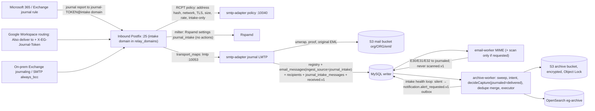

# Step 8.6: Journal-only intake and the Journaling / Archive split

**Status:** designed by the architect on 2026-11-20 on `9c8c798` (8.1, 8.4, 8.2 and 8.5 committed); built by WP1–WP6 and verified locally on 2026-11-20 (§13–§14), **not complete** (commit, CI, cluster apply and live tenant tests pending). Brief: [8.6-journal-intake-and-archive-split.md](../briefs/8.6-journal-intake-and-archive-split.md) (approved by the product owner on 2026-11-17, with the four product-owner decisions). Process decisions of the product owner (2026-11-19/20) apply: one combined review, targeted integration suites (§9), the orchestrator gate keeps the repo checks, the full Playwright suite and the secret scan.

**ADRs of the step** (Proposed; numbers are the next free ones after 8.5's ADR-0086):

- [ADR-0087](../../architecture/adr/0087-journal-intake-path.md): journal-only intake: per-source intake addresses on a platform intake domain, a dedicated LMTP listener, sender authentication (RCPT-time address secret + network, content proof at LMTP, accept-and-drop on proof failure), intake messages as registry messages with `ingest_source = journal_intake` and the terminal lifecycle state `journaled`; never delivered, forwarded or bounced. **Amends** ADR-0019 (a fourth LMTP listener and the intake transport), ADR-0025 (state `journaled`, edges E30–E32), ADR-0027 (decision 1: SMTP-time actions are off for intake-only transactions), ADR-0078 (its proof evaluation reused for intake).
- [ADR-0088](../../architecture/adr/0088-archive-cross-source-dedupe.md): cross-source dedupe: one archive record per message across gateway and intake capture (Message-ID + header fingerprint), sources recorded, envelopes merged, a differing body kept as a content variant of the same record. **Amends** ADR-0064 (one record per message → per message or merged copy group), ADR-0067 (disposal covers variants, merged copies and dedupe rows).
- [ADR-0089](../../architecture/adr/0089-journaling-archive-permission-split.md): the Journaling / Archive permission split: `journal:read`, `journal:manage`, the `compliance_officer` system role, organization admins without archive access by default, record-level archive reads on `archive:search`, and the grant-preserving migration. **Amends** ADR-0016 (10 system roles) and ADR-0068 (A20 holders, record routes).
- [ADR-0090](../../architecture/adr/0090-archive-only-service-profile.md): the archive-only service profile (plan `archive_only`, feature `journal_intake`, derived `serviceProfile`, portal hiding, inbound mail flow off for archive-only domains).

No topology change (stays v14): the only new asynchronous output (the silence alert) is a `notification.alert_requested.v1` outbox row, already routed by v14. Contracts: new [§34](../../architecture/contracts.md) (WP1).

---

## 0. Scope in one paragraph

A customer that wants only journaling and archiving gets a per-source **journal intake address** (`journal-<token>@<JOURNAL_INTAKE_DOMAIN>`) that receives Microsoft 365 / on-premises Exchange journal reports, Google Workspace "Also deliver to" copies or generic SMTP BCC copies. The inbound Postfix accepts mail for the intake domain only from that source's proven sender (address secret + provider egress range or configured networks at RCPT; tenant header or header token at LMTP), routes it to a new smtp-adapter LMTP listener (`:10053`), which unwraps journal reports, stores the original EML in the mail bucket and commits it as a registry message marked `ingest_source = journal_intake` with the full journal envelope (BCC included). MIME parsing runs as for every message; scanning runs only when the organization turned it on; either way the message ends in the terminal state `journaled` and is **never** handed to the policy engine, delivery, quarantine or webhooks. The unchanged 8.1 capture engine (sweep → intent → `decideCapture` → executor) archives it with encryption, Object Lock, retention, holds, search, eDiscovery and audit; a new cross-source dedupe merges the gateway and intake copies of one message into one record. In the portal, **Settings → Journaling** (capture) and the **Archive** menu (storage and use) are separated, backed by a permission split with a new `compliance_officer` role and a grant-preserving migration; archive-only tenants get their own plan and a portal without gateway pages.

## 1. Starting point (inspected at `9c8c798`)

### 1.1 What exists and is reused

| Area                        | Existing (step)                                                                                                                                                                                                                                                                  | 8.6 use                                                                                                       |
| --------------------------- | -------------------------------------------------------------------------------------------------------------------------------------------------------------------------------------------------------------------------------------------------------------------------------- | ------------------------------------------------------------------------------------------------------------- |
| Inbound Postfix             | `relay_domains` via smtp-adapter socketmap, `relay_transport = lmtp:…:10050`, policy service at RCPT and END-OF-MESSAGE (`policy_context=inbound`), Rspamd milter (rejects GTUBE / score ≥ 15, ADR-0027), `header_checks` (strips forged AR, `X-Spam*`, `X-Rspamd-*`) (2.2, 4.1) | Intake domain added to `relay_domains`; `transport_maps` routes it to `:10053`; Rspamd actions off for intake |
| smtp-adapter policy         | `PolicyDecisionService` (fail closed, never `OK`), `FixedWindowLimiter`, `InstanceSizeStore`, `ProviderRelayPolicy`, `EgressIndexService` (8.2)                                                                                                                                  | New intake branch in the `inbound` RCPT decision                                                              |
| smtp-adapter LMTP ingestion | `IngestionService` (per-org transactions, `readMessage` with header tee, `EmlStore`, `ingestKey`, `IngestionRepository.commit` = registry + message + recipients + `received` event + history + `received.v1` outbox) (2.2, 3.1)                                                 | Intake listener and service built from the same parts                                                         |
| Provider proof              | `evaluateProviderProof`, `ProofVerifier` (DKIM through `mailauth`, tenant header), egress ranges, `RelayCountersService` flush pattern (8.2, ADR-0078)                                                                                                                           | Intake proof (tenant header + optional DKIM evidence); counters pattern                                       |
| Provider binding            | `provider_connections` (`external_tenant_id`, `active_tenant_key`, linked TXT-verified domains), wizard (`computeWizard`), guides `setup-guide/1` + markdown renderer, attestations (8.2, ADR-0076/0080)                                                                         | Intake sources reference a connection; wizard and guide framework reused                                      |
| MIME and scanning           | email-worker MIME consumer on `received.v1` (outbox cursor), parse rows, scan rounds, `scanned.v1` → policy-engine; `parse_failed.v1` → policy-engine E5 (3.2, 4.x)                                                                                                              | Intake gates: no `parsed.v1`/`parse_failed.v1` when unscanned, no `scanned.v1` ever                           |
| Archive engine              | Capture intents, journal sweep over `email_messages`, `decideCapture`, executor (EML → `archive-object/1`, journal object, scan snapshots, one writer transaction), refresh, lifecycle, disposal, index, eDiscovery, audit (8.1, ADR-0064–0069)                                  | Unchanged path; `journaled` → category `delivered`; dedupe and merge added                                    |
| RBAC                        | Catalog in `packages/database/src/seed/catalog.ts` (seed syncs `role_permissions`), `RequireAnyPermission`, portal `x-eg-permissions` any/all, `organization_admin = TENANT_PERMISSIONS` (1.3, 8.1 A20)                                                                          | Split and migration (§2 B)                                                                                    |
| Alerts                      | `notification.alert_requested.v1` (strict schema, kinds + required refs), `notification_alert_windows` throttle, notification-worker templates (6.2, 8.2)                                                                                                                        | New kind `journal_intake_silent`                                                                              |

### 1.2 Gaps and conflicts found

1. **8.1 archives only `email_messages` rows.** The capture engine, journal object, scan links, parse rows and search are all keyed on the message registry. A second fact source would duplicate the engine (forbidden by the directive). → Intake messages become registry messages (D3), marked so that every gateway-facing view excludes them (D5).
2. **The Rspamd milter may reject** (GTUBE, score ≥ 15). A journal copy of spam must be archived, and an in-session reject would make Microsoft 365 send the report to its alternate journaling mailbox. ADR-0027 decision 1 forbids per-recipient SMTP-time behaviour because a session may mix tenants. → Intake transactions are forced to be intake-only (D2.5), so a recipient-scoped Rspamd setting is safe (ADR-0087 amends ADR-0027).
3. **Post-queue refusals bounce.** An LMTP `5xx` makes Postfix send a DSN to the envelope sender (backscatter). → Intake LMTP never answers `5xx`; content-proof failures are accepted and dropped (D2.7).
4. **`organization_admin` holds every tenant permission**, and `archive:read` (in the read set) opens record detail, journal and security views. The PO wants IT admins without archive read. → ADR-0089 (§2 B).
5. **Reports use an index-only plan** (`email_messages_org_received_dir_verdict_idx`); excluding intake rows needs the new column in that index (D5).
6. There is no "Mail Flow" page in the repository; the management "Mail Flow" page of the brief is served from a new `docs/architecture/mail-flow.md` (WP6) that the orchestrator's management status page links to (§10).

## 2. Decisions

### 2.0 Invariants (never traded away)

- **I1 No delivery from intake.** An intake message never reaches the policy engine, the delivery-worker, quarantine, reinjection, customer webhooks for `email.received`/`policy`/`delivery`, or a rescan. Enforced at three independent points: email-worker never writes `parsed.v1`-to-policy/`parse_failed.v1`/`scanned.v1` for it (D4), the delivery-worker refuses an `ingest_source = journal_intake` message (D4), and the api treats intake messages as not found on every gateway message route (D5).
- **I2 No open relay, no backscatter.** The intake domain accepts only addresses of existing, non-disabled sources, only from that source's authenticated sender (RCPT), and only one destination kind per transaction. The intake LMTP answers only `250` or `451` (never `5xx`). A refused RCPT is answered in-session to the connecting MTA, which owns any bounce.
- **I3 No content in MySQL** (unchanged). `journal_intake_messages` holds envelope addresses and proof codes only; EMLs live in S3; secrets are stored as SHA-256 only.
- **I4 Tenant from the source row**, never from the message. The organization of an intake message is the organization of the intake source matched by the RCPT address hash; nothing in the content (tenant header, From, To) selects a tenant, it can only fail the proof.
- **I5 Idempotent at every hop**: LMTP ingest key (queue file + recipient set), MIME and capture as in 8.1, dedupe merges under row locks, counters by `(source, day)` upserts.
- **I6 One archive engine.** Intake adds a source of registry messages and a merge step; storage, encryption, lock, retention, holds, index, eDiscovery and audit are the 8.1 code paths.

### 2.1 Components and data flow

### A. Journal-only intake

#### D1. Intake domain, sources and addresses (ADR-0087)

- **Intake domain** `JOURNAL_INTAKE_DOMAIN` (platform-owned; production example `journal.<platform domain>` with MX to the gateway inbound hosts; local `journal.gateway.test`). Empty = intake off (Postfix renders nothing, the policy branch is inert, the api refuses source creation with `503 journal_intake_unavailable`). The api refuses tenant domains equal to or under it (`422 domain_reserved`), like `DOMAIN_RESERVED_SUFFIXES`.
- **Intake source** (`journal_intake_sources`, §3): one per customer sender configuration; an organization may have several (for example one Microsoft 365 tenant plus an on-premises server). Kinds: `microsoft_365_journal`, `google_workspace_copy`, `exchange_onprem_journal`, `smtp_bcc`. Statuses: `pending_verification` (created; mail is accepted and the first accepted message sets `verified_at` and `active`), `active`, `paused` (RCPT `450 4.7.1`: Microsoft 365 and Exchange retry for up to two days), `disabled` (RCPT `550 5.1.1`; terminal, kept for the trail).
- **Address** `journal-<token>@<JOURNAL_INTAKE_DOMAIN>`: `token` = the first 26 characters of lower-case RFC 4648 base32 (no padding) of `HMAC-SHA256(JOURNAL_INTAKE_ADDRESS_SECRET, "eg-journal-intake-address/v1\0<sourcePublicId>\0<addressVersion>")` (130 bits). The api derives it to display it (masked `journal-••••<last 4>@…` unless the caller holds `journal:manage`, like the 8.2 route token); the database stores only `address_hash = sha256(lower(local part))` (unique). The brief's example `journal-<org public id>@…` was rejected (§5): an organization public id is not secret, so it cannot be an intake credential.
- **Header token** (Google Workspace only): `X-EG-Journal-Token: <26-char base32 of HMAC-SHA256(secret, "eg-journal-intake-header/v1\0<sourcePublicId>\0<addressVersion>")>`, added by the customer's routing rule ("Add custom headers"). Stored as `header_token_hash` (SHA-256). It is **removed from the stored EML** by the intake LMTP before upload (D2.6) so the archive never holds the credential.
- **Rotation** `POST …/rotate-address` (MFA): `address_version + 1`; the old hashes move to `previous_address_hash` / `previous_header_token_hash` valid until `previous_valid_until = now + JOURNAL_INTAKE_ROTATION_OVERLAP_DAYS` (default 7); both are accepted during the overlap; audited.
- **Networks** (`exchange_onprem_journal`, `smtp_bcc`; required, 1–32 CIDRs, `intake-networks/1`): public or (local/ci only) private ranges; **refused when they overlap any provider egress range** (8.2 D10 rule: shared infrastructure is never a tenant credential) or `0.0.0.0/0`-like prefixes shorter than /16 (IPv4) or /32 (IPv6). Optional `requireTls` (default true for every kind), optional `clientCertFingerprints` (≤ 4 SHA-256; when set the client certificate must match).
- **Provider binding** (`microsoft_365_journal`, `google_workspace_copy`): `provider_connection_id` required, the connection must belong to the organization, have the same provider, status not `disabled`, and a bound tenant (`active_tenant_key` and `external_tenant_id` set, 8.2 D4). The connection needs no inbound or outbound mail flow (an archive-only customer completes only the 8.2 `connect` and `domains` steps). A connection that is disabled later makes its sources refuse at RCPT (`550 5.7.1`) and the source health `failing`.
- **Domain requirement** (brief A4): activation needs at least one TXT-verified (`verified`/`active`) domain of the organization; provider kinds need at least one domain linked to the connection. No MX change is required or checked.
- **Entitlement:** creating or resuming a source needs the `archiving` and `journal_intake` features (`403 journal_intake_not_enabled`) and archiving `enabled` with a default retention policy (`409 archiving_not_enabled`). Intake mail for an organization whose archiving is disabled is refused at RCPT (`450 4.7.1`, so a short disablement loses nothing that the sender can still retry).

#### D2. Mail path (smtp-adapter, inbound Postfix, Rspamd) (ADR-0087)

1. **Postfix** (`infrastructure/postfix`): the entrypoint renders, when `POSTFIX_JOURNAL_INTAKE_DOMAIN` is set, `relay_domains = <intake domain>, socketmap:…:relay_domain` and `transport_maps = inline:{ <intake domain> = lmtp:inet:${smtp_adapter_host}:10053 }`; otherwise both stay as today. A master.cf transport is not needed (the `lmtp` service is reused). `validate.sh` checks the rendering.
2. **Policy at RCPT** (`policy_context=inbound`, recipient domain = intake domain), in this order, every answer in-session:
   1. Local part `journal-<26 base32>` and a source whose `address_hash` (or unexpired `previous_address_hash`) matches, not `disabled` → else `550 5.1.1` (`UNKNOWN_USER`).
   2. Organization `active`, features `archiving` + `journal_intake`, archiving enabled → else `450 4.7.1` (`INTAKE_UNAVAILABLE`, new reply); source `paused` → `450 4.7.1`.
   3. Network: provider kinds → client in the provider's active egress set (`EgressIndexService`, unavailable index → `DEFER_IF_PERMIT 4.3.5`), the connection still bound and not disabled; on-premises kinds → client in the source's networks and **not** in any provider egress set → else `550 5.7.1` (`INTAKE_SENDER_NOT_AUTHORIZED`, new reply). Client certificate fingerprint when configured.
   4. TLS when `requireTls` and no `encryption_protocol` → `MUST_STARTTLS` (existing reply).
   5. Intake-only transaction: a Redis key `sa:jintake:inst:<instance>` (TTL 1 h) records the first RCPT's kind (`src:<sourceId>` or `tenant`); a later RCPT of a different kind (another source, or a tenant domain) → `452 4.5.3` (`INTAKE_ONE_DESTINATION`, new reply; the client retries the rest in a new transaction). The tenant branch records `tenant` the same way only when the intake domain is configured.
   6. Rate: `FixedWindowLimiter` keys `jintake_src` (per source, `JOURNAL_INTAKE_RATE_PER_SOURCE_PER_MINUTE`) and `jintake_org` (per organization, plan limit `journal_intake_messages_per_minute`) → `451 4.7.1` (`RATE_LIMITED`).
   7. Size: `min(source.max_message_bytes, plan journal_intake_max_message_bytes, JOURNAL_INTAKE_MAX_MESSAGE_BYTES)`: declared size above it → `552 5.3.4` (`TOO_BIG_FOR_RECIPIENT`), else recorded in `InstanceSizeStore` for END-OF-MESSAGE (existing check).
   8. `DUNNO`. Refusals increment Redis counters per source and code (D2.8). The policy reads sources through a cache (`JOURNAL_INTAKE_SOURCE_CACHE_SECONDS`, default 30; negative entries 30 s), so pause/disable take effect within 30 s; the LMTP stage re-checks on the writer.
3. **Rspamd** (`infrastructure/rspamd`): a settings rule `journal_intake` selected by recipient domain = intake domain (rendered by the Rspamd entrypoint from `RSPAMD_JOURNAL_INTAKE_DOMAIN`), applying no action (`apply { actions { reject = null; "add header" = null; "rewrite subject" = null; greylist = null; "soft reject" = null; } }`, symbols still computed). Because D2.2.5 makes intake transactions intake-only, this never changes another tenant's SMTP-time behaviour (the reason ADR-0027 decision 1 forbade per-recipient settings). The stack suite proves a GTUBE journal copy is accepted.
4. **Journal LMTP listener** `LMTP_JOURNAL_PORT` (10053, `JournalIntakeListener`, same `LmtpListener` class, same `INGEST_MAX_MESSAGE_BYTES` ceiling). `IngestDirection` gains `'journal'` (ingest key and object key inputs only; `email_messages.direction` is computed, D3).
5. **Recipient acceptance at LMTP**: authoritative writer lookup of the source by address hash (same checks as D2.2.1–2.2.3, using XFORWARD client address/TLS facts Postfix passes); every failure here is `451` (never `5xx`, I2). One intake recipient per transaction (D2.2.5 guarantees it; a second one is `451`).
6. **Data** (`JournalIntakeService.handleData`), streaming, bounded memory:
   - `readMessage` with a tee into the **unwrapper** (`@email-gateway/archive` `intake/`, WP2): for report kinds (`microsoft_365_journal`, `exchange_onprem_journal`) it recognizes an Exchange journal report (outer header `X-MS-Journal-Report`, top-level `multipart/mixed` with a `text/plain` envelope part and a `message/rfc822` part), captures the envelope part (≤ `JOURNAL_INTAKE_ENVELOPE_MAX_BYTES`, default 1 MiB) and streams the decoded embedded message (7bit/8bit/binary pass-through, base64 and quoted-printable decoded) to the S3 upload and its SHA-256. A report it cannot recognize is stored **as received** with format `journal_report_unparsed` (compliance over tidiness; alert counter). Copy kinds (`google_workspace_copy`, `smtp_bcc`) are stored as received with format `copy`.
   - The header block of the **stored** message is rewritten only to drop `X-EG-Journal-Token` header fields (all occurrences); the SHA-256 and size are of the stored bytes.
   - **Proof** (pure `evaluateIntakeProof` in `@email-gateway/mail-routing`, WP3), evaluated on the **outer** message's headers: `microsoft_365_journal` → every `X-MS-Exchange-CrossTenant-Id` value equals the connection's `external_tenant_id` (at least one present) — the evidence also records DKIM results (aligned to a linked domain or the tenant's `onmicrosoft.com`) without requiring them; `google_workspace_copy` → exactly one `X-EG-Journal-Token` whose SHA-256 matches the current or overlapping token hash (constant-time); on-premises kinds → no content proof (address secret + network + TLS at RCPT are the proof). Outcome `pass | fail | temperror` (DNS or Redis trouble in the optional DKIM evidence never fails, it records `temperror` in evidence only).
   - `fail` → the upload is aborted/deleted, **nothing is stored**, the LMTP answers `250 2.0.0 Ok: dropped` (accept-and-drop, I2), counters `dropped_proof`, source `last_refused_at` / `last_refusal_code = proof_<rule>`, an info log with the source public id and rule only. `temperror` → `451`.
   - `pass` → one writer transaction (`JournalIntakeRepository.commit`, modelled on `IngestionRepository.commit`): `message_identities` (ingest key `v2:` over `{mtaId}|{queueId}|journal|{sha256}|{recipientSet}`), `email_messages` (`ingest_source = journal_intake`, direction and `domain_id` per D3, header metadata of the **stored** message from the header scanner, `eml_object_key = org/<org>/eml/<yyyy>/<mm>/<dd>/<objectRef>.eml`, client facts), `email_recipients` (the journal envelope recipients, D3, status `journaled`), `journal_intake_messages` (envelope document, proof document, format, outer report SHA-256/size, `scan_requested` = the organization's `settings.intake.scanEnabled` at commit), history rows E1/E2 (born `persisted`), an `email_events` `received` row (`details.intake = { sourceId, kind, format }`), and the `mail.message.received.v1` outbox row with the new optional field `ingestSource: 'journal_intake'`. Duplicate ingest key → `250` duplicate (like 2.2). Then `250`.
   - Envelope parsing (`parseJournalEnvelope`, WP2): lines `Sender:`, `Subject:` (ignored), `Message-Id:`, `To:`, `Cc:`, `Bcc:`, `Recipient:` (older format), with the `, Expanded: <dl>` / `, Forwarded: <addr>` suffixes and folded continuation lines; output `journal-envelope/1` (§4.2). A Message-Id in the envelope that differs from the embedded message's is recorded (`envelopeMismatch: true`), not refused. Copy kinds: `google_workspace_copy` recipients = the `X-Gm-Original-To` values when present (field `envelope`), else the To/Cc header addresses (field `header`); `smtp_bcc` = To/Cc header addresses (field `header`). Recipients cap `JOURNAL_INTAKE_MAX_RECIPIENTS` (default 10 000; `truncated: true` beyond).
7. **Accept-and-drop vs refuse.** RCPT-stage failures are refused in-session (the client is the customer's provider or server, which reports to the customer's own alternate journaling mailbox). Only content-proof failures are dropped silently, because a post-queue `5xx` would bounce to an envelope sender we cannot trust. The bounce of last resort (Postfix `maximal_queue_lifetime` after five days of `451`) can only go to an envelope sender that passed the RCPT checks (§6 R6).
8. **Counters and health facts**: `JournalIntakeCountersService` (pattern of 8.2 `RelayCountersService`): Redis hash `sa:jintake:cnt:<sourceId>:<yyyymmdd>` (`accepted`, `duplicates`, `bytes`, `refused_address`, `refused_network`, `refused_tls`, `refused_size`, `refused_rate`, `refused_unavailable`, `dropped_proof`, `unwrap_failed`), flushed every `JOURNAL_INTAKE_COUNTER_FLUSH_SECONDS` (30) into `journal_intake_counters` (upsert-add) and `journal_intake_sources.last_accepted_at` / `last_refused_at` / `last_refusal_code` (max). Refusals before a source is matched (unknown address) count only in metrics.
9. **Metrics** (no organization labels): `journal_intake_messages_total{kind,outcome}`, `journal_intake_bytes_total{kind}`, `journal_intake_refusals_total{stage,code}`, `journal_intake_unwrap_total{format,result}`, `journal_intake_lmtp_seconds`.

#### D3. Intake messages in the registry (ADR-0087)

- `email_messages.ingest_source` ENUM(`gateway`, `journal_intake`) NOT NULL DEFAULT `gateway` (INSTANT). `MessageStatus` and `RecipientStatus` gain `journaled` (appended; INSTANT).
- **Organization-side domain set**: the organization's domains in `verified`/`active`/`suspended` (cached per transaction). **Direction**: sender (envelope `Sender:`, else MAIL FROM, else header From) org-side → `internal` when every recipient is org-side, else `outbound`; sender external → `inbound`. **Recipient direction**: org-side recipient → `internal` (sender org-side) or `inbound`; external recipient with org-side sender → `outbound`; external recipient with external sender → `NULL` (unknown; only addressed). `domain_id` = the first org-side party's domain (sender for outbound/internal, first org-side recipient for inbound), else the organization's lowest-id verified domain (a source cannot be active without one, D1).
- Pure helper `classifyIntakeParties` in `@email-gateway/archive` (WP2), table-tested.
- `journal_intake_messages` keeps what the registry cannot: the envelope with fields (to/cc/bcc/envelope/header, expansion), proof evidence, format, outer report hash, `scan_requested`.

#### D4. Processing gates (email-worker, delivery-worker, lifecycle) (ADR-0087)

- **Lifecycle** (`@email-gateway/message-lifecycle`): state `journaled` is final (in `FINAL_STATES`, never expirable, not a source of E19 rescan or E28/E29). Edges, role `scanner`: **E30** `persisted → journaled` (reasons `intake_unscanned`, `intake_parse_failed`), **E31** `scanned → journaled` (`intake_scan_complete`), **E32** `scan_failed → journaled` (`intake_scan_failed`). A transition into `journaled` is allowed only when `email_messages.ingest_source = journal_intake` (the lifecycle service asserts it; gateway messages can never become `journaled`). `state_changed.v1` is written as for any transition.
- **MIME consumer** (email-worker): parses every intake message (headers, attachments, text/html parts for the archive preview) exactly as today. In the parse commit, for an intake message: `scan_requested = false` → E30 `intake_unscanned` (or `intake_parse_failed`) and **no** `parsed.v1` / `parse_failed.v1` outbox row; `scan_requested = true` → `parsed.v1` as usual on success, E30 `intake_parse_failed` and **no** `parse_failed.v1` on failure (so the policy-engine's E5 fail-safe never sees it).
- **Scan finalization** (email-worker `scan-repository`, the only writer of `scanned.v1`): for an intake message the round completes, the risk score is recorded as today, and in the same transaction E31 (or E32 for a failed/timed-out round) replaces the `scanned.v1` outbox row. Engines' own side outputs during a requested scan (sandbox tasks, URL inspection, DLP incidents) behave as for gateway mail (an opted-in security scan; documented).
- **Delivery-worker** (defence in depth): planning or reinjecting a message with `ingest_source = journal_intake` is refused (`intake_not_deliverable`, error log, metric, message untouched).
- **Event-relay lifecycle recovery and ato-worker maintenance**: WP4 inspects every path that reads `email_messages` and could push a message toward policy, delivery or ATO signals, and excludes `journal_intake` rows (the relay's republish of a lost `received.v1` is allowed; MIME is idempotent).
- **Webhook-worker** projection: `received.v1` with `ingestSource = journal_intake` projects nothing; `state_changed.v1` to `journaled` projects nothing.

#### D5. Exclusion from gateway views (api)

Every gateway-facing read filters `ingest_source = 'gateway'`: Email explorer list drivers and saved views, message detail and its sub-routes (events, recipients, deliveries, scans, reveal, raw/preview, rescan) → `404 message_not_found` for intake messages, reports, organization usage (`messagesToday` excludes intake; new `journalIntakeToday`), incidents message links, quarantine (never applies); review fix (§14.1b): the DLP incident list and the DLP evidence door, the risk dry-run, BEC feedback and the platform scan-training route. **Index:** `email_messages_org_received_dir_verdict_idx` is rebuilt with `ingest_source` appended (`ALGORITHM=INPLACE, LOCK=NONE`; add the new index, then drop the old one) so the report counts stay index-only; the explorer indexes keep their plans (the predicate filters rows already read). WP1 records EXPLAIN before/after.

#### D6. Capture of intake messages (archive-worker; ADR-0064 unchanged path)

- The journal completeness sweep visits intake rows like any message; eligibility (directions, scope, `journal_enabled_at`) is evaluated as in A4 with the intake directions of D3. Policy sources never exist for intake (no policy evaluation).
- `decideCapture`: `journaled` → `capture`, category **`delivered`** (the provider delivered or sent it; retention criteria on category apply unchanged); `persisted`/`scanning`/`scanned`/`scan_failed` of an intake message → `wait`.
- The executor writes the record with `source_gateway = false`, `source_journal_intake = true`, `intake_source_id`; the journal object `archive-journal/1` gains an optional `intake` block (source public id, kind, format, envelope with fields, `envelopeMismatch`, proof summary codes) read from `journal_intake_messages`; parties gain an optional `field` per recipient and recipients' status `journaled`. Scan links when a scan was requested, exactly as 8.1.
- The intent closes on the normal +1 h / +24 h schedule (final state).

#### D7. Cross-source dedupe (ADR-0088)

- **Scope:** merging happens only when at least one of the two copies is an intake copy (gateway↔intake, intake↔intake). Gateway↔gateway keeps the 8.1 behaviour (one record per message), so forwarding loops and resends through the gateway never collapse.
- **Key:** `messageIdHash = sha256("archive-dedupe/1\0<organizationId>\0<Message-ID without angle brackets and surrounding whitespace>")`. No Message-ID → no dedupe.
- **Header fingerprint** (`archive-fingerprint/1`, pure, WP2): SHA-256 of the canonical JSON `{ date: <Date header as epoch seconds>, from: <header From addr-spec, lower>, to: [sorted unique lower To+Cc addr-specs], attachments: [sorted SHA-256 of attachment parts] }`. Body text is excluded on purpose: the gateway legitimately changes bodies at delivery (banners, URL rewriting), so a journal copy of a gateway-delivered message has a different body. Unparsable Date or From → no dedupe. Inputs: the header block of the stored EML (bounded range GET, ≤ `INGEST_HEADER_MAX_BYTES`) and the attachment rows of the parse.
- **Body hash**: SHA-256 of the bytes after the header/body separator, computed while the executor streams the EML (`BodyHasher` transform, WP2).
- **Table** `archive_dedupe_keys` (§3): one row per record (and per merged variant body), `(organization_id, message_id_hash, header_fingerprint)` lookup, `body_sha256`, `archive_id`, `archive_received_at`, source flags, `created_at`. Rows older than `ARCHIVE_DEDUPE_WINDOW_HOURS` (default 72) are pruned by the lifecycle role and deleted at disposal; the merge window is the same.
- **Capture with a candidate** (live record, `status = active`, same organization, same `message_id_hash` and `header_fingerprint`, within the window, and the scope rule above holds):
  1. Before uploading: stream the EML once through `Sha256Verify` + `BodyHasher` without uploading if the candidate's body hash may match; when `body_sha256` equals one of the candidate's bodies → **merge without content**; otherwise, when the record has fewer than `ARCHIVE_MAX_CONTENT_VARIANTS` (4) variants → **merge with a content variant**: the EML is encrypted under the **record's** DEK (HKDF subject = the merged message's public id, kind `eml`) and uploaded with the record's lock; else → no merge (a separate record, metric `archive_dedupe_total{result="variant_limit"}`).
  2. A journal object `archive-journal/1` of the merged copy (its envelope, intake block or gateway facts) is written under the record's DEK (kind `journal`, subject = merged message public id).
  3. One writer transaction: `SELECT … FOR UPDATE` the record and the dedupe rows of the key (the gap lock serializes concurrent captures of one key; a deadlock or a changed candidate → retry the intent, the written objects become orphans for A15); insert `archive_record_sources` (merged copy facts); update the record: `source_*` flags OR-ed, `parties` = union by address (field and direction kept per source, `recipient_count`), `objects.merged[]` appended (≤ `ARCHIVE_MAX_MERGED_COPIES` = 8; beyond → no merge, separate record), `retain_until` = max(current, retention computed for the merged copy), `lock_until` = max, `merged_count + 1`; insert the variant's dedupe row when a variant was stored; set the merged intent `captured_open` with `archive_id` and `archive_received_at` of the record and `merged = true`; insert an index upsert.
  4. **Capture without a candidate**: unchanged 8.1 capture plus the record's dedupe row (when it has a Message-ID) in the same transaction, after the same `FOR UPDATE` on the key range; if a candidate appeared meanwhile, roll back and retry (merge path).
- **Copy consistency (review fix, §14.1b):** header equality is forgeable (every key input is known to any recipient), so a merge also needs the same `email_messages.direction` as the record (`direction_mismatch`) and, for inbound mail between a single-source record and a copy of the other source, a gateway copy received no later than the intake copy + `MERGE_ORDER_SKEW_MS` (5 min; `order_mismatch`). Refusals capture a separate record.
- **Outcome refresh of a merged intent** (A7): reads the merged message's facts by the intent's own `(message_id, received_at)` and the record by `(archive_id, archive_received_at)`. A merged **gateway** copy is authoritative for the security outcome: its `message_state`, verdict, action, risk score, malicious flag and scan links update the record (same ≤ 16 link rule). An intake copy never overwrites a gateway outcome. The primary intake record's outcome fields stay `journaled`/NULL until a gateway copy merges.
- **Disposal and holds:** holds evaluate the merged parties (a BCC'd custodian of the journal envelope holds the record). Disposal deletes every object in `objects` (primary, scans, merged journals, variants), the `archive_record_sources` rows and the dedupe rows of the record; crypto-shredding of the one DEK covers them all.
- **Search and API:** the index document gains `sources` (`gateway`, `journal_intake`) and the merged parties; the search API gains the filter `source`; detail gains `sources`, `intake` and `mergedCopies[]` (receivedAt, source, size, SHA-256, `contentVariant`); download grants take an optional `variant` (merged copy public id) for a stored variant. eDiscovery exports include variants as additional files of the record (`<record>.variant-<n>.eml`) and the merged parties in the load file.
- **Residual risk** (§6 R3): a copy whose only difference is in the body text and that is not stored as a variant cannot occur (a differing body is always stored as a variant or a separate record); copies with stripped or replaced attachments have different fingerprints and stay separate (fail-safe: stored twice).

#### D8. Intake scanning (per organization, off by default)

`archive-settings/1` gains `intake: { scanEnabled?: boolean }` (default false; the schema stays version 1 with an additive optional key, every reader is updated in this step). Changing it needs `journal:manage`; it applies to messages committed afterwards (`journal_intake_messages.scan_requested` is the per-message snapshot). Scan results are linked as in 8.1 (frozen snapshots). Intake scanning never evaluates policy and never alerts through `threat_detected` (that alert comes from `scanned.v1`, which intake never writes).

#### D9. Monitoring, silence and alerts

- **Health job** (archive-worker `capture` role, leader lock `eg:archive-intake-health`, every `JOURNAL_INTAKE_HEALTH_INTERVAL_MS` = 60 000): per non-disabled source computes `health_status`: `paused` (status paused); `failing` (connection disabled/unbound, or refusals and drops without any acceptance in the last hour, or `unwrap_failed` > 0 in the last hour); `silent` (`silence_alert_minutes` set, source verified, and `last_accepted_at` older than that); `healthy`; `unknown` (never verified). On a transition into `silent` or `failing` it writes, in one transaction, the source update, an `audit_logs` system row `journal_intake.health_changed`, and (at most once per source per `JOURNAL_INTAKE_ALERT_MIN_INTERVAL_HOURS` = 24, via `notification_alert_windows`) a `notification.alert_requested.v1` outbox row of the new kind **`journal_intake_silent`** (severity `medium` for silent, `high` for failing; refs `{ intakeSourceId }`, required). The notification-worker renders it (template names the source and the setup guide link, never addresses) to the organization's alert recipients for that kind; the portal notification settings list it.
- **Gauges:** `journal_intake_sources{health}`; Prometheus rules `JournalIntakeSilentSources` (> 0 for 30 min, warning), `JournalIntakeProofDropsHigh`, `JournalIntakeUnwrapFailures`, `JournalIntakeRefusalsSpike`, `ArchiveDedupeVariantLimit`.
- Silence defaults: `silence_alert_minutes` default 240 (Microsoft 365 journals continuously for an active tenant; a quiet small tenant can raise it or switch it off with NULL).

#### D10. Setup wizard and guides (reuse of the 8.2 framework; ADR-0080 unchanged)

- **Wizard** (`computeIntakeWizard`, pure, api `modules/journaling/domain/intake-wizard.ts`, table-tested like 8.2 `computeWizard`): steps `archiving` (entitled, enabled, default retention), `domains` (a TXT-verified domain; provider kinds: a domain linked to the connection), `connection` (provider kinds: connection bound and not disabled; skipped otherwise), `configure` (the customer-side attestations of the kind), `verify` (first accepted intake message, `verified_at`), `monitor` (health not `failing`). Each step `not_started | in_progress | done | blocked | skipped` with blockers and a `nextAction`.
- **Guides** (`journal-intake-guide/1`, `generateJournalIntakeGuide` in `packages/provider-integrations/src/guides/`, reusing `SetupGuideSection`/`SetupGuideStep`/attestation types and the markdown renderer through a shared `renderGuideMarkdown(sections)`), generated per source from its own values, never applied by the gateway:
  - Microsoft 365: Purview journal rule (scope global/internal/external, recipient = the intake address), "Send undeliverable journal reports to" alternate mailbox (required by Exchange Online), optional DKIM for the tenant domains, PowerShell `New-JournalRule -Name "Email security gateway journal" -JournalEmailAddress <address> -Scope Global -Enabled $true` and `Set-TransportConfig -JournalingReportNdrTo <mailbox>`; warning that journal rules journal only mail of mailboxes in the tenant and that Exchange Online refuses journaling to an Exchange Online mailbox (the intake address is external, which is what is required).
  - Google Workspace: Admin console → Apps → Gmail → Routing rule "Email security gateway journal" for inbound + outbound + internal (sending/receiving), "Also deliver to" the intake address, "Add X-Gm-Original-To header", "Add custom headers" `X-EG-Journal-Token: <token>`; notes that Google copies give the routed recipient, not the full envelope.
  - On-premises Exchange: a journal recipient (mail contact with the intake address), journal rule or database journaling, `Set-TransportConfig -JournalingReportNdrTo`, a Send connector with TLS to the gateway MX hosts, source networks to register.
  - Generic SMTP: Postfix `always_bcc = <address>` (or `sender_bcc_maps` / `recipient_bcc_maps`), TLS, networks; notes that BCC copies carry only header recipients.
  - Attestation codes (new, `journal.*`): `journal.m365.rule_created`, `journal.m365.ndr_mailbox_set`, `journal.google.route_created`, `journal.google.headers_added`, `journal.onprem.journal_recipient_created`, `journal.onprem.send_connector_tls`, `journal.smtp.bcc_configured`.
  - The address and header token appear in the guide only when the caller holds `journal:manage` (masked otherwise).

#### D11. Journaling API (module `apps/api/src/modules/journaling`, tag `journaling`)

| Method + path                                         | Permission                                  | Notes                                                                                                                                                                                                                               |
| ----------------------------------------------------- | ------------------------------------------- | ----------------------------------------------------------------------------------------------------------------------------------------------------------------------------------------------------------------------------------- |
| `GET /journaling/settings`                            | any of `journal:read`, `archive:read`       | The journaling half of the settings row: `enabled`, `entitled`, `journalEnabledAt`, `settings.{directions,include,scope,policyArchive,intake}`, `generation`, `rowVersion`                                                          |
| `PUT /journaling/settings`                            | `journal:manage`, MFA user, Idempotency-Key | CAS `expectedRowVersion` (the same `row_version` as `/archive/settings`), only journaling paths; same validations as 8.1 A22; audit `archive.settings_updated` with `area: 'journaling'`                                            |
| `GET /journaling/intake-sources`                      | `journal:read`                              | Cursor list (ADR-0051), filter `status`, `kind`, `health`                                                                                                                                                                           |
| `POST /journaling/intake-sources`                     | `journal:manage`, MFA, Idempotency-Key      | `{ kind, displayName, providerConnectionId?, networks?, requireTls?, clientCertFingerprints?, maxMessageBytes?, silenceAlertMinutes? }` → 201 with the address revealed once in the response (idempotent replay redacted, ADR-0057) |
| `GET /journaling/intake-sources/{id}`                 | `journal:read`                              | Source, health, counters of the last 7 days, address masked unless `journal:manage` and `?reveal=true` (audited `journal_intake.address_revealed`)                                                                                  |
| `PATCH /journaling/intake-sources/{id}`               | `journal:manage`, MFA, Idempotency-Key, CAS | displayName, networks, requireTls, fingerprints, sizes, silence, `status` (`paused` ↔ `active`/`pending_verification`)                                                                                                              |
| `DELETE /journaling/intake-sources/{id}`              | `journal:manage`, MFA                       | Sets `disabled` (terminal)                                                                                                                                                                                                          |
| `POST /journaling/intake-sources/{id}/rotate-address` | `journal:manage`, MFA, Idempotency-Key      | D1 rotation; returns the new address once                                                                                                                                                                                           |
| `GET /journaling/intake-sources/{id}/wizard`          | `journal:read`                              | D10                                                                                                                                                                                                                                 |
| `GET /journaling/intake-sources/{id}/setup-guide`     | `journal:read`                              | JSON `journal-intake-guide/1` or `text/markdown` (Accept), like 8.2                                                                                                                                                                 |
| `POST /journaling/intake-sources/{id}/attestations`   | `journal:manage`, MFA                       | Record attestation codes of D10 (≤ 32 kept)                                                                                                                                                                                         |
| `GET /journaling/status`                              | `journal:read`                              | Capture backlog (intents by status), sources by health, intake counters today                                                                                                                                                       |

Errors (new): `journal_intake_unavailable` (503), `journal_intake_not_enabled` (403), `journal_intake_source_conflict` (409, CAS), `journal_intake_networks_invalid` (422, overlap with provider egress, too broad, invalid), `journal_intake_connection_invalid` (422), `journal_intake_source_limit` (409, > `JOURNAL_INTAKE_MAX_SOURCES_PER_ORG` = 20), `journal_intake_source_disabled` (409). Audit actions: `journal_intake.source_created|updated|paused|resumed|disabled|address_rotated|address_revealed|attested|health_changed` (resource `journal_intake_source`), metadata ids/enums only.

Existing archive routes, **no breaking change** (paths, operationIds and schemas unchanged; additions only): `PUT /archive/settings` requires any of `journal:manage`, `archive:manage` and authorizes **per changed path** (`enabled`, `settings.directions|include|scope|policyArchive|intake` → `journal:manage`; `immutability`, `defaultRetentionPolicyId`, `settings.access` → `archive:manage`; a change the caller may not make → `403 archive_settings_forbidden_path` naming the paths); `GET /archive/settings` and `GET /archive/status` any of `archive:read`, `journal:read`; capture-issues list/retry any of `journal:manage`, `archive:manage`; record routes per §2 B. OpenAPI: new tag `journaling`; `x-tagGroups` `Journaling` = [`journaling`] and `Archive` = [`archive`, `ediscovery`]; the capture-issues and settings operations also carry the `journaling` tag. OpenAPI counts move from the 8.5 total by the 12 new operations.

### B. Journaling / Archive split

#### D12. Permissions and roles (ADR-0089)

New permissions (catalog + 2): `journal:read` ("View journaling settings, journal intake sources and their health"; added to `TENANT_READ_PERMISSIONS`), `journal:manage` ("Manage journaling capture settings and journal intake sources"). `ARCHIVE_ACCESS_PERMISSIONS` (new exported constant) = `archive:search`, `archive:retrieve`, `archive:export`, `archive:legal_hold`, `archive:manage`, `ediscovery:manage`. Re-scoped descriptions: `archive:read` "View archive configuration, retention policies, key versions and status (no records)"; `archive:manage` "Manage retention policies, immutability, encryption keys, access settings and disposal of reviewed records"; `archive:search` "Search archived messages and view their metadata, journal and security views (masked)".

| Role                         | Before 8.6 (archive)                                                                  | After 8.6                                                                                                                                                    |
| ---------------------------- | ------------------------------------------------------------------------------------- | ------------------------------------------------------------------------------------------------------------------------------------------------------------ |
| super_admin                  | all                                                                                   | all (content routes still refuse override sessions, A20)                                                                                                     |
| platform_admin               | `archive:read` (read set)                                                             | `archive:read`, `journal:read` (read set); no record detail any more                                                                                         |
| organization_admin           | every tenant permission                                                               | every tenant permission **except** `ARCHIVE_ACCESS_PERMISSIONS`; gains `journal:*`; may assign `compliance_officer` (`user:manage`, audited)                 |
| domain_admin (IT / mail)     | —                                                                                     | + `journal:read`, `journal:manage`                                                                                                                           |
| security_analyst             | `archive:read`, `archive:search`                                                      | unchanged + `journal:read`                                                                                                                                   |
| compliance_auditor           | read set, `archive:export`, `archive:search`, `archive:retrieve`, `ediscovery:manage` | unchanged + `journal:read` (read set)                                                                                                                        |
| read_only_user               | `archive:read` (read set)                                                             | `archive:read`, `journal:read`; no record detail any more                                                                                                    |
| **compliance_officer** (new) | —                                                                                     | `organization:read`, `user:read`, `domain:read`, `journal:read`, `archive:read`, `ARCHIVE_ACCESS_PERMISSIONS`, `message:reveal`, `audit:read`, `report:read` |

- **Record routes** `GET /archive/messages/{id}`, `/journal`, `/security` and `POST …/reveal` move from `archive:read` to `archive:search` (reveal keeps `message:reveal`). This is the only access removed from existing holders: `read_only_user`, `platform_admin` and custom roles holding `archive:read` without `archive:search` lose archived-record detail (they never had search). It is recorded in the migration record (§3.3) and the release notes (README).
- `user:manage` holders assigning or removing a role that carries any `ARCHIVE_ACCESS_PERMISSIONS` write an extra audit row `rbac.archive_access_granted|revoked` (resource `user`, metadata role key, actor, target public ids). The Archive → Access audit page lists them with the `archive.*`, `ediscovery.*`, `legal_hold.*` rows. **Review fix:** the delegation (holders of `user:manage` without archive access granting or removing it) is open only to user principals in an MFA-authenticated session and never on the caller's own account; API keys, sessions without MFA and self-assignments are `403` (§14.1b).
- API keys: `journal:read` and `journal:manage` are assignable scopes; the MFA-only routes stay user-only.
- **Grant-preserving migration** (§3.3): every existing `organization_admin` assignment in a customer organization gets a `compliance_officer` assignment in the same organization, so no existing admin loses archive access silently; new organizations after 8.6 start without archive access for admins.

#### D13. Archive-only service profile (ADR-0090)

- Feature key `journal_intake` (enterprise, dedicated, archive_only; not trial, standard). Limit keys `journal_intake_messages_per_minute` (trial/standard 0, enterprise 6 000, dedicated 20 000, archive_only 6 000) and `journal_intake_max_message_bytes` (0 / 50 MiB / 50 MiB / 50 MiB).
- New plan `archive_only` ("Archive only": journal intake, journaling and archive without mail filtering): features `archiving`, `journal_intake`, `api_access`, `sso`, `webhooks`; limits: `messages_per_day` 0, `max_domains` 100, `max_users` 10 000, `max_message_size_bytes` 50 MiB, `api_requests_per_minute` 1 200, `quarantine_retention_days` 0, `archive_retention_days` 3 650, inbound/outbound recipient limits 0.
- `serviceProfile` = `archive_only` when the effective features have neither `inbound_filtering` nor `outbound_filtering` but have `archiving`; else `gateway`. Returned additively by `GET /auth/me` (`organization.serviceProfile`) and the organization view.
- Archive-only organizations: domains created get `inbound_enabled = false`; enabling inbound or outbound on a domain is refused (`403 mail_filtering_not_enabled`); the domain detail marks MX/SPF/DKIM records "not required for archive-only". Existing domains of existing organizations are never changed.
- **Portal:** navigation items gain `profiles` (default both); for `archive_only` the gateway-only items are hidden: Dashboard, Reports, Email explorer, Quarantine, Mail servers, the Security section, Policy builder, SMTP connectors tab; `firstPermittedHref` lands on Archive search (or Settings → Journaling without archive access). Direct navigation to a hidden route shows the standard "not available for this plan" state. ATO pages follow their own feature (unchanged).

#### D14. Admin portal (WP6)

| Route                                                                   | Content                                                                                                                                                                                                                                                                                                                                                                                        | Gate (operations)                                                                        |
| ----------------------------------------------------------------------- | ---------------------------------------------------------------------------------------------------------------------------------------------------------------------------------------------------------------------------------------------------------------------------------------------------------------------------------------------------------------------------------------------- | ---------------------------------------------------------------------------------------- |
| `/settings?tab=journaling` (replaces `tab=archive`; old link redirects) | Two-layer explainer panel; enable; directions; categories; scope pickers; policy-rule archiving; intake scanning toggle; intake sources table with kind, status, health badge, last accepted, "Add source"                                                                                                                                                                                     | `JournalingController_getSettings_v1`, `…_putSettings_v1`, intake list                   |
| `/settings/journaling/intake/new`                                       | Wizard: kind → connection (8.2 connections list, link to 8.2 wizard) or networks → review → created (address shown once, copy button)                                                                                                                                                                                                                                                          | intake create                                                                            |
| `/settings/journaling/intake/[sourceId]`                                | Wizard steps (D10), guide (rendered sections, download `.md`), address (masked, reveal, rotate with MFA), attestations, health and 7-day counters, pause/resume/disable                                                                                                                                                                                                                        | intake get, wizard, guide, rotate, attestations                                          |
| Archive section (renamed from "Compliance")                             | **Search** `/archive` (+ `source` filter, sources badges, merged copies in detail, variant download), **Retention and lock** `/archive/retention` (+ tab "Immutability and keys" and "Access settings" moved from Settings), **Legal holds**, **eDiscovery**, **Access audit** `/archive/access-audit` (audit search prefixed `archive.`, `ediscovery.`, `legal_hold.`, `rbac.archive_access`) | archive ops; `AuditLogsController_search_v1` + `archive:search` any-of gate for the page |
| Roles / users                                                           | `compliance_officer` shown with its description; assigning a role with archive access shows a confirmation that it grants archived-mail access (audited)                                                                                                                                                                                                                                       | existing                                                                                 |
| Notification settings                                                   | `journal_intake_silent` alert kind                                                                                                                                                                                                                                                                                                                                                             | existing                                                                                 |

Archive-only hiding per D13. Dev fixtures for every new operation; component tests (MSW, axe); Playwright specs §9.5.

### 2.2 Docs

`docs/architecture/mail-flow.md` (new, management-readable: the gateway layer, the Journaling layer = capture from the gateway or journal intake, the Archive layer = storage and use; one diagram; links), `docs/integrations/journal-intake-microsoft-365.md`, `…-google-workspace.md`, `…-on-premises.md` (customer guides, embedded-guide snapshot tests like 8.2), `docs/runbooks/journal-intake.md` (refusal codes, silent source, unwrap failures, rotation, dropping proof failures), `docs/deployment/archive.md` and `smtp-gateway.md` (intake domain DNS: MX of the intake domain to the gateway inbound hosts, TLS certificate covering it, keys), `docs/security/rbac.md` (matrix of D12), `docs/api/README.md` (two areas), README (feature summary, release note on the access change), `docs/frontend/page-inventory.md`, `docs/architecture/overview.md` (intake path), contracts §34, ADRs.

## 3. Data model (one forward migration `<UTC timestamp>_journal_intake`, WP1)

### 3.1 Changes to existing tables

| Table                                                                                             | Change                                                                                                                                                                                                                                                                                                                                                                                                |
| ------------------------------------------------------------------------------------------------- | ----------------------------------------------------------------------------------------------------------------------------------------------------------------------------------------------------------------------------------------------------------------------------------------------------------------------------------------------------------------------------------------------------- |
| `email_messages`                                                                                  | + `ingest_source` ENUM('gateway','journal_intake') NOT NULL DEFAULT 'gateway' (INSTANT); `status` enum + `journaled` (appended, INSTANT); index `email_messages_org_received_dir_verdict_idx` → `…(organization_id, received_at, direction, final_verdict, final_action, domain_id, ingest_source)` (new index name `email_messages_org_received_dir_verdict_src_idx` added INPLACE, old one dropped) |
| `email_recipients`                                                                                | `status` enum + `journaled` (appended)                                                                                                                                                                                                                                                                                                                                                                |
| every other `MessageStatus` column (`email_archives.message_state`, lifecycle history from/to, …) | enum + `journaled` (appended) — WP1 lists them from the schema                                                                                                                                                                                                                                                                                                                                        |
| `email_archives`                                                                                  | + `source_gateway` BOOLEAN NOT NULL DEFAULT 1, `source_journal_intake` BOOLEAN NOT NULL DEFAULT 0, `intake_source_id` BIGINT UNSIGNED NULL, `merged_count` SMALLINT UNSIGNED NOT NULL DEFAULT 0 (INSTANT)                                                                                                                                                                                             |
| `archive_capture_intents`                                                                         | + `archive_received_at` DATETIME(3) NULL (NULL = same as `received_at`), `merged` BOOLEAN NOT NULL DEFAULT 0                                                                                                                                                                                                                                                                                          |
| `permissions`, `roles`, `role_permissions`, `user_roles`, `audit_logs`                            | data migration §3.3                                                                                                                                                                                                                                                                                                                                                                                   |
| `plans`, plan features/limits                                                                     | seeded by `pnpm db:seed` from the catalog (§2 D13); no SQL                                                                                                                                                                                                                                                                                                                                            |

### 3.2 New tables

- **`journal_intake_sources`** (not partitioned): `id`, `public_id` CHAR(36) UUIDv7 unique, `organization_id` (FK organizations, Restrict), `kind` ENUM(`microsoft_365_journal`,`google_workspace_copy`,`exchange_onprem_journal`,`smtp_bcc`), `display_name` VARCHAR(128) (unique per organization), `status` ENUM(`pending_verification`,`active`,`paused`,`disabled`) default `pending_verification`, `provider_connection_id` (FK provider_connections, Restrict, NULL), `networks` JSON NULL (`intake-networks/1`), `require_tls` BOOL default 1, `client_cert_fingerprints` JSON NULL, `max_message_bytes` INT UNSIGNED NULL, `silence_alert_minutes` INT UNSIGNED NULL default 240, `address_version` SMALLINT UNSIGNED default 1, `address_hash` CHAR(64) UNIQUE, `previous_address_hash` CHAR(64) UNIQUE NULL, `header_token_hash` CHAR(64) NULL, `previous_header_token_hash` CHAR(64) NULL, `previous_valid_until` DATETIME(3) NULL, `verified_at`, `last_accepted_at`, `last_refused_at` DATETIME(3) NULL, `last_refusal_code` VARCHAR(64) NULL, `health_status` ENUM(`unknown`,`healthy`,`silent`,`failing`,`paused`) default `unknown`, `health_changed_at`, `health_alerted_at` DATETIME(3) NULL, `attestations` JSON NULL (`provider-attestations/1` shape), `created_by_user_id`, `disabled_at`, `disabled_by_user_id` (no FK), `row_version` INT UNSIGNED default 1, `created_at`, `updated_at`. Indexes: `(organization_id, status)`, `(status, health_status)`, `(provider_connection_id)`.
- **`journal_intake_messages`** (PARTITIONED RANGE COLUMNS(`received_at`) monthly, retention 6 months like `email_messages`, tier `core`): PK `(message_id, received_at)`, `organization_id`, `source_id` (no FK), `kind`, `format` ENUM(`journal_report`,`copy`,`journal_report_unparsed`), `envelope` JSON (`journal-envelope/1`), `proof` JSON (`journal-intake-proof/1`), `report_sha256` CHAR(64), `report_size_bytes` INT UNSIGNED, `scan_requested` BOOL, `created_at`. Index `(organization_id, received_at)`, `(source_id, received_at)`.
- **`journal_intake_counters`** (not partitioned; pruned after 400 days by the archive-worker lifecycle maintenance): `id`, `organization_id`, `source_id` (FK sources, Cascade), `day` DATE, `accepted`, `duplicates`, `refused_address`, `refused_network`, `refused_tls`, `refused_size`, `refused_rate`, `refused_unavailable`, `dropped_proof`, `unwrap_failed` INT UNSIGNED default 0, `bytes` BIGINT UNSIGNED default 0, `updated_at`; UNIQUE `(source_id, day)`, index `(organization_id, day)`.
- **`archive_dedupe_keys`** (not partitioned, transient): `id`, `organization_id`, `message_id_hash` CHAR(64), `header_fingerprint` CHAR(64), `body_sha256` CHAR(64), `archive_id`, `archive_received_at`, `has_gateway`, `has_intake` BOOL, `created_at`. Index `(organization_id, message_id_hash, header_fingerprint)`, `(archive_id, archive_received_at)`, `(created_at)`.
- **`archive_record_sources`** (PARTITIONED RANGE COLUMNS(`archive_received_at`) monthly, never auto-dropped, tier `compliance`, like `email_archives`): PK `(id, archive_received_at)`, `organization_id`, `archive_id`, `message_id`, `message_received_at`, `message_public_id` CHAR(36), `source` ENUM(`gateway`,`journal_intake`), `intake_source_id` NULL, `eml_sha256` CHAR(64), `size_bytes` INT UNSIGNED, `body_sha256` CHAR(64), `content_variant` BOOL, `recipients_added` SMALLINT UNSIGNED, `merged_at` DATETIME(3). UNIQUE `(message_id, message_received_at, archive_received_at)`, index `(organization_id, archive_id, archive_received_at)`. The registry purge (`packages/database/src/partitioning/executor.ts`) keeps `message_identities` rows referenced by a live `archive_record_sources` row as it does for `email_archives`.

### 3.3 Grant-preserving RBAC data migration (in the same migration; ADR-0089)

In this order, idempotent (`INSERT … ON DUPLICATE KEY UPDATE` / `INSERT IGNORE` / `NOT EXISTS`), no deletes of user assignments:

1. Upsert permissions `journal:read`, `journal:manage` (category `journaling`) and the re-scoped descriptions of §2 D12.
2. Upsert the system role `compliance_officer` (`organization_id` NULL, `is_system` 1, name "Compliance Officer", description "Searches and views archived mail, runs eDiscovery, manages legal holds, retention and archive access; reads the access audit") and its `role_permissions`.
3. **Audit first, then grant:** insert one `audit_logs` row (actor `system`, actor id `migration:journal_intake`, action `rbac.archive_access_migrated`, resource `user` + the user's public id, organization id, metadata `{ roleKey: 'compliance_officer', reason: 'step_8_6_archive_access_split', fromRole: 'organization_admin' }`) for every `user_roles` row of system role `organization_admin` in a **customer** organization (not the platform organization) whose user has no `compliance_officer` assignment yet; then insert those `compliance_officer` assignments (`granted_by_user_id` NULL).
4. `role_permissions`: remove `ARCHIVE_ACCESS_PERMISSIONS` from `organization_admin`; add `journal:*` to `organization_admin` and `domain_admin`, `journal:read` to `security_analyst` and to every role holding the read set (`platform_admin`, `compliance_auditor`, `read_only_user`). The seed catalog states the same, so `pnpm db:seed` afterwards is a no-op for these rows.

Effect: every existing organization admin's effective permissions are a superset of before (all tenant permissions + `journal:*`); this holds for the protected accounts too (user 21416, organizations 1, 2 and 16946 are touched only by the additive grant and the role change, and their effective permissions do not shrink). The verification compares, for every user, the effective permission set before and after the migration on a copy (§9.6); the only removals allowed are the record-detail re-scope of §2 D12 (route-level, not a permission removal).

## 4. Contracts (WP1 writes contracts §34 from this section)

### 4.1 SMTP and Redis

- LMTP `:10053` (`LMTP_JOURNAL_PORT`), answers `250` / `451` only. Policy replies (new constants in `apps/smtp-adapter/src/shared/replies.ts`): `INTAKE_UNAVAILABLE` = `450 4.7.1 Journal intake temporarily unavailable`, `INTAKE_SENDER_NOT_AUTHORIZED` = `550 5.7.1 Journal intake sender not authorized`, `INTAKE_ONE_DESTINATION` = `452 4.5.3 Error: too many recipients`; existing `UNKNOWN_USER`, `MUST_STARTTLS`, `RATE_LIMITED`, `TOO_BIG_FOR_RECIPIENT`.
- Redis (smtp-adapter): `sa:jintake:inst:<instance>` (transaction kind, TTL 3600 s), `sa:jintake:cnt:<sourceId>:<yyyymmdd>` (hash, TTL 3 days), `sa:jintake:src:<addressHash>` (source cache JSON, TTL `JOURNAL_INTAKE_SOURCE_CACHE_SECONDS`). Rate limiter keys `jintake_src:<sourceId>`, `jintake_org:<orgId>` through `FixedWindowLimiter`.

### 4.2 Documents (strict zod, `@email-gateway/archive` `intake/` and `documents/`)

- `journal-envelope/1`: `{ v: 1, sender: string|null, onBehalfOf: string|null, messageId: string|null, recipients: [{ address, field: 'to'|'cc'|'bcc'|'recipient'|'envelope'|'header', expandedFrom?: string, forwardedFrom?: string }] (≤ 10 000), truncated: boolean, envelopeMismatch: boolean }`.
- `journal-intake-proof/1`: `{ v: 1, network: 'provider_egress'|'source_networks', tls: boolean, clientCert: 'match'|'n/a', tenantHeader: 'match'|'mismatch'|'absent'|'n/a', headerToken: 'match'|'previous'|'mismatch'|'absent'|'n/a', dkim: { result: <ProviderDkimResult>|'n/a', domains: string[≤5] }, result: 'pass' }` (only passing proofs are stored).
- `intake-networks/1`: `{ v: 1, cidrs: string[1..32] }`.
- `archive-fingerprint/1` (function contract, §2 D7) and `archive-dedupe/1` key derivation.
- `archive-settings/1` + `intake.scanEnabled` (optional); `archive-journal/1` + optional `intake` block and optional `mergedFrom` (for merged copies' journal objects); `archive-parties/1` recipients + optional `field`, `sources`; record `objects` + optional `merged: [{ messageId, receivedAt, source, journal: objectRef, eml: objectRef|null }]` (≤ 8). Readers accept documents without the new keys (every 8.1 object).
- `journal-intake-guide/1`: `{ schema, kind, source: { id, displayName, kind }, address (masked or revealed), headerToken? , sections: SetupGuideSection[], attestations, generatedAt }`.

### 4.3 Events

- `mail.message.received.v1` + optional `ingestSource: 'gateway' | 'journal_intake'` (absent = `gateway`; the schema is non-strict, so older consumers ignore it).
- `notification.alert_requested.v1`: kind `journal_intake_silent`, new optional ref `intakeSourceId` (UUID), required for that kind. Producer: archive-worker through `message_outbox` (`aggregate_type = 'organization'`), published by the event-relay to the existing v14 route. **No topology change.**

### 4.4 Configuration keys (WP1 appends all to `.env.example` with "read by" comments and working values to the local `.env`; secrets `__GENERATE__`)

| Key                                         | Read by                                                                                                     | Default / local value   |
| ------------------------------------------- | ----------------------------------------------------------------------------------------------------------- | ----------------------- |
| `JOURNAL_INTAKE_DOMAIN`                     | api, smtp-adapter, postfix (as `POSTFIX_JOURNAL_INTAKE_DOMAIN`), rspamd (as `RSPAMD_JOURNAL_INTAKE_DOMAIN`) | `journal.gateway.test`  |
| `JOURNAL_INTAKE_ADDRESS_SECRET`             | api                                                                                                         | `__GENERATE__` (64 hex) |
| `JOURNAL_INTAKE_ENABLED`                    | smtp-adapter                                                                                                | `true`                  |
| `LMTP_JOURNAL_PORT`                         | smtp-adapter (compose fixed 10053)                                                                          | `10053`                 |
| `JOURNAL_INTAKE_MAX_MESSAGE_BYTES`          | api, smtp-adapter                                                                                           | `52428800`              |
| `JOURNAL_INTAKE_ENVELOPE_MAX_BYTES`         | smtp-adapter                                                                                                | `1048576`               |
| `JOURNAL_INTAKE_MAX_RECIPIENTS`             | smtp-adapter                                                                                                | `10000`                 |
| `JOURNAL_INTAKE_SOURCE_CACHE_SECONDS`       | smtp-adapter                                                                                                | `30`                    |
| `JOURNAL_INTAKE_RATE_PER_SOURCE_PER_MINUTE` | smtp-adapter                                                                                                | `6000`                  |
| `JOURNAL_INTAKE_COUNTER_FLUSH_SECONDS`      | smtp-adapter                                                                                                | `30`                    |
| `JOURNAL_INTAKE_ROTATION_OVERLAP_DAYS`      | api                                                                                                         | `7`                     |
| `JOURNAL_INTAKE_MAX_SOURCES_PER_ORG`        | api                                                                                                         | `20`                    |
| `JOURNAL_INTAKE_HEALTH_INTERVAL_MS`         | archive-worker                                                                                              | `60000`                 |
| `JOURNAL_INTAKE_ALERT_MIN_INTERVAL_HOURS`   | archive-worker                                                                                              | `24`                    |
| `ARCHIVE_DEDUPE_WINDOW_HOURS`               | archive-worker                                                                                              | `72`                    |
| `ARCHIVE_MAX_CONTENT_VARIANTS`              | archive-worker                                                                                              | `4`                     |
| `ARCHIVE_MAX_MERGED_COPIES`                 | archive-worker                                                                                              | `8`                     |

### 4.5 Source layout and ownership (who writes what)

| Path                                                                                                                                                                                                                                                                                                   | Package |
| ------------------------------------------------------------------------------------------------------------------------------------------------------------------------------------------------------------------------------------------------------------------------------------------------------ | ------- |
| `packages/database/**`, `packages/event-contracts/**`, `packages/message-lifecycle/**`, `.env.example`, `.env`, `pnpm-lock.yaml`, `apps/smtp-adapter/package.json`, ADR files 0087–0090 + index + amendment lines, `docs/architecture/contracts.md`, `docs/database/**`, `docs/plan/execution-plan.md` | WP1     |
| `packages/archive/**` (not `package.json`), `packages/provider-integrations/src/guides/**`                                                                                                                                                                                                             | WP2     |
| `apps/smtp-adapter/**` (not `package.json`), `packages/mail-routing/**`, `infrastructure/**`, `docker-compose.yml`, `docs/deployment/**`, `docs/runbooks/journal-intake.md`                                                                                                                            | WP3     |
| `apps/email-worker/**`, `apps/archive-worker/**`, `apps/delivery-worker/**`, `apps/event-relay/**`, `apps/ato-worker/**`, `apps/webhook-worker/**`, `apps/notification-worker/**`, `docs/runbooks/archive.md`, `docs/runbooks/ediscovery.md`                                                           | WP4     |
| `apps/api/**`, `docs/api/**`, `docs/security/rbac.md`, `docs/runbooks/organization-deletion.md`, `apps/admin-portal/src/lib/api/*.gen.ts`                                                                                                                                                              | WP5     |
| `apps/admin-portal/**` (not the generated client), `tests/**`, `docs/integrations/**`, `docs/architecture/mail-flow.md`, `docs/architecture/overview.md`, `docs/frontend/**`, `README.md`, ADR status lines, §13/§14 of this note                                                                      | WP6     |

## 5. Alternatives considered

- **A separate intake fact source in the archive-worker (no registry row).** Rejected: duplicates the capture engine (journal object, parse, attachments, scan links, search fields) and makes optional scanning impossible without a registry row anyway (scan rounds are keyed on messages). The chosen design costs one column, one index rebuild and explicit exclusions in gateway views.
- **Treat intake as ordinary inbound mail with a "no delivery" policy.** Rejected: the policy engine, delivery and webhooks would all see it; one misconfigured rule could forward or bounce journaled mail (violates I1).
- **Address `journal-<org public id>@…`** (the brief's example). Rejected: the public id is not secret, so anyone in the provider's shared ranges could journal into another organization; a per-source HMAC token gives a revocable, rotatable credential.
- **Tenant from the M365 tenant header (TOFU).** Rejected: the first sender would bind; the 8.2 binding proves control by a linked domain first.
- **Bounce on proof failure.** Rejected: backscatter to spoofed senders. Accept-and-drop with counters, logs, health and alerts instead.
- **A separate Postfix instance (or IP) for intake** to avoid the milter question. Rejected for now: another MX host, certificate and container on an 8 GB VM; the intake-only transaction rule makes a recipient-scoped Rspamd setting safe. A dedicated intake MX remains a deployment option (documented).
- **Dedupe on raw SHA-256 only.** Rejected: provider copies always differ in headers (Received, provider stamps), so nothing would ever merge. **Dedupe on Message-ID only.** Rejected: an insider could send a second, different message with a reused Message-ID and hide its content; the fingerprint plus body-variant storage closes that.
- **Merge and drop differing bodies** ("store once" literally). Rejected: loses compliance content when the gateway modified the body; variants keep one record with both contents.
- **Dedicated domain event + topology v15 for the silence alert.** Rejected: the archive-worker can write the existing `notification.alert_requested.v1` through the outbox; no cluster re-test needed.
- **Keep `archive:read` for record detail and only remove `archive:search` from admins.** Rejected: admins would still read journal and parties of any record by id, contradicting PO decision 2.
- **Silently drop archive access of existing admins.** Rejected by PO decision 2; the grant-preserving migration is required.

## 6. Risks and mitigations

| #   | Risk                                                                                                    | Mitigation                                                                                                                                                                                                                                                                                                                                                        |
| --- | ------------------------------------------------------------------------------------------------------- | ----------------------------------------------------------------------------------------------------------------------------------------------------------------------------------------------------------------------------------------------------------------------------------------------------------------------------------------------------------------- |
| R1  | Exchange Online journal reports may not carry `X-MS-Exchange-CrossTenant-Id` exactly as relay mail does | Synthetic fixtures follow the documented report format; the live tenant test (when the PO provides tenants) confirms it. If absent, the documented fallback is an explicit-authorization override per source (`tenantHeader` relaxed, DKIM aligned to the tenant's `onmicrosoft.com` domain required) — **not built in 8.6**, recorded as a PO question (§12 Q1). |
| R2  | Journal report formats vary (on-prem versions, TNEF, legacy `Recipient:` lines)                         | Unrecognized → stored as received (`journal_report_unparsed`) and alerted; parser table tests over synthetic variants; envelope parse never blocks storage.                                                                                                                                                                                                       |
| R3  | Dedupe merges two different messages (fingerprint collision) or misses duplicates                       | Merge needs Message-ID + Date + From + To/Cc + attachment set, the same direction and (inbound) the gateway-before-journal order; differing bodies are stored as variants; misses only cost storage. Metrics per result.                                                                                                                                          |
| R4  | Gateway views polluted by intake rows (a missed query)                                                  | Central predicate helper in the api read layer; e2e tests assert intake messages are absent from list, detail, reports, usage; WP6 stack suite checks the explorer.                                                                                                                                                                                               |
| R5  | Rspamd settings by recipient affect another tenant                                                      | Intake-only transactions (452 on mixing) enforced before the milter's end-of-data; stack test sends mixed recipients.                                                                                                                                                                                                                                             |
| R6  | Postfix gives up after `maximal_queue_lifetime` and bounces                                             | Only after five days of `451`; the envelope sender passed RCPT authentication (the customer's own system); runbook alert on intake LMTP tempfails.                                                                                                                                                                                                                |
| R7  | Large journal envelopes (expanded distribution lists)                                                   | Cap 10 000 recipients, `truncated` flag; JSON size bounded; parties union capped by `recipient_count` (unsigned smallint).                                                                                                                                                                                                                                        |
| R8  | Migration grants change protected accounts                                                              | Additive only; effective-permission comparison before/after (§9.6); no deletes of assignments.                                                                                                                                                                                                                                                                    |
| R9  | Index rebuild on `email_messages` in production                                                         | INPLACE/LOCK=NONE, add-then-drop; documented duration estimate in `docs/database/indexing.md`.                                                                                                                                                                                                                                                                    |
| R10 | Hot row contention on the source row                                                                    | Counters and `last_accepted_at` through Redis and a periodic flush, never per message.                                                                                                                                                                                                                                                                            |
| R11 | Secrets in archived copies                                                                              | Header token stripped before storage; the address token is in the envelope by nature (it is a mailbox address; rotation available).                                                                                                                                                                                                                               |

## 7. Security notes

Tenant resolution only from the RCPT address hash (I4); constant-time token compare; address and token derivable only by the api (secret in the api only; smtp-adapter stores and compares hashes); reveal and rotation audited and MFA-gated; on-prem networks never cover provider ranges; no content in logs (source public ids, codes, sizes only); archived content still refuses platform override sessions; org admins gain no archive access by default; every new route tenant-scoped from the principal, foreign ids → 404.

## 8. Not in scope (stated plainly)

- Importing historical mail (PST, mbox, provider export or API backfill) — a later step (PO decision 4). Intake starts at source creation and `journal_enabled_at`.
- Full-text search of message bodies (8.1 searches metadata only).
- Live verification against real Microsoft 365 and Google Workspace tenants (pending PO-provided tenants, as for 8.2/8.5); CI and Kubernetes apply.
- The M365 tenant-header relaxation override (R1) and a dedicated intake MX instance (documented options only).
- eDiscovery search criteria on `source` (archive search has the filter; eDiscovery searches all sources).
- Changing storage, encryption format, key hierarchy or Object Lock behaviour of 8.1 (only new object entries under the same format and DEK).
- Retention criteria on source (records carry `sources`; criteria stay as 8.1).
- Billing/metering of intake volume beyond the usage counter.

## 9. Test plan (targeted suites per the PO process decision; synthetic fixtures; never Microsoft or Google endpoints)

### 9.1 Libraries (WP2, Vitest, no infrastructure)

Unwrapper: M365 report (7bit, base64 and QP embedded message, CRLF and LF), on-prem report, legacy `Recipient:` format, folded lines, Expanded/Forwarded suffixes, missing parts → unparsed, oversized envelope, chunk boundaries at every byte of the boundary line (property test), byte-exact passthrough of the embedded message; header-token removal (multiple occurrences, folded, case-insensitive) with SHA-256 of output; envelope parser table; `classifyIntakeParties`; fingerprint canonicalization (case, ordering, Date formats, missing fields); `BodyHasher` boundary detection; dedupe key; `decideCapture` for `journaled`; documents (new optional keys, old documents still parse); address/token derivation vectors; guide snapshots per kind and markdown rendering.

### 9.2 Mail path (WP3; `apps/smtp-adapter` unit + `test:integration`)

Policy intake branch table (every refusal code, cache, paused, disabled, previous address in/after overlap, provider egress vs networks, overlap refusal, TLS, client cert, mixing 452 both orders, rate, size); `evaluateIntakeProof` table; LMTP intake service integration on real MySQL + MinIO + Redis: commit rows and outbox, duplicate redelivery, proof fail → nothing stored + 250 + counters, temperror → 451, unparsed report stored, counter flush; Postfix `validate.sh` rendering with and without the domain.

### 9.3 Workers (WP4)

email-worker integration: intake unscanned → `journaled` with no `parsed.v1`/`parse_failed.v1`; scanned → round + E31, no `scanned.v1`; parse failure → E30; gateway messages unchanged (regression of `mime-ingestion` and `scan-pipeline` suites). delivery-worker unit guard. archive-worker integration: intake capture (category delivered, sources, intake block), dedupe both orders (gateway first / intake first), same body (no variant), different body (variant), variant limit, merged-copies limit, intake↔intake merge, concurrent captures of one key (two schedulers), refresh of a merged gateway intent updates outcome, disposal removes variants/sources/dedupe rows, hold on a BCC custodian blocks disposal, dedupe pruning, intake health transitions and alert outbox throttling. webhook-worker projection unit; notification-worker template/reads test for the new kind; lifecycle package unit (E30–E32, `journaled` final, assertion on ingest source).

### 9.4 API (WP5)

Unit: settings path authorization, wizard table, guide service, source validation (networks overlap, connection checks). e2e (`apps/api/test`): journaling routes (permissions, MFA, idempotency, CAS, reveal audit, rotation), archive routes permission changes (org admin 403 on search/detail, compliance_officer 200, read_only_user 403 on detail), `PUT /archive/settings` per-path 403, `source` filter and new detail fields, `/auth/me` serviceProfile, domain inbound refusal for archive-only, route-security catalogue. Integration (`apps/api/integration`): intake messages excluded from explorer/list/detail/reports/usage, migration effect on synthetic users (org admin keeps access via `compliance_officer`), tenant-data purge of the new tables, OpenAPI snapshot.

### 9.5 Portal and Playwright (WP6)

Component tests for Journaling tab, intake wizard and detail, Archive menu, Access audit, archive-only navigation. Playwright: new `journaling.spec.ts`, `archive-split.spec.ts`, `archive-only.spec.ts`; the **whole** suite runs (`pnpm test:portal`).

### 9.6 Stack suite `tests/integration/journal-intake.test.ts` (WP6; Compose `apps` + `smtp-test` profiles; images built one at a time)

Synthetic organizations `it-jrnl-*` only (never organizations 1, 2, 16946 or user 21416). Cases: (1) M365 journal report from `provider-sender-m365` with the bound tenant id through `postfix:25` STARTTLS → accepted, original stored unwrapped, BCC in recipients, `journaled`, archive record encrypted (no plaintext in the archive bucket), Object Lock headers under governance, searchable with `source=journal_intake`, no delivery rows, nothing in the sinks, no `email.received` webhook; (2) Google copy with header token from `provider-sender-google` → accepted, token absent from the stored EML; (3) `smtp_bcc` from `smtp-tools` within the source networks → accepted, from outside → `550` in-session; (4) spoofing: wrong tenant header → `250` dropped, no rows, no DSN in the Postfix queue/maillog; unknown address → `550 5.1.1`; M365 source from a non-egress client → `550 5.7.1`; mixed intake + tenant recipients → `452` on the second; (5) dedupe gateway→intake (inbound via the normal MX path delivered to `sink-m365`, then its journal report with a banner-modified body) → one record, both sources, merged BCC, one variant; same body → no variant; intake→intake duplicate report → merged recipients; (6) retention + legal hold on a BCC custodian (archive test seam clock) → disposal blocked, released → disposed with variants; (7) scanning on → scan snapshot linked, still no policy evaluation and no delivery; (8) GTUBE journal copy accepted; (9) size → `552`, rate → `451`; (10) paused → `450`, disabled → `550`; (11) silence: `silence_alert_minutes = 1` + health interval shortened → `silent`, alert email at `notify-relay-sink`; (12) permission split end to end (new org admin cannot search, assigns `compliance_officer` to a second user who can; audit rows present).

**Migration verification:** clean-database run in a throwaway schema `email_gateway_verify` (create, `pnpm db:migrate`, `pnpm db:seed`, `pnpm db:partitions apply`, drop), and on the main schema; before applying on the main schema, export every user's effective permission set (SQL over `user_roles` → `role_permissions` → `permissions`) and compare after: no user loses a permission; organization admins gain `journal:*` and keep archive access through `compliance_officer`.

### 9.7 Targeted regression (the step's own suites plus the ones it touches)

`tests/integration/archive-smtp.test.ts`, `provider-integrations.test.ts`, `smtp-inbound.test.ts`, `smtp-fail-closed.test.ts`, `smtp-limits.test.ts`, `mime-ingestion.test.ts`, `scan-pipeline.test.ts`, `webhooks-notifications.test.ts`, `seed.test.ts`, `schema.test.ts`, `partitions.test.ts`; package suites `apps/api` (archive, ediscovery, messages, reports, roles), `apps/smtp-adapter`, `apps/archive-worker`, `apps/email-worker`, `packages/message-lifecycle`, `packages/mail-routing`, `apps/webhook-worker`, `apps/notification-worker`, `apps/delivery-worker`. Not run: the 3-node RabbitMQ cluster suite (topology unchanged, v14). Orchestrator gate: `pnpm lint`, `typecheck`, `test`, `test:e2e`, `build`, the whole Playwright suite, the secret scan.

## 10. Docs, ADR index rows, execution-plan row

WP1: ADR files 0087–0090 (texts §11), index rows, "Amended by ADR-0087/0088/0089" lines on ADR-0016, 0019, 0025, 0027, 0064, 0067, 0068, 0078; contracts §34; `docs/database/**` (schema reference, partitioning, indexing, ER diagram, retention rows); execution-plan row 8.6 → "designed; in progress" with links. WP3–WP6 per §2.2 and §4.5. The orchestrator updates the management status page (outside the repository) to link `docs/architecture/mail-flow.md`.

## 11. ADR texts (WP1 creates the files with status "Proposed (step 8.6 architect, 2026-11-20)"; WP6 sets "Accepted (date, evidence)" after verification)

### ADR-0087: Journal-only intake path

**Context.** Customers want journaling and archiving without routing mail through the gateway (brief 8.6 A). 8.1 archives only messages in the registry; the inbound path delivers, scans and evaluates policy; provider infrastructure is shared between tenants.

**Decision.** (1) A platform intake domain with per-source addresses `journal-<HMAC token>@domain`, only hashes stored; Google sources add a header token, stripped before storage. (2) Inbound Postfix routes the intake domain to a dedicated LMTP listener (`:10053`). (3) RCPT-time authentication: address hash, source and organization state, provider egress range of the bound 8.2 connection or the source's own non-provider networks, TLS, optional client certificate, size and rate limits, intake-only transactions. (4) LMTP-time proof: Microsoft 365 tenant header equal to the bound tenant (DKIM recorded as evidence), Google header token; failure is accepted and dropped (no backscatter), infrastructure trouble is `451`; the intake LMTP never answers `5xx`. (5) Journal reports are unwrapped to the original message and the full envelope (BCC included); unrecognized reports are stored as received. (6) Intake messages are registry messages with `ingest_source = journal_intake`, parsed as usual, scanned only when the organization opted in, and end in the final state `journaled` (E30–E32); they never reach policy, delivery, quarantine, webhooks or rescans, and gateway views exclude them. (7) Rspamd applies no action to intake-only transactions (amends ADR-0027 decision 1: the per-recipient setting is safe because transactions are not mixed). (8) Health, silence alerts (`journal_intake_silent`) and counters per source.

**Consequences.** The 8.1 engine archives intake copies unchanged; one column and one index rebuild on `email_messages`; customers configure journal rules from generated guides; Google copies carry routed recipients only; proof failures are invisible to senders (visible in health and counters).

**Alternatives.** Separate archive fact source; ordinary inbound with a no-delivery policy; org-public-id addresses; tenant TOFU; bounce on failure; separate intake MX (see design §5).

### ADR-0088: Cross-source archive dedupe

**Context.** Customers using both the gateway and journal intake would archive each message twice; journal rules may also emit several reports per message (PO decision 3).

**Decision.** When at least one copy comes from journal intake, copies with the same Message-ID and header fingerprint (Date, From, To/Cc, attachment hashes) within 72 h are one archive record: sources OR-ed, parties merged (BCC included), each merged copy's journal object stored under the record's key, a differing body stored as a content variant of the same record (≤ 4; beyond, a separate record), retention and lock the maximum. Concurrency through row/gap locks on the dedupe key; the gateway copy is authoritative for the security outcome. Gateway↔gateway copies keep one record per message (ADR-0064 unchanged for them).

**Consequences.** One search hit per message with both sources; storage saved when bodies match (outbound and internal mail); compliance content never lost; disposal and holds cover the whole group.

**Alternatives.** Raw-hash dedupe; Message-ID-only dedupe; merge dropping differing bodies (design §5).

### ADR-0089: Journaling / Archive permission split

**Context.** PO decision 2: organization admins manage journaling but do not read the archive by default; a `compliance_officer` role holds archive access; no tenant loses access silently.

**Decision.** New `journal:read` / `journal:manage`; `ARCHIVE_ACCESS_PERMISSIONS` removed from `organization_admin`; new system role `compliance_officer`; record-level archive routes require `archive:search`; settings authorized per path; role assignments that grant archive access are audited (`rbac.archive_access_granted|revoked`); a migration grants `compliance_officer` to every existing organization admin (audited `rbac.archive_access_migrated`). Ten system roles (amends ADR-0016); A20 holders change (amends ADR-0068).

**Consequences.** New organizations need an explicit, audited role assignment for archive access; `read_only_user`, `platform_admin` and custom roles with `archive:read` only lose archived-record detail (documented).

**Alternatives.** Keep `archive:read` for detail; silent removal (design §5).

### ADR-0090: Archive-only service profile

**Context.** PO decision 1: an "archive only" plan without MX change or filtering.

**Decision.** Plan `archive_only`, feature `journal_intake`, intake limits; `serviceProfile` derived from effective features and returned by `/auth/me`; the portal hides gateway-only pages; archive-only domains are created with inbound off and cannot enable mail flow; existing organizations unchanged.

**Consequences.** One codebase and data model for both profiles; switching plans later enables gateway pages without migration.

**Alternatives.** A tenant "mode" column (duplicates features); hiding by role (wrong axis).

## 12. Product-owner questions (each with the default the design implements)

1. **Q1 Microsoft 365 tenant header on journal reports.** Default: required (proof fails without it). If the live tenant test shows it is missing, a per-source explicit-authorization relaxation is the follow-up (not built).
2. **Q2 Google sources require an 8.2 connection** (bound customer) even though Google copies carry no tenant id. Default: yes (brief: use the 8.2 binding; it also proves domain control).
3. **Q3 Differing bodies stored as variants** (one record, more storage for gateway-modified inbound copies). Default: yes.
4. **Q4 Record detail moves to `archive:search`** (read-only users lose archived detail). Default: yes (PO decision 2).
5. **Q5 Silence default 240 minutes.** Default: 240, editable per source, NULL disables.

**Product-owner decision (2026-11-20): all five defaults accepted** (Q1–Q5 as stated above; relayed by the orchestrator at 09:45 IST, recorded by WP1).

## 13. Deviations log

Each package replaces only its own placeholder line below, with one Edit, at the end of its work: what was built, commands and results, deviations with evidence, open items.

### 13.1 WP1

**WP1 done (2026-11-20), not committed.**

**Built.**

- **Migration `20261120053633_journal_intake`** (`packages/database/prisma/migrations/20261120053633_journal_intake/migration.sql`). Generated with `migrate diff --from-migrations … --to-schema-datamodel … --shadow-database-url` (not `migrate dev`: it can stop on a non-interactive warning and the main schema is shared), then hand-edited. §3.1: `email_messages.ingest_source` (Prisma enum `MessageIngestSource`), `journaled` appended to `MessageStatus` on all four columns that use it (`email_messages.status`, `email_message_status_history.from_status` / `to_status`, `email_archives.message_state`) and to `RecipientStatus` (`email_recipients.status`), the four `email_archives` columns, the two `archive_capture_intents` columns — every one `ALGORITHM=INSTANT`, accepted by MySQL 8.4 on all five partitioned tables (no INPLACE fallback needed). Report index: **`email_messages_org_received_dir_verdict_src_idx`** `(organization_id, received_at, direction, final_verdict, final_action, domain_id, ingest_source)` added `INPLACE, LOCK=NONE`, then `email_messages_org_received_dir_verdict_idx` dropped in a second online statement; the Prisma `@@index` map name is the new one. §3.2: the five tables exactly as specified; `journal_intake_messages` and `archive_record_sources` with `PARTITION BY RANGE COLUMNS` and the single `pmax`; FKs `journal_intake_sources` → `organizations` RESTRICT and → `provider_connections` RESTRICT, `journal_intake_counters.source_id` → sources CASCADE. Prisma models with doc comments; enums `JournalIntakeSourceKind`, `JournalIntakeSourceStatus`, `JournalIntakeHealthStatus`, `JournalIntakeFormat` (`archive_record_sources.source` reuses `MessageIngestSource`).
- **RBAC data migration** (same migration, sections 9–12, §3.3 steps 1–4 in that order): permissions upsert (`journal:*`, category `journaling`; re-scoped `archive:read|manage|search`), `compliance_officer` created only when missing then its texts and 14 grants, audit rows (`rbac.archive_access_migrated`, actor `system`, actor id `migration:journal_intake`, correlation id `migration:20261120053633_journal_intake`, resource `user` + public id, metadata `{ roleKey, reason, fromRole }`) **then** the `compliance_officer` assignments (`granted_by_user_id` NULL) for system `organization_admin` assignments in `organizations.kind = 'customer'` (the platform organization is `kind = 'platform'`, as the seed asserts), then the `role_permissions` changes; the `organization_admin` description is updated to the catalog's. Idempotent (re-run twice on a seeded clean schema: same 272 grants, one audit row, one assignment); no `user_roles` row deleted.
- **Effective-permission check** (for WP6 and production): `packages/database/src/migrations/effective-permissions.ts` (SQL `EFFECTIVE_PERMISSIONS_SQL`, snapshot, pure comparison, unit tests) and `node dist/migrations/cli.js effective-permissions export|compare <file>` (public ids only, file mode 600, exit 1 when any user lost a permission); procedure in `docs/database/README.md` "Step 8.6 migration".
- **Partitioning:** both tables in `registry.ts` (41 tables; `journal_intake_messages` 6 months core, `archive_record_sources` never dropped, compliance); `REGISTRY_PURGE_SQL` keeps `message_identities` rows referenced by any `archive_record_sources` row; planner/executor tests updated.
- **Seed catalog:** `journal:read` / `journal:manage` (D12 texts; `PermissionDef.category` + `permissionCategoryOf` so the seed writes `journaling` like the migration), re-scoped descriptions, `journal:read` in `TENANT_READ_PERMISSIONS`, exported `ARCHIVE_ACCESS_PERMISSIONS`, 10 `SYSTEM_ROLE_KEYS` (`compliance_officer`), roles per D12, feature `journal_intake`, limits `journal_intake_messages_per_minute` / `journal_intake_max_message_bytes`, plan `archive_only` per D13. `seed.ts` syncs the new role through the existing loop.
- **Event contracts:** `messageReceivedV1.ingestSource` optional (schema stays non-strict), `MESSAGE_STATES` + `journaled`, alert kind `journal_intake_silent` with required ref `intakeSourceId` (UUID); examples and tests updated; `TOPOLOGY_VERSION` stays 14. Confirmed: the event-relay publishes every `message_outbox` row by its registered event type regardless of the producer (`registry.ts` routes `notification.alert_requested.v1` to `email.policy`, bound to `email.notifications` in v14), so an archive-worker outbox row needs no relay change.
- **Lifecycle:** state `journaled` (final, rank 8, not expirable, no edge leaves it), E30/E31/E32 (role `scanner`, reasons appended), `INTAKE_ONLY_STATES`; `decideTransition` returns `invalid/ingest_source_not_allowed` for an edge into `journaled` unless the current row's `ingest_source` is `journal_intake` (absent = gateway); `transitionMessage` reads `ingest_source` on the row it already locks (`SELECT … FOR UPDATE`; `LifecycleSnapshot` shape unchanged). Unit tests (exhaustive decision, table, ordering) and integration tests on the real writer (E30/E31 applied with history and `state_changed.v1`; gateway refused and recorded as `lifecycle.ignored`; rescan of a journaled message stale; gateway edges unchanged for intake rows).
- `apps/smtp-adapter/package.json` + `"@email-gateway/archive": "workspace:*"`; `pnpm install --offline` (lockfile +3 lines).
- `.env.example` section "Journal intake and archive dedupe (step 8.6)" (every §4.4 key with a read-by comment; `JOURNAL_INTAKE_ADDRESS_SECRET=__GENERATE_64__`, the convention for 64-hex secrets in `scripts/init-env.mjs`; `POSTFIX_JOURNAL_INTAKE_DOMAIN` / `RSPAMD_JOURNAL_INTAKE_DOMAIN` = `${JOURNAL_INTAKE_DOMAIN}`); the same keys appended to the local `.env` with literal values and a CSPRNG secret (never printed; no existing value changed).
- ADR-0087–0090 (Proposed), index rows, "Amended by" lines on ADR-0016, 0019, 0025, 0027, 0064, 0067, 0068, 0078; contracts §34; `docs/database/` README (counts, catalog, Step 8.6 migration and verification procedure), schema-reference (new module, Step 8.6 changes with algorithms), partitioning, retention, indexing (index rationale, EXPLAIN, duration), er-diagram (overview, archiving, new Journal intake diagram); execution-plan row 8.6; §12 PO decision line.

**Commands and results.** `pnpm --filter @email-gateway/database|event-contracts|message-lifecycle build, typecheck, lint, test`: all exit 0 (185, 211, 102 tests). `message-lifecycle test:integration`: 20/20. `@email-gateway/common` content-guard + codec tests with the new examples: 64/64. Clean schema `email_gateway_verify`: all 36 migrations from empty, `db:partitions apply` then 0 actions, `migrate diff --exit-code` exit 0, 170 base tables (169 + `_prisma_migrations`), 41 partitioned, `db:seed` twice (72 permissions, 10 roles, 272 role grants, 5 plans), RBAC sections re-run twice; dropped and its grant revoked. Main schema: effective permissions exported (5 users with a role), `pnpm db:migrate` applied, `pnpm db:seed` twice, `pnpm db:partitions apply` 2 actions then 0, `pnpm db:status` up to date, drift exit 0, replica has the five tables. **Effective-permission comparison on the main schema: 5 users, 0 lost a permission** (after the migration: 3 gained; after the seed: 5 gained — `journal:read` 5, `journal:manage` 4); the 2 `organization_admin` assignments of customer organizations each got `compliance_officer` and one audit row; protected organizations and users were touched only by these additive rows. EXPLAIN before/after and the build time (0.34 s / 100 000 rows, `pnpm db:perf` schema, dropped afterwards) are in `docs/database/indexing.md`.

**Deviations (with evidence).**

1. `archive_only.outbound_recipients_per_domain_per_minute` = 0 (D13 "inbound/outbound recipient limits 0"); the step 2.3 rule "half of the per-minute limit, at least 1" now reads "0 when the per-minute limit is 0" (`seed-catalog.test.ts`).
2. `journal_intake_sources.created_by_user_id` has no FK (§3.2 lists no FK for it; read literally with `disabled_by_user_id` "(no FK)"), unlike 8.2's `provider_connections.created_by_user_id`.
3. `compliance_officer` holds no `delivery:read` (D12 set exactly), so "every system role but `mailbox_user` holds `delivery:read`" is no longer true (test updated).
4. The design's "add the new index, then drop" is two statements; the step 7.1 practice of redefining an index under the same name in one statement was not possible (new name required). Rolling-deploy consequence recorded in the migration header and `docs/database/indexing.md`: the 8.5 api's `FORCE INDEX (…_verdict_idx)` fails until the 8.6 api runs — deploy them together.
5. `MESSAGE_STATES` (event-contracts) gains `journaled`, which the api re-exports into OpenAPI enums and validators (`messages/api-docs.ts`, `message-data.schemas.ts`, `deliveries.schemas.ts`); unavoidable with the Prisma enum equality test.

**Open items for later packages.**

- WP5: report SQL `FORCE INDEX (email_messages_org_received_dir_verdict_src_idx)` + `ingest_source = 'gateway'` (and `apps/api/integration/insights-reports.test.ts` index names); OpenAPI/client regeneration for the `journaled` state and alert kind; `apps/api/src/modules/messages/domain/lifecycle-operations.test.ts` and role tests (`role-rules.ts` uses `TENANT_PERMISSIONS`; `organization_admin` no longer holds `ARCHIVE_ACCESS_PERMISSIONS`); entitlement of existing enterprise/dedicated organizations without a `journal_intake` `organization_features` row must fall back to the plan defaults (the seed materializes only platform and demo); organization purge of the five new tables.
- WP4: the event-relay lifecycle check already excludes `journaled` (final); email-worker uses E30–E32 with role `scanner`; `archive_capture_intents.archive_received_at` / `merged` and `email_archives.source_*` are ready.
- WP6 (`tests/**`, not edited by WP1): `tests/integration/schema.test.ts` 164 → 169 tables, `PARTITIONED` + `journal_intake_messages: received_at`, `archive_record_sources: archive_received_at` (39 → 41), report index name/columns; `tests/integration/partitions.test.ts` 39 → 41; `tests/integration/seed.test.ts` `permissions` 72, `systemRoles` 10, demo/platform limits 11 → 13 and features 12 → 13, and `demoUserRoles` is 3 on a schema where the demo admin existed before the migration (it received `compliance_officer`), 2 on a clean CI schema; WP6's own effective-permission run uses the CLI above.

### 13.2 WP2

**Built (WP2, 2026-11-20; libraries only, pure, no I/O / clock / logger; nothing committed).**

Files: `packages/archive/src/vocabulary.ts`, `versions.ts`, `index.ts`, `capture/decide.ts`, `capture/eligibility.ts`, `holds/matcher.ts`, `retention/retention.ts`, `documents/{common,records,settings,index}.ts`, new `documents/parties-merge.ts`, `search/{template,document,query}.ts`, new `intake/{address,documents,envelope,header-strip,networks,parties,rfc5322,transfer-decoding,unwrap,index}.ts`, new `dedupe/{body-hash,fingerprint,merge,index}.ts`, tests (`intake/*.test.ts`, `dedupe/dedupe.test.ts`, `documents/intake-additions.test.ts`, `capture/intake.test.ts`, `search/ingest-sources.test.ts`; two 8.1 tests updated for the additive `intake` default and the `ingest_sources` field), `packages/archive/README.md`; `packages/provider-integrations/src/guides/{attestations,markdown,index}.ts`, new `journal-intake-guide.ts` + test + snapshot, `packages/provider-integrations/README.md`.

API the later packages build on (all exported from the package roots):

- **Unwrapper (WP3).** `new JournalReportUnwrapper(options?)` (Transform; push core `JournalReportSplitter` with `push(chunk): Buffer[]`, `end(): Buffer[]`, `decision`, `result()`; whole-buffer `unwrapJournalReport`). Options `envelopeMaxBytes` (default 1 MiB = `JOURNAL_INTAKE_ENVELOPE_MAX_BYTES`), `headerMaxBytes` (256 KiB, outer and each part header block), `preambleMaxBytes` (64 KiB). Write the **raw** message; read the bytes to **store**. Contract: nothing is emitted before the decision; event `decision` (`{ format: 'journal_report', envelopeText, embeddedEncoding, outerHeaderBlock } | { format: 'journal_report_unparsed', reason, outerHeaderBlock|null }`) fires before the first output byte; the decision is final (later anomalies only go to `result().anomalies`: `closing_delimiter_missing`, `extra_parts`), so the LMTP pipes the output to the S3 upload + SHA-256 in both cases without re-reading. Unparsed output is the input byte for byte; `journal_report` output is the embedded part (7bit/8bit/binary byte-exact, base64/QP decoded). **Buffering bound:** before the decision at most `prefixLimitOf(options)` = 3 × headerMaxBytes + preambleMaxBytes + envelopeMaxBytes + 4 KiB input bytes (1 MiB + 832 KiB with the defaults) plus the chunk that crossed it (a prefix reaching it is `prefix_too_large`); afterwards a boundary-sized tail (boundary length + 3 bytes) and ≤ 3 bytes of decoder state. `result()`: `inputBytes`, `outputBytes`, `anomalies`. Reasons: `not_journal_report`, `not_multipart_mixed`, `boundary_missing`, `header_too_large`, `preamble_too_large`, `envelope_part_missing`, `envelope_too_large`, `embedded_part_missing`, `unsupported_encoding`, `truncated`, `prefix_too_large`.
- `stripHeaderFields(['X-EG-Journal-Token'], { maxLineBytes? })` → Transform (`removed`, `overlongLines`); `HeaderFieldStripper`, `stripHeaderFieldsFromBuffer`. Chain it after the unwrapper (or alone for copy kinds) and hash the stripped output.
- `parseJournalEnvelope(text, { maxRecipients?, embeddedMessageId? })` → `journal-envelope/1`; `buildCopyEnvelope({ kind, headerBlock, mailFrom, maxRecipients? })` for copy kinds; `bareMessageId`.
- `classifyIntakeParties({ sender, headerFrom, recipients, orgDomains })` → `{ direction, senderAddress, senderOrgSide, recipients[{ address, orgSide, direction|null }], orgSideDomain|null }` (null → the lowest-id verified domain, caller).
- Tokens (WP5 derives, WP3 hashes): `parseIntakeAddressSecret(hex)` (≥ 32 bytes hex → key bytes; the HMAC key is the **decoded** bytes), `deriveIntakeAddressToken(key, sourcePublicId, version)`, `deriveIntakeHeaderToken(...)`, `intakeLocalPart`, `intakeAddress(token, domain)`, `parseIntakeLocalPart(local)` (case-insensitive) → token|null, `intakeAddressHash(local)` (sha256 of lower-cased local part), `intakeHeaderTokenHash(token)` (sha256 of the trimmed lower-cased token), `sha256HexEqual` (constant time), `maskIntakeAddress`, `maskIntakeHeaderToken`, `JOURNAL_TOKEN_HEADER_NAME`. Vectors in `intake/address.test.ts`.
- Documents: `journalEnvelopeSchema`, `journalIntakeProofSchema` (`dkim.result` restates the 8.2 `DkimProofResult` values as `PROVIDER_DKIM_RESULTS`), `intakeNetworksSchema` (canonical CIDRs), examples; `validateIntakeNetworks(cidrs, { allowPrivate, providerRanges })` → `{ ok: true, cidrs }` (canonical) or `{ ok: false, issues: [{ code, index }] }` (codes `count`, `invalid`, `host_bits_set`, `too_broad`, `private_not_allowed`, `provider_overlap`, `duplicate`; an invalid provider range throws); `parseCidr`, `addressInCidrs` (handles `::ffff:` and `[…]`).
- Dedupe (WP4): `dedupeMessageIdHash(orgId, messageId)`, `headerFingerprint({ headerBlock, attachmentSha256s })` → `{ fingerprint, messageId, canonical } | null`, `BodyHasher` (pass-through Transform; `bodySha256` after flush) / `BodyHashState` / `bodySha256Of`, `decideMerge({ candidate: { hasGateway, hasIntake, bodySha256s, contentVariants, mergedCopies, status?, keyCreatedAt? }, incoming: { source, bodySha256 }, limits: { maxContentVariants, maxMergedCopies, windowHours? }, now? })`, `mergeParties(a, b, { aSource?, bSource?, max? })` → `{ parties, added, truncated }`.
- Capture: `CaptureMessageFacts.ingestSource?` (absent = gateway; gateway decisions unchanged), recipient `direction: MessageDirection | null`; `FINAL_MESSAGE_STATUSES` includes `journaled`; intake messages capture only in `journaled` (category `delivered`, final) and wait in every other state. Eligibility, holds (`recipientDirections`) and retention (`directions`) accept and ignore NULL.
- Documents: `ResolvedArchiveSettings.intake.scanEnabled` (default false); parties recipients `direction` nullable + optional `field`, `sources`; journal `envelope.recipients[].direction` nullable + optional `field`, optional `intake` (`archiveJournalIntakeSchema`) and `mergedFrom` (`{ recordMessageId, recordReceivedAt, mergedAt, source, contentVariant }`); `objects.merged` (`archiveMergedCopySchema`, ≤ 8). The 8.1 examples still parse (tested).
- Search: `ArchiveIndexRecord.sourceGateway?` / `sourceJournalIntake?` → document field `ingest_sources`; `buildIndexMappingUpdate()` (additive `PUT <index>/_mapping`), `ARCHIVE_INDEX_MAPPING_REVISION = 2` in the template `_meta`; `ArchiveSearchFilters.source` (`gateway` also matches documents without the field).
- Guides (WP5): `generateJournalIntakeGuide(input)` → `journal-intake-guide/1` (`{ schema, kind, source, address, headerToken?, revealed, notice, sections, attestations, generatedAt }`), `renderJournalIntakeGuideMarkdown`, `journalIntakeGuideFileName`, `exampleJournalIntakeGuideInput(kind)`, `maskJournalIntakeAddress`/`Token`; `JOURNAL_INTAKE_KINDS`, `INTAKE_ATTESTATIONS`, `intakeAttestationsFor`, `intakeAttestationByCode`, `intakeConfigureAttestations` (the wizard's `configure` step); shared `renderGuideMarkdown(head, sections)`.

Commands and results: `pnpm --filter @email-gateway/archive build|lint|typecheck|test` → pass (21 files, 424 tests; unwrapper split at every byte of five fixtures, fast-check chunkings and one-byte chunks through base64/QP, body-hash property test 2 000 runs); `pnpm --filter @email-gateway/provider-integrations build|lint|typecheck|test` → pass (15 files, 193 tests; the 16 existing 8.2 snapshots unchanged, 4 new journal-guide snapshots; integration suite not run, as instructed); Prettier on every changed file.

Deviations (with evidence):

1. **Index field named `ingest_sources`, not `sources`.** The 8.1 mapping already has a keyword `sources` holding the capture sources `journal` / `policy` (`search/template.ts`, filtered by `archive-search/1` `sources`); reusing it would mix two vocabularies and change existing filters. The new field is additive; the API filter is still called `source`. `ARCHIVE_INDEX_VERSION` stays 1 (it is part of every index name); a mapping revision (2) is recorded instead.
2. **Recipient `direction` is nullable** in `archive-parties/1` and in the journal envelope (D3 gives NULL to an external recipient of an external intake sender). Additive for readers of stored documents, but a type change: `apps/api/src/modules/archive/services/archive-messages.service.ts` (lines 282, 364) no longer typechecks against its DTOs (`direction: z.enum(MESSAGE_DIRECTIONS)` in `archive.schemas.ts` ~405/476), and archive-worker passes `r.direction ?? msg.direction` today. WP5 must make the detail/journal DTO direction nullable (and accept status `journaled`); WP4 must pass NULL (not the fallback) for intake recipients.
3. `decideMerge` adds two optional checks (`record_inactive` when `status` is given, `outside_window` when `now` + `keyCreatedAt` + `windowHours` are given) and defines the scope rule for a record that already has both sources: an incoming gateway copy is `scope_gateway_gateway` whenever the record has a gateway copy (D7: gateway↔gateway never merges).
4. `journal-intake-guide/1` adds `revealed` and `notice` to the §4.2 shape (the 8.2 guide carries the same notice).
5. The setup-guide value checks and PowerShell quoting are restated in `journal-intake-guide.ts` instead of being exported from `setup-guide.ts`, so the 8.2 module and the package's public names stay unchanged.

Open items (not done by WP2): the consumer typecheck errors above (WP4/WP5), and the policy-engine errors `src/quarantine/disposal.ts:359`, `release-executor.ts:280,321` (archive `MessageStatus`/`RecipientStatus` now include `journaled`, the Prisma client / `@email-gateway/message-lifecycle` types they are compared with must include it too: WP1 regenerates the client; re-check after wave 1); WP6's `docs/integrations/journal-intake-*.md` can embed `renderJournalIntakeGuideMarkdown(generateJournalIntakeGuide(exampleJournalIntakeGuideInput(kind)))` with a docs-template test like 8.2's `docs-templates.test.ts` (not added here because the docs files do not exist yet); the R1 tenant-header question (§12 Q1) is untouched (proof evaluation is WP3's `evaluateIntakeProof`). No `package.json` change was needed.

### 13.3 WP3

**WP3 done (2026-11-20), not committed.** Mail path built and verified in-process and on the local stack; the GTUBE half of D2.3 does not hold (deviation 1).

**Built.**

- **`@email-gateway/mail-routing`** `src/journal-intake-proof.ts` (exported): `JOURNAL_INTAKE_KINDS`, `intakeKindProvider`, `isJournalReportKind`, pure `evaluateIntakeProof(evidence, policy)` → `{ result: pass|fail|temperror, failedRule: tenant_header|header_token|header_block|null, failureCode, tenantHeader, headerToken, dkim, document }` (document = `journal-intake-proof/1`, pass only). Microsoft 365: ≥ 1 `X-MS-Exchange-CrossTenant-Id`, all equal to the bound tenant; DKIM evidence only (`intakeDkimEvidence`: 8.2 strength rules, aligned = a linked domain, a parent of one, or `<name>.onmicrosoft.com`; verifier error → `temperror` in evidence). Google: exactly one `X-EG-Journal-Token`, `sha256(trim(lower))` equal to the current or (before `previous_valid_until`) previous hash, `timingSafeEqual` on hex buffers, both compared. On-premises kinds: pass. Table tests (27).
- **smtp-adapter** `src/journal-intake/**` (`JournalIntakeModule`, imported by `AppModule` only while `JOURNAL_INTAKE_ENABLED` and `JOURNAL_INTAKE_DOMAIN`): config (`journal-intake.config.ts`, zod, refuses an intake domain overlapping the bounce/probe domains); `JournalIntakeSourceRepository` (writer snapshot by current/previous address hash: org status, effective `archiving`/`journal_intake` = org row else plan `default_features`, plan/org limits, `archive_settings.enabled`, connection binding, linked and org-side domains, parsed networks and fingerprints) and `JournalIntakeSourceCache` (`sa:jintake:src:<hash>`, positive and negative TTL); pure `admitIntakeRecipient` (D2.2 steps 1–4, shared by RCPT and the LMTP re-check); `JournalIntakePolicy` (steps 5–8, `claimTenant`, END-OF-MESSAGE marker, EOM size refusal counted), hooked into `PolicyDecisionService` (`inbound` RCPT before every other check, tenant `DUNNO` path, END-OF-MESSAGE); replies `INTAKE_UNAVAILABLE`, `INTAKE_SENDER_NOT_AUTHORIZED`, `INTAKE_ONE_DESTINATION`, `LMTP_INTAKE_DROPPED`; `FixedWindowLimiter` scopes `jintake_src`/`jintake_org`; `IntakeStateStore` (`sa:jintake:inst:<instance>` Lua claim, `sa:jintake:q:<queueId>` marker); `JournalIntakeListener` (`:10053`, health `lmtp-journal`) and `JournalIntakeService` (D2.5–D2.7: writer re-check with XFORWARD ADDR + marker, one intake recipient, `readMessage` → WP2 `JournalReportSplitter` → `HeaderFieldStripper` → hash/header scan/`EmlStore` upload, DKIM tee for M365, proof, drop/451/commit, duplicate); `JournalIntakeRepository.commit` (registry, `email_messages` `ingest_source = journal_intake`, E1/E2 history, `journaled` recipients with nullable direction, `journal_intake_messages` with `scan_requested` read in the transaction via `resolveArchiveSettings`, `received` event `details.intake`, `received.v1` `ingestSource`); `JournalIntakeCountersService` (Redis hashes + dirty set, atomic take, additive flush, `last_*`, first acceptance verifies the source); `JournalIntakeMetrics` (D2.9 + `journal_intake_proof_total`, flush errors). `IngestDirection` gains `journal` (`GatewayDirection` for the gateway listeners); `HeaderScanner` collects `X-EG-Journal-Token`; `DomainPolicyService` never resolves the intake domain or its subdomains; `EgressIndexService` loads while intake is on; `ProofVerifier` exported. TEST-ONLY builders in `src/journal-intake/testing/` (excluded from the build).
- **Infrastructure:** Postfix entrypoint renders the intake domain (`relay_domains`, `transport_maps` inline, `smtpd_tls_ask_ccert = yes`), `require_mail_domain` in both `validate.sh` copies, render-only mode `POSTFIX_RENDER_CHECK` and `infrastructure/postfix/test-render.sh`; Rspamd entrypoint renders settings `journal_intake`; Compose (postfix, rspamd, smtp-adapter incl. `LMTP_JOURNAL_PORT: 10053`, api incl. `JOURNAL_INTAKE_ADDRESS_SECRET:?`, archive-worker keys; `smtp-tools` fixed at `172.31.250.73`); Kubernetes (ConfigMap keys of every app, api Secret `email-gateway-journal-intake-address-secret` as `_FILE`, smtp-adapter mail ports incl. 10053 on the Deployment and Service, new Ingress NetworkPolicy); Prometheus `rules/journal-intake.rules.yml` (6 rules) + promtool tests. Docs: `docs/deployment/smtp-gateway.md` and `archive.md` sections, `docs/runbooks/journal-intake.md`, `apps/smtp-adapter/README.md`.

**Commands and results.** `pnpm --filter @email-gateway/mail-routing build|lint|typecheck|test|test:integration` → pass (238 unit, 22 integration). `pnpm --filter @email-gateway/smtp-adapter build|lint|typecheck|test` → pass (47 files, 546 tests; intake: admission 26, policy 27 incl. mixing both orders, cache, rotation, rate, size, TLS, certificate, fail-closed; service 11; repository 3; snapshot/counters 9; config, app wiring). `test:integration` → 8 files, 93 tests (new `integration/journal-intake.test.ts`, 8, real MySQL writer, MinIO, Redis: commit rows + outbox, redelivery duplicate, proof drop leaves nothing, in-session refusals, 451 without marker, Google token stripped, on-premises networks vs provider range, counter flush and verification). `infrastructure/postfix/test-render.sh` → ok (with/without domain, `postmap -q` answers, invalid domains exit 64). `promtool check rules` (all files) and `test rules tests/journal-intake.rules.test.yml` → SUCCESS. `kubectl kustomize overlays/saas|dedicated` → renders; `docker compose config -q` → ok. Stack smoke: rspamd recreated, postfix image rebuilt (one at a time), smtp-adapter on the host (`HTTP_PORT=3110`), synthetic `it-jrnl-smoke-*` org/connection/source inserted directly; swaks from `provider-sender-m365` → `postfix:25` STARTTLS: good report `status=sent (250 2.0.0 Ok)` via `host.docker.internal:10053`, rows as designed (BCC recipient, `journaled`, proof `match`, `ingestSource`); forged tenant `250 2.0.0 Ok: dropped`; counters flushed, source `pending_verification → active`; a score-20.30 message to the intake address `no action` (`settings_id: journal_intake`), the same to a tenant recipient `reject`. All synthetic rows (151 org-scoped tables), 5 objects and Redis keys removed; host adapter stopped. `pnpm format` (Prettier) on every changed file.

**Deviations (with evidence).**

1. **GTUBE is still rejected for intake** (D2.3, §9.6 case 8). Rspamd 3.12.1 sets the GTUBE pre-result before settings apply: with the rule matched (`settings_id: journal_intake`, log `disabled action … due to settings`) the GTUBE copy is still `forced: reject "Gtube pattern"` → Postfix `milter-reject … 5.7.1 Gtube pattern`; a Lua postfilter is never run after that pre-result. Score-based rejects (real spam) are neutralized (20.30 → `no action`). WP6: case 8 should send a high-score copy (e.g. a body linking `bad-url.scan.test`) or assert `554` for GTUBE; ADR-0087/ADR-0027 wording should say "score-based actions".
2. **`transport_maps = inline:{ <domain>=lmtp:… }`** without blanks around `=`: with blanks Postfix logs `missing '=' after attribute name … need "inline:{name=value...}"` and answers `451 4.3.0 Temporary lookup failure` at RCPT (found in the smoke; test-render now asserts `postmap -q`).
3. **New Redis keys:** END-OF-MESSAGE marker `sa:jintake:q:<queueId>` (v1, TTL 5 d) because XFORWARD carries no TLS or certificate facts for the LMTP re-check (D2.5); dirty set `sa:jintake:cnt:dirty`; rate keys `sa:rl:jintake_src|jintake_org:<id>:<minute>`. Contracts §34 should list them.
4. Policy actions: `INTAKE_UNAVAILABLE` / `INTAKE_ONE_DESTINATION` are numeric `450 …` / `452 …` (exact codes of §4.1); `INTAKE_SENDER_NOT_AUTHORIZED` is `REJECT 5.7.1 …` (550 on the wire through `postfixAction`, as every 2.2 REJECT).
5. `evaluateIntakeProof` restates `journal-intake-proof/1` structurally (mail-routing has no archive dependency; the adapter parses with `journalIntakeProofSchema` before storing, tested); `journalTokenSha256` restates `intakeHeaderTokenHash`. `temperror` = connection without tenant id (`tenant_unbound`) or Google source without a token hash (`header_token_unconfigured`).
6. Missing intake limits (organization row and plan default) = 0 = nothing accepted (fail closed; seeded plans carry both keys).
7. `received.v1.recipientCount` = max(1, n) (schema requires ≥ 1); `email_messages.recipient_count` may be 0 (an unparsed report whose only header recipient was the intake address).
8. Envelope: intake-domain addresses are removed from every envelope; parsing at the 10 000 schema bound, then `JOURNAL_INTAKE_MAX_RECIPIENTS`; unparsed reports use `buildCopyEnvelope` on the stored (report) headers (field `header`).
9. Counter flush inserts with `INSERT … SELECT` from the source row (the organization comes from it); refusals of the LMTP re-check are counted too; the verification bumps `row_version`.
10. `DomainPolicyService` reserves `JOURNAL_INTAKE_DOMAIN` even with `JOURNAL_INTAKE_ENABLED=false`; `smtpd_tls_ask_ccert = yes` is rendered with the intake domain (needed for certificate fingerprints).
11. Kubernetes had no smtp-adapter mail ports and no NetworkPolicy: all Postfix extension ports were added to the Deployment/Service and an Ingress-only NetworkPolicy with placeholder Postfix subnets (`10.0.96.0/22`, `10.0.100.0/22`). Postfix and Rspamd are not Kubernetes workloads (EC2), so their intake config is documented, not manifested. No Grafana dashboards exist in the repository (none added). Extra alert `JournalIntakeTempfails` (R6); `ArchiveDedupeVariantLimit` links `journal-intake.md` (archive runbook is WP4's).
12. `client_cert_fingerprints` is read as a JSON array of SHA-256 fingerprints (hex, colons allowed; or `{ fingerprints: [...] }`), ≤ 4; anything else refuses the source (WP5 must write that shape).

**Observed during the smoke (for WP4/WP6).** The running pre-WP4 `email-worker`/`policy-engine` containers parsed, scanned and decided the two intake messages (`approved`, `quarantined`); no delivery was planned (0 `email_deliveries`), and the integration-worker wrote health events for the synthetic connection; all removed with the organization (consumer ledger rows of those outbox events, which carry no organization id, may remain). The workers must be rebuilt with WP4's gates before the stack suite. `postfix` and `rspamd` now run with `journal.gateway.test` rendered.

**Open items for WP6.** Fixture builders: `apps/smtp-adapter/src/journal-intake/testing/fixtures.ts` (`m365JournalReport`, `onPremJournalReport`, `journalReport` options incl. `withoutJournalHeader`/`encoding`, `googleWorkspaceCopy`, `smtpBccCopy`, `originalMessage`, `intakeCredentials(secret, publicId, version, domain)`) and `snapshots.ts`; in-process patterns in `integration/journal-intake.test.ts` / `journal-intake-support/fixtures.ts` (`it-jrnl-*`, cleanup of rows, objects, `sa:jintake:*`/rate keys). Test seams: `JOURNAL_INTAKE_COUNTER_FLUSH_SECONDS` (small for health tests), `JOURNAL_INTAKE_SOURCE_CACHE_SECONDS`, `POSTFIX_RENDER_CHECK=true` (render only), `PROVIDER_EGRESS_EXTRA_RANGES` (`provider-sender-m365` 172.31.250.70 = Microsoft 365, `provider-sender-google` .71 = Google). On-premises case: `smtp-tools` now has the fixed address `172.31.250.73` on `mailtest` (recreate it once: `docker compose --profile smtp-test up -d smtp-tools`); register `172.31.250.73/32` as the source network (private ranges need APP_ENV local/ci in the api's `validateIntakeNetworks`) and send from another mailtest client for the "outside" case; Postfix reaches an adapter on the host through `host.docker.internal` (`SMTP_ADAPTER_HOST`), so run the adapter on the host or with the apps profile. GTUBE case per deviation 1. Not done here: the live Microsoft 365 / Google tenant test (R1, §8).

### 13.4 WP4

**WP4 done (2026-11-20), not committed.** Only `apps/{email,archive,delivery,ato,webhook,notification}-worker/**`, `apps/event-relay/**` and the four runbooks were touched; no `package.json` changed.

**Built.**

- **email-worker (D4).** `MimeRepository.finalize` reads `ingest_source` and `journal_intake_messages.scan_requested` (same partition key; a missing row counts as not requested). The pure `intakeGate` decides what happens. Gateway mail behaves as before. Intake mail without a requested scan gets E30 (`intake_unscanned`, or `intake_parse_failed` when the parse failed) through `transitionMessage` (role `scanner`, key `intake-parse:<id>`) and no `parsed.v1` / `parse_failed.v1`. Intake mail with a requested scan gets `parsed.v1` when the parse succeeds, and E30 `intake_parse_failed` (never `parse_failed.v1`) when it fails. Metric `mime_intake_messages_total{result}`. `ScanRepository.complete` serves both the engine finals and the deadline sweeper. For intake mail it applies E6/E7 and then E31/E32 (`intake-scan:<id>:<round>`) in the same transaction, with no `scanned.v1` row. The risk score is written as today. The completion result carries `intake`. The attachment rescan job selects `ingest_source = 'gateway'` only. I checked every writer of `MessageScanned` and `parse_failed`: there are no others.
- **delivery-worker.** The planner refuses a journal intake message before the provenance check: `rejected/intake_not_deliverable`, an error log, `delivery_intake_refusals_total{stage="planning"}`, and the message is untouched. The reinjector sees the same thing through the reinjection context: the reinjection row becomes `failed` (`intake_not_deliverable`), with `stage="reinjection"`, and no SMTP session is opened.
- **event-relay.** The expiry sweeper skips `ingest_source = 'journal_intake'`. An expired intake message would never reach `journaled` and so would never be archived. The lifecycle check only walks delivery states, and the stuck gauge still counts intake rows. The reconciler does not read `email_messages`.
- **ato-worker.** The mail catch-up adds `ingest_source = 'gateway'`. `MailHandler.process` returns the new result `skipped_source` for intake messages. The reply-parent lookup reads gateway rows only.
- **webhook-worker.** `received.v1` with `ingestSource: 'journal_intake'` projects nothing. `state_changed.v1` to `journaled` projects nothing; I verified this with tests over the four reasons.
- **notification-worker.** Kind `journal_intake_silent`:
  - Reads `journal_intake_sources` (name, kind, health, last accepted, silence minutes) and echo-checks it. A missing or foreign source dead-letters with `intake_source_not_found`.
  - Scope key is the source public id.
  - Always enabled, with no tenant setting (like `integration_unhealthy`).
  - Recipients are `journal:manage` holders plus the organization contact.
  - The template names the source and its kind, and gives silent (medium) or failing (high) text and the link `/settings/journaling/intake/<id>`. It never shows an address; a name that looks like one is hidden.
  - The metrics help text is updated.
- **archive-worker.**
  - **Config (§4.4).** The five keys are in zod with the §4.4 defaults, plus `ARCHIVE_MAX_CONTENT_VARIANTS ≤ ARCHIVE_MAX_MERGED_COPIES`.
  - **Intake capture (D6).** `FactsReader` reads `ingest_source` and keeps NULL recipient directions for intake (the sweep does the same). `FactsReader.intake` builds the `intake` block and the per-address `field`. `decideCapture` receives `ingestSource`. Records carry `source_gateway`, `source_journal_intake` and `intake_source_id`.
  - **Dedupe and merge (D7, `capture/dedupe.ts`, `executor.ts`).** The key is a 256 KiB range GET of the stored EML's header block plus the parse's attachment hashes (no complete parse, header block or Message-ID means no key). Candidates are looked up in `archive_dedupe_keys` (window, live record). The EML is hashed first with `Sha256Verify` + `BodyHasher`, then `decideMerge` runs. The merge path:
    - writes the variant and the copy's journal object under the record's DEK (subject = the copy's public id, at the copy's own prefix);
    - for a gateway copy into a record without one, freezes its newest round under the record's subject;
    - extends the Object Lock of every recorded version when the record's lock grows;
    - commits one transaction: lock the record and the key rows, re-decide, write `archive_record_sources` and the merged record, the variant's dedupe row, the intent (`merged`, `archive_id`, `archive_received_at`) and an index op.

    A capture without a candidate adds its dedupe row under the same key lock, and a mergeable candidate that appeared meanwhile triggers `CandidateChangedError` and a retry. When a message is already merged, a lost race is linked through `archive_record_sources`. Refresh reads a merged intent's record by `(archive_id, archive_received_at)`. A gateway copy is authoritative for state, verdict, action, risk, malicious, category and scan links. An intake copy only refreshes parties (`refreshMergedParties`). Metric `archive_dedupe_total{result}`.

  - **Lifecycle.** `storage/record-versions.ts` lists record versions plus merged journals and variants. It is used by the disposal decision, the expiry lock extension, the lock pass and the orphan reconciliation; the reconciler resolves merged prefixes through `archive_record_sources` and skips keys of open disposals.
    - The disposal pipeline also deletes merged versions and sweeps merged prefixes (except a message that has its own record), in the archive bucket and the replicas. That covers api-written disposals too.
    - At row deletion it removes the `archive_record_sources` and `archive_dedupe_keys` rows and the registry rows of merged messages; the purge-contract check now also checks `archive_record_sources`.
    - `IntakeDataPruner` runs in the lifecycle leader and prunes dedupe rows older than the window and counters older than 400 days.
    - Holds use the merged parties.
  - **Index.** `ensureTemplate` applies `buildIndexMappingUpdate()` to the existing indices of the version. Documents get `ingest_sources` and merged parties from the record.
  - **Exports.** Each variant is added as `<item>.variant-<n>.eml`, with its SHA-256 re-verified from `archive_record_sources`. The new `merged.json` (`archive-export-merged/1`: sources, merged parties with `field`, merged copies) is signed into `merged.sig`.
  - **Intake health (D9, `capture/intake-health.ts`).** Capture role, leader `eg:archive-intake-health`. The pure `computeIntakeHealth` is driven by an injected clock. A transition does a CAS on the health and leaves `row_version` untouched. It writes the audit row `journal_intake.health_changed` (codes and today's counts). For silent or failing it writes, at most once per source per interval (`health_alerted_at` plus a `notification_alert_windows` window of that size), a schema-validated `notification.alert_requested.v1` outbox row (aggregate `organization`). Gauge `journal_intake_sources{health}`, plus transition, alert and prune counters.
- **Docs.** Runbooks `archive.md` (sources, dedupe, variants, merged copies, health, metrics), `ediscovery.md` (variants, `merged.json`, verification), `mime-ingestion.md` and `scan-pipeline.md` (intake gates); the archive-worker and email-worker READMEs.

**Commands and results** (all exit 0).

- `pnpm --filter @email-gateway/<app> lint|typecheck|build|test` for the seven apps. Unit tests: email-worker 641, archive-worker 93, delivery-worker 168, event-relay 144, ato-worker 47, webhook-worker 218, notification-worker 107. `message-lifecycle test` 102.
- `test:integration` on real MySQL, MinIO, OpenSearch and RabbitMQ, run sequentially: archive-worker 35 (new `journal-intake.test.ts`, 11 tests, passed 3 runs in a row), delivery-worker 52, event-relay 23, notification-worker 19, webhook-worker 19, ato-worker 81, email-worker 164 passed with 1 skipped (new `journal-intake.test.ts`, 10 tests; the gateway suites are unchanged).
- Prettier was run on every changed file.

**Deviations (with evidence).**

1. **REPEATABLE READ for the dedupe transactions.** The server's global isolation is READ-COMMITTED (`SELECT @@global.transaction_isolation`, ADR-0004), where `FOR UPDATE` on an empty key range takes no gap lock. With it, the first run of the two-scheduler test produced two records. The capture transaction (when it has a key) and the merge transaction therefore pin `RepeatableRead`. One of two racing captures then loses a deadlock and is retried as a merge.
2. **Merged-copy scan snapshots use the record's subject.** The design names subjects only for `eml`/`journal`, and readers (api, `RecordObjects`) open every `objects.scans` entry with the record's subject. A gateway round whose (round, revision) is not newer than an existing link (an intake primary that was scanned too) is not linked.
3. **Failing check uses timestamps and messages, not the daily counters.** "Refused or dropped without acceptance in the last hour" is computed from `last_refused_at` / `last_accepted_at`, and "unwrap failures in the last hour" from `journal_report_unparsed` rows in `journal_intake_messages`. `journal_intake_counters` is per day and cannot answer "last hour"; today's counter totals go into the audit metadata.
4. **Exports.** `archive-export-manifest/1` is strict and owned by WP2, so variants and merged parties are in the separately signed `merged.json`. The export byte bound counts primary messages only.
5. **notification-worker recipients and opt-out.** `@email-gateway/webhooks` (not owned by any package) has no `journal_intake_silent` in `ALERT_KINDS`, `ALERT_RECIPIENT_PERMISSION` or `PREFERENCE_KINDS`. The worker keeps a local map (`journal:manage`) and a widened filter kind, so per-user opt-out of this kind is not possible yet. The kind is always enabled.
6. **New ATO result `skipped_source`.** It is added to `ato_events_total`; the change is additive.

**Open items.**

- Orchestrator / owner of `packages/webhooks`: add `journal_intake_silent` to `ALERT_KINDS`, `ALERT_RECIPIENT_PERMISSION` and `PREFERENCE_KINDS`, so the opt-out and the portal notification settings list it (WP5/WP6).
- WP5: organization purge phase 2 can also delete `archive_dedupe_keys`, `archive_record_sources`, `journal_intake_*` defensively; records are already cleaned through the disposal pipeline. The api download with `variant` decrypts with the merged copy's public id as subject (kind `eml`). The scans view of a merged record uses the record's subject (deviation 2).
- WP6 stack suite:
  - **Health job.** Set `JOURNAL_INTAKE_HEALTH_INTERVAL_MS` to a small value (≥ 1000, e.g. 5000) on the archive-worker container and `silence_alert_minutes = 1` on the source. Health uses the real clock (no test seam). A verified source with `last_accepted_at` older than 1 minute becomes `silent` within interval + 60 s, and the `notification.alert_requested.v1` row is relayed to the notification-worker. The alert goes to `journal:manage` holders and the organization contact.
  - **Retention and holds.** The existing `ARCHIVE_TEST_DAY_SECONDS` seam applies.
  - **Dedupe window.** `ARCHIVE_DEDUPE_WINDOW_HOURS` is ≥ 1.
  - **Live archive-worker image.** The archive-worker currently running in Compose is the pre-8.6 image (it is paused while the archive suites run). It needs a rebuild (WP6) before the stack suite.

### 13.5 WP5

**WP5 done (2026-11-20), not committed.** Files: `apps/api/**`, `docs/api/README.md`, `docs/api/openapi.json`, `docs/security/rbac.md`, `docs/runbooks/organization-deletion.md`, `apps/admin-portal/src/lib/api/{operations,schema}.gen.ts` (generated with `pnpm --filter @email-gateway/admin-portal api:generate`, never hand-edited).

**Routes (operationIds; WP6 gates pages on them).** New tag `journaling`; `x-tagGroups` `Gateway and platform` (every other tag), `Journaling` = [`journaling`], `Archive` = [`archive`, `ediscovery`].

| Route                                                       | operationId                          | Permission                                                     |
| ----------------------------------------------------------- | ------------------------------------ | -------------------------------------------------------------- |
| `GET /journaling/settings`                                  | `JournalingController_get_v1`        | any `journal:read`, `archive:read`                             |
| `PUT /journaling/settings`                                  | `JournalingController_update_v1`     | `journal:manage`, MFA, Idem                                    |
| `GET /journaling/status`                                    | `JournalingController_status_v1`     | `journal:read`                                                 |
| `GET /journaling/intake-sources`                            | `IntakeSourcesController_list_v1`    | `journal:read` (v1 cursor `journal_intake_sources`)            |
| `POST /journaling/intake-sources`                           | `IntakeSourcesController_create_v1`  | `journal:manage`, MFA, Idem, redacted replay                   |
| `GET /journaling/intake-sources/{sourceId}`                 | `IntakeSourcesController_get_v1`     | `journal:read` (`?reveal=true` needs `journal:manage`)         |
| `PATCH /journaling/intake-sources/{sourceId}`               | `IntakeSourcesController_update_v1`  | `journal:manage`, MFA, Idem, CAS                               |
| `DELETE /journaling/intake-sources/{sourceId}`              | `IntakeSourcesController_disable_v1` | `journal:manage`, MFA                                          |
| `POST /journaling/intake-sources/{sourceId}/rotate-address` | `IntakeSourcesController_rotate_v1`  | `journal:manage`, MFA, Idem, redacted replay                   |
| `GET /journaling/intake-sources/{sourceId}/wizard`          | `IntakeSourcesController_wizard_v1`  | `journal:read`                                                 |
| `GET /journaling/intake-sources/{sourceId}/setup-guide`     | `IntakeSourcesController_guide_v1`   | `journal:read` (`?format=markdown` or `Accept: text/markdown`) |
| `POST /journaling/intake-sources/{sourceId}/attestations`   | `IntakeSourcesController_attest_v1`  | `journal:manage`, MFA                                          |

Archive changes (paths/operationIds unchanged): `ArchiveAdminController_get_v1`/`_status_v1` any(`archive:read`, `journal:read`); `ArchiveAdminController_update_v1` any(`journal:manage`, `archive:manage`) + per changed path (`403 archive_settings_forbidden_path`, `paths: [{ path, permission }]`); `ArchiveAdminController_captureIssues_v1`/`_retry_v1` any(`journal:manage`, `archive:manage`); these four also carry the `journaling` tag. `ArchiveMessagesController_detail_v1`/`_journal_v1`/`_security_v1` need `archive:search`, `_reveal_v1` `archive:search` + `message:reveal`. Additive fields: `settings.intake.scanEnabled`; list/detail `ingestSources`; detail `intake`, `mergedCopies[]`; parties recipients `field`, `ingestSources`, nullable `direction`; journal view `intake` (masked envelope with fields, proof codes) and recipients `field`; download grants `variant` (`404 archive_variant_not_found`); `GET /auth/me` `organization.serviceProfile`; organization view `serviceProfile`; usage `messages.journalIntakeToday`; recipient status enum + `journaled`. Domains: `JOURNAL_INTAKE_DOMAIN` and names under it `422 domain_reserved`; archive-only organizations get `inboundEnabled: false`, `true` → `403 mail_filtering_not_enabled`.

**Built.** Config keys (`JOURNAL_INTAKE_DOMAIN` optional, secret required with it, max bytes, overlap days, max sources; e2e env sets them). Module `modules/journaling` (constants, errors, api-docs, repository, `IntakeAddressService` over the WP2 derive helpers, settings/status service writing the shared row through `ArchiveSettingsService.applyUpdate`, sources service, guide service, pure `domain/intake-wizard.ts` (`computeIntakeWizard`) and `domain/source-rules.ts`). Per-path settings authorization in `archive/domain/settings-paths.ts`. Gateway-view exclusion predicate `tenant-data/gateway-messages.ts`, applied to the explorer page/key SQL (not the index-only budget boundaries), message detail/ref (all sub-routes through it), lifecycle read, reveal refs, rescan/release identity lookup, deliveries, policy explain facts, tenant-data messages repository, incident message links, the four report statements (`FORCE INDEX (email_messages_org_received_dir_verdict_src_idx)` + `ingest_source = 'gateway'`), organization usage, the attachment-rescan count. RBAC: `forAssignment`/`archiveAccessChanges` in `roles/role-rules.ts`; invitations and role replacement write `rbac.archive_access_granted|revoked` rows. `OrganizationFeaturesService.effective`/`serviceProfile` (plan-default fallback for missing feature rows, WP1 open item) and `tenancy/service-profile.ts`. `JournalIntakeTenantDataRepository` (counters → intake messages → sources). Quarantine services narrow the registry states (`journaled` can never reach a quarantine decision; `quarantine/domain/gateway-states.ts`).

**Commands and results.** `pnpm --filter @email-gateway/api build` ✓, `lint` ✓, `typecheck` ✓, `test` 178 files / 2587 tests ✓, `test:e2e` 46 files / 1551 tests ✓ (one run under load timed out `openapi.test.ts`'s 5 s snapshot test; it passes alone in 1.5 s), `test:integration` 68 files: all pass after the fixes except `common.test.ts` "SmtpEmailSender against the Compose Postfix" (`SMTP 451` from the running mail plane while WP3 rebuilds the smtp-adapter/Postfix intake path; no api code involved; re-check after WP3). New suites: `test/journaling.e2e.test.ts` (65), `test/archive-split.e2e.test.ts` (11), `integration/journaling.test.ts` (14, real writer/replica). `UPDATE_OPENAPI=1 … openapi` regenerated the snapshot (403 operations, 95 keyed); `api:check` matches. **EXPLAIN (local writer/replica, `integration/journaling.test.ts`):** traffic, directions, outcomes, domainVerdicts → `email_messages_org_received_dir_verdict_src_idx`, `range`, `using_index: true`, `ingest_source` in the index condition; explorer default (`driver: none`) → `email_messages_organization_id_received_at_id_idx`, `range` (plan unchanged; the predicate filters rows read). `insights-reports.test.ts` EXPLAIN assertions updated to the new index name and pass.

**Deviations (with evidence).**

1. Search filter is **`ingestSource`** and the field **`ingestSources`**, not `source`/`sources`: the 8.1 API already has `source` (capture source `journal`/`policy`) and `sources` on every list item; reusing them would break existing clients (WP2 made the same call for the index field `ingest_sources`).
2. New error codes beyond D11: `journal_intake_source_not_found` (404), `journal_intake_source_name_taken` (409), `journal_intake_domain_required` (409, `reason`: D1 domain requirement enforced at create/resume because an intake message needs a `domain_id`), `journal_intake_attestation_unknown` (422), `archive_variant_not_found` (404). `archiving_not_enabled` is 409 on journaling routes per D1 (403 on archive routes, unchanged).
3. Create/rotate respond `{ source (masked), address, headerToken }`; the stored replay carries `null` for both (ADR-0057 pattern; route-inventory allow-list extended).
4. Archive access is **delegable** in role assignment: the escalation guards ignore `ARCHIVE_ACCESS_PERMISSIONS` when the actor holds `user:manage` (otherwise D12 "organization_admin may assign compliance_officer" is impossible); creating/editing roles and other user actions keep the strict rule.
5. `CreateDomainSchema.inboundEnabled` lost its schema default (now optional, defaulted to true in the service) so an explicit `true` can be refused for archive-only organizations; behaviour for gateway organizations unchanged.
6. The processing (`scanRounds`) and deliveries reports read `email_scans`/`email_deliveries` index-only and cannot filter `ingest_source` without a join: scan rounds of intake messages with intake scanning on are counted in the processing-time report. Documented, not fixed.
7. No dedicated route limit on `?reveal=true` (global `sensitive` class on mutations only); every reveal is audited.
8. The guide reveals the address to `journal:manage` holders and audits it (`via: guide`).
9. Archive integration suites' admins now hold `organization_admin` + `compliance_officer` (what the migration gives existing admins).

**Open items for WP6.** Portal typecheck (`tsc --noEmit`, 17 errors, all fixtures/test data to adapt, no page logic): `src/features/archive/test-data.ts` (37 `settings.intake`; 86, 116 `ingestSources`/`intake`/`mergedCopies`), `src/features/billing/billing.test.tsx:48` and `src/server/dev-mocks/fixtures/organizations.ts:313` (`journalIntakeToday`), `src/features/organizations/organizations.test.tsx:26`, `src/features/settings/settings.test.tsx:30`, `src/server/dev-mocks/fixtures/organizations.ts:377`, `session.ts:58` (`serviceProfile` in the organization view), `src/server/dev-mocks/fixtures/session.ts:285,300` and `src/test/fixtures.ts:31` (`organization.serviceProfile` of `/auth/me`), `src/server/dev-mocks/fixtures/archive.ts:136, 210, 278, 873, 1092` (`ingestSources`, `settings.intake`, detail `intake`/`mergedCopies`, journal `intake`). Portal pages: use `ingestSource`/`ingestSources` (not `source`), the `paths` detail of `archive_settings_forbidden_path`, the record routes now 403 for `archive:read`-only users, the role assignment confirmation for archive roles. Stack suite: `tests/integration/schema.test.ts`, `seed.test.ts` counts per §13.1. WP4: the email-worker `RescanJobRunner.candidates` should add `ingest_source = 'gateway'` like the api count (`attachment-rescans.repository.ts`).

### 13.6 WP6

**WP6 done (2026-11-20), not committed.** Portal, Playwright, the stack suite, customer and architecture docs, targeted verification and the closing records. Files: `apps/admin-portal/**` (not the generated client), `tests/**`, `docs/integrations/journal-intake-*.md`, `docs/architecture/mail-flow.md` and `overview.md`, `docs/frontend/page-inventory.md` and `running-and-testing.md`, `README.md`, the ADR 0087–0090 status lines and index, the plan row, §13.6/§14; plus three recorded changes outside them (below).

**Built.**

- **Portal, Settings → Journaling** (`src/features/journaling/`): tab `journaling` replaces `archive` (`/settings?tab=archive` redirects); the two-layer explainer (Journaling captures, the Archive keeps); status card (`JournalingController_status_v1`); the capture form (`PUT /journaling/settings`, CAS, Idempotency-Key; enable, directions, categories, scope pickers, policy-rule archiving, intake scanning; `archive_default_retention_required` explained as "a compliance officer chooses it"), read-only view for `journal:read`; the intake sources table (kind, status, health badge, last accepted, Add source; platform without intake domain and plan without `journal_intake` explained).
- **Intake wizard** `/settings/journaling/intake/new` (`?kind=` preset): kind → Microsoft 365 / Google Workspace connection picker (8.2 list filtered by provider, link to the 8.2 wizard) or networks, TLS, certificate fingerprints → name, silence alert (5–10 080 min, off), size → review → created: the address (and Google header token) shown once in the secret dialog with copy buttons, then the guide tab.
- **Source page** `/settings/journaling/intake/[sourceId]` (`?tab=setup|guide|address|health|settings`): server-computed wizard steps with blockers and next action, attestations (statements, audited); the guide rendered (sections, copyable values and commands, warnings) with Download Markdown (`?format=markdown` through the BFF, file name from `Content-Disposition`); masked address with Reveal (`?reveal=true`, audited) and Rotate (MFA, confirm, one-time dialog); health, last refusal in words, 7-day counters; settings (name, networks, TLS, silence), pause/resume with confirmations, disable after typing `disable`; polling while `pending_verification`.
- **Archive menu**: section "Compliance" → "Archive" (Search, Retention and lock, Legal holds, eDiscovery, Access audit). `/archive/retention` gains "Immutability and keys" (availability, status, immutability with the typed compliance confirmation, default retention, key versions and rotation) and "Access settings" (preview/download); both send the full document with the journaling paths unchanged and name the paths of a `403 archive_settings_forbidden_path`. Shared fields moved to `features/archive/settings-fields.tsx`. **Access audit** `/archive/access-audit` (`features/audit/access-audit-page.tsx`): one category per view (`archive.`, `ediscovery.`, `legal_hold.` prefixes; exact `rbac.archive_access_granted|revoked|migrated`), the audit detail sheet; nav item gate `AuditLogsController_search_v1` plus `requires: ['archive:search']`.
- **Archive search and detail**: copy-source filter (`ingestSource`, URL state, archive search only) and "Copies from" badges; detail "Copies from", journal intake source link (for `journal:read`), recipient field (To/Cc/Bcc) and per-recipient copies, a Merged copies section (received, source, content, recipients added, size and SHA-256) with "Download variant" through the existing re-authenticated grant (`variant`), the journal intake block in the journal section (format, sender, proof codes, envelope recipients with fields and expansion, mismatch).
- **Roles and users**: role picker marks roles that grant archived-mail access and lets user managers assign them (api delegation rule); assigning one (invite or role change) asks "Grant access to archived mail?" first. `compliance_officer` is listed with its description (dev fixture catalog and role texts updated).
- **Notifications**: Settings → Notifications lists the always-on `journal_intake_silent` alert (no opt-out: see open items).
- **Archive-only** (`lib/navigation.ts`): items gain `profiles` (gateway-only: Dashboard, Reports, Email explorer, Quarantine, Mail servers and the whole Security section incl. Policy builder) and `requires`; `visibleNavigation`/`firstPermittedHref(permissions, profile)` (archive-only lands on `/archive`, else `/settings?tab=journaling`); the shell shows `PlanUnavailableView` ("Not available for this plan") on hidden routes; Integrations hides the SMTP connectors card; domain DNS records and checks mark MX/SPF/DKIM "Not required for archive-only"; `useArchiveOnly()`.
- **Dev fixtures**: `fixtures/journaling.ts` (all 12 operations, shared settings row with the archive fixtures, masking and audited-reveal rules, one-time address with redacted replay, MFA, CAS, network validation, terminal disable); archive fixtures with intake-only and merged records, variants, `ingestSource`, per-path settings authorization; an archive-only organization and the dev hint `archive.<role>@example.com`; `compliance_officer` everywhere. WP5's 17 portal typecheck errors fixed (fixtures and test data).
- **Tests (Vitest, MSW, axe)**: `journaling.test.tsx` (15), `journal-intake.test.tsx` (archive additions, 5), `access-audit.test.tsx` (2), `journaling-fixtures.test.ts` (4), new cases in navigation (archive-only per role, start page, hidden routes, Archive section), shell, integrations, domains, users, settings, archive settings (rewritten for the two tabs); `src/test/roles.ts` regenerated from `docs/security/rbac.md` (10 roles) plus `MIGRATED_ADMIN_PERMISSIONS` for tests of admins that existed before the split.
- **Playwright** (`tests/portal-e2e`): new `journaling.spec.ts` (4), `archive-split.spec.ts` (2), `archive-only.spec.ts` (2); updated `archive.spec.ts`, `navigation.spec.ts` (+ compliance officer), `pages.spec.ts` (+ compliance officer pages), `crud.spec.ts`, `support/contract.ts` (Archive labels, `requires`, `gatewayOnly`, `expectedNav(…, profile)`); seed: `alphaAdmin` is a new admin without archive access, `approver` and the beta admin hold `organization_admin` + `compliance_officer`, new `compliance@` (MFA) and an archive-only organization `e2e-portal-gamma` with its admin; the retention policy is created by the approver; cleanup of the five 8.6 tables.
- **Stack suite** `tests/integration/journal-intake.test.ts` + `support/journal-intake.ts`: the 12 cases of §9.6 on the live containers (details and observed values in §14). Wired like `archive-smtp` (the integration package's `vitest run` glob; no script change needed). `support/api-client.ts` gains `extraRoles` and PATCH headers; `support/archive.ts` `purgeArchiveTenants` also deletes `archive_record_sources` and `archive_dedupe_keys`; `archive-smtp.test.ts` admins hold `organization_admin` + `compliance_officer` (the migrated grant).
- **Counts** (WP1 list): `schema.test.ts` 169 tables, 41 partitioned (+ `journal_intake_messages`, `archive_record_sources`), `ingest_source` and `journaled`, capture-intent columns, report index `…_verdict_src_idx`; `partitions.test.ts` 41 + the two specs; `seed.test.ts` 72 permissions, 10 roles, 13 limits and features, `demoUserRoles` 2 or 3 (migrated demo admin), archive holders moved to `compliance_officer`, `journal:*` holders, `delivery:read` and `message:reveal` holders.
- **Docs**: `docs/architecture/mail-flow.md` (management summary, one diagram, who manages what, archive-only plan, what the gateway never does with copies); `overview.md` (documentation map row, the intake path in the mail-path diagram and as step 5 of the walk-through, the step 8.6 block); customer guides `docs/integrations/journal-intake-microsoft-365.md`, `-google-workspace.md`, `-on-premises.md` (embedded generated guides, see deviations); `page-inventory.md` (rows 21, 23, 24 changed, 37–39 new, archive-only paragraph); `running-and-testing.md` (seed and spec rows); README (step 8.6 section, release note on archive access, documentation link).

**Fixes in other packages (with evidence).**

1. `apps/policy-engine/src/quarantine/{gateway-states.ts (new), disposal.ts, release-executor.ts}`: `pnpm typecheck` failed in `@email-gateway/policy-engine` (TS2322/TS2345 at `disposal.ts:359`, `release-executor.ts:280,321`: the registry's `MessageStatus`/`RecipientStatus` now include `journaled`, the `@email-gateway/quarantine` vocabulary does not) — the open item WP2 recorded, owned by no package. Fixed with the api's guard (`gatewayMessageState` / `gatewayRecipientState`, throwing on a non-gateway state, since intake messages never reach quarantine, I1). Evidence after: policy-engine typecheck and lint clean, unit 15 files / 193 tests pass, repo typecheck green.
2. `packages/provider-integrations/src/guides/journal-intake-docs-templates.test.ts` (new file, WP2's package): the 8.2 docs-template test lives in the package, so the snapshot test of the three customer guides was added beside it (WP2's own test unchanged), per the instruction "record that WP2's test must be extended".

**Deviations (with evidence).**

1. **Access audit gate** is all-of (`AuditLogsController_search_v1` **and** `archive:search`) rather than an any-of of the two: the page needs the audit search to work at all, and `archive:search` keeps it in the archive audience. Implemented as the nav item's `requires` plus a page-level check (organization admins without archive access get the 403 view; asserted by unit, nav and Playwright tests).
2. **Access audit categories** are one per view: the audit api filters one `actionPrefix` (`[a-z_]+.`) or one exact `action` per request, so `rbac.archive_access_*` are three exact-action views.
3. **Size and rate replies** (stack cases 9): the design names `552` and `451`; the existing replies are `REJECT 5.3.4` (550 5.3.4 on the wire, WP3 deviation 4) and `DEFER_IF_PERMIT 4.7.1` (450 4.7.1). The suite asserts the enhanced codes and the class.
4. **GTUBE** (case 8): `554 5.7.1` in session (WP3 deviation 1; score-based actions are neutralized, the GTUBE pre-result is not). Asserted as observed, not as accepted.
5. **Provider connections in the stack suite** are inserted bound (`status active`, tenant id and key, linked verified domain) on the writer, as WP3's in-process suite does; the 8.2 binding flow itself is the provider-integrations suite's (passed, §14). Sources are created through the live api (real address derivation; addresses never printed).
6. **Silence case** sets `silence_alert_minutes = 1` and an old `last_accepted_at` on the writer (the api's minimum is 5 minutes) with the worker's health interval at 5 s.
7. **smtp-tools networks**: the container reaches Postfix over the default Compose network, not `mailtest`; every address it has is registered (/32 each), discovered at run time.
8. **Crud spec** assigns Domain Admin instead of Security Analyst (see open item 1).

**Open items.**

1. **Organization admins cannot disable or delete users who hold archive permissions.** The api's escalation guard (WP5 deviation 4) delegates archive access only for role _assignment_; disabling, deleting or otherwise acting on a user who holds `archive:search` etc. (security analysts, compliance officers, auditors) is refused with `403` for an admin without archive access (Playwright `crud.spec.ts` evidence, request `894a6a06-…`). Not changed here (security rule); product-owner / api decision needed (for example extending the delegation to user lifecycle actions, audited).
2. **`journal_intake_silent` opt-out**: needs the kind in `@email-gateway/webhooks` (`ALERT_KINDS`, `ALERT_RECIPIENT_PERMISSION`, `PREFERENCE_KINDS`, WP4 open item); until then the portal lists it as always on and the api's preference enum does not offer it.
3. **Body hash and trailing line ends**: a copy differing only by a trailing empty line hashes differently and is stored as a content variant (fail-safe, costs storage). Observed with swaks (which appends CRLF); whether to normalize trailing CRLF in `BodyHasher` is a WP2/product question.
4. Not verified: live Microsoft 365 / Google Workspace tenants (R1, Q1), CI, the Kubernetes apply, the full Playwright suite and the full `test:integration` chain (orchestrator gate / PO process), the 3-node RabbitMQ cluster suite (not required: topology unchanged, v14).

## 14. Verification record

### 14.1 WP6 (targeted verification)

Targeted verification per the product owner's process decision (2026-11-20), run by WP6 on 2026-11-20 on `9c8c798` + the uncommitted step 8.6 tree. Every command from the repository root unless noted; exit codes and counts as observed. Secrets were never printed.

**Images and stack.** Rebuilt one at a time with `docker compose --profile apps --profile smtp-test build <service>`: smtp-adapter (125 s), email-worker (103 s), archive-worker (94 s), api (145 s), notification-worker (90 s), webhook-worker (88 s), delivery-worker (94 s), event-relay (87 s), ato-worker (111 s), db-migrate (60 s), postfix (cached), admin-portal (163 s, again 221 s after a portal change), policy-engine (172 s, after the guard fix); rspamd uses the upstream image (no build; recreated by WP3 and the rspamd/Redis fix). Each recreated with `up -d --no-deps --force-recreate --wait`: all healthy (`docker compose --profile apps ps`: every app container healthy; only the test clients and sinks without health checks). Afterwards `postfix` again uses `SMTP_ADAPTER_HOST=host.docker.internal`; smtp-adapter, archive-worker and api run from `.env` (overrides checked removed). The analytics/observability profiles were not started.

**Database.**

| Check                                                                                                                                                                                                                  | Result                                                                                                                                                                                                                                                                     |
| ---------------------------------------------------------------------------------------------------------------------------------------------------------------------------------------------------------------------- | -------------------------------------------------------------------------------------------------------------------------------------------------------------------------------------------------------------------------------------------------------------------------- |
| `pnpm db:status` (main schema)                                                                                                                                                                                         | 36 migrations, "Database schema is up to date"                                                                                                                                                                                                                             |
| Clean schema `email_gateway_verify` (created and granted by root, `migrate deploy`, `dist/seed/cli.js` twice, `dist/partitioning/cli.js apply` twice, `migrate diff --from-url … --to-schema-datamodel … --exit-code`) | 36 migrations applied; seed exit 0 twice; partitions 41 actions then 0; drift exit 0; 170 base tables (169 + `_prisma_migrations`), 41 partitioned; 72 permissions, 10 system roles, 272 role grants, 5 plans. Dropped and the grant revoked (`SHOW DATABASES LIKE` empty) |
| Effective permissions (`dist/migrations/cli.js effective-permissions compare` against WP1's pre-migration export)                                                                                                      | exit 0: 5 users before and after, 0 lost a permission, 5 gained only (`journal:manage` 4, `journal:read` 5)                                                                                                                                                                |

**Repository checks.**

| Command                     | Result                                                                                                                                                                                                                                                                                                                                                                                                                                                                |
| --------------------------- | --------------------------------------------------------------------------------------------------------------------------------------------------------------------------------------------------------------------------------------------------------------------------------------------------------------------------------------------------------------------------------------------------------------------------------------------------------------------- |
| `pnpm lint`                 | exit 0, 72/72 tasks                                                                                                                                                                                                                                                                                                                                                                                                                                                   |
| `pnpm typecheck`            | first run exit 2 (`@email-gateway/policy-engine`, the `journaled` state; fixed, §13.6 WP6 fix 1); policy-engine typecheck then clean; the other 65 tasks green                                                                                                                                                                                                                                                                                                        |
| `pnpm test`                 | first run exit 1 under full parallel load (timeouts only: `Test timed out in 5000ms/60000ms`); rerun `pnpm turbo run test --filter='!@email-gateway/portal-e2e' --concurrency=3 --continue`: 68/70 tasks green, the two others timing-only (`generate-api` 120 s timeout, an email-worker concurrency-timing test) and green alone: `@email-gateway/email-worker` 71 files / 641 tests, `@email-gateway/admin-portal` 123 files / 1 369 tests; policy-engine 15 / 193 |
| `pnpm test:e2e`             | exit 0, 30/30 tasks                                                                                                                                                                                                                                                                                                                                                                                                                                                   |
| `pnpm build`                | exit 0, 43/43 tasks                                                                                                                                                                                                                                                                                                                                                                                                                                                   |
| `pnpm format:check`         | first run 3 files (two of mine and this design note) → formatted; clean after (re-run below)                                                                                                                                                                                                                                                                                                                                                                          |
| Package checks of WP6 files | `@email-gateway/integration-tests` and `@email-gateway/portal-e2e` typecheck and lint clean; `provider-integrations` `journal-intake-docs-templates.test.ts` 7/7                                                                                                                                                                                                                                                                                                      |
| Secret scan                 | The repository has no scanner script (`scripts/` holds only `init-env.mjs`; CI has none); pattern scan of the 430 changed and new files for `whsec_…`, `AKIA…`, PEM private keys, `ghp_…`, `sk-…`, `egk_…`, `xox?-…`: one hit, the pre-existing all-`A` placeholder `egk_AAAAAAAAAAAA` in `apps/api/src/modules/api-keys/api-keys.service.test.ts` (not a credential). The orchestrator gate's scanner was not available here: **not run** by WP6                     |

**Integration suites** (each on its own; stack suites with the Postfix switch `SMTP_ADAPTER_HOST=smtp-adapter docker compose up -d --no-deps --force-recreate --wait postfix postfix-outbound`, restored afterwards).

| Suite                                                                                | Result                                                                                                                                                                                                                                                                                                                                                                                                                                                                                                                                                                                                                                                                                                                                                                                                                                                                                                                                                                                                                                                                                                                                                                                                                                                                                                                                                                                                                                                                                                                                                                                                                                                                            |
| ------------------------------------------------------------------------------------ | --------------------------------------------------------------------------------------------------------------------------------------------------------------------------------------------------------------------------------------------------------------------------------------------------------------------------------------------------------------------------------------------------------------------------------------------------------------------------------------------------------------------------------------------------------------------------------------------------------------------------------------------------------------------------------------------------------------------------------------------------------------------------------------------------------------------------------------------------------------------------------------------------------------------------------------------------------------------------------------------------------------------------------------------------------------------------------------------------------------------------------------------------------------------------------------------------------------------------------------------------------------------------------------------------------------------------------------------------------------------------------------------------------------------------------------------------------------------------------------------------------------------------------------------------------------------------------------------------------------------------------------------------------------------------------- |
| `tests/integration/journal-intake.test.ts` (new, §9.6)                               | **12/12 passed** (431 s, run 7; runs 1–6 found fixture problems fixed in the suite: webhooks feature, smtp-tools on the default network, inbound Postfix log source, session renewal, merged-record primary, swaks trailing CRLF, existing reply codes). Observed: (1) M365 report from 172.31.250.70 STARTTLS → unwrapped original, 2 recipients incl. the Bcc, `journaled`, record `source_journal_intake`, archive object `EGARC1`, Object Lock `GOVERNANCE`, found with `ingestSource=journal_intake`, 0 deliveries, 0 policy rows, no sink copy, no DSN, `404` in the gateway explorer; (2) Google copy → token absent from the EML, proof `headerToken: match`; (3) inside networks 250, outside `550 5.7.1`; (4) forged tenant `250 … dropped` with no rows and no DSN, unknown address `550 5.1.1`, M365 source from smtp-tools `550 5.7.1`, mixed recipients second RCPT `452`, `dropped_proof` 1; (5) one record with both sources and one content variant, same body without a variant, intake↔intake one record with both Bcc recipients, `email.received` 1 for the gateway copy and 0 for intake copies; (6) hold on a Bcc custodian kept the record past its 60-s retention, release → disposed with the variant, record sources and dedupe keys; (7) scan round linked (1), no policy evaluation, no delivery; (8) GTUBE `554` (WP3 deviation 1); (9) size `550 5.3.4`, rate `250/250/450`; (10) paused `450`, disabled `550`; (11) silent within seconds, 3 alert mails at notify-relay-sink; (12) new admin `403`, after assigning `compliance_officer` the colleague `200`, 1 `rbac.archive_access_granted` row. Cleanup: 0 locked versions, services restored |
| `archive-smtp.test.ts`                                                               | 19/19 (961 s)                                                                                                                                                                                                                                                                                                                                                                                                                                                                                                                                                                                                                                                                                                                                                                                                                                                                                                                                                                                                                                                                                                                                                                                                                                                                                                                                                                                                                                                                                                                                                                                                                                                                     |
| `provider-integrations.test.ts`                                                      | 10/10 (180 s)                                                                                                                                                                                                                                                                                                                                                                                                                                                                                                                                                                                                                                                                                                                                                                                                                                                                                                                                                                                                                                                                                                                                                                                                                                                                                                                                                                                                                                                                                                                                                                                                                                                                     |
| `smtp-inbound`, `smtp-fail-closed`, `smtp-limits`                                    | 8/8, 2/2, 6/6                                                                                                                                                                                                                                                                                                                                                                                                                                                                                                                                                                                                                                                                                                                                                                                                                                                                                                                                                                                                                                                                                                                                                                                                                                                                                                                                                                                                                                                                                                                                                                                                                                                                     |
| `mime-ingestion`, `scan-pipeline`, `webhooks-notifications`                          | 2/2, 4/4, 2/2                                                                                                                                                                                                                                                                                                                                                                                                                                                                                                                                                                                                                                                                                                                                                                                                                                                                                                                                                                                                                                                                                                                                                                                                                                                                                                                                                                                                                                                                                                                                                                                                                                                                     |
| `schema.test.ts`, `seed.test.ts`, `partitions.test.ts`, `messaging-topology.test.ts` | 131/131, 8/8, 6/6, 26/26                                                                                                                                                                                                                                                                                                                                                                                                                                                                                                                                                                                                                                                                                                                                                                                                                                                                                                                                                                                                                                                                                                                                                                                                                                                                                                                                                                                                                                                                                                                                                                                                                                                          |
| Package suites of WP1–WP5                                                            | as recorded in §13.1–§13.5 (packages/archive, archive-worker, smtp-adapter, mail-routing, message-lifecycle, email-worker, delivery-worker, event-relay, ato-worker, webhook-worker, notification-worker, api incl. journaling/archive/RBAC/tenant isolation); not re-run by WP6                                                                                                                                                                                                                                                                                                                                                                                                                                                                                                                                                                                                                                                                                                                                                                                                                                                                                                                                                                                                                                                                                                                                                                                                                                                                                                                                                                                                  |
| 3-node RabbitMQ cluster suite                                                        | **not required and not run** (topology unchanged, v14)                                                                                                                                                                                                                                                                                                                                                                                                                                                                                                                                                                                                                                                                                                                                                                                                                                                                                                                                                                                                                                                                                                                                                                                                                                                                                                                                                                                                                                                                                                                                                                                                                            |

**Playwright** (`tests/portal-e2e`, api recreated with the session's `portal-e2e.override.yml`, `E2E_API_ORIGIN=http://localhost:3200 npx playwright test <specs>`, api recreated from `.env` afterwards; portal = the rebuilt `admin-portal` container). Run 1 (archive, journaling, archive-split, archive-only, navigation, pages, crud, ediscovery; 30 tests): 24 passed, 3 failed, 3 did not run — the three failures were spec expectations (empty-table state, default category omitted from the URL, the new archive-access confirmation), fixed. Run 2 (journaling, archive-split, crud): 8 passed, 1 failed — `crud` users test hit open item 1 (§13.6), spec changed to Domain Admin. Run 3 (crud): 3/3. Final state: every test of the eight targeted specs passed (archive 4, archive-only 2, archive-split 2, crud 3, ediscovery 2, journaling 4, navigation 6 roles + hidden actions, pages 6). The **whole** Playwright suite was not run (orchestrator gate).

**Not verified:** live Microsoft 365 / Google Workspace tenants (R1, §12 Q1), CI, the Kubernetes apply, the full `pnpm test:integration` chain and the full Playwright suite (orchestrator gate), the orchestrator's secret scanner.

### 14.1a Verification engineer, round 1 (2026-11-20)

Independent re-run on `9c8c798` (+ `c29825f`, the rspamd/Redis fix) and the uncommitted step 8.6 tree, targeted per the product owner's process decision (no full `pnpm test:integration` chain, no full Playwright suite). Secrets were never printed; `caffeinate -dims` around every long command; no sleep during the runs (`pmset -g log`).

| Check                                                                                                                                                                                                                                                     | Result                                                                                                                                                                                                                                                                                                                                                                                                                                                                                  |
| --------------------------------------------------------------------------------------------------------------------------------------------------------------------------------------------------------------------------------------------------------- | --------------------------------------------------------------------------------------------------------------------------------------------------------------------------------------------------------------------------------------------------------------------------------------------------------------------------------------------------------------------------------------------------------------------------------------------------------------------------------------- |
| `pnpm install --frozen-lockfile --offline`, `pnpm db:generate`                                                                                                                                                                                            | lockfile up to date; client generated                                                                                                                                                                                                                                                                                                                                                                                                                                                   |
| `pnpm db:migrate`, `pnpm db:status`, drift (`migrate diff --from-url <migrator URL> --to-schema-datamodel --exit-code`) on the main schema                                                                                                                | no pending migrations (36); "Database schema is up to date"; "No difference detected"                                                                                                                                                                                                                                                                                                                                                                                                   |
| Clean schema `email_gateway_verify` (root create + grant, `migrate deploy`, `partitioning/cli.js apply` twice, `seed/cli.js` twice, drift)                                                                                                                | 36 migrations applied; partitions 41 actions then 0; seed exit 0 twice (72 permissions, 10 roles, 272 role grants, 5 plans); drift exit 0; 170 base tables, 41 partitioned; dropped and grant revoked                                                                                                                                                                                                                                                                                   |
| `pnpm format:check` / `lint` / `typecheck` / `test` / `test:e2e` / `build`                                                                                                                                                                                | exit 0 / 72/72 / 72/72 / 70/70 tasks (13 289 tests; 68 tasks replayed from the Turborepo cache of identical inputs) / 30/30 / 43/43                                                                                                                                                                                                                                                                                                                                                     |
| Package integration suites, one at a time                                                                                                                                                                                                                 | mail-routing 22, message-lifecycle 20, provider-integrations 6, notification-worker 19, archive-worker 35, smtp-adapter 93, email-worker 164 (+1 skipped), delivery-worker 52, webhook-worker 19, event-relay 23, ato-worker 81 (12 files, 1 812 s), policy-engine 43: all pass                                                                                                                                                                                                         |
| `apps/api` `test:integration` (68 files, Postfix on `host.docker.internal`)                                                                                                                                                                               | 717 passed, 1 skipped, 1 failed: `common.test.ts` "delivers to the local MX" got `451 4.3.0` because Postfix's `relay_domains` socketmap pointed at `host.docker.internal:10041` with no host adapter (environment, not 8.6); passes under the stack switch below                                                                                                                                                                                                                       |
| Images                                                                                                                                                                                                                                                    | not rebuilt: every app image was built after the last change to its sources (checked by mtime against the image creation time), so the containers already ran the current tree                                                                                                                                                                                                                                                                                                          |
| Stack switch                                                                                                                                                                                                                                              | `.env` backed up privately (mode 600), `SMTP_ADAPTER_HOST=smtp-adapter` only; ClamAV healthy; `postfix-outbound` `postfix logrotate`; `docker compose --profile apps --profile smtp-test --profile url-browser up -d --wait` healthy; no host process on 3000–3075/3200                                                                                                                                                                                                                 |
| `apps/api` `common.test.ts` (stack switch)                                                                                                                                                                                                                | 13 passed, 1 skipped (the "policy service down" case, skipped by design while the adapter runs)                                                                                                                                                                                                                                                                                                                                                                                         |
| Stack suites: `schema`, `seed`, `partitions`, `messaging-topology`, `journal-intake`, `archive-smtp`, `provider-integrations`, `smtp-inbound`, `smtp-fail-closed`, `smtp-limits`, `mime-ingestion`, `scan-pipeline`, `webhooks-notifications`             | 131, 8, 6, 26, **12/12** (444 s), 19 (1 010 s), 10, 8, 2, 6, 2, 4, 2: all pass                                                                                                                                                                                                                                                                                                                                                                                                          |
| Playwright (api recreated with `portal-e2e.override.yml`; `PLAYWRIGHT_SKIP_BROWSER_DOWNLOAD=1 E2E_API_ORIGIN=http://localhost:3200 npx playwright test` archive, archive-split, archive-only, journaling, ediscovery, navigation, pages, crud, isolation) | 33/33 passed (7.8 min) in one run; teardown removed its 3 organizations and 1 platform user                                                                                                                                                                                                                                                                                                                                                                                             |
| Restore                                                                                                                                                                                                                                                   | `.env` restored, `cmp` identical to the backup; api, postfix and postfix-outbound recreated; both Postfix instances on `host.docker.internal`; api without the override (TTL / DNS keys absent)                                                                                                                                                                                                                                                                                         |
| End state                                                                                                                                                                                                                                                 | Postfix queues (`postfix`, `postfix-outbound`, `postfix-notify`) empty; every work queue 0 (`email.analytics` dormant without a consumer; `email.dead-letter` 20, the store: one new `ato.notification.requested.v1` for a deleted `it-ato` organization from the ato-worker suite, same pattern as the 19 before); no `it-`/`e2e` organizations or users; 0 intake rows; no current S3 objects of deleted organizations; no sandbox runner containers or volumes; user 21416 unchanged |

Fix made in this round: contracts §34 now lists the intake Redis keys the smtp-adapter actually writes (`sa:jintake:cnt:dirty`, the end-of-message marker `sa:jintake:q:<queueId>` with its 432 000 s TTL, and the full `sa:rl:jintake_src|jintake_org` rate-key spelling; WP3 open item). The markers left by the suites (136 keys) expire with that TTL; they hold no message content.

Still open (unchanged from §13 and §14.1): organization admins cannot disable or delete users who hold archive permissions (WP6 open item, product-owner decision); `journal_intake_silent` cannot be opted out of (`@email-gateway/webhooks`); oversize/rate reply codes 550 5.3.4 / 450 4.7.1 and GTUBE 554 differ from the design's 552 / 451 / accept; live Microsoft 365 / Google tenants, CI, the Kubernetes apply, the full Playwright suite and the secret scan (orchestrator gate).

### 14.1b Closing round: review findings (2026-11-20)

Four medium findings of the combined review, each confirmed against the code and fixed with tests.

1. **DLP routes read journal intake messages (D5).** `DlpResultsRepository.findMessage` (evidence door `GET|DELETE /messages/{id}/scans/{scanId}/dlp-evidence`) and `messagePublicIds` (incident list `GET /dlp/incidents`) had no ingest-source predicate, so an `organization_admin` (holds `dlp:read` and `dlp:evidence_read`, no archive access) could read decrypted matched values of journaled mail. Fixed: both apply `GATEWAY_MESSAGE_WHERE` (the evidence door answers `404 message_not_found` for an intake message; incident rows of intake messages are dropped). `DlpIncidentsService.list` refills a page from the following rows (at most 5 reads) and hands out the cursor of the last row read when the page stays short. Tests: `dlp-incidents.service.test.ts` (new, 3), `apps/api/integration/journaling.test.ts` D5 case (incidents list, evidence 404, repository lookup).
2. **Other gateway sub-routes resolved intake messages (D5).** `RiskDryRunRepository.message` (`POST …/risk/dry-run`), `BecFeedbackRepository.findMessage` (`POST …/bec-feedback`) and `ScanTrainingRepository.findMessage` (`POST /platform/organizations/{id}/messages/{id}/scan-training`) now apply `GATEWAY_MESSAGE_WHERE` → `404 message_not_found`; the same integration case asserts the three 404s and that nothing was written. A grep confirms the remaining `email_messages`/`message_identities` readers in the api without the predicate are archive (by design), quarantine and policy executions (an intake message never reaches quarantine or the policy engine, I1).
3. **Archive-access delegation too broad (D12).** `forAssignment` relaxed the escalation guard for every `user:manage` holder, including API keys, sessions without MFA and self-assignment. It now takes an `AssignmentActor` and refuses (`403`) when the relaxation would be needed for an API key, a session without MFA or the caller's own account. OpenAPI descriptions of `POST /users/invitations` and `PUT /users/{id}/roles` and `docs/security/rbac.md` updated; ADR-0089 amended. Tests: `role-rules.test.ts` (2 new), `users.service.test.ts` (2 new), integration case "archive access is never self-granted, nor granted by an API key or without MFA".
4. **Forged resends could merge into journaled records (D7).** `decideMerge` additionally requires the same direction and, for inbound single-source pairs, the gateway-before-journal order (± 5 min); `findCandidates` returns the record's direction and received time and the executor passes the copy's. ADR-0088 amended with the residual risk (an inbound message that bypassed the gateway, resent through it before its journal report arrived). Tests: `dedupe.test.ts` (5 new), archive-worker integration "a forged resend through the gateway never merges into a journaled record".

The portal role picker follows the api rule (archive roles disabled with an explanation without an MFA session or on the own account; `users.test.tsx` +1), and the Playwright seed gained `alphaAccessAdmin` (organization admin, MFA) for the positive delegation path of `archive-split.spec.ts` (`ALPHA_ROLE_USERS` 12).

Re-verification of this round (2026-11-20): `pnpm format:check` exit 0; `lint` 72/72; `typecheck` 72/72; `test` 70/70 tasks (13 302 tests; a first run timed out once in the portal's generate-api drift test under load, the rerun passed); `test:e2e` 30/30 (api 1 551; a first run timed out once in the OpenAPI snapshot test under load, the rerun passed); `build` 43/43; `db:status` up to date (36). OpenAPI snapshot and the portal's generated client regenerated (two descriptions). Integration: api `journaling` 16/16, `dlp` 10, `bec` 12, `risk-scoring` 7, `scans` 10, `identity-admin` 20, `tenant-isolation-identity` 17, `tenant-isolation-archive` 5; archive-worker 36/36 (5 files). Images rebuilt one at a time (api, admin-portal, archive-worker). Playwright (api with `portal-e2e.override.yml`): archive-split, archive, archive-only, journaling, navigation, pages, crud, pagination, auth, isolation, dlp-bec-config — 47/47; api recreated without the override. Stack switch (`.env` backup, `SMTP_ADAPTER_HOST=smtp-adapter`, full stack up): `journal-intake.test.ts` 12/12 (425 s); `.env` restored (`cmp` identical), both Postfix instances back on `host.docker.internal`, queues empty.

### 14.2 Orchestrator gate

_(the orchestrator fills this: full Playwright suite, secret scan, repo checks)_

Orchestrator gate (2026-11-20 18:50–19:45 IST, before the commit): the stack was recreated from the main tree (bind mounts of the removed 8.2/8.5 worktrees replaced); `pnpm install --frozen-lockfile --offline`, `format:check`, `lint`, `typecheck` pass; `pnpm test` 70/70 tasks, `pnpm test:e2e` 30/30, `pnpm build` 43/43, `pnpm db:status` up to date; secret scan clean; owner account unchanged. Full `pnpm test:portal`: 127/128, the incidents workflow failed twice (finding below); after the fix `incidents.spec` + `ato.spec` 12/12. Full `pnpm test:integration` not run (product-owner decision of 2026-11-20).

Orchestrator gate finding (2026-11-20): a race in the incident workflow dialog, not an 8.6 rule. `WorkflowSection` derived the open transition from the refetched `incident.allowedTransitions`, so the refetch after "Start investigating" closed that dialog while `useApiMutation` was still awaiting its other invalidations. The mutation then settled and its late close (`setDialog(null)`) shut the "Confirm compromise" dialog the test had just opened. 8.6 changed only the timing that exposed it. Fixed in `apps/admin-portal/src/features/incidents/incident-page.tsx`: the chosen transition is kept in state while its dialog is open. admin-portal image rebuilt; incidents.spec + ato.spec pass (12/12).
